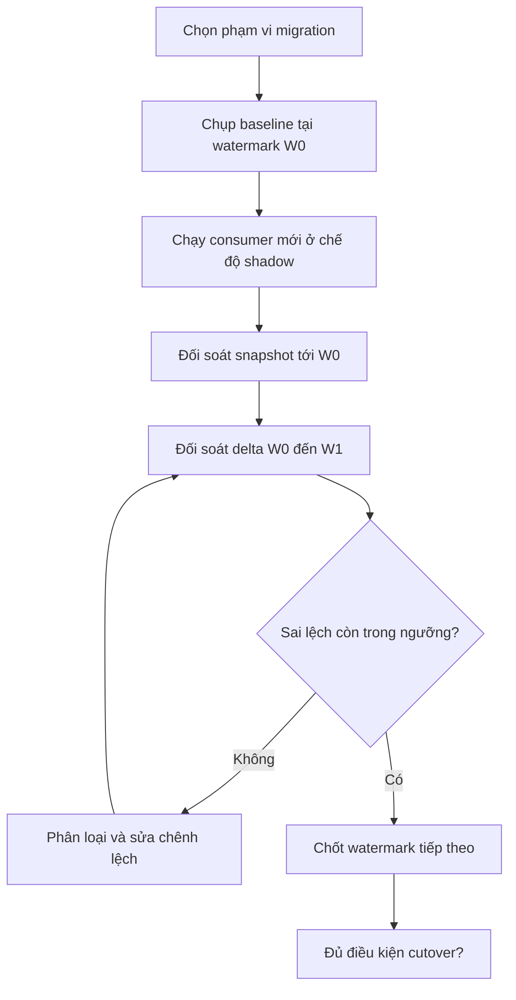
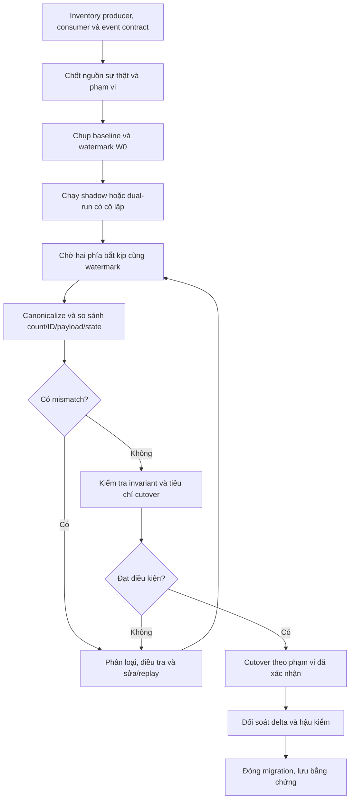

# Đối soát trước và sau

Di trú event thường thay đổi một hoặc nhiều phần của luồng giao tiếp: producer đổi event contract, consumer chuyển sang listener mới, integration event được externalize qua broker khác, hoặc projection được dựng lại từ event history. Sau khi chuyển đổi, chỉ thấy consumer mới chạy thành công chưa đủ để kết luận dữ liệu và hành vi nghiệp vụ vẫn đúng. Cần đối soát trạng thái trước và sau migration để phát hiện event bị thiếu, xử lý trùng, sai thứ tự, thay đổi payload hoặc chênh lệch kết quả nghiệp vụ.

Đối soát trước và sau (before-and-after reconciliation) là quy trình so sánh dữ liệu, event và các invariant nghiệp vụ ở nguồn cũ với kết quả được tạo bởi luồng mới. Quy trình này cần một mốc dữ liệu có thể xác định, cách chuẩn hóa dữ liệu để so sánh, tiêu chí chấp nhận chênh lệch và cách xử lý các bản ghi không khớp. Trong Spring Modulith, application events giúp các module phối hợp và Event Publication Registry theo dõi publication tới listener; registry hỗ trợ độ tin cậy của giao event nhưng không tự thực hiện đối soát dữ liệu giữa hai phiên bản.

## Mục tiêu

Sau bài này, bạn có thể:

- Xác định nguồn dữ liệu có thẩm quyền và phạm vi cần đối soát trước migration.
- Chụp baseline nhất quán và xác định watermark để so sánh trong lúc hệ thống vẫn hoạt động.
- Chạy shadow consumer hoặc dual-run mà không tạo side effect nghiệp vụ trùng.
- So sánh event count, event ID, payload và kết quả nghiệp vụ theo partition.
- Chuẩn hóa dữ liệu trước khi tính checksum hoặc so sánh chi tiết.
- Phân loại chênh lệch, xử lý thiếu/trùng/sai thứ tự và theo dõi kết quả sửa lỗi.
- Đặt điều kiện cutover, rollback và kết thúc giai đoạn migration.
- Kết hợp đối soát với Event Publication Registry, inbox/idempotency và observability.

## 1. Đối soát để chứng minh điều gì?

Một migration event có thể hoàn tất ở mức hạ tầng nhưng chưa đúng ở mức nghiệp vụ. Broker mới nhận đủ message không có nghĩa consumer mới đã tạo đúng projection. Consumer mới deserialize được payload không có nghĩa mọi event cũ đều được chuyển đổi đúng. Số event ở hai phía bằng nhau cũng không chứng minh hai tập event chứa cùng định danh và cùng ý nghĩa.

Đối soát cần trả lời ít nhất bốn câu hỏi:

1. **Độ bao phủ:** mọi event hoặc aggregate thuộc phạm vi migration có được xử lý ở luồng mới không?
2. **Tính duy nhất:** event có bị bỏ sót hoặc áp dụng nhiều lần không?
3. **Tính tương đương:** dữ liệu và trạng thái nghiệp vụ sau xử lý có tương đương với kết quả mong đợi không?
4. **Khả năng truy vết:** mỗi chênh lệch có thể liên kết tới event ID, aggregate, consumer, phiên bản schema và lần xử lý cụ thể không?

Ví dụ, hệ thống chuyển consumer `OrderProjectionV1` sang `OrderProjectionV2`. Cả hai consumer có thể nhận 10.000 event, nhưng V2 bỏ sót một event cập nhật địa chỉ và áp dụng hai lần một event hoàn tiền. Count vẫn bằng nhau nếu có một event khác bị trùng thay cho event bị thiếu. Vì vậy, đối soát theo count phải đi cùng kiểm tra tập ID và invariant nghiệp vụ.

## 2. Chọn nguồn sự thật và phạm vi so sánh

Trước khi so sánh, cần xác định dữ liệu nào là nguồn có thẩm quyền. Trong một quy trình event-driven, có thể có nhiều bản sao: aggregate trong database, event store, broker log, projection và bảng trạng thái của consumer. Không phải bản sao nào cũng là nguồn sự thật.

| Đối tượng | Nguồn đối chiếu có thể dùng | Câu hỏi |
|---|---|---|
| Event đã phát | Event store, outbox hoặc log nguồn có định danh ổn định | Producer đã tạo những event nào? |
| Event đã giao | Broker offset/queue metadata và consumer inbox | Consumer đã nhận event nào? |
| Publication nội bộ | Event Publication Registry | Listener nào đã hoàn tất hoặc còn incomplete? |
| Projection | Bảng projection cũ và mới tại cùng watermark | Hai cách xử lý tạo cùng trạng thái không? |
| Nghiệp vụ tài chính/kho | Ledger hoặc aggregate có thẩm quyền | Tổng tiền, số lượng và trạng thái có bảo toàn không? |

Đừng dùng projection cũ làm nguồn chân lý nếu projection đó vốn có lỗi hoặc đã stale. Hãy đối chiếu cả hai kết quả với nguồn dữ liệu có thẩm quyền hoặc invariant được nghiệp vụ chấp nhận. Nếu không có nguồn lịch sử đầy đủ, cần ghi rõ giới hạn và xác định phần nào chỉ có thể đối soát theo snapshot hiện tại.

Phạm vi nên được xác định cụ thể: event type nào, tenant nào, khoảng thời gian nào, aggregate nào, schema version nào và consumer nào. Tránh chạy một phép so sánh toàn hệ thống không có partition; khi phát hiện lệch sẽ khó khoanh vùng và sửa chữa.

## 3. Lập baseline trước migration

Baseline là ảnh chụp trạng thái trước khi luồng mới bắt đầu tạo kết quả. Nó cung cấp mốc để so sánh sau migration. Một baseline tốt cần có thời điểm hoặc watermark rõ ràng, định danh phạm vi và phương pháp tái tạo.

Thông tin baseline thường gồm:

- `migrationId`: định danh một đợt migration.
- `scope`: event type, tenant, partition hoặc tập aggregate thuộc phạm vi.
- `capturedAt`: thời điểm tạo baseline.
- `sourceWatermark`: sequence, event offset hoặc high-water mark tại nguồn.
- `schemaVersion`: phiên bản contract được dùng để đọc dữ liệu.
- `recordCount`: số event/aggregate trong phạm vi.
- `digest`: checksum hoặc hash tổng hợp trên dữ liệu đã chuẩn hóa.
- `status`: trạng thái snapshot và thời điểm hoàn tất.

Ví dụ bản ghi kiểm soát migration:

```text
MigrationCheckpoint
  migrationId
  scopeKey
  sourceWatermark
  baselineCapturedAt
  baselineCount
  baselineDigest
  targetWatermark
  targetCount
  targetDigest
  reconciliationStatus
  mismatchCount
  updatedAt
```

Không chụp baseline bằng nhiều truy vấn rời rạc trong khi dữ liệu vẫn thay đổi mà không có transaction snapshot hoặc watermark. Nếu phần đầu snapshot được đọc lúc 10:00 và phần cuối lúc 10:05, hai phần có thể phản ánh hai thời điểm khác nhau. Dùng snapshot isolation, consistent read, event sequence hoặc cơ chế CDC để định nghĩa một điểm cắt có thể lặp lại.

## 4. Watermark khi hệ thống vẫn nhận event

Trong migration chạy song song với production traffic, dữ liệu vẫn tiếp tục thay đổi. Chỉ so sánh hai bảng tại cùng thời điểm đồng hồ không đảm bảo chúng phản ánh cùng một tập event, vì hai consumer có độ trễ khác nhau.

Watermark là mốc xác định phạm vi event đã được tạo hoặc xử lý. Tùy hệ thống, watermark có thể là:

- Sequence tăng đơn điệu của aggregate hoặc event store.
- Kafka partition offset đã được ghi nhận.
- ID outbox lớn nhất đã commit tại thời điểm snapshot.
- CDC log position hoặc transaction log sequence number.
- Timestamp kết hợp với một định danh thứ tự ổn định nếu nguồn không có sequence.

Ưu tiên sequence/offset có thứ tự rõ ràng hơn timestamp đơn thuần. Đồng hồ giữa các instance có thể lệch; nhiều event có thể cùng timestamp; event được retry có thể tới consumer sau event mới hơn.

Một cách tổ chức là chốt watermark `W0`, sau đó đối soát mọi event có sequence không vượt quá `W0`. Những event mới hơn được xử lý như luồng delta. Khi consumer mới đã bắt kịp tới watermark mới `W1`, chốt một khoảng delta tiếp theo và tiếp tục so sánh. Nhờ đó, migration không cần dừng toàn bộ producer trong thời gian dài.



Watermark chỉ có ý nghĩa nếu mọi event trong phạm vi có thể được liên kết tới sequence/offset tương ứng. Nếu event được tạo bởi nhiều producer không có thứ tự toàn cục, hãy dùng watermark theo partition hoặc theo aggregate thay vì tự tạo một số thứ tự toàn hệ thống không tồn tại.

## 5. Chọn chiến lược migration có thể đối soát

Một số chiến lược thường dùng:

| Chiến lược | Cách hoạt động | Điểm cần đối soát |
|---|---|---|
| Shadow consumer | Consumer mới đọc bản sao event nhưng không tạo side effect bên ngoài | So sánh projection/kết quả tính toán với consumer cũ |
| Dual publish | Producer phát cả contract cũ và mới | So sánh event ID, payload mapping và số lượng hai luồng |
| Dual consume | Hai consumer xử lý cùng nguồn event | So sánh trạng thái đầu ra và kiểm soát side effect trùng |
| Replay | Phát lại event history vào consumer mới | So sánh kết quả dựng lại với baseline hoặc nguồn sự thật |
| Cutover theo partition | Chuyển từng tenant/partition/aggregate sang luồng mới | Đối soát riêng từng partition trước khi chuyển tiếp |

Shadow consumer thường là lựa chọn an toàn để đánh giá logic mới, vì nó có thể tính kết quả nhưng không gửi email, thu tiền, giải phóng hàng hoặc gọi hệ thống ngoài. Nếu shadow consumer ghi projection riêng, dùng database/schema riêng hoặc namespace riêng để tránh ghi đè dữ liệu production.

Dual publish có thể giúp consumer cũ và mới cùng tồn tại, nhưng producer không nên thực hiện hai lần ghi độc lập mà không có cơ chế bảo vệ. Nếu ghi event cũ thành công nhưng event mới thất bại, hai luồng sẽ lệch. Transactional outbox hoặc một transaction chung cho dữ liệu nguồn và hai publication có thể giúp đảm bảo hai bản ghi được tạo nguyên tử trong phạm vi database hỗ trợ.

Dual consume không đồng nghĩa hai consumer được phép thực hiện cùng side effect. Nếu cả hai cùng gửi thông báo hoặc gọi payment provider, người dùng có thể nhận hai thông báo hoặc bị thu tiền hai lần. Trong giai đoạn shadow, tắt side effect hoặc dùng idempotency key có phạm vi rõ ràng.

## 6. Chuẩn hóa trước khi so sánh

Hai payload có thể biểu diễn cùng một dữ liệu nhưng khác byte do thứ tự JSON field, format timestamp, scale decimal hoặc cách biểu diễn null. Nếu so sánh hash trực tiếp trên raw payload, có thể tạo false positive. Ngược lại, chuẩn hóa quá mạnh có thể che giấu khác biệt nghiệp vụ thật.

Hãy định nghĩa canonical representation cho từng loại event hoặc aggregate:

- Sắp xếp field và collection theo quy tắc ổn định nếu thứ tự không mang ý nghĩa.
- Chuẩn hóa timestamp về UTC và một precision thống nhất.
- Chuẩn hóa decimal theo scale/currency đã quy định; không dùng floating-point cho số tiền.
- Phân biệt field vắng mặt, `null`, giá trị mặc định và chuỗi rỗng nếu contract xem chúng khác nhau.
- Chuẩn hóa enum alias hoặc mã trạng thái chỉ khi chúng thực sự tương đương.
- Loại khỏi phép so sánh các field vận hành không có ý nghĩa nghiệp vụ như `processedAt`, host name hoặc trace ID.
- Giữ lại event ID, aggregate ID, sequence và schema version trong báo cáo đối soát.

Ví dụ hai event có `occurredAt` lần lượt là `2026-11-25T10:00:00Z` và `2026-11-25T17:00:00+07:00` biểu diễn cùng một thời điểm. Có thể chuẩn hóa về instant UTC trước khi so sánh. Nhưng không được bỏ qua `currency` chỉ vì giá trị `amount` bằng nhau.

Canonicalization phải là quy tắc có phiên bản. Nếu thay đổi quy tắc chuẩn hóa trong lúc migration, các digest cũ và mới có thể không còn so sánh trực tiếp được. Lưu `canonicalizationVersion` cùng baseline và digest.

## 7. Đối soát theo nhiều cấp độ

Không nên bắt đầu bằng so sánh từng payload của toàn bộ dữ liệu lớn. Hãy chạy từ cấp tổng hợp tới cấp chi tiết để khoanh vùng hiệu quả.

| Cấp độ | Phép kiểm tra | Phát hiện |
|---|---|---|
| Tổng quan | Count event, count aggregate, tổng số theo event type | Thiếu hoặc tăng bất thường ở quy mô lớn |
| Partition/tenant | Count và digest theo tenant, partition, ngày hoặc loại event | Khoanh vùng nhóm dữ liệu lệch |
| Định danh | So sánh tập event ID và aggregate ID | Event thiếu, event thừa, duplicate |
| Payload | So sánh canonical payload hoặc field nghiệp vụ | Mapping sai, mất field, đổi đơn vị |
| Trạng thái | So sánh projection và aggregate state tại cùng watermark | Consumer tạo kết quả khác |
| Invariant | Tổng tiền, số lượng, số dư, trạng thái cuối | Phát hiện lỗi nghiệp vụ dù payload có vẻ hợp lệ |

Ví dụ, số event theo ngày bằng nhau nhưng số đơn hàng `COMPLETED` khác nhau. Khi đó cần so sánh theo order ID và trạng thái. Một migration có thể tạo đúng số event nhưng gán nhầm event vào tenant khác; tổng count toàn hệ thống vẫn bằng nhau. Vì vậy, đối soát cần partition theo những chiều có ý nghĩa như tenant, event type và aggregate.

## 8. Kiểm tra event thiếu, trùng và sai thứ tự

Event ID ổn định là chìa khóa để so sánh hai luồng. Với cùng một phạm vi và watermark, có thể phân loại:

- **Missing:** có trong nguồn nhưng không có ở đích.
- **Unexpected:** có ở đích nhưng không thuộc nguồn hoặc phạm vi đã chốt.
- **Duplicate:** một event ID được ghi nhận hoặc áp dụng nhiều lần.
- **Payload mismatch:** cùng event ID nhưng nội dung canonical khác nhau.
- **Out of order:** sequence của aggregate được áp dụng sai thứ tự.
- **Late arrival:** event hợp lệ đến sau watermark xử lý dự kiến.

Không gộp `late arrival` với `missing` ngay lập tức. Một event có thể đang nằm trong queue hoặc retry. Hãy so sánh với consumer lag, broker offset, publication status và thời gian xử lý. Chỉ kết luận missing sau khi phạm vi đã qua thời gian chờ và các nguồn giao nhận đã được kiểm tra.

Ví dụ truy vấn đối chiếu event ID ở hai bảng staging:

```sql
SELECT old.event_id, 'MISSING_IN_NEW' AS mismatch_type
FROM old_event_snapshot old
LEFT JOIN new_event_snapshot new
  ON new.event_id = old.event_id
WHERE new.event_id IS NULL

UNION ALL

SELECT new.event_id, 'UNEXPECTED_IN_NEW' AS mismatch_type
FROM new_event_snapshot new
LEFT JOIN old_event_snapshot old
  ON old.event_id = new.event_id
WHERE old.event_id IS NULL;
```

Tên bảng và cú pháp là ví dụ tổng quát; điều chỉnh theo database và cách lưu snapshot của hệ thống. Trước khi so sánh, cả hai tập phải dùng cùng `migrationId`, phạm vi, watermark và quy tắc lọc.

Để phát hiện duplicate, đếm số lần xuất hiện theo event ID:

```sql
SELECT event_id, COUNT(*) AS occurrences
FROM new_event_snapshot
GROUP BY event_id
HAVING COUNT(*) > 1;
```

Nếu cùng event ID xuất hiện nhiều lần nhưng chỉ một lần được áp dụng do inbox/deduplication, hãy phân biệt duplicate delivery với duplicate business effect. Delivery lặp có thể là hành vi bình thường của at-least-once; tác động nghiệp vụ lặp mới là lỗi cần ngăn.

## 9. Đối soát payload và kết quả nghiệp vụ

Khi event ID khớp, tiếp tục so sánh payload đã chuẩn hóa. Có thể tính digest theo từng event hoặc theo nhóm partition để phát hiện nhanh vùng dữ liệu khác nhau. Khi digest khác, lấy danh sách event ID để so sánh từng field và tìm nguyên nhân.

Digest chỉ là công cụ phát hiện chênh lệch. Nó không cho biết field nào sai và không thay thế kiểm tra nghiệp vụ. Với dữ liệu tài chính, cần so sánh tổng tiền theo currency, số giao dịch và trạng thái ledger. Với tồn kho, so sánh quantity theo SKU/warehouse và reservation đang hoạt động. Với order, so sánh trạng thái, line item, tổng tiền và quan hệ với payment/shipment.

Ví dụ invariant cho tồn kho:

```text
availableQuantity
+ reservedQuantity
+ allocatedQuantity
== totalTrackedQuantity
```

Ví dụ invariant cho thanh toán:

```text
capturedAmount - refundedAmount == netSettledAmount
```

Các công thức phải phản ánh đúng mô hình domain thực tế; không áp dụng invariant minh họa nếu hệ thống có trạng thái trung gian, nhiều currency hoặc cách hạch toán khác. Hãy để nghiệp vụ sở hữu định nghĩa invariant và ngưỡng sai lệch được chấp nhận.

## 10. Đối soát khi hai consumer có độ trễ khác nhau

Consumer cũ và mới có thể xử lý cùng event với tốc độ khác nhau. So sánh projection ngay sau khi publish thường tạo ra false mismatch vì một bên chưa bắt kịp. Trước khi so sánh, cần xác định cả hai consumer đã xử lý tới cùng watermark hoặc cùng tập event ID.

Một quy trình:

1. Chọn watermark nguồn `W`.
2. Chờ consumer cũ xử lý tới `W`.
3. Chờ consumer mới xử lý tới `W`.
4. Kiểm tra không còn event thuộc phạm vi `<= W` đang in-flight hoặc retry.
5. Chụp snapshot projection của cả hai consumer.
6. Chuẩn hóa và so sánh snapshot.

Với Kafka, watermark có thể là offset theo từng partition; với queue không có offset toàn cục, có thể dùng event ID và consumer inbox/checkpoint. Với Spring Modulith nội bộ, có thể kết hợp trạng thái publication của listener với checkpoint nghiệp vụ do consumer tự lưu. Không suy ra consumer đã bắt kịp chỉ từ việc không thấy exception trong log.

Nếu listener chạy bất đồng bộ bằng `@ApplicationModuleListener`, thời điểm producer commit không đồng nghĩa listener đã hoàn tất. Event Publication Registry có thể cho biết publication nào chưa hoàn tất khi được cấu hình persistence, nhưng checkpoint nghiệp vụ vẫn cần thể hiện consumer đã áp dụng tới sequence nào.

## 11. Tổ chức shadow run an toàn

Shadow run cho phép consumer mới nhận dữ liệu thật nhưng chỉ tính kết quả để so sánh. Nó không được thực hiện side effect có thể nhìn thấy từ bên ngoài hoặc làm thay đổi nguồn dữ liệu chính.

Các biện pháp cô lập:

- Dùng schema/database hoặc bảng projection riêng cho shadow consumer.
- Tắt gửi email, push notification, payment, shipment và các lệnh có tác động ngoài.
- Không dùng credential production có quyền ghi nếu consumer chỉ cần đọc.
- Gắn `migrationId`, `consumerVersion` và `shadow=true` vào telemetry.
- Giữ cùng input event và cùng watermark khi so sánh.
- Dọn dữ liệu shadow theo chính sách sau khi migration kết thúc.

Nếu consumer mới gọi một module nội bộ có side effect, chỉ mock hoặc thay adapter của side effect đó; không mock logic cần đối soát. Mục tiêu là chạy thật phần mapping và business calculation nhưng cô lập tác động không được phép lặp.

## 12. Xử lý chênh lệch theo quy trình có kiểm soát

Mỗi mismatch cần có mã phân loại, mức độ nghiêm trọng, chủ sở hữu và trạng thái xử lý. Không sửa trực tiếp projection production chỉ để làm hai bảng giống nhau. Trước tiên cần xác định nguồn nào đúng và nguyên nhân chênh lệch.

| Loại chênh lệch | Nguyên nhân có thể | Hướng xử lý |
|---|---|---|
| Missing event | Consumer lag, routing sai, publication lỗi | Kiểm tra queue/registry, replay event thiếu |
| Duplicate delivery | Retry hoặc redelivery bình thường | Xác minh inbox/idempotency; không tạo side effect lặp |
| Duplicate effect | Handler không idempotent hoặc dedupe sai | Dừng luồng liên quan, đối soát tác động và sửa theo quy trình nghiệp vụ |
| Payload mismatch | Mapping/schema conversion sai | Sửa adapter/upcaster và replay có kiểm soát |
| Ordering mismatch | Concurrent listener hoặc thiếu sequence check | Khôi phục thứ tự theo aggregate và tính lại projection |
| Business invariant mismatch | Logic mới khác logic cũ hoặc dữ liệu nguồn sai | Chủ nghiệp vụ quyết định kết quả đúng và cách điều chỉnh |
| Late event | Backlog hoặc retry dài | Cập nhật watermark và chạy lại delta reconciliation |

Một reconciliation record nên lưu `migrationId`, `eventId` hoặc `aggregateId`, mismatch type, old value digest, new value digest, detectedAt, owner, resolution, replay reference và resolvedAt. Không ghi dữ liệu nhạy cảm đầy đủ nếu digest và định danh đủ cho điều tra.

Việc sửa sai nên thực hiện qua command hoặc event bù trừ có audit, idempotency key và kiểm tra quyền. Không cập nhật trực tiếp bảng nội bộ của module khác để ép kết quả khớp; hãy để module sở hữu dữ liệu thực hiện thay đổi qua API hoặc hợp đồng công khai.

## 13. Cutover và rollback dựa trên kết quả đối soát

Cutover là thời điểm chuyển nguồn xử lý chính sang consumer hoặc event contract mới. Không cutover chỉ vì deployment thành công. Cần có tiêu chí định lượng và khoảng thời gian quan sát.

Ví dụ tiêu chí:

- Tất cả partition trong phạm vi đã đối soát tới watermark đã thống nhất.
- Không có missing event chưa giải thích.
- Không có duplicate business effect.
- Các invariant nghiệp vụ quan trọng khớp tuyệt đối hoặc nằm trong tolerance đã được chủ nghiệp vụ phê duyệt.
- Tỷ lệ payload mismatch và lỗi deserialize bằng 0 hoặc nằm trong ngưỡng được chấp nhận có lý do.
- Consumer mới đáp ứng latency, throughput và error-rate mục tiêu.
- Có kế hoạch xử lý backlog cũ và DLQ sau cutover.
- Có thể xác định cách rollback hoặc forward-fix nếu phát hiện sai lệch sau chuyển đổi.

Rollback không phải lúc nào cũng là quay ngược dữ liệu. Nếu consumer mới đã tạo side effect bên ngoài, dừng consumer mới không tự thu hồi tác động. Cần biết event nào đã được áp dụng, checkpoint cuối cùng và side effect nào cần compensation. Trong nhiều trường hợp, forward-fix hoặc replay có kiểm soát an toàn hơn rollback dữ liệu mù quáng.

Khi cutover theo partition, chỉ chuyển partition đã đạt điều kiện. Giữ khả năng quan sát consumer version theo tenant/partition để biết phần nào đang chạy luồng cũ và phần nào đã chuyển sang luồng mới.

## 14. Vai trò của Spring Modulith trong đối soát

Spring Modulith giúp tổ chức application events giữa các module và theo dõi publication tới listener. Một số thành phần có vai trò liên quan:

| Thành phần | Vai trò trong migration/reconciliation |
|---|---|
| `ApplicationEventPublisher` | Phát application event từ module producer |
| `@ApplicationModuleListener` | Xử lý event bất đồng bộ theo semantics module và transaction của Spring Modulith |
| Event Publication Registry | Theo dõi publication tới listener và publication chưa hoàn tất |
| `IncompleteEventPublications` | Tìm và resubmit publication chưa hoàn tất theo chính sách phục hồi |
| Integration DTO/externalization | Giữ contract và mapping tại ranh giới broker |
| Inbox/idempotency store | Theo dõi event đã được consumer áp dụng để chống tác động trùng |
| Reconciliation checkpoint | Theo dõi watermark và kết quả so sánh trước/sau |

Registry không phải audit ledger nghiệp vụ và không tự biết hai projection có tương đương không. Một listener có thể hoàn tất publication nhưng ghi sai dữ liệu; publication status vẫn không thể phát hiện lỗi domain đó. Ngược lại, projection có thể đúng nhưng registry còn publication incomplete do listener khác chưa hoàn tất. Cần kết hợp publication status, checkpoint consumer và invariant nghiệp vụ.

Nếu event được externalize, kiểm tra riêng các chặng: application event đã được tạo, externalizer đã gửi message theo semantics adapter, broker đã nhận, consumer đã áp dụng và kết quả đã được đối soát. Không coi một trạng thái hoàn tất ở chặng trước là bằng chứng chặng sau thành công.

## 15. Ví dụ mô hình checkpoint và kết quả đối soát

Có thể định nghĩa các kiểu dữ liệu ứng dụng để lưu tiến trình:

```java
import java.time.Instant;

public record ReconciliationCheckpoint(
    String migrationId,
    String scopeKey,
    long sourceWatermark,
    long oldConsumerWatermark,
    long newConsumerWatermark,
    Instant capturedAt
) {}

public record ReconciliationResult(
    String migrationId,
    String scopeKey,
    long comparedCount,
    long missingCount,
    long unexpectedCount,
    long duplicateCount,
    long payloadMismatchCount,
    long invariantMismatchCount,
    String status
) {}
```

Các record này là mô hình minh họa do ứng dụng định nghĩa, không phải API dựng sẵn của Spring Modulith. Một service đối soát có thể:

1. Đọc checkpoint đã chốt.
2. Xác nhận old/new consumer đều đã xử lý tới watermark.
3. Lấy dữ liệu theo partition trong cùng phạm vi.
4. Chuẩn hóa dữ liệu theo canonicalization version.
5. Tính count, digest và so sánh event ID.
6. So sánh projection và invariant domain.
7. Lưu kết quả cùng mismatch detail.
8. Chỉ đánh dấu scope `READY_FOR_CUTOVER` khi đạt toàn bộ tiêu chí.

Ví dụ trạng thái migration:

| Trạng thái | Ý nghĩa |
|---|---|
| `BASELINED` | Snapshot nguồn đã được chốt |
| `SHADOW_RUNNING` | Consumer mới đang xử lý bản sao input |
| `RECONCILING` | Đang so sánh theo watermark |
| `MISMATCH_FOUND` | Có chênh lệch chưa được giải quyết |
| `READY_FOR_CUTOVER` | Đạt tiêu chí chuyển đổi |
| `CUTOVER` | Luồng mới là đường xử lý chính |
| `ROLLBACK_REQUIRED` | Phát hiện vấn đề cần quay lại hoặc forward-fix theo kế hoạch |
| `COMPLETED` | Migration và đối soát hậu kiểm đã hoàn tất |

Mọi chuyển trạng thái cần có người hoặc quy trình tự động chịu trách nhiệm, thời điểm, watermark và bằng chứng. Không cho phép một job tự chuyển `MISMATCH_FOUND` sang `READY_FOR_CUTOVER` chỉ vì lần chạy tiếp theo không tìm thấy lỗi trong một phạm vi khác.

## 16. Kiểm thử quy trình đối soát

Kiểm thử nên bao phủ dữ liệu đúng, dữ liệu lệch và tình huống hệ thống thay đổi trong khi đối soát:

| Tình huống | Điều cần xác nhận |
|---|---|
| Hai consumer xử lý cùng event set | Count, ID và canonical payload khớp |
| Thiếu một event ở consumer mới | Mismatch được phân loại `MISSING` |
| Event bị giao hai lần | Duplicate delivery được phân biệt với duplicate effect |
| Cùng event ID nhưng payload khác | Phát hiện payload conflict |
| Consumer mới xử lý chậm | Không kết luận missing trước khi đạt watermark |
| Event đến muộn sau snapshot | Được đưa vào delta reconciliation |
| Sai thứ tự theo aggregate | Sequence/invariant phát hiện trạng thái sai |
| Canonicalization thay đổi | Digest có version và không so sánh sai khác quy tắc |
| Shadow consumer gửi side effect | Test phát hiện hoặc adapter test double ngăn side effect |
| Replay sau khi sửa mapping | Kết quả mới khớp invariant và không tạo tác động trùng |
| Rollback sau cutover một phần | Checkpoint cho biết partition và side effect đã áp dụng |
| Event Publication Registry còn incomplete | Không đánh dấu migration hoàn tất khi publication cần thiết chưa được xử lý |

Trong test, dùng fixture event ID ổn định và watermark cố định. Kiểm thử snapshot/delta bằng dữ liệu thay đổi giữa hai lần chụp. Với consumer bất đồng bộ, chờ checkpoint tiến tới watermark thay vì dùng sleep. Với side effect ngoài, dùng fake adapter để xác nhận shadow mode không phát lệnh thật.

## 17. Quan sát và báo cáo migration

Dashboard migration nên thể hiện cả tiến độ lẫn chất lượng dữ liệu:

- Số event nguồn và đích theo event type, tenant và partition.
- Watermark của producer, old consumer và new consumer.
- Consumer lag và tuổi event chưa xử lý.
- Missing, unexpected, duplicate, payload mismatch và invariant mismatch.
- Tỷ lệ mismatch đã giải quyết và thời gian trung bình để xử lý.
- Số publication incomplete trong Event Publication Registry.
- Số event replay/redrive và số side effect được deduplicate.
- Latency, throughput, error rate và DLQ trong giai đoạn shadow/cutover.
- Consumer version và tỷ lệ traffic đã chuyển sang luồng mới.

Log nên chứa `migrationId`, scope/partition, event ID, aggregate ID, schema version, watermark, consumer version và mismatch type. Không đưa event ID hoặc aggregate ID vào metric label có cardinality cao; giữ chúng trong log/trace hoặc bảng chi tiết để điều tra.

Báo cáo cuối cần ghi rõ phạm vi đã đối soát, watermark cuối, số bản ghi so sánh, số mismatch theo loại, các ngoại lệ được chấp nhận, người phê duyệt và thời điểm cutover. Một con số “100% matched” không đủ nếu không biết tập dữ liệu, cách chuẩn hóa và watermark nào đã được dùng.

## 18. Những lỗi thiết kế thường gặp

| Lỗi | Hệ quả | Cách khắc phục |
|---|---|---|
| Chỉ so sánh tổng số event | Thiếu một event và trùng một event có thể triệt tiêu nhau | So sánh event ID, partition và payload |
| Chụp snapshot không có watermark | Hai phía phản ánh thời điểm khác nhau | Dùng snapshot nhất quán và watermark có thứ tự |
| So sánh raw JSON bytes | False mismatch do serialization khác nhau | Canonicalize theo quy tắc có version |
| Bỏ qua field vì “không quan trọng” | Che giấu khác biệt nghiệp vụ | Chỉ loại field vận hành được định nghĩa rõ |
| Shadow consumer vẫn tạo side effect | Gửi thông báo hoặc thực hiện thanh toán hai lần | Cô lập side effect và quyền truy cập |
| Dual publish bằng hai lần ghi độc lập | Một luồng thành công, luồng kia thất bại | Transactional outbox hoặc transaction chung phù hợp |
| Coi publication registry là reconciliation | Listener hoàn tất nhưng dữ liệu có thể sai | So sánh projection và invariant riêng |
| Sửa trực tiếp bảng module khác | Phá ranh giới và thiếu audit | Dùng API/command của module sở hữu dữ liệu |
| Cutover khi consumer mới chưa bắt kịp | Mất event hoặc sai trạng thái | Chờ watermark và đạt tiêu chí định lượng |
| Rollback mà không kiểm tra side effect | Tác động ngoài vẫn tồn tại hoặc bị lặp | Dùng checkpoint, idempotency và compensation |

## 19. Quy trình đối soát trước và sau



Đối soát trước và sau biến migration thành một quy trình có bằng chứng. Hãy chốt nguồn sự thật, baseline và watermark; chạy luồng mới trong phạm vi có thể cô lập; so sánh event ID, payload đã chuẩn hóa, trạng thái và invariant nghiệp vụ; xử lý từng mismatch có audit; rồi mới cutover. Sau chuyển đổi, tiếp tục đối soát delta và giữ decoder/replay support đủ lâu. Spring Modulith hỗ trợ giao event và theo dõi publication, còn checkpoint, phép so sánh và quyết định chấp nhận chênh lệch phải được thiết kế theo nghiệp vụ của ứng dụng.

## Tài liệu tham khảo

- [Spring Modulith — Working with Application Events](https://docs.spring.io/spring-modulith/reference/events.html)
- [Spring Modulith — Event Publication Registry](https://docs.spring.io/spring-modulith/reference/events.html#_event_publication_registry)
- [Apache Kafka — Message Delivery Semantics](https://kafka.apache.org/documentation/#semantics)
- [Debezium — Outbox Event Router](https://debezium.io/documentation/reference/stable/transformations/outbox-event-router.html)
