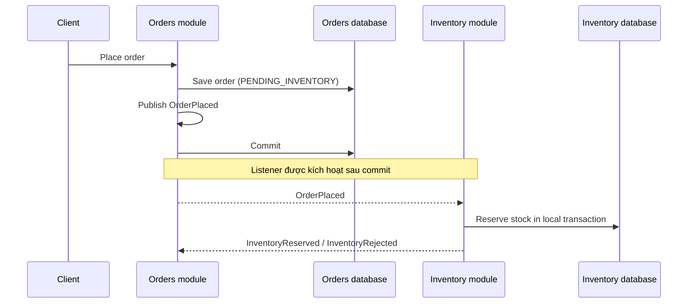
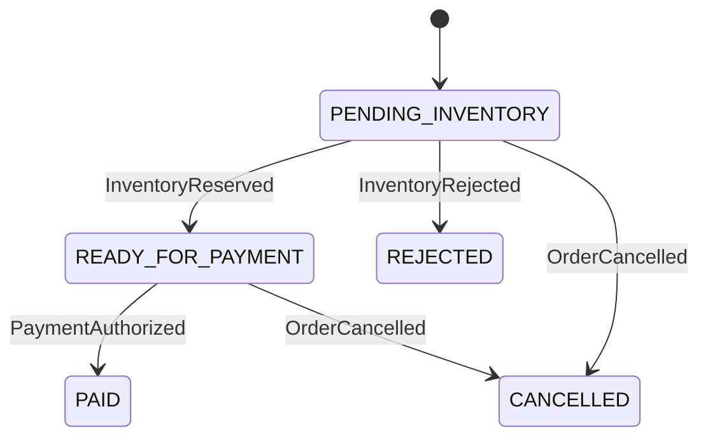

# Ví dụ event

Application event giúp các module trong cùng một ứng dụng Spring Modulith thông báo cho nhau về một sự kiện nghiệp vụ đã xảy ra. Module phát chỉ công bố dữ liệu cần thiết qua event contract; module nhận đăng ký listener và xử lý theo trách nhiệm của mình. Cách giao tiếp này giảm phụ thuộc trực tiếp giữa các module và giúp mỗi module sở hữu dữ liệu, quy tắc nghiệp vụ riêng.

Bài viết xây dựng một ví dụ xuyên suốt: module `orders` tạo đơn hàng và phát `OrderPlaced`; module `inventory` nhận event sau khi transaction tạo đơn commit rồi giữ hàng. Ví dụ minh họa contract, publisher, listener, transaction, idempotency, kiểm thử và các điểm cần quan sát khi vận hành.

## 1. Bài toán và ranh giới module

Giả sử ứng dụng bán hàng có hai module:

- **Orders:** quản lý đơn hàng, dòng hàng, giá và trạng thái đơn.
- **Inventory:** quản lý tồn kho, reservation và quy tắc giữ hàng.

Khi khách đặt hàng, Orders cần thông báo cho Inventory để giữ số lượng tương ứng. Orders không nên truy cập repository hoặc bảng dữ liệu nội bộ của Inventory. Inventory cũng không cần biết cách Orders tạo entity hay tính tổng tiền.

Luồng nghiệp vụ:

1. Orders xác thực yêu cầu và tạo đơn hàng ở trạng thái `PENDING_INVENTORY`.
2. Orders lưu đơn hàng trong transaction và publish `OrderPlaced`.
3. Transaction Orders commit.
4. Listener của Inventory nhận event và yêu cầu giữ hàng trong transaction riêng.
5. Inventory phát `InventoryReserved` hoặc `InventoryRejected` theo kết quả nghiệp vụ.
6. Orders nhận kết quả và chuyển trạng thái đơn hàng phù hợp.



Đơn hàng có thể ở trạng thái chờ trong một khoảng thời gian ngắn. Đây là trạng thái nghiệp vụ được thiết kế để biểu diễn eventual consistency giữa hai module.

## 2. Thiết kế event contract

Event nên mô tả điều đã xảy ra, dùng dữ liệu bất biến và chỉ chứa thông tin cần thiết cho consumer. Ví dụ:

```java
package com.example.orders.events;

import java.math.BigDecimal;
import java.time.Instant;
import java.util.List;
import java.util.UUID;

public record OrderPlaced(
    UUID eventId,
    UUID orderId,
    String orderNumber,
    Instant occurredAt,
    List<OrderLineData> lines
) {
    public OrderPlaced {
        lines = List.copyOf(lines);
    }
}

public record OrderLineData(
    UUID productId,
    int quantity,
    BigDecimal unitPrice
) {}
```

Các trường có mục đích cụ thể:

| Trường | Ý nghĩa |
|---|---|
| `eventId` | Định danh duy nhất của lần phát event; giữ nguyên khi retry hoặc replay |
| `orderId` | Định danh đơn hàng trong module Orders |
| `orderNumber` | Mã đơn có thể dùng trong log hoặc hỗ trợ vận hành |
| `occurredAt` | Thời điểm sự kiện xảy ra theo UTC |
| `lines` | Snapshot dòng hàng mà Inventory cần để giữ tồn |
| `productId` | Định danh sản phẩm do Inventory quản lý |
| `quantity` | Số lượng yêu cầu giữ |
| `unitPrice` | Giá tại thời điểm đặt hàng nếu consumer cần cho nghiệp vụ của mình |

Chỉ đưa `unitPrice` vào event nếu consumer thực sự cần. Inventory thường chỉ cần product ID và quantity; giữ payload nhỏ giúp giảm coupling và tránh công bố dữ liệu không cần thiết.

Không đưa JPA entity, Hibernate proxy, repository, `EntityManager`, HTTP request hoặc `SecurityContext` vào event. Những object này gắn với runtime hoặc persistence lifecycle và có thể kéo theo dữ liệu không thuộc contract. Event là snapshot dữ liệu tại thời điểm nghiệp vụ xảy ra, không phải một tham chiếu tới object có thể tiếp tục thay đổi.

## 3. Tạo event từ domain state

Có thể đặt factory method trong event hoặc mapper ở application layer. Ví dụ factory:

```java
public static OrderPlaced from(Order order, Instant occurredAt) {
    var lines = order.lines().stream()
        .map(line -> new OrderLineData(
            line.productId(),
            line.quantity(),
            line.unitPrice()
        ))
        .toList();

    return new OrderPlaced(
        UUID.randomUUID(),
        order.id(),
        order.number(),
        occurredAt,
        lines
    );
}
```

Đây là phần thân factory minh họa; trong code thực tế, đặt method ở class phù hợp và dùng `Clock` được inject nếu cần kiểm soát thời gian trong test. Nếu event được ghi vào outbox hoặc publication store, event ID phải được tạo một lần và lưu cùng event. Không sinh ID mới mỗi lần dispatcher retry.

## 4. Publish event trong application service

Spring cung cấp `ApplicationEventPublisher` để publish application event. Module Orders gọi publisher sau khi hoàn thành thay đổi domain trong transaction:

```java
package com.example.orders;

import org.springframework.context.ApplicationEventPublisher;
import org.springframework.stereotype.Service;
import org.springframework.transaction.annotation.Transactional;

@Service
class OrderManagement {

    private final OrderRepository orders;
    private final ApplicationEventPublisher events;
    private final Clock clock;

    OrderManagement(
        OrderRepository orders,
        ApplicationEventPublisher events,
        Clock clock
    ) {
        this.orders = orders;
        this.events = events;
        this.clock = clock;
    }

    @Transactional
    public UUID placeOrder(PlaceOrderCommand command) {
        Order order = Order.place(command);
        orders.save(order);

        events.publishEvent(OrderPlaced.from(order, clock.instant()));
        return order.id();
    }
}
```

Các kiểu `Order`, `OrderRepository`, `PlaceOrderCommand` và `Clock` đại diện cho thành phần của ứng dụng. Ví dụ nhấn mạnh transaction boundary: event được publish trong khi transaction tạo đơn còn hoạt động. Việc listener thực sự chạy ở thời điểm nào phụ thuộc loại listener.

`publishEvent()` không tự ghi event vào broker và cũng không tự tạo transaction. Nó gửi event vào application event infrastructure trong cùng application context. Nếu không có listener phù hợp, event không tự động được lưu để xử lý sau này.

## 5. Xử lý sau commit bằng `@TransactionalEventListener`

Nếu listener chỉ được chạy khi transaction nguồn commit, có thể dùng `@TransactionalEventListener`. Phase mặc định là `AFTER_COMMIT`:

```java
@Component
class InventoryOrderListener {

    private final InventoryReservationService reservations;

    InventoryOrderListener(InventoryReservationService reservations) {
        this.reservations = reservations;
    }

    @TransactionalEventListener(phase = TransactionPhase.AFTER_COMMIT)
    void on(OrderPlaced event) {
        reservations.reserve(
            event.eventId(),
            event.orderId(),
            event.lines()
        );
    }
}
```

Khi transaction Orders rollback, listener `AFTER_COMMIT` không được gọi cho transaction đó. Khi commit thành công, listener mới thực hiện phần việc của Inventory.

Listener sau commit không thể rollback transaction nguồn đã commit. Nếu việc giữ hàng thất bại, đơn hàng vẫn đã được tạo; hệ thống cần ghi nhận lỗi và xử lý theo retry hoặc phát kết quả nghiệp vụ phù hợp.

Nếu listener ghi dữ liệu, hãy để service đích mở transaction riêng:

```java
@Service
class InventoryReservationService {

    @Transactional
    public void reserve(
        UUID sourceEventId,
        UUID orderId,
        List<OrderLineData> lines
    ) {
        // Kiểm tra idempotency, kiểm tra tồn và tạo reservation.
    }
}
```

Không dựa vào transaction đã kết thúc của Orders để ghi dữ liệu Inventory. Service Inventory sở hữu transaction và invariant của mình.

## 6. Dùng `@ApplicationModuleListener` trong Spring Modulith

Spring Modulith cung cấp `@ApplicationModuleListener` để biểu diễn listener ở ranh giới module. Annotation này được thiết kế cho xử lý bất đồng bộ và transaction riêng theo semantics của Spring Modulith/Spring Framework tương ứng. Trong các phiên bản phổ biến, nó kết hợp async execution, transactional listener sau commit và propagation `REQUIRES_NEW`.

Ví dụ:

```java
@Component
class InventoryOrderListener {

    private final InventoryReservationService reservations;

    InventoryOrderListener(InventoryReservationService reservations) {
        this.reservations = reservations;
    }

    @ApplicationModuleListener
    void on(OrderPlaced event) {
        reservations.reserve(
            event.eventId(),
            event.orderId(),
            event.lines()
        );
    }
}
```

Chọn một cách khai báo listener phù hợp với yêu cầu. Không đặt đồng thời `@TransactionalEventListener` và `@ApplicationModuleListener` lên cùng một method nếu chưa hiểu rõ meta-annotation và semantics của phiên bản đang dùng. Cần cấu hình executor, transaction manager và persistence implementation phù hợp.

Với listener bất đồng bộ, caller không chờ xử lý xong và không nhận exception trực tiếp như lời gọi đồng bộ. Nếu cần độ tin cậy qua restart, hãy cấu hình Event Publication Registry persistence phù hợp và thiết kế listener idempotent.

## 7. Giữ idempotency cho consumer

Event có thể được giao lại sau retry, restart hoặc lỗi acknowledgement. Inventory cần tránh tạo hai reservation cho cùng một event. Có thể lưu event ID đã xử lý trong Inbox hoặc dùng unique business key phù hợp.

Một interface repository minh họa:

```java
public interface ProcessedEventRepository {
    boolean insertIfAbsent(String consumerName, UUID eventId);
}
```

`insertIfAbsent` cần được triển khai bằng unique constraint và thao tác database nguyên tử. Không chỉ dùng `existsByEventId()` rồi `save()` mà không có constraint, vì hai worker đồng thời có thể cùng vượt qua bước kiểm tra.

Trong transaction Inventory:

1. Thử insert `(consumerName, eventId)` vào Inbox.
2. Nếu đã tồn tại, kết thúc như một duplicate đã xử lý.
3. Nếu insert thành công, kiểm tra tồn kho và tạo reservation.
4. Commit Inbox cùng reservation trong một transaction.

Nếu reservation thất bại và transaction rollback, Inbox cũng rollback. Event có thể được thử lại. Nếu transaction đã commit nhưng message bị giao lại, Inbox ngăn tác động nghiệp vụ lặp.

Đối với hai event khác nhau có payload giống nhau, Inventory vẫn phải xử lý theo quy tắc nghiệp vụ. Không dùng hash payload làm định danh duy nhất của event.

## 8. Phát event kết quả từ module Inventory

Sau khi giữ hàng, Inventory có thể phát một event kết quả. Ví dụ:

```java
public record InventoryReserved(
    UUID eventId,
    UUID sourceEventId,
    UUID orderId,
    UUID reservationId,
    Instant occurredAt
) {}

public record InventoryRejected(
    UUID eventId,
    UUID sourceEventId,
    UUID orderId,
    String reasonCode,
    Instant occurredAt
) {}
```

`sourceEventId` liên kết kết quả với `OrderPlaced` ban đầu. `eventId` của kết quả là ID riêng vì đây là một event mới. `reasonCode` nên là mã nghiệp vụ ổn định như `INSUFFICIENT_STOCK`, không phải exception message tùy ý.

Service Inventory có thể publish kết quả sau khi cập nhật trạng thái:

```java
@Transactional
public void reserve(UUID sourceEventId, UUID orderId, List<OrderLineData> lines) {
    // Idempotency và kiểm tra tồn kho được thực hiện trong transaction.

    Reservation reservation = inventory.reserve(orderId, lines);
    reservations.save(reservation);

    events.publishEvent(new InventoryReserved(
        UUID.randomUUID(),
        sourceEventId,
        orderId,
        reservation.id(),
        clock.instant()
    ));
}
```

Nếu cần listener nhận kết quả chỉ sau khi transaction Inventory commit, listener nhận `InventoryReserved` nên dùng `@TransactionalEventListener(AFTER_COMMIT)` hoặc `@ApplicationModuleListener` phù hợp. Với hệ thống yêu cầu publication bền vững, cần cấu hình registry/outbox để không mất event giữa commit và dispatch.

## 9. Orders nhận kết quả và cập nhật trạng thái

Module Orders sở hữu trạng thái đơn hàng. Nó nhận event kết quả và chuyển trạng thái theo transition hợp lệ:

```java
@Component
class InventoryResultListener {

    private final OrderResultService results;

    InventoryResultListener(OrderResultService results) {
        this.results = results;
    }

    @ApplicationModuleListener
    void on(InventoryReserved event) {
        results.markInventoryReserved(
            event.sourceEventId(),
            event.orderId(),
            event.reservationId()
        );
    }

    @ApplicationModuleListener
    void on(InventoryRejected event) {
        results.rejectForInventory(
            event.sourceEventId(),
            event.orderId(),
            event.reasonCode()
        );
    }
}
```

Service `OrderResultService` cần kiểm tra trạng thái hiện tại và idempotency. Ví dụ, một đơn đã `CANCELLED` không nên chuyển ngược sang `READY_FOR_PAYMENT` chỉ vì event `InventoryReserved` đến muộn. Nếu event bị duplicate, trạng thái không được thay đổi hoặc tạo side effect lần nữa.

## 10. Sơ đồ trạng thái của đơn hàng

Event-driven workflow cần thể hiện trạng thái trung gian:



Không giả định mọi event đến đúng thứ tự hoặc chỉ một lần. State transition cần từ chối event không hợp lệ, xử lý event stale theo policy và ghi nhận trường hợp cần đối soát.

## 11. Kiểm thử event được phát

Spring Modulith cung cấp test support để kiểm tra event giữa các module. `@ApplicationModuleTest` dựng test context theo module; `Scenario` giúp kích hoạt hành động và chờ event bất đồng bộ mà không cần `Thread.sleep()`.

```java
@ApplicationModuleTest
class OrdersEventTests {

    @Autowired
    Scenario scenario;

    @Autowired
    OrderManagement orders;

    @Test
    void publishesOrderPlaced() {
        UUID orderId = UUID.randomUUID();
        PlaceOrderCommand command = TestCommands.placeOrder(orderId);

        scenario.stimulate(() -> orders.placeOrder(command))
            .andWaitForEventOfType(OrderPlaced.class)
            .matching(event -> event.orderId().equals(orderId))
            .toArrive();
    }
}
```

Ví dụ minh họa Scenario API của Spring Modulith; kiểu command và cách tạo đơn cần khớp ứng dụng. Có thể bổ sung assertion cho event ID, timestamp, số dòng hàng và các field contract khác. `Scenario` hữu ích khi cần chờ event do listener bất đồng bộ phát ra.

## 12. Kiểm thử transaction commit và rollback

Vì event được publish trong transaction nhưng listener `AFTER_COMMIT` chỉ chạy sau commit, cần kiểm thử cả hai nhánh:

| Tình huống | Kết quả mong đợi |
|---|---|
| Transaction Orders commit | Inventory listener được kích hoạt |
| Transaction Orders rollback | Listener sau commit không chạy |
| Inventory xử lý thành công | Reservation và Inbox cùng commit |
| Inventory xử lý thất bại | Reservation và Inbox cùng rollback nếu chưa hoàn tất |
| Event kết quả được phát | Orders nhận sau commit Inventory |
| Listener Orders lỗi | Publication failure được quan sát và có thể phục hồi theo cấu hình |

Test rollback cần chủ động rollback transaction nguồn và xác minh không có reservation. Chú ý: test method có `@Transactional` mặc định rollback khi kết thúc có thể khiến listener `AFTER_COMMIT` không chạy. Khi kiểm tra nhánh commit, hãy commit transaction test một cách chủ động hoặc gọi use case trong transaction riêng.

## 13. Kiểm thử module boundary

Event contract nên nằm trong API package mà module Orders công bố. Inventory chỉ phụ thuộc vào event contract đó, không import entity hoặc repository nội bộ của Orders.

Spring Modulith có thể kiểm tra cấu trúc module:

```java
class ModularityTests {

    @Test
    void moduleDependenciesAreValid() {
        ApplicationModules.of(Application.class).verify();
    }
}
```

Test này xác minh dependency theo module structure được Spring Modulith nhận diện. Nó không thay thế kiểm thử semantics hoặc serialization của event. Nên kết hợp architecture test với unit/integration test cho contract.

## 14. Event Publication Registry và phục hồi

Event Publication Registry theo dõi publication của application event tới listener được quản lý. Với persistence implementation phù hợp, registry ghi lại publication và trạng thái hoàn tất để ứng dụng nhận diện publication chưa xử lý xong.

Trong ví dụ, cần kiểm tra:

- `OrderPlaced` được ghi nhận cho listener Inventory theo cấu hình registry.
- Listener thành công khiến publication được đánh dấu hoàn tất.
- Listener thất bại không bị đánh dấu hoàn tất nhầm.
- Publication incomplete có thể được phục hồi theo API được hỗ trợ.
- Khi listener được gọi lại, Inbox ngăn reservation lặp.

Registry không thay thế idempotency của consumer và không tự tạo transaction phân tán giữa Orders và Inventory. Nó theo dõi publication; mỗi listener vẫn thực hiện transaction cục bộ của module nhận.

Không cập nhật trực tiếp bảng nội bộ của registry để xử lý publication lỗi. Dùng API recovery/resubmission phù hợp với phiên bản Spring Modulith đang sử dụng.

## 15. Khi nào cần Outbox hoặc externalization?

Ví dụ trên dùng application event trong cùng ứng dụng. Nếu cần gửi event tới broker ngoài, cần thêm externalization adapter hoặc outbox tùy yêu cầu độ tin cậy.

Transactional outbox ghi event intent cùng transaction với thay đổi Orders. Dispatcher gửi event tới broker sau commit. Nếu process dừng sau commit, outbox vẫn giữ event để gửi lại. Nếu broker đã nhận nhưng confirm bị mất, dispatcher có thể gửi lại; consumer vẫn cần idempotency.

Không nhầm Event Publication Registry với outbox:

| Cơ chế | Vai trò |
|---|---|
| Application event | Giao tiếp trong application context |
| Event Publication Registry | Theo dõi publication tới listener Spring Modulith |
| Outbox | Lưu intent gửi event/message bền vững cùng transaction nghiệp vụ |
| Broker | Vận chuyển message giữa các process/service |

Chọn cơ chế theo topology thực tế. Không cần thêm broker nếu các module chỉ cần giao tiếp trong cùng modular monolith và yêu cầu vận hành được đáp ứng bởi application event cùng registry.

## 16. Logging và observability

Log nên mang đủ định danh để truy vết một luồng:

- `eventId` của event hiện tại.
- `sourceEventId` hoặc `causationId` để liên kết event nguồn.
- `orderId` và `reservationId`.
- Tên module/listener và kết quả xử lý.
- `correlationId` nếu có.
- Thời điểm event xảy ra và thời điểm listener hoàn tất.

Metric hữu ích gồm số event theo type, listener processing duration, số publication incomplete, số retry, duplicate count và thời gian từ `occurredAt` tới khi trạng thái đơn được cập nhật.

Không log toàn bộ payload nếu có dữ liệu cá nhân hoặc dữ liệu nhạy cảm. Không dùng `orderId` hay `eventId` làm metric label có cardinality cao; dùng log/trace cho định danh cụ thể và metric label cho event type, listener hoặc outcome có tập giá trị giới hạn.

## 17. Các lỗi thường gặp

- **Publish trước khi lưu thay đổi:** listener có thể quan sát event cho transaction sau đó rollback.
- **Dùng entity làm payload:** kéo theo lazy loading, vòng tham chiếu và coupling persistence.
- **Coi publish là đã xử lý:** `publishEvent()` không chứng minh listener hoàn tất.
- **Nuốt exception trong listener:** publication có thể bị coi là hoàn tất dù nghiệp vụ chưa xong.
- **Không có idempotency:** retry hoặc redelivery tạo reservation lặp.
- **Dùng transaction chung xuyên module tùy tiện:** làm mờ quyền sở hữu invariant.
- **Không biểu diễn trạng thái chờ:** API báo đơn hoàn tất trước khi tồn kho được giữ.
- **Dựa vào event async để trả kết quả đồng bộ:** caller không thể biết listener đã xong hay chưa.
- **Không kiểm thử rollback:** event hoặc listener chạy sai phase mà không bị phát hiện.
- **Không quan sát publication incomplete:** lỗi listener có thể tồn tại lâu mà không ai biết.

## 18. Checklist triển khai một event

- [ ] Event mô tả một sự kiện nghiệp vụ đã xảy ra.
- [ ] Contract bất biến, nhỏ và không chứa entity/runtime object.
- [ ] Có event ID ổn định, timestamp và business ID cần thiết.
- [ ] Module phát sở hữu dữ liệu và invariant nguồn.
- [ ] Event được publish trong transaction phù hợp.
- [ ] Listener chạy đúng phase: đồng bộ, `AFTER_COMMIT` hoặc module listener bất đồng bộ.
- [ ] Module nhận sở hữu transaction và invariant của mình.
- [ ] Consumer idempotent với duplicate delivery.
- [ ] Kết quả nghiệp vụ được biểu diễn bằng event riêng.
- [ ] State machine xử lý event stale/duplicate đúng cách.
- [ ] Module boundary được kiểm tra bằng architecture test.
- [ ] Commit, rollback, async listener và publication recovery được kiểm thử.
- [ ] Có log, metric và cảnh báo cho lỗi xử lý event.
- [ ] Outbox/externalization được bổ sung khi cần giao tiếp qua process/broker.

Ví dụ `OrderPlaced` cho thấy cách một module công bố thay đổi nghiệp vụ và module khác phản ứng mà không truy cập dữ liệu nội bộ của nhau. Trong Spring Modulith, event contract rõ ràng, publish trong transaction, listener sau commit, transaction cục bộ và idempotency tạo nên một luồng giao tiếp dễ kiểm thử và phục hồi. Khi cần mở rộng ra broker, có thể bổ sung externalization hoặc outbox mà vẫn giữ nguyên semantics của event nghiệp vụ.
