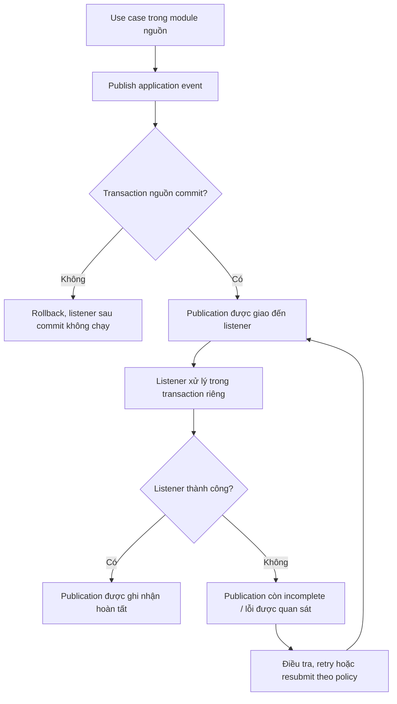

# Tài liệu vận hành

Tài liệu vận hành mô tả cách theo dõi, xử lý sự cố và duy trì luồng application events trong một ứng dụng Spring Modulith. Mục tiêu là giúp người trực vận hành xác định event đang ở chặng nào, module nào chịu trách nhiệm, dữ liệu nào đã commit, publication nào chưa hoàn tất và cách phục hồi an toàn khi listener hoặc broker gặp lỗi.

Trong Spring Modulith, application events là hợp đồng giao tiếp giữa các module. `@ApplicationModuleListener` hỗ trợ xử lý bất đồng bộ sau commit; Event Publication Registry theo dõi publication đến transactional listener và giúp phát hiện publication chưa hoàn tất. Với event được externalize, broker và consumer tạo thêm các chặng vận hành riêng. Một runbook tốt phải phân biệt các chặng này, có chủ sở hữu rõ ràng, metric/alert đủ dùng và quy trình phục hồi có idempotency.

## 1. Phạm vi và nguyên tắc vận hành

Runbook này áp dụng cho các luồng event trong module Spring Modulith, bao gồm:

- Publisher phát application event sau khi nghiệp vụ thay đổi.
- Listener nội bộ xử lý event trong cùng ứng dụng.
- `@ApplicationModuleListener` xử lý bất đồng bộ sau commit.
- Event Publication Registry theo dõi trạng thái publication.
- Adapter externalization chuyển event sang broker hoặc hệ thống khác.
- Retry, resubmit, dead-letter và replay theo cơ chế ứng dụng/hạ tầng.
- Projection/read model được cập nhật từ event.

Các nguyên tắc vận hành:

1. Xác định rõ event, publisher, listener và chủ sở hữu nghiệp vụ trước khi thay đổi trạng thái.
2. Phân biệt transaction nguồn, transaction listener và acknowledgement của broker.
3. Chỉ retry lỗi có khả năng phục hồi; retry phải có giới hạn và backoff.
4. Giả định event có thể được giao lặp; consumer phải idempotent.
5. Không sửa trực tiếp bảng nội bộ của Event Publication Registry hoặc broker để ép trạng thái.
6. Không chạy replay diện rộng khi chưa xác định phạm vi, checkpoint và side effect.
7. Giữ payload nhạy cảm ngoài log, dashboard, ticket và lệnh vận hành.

## 2. Bản đồ vận hành của một event

Một event nội bộ thường đi qua các bước sau:



Với event externalized, sau bước publish nội bộ còn có adapter, broker, consumer group, acknowledgement/offset và DLQ. Hãy vẽ sơ đồ riêng cho từng luồng quan trọng để xác định ranh giới trách nhiệm và điểm quan sát.

| Chặng | Thành phần chịu trách nhiệm | Bằng chứng vận hành |
| --- | --- | --- |
| Tạo sự kiện | Use case/module nguồn | Log nghiệp vụ, event ID, transaction outcome |
| Publish nội bộ | Spring application event publisher | Event type, publisher, correlation ID |
| Sau commit | Transaction lifecycle | Commit/rollback của transaction nguồn |
| Giao listener | Spring Modulith / listener infrastructure | Publication state, listener identity |
| Xử lý listener | Module nhận | Log, processing timer, transaction outcome |
| Lưu publication state | Event Publication Registry | Incomplete/completed qua API được hỗ trợ |
| Externalization | Adapter và broker | Publish confirmation, topic/queue, broker metrics |
| Consumer ngoài | Consumer service | Consumer lag, acknowledgement/offset, DLQ |

Không dùng một chỉ số duy nhất để kết luận toàn bộ luồng thành công. Ví dụ, publisher đã phát event không có nghĩa listener đã commit; publication nội bộ hoàn tất cũng không chứng minh hệ thống ngoài đã xử lý message nếu externalization là một chặng riêng.

## 3. Danh mục event và ownership

Mỗi event quan trọng cần có một mục trong event catalog hoặc tài liệu vận hành của module. Tối thiểu ghi nhận:

| Trường | Nội dung cần có |
| --- | --- |
| Event type | Tên hợp đồng ổn định và schema version |
| Business meaning | Điều gì đã xảy ra và điều kiện phát event |
| Publisher | Module/use case sở hữu sự kiện |
| Consumers | Listener nội bộ và hệ thống ngoài nhận event |
| Data owner | Module chịu trách nhiệm về dữ liệu nguồn |
| Delivery mode | Đồng bộ, sau commit, bất đồng bộ hoặc qua broker |
| Transaction | Transaction manager/resource và phase liên quan |
| Idempotency | Event ID, inbox key, aggregate version hoặc business key |
| Retry policy | Nhóm lỗi retry, số lần, backoff, exhaustion path |
| Retention | Registry, broker, retry, DLQ và archive |
| SLO | Độ trễ xử lý và thời gian publication tối đa được phép tồn tại |
| Runbook owner | Nhóm chịu trách nhiệm điều tra và quyết định phục hồi |

Một event không có owner hoặc không xác định được consumer đích sẽ khó được phục hồi an toàn. Khi thay đổi listener, topic hoặc schema, cập nhật catalog cùng release để người trực không phải suy đoán từ tên class hoặc tên queue.

## 4. Các trạng thái cần phân biệt

Trong dashboard và khi điều tra, dùng các trạng thái có ý nghĩa rõ:

| Trạng thái | Diễn giải | Hành động tiếp theo |
| --- | --- | --- |
| Published | Publisher đã phát event trong ứng dụng. | Kiểm tra transaction nguồn và listener tương ứng. |
| Source committed | Transaction nghiệp vụ nguồn đã commit. | Xác nhận listener sau commit được kích hoạt. |
| Incomplete publication | Registry chưa ghi nhận listener hoàn tất. | Xem listener lỗi, process restart và khả năng phục hồi. |
| Listener completed | Listener đã hoàn tất theo registry. | Kiểm tra kết quả nghiệp vụ nếu cần đối soát. |
| Retry scheduled | Retry policy đã lưu quyết định thử lại. | Theo dõi thời điểm đến hạn và queue retry. |
| Retry exhausted | Không còn retry tự động theo policy. | Phân loại lỗi và chuyển sang quy trình can thiệp. |
| Dead-lettered | Message được chuyển sang nơi cách ly/chờ xử lý. | Điều tra payload, schema, quyền và quyết định redrive. |
| Broker acknowledged | Broker/consumer xác nhận theo semantics cấu hình. | Kiểm tra offset/ack và tác động database riêng. |

`Incomplete publication` không đồng nghĩa với `retry scheduled`. Publication có thể chưa hoàn tất vì process dừng giữa chừng, trong khi chưa có retry task nào được tạo. Tương tự, broker acknowledgement không tự chứng minh transaction database của consumer đã commit nếu thứ tự commit/ack được cấu hình sai.

## 5. Kiểm tra sức khỏe trước khi xử lý sự cố

Khi có cảnh báo event, trước tiên kiểm tra phạm vi và mức ảnh hưởng:

1. Xác định event type, listener, module nguồn và module nhận.
2. Xác định bắt đầu từ thời điểm nào và có ảnh hưởng đến một event hay nhiều event.
3. Kiểm tra tỷ lệ success/failure, processing latency và publication incomplete.
4. Với broker, kiểm tra consumer lag, queue depth, unacknowledged messages và DLQ.
5. Kiểm tra lần deploy gần nhất, schema version, cấu hình executor và dependency liên quan.
6. Xác định dữ liệu nghiệp vụ đã commit hay chưa trước khi thử lại.
7. Chọn một event đại diện để truy vết bằng event ID/correlation ID trong log có kiểm soát.

Không bắt đầu bằng thao tác xóa queue, reset offset hoặc sửa registry. Những thao tác này có thể làm mất bằng chứng, bỏ qua event hoặc tạo side effect trùng.

## 6. Metric và dashboard tối thiểu

Dashboard vận hành nên thể hiện bốn nhóm:

### Throughput và outcome

- Số attempt theo listener/event type.
- Số success và failure.
- Failure rate theo cửa sổ thời gian, kèm số mẫu.
- Số event được externalize và broker confirmation nếu có.

### Latency

- Processing duration p50/p95/p99.
- Thời gian từ source commit đến listener completion.
- Tuổi publication incomplete lâu nhất.
- Retry delay và thời gian từ lần lỗi đầu đến phục hồi.

### Backlog và recovery

- Số publication incomplete.
- Retry backlog và số task đã đến hạn nhưng chưa chạy.
- Retry exhausted và số message trong DLQ.
- Broker consumer lag, queue depth và unacknowledged messages.

### Capacity và dependency

- Executor active thread, queue depth và rejected task.
- Database connection pool, lock wait và transaction duration.
- Broker availability, publish error và consumer throughput.
- Dependency timeout/rate limit ảnh hưởng listener.

Metric nên dùng nhãn có cardinality thấp như listener, event type, outcome và failure kind. Không dùng event ID, aggregate ID, customer ID hoặc exception message làm metric tag. Các định danh cụ thể nên nằm trong log/trace có kiểm soát để truy vết.

## 7. Alert và mức độ ưu tiên

Ngưỡng alert phải dựa trên SLO của từng luồng event, không dùng một ngưỡng chung cho mọi module.

| Mức độ | Tín hiệu tham khảo | Hành động |
| --- | --- | --- |
| P1 | Event quan trọng không xử lý được diện rộng; backlog tăng nhanh; dữ liệu nghiệp vụ bị chặn hoặc sai | Kích hoạt incident process, liên hệ owner của nguồn và consumer, ngăn side effect nguy hiểm. |
| P2 | Publication incomplete quá tuổi cho phép; retry exhausted/DLQ tăng; một consumer chính bị dừng | Điều tra listener/dependency, lập kế hoạch phục hồi có kiểm soát. |
| P3 | Một số lỗi tạm thời, retry phục hồi được, lag vẫn trong SLO | Theo dõi xu hướng, xác minh không tăng backlog. |
| P4 | Cảnh báo cấu hình hoặc metric collector không ổn định nhưng chưa có ảnh hưởng xác nhận | Ghi nhận, sửa trong khung bảo trì phù hợp. |

Alert nên kết hợp tỷ lệ lỗi, số lượng tuyệt đối và tuổi backlog. Khi lưu lượng thấp, một failure có thể tạo tỷ lệ 100% nhưng chưa phải sự cố diện rộng. Ngược lại, failure rate thấp vẫn có thể gây ảnh hưởng lớn nếu event quan trọng bị kẹt lâu.

## 8. Quy trình điều tra publication incomplete

Khi số publication incomplete tăng:

1. Lọc theo listener/event type qua API hoặc công cụ quan sát được hỗ trợ.
2. Xác định publication cũ nhất và khoảng thời gian bắt đầu tăng.
3. Tra log/trace của listener bằng event ID hoặc correlation ID.
4. Kiểm tra exception, transaction rollback, timeout, database lock và executor saturation.
5. Kiểm tra listener có thay đổi gần đây về schema, dependency hoặc transaction propagation không.
6. Xác định side effect đã commit một phần hay chưa; kiểm tra inbox/idempotency state nếu có.
7. Khắc phục nguyên nhân trước khi resubmit.
8. Resubmit một phạm vi nhỏ theo API/cơ chế công khai của phiên bản Spring Modulith.
9. Theo dõi listener completion, publication incomplete và tác động nghiệp vụ sau resubmit.

Event Publication Registry theo dõi trạng thái publication đến transactional listener. Khả năng persistence và API truy vấn/phục hồi phụ thuộc dependency, cấu hình và phiên bản ứng dụng. Xác minh ứng dụng đang dùng implementation nào; không giả định registry luôn bền vững hoặc luôn có toàn bộ lịch sử.

Không cập nhật trực tiếp bảng nội bộ của registry để đánh dấu publication hoàn tất hoặc xóa bản ghi lỗi. Điều đó có thể khiến framework bỏ qua một listener chưa xử lý hoặc làm mất khả năng phục hồi.

## 9. Quy trình xử lý listener failure

Khi listener thất bại, phân loại lỗi trước khi retry:

| Loại lỗi | Dấu hiệu | Xử lý |
| --- | --- | --- |
| Transient dependency | Timeout, connection reset, dịch vụ tạm không khả dụng | Khắc phục dependency, retry có giới hạn và backoff. |
| Overload | Executor queue đầy, database pool cạn, broker throttling | Giảm tải, phục hồi capacity, điều tiết concurrency. |
| Contract/schema | Deserialize failure, field/type không tương thích | Dừng retry mù; sửa consumer/mapper hoặc quarantine event. |
| Business rejection | Trạng thái nghiệp vụ không cho phép hoặc invariant bị vi phạm | Chuyển về owner nghiệp vụ; không retry vô hạn. |
| Programming/configuration | Null bất ngờ, mapping lỗi, thiếu cấu hình | Sửa lỗi và deploy bản tương thích trước khi redrive. |
| Unknown | Chưa xác định được nguyên nhân | Giữ event, thu thập bằng chứng và giới hạn retry. |

Retry nên có số lần tối đa hoặc deadline, exponential backoff, jitter và đường xử lý khi exhausted. Không retry liên tục một payload sai schema vì nó chỉ làm tăng tải và che lấp lỗi thực.

## 10. Retry và resubmit an toàn

Trước khi thử lại, trả lời ba câu hỏi:

1. Lỗi gốc đã được khắc phục chưa?
2. Consumer có idempotent với cùng event ID không?
3. Có side effect nào đã commit hoặc đã gửi ra hệ thống ngoài không?

Quy trình:

- Ghi lại event/publication ID, event type, listener, nguyên nhân và incident/change reference.
- Kiểm tra inbox, unique constraint hoặc aggregate version để xác nhận tác động không bị lặp.
- Chọn một event hoặc một phạm vi nhỏ làm canary.
- Dùng API/cơ chế resubmit/retry được hỗ trợ bởi phiên bản Spring Modulith và chính sách ứng dụng.
- Theo dõi completion, duplicate detection, retry count và trạng thái nghiệp vụ.
- Chỉ mở rộng phạm vi khi canary thành công và backlog không tăng bất thường.

Không tạo event ID mới cho cùng một event chỉ để vượt qua deduplication. Không đánh dấu listener thành công bằng cách nuốt exception nếu nghiệp vụ chưa hoàn tất. Nếu side effect ngoài database không thể xác định đã xảy ra hay chưa, cần đối soát trước khi redrive.

## 11. Xử lý poison message và DLQ

Poison message là event luôn thất bại vì payload, schema hoặc điều kiện nghiệp vụ không thể tự khắc phục. Với broker, message có thể được chuyển vào DLQ theo cấu hình. Với listener nội bộ, ứng dụng cần cơ chế quarantine/exception workflow phù hợp; không mặc định Event Publication Registry tự tạo DLQ.

Khi xử lý DLQ:

1. Ghi nhận source topic/queue, partition/offset hoặc message ID.
2. Lưu event type, schema version, event ID và lỗi đã chuẩn hóa.
3. Bảo vệ payload nhạy cảm; giới hạn người có quyền đọc và export.
4. Phân loại lỗi có thể sửa bằng code/config hay cần xử lý dữ liệu.
5. Kiểm thử mapper/consumer mới bằng fixture an toàn.
6. Redrive bằng message ID gốc sau khi nguyên nhân được khắc phục.
7. Theo dõi duplicate, completion và audit kết quả.

Không replay toàn bộ DLQ nếu chỉ một nhóm event bị lỗi. Chọn phạm vi theo event type/version, thời gian, partition hoặc incident để tránh tạo thêm tải và side effect.

## 12. Vận hành broker và consumer ngoài

Khi event externalized, cần kiểm tra từng chặng:

| Chặng | Kiểm tra |
| --- | --- |
| Producer adapter | Serializer, destination, key, header, publish failure và confirmation. |
| Broker | Availability, disk/retention, replication, ACL, topic/queue depth. |
| Consumer | Instance health, group membership, lag, processing latency, exception. |
| Acknowledgement | Offset/ack mode và thứ tự so với database commit. |
| Retry/DLQ | Backoff, max attempts, routing, retention và quyền redrive. |

Với Kafka, consumer lag và offset được quản lý theo từng partition/consumer group; không coi một offset là thứ tự toàn cục. Với RabbitMQ, theo dõi ready/unacked messages, consumer count, redelivery và dead-letter routing theo cấu hình. Chỉ dùng metric thực tế từ broker/client đã triển khai.

Nếu database commit thành công nhưng offset/ack chưa commit, message có thể được giao lại. Consumer phải idempotent. Nếu offset/ack được commit trước khi database commit, process crash có thể làm mất tác động nghiệp vụ. Kiểm tra acknowledgement semantics của ứng dụng trước khi thay đổi cấu hình.

## 13. Executor, concurrency và backpressure

Listener bất đồng bộ sử dụng tài nguyên xử lý có giới hạn. Executor quá nhỏ tạo backlog; executor quá lớn có thể làm database hoặc dependency quá tải.

Theo dõi:

- active thread, pool size và queue depth;
- task rejected và thời gian chờ trong queue;
- listener processing duration;
- database connection pool và lock wait;
- throughput của từng listener;
- shutdown drain duration.

Khi backlog tăng:

1. Xác định listener nào chiếm phần lớn thời gian hoặc queue.
2. Kiểm tra dependency latency và database contention.
3. Kiểm tra concurrency có vượt khả năng xử lý của database không.
4. Giảm tốc độ nhận event hoặc điều tiết publisher nếu có cơ chế.
5. Chỉ tăng worker/thread sau khi xác nhận bottleneck là năng lực consumer và dependency còn capacity.
6. Theo dõi lag và error rate sau thay đổi.

Không dùng queue không giới hạn để che giấu consumer chậm. Queue tăng mãi sẽ làm event stale và có thể gây hết bộ nhớ hoặc storage.

## 14. Startup, shutdown và deploy

### Khi khởi động

- Xác nhận cấu hình database/transaction manager và persistence registry đã sẵn sàng.
- Xác nhận executor và broker client hoạt động.
- Kiểm tra listener được đăng ký trong application context.
- Kiểm tra publication incomplete và retry backlog trước khi tăng concurrency.
- Xác nhận schema/event contract tương thích với message còn tồn tại.

### Khi shutdown

- Ngừng nhận công việc mới theo cơ chế lifecycle của ứng dụng.
- Cho listener đang chạy thời gian hoàn tất trong shutdown timeout.
- Không đánh dấu publication hoàn tất nếu listener chưa commit.
- Xác nhận message chưa ack sẽ được broker giao lại hoặc publication incomplete có thể phục hồi.
- Ghi nhận backlog còn lại để theo dõi sau restart.

### Khi deploy

- Đánh giá schema compatibility với event đang nằm trong registry, broker, retry queue và DLQ.
- Deploy consumer có khả năng đọc payload cũ trước khi producer chuyển schema nếu cần.
- Không đổi tên class/package làm hỏng serialized type metadata mà chưa kiểm tra.
- Theo dõi lỗi deserialize, publication incomplete và consumer lag sau deploy.
- Giữ khả năng rollback code consumer và schema trong thời gian cần thiết.

Không giả định restart sẽ tự giải quyết mọi publication incomplete. Xác minh persistence adapter và cơ chế phục hồi đang bật, sau đó theo dõi trạng thái thực tế.

## 15. Backup, restore và disaster recovery

Event pipeline có thể phụ thuộc nhiều loại dữ liệu bền vững: database nghiệp vụ, Event Publication Registry, outbox, broker, schema registry, DLQ và archive. Kế hoạch backup/restore cần ghi rõ nguồn nào là authoritative cho từng loại dữ liệu.

Khi restore:

1. Xác định thời điểm nhất quán của database và broker/archive.
2. Khôi phục schema/serializer tương thích với message còn tồn tại.
3. Xác định publication incomplete và event có thể được giao lại.
4. Đảm bảo consumer idempotent trước khi mở lại traffic.
5. Đối soát database với broker offset/checkpoint hoặc outbox state.
6. Mở consumer theo từng nhóm, quan sát lag và retry.
7. Ghi nhận event bị thiếu hoặc duplicate và xử lý theo quy trình.

Không restore database về thời điểm cũ rồi tiếp tục consumer với offset mới hơn mà không đối soát. Sự lệch giữa database state và broker checkpoint có thể làm mất event hoặc lặp tác động. Khi không thể khôi phục đồng bộ, dùng snapshot/replay có checkpoint và idempotency.

## 16. Bảo mật và retention khi vận hành

Event có thể chứa dữ liệu nhạy cảm và được lưu ở nhiều nơi. Người trực chỉ nên truy cập payload khi cần và theo quyền được cấp.

- Không log toàn bộ event hoặc đưa payload vào ticket/chat.
- Dùng event ID, correlation ID và metadata không nhạy cảm để điều tra.
- Bảo vệ database registry, broker, retry store và DLQ bằng quyền tối thiểu.
- Dùng TLS khi truyền và encryption at rest theo chính sách nền tảng.
- Không đưa password, token, key hoặc credential vào event.
- Áp dụng retention cho registry, broker, DLQ, archive và backup.
- Audit thao tác replay, resubmit, export và thay đổi ACL.
- Khi xử lý yêu cầu xóa dữ liệu, đánh giá cả bản sao trong event pipeline.

Masking trên dashboard không thay thế tối thiểu hóa payload. Nếu event không cần dữ liệu cá nhân, loại bỏ dữ liệu đó tại publisher.

## 17. Thay đổi schema và compatibility trong vận hành

Trước một release thay đổi event:

1. Xác định event type và schema version bị ảnh hưởng.
2. Liệt kê consumer nội bộ và consumer ngoài.
3. Kiểm tra backward/forward compatibility theo serializer thực tế.
4. Triển khai consumer hỗ trợ schema mới trước khi producer chuyển nếu cần.
5. Giữ mapper cũ trong suốt retry, retention và replay window.
6. Theo dõi tỷ lệ message theo version và lỗi deserialize.
7. Chỉ loại bỏ version cũ khi không còn message cần đọc và đã hết cửa sổ rollback.

Không dùng Event Publication Registry làm event store để giữ mọi version lịch sử. Registry chủ yếu theo dõi trạng thái publication; nguồn replay lâu dài phải được thiết kế riêng.

## 18. Quy trình incident: event không được xử lý

Khi người dùng báo trạng thái nghiệp vụ không cập nhật:

1. Lấy business ID, thời điểm thao tác và correlation ID từ hệ thống hỗ trợ; không yêu cầu payload nhạy cảm.
2. Kiểm tra transaction nguồn có commit không.
3. Xác định event type và listener chịu trách nhiệm.
4. Kiểm tra publication incomplete và listener failure trong khoảng thời gian liên quan.
5. Nếu externalized, kiểm tra producer confirmation, broker destination và consumer lag.
6. Kiểm tra DLQ, retry exhausted và lỗi schema.
7. Xác nhận trạng thái database/read model và idempotency record.
8. Phân loại lỗi và thống nhất owner xử lý.
9. Khắc phục nguyên nhân, resubmit một event canary nếu phù hợp.
10. Xác nhận trạng thái nghiệp vụ cuối cùng và ghi lại incident timeline.

Không resubmit chỉ vì người dùng chưa nhìn thấy trạng thái mới. Trước hết xác định event chưa được phát, đang chờ listener, đã lỗi hay projection chỉ đang eventual consistent trong giới hạn bình thường.

## 19. Quy trình incident: backlog tăng liên tục

Khi backlog hoặc consumer lag tăng:

1. Xác định backlog ở chặng nào: publication registry, executor, retry store hay broker.
2. So sánh incoming rate với processing rate.
3. Tìm listener/partition có latency hoặc failure cao nhất.
4. Kiểm tra database pool, lock, dependency latency và task rejected.
5. Tạm điều tiết nguồn phát hoặc giảm concurrency nếu downstream quá tải.
6. Khôi phục dependency/bottleneck trước khi tăng consumer capacity.
7. Tăng concurrency theo từng bước nếu có đủ tài nguyên.
8. Theo dõi oldest age, lag và error rate cho đến khi backlog giảm ổn định.

Backlog giảm không đồng nghĩa event đã được xử lý đúng. Đối soát số lượng và trạng thái nghiệp vụ sau khi phục hồi.

## 20. Quy trình incident: duplicate hoặc side effect lặp

Khi phát hiện một event tạo tác động nhiều lần:

1. Xác định event ID và consumer/handler liên quan.
2. Kiểm tra redelivery, retry, resubmit hoặc replay gần thời điểm đó.
3. Đối chiếu inbox/idempotency key và transaction outcome.
4. Xác định side effect nội bộ đã commit bao nhiêu lần.
5. Với hệ thống ngoài, đối soát bằng idempotency key hoặc operation reference.
6. Tạm dừng redrive nếu còn nguy cơ tạo thêm tác động.
7. Sửa consumer để idempotent hoặc bổ sung unique constraint/outbox phù hợp.
8. Xử lý bù trừ theo quy trình nghiệp vụ và audit.

Không xóa inbox record hoặc cấp event ID mới để “chạy lại cho sạch”. Điều đó có thể làm duplicate tái diễn.

## 21. Quy trình incident: schema hoặc deserialize failure

Khi consumer không đọc được event:

1. Ghi nhận event type, schema version, consumer version và message ID.
2. Xác định lỗi xảy ra ở deserialize, validation hay business mapping.
3. Kiểm tra producer release gần nhất và contract/schema registry.
4. Xác định payload cũ còn trong registry, broker, retry hoặc DLQ.
5. Chọn hướng xử lý: deploy consumer tương thích, upcast, quarantine hoặc rollback producer.
6. Kiểm thử bằng fixture an toàn của version bị lỗi.
7. Redrive phạm vi nhỏ sau khi consumer đã đọc được payload.
8. Theo dõi lỗi version và backlog trước khi mở rộng.

Không bỏ qua event lỗi schema nếu nó chứa thay đổi nghiệp vụ bắt buộc. Nếu được phép skip, phải có quyết định nghiệp vụ, audit và cách bù dữ liệu.

## 22. Checklist trực ca

### Đầu ca

- [ ] Xem alert đang mở và incident chưa đóng.
- [ ] Kiểm tra publication incomplete và oldest age.
- [ ] Kiểm tra retry backlog, exhausted và DLQ.
- [ ] Kiểm tra broker lag/queue depth nếu có externalization.
- [ ] Kiểm tra listener failure rate và processing latency.
- [ ] Kiểm tra executor, database pool và dependency health.

### Khi có cảnh báo

- [ ] Xác định event type, listener và owner.
- [ ] Xác nhận transaction nguồn đã commit.
- [ ] Phân biệt incomplete, retry scheduled, broker lag và DLQ.
- [ ] Kiểm tra idempotency trước khi resubmit.
- [ ] Ghi lại phạm vi, event ID và incident reference.
- [ ] Thực hiện canary trước khi phục hồi diện rộng.
- [ ] Xác nhận trạng thái nghiệp vụ sau xử lý.

### Cuối ca / bàn giao

- [ ] Ghi publication/backlog còn tồn tại và tuổi lớn nhất.
- [ ] Ghi retry exhausted/DLQ cần owner tiếp tục xử lý.
- [ ] Ghi thao tác resubmit/replay và kết quả.
- [ ] Ghi thay đổi cấu hình, deploy hoặc dependency liên quan.
- [ ] Nêu rõ rủi ro side effect hoặc dữ liệu chưa đối soát.
- [ ] Chỉ bàn giao event ID/correlation ID trong hệ thống log có kiểm soát.

## 23. Mẫu thông tin bàn giao incident

Một bản bàn giao ngắn nên có cấu trúc:

```text
Incident ID:
Severity:
Started at (UTC):
Affected event type:
Publisher module:
Listener / consumer:
Affected time range or partition:
Observed state:
Source transaction outcome:
Incomplete publication / retry / DLQ status:
Suspected failure kind:
Idempotency check:
Actions already taken:
Current backlog and oldest age:
Business impact:
Next owner and next action:
```

Không điền payload nhạy cảm, token hoặc thông tin cá nhân vào bản bàn giao. Dùng event ID/correlation ID để tham chiếu log được bảo vệ.

## 24. Checklist thay đổi vận hành

Trước khi thay đổi executor, retry, broker, schema hoặc registry:

- [ ] Có owner và lý do thay đổi.
- [ ] Đã xác định luồng event và listener chịu ảnh hưởng.
- [ ] Đã kiểm tra compatibility với publication/message đang tồn tại.
- [ ] Đã đánh giá transaction, idempotency và side effect.
- [ ] Có giới hạn concurrency, timeout và retry budget phù hợp.
- [ ] Có metric/alert để xác nhận thay đổi.
- [ ] Có kế hoạch rollback cấu hình/code.
- [ ] Có cách đối soát event trước và sau thay đổi.
- [ ] Có audit cho thao tác resubmit, replay hoặc DLQ redrive.

## 25. Tóm tắt trách nhiệm vận hành

Module nguồn chịu trách nhiệm về ý nghĩa nghiệp vụ và điều kiện phát event. Module listener chịu trách nhiệm xử lý idempotent và ghi nhận kết quả của transaction riêng. Event Publication Registry giúp theo dõi publication đến transactional listener và phát hiện publication chưa hoàn tất. Adapter/broker chịu trách nhiệm giao message qua ranh giới process; consumer ngoài chịu trách nhiệm acknowledgement, offset, retry và side effect của nó. Nhóm vận hành kết nối các tín hiệu này để xác định chặng lỗi, điều phối đúng owner và phục hồi có kiểm soát.

Một luồng event được vận hành tốt phải trả lời được: event nào đang chờ, ai sở hữu nó, dữ liệu nguồn đã commit chưa, listener đã hoàn tất chưa, retry có được lên lịch không, message có nằm trong broker/DLQ không và trạng thái nghiệp vụ cuối cùng đã đúng chưa. Với event catalog rõ ràng, metric theo SLO, log/trace có định danh, retry idempotent và runbook incident cụ thể, ứng dụng Spring Modulith có thể duy trì giao tiếp giữa các module đáng tin cậy qua deploy, restart và sự cố phụ thuộc.
