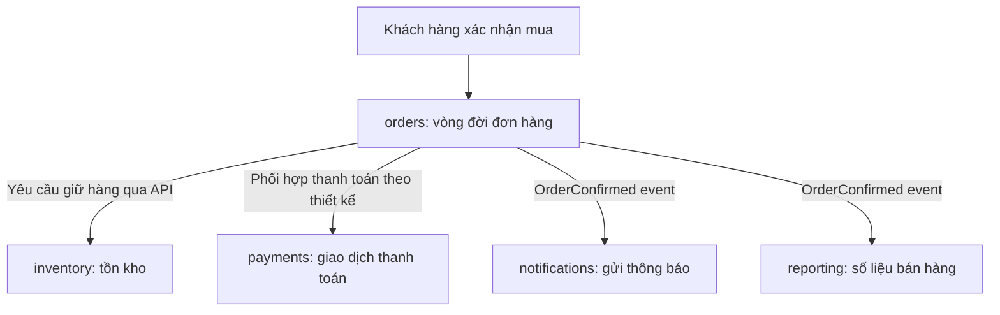
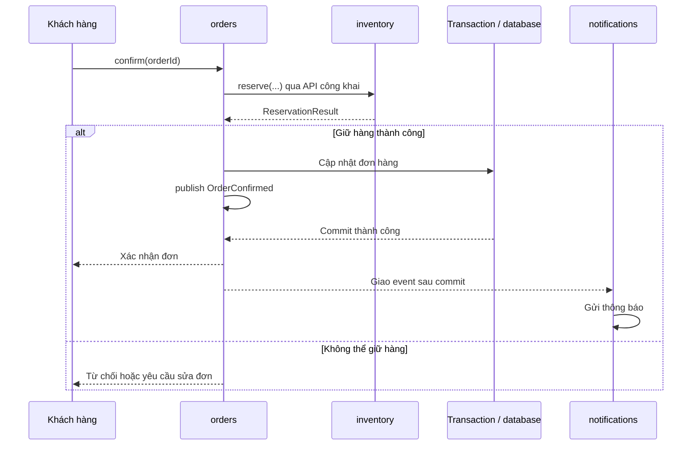

# Xác định boundary trong Spring Modulith

## 1. Boundary là gì và vì sao phải xác định trước khi dùng application events?

Trong Spring Modulith, **module boundary** (ranh giới module) xác định một phần nghiệp vụ **sở hữu trách nhiệm nào, dữ liệu nào, hành vi nào** và **những điểm tương tác nào được phép công bố** cho phần còn lại của ứng dụng. Một boundary tốt cho phép thay đổi quy tắc nội bộ của một module mà ít ảnh hưởng đến các module khác.

Ví dụ, trong ứng dụng bán hàng:

- `orders` quyết định một đơn hàng có thể được xác nhận hay hủy.
- `inventory` quyết định hàng có còn và việc giữ chỗ tồn kho có hợp lệ không.
- `notifications` quyết định nội dung và phương thức gửi thông báo.
- `reporting` xây dựng số liệu từ các sự kiện nghiệp vụ.

Trong kiến trúc modular monolith, các module thường vẫn chạy trong **một tiến trình Spring Boot** và có thể sử dụng cùng hạ tầng database. Tuy nhiên, dùng chung tiến trình **không đồng nghĩa với việc module nào cũng được truy cập trực tiếp vào lớp, repository hoặc bảng dữ liệu của module khác**. Ranh giới là cam kết kiến trúc về quyền sở hữu và cách phối hợp.

Đối với dịch vụ học `SPRING_MODULITH_APPLICATION_EVENTS`, mục tiêu cuối cùng là tổ chức giao tiếp giữa các module bằng **application events** để giảm phụ thuộc và bảo vệ ranh giới nghiệp vụ. Vì vậy, việc xác định boundary phải diễn ra trước khi quyết định nơi đặt `ApplicationEventPublisher`, các listener, event contract hoặc cơ chế retry.

Một boundary có thể được xem theo năm chiều:

| Chiều | Câu hỏi cần trả lời | Ví dụ |
| --- | --- | --- |
| **Năng lực nghiệp vụ** | Module chịu trách nhiệm quyết định điều gì? | `orders` quản lý vòng đời đơn hàng |
| **Quyền sở hữu dữ liệu** | Module nào được phép trực tiếp tạo và cập nhật dữ liệu? | `inventory` quản lý số lượng tồn và reservation |
| **API công khai** | Module khác được yêu cầu hành vi gì một cách trực tiếp? | `InventoryService.reserve(...)` |
| **Sự kiện công bố** | Module phát thông báo về sự thật nghiệp vụ nào đã xảy ra? | `OrderConfirmed` |
| **Nhất quán và lỗi** | Những thay đổi nào phải thành công cùng nhau, thay đổi nào có thể xảy ra sau? | Xác nhận đơn cần giữ hàng; gửi email có thể sau commit |

Boundary **không đơn thuần là một tên package**, một bảng database hay một nhóm controller. Tên package là cách thể hiện ranh giới trong mã Java; bản thân ranh giới phải có lý do từ nghiệp vụ.

## 2. Phân tích nghiệp vụ để tìm ranh giới

### 2.1. Bắt đầu từ hành vi thay vì tầng kỹ thuật

Giả sử hệ thống có quy trình đặt hàng:

1. Khách đặt sản phẩm vào đơn hàng.
2. Hệ thống kiểm tra quy tắc đơn hàng và khả năng giữ hàng.
3. Khách thanh toán; hệ thống ghi nhận kết quả thanh toán.
4. Đơn hàng chuyển trạng thái đã xác nhận khi các điều kiện cần thiết được thỏa mãn.
5. Hệ thống gửi email và cập nhật báo cáo.

Nếu phân chia thành `controllers`, `services`, `repositories` ở cấp module, một thay đổi nhỏ của đơn hàng sẽ trải qua nhiều module kỹ thuật và tạo phụ thuộc chéo. Cách hữu ích hơn là tìm các **năng lực nghiệp vụ có ngôn ngữ, quy tắc và vòng đời riêng**.



Sơ đồ trên là một phương án thiết kế minh họa, không áp đặt quy trình đồng bộ duy nhất cho mọi hệ thống. Tùy yêu cầu sản phẩm, thanh toán có thể được xác nhận bằng callback và quy trình đơn hàng có thể là một state machine kéo dài nhiều transaction.

### 2.2. Năm câu hỏi để xác định chủ sở hữu

Với mỗi khái niệm như `Order`, `StockReservation` hoặc `Payment`, trả lời:

**1. Ai có quyền quyết định trạng thái hợp lệ?**

Nếu quy tắc chuyển từ `DRAFT` sang `CONFIRMED` thuộc nghiệp vụ đơn hàng, `orders` phải sở hữu hành vi xác nhận. Module gửi email không nên tự sửa trạng thái đơn hàng khi thấy một sự kiện.

**2. Ai chịu trách nhiệm giữ bất biến nghiệp vụ?**

Ví dụ, không cho reservation vượt quá số lượng hàng khả dụng là bất biến của `inventory`. Nếu module `orders` tự sửa cột `available_quantity`, quy tắc tồn kho sẽ bị phân tán và khó kiểm soát.

**3. Dữ liệu thay đổi cùng nhau vì cùng một lý do hay chỉ tình cờ được truy cập cùng nhau?**

Đơn hàng và chi tiết đơn thường thay đổi cùng một vòng đời. Bản ghi gửi email có vòng đời độc lập: có thể retry nhiều lần sau khi đơn hàng đã xác nhận. Đó là dấu hiệu nên có ranh giới riêng.

**4. Nếu đổi quy tắc nội bộ, ai thật sự cần biết?**

Thay công thức tính tồn khả dụng không nên đòi sửa `notifications`. Nếu thay đổi cấu trúc entity đơn hàng buộc sửa nhiều listener thì contract đang để lộ quá nhiều chi tiết.

**5. Module khác cần yêu cầu một quyết định, hay chỉ cần biết một việc đã xảy ra?**

Nếu cần câu trả lời ngay: dùng API công khai của module sở hữu hành vi. Nếu chỉ cần phản ứng với việc đã xảy ra: cân nhắc application event. Phân biệt này là cơ sở để chọn điểm giao tiếp.

### 2.3. Lập bảng quyền sở hữu trước khi viết code

| Module | Sở hữu | API có thể công bố | Event có thể phát | Điều không nên để module khác tự làm |
| --- | --- | --- | --- | --- |
| `orders` | Đơn hàng, chi tiết, trạng thái và quy tắc xác nhận | `OrderOperations` | `OrderConfirmed`, `OrderCancelled` | Cập nhật trực tiếp `OrderRepository` |
| `inventory` | Tồn kho và reservation | `InventoryOperations` | `StockReserved`, `StockReservationExpired` | Sửa trực tiếp tồn kho hoặc bảng reservation |
| `payments` | Lệnh thanh toán, kết quả và hoàn tiền | `PaymentOperations` | `PaymentCaptured`, `PaymentFailed` | Sửa trạng thái payment trong DB |
| `notifications` | Mẫu nội dung, lịch sử gửi và kết quả giao thông báo | Có thể không cần API xuyên module | `NotificationDelivered` nếu thật sự có bên cần biết | Đọc trực tiếp entity đơn hàng hoặc sửa đơn |
| `reporting` | Projection, read model và chỉ số báo cáo | API truy vấn báo cáo | Event chỉ khi nghiệp vụ thực sự cần | Ghi trực tiếp dữ liệu nghiệp vụ nguồn |

Các tên API và event chỉ là ví dụ. Không nên tạo tất cả nếu chưa có nhu cầu thực sự. Giá trị của bảng nằm ở **quyền quyết định cuối cùng** đối với từng hành vi và sự thay đổi dữ liệu.

## 3. Phân biệt boundary nghiệp vụ, Java package và transaction

Ba khái niệm này liên quan nhưng không tương đương:

- **Boundary nghiệp vụ:** ai quản lý quy tắc, dữ liệu và kết quả nghiệp vụ.
- **Boundary mã nguồn:** lớp, interface hoặc event nào được phép tham chiếu từ module khác.
- **Boundary transaction:** tập thao tác dữ liệu phải commit hoặc rollback cùng nhau.

Trong một modular monolith, một transaction có thể đi qua lời gọi API công khai của hai module khi dùng chung transaction manager; điều đó không tự xóa ranh giới trách nhiệm. Ngược lại, hai module nằm trong cùng transaction cũng không phải lý do để chúng truy cập repository nội bộ của nhau.

| Tình huống | Quyết định boundary cần làm rõ |
| --- | --- |
| Xác nhận đơn phải đảm bảo một phần hàng đã được giữ | Module nào sở hữu việc giữ hàng, và lời gọi/transaction nào giữ bất biến? |
| Gửi email có thể lỗi sau khi đơn đã hợp lệ | `notifications` sở hữu việc retry và trạng thái gửi riêng |
| Thanh toán trả kết quả sau callback từ cổng thanh toán | `payments` sở hữu kết quả thanh toán; `orders` phối hợp trạng thái theo contract rõ ràng |
| Báo cáo được cập nhật chậm vài giây | `reporting` có thể cập nhật read model theo event, chấp nhận eventual consistency |

Nếu nhiều tác vụ phải cùng thành công trước khi trả về kết quả, cần phân tích tính nhất quán và transaction cẩn thận. Chuyển mọi bước thành listener bất đồng bộ có thể dẫn đến xác nhận đơn trong khi việc giữ hàng chưa thành công. Ngược lại, gửi thông báo không cần kéo dài transaction xác nhận đơn.

## 4. Biểu diễn boundary bằng cấu trúc Spring Modulith

### 4.1. Application module theo package nghiệp vụ

Spring Modulith thường nhận diện các **package con trực tiếp** của package ứng dụng gốc làm application module theo mặc định. Với ứng dụng `com.example.shop`, cách tổ chức có thể là:

```text
com.example.shop
├── ShopApplication.java
├── orders
│   ├── OrderOperations.java           # API của orders
│   ├── OrderManagement.java           # implementation nội bộ / bean
│   ├── events
│   │   ├── package-info.java          # named interface: events
│   │   ├── OrderConfirmed.java
│   │   └── OrderCancelled.java
│   └── internal
│       ├── Order.java
│       └── OrderRepository.java
├── inventory
│   ├── InventoryOperations.java       # API của inventory
│   └── internal
│       ├── Reservation.java
│       └── ReservationRepository.java
├── notifications
│   ├── package-info.java
│   └── internal
│       ├── OrderNotificationListener.java
│       └── DeliveryAttemptRepository.java
└── reporting
    └── internal
        └── OrderReportingListener.java
```

Chú thích trong sơ đồ là để giải thích vai trò file. Để bảo vệ ranh giới chặt hơn, nên đặt implementation cụ thể của `orders` như `OrderManagement` trong `orders.internal` thay vì ở package API; khi ấy một module khác chỉ nhìn thấy contract công khai được thiết kế để dùng. Cấu trúc hoàn chỉnh có thể điều chỉnh theo ngữ cảnh thực tế.

Ví dụ `OrderOperations` là API ở package gốc `orders`:

```java
package com.example.shop.orders;

import java.util.UUID;

public interface OrderOperations {
    void confirm(UUID orderId);
}
```

Các lớp bên trong `orders.internal` triển khai interface, kiểm tra quy tắc và truy cập repository của **chính `orders`**. Module khác không cần biết `OrderRepository` hoạt động bằng JPA, JDBC hay một cơ chế lưu trữ khác.

### 4.2. Exposed API và phần nội bộ

Theo quy ước mặc định, các kiểu trong package gốc của module có thể là API công khai; package con được xem là nội bộ, trừ phần được công bố qua **named interface**. Vì thế, hãy phân loại có chủ đích:

| Vị trí | Mục đích | Module khác nên phụ thuộc? |
| --- | --- | --- |
| `orders.OrderOperations` | Contract công khai để yêu cầu hành vi | Có, nếu chức năng yêu cầu |
| `orders.events.OrderConfirmed` | Contract sự kiện công bố bằng named interface | Có, thông qua `orders::events` |
| `orders.internal.OrderRepository` | Chi tiết lưu trữ | Không |
| `orders.internal.Order` | Model/aggregate nội bộ | Không |
| `orders.internal.OrderPolicy` | Quy tắc nghiệp vụ nội bộ | Không |

`public` của Java chỉ là quyền truy cập ở cấp ngôn ngữ lập trình. Một lớp `public` trong `orders.internal` vẫn có thể là **API không được phép sử dụng xuyên module** theo mô hình kiến trúc Spring Modulith.

### 4.3. Công bố event contract bằng `@NamedInterface`

Giả sử `notifications` cần nhận sự kiện đơn hàng đã xác nhận. `orders` công bố package chứa event như một named interface:

```java
// orders/events/package-info.java
@org.springframework.modulith.NamedInterface("events")
package com.example.shop.orders.events;
```

```java
// orders/events/OrderConfirmed.java
package com.example.shop.orders.events;

import java.time.Instant;
import java.util.UUID;

public record OrderConfirmed(
    UUID eventId,
    UUID orderId,
    Instant occurredAt
) {
}
```

Named interface `events` có tên đầy đủ dùng trong khai báo phụ thuộc là **`orders::events`**. Event ở đây là contract giữa các module, nên cần đặt tên rõ ràng, kiểu dữ liệu ổn định và tránh phụ thuộc vào entity nội bộ.

`notifications` có thể khai báo các phụ thuộc được cho phép:

```java
// notifications/package-info.java
@org.springframework.modulith.ApplicationModule(
    allowedDependencies = "orders::events"
)
package com.example.shop.notifications;
```

Điều này mô tả rằng `notifications` được phép phụ thuộc vào named interface `events` của `orders`; nó **không** cấp quyền truy cập vào `orders.internal`. Khi module cần thêm một contract công khai khác, phải thiết kế hoặc khai báo phụ thuộc có chủ đích, thay vì mở toàn bộ chi tiết nội bộ.

### 4.4. Kiểm tra boundary bằng mô hình module

Spring Modulith có API tạo mô hình module và xác minh ràng buộc kiến trúc:

```java
import org.junit.jupiter.api.Test;
import org.springframework.modulith.core.ApplicationModules;

class ModuleArchitectureTest {

    @Test
    void verifiesModuleBoundaries() {
        ApplicationModules modules =
            ApplicationModules.of(ShopApplication.class);

        modules.verify();
    }
}
```

Theo cấu trúc và cấu hình module, việc xác minh có thể phát hiện kiểu phụ thuộc không hợp lệ, chẳng hạn tham chiếu vào thành phần nội bộ hoặc quan hệ vòng giữa các module. Nó cũng giúp nhận ra những khai báo `allowedDependencies` bị vi phạm. Đây là kiểm tra **quan hệ mã nguồn**; không tự chứng minh transaction hoặc retry đã vận hành đúng nghiệp vụ.

## 5. Xác định boundary giao tiếp: API trực tiếp hay event?

Sau khi biết module nào sở hữu hành vi, hãy xác định **điểm giao tiếp** giữa hai module. Không có quy tắc “càng nhiều event càng tốt”; lựa chọn phải dựa trên ý nghĩa nghiệp vụ và yêu cầu nhất quán.

| Câu hỏi | Gọi API/module trực tiếp | Phát application event |
| --- | --- | --- |
| Bên gọi cần kết quả ngay? | Thường phù hợp | Thường không phù hợp nếu listener hậu commit/bất đồng bộ |
| Có cần quyết định thành công hay thất bại ngay trong luồng xử lý? | Có thể biểu diễn kết quả/exception rõ | Cần quy trình bất đồng bộ với trạng thái và phản hồi riêng |
| Bên nhận chỉ cần biết điều gì đã xảy ra? | Có thể tạo phụ thuộc không cần thiết | Phù hợp |
| Có nhiều bên cùng phản ứng độc lập? | Bên gọi phải biết từng bên hoặc orchestrator | Một event có thể có nhiều listener |
| Có thể xử lý sau commit? | Không nhất thiết | `@TransactionalEventListener` hoặc `@ApplicationModuleListener` là ứng viên |
| Cần retry khi bên nhận lỗi tạm thời? | Phụ thuộc cơ chế gọi và retry | Có thể kết hợp event publication registry và idempotency |

### 5.1. Ví dụ cần kết quả đồng bộ

Nếu đơn hàng không được xác nhận khi chưa giữ đủ hàng, module `orders` có thể yêu cầu `inventory` thực hiện `reserve(...)` qua API đã công bố:

```java
public interface InventoryOperations {
    ReservationResult reserve(UUID orderId, UUID productId, int quantity);
}
```

`InventoryOperations` và `ReservationResult` là các kiểu công khai của module `inventory` trong ví dụ. Việc quyết định reservation thành công phải thuộc `inventory`. `orders` chỉ dựa vào kết quả được trả về để tiếp tục hoặc từ chối đơn.

Lựa chọn đồng bộ chưa tự bảo đảm tính nhất quán dữ liệu: cần xác định transaction, khóa/cạnh tranh cập nhật, mức isolation và quy tắc lỗi phù hợp. Nếu phối hợp nhiều resource hoặc dịch vụ ngoài, một transaction cục bộ có thể không đủ; khi đó có thể cần một quy trình nhiều bước với trạng thái trung gian.

### 5.2. Ví dụ chỉ cần thông báo việc đã xảy ra

Sau khi đơn được xác nhận hợp lệ, `orders` có thể phát `OrderConfirmed`. Các module quan tâm tự quyết định phải làm gì:

```java
// Trong application service của orders (đoạn mã minh họa)
@Transactional
public void confirm(UUID orderId) {
    var order = repository.findById(orderId).orElseThrow();
    order.confirm();

    events.publishEvent(new OrderConfirmed(
        UUID.randomUUID(), orderId, Instant.now()
    ));
}
```

Ở đây `events` là `ApplicationEventPublisher` được inject; `repository` và `order` thuộc phần nội bộ `orders`. Listener ở `notifications` không được tự gọi `repository` hoặc tham chiếu vào `Order` để hoàn thành công việc.

```java
// notifications/internal/OrderNotificationListener.java
@Component
class OrderNotificationListener {

    private final NotificationService service;

    OrderNotificationListener(NotificationService service) {
        this.service = service;
    }

    @ApplicationModuleListener
    void on(OrderConfirmed event) {
        service.sendOrderConfirmed(event.eventId(), event.orderId());
    }
}
```

Ví dụ dùng `@ApplicationModuleListener` để diễn tả listener bất đồng bộ, xử lý sau commit và trong transaction riêng theo ngữ nghĩa Spring Modulith. Dự án thực tế phải cung cấp các dependency, import và cấu hình async/transaction tương ứng. `NotificationService` phải được định nghĩa trong `notifications` để không tạo chiều phụ thuộc ngược vào `orders`.



Sơ đồ cố ý tách trách nhiệm quyết định điều kiện xác nhận với tác vụ hậu commit. Thứ tự thực tế có thể khác nếu thanh toán hoặc giữ hàng diễn ra theo quy trình nhiều transaction; nguyên tắc vẫn là không để listener gửi email quyết định tính hợp lệ của đơn.

## 6. Thiết kế event contract đúng ranh giới

### 6.1. Event thuộc module nào?

Module **phát và sở hữu sự thật nghiệp vụ** thường là nơi định nghĩa event. `OrderConfirmed` thuộc `orders` vì chỉ `orders` có thẩm quyền xác định khi nào đơn đã xác nhận. Nếu `notifications` tự định nghĩa `SendOrderConfirmationRequested` rồi yêu cầu `orders` phát theo format nội bộ của email, hướng phụ thuộc có thể bị đảo và module phát phải biết quá nhiều về cách tiêu thụ.

Một event contract nên có:

- **Tên mô tả sự kiện đã xảy ra:** `OrderConfirmed`, `StockReserved`, `PaymentCaptured`.
- **Định danh nghiệp vụ:** `orderId`, `reservationId` hoặc `paymentId` tùy ngữ cảnh.
- **Định danh sự kiện:** `eventId` nếu cần nhận diện và xử lý lặp.
- **Thời điểm nghiệp vụ:** `occurredAt` nếu cần audit/đánh giá thứ tự.
- **Dữ liệu tối thiểu cần thiết:** chỉ các trường mà bên tiêu thụ thực sự cần, không sao chép toàn bộ entity.

Không có một schema chung bắt buộc cho tất cả event; những trường trên là gợi ý để chọn theo yêu cầu cụ thể.

### 6.2. Không để event làm rò rỉ mô hình nội bộ

**Thiết kế dễ gây phụ thuộc:**

```java
// Minh họa điều nên tránh ở API xuyên module
public record OrderConfirmed(OrderJpaEntity order) {
}
```

Listener có thể vô tình dựa vào lazy association, thông tin persistence hoặc trường mà `orders` sẽ đổi trong tương lai. Entity còn có thể biến đổi sau thời điểm sự kiện được phát, khiến ý nghĩa event thiếu ổn định.

**Thiết kế giảm ràng buộc:**

```java
public record OrderConfirmed(
    UUID eventId,
    UUID orderId,
    Instant occurredAt
) {
}
```

Nếu module nhận cần thêm thông tin để tạo email, cân nhắc thêm **snapshot dữ liệu nghiệp vụ đã công bố rõ ràng** trong event (ví dụ `customerEmail` nếu được phép) hoặc cung cấp API đọc công khai phù hợp. Đừng buộc module nhận đọc bảng nội bộ của `orders`. Việc thêm payload phải cân đối tính riêng tư, kích thước, độ ổn định và khả năng truy vấn ngược.

### 6.3. Contract cần ổn định theo thời gian

Thay đổi nội dung event có thể tác động đến tất cả listener dù publisher không hề gọi trực tiếp chúng. Vì vậy khi thay đổi contract, cần đánh giá:

1. Listener nào đang phụ thuộc vào tên và trường của event?
2. Có thay đổi **ý nghĩa** của việc “đã xác nhận” hay chỉ thêm dữ liệu?
3. Publication chưa hoàn tất hoặc event lưu bền có thể chứa biểu diễn cũ không?
4. Nếu externalize ra broker, consumer và hệ thống khác xử lý các phiên bản schema như thế nào?
5. Cần phát event mới hay có thể mở rộng contract hiện tại mà không phá vỡ tương thích?

Trong ứng dụng nội bộ, thay đổi mã nguồn cùng lúc có thể đơn giản hơn môi trường đa dịch vụ, nhưng những event đã lưu để khôi phục vẫn có thể đặt ra yêu cầu tương thích dữ liệu.

## 7. Boundary dưới góc nhìn transaction, retry và khả năng khôi phục

### 7.1. Event sau commit bảo vệ ý nghĩa nghiệp vụ

Một `@EventListener` thông thường mặc định được gọi đồng bộ theo lúc phát sự kiện. Nếu gọi trong transaction, listener có thể chạy **trước khi transaction commit**. Khi listener gửi email hoặc gọi HTTP bên ngoài, tác dụng phụ đó không tự rollback cùng transaction của database.

Với event chỉ nên có tác dụng sau khi nghiệp vụ đã commit, cân nhắc `@TransactionalEventListener(phase = AFTER_COMMIT)` hoặc `@ApplicationModuleListener`. Loại listener sau giúp tổ chức giao tiếp bất đồng bộ giữa các module theo ngữ nghĩa Spring Modulith. Chúng phù hợp cho các tác vụ có thể hoàn tất sau lời gọi chính.

Tuy nhiên, chạy sau commit chỉ giải quyết **thời điểm**. Nó không bảo đảm listener sẽ luôn thành công và không thể loại trừ lỗi hệ thống sau khi dữ liệu nguồn đã được commit.

### 7.2. Publication registry theo dõi trách nhiệm xử lý

Khi cần theo dõi những sự kiện được gửi tới transactional listeners, Spring Modulith có **event publication registry**. Nếu đã cấu hình backend lưu trữ thích hợp, registry giúp ghi nhận những publication chưa hoàn tất và trạng thái hoàn tất cho từng listener.

Ví dụ cùng `OrderConfirmed` có hai listener:

| Publication | Module nhận | Trạng thái giả định |
| --- | --- | --- |
| Event E → notification listener | `notifications` | Đã hoàn tất |
| Event E → reporting listener | `reporting` | Chưa hoàn tất do lỗi tạm thời |

Quyết định `reporting` thất bại không được làm thay đổi quyền sở hữu của `orders` đối với kết quả đã xác nhận. `reporting` chịu trách nhiệm về số liệu, cách retry và sự nhất quán của projection do nó quản lý. Tùy cấu hình, registry hỗ trợ kiểm tra và tiếp tục xử lý publication chưa hoàn tất; không nên mặc định việc phát lại tự động đã được cấu hình chỉ vì ứng dụng đang dùng Spring Modulith.

### 7.3. Mỗi module nhận phải kiểm soát xử lý lặp

Một listener có thể đã gửi thành công yêu cầu ra hệ thống ngoài nhưng gặp lỗi trước khi publication được đánh dấu hoàn tất. Khi thử lại, listener có thể nhận cùng event lần nữa. Vì thế cần thiết kế **idempotency** theo phạm vi trách nhiệm của module nhận.

Một cách minh họa cho `notifications`:

```text
on OrderConfirmed(eventId, orderId):
    nếu eventId đã xử lý thành công:
        return
    ghi nhận hoặc giành quyền xử lý eventId theo cơ chế an toàn đồng thời
    gửi thông báo, ưu tiên idempotency key nếu provider hỗ trợ
    ghi kết quả thành công vào dữ liệu do notifications sở hữu
```

Mã giả này cố tình không chọn một chiến thuật giao dịch cố định. Việc ghi dấu trước hay sau thao tác với nhà cung cấp email, xử lý lock và retry phụ thuộc bảo đảm của hệ thống ngoài; **chỉ kiểm tra trước rồi gửi** không đủ để bảo vệ khỏi hai listener đồng thời. Điều quan trọng ở mức boundary là bảng/dấu nhận diện việc đã xử lý thuộc `notifications`, không nằm trong repository của `orders`.

### 7.4. Khi nào boundary cần một workflow riêng?

Nếu một nghiệp vụ kéo dài qua nhiều transaction hoặc hệ thống ngoài, chẳng hạn “chỉ hoàn tất đơn sau khi bên thanh toán xác nhận thành công”, event đơn thuần không thay thế state machine, timeout, bù trừ hoặc chính sách retry.

Trong trường hợp đó, cần xác định module **điều phối trạng thái quy trình** và contract giữa các bước. Ví dụ `orders` sở hữu trạng thái `AWAITING_PAYMENT`, `CONFIRMED`, `CANCELLED`; `payments` sở hữu trạng thái giao dịch tiền và phát `PaymentCaptured`. Listener của `orders` có thể phản ứng để tiếp tục state machine, nhưng phải làm rõ xử lý trùng, event đến muộn và điều kiện chuyển trạng thái. Đây là một quyết định nghiệp vụ cần thiết, không thể chỉ giải quyết bằng cách đổi từ lời gọi method sang event.

## 8. Kiểm tra boundary trước khi mở rộng hệ thống

### 8.1. Căn cứ đánh giá boundary có hợp lý hay chưa

Một ranh giới tốt thường thể hiện bằng những dấu hiệu sau:

| Dấu hiệu | Boundary đang có vấn đề | Hướng điều chỉnh |
| --- | --- | --- |
| Thay quy tắc đơn hàng phải sửa nhiều module | Logic nghiệp vụ bị phân tán | Đưa quyết định về module sở hữu, công bố contract ổn định |
| Listener import `orders.internal.*` | Rò rỉ mã nội bộ | Dùng event payload hoặc API công khai/named interface |
| Hai module cùng cập nhật một bảng không có quyền sở hữu rõ | Dễ phá vỡ bất biến và khó truy vết | Giao một module sở hữu thao tác ghi, các bên khác tương tác qua contract |
| `orders` gọi `notifications` rồi `notifications` gọi ngược vào `orders.internal` | Phụ thuộc vòng hoặc ràng buộc quá chặt | Đổi hướng giao tiếp, công bố contract phù hợp, tách tác vụ hậu commit |
| Cứ nhận event là module phải cập nhật ngay trong transaction nguồn | Chưa phân biệt bất biến tức thời và eventual consistency | Xem lại điểm đồng bộ và trách nhiệm quyết định |
| Một event chứa rất nhiều entity và trường tùy biến | Contract phụ thuộc cấu trúc dữ liệu nội bộ | Thiết kế event theo sự thật nghiệp vụ và nhu cầu tiêu thụ |
| Listener lỗi làm không thể biết cần xử lý lại cái gì | Thiếu quan sát publication và chiến lược khôi phục | Dùng registry/backend phù hợp, logging, retry và idempotency |

### 8.2. Kiểm tra ở ba lớp

**Lớp 1 — Kiểm tra cấu trúc:** Dùng `ApplicationModules.of(...).verify()` để phát hiện các phụ thuộc mã nguồn trái ranh giới hoặc quan hệ vòng theo cấu hình module.

**Lớp 2 — Kiểm tra hành vi:** Kiểm thử trường hợp đặt hàng hợp lệ, thiếu hàng, transaction rollback và event hậu commit. Xác nhận module nào thực hiện quyết định và module nào chỉ phản ứng.

**Lớp 3 — Kiểm tra vận hành:** Mô phỏng listener lỗi, publication chưa hoàn tất, retry và nhận event lặp. Xác nhận tác dụng phụ được kiểm soát trong module sở hữu, đồng thời người vận hành có thể quan sát lỗi.

`@ApplicationModuleTest` là công cụ hữu ích để kiểm thử từng module với ngữ cảnh được giới hạn phù hợp. Các kiểm thử transaction và failure recovery vẫn cần được thiết kế theo backend cùng hạ tầng thực tế, vì kiểm tra cấu trúc đơn thuần không phát hiện được lỗi nghiệp vụ chạy thời gian thực.

## 9. Các phản ví dụ phổ biến khi phân chia module

### 9.1. Chia module theo lớp kỹ thuật

```text
controllers/
services/
repositories/
events/
```

Nếu mỗi thư mục trên trở thành một application module toàn ứng dụng, luồng nghiệp vụ phải đi qua nhiều module kỹ thuật và khó xác định ai sở hữu dữ liệu. Tổ chức theo `orders`, `inventory`, `payments`, `notifications` giúp đặt controller, service và repository cùng phần nghiệp vụ liên quan.

### 9.2. Dùng event như lời gọi lệnh không có người sở hữu

Một event tên `PleaseSendEmail` do `orders` phát ra buộc `orders` biết giải pháp gửi email. Nếu yêu cầu chỉ là “đơn hàng đã xác nhận”, event `OrderConfirmed` thể hiện sự thật thuộc `orders`, còn `notifications` tự quyết định chính sách thông báo. Tuy nhiên, trong một hệ thống có mô hình command rõ ràng, một **yêu cầu gửi email** vẫn có thể là contract hợp lệ nếu đơn vị sở hữu quy trình và phía tiếp nhận được xác định rõ; vấn đề là định nghĩa ý nghĩa và quyền sở hữu, không chỉ nằm ở cách đặt tên.

### 9.3. Cho nhiều module ghi chung entity

Nếu `reporting` sửa đối tượng `Order` để đánh dấu đã tính doanh thu, báo cáo bắt đầu quyết định gián tiếp trạng thái của đơn hàng. Phương án an toàn hơn là `reporting` lưu dấu đã xử lý trong dữ liệu của chính nó, hoặc yêu cầu thay đổi trạng thái thông qua API nghiệp vụ công khai của `orders` nếu đó thực sự là quyết định thuộc đơn hàng.

### 9.4. Bẻ nhỏ module tới mức quá nhiều sự kiện

Nếu mọi phép tính nhỏ đều trở thành một module riêng và các module chỉ trao đổi bằng event, việc đọc luồng xử lý và bảo đảm nhất quán có thể khó hơn. Boundary nên tương ứng với **khả năng tự chủ nghiệp vụ thực sự**, không phải một tỷ lệ lớp/module cố định. Một module có thể chứa nhiều package nội bộ và nhiều service cùng phục vụ một bộ quy tắc.

### 9.5. Coi shared kernel là nơi đặt mọi thứ

Một package `shared` chứa entity, repository và tiện ích nghiệp vụ của tất cả module sẽ tạo phụ thuộc ngầm và làm mất quyền sở hữu. Chỉ chia sẻ những kiểu thực sự ổn định và không mang quyết định nghiệp vụ riêng; contract giữa các module nên được công bố từ module sở hữu nó, kèm kiểm tra phụ thuộc kiến trúc.

## 10. Bài tập thực hành xác định boundary

**Bối cảnh:** Nền tảng thương mại điện tử cần thêm chức năng gửi thông báo khi đơn đã được thanh toán thành công. Hiện tại, `OrderService` gọi trực tiếp `EmailService`, `ReportService` và cập nhật bảng `payments`. Khi provider email ngừng hoạt động, transaction xác nhận đơn bị lỗi.

**Yêu cầu:** Thiết kế lại ranh giới theo Spring Modulith để một lỗi gửi email không xóa bỏ kết quả thanh toán/đơn hàng đã commit, đồng thời có khả năng kiểm tra và xử lý lại thông báo bị lỗi.

**Bước 1 — Chỉ ra ownership.** `payments` quản lý payment và thông báo kết quả thanh toán; `orders` quản lý trạng thái đơn; `notifications` quản lý gửi email; `reporting` quản lý số liệu. Xác định ai được quyền thay đổi mỗi trạng thái.

**Bước 2 — Vẽ luồng phụ thuộc.** API đồng bộ nào thực sự cần trong lúc quyết định trạng thái đơn? Sự kiện nào chỉ biểu diễn điều đã xảy ra? Đối chiếu `PaymentCaptured` và `OrderConfirmed`, tránh dùng hai event thay nhau nếu chúng có ý nghĩa nghiệp vụ khác nhau.

**Bước 3 — Định nghĩa contract.** Đặt event trong module sở hữu, dùng payload bất biến, không trả entity JPA. Nếu cần import từ module khác, công bố named interface thích hợp.

**Bước 4 — Tách tác vụ hậu commit.** `notifications` và `reporting` xử lý kết quả đã commit. Cân nhắc `@ApplicationModuleListener` cho công việc bất đồng bộ, cấu hình transaction và hạ tầng phù hợp.

**Bước 5 — Thiết kế lỗi và retry.** Mỗi module nhận lưu trạng thái xử lý do mình sở hữu. Khi cần theo dõi publication chưa hoàn tất, cấu hình event publication registry với backend phù hợp; xây dựng idempotency cho event trùng.

**Bước 6 — Xác minh.** Chạy kiểm tra module dependencies, thử rollback transaction nguồn, mô phỏng provider email lỗi và thử phát lại cùng event. Quan sát rằng đơn hàng và thanh toán vẫn tuân thủ quy tắc nghiệp vụ, còn thông báo được xử lý độc lập.

### Bảng quyết định mẫu

| Câu hỏi | Quyết định tham khảo |
| --- | --- |
| Ai phát `PaymentCaptured`? | `payments`, khi giao dịch được ghi nhận thành công theo quy tắc của nó |
| Ai quyết định đơn chuyển `CONFIRMED`? | `orders`, dựa trên kết quả thanh toán và các điều kiện đơn hàng |
| Ai phát `OrderConfirmed`? | `orders`, khi trạng thái xác nhận hợp lệ được xác lập |
| Ai gửi email? | `notifications`, khi nhận contract nghiệp vụ thích hợp |
| Ai cập nhật báo cáo? | `reporting`, trong dữ liệu projection của chính nó |
| Ai kiểm soát gửi lại email? | `notifications`, phối hợp registry/retry phù hợp và bảo vệ idempotency |

Trong bài tập này, cần chọn rõ **điều kiện chuyển trạng thái**: có thể dùng API trực tiếp hoặc quy trình phản ứng event với state machine nếu luồng thanh toán bất đồng bộ. Không có yêu cầu phải chuyển mọi tương tác sang event; kết quả cần đạt là trách nhiệm và các hợp đồng giao tiếp được thể hiện rõ, kiểm tra được.

## 11. Checklist trước khi chốt một boundary

- [ ] Mỗi module có một trách nhiệm nghiệp vụ mô tả được bằng một vài câu.
- [ ] Mỗi loại dữ liệu và bất biến quan trọng có một module sở hữu rõ ràng.
- [ ] Có phân biệt API cần kết quả ngay với event chỉ thông báo sự kiện đã xảy ra.
- [ ] Các lớp nội bộ không trở thành phụ thuộc xuyên module.
- [ ] Event contract do module sở hữu sự thật nghiệp vụ công bố, đủ dữ liệu và hạn chế rò rỉ entity.
- [ ] Những việc phải hoàn tất trong cùng transaction được phân biệt với tác vụ hậu commit.
- [ ] Các listener có trách nhiệm dữ liệu, retry, xử lý trùng và quan sát riêng khi cần.
- [ ] `@NamedInterface`/`allowedDependencies` được dùng có chủ đích để mô tả phụ thuộc được phép.
- [ ] Mô hình Spring Modulith có thể được xác minh; các kịch bản nghiệp vụ và lỗi có cách kiểm thử phù hợp.

Khi đã trả lời được các câu hỏi này, application events trở thành một kênh giao tiếp có ý nghĩa rõ ràng: **module phát công bố một sự thật mà nó sở hữu, module nhận phản ứng trong phạm vi trách nhiệm của mình**. Những ranh giới ấy là nền tảng để xử lý sau commit, theo dõi event publication, retry và quan sát đáng tin cậy trong Spring Modulith.
