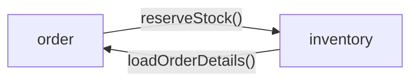
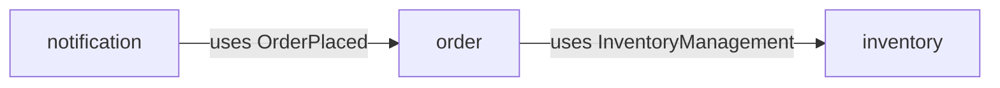
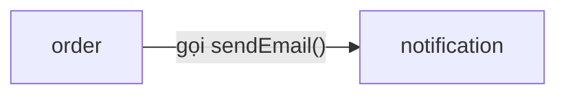
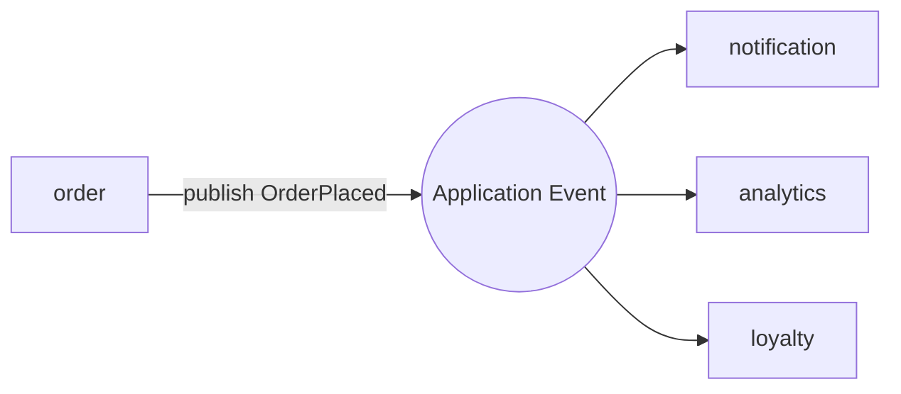
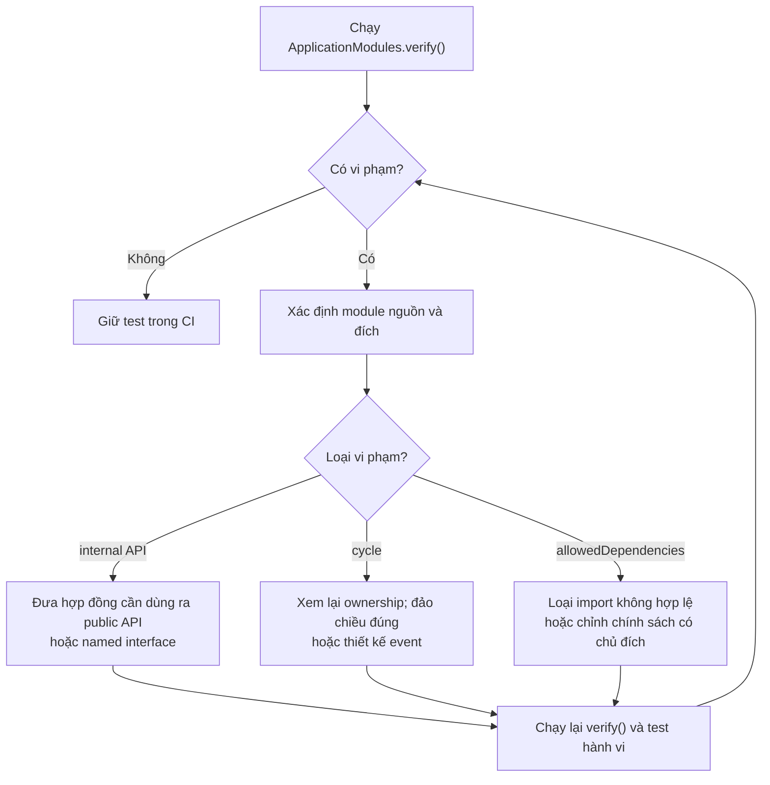
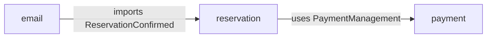

# Dependency giữa module trong Spring Modulith

## 1. Vì sao dependency là cốt lõi của ranh giới module?

Trong một **modular monolith**, các chức năng vẫn chạy chung một tiến trình nhưng được tách thành **application module** theo ranh giới nghiệp vụ. Ví dụ, một hệ thống bán hàng có các module `order` (đơn hàng), `inventory` (kho) và `notification` (thông báo). Dù cùng chạy trong Spring Boot, mỗi module cần biết rõ **có thể phụ thuộc vào module nào và được phép dùng những thành phần nào**.

Một thiết kế module tốt không chỉ là có thư mục Java package gọn gàng. Nếu `order` gọi thẳng repository nội bộ của `inventory`, hoặc `inventory` gọi ngược bean nội bộ của `order`, ranh giới nghiệp vụ bị phá vỡ dù ứng dụng vẫn biên dịch và chạy được.

Spring Modulith hỗ trợ:

- Phân tích quan hệ phụ thuộc giữa các application module từ mã nguồn.
- Phân biệt **API được công bố** và chi tiết triển khai **internal**.
- Kiểm tra phụ thuộc vòng và vi phạm ranh giới thông qua `ApplicationModules.verify()`.
- Tùy chọn giới hạn các module được phép sử dụng bằng `@ApplicationModule(allowedDependencies = …)`.
- Tổ chức giao tiếp qua **application events**, giảm việc module phát sự kiện biết trực tiếp module nhận.

Bài học này tập trung vào **dependency giữa module** trong dịch vụ học **SPRING_MODULITH_APPLICATION_EVENTS**. Phần ví dụ liên hệ dependency trực tiếp với publisher/listener để thấy vì sao kiến trúc sự kiện giúp giảm liên kết, đồng thời chỉ rõ những phụ thuộc tĩnh vẫn tồn tại khi một listener import kiểu sự kiện.

## 2. Module dependency là gì?

Một module `A` **phụ thuộc vào** module `B` khi mã của `A` tham chiếu tới một kiểu, bean hoặc hợp đồng được định nghĩa bởi `B`. Những tham chiếu thường gặp gồm:

1. **Phụ thuộc kiểu Java:** import một interface, class, record, enum hoặc annotation do module khác sở hữu.
2. **Phụ thuộc qua Spring bean:** constructor của service ở `A` nhận interface/bean do `B` cung cấp; đây đồng thời là một phụ thuộc kiểu.
3. **Phụ thuộc qua hợp đồng sự kiện:** listener ở `A` khai báo tham số là kiểu event nằm trong `B`.
4. **Phụ thuộc qua cấu hình hoặc hợp đồng dùng chung:** sử dụng các kiểu cấu hình được module khác công bố.

Ví dụ:

```java
package com.example.shop.order;

import com.example.shop.inventory.InventoryManagement;
import org.springframework.stereotype.Service;

@Service
public class OrderService {

    private final InventoryManagement inventory;

    public OrderService(InventoryManagement inventory) {
        this.inventory = inventory;
    }
}
```

Ở đây, `order` **phụ thuộc vào** `inventory` vì `OrderService` tham chiếu `inventory.InventoryManagement`. Chiều quan hệ được viết:

```text
order  ───────► inventory
 (dùng API của)
```

Điều này **không có nghĩa** `inventory` cũng phụ thuộc `order`. Một quan hệ chỉ có chiều ngược lại nếu mã của `inventory` thực sự tham chiếu các kiểu thuộc `order`.

### 2.1. Dependency tĩnh khác với luồng xử lý ở runtime

Trong Spring Modulith cần tách hai câu hỏi:

| Câu hỏi | Ví dụ | Điều gì được phân tích? |
| --- | --- | --- |
| **Module nào biết tới module nào trong code?** | `order` import `InventoryManagement` | Phụ thuộc tĩnh giữa module, có thể xác minh kiến trúc |
| **Ai gọi hoặc kích hoạt ai khi chạy?** | `order` gọi `inventory.reserve()` | Luồng đồng bộ trong runtime |
| **Ai phát event, ai xử lý event?** | `order` phát `OrderPlaced`, `notification` lắng nghe | Luồng giao tiếp bằng sự kiện tại runtime |
| **Listener phải biết kiểu event của ai?** | `notification` import `order.OrderPlaced` | Phụ thuộc tĩnh `notification → order` |

Việc `order` publish sự kiện để `notification` xử lý tạo luồng **`order → notification` ở runtime**, nhưng publisher **không cần import bean hoặc class listener**. Nếu `OrderPlaced` thuộc API của `order`, module `notification` lại có phụ thuộc **tĩnh `notification → order`** để biết kiểu event. Đây là khác biệt quan trọng khi đọc sơ đồ module.

## 3. API công khai và internal quyết định dependency hợp lệ

Với cách phát hiện mặc định của Spring Modulith, mỗi package con trực tiếp dưới package ứng dụng có thể trở thành một module:

```text
com.example.shop
├── ShopApplication.java
├── order/                            [module order]
│   ├── OrderService.java             API module
│   ├── OrderPlaced.java              public event
│   └── internal/
│       └── OrderRepository.java      internal
├── inventory/                        [module inventory]
│   ├── InventoryManagement.java      API module
│   └── internal/
│       └── InventoryService.java     internal
└── notification/                     [module notification]
    └── internal/
        └── OrderPlacedListener.java  internal
```

Lớp khởi động nằm ở package gốc, ví dụ file `src/main/java/com/example/shop/ShopApplication.java`:

```java
package com.example.shop;

import org.springframework.boot.SpringApplication;
import org.springframework.boot.autoconfigure.SpringBootApplication;

@SpringBootApplication
public class ShopApplication {

    public static void main(String[] args) {
        SpringApplication.run(ShopApplication.class, args);
    }
}
```

Theo mô hình module **closed** mặc định:

- Các kiểu `public` nằm trực tiếp trong **package gốc của module** là API không đặt tên (*unnamed interface*) mà module khác có thể dùng.
- Các kiểu trong package con như `inventory.internal` hay `order.internal` được xem là **nội bộ**, ngay cả khi Java khai báo chúng là `public`.
- Package con có thể được mở có chủ đích thành **named interface**. Khi đó, các kiểu của interface được công bố có thể dùng từ module khác.
- Một module được đánh dấu loại `OPEN` nới quy tắc truy cập internal, nhưng thường chỉ nên dùng như giải pháp chuyển đổi dần cho code cũ.

Ví dụ hợp lệ:

```java
// order/OrderService.java
import com.example.shop.inventory.InventoryManagement;
```

Ví dụ vi phạm ranh giới:

```java
// order/OrderService.java
import com.example.shop.inventory.internal.InventoryService;
```

Nếu `InventoryService` là `public`, trình biên dịch Java có thể cho phép dòng import thứ hai. Tuy nhiên, **`ApplicationModules.verify()` vẫn có thể từ chối** phụ thuộc vào package nội bộ của module khác. Điều này cho thấy quy tắc của Spring Modulith là một **kiểm tra kiến trúc bổ sung**, không phải cơ chế tự thay đổi phạm vi truy cập Java.

> Hai thông tin cần giữ riêng: **dependency vào module nào** và **dependency vào phần API nào của module đó**. Một dependency có đúng tên module đích vẫn có thể sai nếu tham chiếu tới mã nội bộ.

## 4. Ba nguyên tắc kiểm soát dependency

Spring Modulith cung cấp những kiểm tra cấu trúc quan trọng khi gọi `verify()`:

| Nguyên tắc | Ý nghĩa | Dấu hiệu vi phạm |
| --- | --- | --- |
| **Không có phụ thuộc vòng** | Đồ thị phụ thuộc module phải không chứa chu trình | `order → inventory → order` |
| **Chỉ truy cập API được công bố** | Module khác không tham chiếu kiểu nằm trong package internal của module closed | `order` import `inventory.internal.JpaStockRepository` |
| **Tuân thủ allowedDependencies nếu đã khai báo** | Module chỉ phụ thuộc những module/named interface được liệt kê | `order` được phép dùng `inventory` nhưng lại phụ thuộc `notification` |

Hai tình huống cần phân biệt:

**Tình huống A: thiếu `allowedDependencies`.** Điều này không đồng nghĩa vô hiệu hóa mọi ranh giới: việc kiểm tra vòng và API/internal vẫn có giá trị. Module có thể tham chiếu những API module khác được công bố nếu không bị một quy tắc bổ sung cấm.

**Tình huống B: có `allowedDependencies`.** Danh sách là giới hạn các phụ thuộc **đi ra từ module đang khai báo**. Nó không buộc module phải thực sự gọi tất cả module liệt kê; cũng không mặc định cấm code bên ngoài mô hình application module, như các thư viện Java/Spring dùng chung.

### 4.1. Dependency cycle: vì sao phải tránh?

Giả sử:



Tại thời điểm đặt hàng, `order` gọi `inventory` để giữ hàng. Nhưng `inventory` lại gọi về `order` để lấy thông tin đơn hàng. Hai module bây giờ có chu trình tĩnh, trở nên khó thay đổi và khó kiểm thử riêng lẻ.

Cách xử lý không phải lúc nào cũng là đổi một lời gọi sang `@Async`. Đổi sang bất đồng bộ **không xóa** dependency nếu module vẫn import kiểu nội bộ của module kia. Thay vào đó, cần xem lại:

- Module nào **sở hữu dữ liệu và quy tắc** đang bị sử dụng qua lại?
- Có thể chuyển dữ liệu cần thiết thành tham số của API công khai, thay vì gọi ngược để lấy dữ liệu?
- Có nên dùng sự kiện để module hoàn tất nghiệp vụ phát thông báo, còn bên quan tâm tự xử lý?
- Có thể tách một hợp đồng dùng chung nhỏ, có owner rõ ràng, để loại chu trình?

Không nên đưa tất cả model/service vào package `common` để “lách” lỗi vòng. Việc làm đó chỉ có thể che khuất ranh giới nghiệp vụ và khiến trách nhiệm sở hữu dữ liệu trở nên mơ hồ.

## 5. Thiết kế dependency trực tiếp đúng cách

Một dependency trực tiếp phù hợp khi module gọi cần **kết quả ngay lập tức** để quyết định nghiệp vụ. Ví dụ `order` phải biết có đủ hàng trước khi chấp nhận đơn.

### 5.1. Công bố một interface ổn định ở module inventory

File `src/main/java/com/example/shop/inventory/InventoryManagement.java`:

```java
package com.example.shop.inventory;

public interface InventoryManagement {

    void reserve(String sku, int quantity);
}
```

Phần triển khai đặt bên trong module:

```java
package com.example.shop.inventory.internal;

import com.example.shop.inventory.InventoryManagement;
import org.springframework.stereotype.Service;

@Service
class InventoryService implements InventoryManagement {

    @Override
    public void reserve(String sku, int quantity) {
        if (sku == null || sku.isBlank() || quantity <= 0) {
            throw new IllegalArgumentException("Invalid stock reservation");
        }

        // Ví dụ minh họa. Hệ thống thực cần kiểm tra tồn kho, khóa/cạnh tranh
        // và ghi nhận thay đổi trong storage có giao dịch phù hợp.
    }
}
```

`InventoryManagement` là một hợp đồng của module `inventory`. `order` phụ thuộc vào hợp đồng đó, trong khi `InventoryService` vẫn có thể đổi cách cài đặt mà `order` không phải thay import.

### 5.2. order sử dụng interface, không truy cập repository nội bộ

File `src/main/java/com/example/shop/order/OrderService.java`:

```java
package com.example.shop.order;

import com.example.shop.inventory.InventoryManagement;
import java.util.UUID;
import org.springframework.context.ApplicationEventPublisher;
import org.springframework.stereotype.Service;
import org.springframework.transaction.annotation.Transactional;

@Service
public class OrderService {

    private final InventoryManagement inventory;
    private final ApplicationEventPublisher events;

    public OrderService(
            InventoryManagement inventory,
            ApplicationEventPublisher events) {
        this.inventory = inventory;
        this.events = events;
    }

    @Transactional
    public UUID placeOrder(String sku, int quantity) {
        inventory.reserve(sku, quantity); // Lời gọi trực tiếp, cần kết quả ngay

        UUID orderId = UUID.randomUUID();

        // Trong ứng dụng thật: lưu đơn hàng vào database trong transaction này.
        events.publishEvent(new OrderPlaced(orderId, sku, quantity));

        return orderId;
    }
}
```

File `src/main/java/com/example/shop/order/OrderPlaced.java`:

```java
package com.example.shop.order;

import java.util.UUID;

public record OrderPlaced(UUID orderId, String sku, int quantity) {}
```

**Giải thích trách nhiệm:**

1. `order` sở hữu quyết định tạo đơn và phát `OrderPlaced`.
2. `inventory` sở hữu logic giữ hàng và công bố API `reserve`. `order` không biết repository hay entity tồn kho bên trong.
3. `OrderPlaced` được đặt ở **API của order** để listener bên ngoài có thể tham chiếu hợp lệ.
4. `@Transactional` thể hiện ranh giới transaction của thao tác nghiệp vụ. Đoạn mã lược bỏ persistence để tập trung vào dependency; chạy sản xuất cần bổ sung thao tác ghi dữ liệu, xử lý lỗi và cấu hình giao dịch thực tế.

Với cách này, `order → inventory` là một dependency **có chủ đích và hợp lệ**. Không phải mọi lời gọi trực tiếp đều xấu. Quan trọng là module đích công bố hợp đồng rõ ràng và luồng đồng bộ phù hợp với nhu cầu nhất quán nghiệp vụ.

## 6. Giới hạn module được phép phụ thuộc với allowedDependencies

Spring Modulith cho phép khai báo chính sách phụ thuộc ở cấp module bằng annotation `@ApplicationModule` trong `package-info.java`.

File `src/main/java/com/example/shop/order/package-info.java`:

```java
@org.springframework.modulith.ApplicationModule(
    allowedDependencies = "inventory"
)
package com.example.shop.order;
```

Quy tắc trên có nghĩa: mã thuộc module `order` được phép tham chiếu tới **API được công bố của inventory**. Nếu một lớp trong `order` cố import `notification.internal.EmailSender` hoặc API của `notification`, bài kiểm tra cấu trúc sẽ báo lỗi. Đồng thời, nếu `order` truy cập `inventory.internal.InventoryService` thì vẫn sai vì đó là nội bộ.

Một biến thể cho nhiều module đích:

```java
@org.springframework.modulith.ApplicationModule(
    allowedDependencies = { "inventory", "pricing" }
)
package com.example.shop.order;
```

Ở đây `pricing` chỉ là module giả định bổ sung; muốn áp dụng ví dụ phải có package/module `pricing` thật trong dự án.

### 6.1. Hướng khai báo

Giả sử mô hình có ba module:



Chính sách hợp lý:

| Module khai báo | `allowedDependencies` | Vì sao |
| --- | --- | --- |
| `order` | `"inventory"` | Cần API giữ hàng |
| `notification` | `"order"` | Listener cần kiểu `order.OrderPlaced` |
| `inventory` | Không khai báo trong ví dụ | Không cần tham chiếu kiểu thuộc hai module còn lại |

Lưu ý **chiều phụ thuộc**: `notification` nhận event từ `order` nên `notification` phụ thuộc tĩnh vào kiểu event của `order`; điều đó không yêu cầu `order` khai báo phụ thuộc vào `notification`.

**Không nên hiểu** `allowedDependencies` như một cơ chế phân quyền API ở runtime. Nó diễn tả ràng buộc kiến trúc được công cụ kiểm tra dựa trên code; nó không tự chặn một request HTTP hoặc lời gọi reflection, không quản lý quyền dữ liệu và không bảo đảm event đã được xử lý.

## 7. Named interface: chỉ cho phép đúng một phần API của module

Giả sử `order` có hai nhóm API:

- `order.OrderManagement`: giao diện xử lý đơn đồng bộ cho những module gọi trực tiếp.
- `order.events.OrderPlaced`: kiểu sự kiện công khai dành cho các module nhận thông báo.

Đặt event vào package con `order.events` sẽ khiến package đó bị xem là internal theo mặc định. Nếu muốn công bố nó, định nghĩa **named interface**:

```text
com.example.shop
├── order/
│   ├── OrderManagement.java
│   ├── package-info.java
│   ├── events/
│   │   ├── package-info.java       ← @NamedInterface("events")
│   │   └── OrderPlaced.java
│   └── internal/
│       └── OrderRepository.java
└── notification/
    ├── package-info.java           ← allowedDependencies = "order :: events"
    └── internal/
        └── OrderPlacedListener.java
```

File `src/main/java/com/example/shop/order/events/package-info.java`:

```java
@org.springframework.modulith.NamedInterface("events")
package com.example.shop.order.events;
```

File `src/main/java/com/example/shop/notification/package-info.java`:

```java
@org.springframework.modulith.ApplicationModule(
    allowedDependencies = "order :: events"
)
package com.example.shop.notification;
```

Mã trong `notification` có thể import `com.example.shop.order.events.OrderPlaced`, nhưng bị ràng buộc không được tự ý gọi `order.OrderManagement` chỉ vì cả hai cùng thuộc module `order`.

**Cú pháp đáng nhớ:**

| Khai báo | Phạm vi được phép |
| --- | --- |
| `"order"` | API package gốc của `order` |
| `"order :: events"` | Named interface `events` của `order` |
| `"order :: *"` | Các named interface được công bố tường minh; **không tự bao gồm API package gốc** |
| `"order :: **"` | Toàn bộ API công bố: package gốc và các named interface |

Đây là **biến thể cấu trúc** so với ví dụ phần 5: nếu chuyển `OrderPlaced` từ `order` sang `order.events`, cần sửa đồng bộ `package`, các `import` ở publisher/listener và các quy tắc phụ thuộc. Không đặt hai bản `OrderPlaced` ở cả hai package rồi coi là cùng một hợp đồng.

Named interface không tạo thêm một application module. Nó mở một phần API có tên bên trong module sở hữu; dùng phù hợp khi module có nhiều nhóm hợp đồng (ví dụ `api`, `events`, `spi`), mỗi nhóm phục vụ một loại consumer.

## 8. Giao tiếp qua application events để giảm coupling

Ví dụ `order` đặt mua hàng thành công, sau đó cần gửi email. Nếu `OrderService` gọi trực tiếp `NotificationService`, sơ đồ phụ thuộc sẽ là:



Giờ nếu có thêm `analytics`, `loyalty` hay `shipping` cùng cần biết đơn mới, `OrderService` phải biết thêm ngày càng nhiều consumer. Điều này làm module phát sinh thay đổi khi thêm tính năng phụ.

Spring khuyến khích publish event trong module nguồn, để mỗi consumer tự đăng ký listener:



Sơ đồ vừa rồi biểu diễn **luồng event khi chạy**, không phải sơ đồ import tĩnh. Trong code, `notification`, `analytics` và `loyalty` thường import `order.OrderPlaced` để đăng ký xử lý; `order` không cần import các listener.

### 8.1. Viết listener ở module nhận

File `src/main/java/com/example/shop/notification/internal/OrderPlacedListener.java`:

```java
package com.example.shop.notification.internal;

import com.example.shop.order.OrderPlaced;
import org.springframework.modulith.events.ApplicationModuleListener;
import org.springframework.stereotype.Component;

@Component
class OrderPlacedListener {

    @ApplicationModuleListener
    void on(OrderPlaced event) {
        // Ví dụ: gửi thông báo, ghi log hoặc lưu tác vụ cần gửi email.
        System.out.println("Email for order: " + event.orderId());
    }
}
```

File `src/main/java/com/example/shop/notification/package-info.java` trong cấu trúc **event nằm ở package gốc `order`**:

```java
@org.springframework.modulith.ApplicationModule(
    allowedDependencies = "order"
)
package com.example.shop.notification;
```

Ở đây:

- `order` không gọi `OrderPlacedListener` và không cần biết module `notification` có tồn tại.
- `notification` phụ thuộc tĩnh vào **API công khai** `OrderPlaced` của `order`, không vào `order.internal`.
- `@ApplicationModuleListener` là tiện ích của Spring Modulith, kết hợp transactional event listener, xử lý bất đồng bộ và transaction riêng cho listener. Listener loại này mặc định kích hoạt sau khi transaction phát sự kiện commit thành công.
- Vì listener thuộc giao tiếp **sau commit**, hành vi của nó khác lời gọi `inventory.reserve(...)` đồng bộ trong transaction đặt hàng.

**Điều kiện cần hiểu đúng:** Nếu publisher không chạy bên trong transaction phù hợp, một `@TransactionalEventListener` mặc định có thể **không được gọi** (vì không có transaction để chờ commit). Ví dụ phần 5 khai báo `@Transactional` để minh họa ý định đó; ứng dụng thực cần cấu hình transaction manager, lưu dữ liệu và kiểm thử trường hợp commit/rollback.

### 8.2. So sánh direct call và event

| Tiêu chí | Gọi API trực tiếp | Phát và nhận application event |
| --- | --- | --- |
| Quan hệ tĩnh điển hình | Caller → module cung cấp API | Consumer → module định nghĩa event; publisher không phụ thuộc consumer |
| Cần kết quả tức thời? | Phù hợp | Không phù hợp nếu nghiệp vụ phải nhận kết quả đồng bộ ngay |
| Thêm consumer mới | Có thể cần sửa caller | Thường thêm listener, publisher không phải sửa |
| Ranh giới transaction | Có thể cùng transaction | Phụ thuộc cơ chế listener: đồng bộ mặc định hoặc xử lý sau commit |
| Khi consumer lỗi | Có thể làm caller thất bại ngay | Với listener sau commit, lỗi tách khỏi transaction nguồn; cần cơ chế retry |
| Dễ test từng module | Cần stub/mock API đích hoặc bootstrap dependencies | Có thể kiểm tra event được publish độc lập với consumer |

**Không phải mọi sự kiện đều bất đồng bộ.** `ApplicationEventPublisher.publishEvent(...)` với `@EventListener` thông thường vẫn dispatch đồng bộ theo cấu hình Spring mặc định. Chỉ khi chọn listener bất đồng bộ/sau commit phù hợp thì mới tách được việc xử lý khỏi transaction nguồn.

### 8.3. Dependency giảm nhưng không tự biến mất hết

Một hiểu nhầm phổ biến là “chuyển sang event thì các module không còn dependency”. Thực tế:

1. **Publisher → consumer** thường được loại bỏ, vì publisher chỉ biết event nó tự công bố.
2. **Consumer → nơi định nghĩa event** vẫn tồn tại qua import kiểu event.
3. Nếu hai module vừa công bố, vừa lắng nghe event của nhau, **vẫn có thể hình thành phụ thuộc vòng tĩnh**, cần xem lại ownership hoặc tách hợp đồng phù hợp.
4. Một sự kiện quá lớn mang nguyên entity JPA nội bộ có thể làm rò rỉ mô hình dữ liệu, dù cách giao tiếp là event. Nên thiết kế event thành hợp đồng nhỏ, ổn định, bất biến (ví dụ Java `record` chứa ID và dữ liệu cần thiết).

Vì vậy mục tiêu là **giảm coupling có chủ đích**, giữ phụ thuộc theo một chiều hợp lý và bảo vệ API, không phải loại bỏ mọi dependency bằng mọi giá.

## 9. Kiểm tra dependency thật bằng ApplicationModules.verify()

Các ví dụ trước đây đều có thể sai ranh giới nhưng vẫn compile. Spring Modulith cung cấp một bước kiểm chứng tự động và có thể đưa vào CI.

Với Gradle, một cấu hình phụ thuộc minh họa gồm Spring Modulith core, API của event listener và starter test (dự án cần quản lý phiên bản Spring Modulith tương thích Spring Boot qua BOM hoặc cơ chế quản lý dependency):

```groovy
dependencies {
    implementation 'org.springframework.modulith:spring-modulith-starter-core'
    implementation 'org.springframework.modulith:spring-modulith-events-api'
    testImplementation 'org.springframework.modulith:spring-modulith-starter-test'
}
```

Ví dụ giả định dự án đã có Spring Boot starter, JUnit và Spring transaction infrastructure cần thiết. Riêng khi dùng Event Publication Registry để lưu bền publication, cần cấu hình thêm Spring Modulith event persistence tương ứng và database; `spring-modulith-events-api` chỉ cung cấp API event/listener, không tự tạo kho lưu publication.

File `src/test/java/com/example/shop/ModuleArchitectureTests.java`:

```java
package com.example.shop;

import org.junit.jupiter.api.Test;
import org.springframework.modulith.core.ApplicationModules;

class ModuleArchitectureTests {

    @Test
    void moduleDependenciesRespectBoundaries() {
        ApplicationModules.of(ShopApplication.class).verify();
    }
}
```

Giả sử ở `order` có:

```java
import com.example.shop.inventory.internal.InventoryService;
```

Thì `verify()` sẽ phát hiện vi phạm truy cập internal của module `inventory`. Nếu một lớp ở `inventory` lại import kiểu API của `order` trong khi `order` đã phụ thuộc `inventory`, kiểm tra phụ thuộc vòng cũng có thể thất bại. Nếu `order` khai báo `allowedDependencies = "inventory"` nhưng import API thuộc `notification`, sẽ có vi phạm giới hạn phụ thuộc đã công bố.

### 9.1. Quy trình sửa một lỗi dependency



**Không sửa lỗi bằng cách mở `Type.OPEN` vô điều kiện** hoặc cho `allowedDependencies` chứa tất cả module chỉ để test xanh. Hai cách đó có thể hợp lý trong một giai đoạn chuyển đổi code cũ, nhưng chúng cũng làm yếu quy tắc bảo vệ ranh giới nếu dùng mà không có quyết định kiến trúc.

### 9.2. Quan sát đồ thị dependency

Spring Modulith cung cấp `Documenter` để sinh tài liệu và sơ đồ quan hệ từ `ApplicationModules`:

```java
package com.example.shop;

import org.junit.jupiter.api.Test;
import org.springframework.modulith.core.ApplicationModules;
import org.springframework.modulith.docs.Documenter;

class ModuleDocumentationTests {

    @Test
    void generateModuleDiagrams() {
        var modules = ApplicationModules.of(ShopApplication.class);

        new Documenter(modules)
                .writeModulesAsPlantUml()
                .writeIndividualModulesAsPlantUml();
    }
}
```

Đây là một cách tốt để nhìn thấy dependency tăng lên sau mỗi lần thêm tính năng. `spring-modulith-starter-test` có các thành phần test và documentation cần thiết trong các phiên bản Spring Modulith phù hợp. Nội dung sơ đồ được sinh theo code hiện tại, nên mỗi lần đổi module/import cần chạy lại test để có kết quả cập nhật.

Một hướng thực hành khác là dùng `@ApplicationModuleTest` để chạy test giới hạn trong phạm vi một module. Với **STANDALONE** mode, các bean của module được test có thể cần mock những phụ thuộc từ module khác; có thể sử dụng chế độ bootstrap kèm dependency khi cần integration test thật. Điều này giúp kiểm thử dependency từ góc độ **khởi động module**, bổ sung cho `verify()` vốn kiểm tra **cấu trúc mã nguồn**.

## 10. Dependency, retry và độ tin cậy giao sự kiện

Trong hệ thống cần xử lý email, thanh toán bổ sung, cập nhật read model hoặc gửi thông báo, giảm dependency qua event đem lại khả năng tách biệt, nhưng đồng thời đặt ra các yêu cầu về độ tin cậy:

- **Sau commit:** chỉ xử lý việc phụ sau khi transaction chính thành công khi nghiệp vụ yêu cầu; không gửi thông báo cho một đơn hàng đã rollback.
- **Không mất event khi lỗi:** dùng cơ chế lưu publication phù hợp nếu listener bất đồng bộ có thể thất bại hoặc ứng dụng sập.
- **Retry có kiểm soát:** publication chưa hoàn tất cần được theo dõi, thử lại hoặc xử lý thủ công theo chính sách.
- **Idempotency:** listener cần chấp nhận khả năng một event bị xử lý nhiều lần, ví dụ dựa trên `orderId` hoặc khóa idempotency.
- **Quan sát:** theo dõi publication đang chờ, bị lỗi, thời gian xử lý và số lần xử lý lại.

Spring Modulith có **Event Publication Registry** để ghi nhận publication dành cho các transactional event listener phù hợp cùng giao dịch nguồn, khi đã cấu hình persistence cho registry. Nếu listener thất bại, cơ chế này hỗ trợ xác định những publication chưa hoàn tất để khôi phục theo cấu hình/công cụ phù hợp. Registry **không tự biến xử lý bên ngoài thành exactly-once**, không thay thế idempotency hoặc quản lý giao dịch giữa hai hệ thống độc lập.

Không phải `@ApplicationModuleListener` đơn lẻ đã tự cung cấp lưu bền sự kiện: dự án cần thêm backend persistence của registry tương ứng (ví dụ starter JDBC/JPA theo stack) và cấu hình kết nối/transaction thích hợp. Các phương án phát lại, lifecycle và retry có thể khác theo phiên bản Spring Modulith; cần tham chiếu tài liệu đúng phiên bản ứng dụng đang dùng.

Ở cấp kiến trúc, việc chọn event giải quyết **coupling giữa module**; việc chọn xử lý sau commit, registry, retry và idempotency giải quyết **ngữ nghĩa và độ tin cậy của giao tiếp**. Hai nhóm yêu cầu gắn chặt với nhau nhưng cần được kiểm thử bằng các lớp test khác nhau.

## 11. Các lỗi thiết kế thường gặp

| Lỗi | Hậu quả | Hướng xử lý |
| --- | --- | --- |
| `order` import repository trong `inventory.internal` | Vượt API, khó thay cài đặt module đích | Đưa hành vi cần thiết ra `inventory.InventoryManagement` |
| Hai module inject service của nhau | Sinh cycle, dễ lỗi boot và khó test | Xem lại ownership, cắt vòng bằng hợp đồng hoặc event |
| Đặt event class ở `order.internal` nhưng listener module khác import | Vi phạm ranh giới | Đặt event ở API gốc hoặc công bố named interface |
| Tưởng `@Async` làm biến mất dependency | Import vẫn còn, vòng tĩnh vẫn còn | Kiểm tra đồ thị import, thiết kế lại hướng phụ thuộc |
| `allowedDependencies` đặt ở module đích thay vì nguồn | Chính sách không hạn chế đúng cạnh dependency | Khai báo trong module đang **sử dụng** module khác |
| Khai báo `"order :: events"` nhưng lại import `order.OrderManagement` | Chỉ được phép dùng named interface `events` | Điều chỉnh hợp đồng hoặc khai báo quyền có chủ đích |
| Publish event từ code không có transaction nhưng chờ `@ApplicationModuleListener` chạy | Listener after-commit có thể không được kích hoạt | Thiết lập transaction phù hợp và test commit/rollback |
| Listener retry nhưng gửi email hai lần | Side effect bị lặp | Dùng khóa idempotency và lưu trạng thái đã xử lý |
| Đưa toàn bộ entity JPA vào event | Rò rỉ model nội bộ, coupling tăng | Dùng ID/value object/DTO event ổn định |
| Chỉ test chạy thành công, không chạy `verify()` | Vi phạm phụ thuộc không bị phát hiện sớm | Thêm architecture test và chạy trong CI |

## 12. Bài thực hành: thiết kế lại dependency giữa các module

**Bối cảnh:** ứng dụng `com.example.booking` có ba module `reservation`, `payment` và `email`.

Ban đầu, `reservation.ReservationService` gọi `payment.internal.PaymentJpaRepository` để xác định thanh toán và gọi `email.internal.EmailSender` để gửi xác nhận; `payment.PaymentService` lại import `reservation.internal.ReservationJpaRepository` để lấy dữ liệu đặt chỗ.

### Nhiệm vụ

1. **Vẽ đồ thị:** Ghi chính xác các cạnh phụ thuộc tĩnh ban đầu giữa ba module; xác định chu trình và các cạnh truy cập internal.
2. **Thiết kế API:** Đưa hành vi cần thiết của thanh toán ra `payment.PaymentManagement`. Cho `reservation` phụ thuộc trực tiếp interface này nếu quyết định xác nhận đặt chỗ phải có kết quả ngay.
3. **Chuyển thông báo thành event:** Tạo `reservation.ReservationConfirmed` chứa `reservationId` và dữ liệu tối thiểu. `reservation` publish event, `email` đăng ký listener `@ApplicationModuleListener`.
4. **Khai báo giới hạn:** Viết `package-info.java` cho `reservation` với `allowedDependencies = "payment"`; cho `email` với `allowedDependencies = "reservation"`. Giải thích vì sao publisher không cần khai báo `email`.
5. **Kiểm tra:** Thêm test `ApplicationModules.of(BookingApplication.class).verify()`; cố tình import `payment.internal` để thấy test đỏ rồi sửa về API công khai.
6. **Xét độ tin cậy:** Khi listener gửi email thất bại sau commit, xác định điều gì xảy ra với transaction đặt chỗ và đề xuất Event Publication Registry, retry, idempotency cho hệ thống thật.

### Đáp án gợi ý

Trước khi sửa, `reservation` phụ thuộc `payment` và `email` qua import nội bộ; `payment` phụ thuộc ngược `reservation`, nên có chu trình `reservation ↔ payment`. Sau khi đặt lại API, đồ thị tĩnh có thể là:



`reservation` vẫn quyết định nghiệp vụ đồng bộ với `payment`, còn việc gửi email được tách qua event. Listener thất bại sau commit không tự rollback transaction đặt chỗ đã commit; cần lưu và xử lý publication đáng tin cậy, bảo đảm handler có thể chạy lại an toàn.

## 13. Checklist áp dụng vào dự án

Trước khi merge thay đổi liên quan đến hai module, hãy tự kiểm tra:

- Module đang sửa **sở hữu nghiệp vụ** nào? API công khai của nó nằm ở package nào?
- Mọi import xuyên module có đi qua package gốc hoặc named interface được công bố không?
- Chiều phụ thuộc có đúng theo ownership, có tạo cycle không?
- `allowedDependencies` của module nguồn có phản ánh đúng những phụ thuộc được phép không?
- Việc cần kết quả tức thời có dùng API đồng bộ; việc phụ có thể dùng application event không?
- Event chứa hợp đồng ổn định, hạn chế kiểu internal/entity và không làm publisher biết consumer?
- Các listener sau commit có transaction, registry, retry/idempotency và quan sát khi cần?
- `ApplicationModules.verify()` và các test giao tiếp module đã chạy thành công?

Ranh giới module được bảo vệ tốt khi **dependency có hướng, có lý do nghiệp vụ và chỉ đi qua hợp đồng công khai**. Spring Modulith giúp biến nguyên tắc đó thành các kiểm tra cụ thể, đồng thời application events giúp tách việc phát sinh hành vi khỏi những module cần phản ứng với hành vi ấy.

### Tài liệu tham khảo

- [Spring Modulith Reference — Fundamentals](https://docs.spring.io/spring-modulith/reference/fundamentals.html): API/internal, named interfaces, `allowedDependencies` và module open.
- [Spring Modulith Reference — Verifying Application Module Structure](https://docs.spring.io/spring-modulith/reference/verification.html): phụ thuộc vòng, truy cập API và kiểm chứng.
- [Spring Modulith Reference — Working with Application Events](https://docs.spring.io/spring-modulith/reference/events.html): event, `@ApplicationModuleListener`, publication registry và retry.
- [Spring Modulith Reference — Documenting Application Modules](https://docs.spring.io/spring-modulith/reference/documentation.html): tạo sơ đồ module từ dependency thực tế.
- [Spring Modulith Reference — Integration Testing Application Modules](https://docs.spring.io/spring-modulith/reference/testing.html): kiểm thử module độc lập và cùng dependency.
