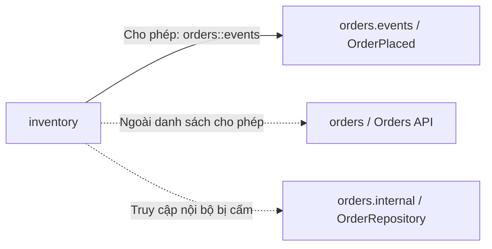
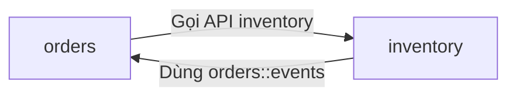

# Allowed dependency trong Spring Modulith

## 1. Allowed dependency giải quyết vấn đề gì?

Trong một ứng dụng Spring Boot chạy dưới dạng **modular monolith**, các module nghiệp vụ vẫn được biên dịch và chạy chung ứng dụng. Nếu một lớp trong module `inventory` import `orders.internal.OrderRepository`, Java có thể biên dịch thành công khi lớp đó là `public`; tuy nhiên, module kho đang biết chi tiết lưu trữ nội bộ của module đơn hàng. Thay đổi repository lúc này có thể kéo theo thay đổi không cần thiết trong kho.

**Allowed dependency** là quy tắc xác định **module hiện tại được phép phụ thuộc vào những module hoặc những API được công bố nào của module khác**. Spring Modulith cung cấp thuộc tính `@ApplicationModule(allowedDependencies = ...)` và khả năng kiểm tra kiến trúc để bảo vệ ranh giới này.

Ví dụ hệ thống thương mại điện tử gồm:

- `orders`: tạo đơn hàng, quản lý trạng thái đơn và phát sự kiện `OrderPlaced`.
- `inventory`: giữ hàng, giải phóng hàng, duy trì trạng thái tồn kho.
- `billing`: tạo yêu cầu thanh toán, quản lý trạng thái thu tiền.

Sau khi đơn hàng được tạo, cả kho và thanh toán có thể phản ứng với `OrderPlaced`. Module `orders` không cần import `InventoryService` hay `BillingService` nếu hai module kia đăng ký listener cho hợp đồng sự kiện đã công bố. Điều cần giới hạn là phần **mã nguồn** mà từng module được phép sử dụng từ module khác.

Trong phạm vi `SPRING_MODULITH_APPLICATION_EVENTS`, allowed dependency giúp giảm kết dính và bảo vệ ranh giới nghiệp vụ. Các cơ chế publisher, listener, xử lý sau commit, Event Publication Registry, retry, kiểm thử và quan sát giao sự kiện là những phần tiếp theo giúp luồng giao tiếp giữa các module hoạt động đúng và đáng tin cậy.

> Allowed dependency kiểm soát **kiến trúc phụ thuộc của ứng dụng**. Nó không phải phân quyền bảo mật tại runtime, cũng không tự biến package thành microservice hoặc cô lập cơ sở dữ liệu.

## 2. Phân biệt Java package, API module và allowed dependency

Spring Modulith thường nhận diện các **application module** từ những package con trực tiếp dưới package gốc của ứng dụng Spring Boot. Ví dụ:

```text
com.example.shop
├── ShopApplication.java
├── orders
│   ├── Orders.java
│   ├── events
│   │   ├── package-info.java
│   │   └── OrderPlaced.java
│   └── internal
│       ├── OrderService.java
│       └── OrderRepository.java
├── inventory
│   ├── package-info.java
│   └── internal
│       └── OrderPlacedListener.java
└── billing
    └── internal
        └── BillingService.java
```

Ba application module là `orders`, `inventory` và `billing`. Package `orders.events` và `orders.internal` thuộc module `orders`; chúng không phải module riêng.

Nếu kiểu trong `inventory` tham chiếu kiểu trong `orders`, ví dụ qua import, constructor, tham số hoặc trường, tồn tại một **phụ thuộc từ inventory sang orders**. Nhưng việc phụ thuộc này có hợp lệ không phải xét qua nhiều lớp quy tắc:

| Lớp kiểm soát | Câu hỏi | Ví dụ |
| --- | --- | --- |
| Mức truy cập Java | Kiểu có thể được tham chiếu theo quy tắc Java không? | Một lớp `public` có thể được import từ package khác |
| API của application module | Kiểu có nằm trong phần API mà module chủ sở hữu công bố không? | `orders.Orders` công khai; `orders.internal.OrderRepository` là nội bộ |
| Allowed dependency | Module tiêu thụ có được phép tham chiếu API đó của module cung cấp không? | `inventory` chỉ được phép dùng `orders::events` |

Một lớp `public` không mặc nhiên là API của Spring Modulith khi nó nằm trong subpackage nội bộ. Ngược lại, chỉ thêm tên `orders` vào danh sách cho phép cũng không biến `orders.internal` thành API.

## 3. Cách viết allowedDependencies

Spring Modulith dùng annotation `org.springframework.modulith.ApplicationModule` để khai báo thông tin của một application module. Thuộc tính `allowedDependencies` có thể giới hạn các phụ thuộc **đi ra từ module được khai báo**. Thông thường annotation được đặt trong file `package-info.java` thuộc package gốc của module tiêu thụ.

### 3.1. Giới hạn theo tên module

Ví dụ `inventory` được phép sử dụng API của `catalog`:

```java
// inventory/package-info.java
@org.springframework.modulith.ApplicationModule(
    allowedDependencies = "catalog"
)
package com.example.shop.inventory;
```

Giá trị `catalog` là tên **application module** trong mô hình, không phải tên class hay tên hiển thị. Quy tắc này cho phép phụ thuộc tới những API mà `catalog` công bố, nhưng không cho phép truy cập trực tiếp các kiểu nội bộ của `catalog`.

### 3.2. Giới hạn tới một named interface

Nếu `orders` công bố nhóm hợp đồng có tên `events`, `inventory` có thể chỉ cho phép nhóm đó:

```java
// inventory/package-info.java
@org.springframework.modulith.ApplicationModule(
    allowedDependencies = "orders::events"
)
package com.example.shop.inventory;
```

Trong `orders::events`:

- `orders` là tên module cung cấp.
- `events` là tên **named interface** được module đó công bố.
- Ký hiệu `::` phân tách tên module và tên interface. Đây là định danh kiến trúc, **không phải cú pháp package Java**.

Quy tắc được đặt tại `inventory` vì **inventory là bên tạo ra phụ thuộc**. Đặt cùng annotation tại `orders` sẽ kiểm soát các phụ thuộc đi ra từ `orders`, không phải cấp quyền ngược cho module kho.

### 3.3. Nhiều phụ thuộc được phép

Có thể khai báo một mảng khi module cần nhiều hợp đồng:

```java
@org.springframework.modulith.ApplicationModule(
    allowedDependencies = {
        "orders::events",
        "catalog"
    }
)
package com.example.shop.inventory;
```

Ở đây, kho được tham chiếu nhóm sự kiện đã công bố của `orders` và API được công bố của `catalog`. Các quy tắc chung về nội bộ module và vòng phụ thuộc vẫn tiếp tục được kiểm tra.

### 3.4. Không khai báo khác với danh sách cấm tất cả

Theo cơ chế mặc định, nếu module **không khai báo** `allowedDependencies`, Spring Modulith không giới hạn các module đích bằng danh sách trắng này. Việc truy cập API nội bộ và vòng phụ thuộc vẫn bị kiểm tra theo các quy tắc kiến trúc chung.

Không nên dùng `allowedDependencies = {}` với kỳ vọng nó sẽ cấm mọi phụ thuộc sang module khác: mảng rỗng tương ứng với việc **không đặt hạn chế bằng danh sách này**. Muốn một module hoàn toàn độc lập, cần thiết kế ranh giới thích hợp và áp dụng thêm quy tắc kiểm chứng nếu chính sách dự án yêu cầu.

## 4. Tạo named interface để công bố sự kiện

Theo cách nhận diện module mặc định, các kiểu ở ngay package gốc `orders` thuộc API module, còn các kiểu trong `orders.events` là nội bộ trừ khi được công bố một cách tường minh. Vì vậy nếu `inventory` cần import `OrderPlaced` từ `orders.events`, trước tiên cần khai báo named interface:

```java
// orders/events/package-info.java
@org.springframework.modulith.NamedInterface("events")
package com.example.shop.orders.events;
```

Định nghĩa hợp đồng sự kiện:

```java
// orders/events/OrderPlaced.java
package com.example.shop.orders.events;

import java.util.UUID;

public record OrderPlaced(UUID orderId) {}
```

Annotation `@NamedInterface("events")` công bố nhóm kiểu từ package này thành named interface có tên `events`. Khi đó `orders::events` là đích phụ thuộc mà module kho có thể khai báo qua `allowedDependencies`.

Điều này giúp phân biệt các vùng của module đơn hàng:

| Kiểu | Vai trò | `inventory` với `orders::events` |
| --- | --- | --- |
| `orders.events.OrderPlaced` | Hợp đồng sự kiện trong named interface `events` | Được tham chiếu |
| `orders.Orders` | API công khai ở package gốc `orders` | Không nằm trong named interface đã cho phép |
| `orders.internal.OrderService` | Triển khai nghiệp vụ | Không được tham chiếu |
| `orders.internal.OrderRepository` | Chi tiết lưu trữ | Không được tham chiếu |



**Lưu ý:** `@NamedInterface` chỉ định nghĩa phạm vi API kiến trúc. Nó không tự đăng ký event listener, không cấu hình cơ chế gửi sự kiện và không bảo đảm giao sự kiện sau commit.

## 5. Ví dụ ứng dụng: lắng nghe sự kiện với ranh giới hợp lệ

Giả sử module `orders` có service tạo đơn và phát `OrderPlaced` thông qua `ApplicationEventPublisher`:

```java
// Trích đoạn phương thức trong orders.internal.OrderService
@Transactional
public void placeOrder(UUID orderId) {
    // Repository nội bộ đã lưu đơn hàng trong transaction này.
    events.publishEvent(new OrderPlaced(orderId));
}
```

Trong đó `events` là một `ApplicationEventPublisher` đã được inject vào service, `OrderPlaced` là record của `orders.events`. Đoạn trích tập trung vào thứ tự lưu dữ liệu và phát sự kiện; ứng dụng thực tế phải có repository và quy tắc kiểm tra đầu vào phù hợp.

Module `inventory` khai báo `allowedDependencies = "orders::events"` như mục 3.2, rồi định nghĩa listener:

```java
package com.example.shop.inventory.internal;

import com.example.shop.orders.events.OrderPlaced;
import org.springframework.modulith.events.ApplicationModuleListener;
import org.springframework.stereotype.Component;

@Component
class OrderPlacedListener {

    @ApplicationModuleListener
    void on(OrderPlaced event) {
        // Inventory xử lý nghiệp vụ riêng với event.orderId().
        // Không truy cập repository hoặc service nội bộ của orders.
    }
}
```

Sự phụ thuộc tĩnh trong đoạn mã là **`inventory → orders::events`** vì listener import kiểu `OrderPlaced`. Module `orders` không cần import `OrderPlacedListener` của kho. Dù Spring có thể gửi sự kiện đến listener tại runtime, việc đó không tạo ra phụ thuộc mã nguồn từ `orders` sang `inventory`.

`@ApplicationModuleListener` hỗ trợ listener có ngữ nghĩa xử lý **sau commit, bất đồng bộ và trong transaction riêng** khi môi trường transaction được cấu hình đúng. Trong khi đó, `ApplicationEventPublisher.publishEvent(...)` tự nó không bảo đảm tất cả listener đều chạy sau commit; một `@EventListener` thông thường mặc định được gọi đồng bộ. Allowed dependency không điều khiển các cơ chế transaction hoặc lịch thực thi này.

### 5.1. Trường hợp sai: import lớp nội bộ

```java
package com.example.shop.inventory.internal;

import com.example.shop.orders.internal.OrderRepository;

class InventoryCoordinator {
    private final OrderRepository orders; // Vi phạm API module

    InventoryCoordinator(OrderRepository orders) {
        this.orders = orders;
    }
}
```

Giả sử `OrderRepository` là lớp `public` để Java có thể import. Phụ thuộc vẫn sai vì repository thuộc `orders.internal`, không phải API mà module đơn hàng công bố. Kể cả đổi `allowedDependencies` thành `"orders"` cũng **không hợp thức hóa** việc truy cập lớp nội bộ.

### 5.2. Trường hợp sai: dùng API công khai ngoài danh sách

```java
package com.example.shop.inventory.internal;

import com.example.shop.orders.Orders;

class InventoryCoordinator {
    private final Orders orders; // Ngoài allowedDependencies

    InventoryCoordinator(Orders orders) {
        this.orders = orders;
    }
}
```

Giả sử `Orders` là interface nằm ngay trong package gốc `orders`, tức thuộc API công khai của module. Khi `inventory` chỉ khai báo `orders::events`, phụ thuộc tới `Orders` vẫn **không được phép** vì nằm ngoài phạm vi named interface đã chỉ định.

Đây là sự khác biệt giữa **lớp đã được công bố** và **lớp module tiêu thụ được quyền tham chiếu**.

## 6. Dùng ApplicationModules.verify() để kiểm tra

Việc khai báo giới hạn cần đi cùng bài kiểm tra kiến trúc tự động. Spring Modulith cung cấp `ApplicationModules` để dựng mô hình module và `verify()` để kiểm tra các quy tắc phụ thuộc.

```java
package com.example.shop;

import org.junit.jupiter.api.Test;
import org.springframework.modulith.core.ApplicationModules;

class ModularityTests {

    @Test
    void verifyModuleBoundaries() {
        ApplicationModules.of(ShopApplication.class).verify();
    }
}
```

Với cấu hình `inventory` chỉ cho phép `orders::events`:

| Phụ thuộc bắt đầu từ `inventory` | Kỳ vọng |
| --- | --- |
| Import `orders.events.OrderPlaced` và đã công bố `events` | Hợp lệ |
| Import `orders.internal.OrderRepository` | Vi phạm API nội bộ |
| Import `orders.Orders` | Ngoài nhóm API được cho phép |
| Import `billing.internal.BillingService` | Vi phạm API nội bộ và ngoài danh sách |
| Sử dụng `java.util.UUID` | Không phải phụ thuộc giữa hai application module |

Khi `verify()` phát hiện vi phạm, cần xem module nguồn, module đích, kiểu đang được tham chiếu và giới hạn đã khai báo. Sửa đúng trách nhiệm module hoặc API công bố. Không nên giải quyết bằng cách thêm mọi module vào `allowedDependencies` chỉ để bài kiểm tra chuyển sang màu xanh.

**Cần phân biệt:** Java compiler có thể chấp nhận một import `public` không hợp lệ về mặt kiến trúc. Kết quả kiểm tra phụ thuộc là trách nhiệm của bài kiểm tra Spring Modulith, vì vậy bài test nên được chạy thường xuyên trong CI. `verify()` không tự kiểm tra nghiệp vụ, transaction hay bảo đảm listener xử lý thành công.

## 7. Allowed dependency không giải quyết vòng phụ thuộc

Giả sử `orders` gọi API của `inventory` để kiểm tra tồn kho, còn `inventory` lại import sự kiện `OrderPlaced` từ `orders::events`. Hai hướng phụ thuộc có thể tạo thành chu trình:



Ngay cả khi cả hai bên tự khai báo phụ thuộc được phép, **vòng phụ thuộc module** vẫn là một vấn đề kiến trúc cần giải quyết; không nên xem allowed dependency như cơ chế miễn trừ kiểm tra chu trình.

Có thể xem xét một số cách thiết kế tùy yêu cầu nghiệp vụ:

1. Giữ hướng phụ thuộc một chiều khi chỉ một bên thật sự cần sử dụng API của bên kia.
2. Phát một sự kiện nghiệp vụ để bên nhận phản ứng độc lập, nếu quy trình cho phép xử lý sau commit và nhất quán theo thời gian.
3. Tách hợp đồng ổn định vào một module có trách nhiệm rõ ràng nếu nhiều module cùng cần biết, tránh tạo package dùng chung tùy tiện.
4. Đặt điều phối vào đúng module sở hữu quy trình nếu các bước cần trao đổi kết quả đồng bộ.

Việc chọn API đồng bộ hay event phải xét thời điểm ra quyết định nghiệp vụ. Nếu người dùng chỉ được xác nhận đơn sau khi biết kho còn hàng, cần thiết kế cách xác nhận phù hợp; một listener chạy sau commit không thể tự rollback giao dịch đã commit.

## 8. Đặt allowed dependency trong bức tranh giao sự kiện tin cậy

Allowed dependency khiến `inventory` có thể nhận `OrderPlaced` qua hợp đồng công khai, nhưng nó **không đảm bảo** công việc giữ hàng luôn hoàn tất. Ví dụ, `orders` đã commit giao dịch tạo đơn, trong khi listener kho bị lỗi kết nối dữ liệu.

Với những transactional event listener phù hợp, Spring Modulith có cơ chế **Event Publication Registry** để theo dõi publication khi ứng dụng tích hợp cơ chế lưu trữ thích hợp. Registry cho phép nhận biết những publication chưa hoàn thành, làm cơ sở cho chính sách xử lý lại. Cơ chế retry tự động, lịch tái công bố và cách giám sát cần dựa trên phiên bản Spring Modulith cùng cấu hình vận hành cụ thể; không nên mặc định chỉ khai báo `@ApplicationModuleListener` là đủ.

Listener cần có khả năng **idempotent**: nếu sự kiện `OrderPlaced(orderId)` được xử lý lại, việc giữ hàng không được thực hiện hai lần. Có thể sử dụng `orderId` làm khóa nghiệp vụ, ràng buộc duy nhất hoặc bảng ghi nhận sự kiện đã xử lý. Các chỉ số cần quan sát gồm số publication còn chờ, thời gian xử lý sau commit, số lần retry và tỷ lệ lỗi.

Ba nhóm kiểm chứng bổ sung cho nhau:

- **Kiến trúc:** `ApplicationModules.verify()` xác minh ranh giới và danh sách allowed dependency.
- **Hành vi:** kiểm thử publisher, listener và dữ liệu nghiệp vụ sau khi nhận sự kiện.
- **Độ tin cậy:** kiểm thử rollback, listener lỗi, lưu vết publication, xử lý lại và chống trùng.

## 9. Những nhầm lẫn dễ gặp

| Nhận định | Cách hiểu đúng |
| --- | --- |
| “Đã khai báo `allowedDependencies` thì compiler tự cấm import sai.” | Phải chạy kiểm tra kiến trúc để phát hiện các phụ thuộc vi phạm |
| “`orders::events` là đường dẫn thư mục.” | Đây là cú pháp `module::namedInterface` |
| “Thêm `orders` cho phép truy cập mọi lớp `orders.internal`.” | Chỉ những API được công bố của module mới hợp lệ |
| “`allowedDependencies = {}` nghĩa là không được phụ thuộc ai.” | Mảng rỗng không áp đặt danh sách cấm mọi module |
| “Publisher phải phụ thuộc vào mọi module listener.” | Publisher chỉ phát event; bên tiêu thụ mới import hợp đồng sự kiện |
| “Allowed dependency tự cung cấp retry sau commit.” | Retry và quản lý publication là cơ chế vận hành riêng |

## 10. Checklist thực hành

Khi bổ sung giao tiếp giữa hai application module:

1. Xác định rõ **module nào đang dùng API** của module nào, theo hướng `module tiêu thụ → module cung cấp`.
2. Chọn mức hợp đồng vừa đủ: API gốc nếu cần gọi nghiệp vụ trực tiếp; named interface hẹp nếu chỉ cần nhóm sự kiện hay một nhóm API cụ thể.
3. Công bố hợp đồng hợp lệ qua vị trí package gốc hoặc `@NamedInterface`. Đặt implementation và repository nội bộ trong subpackage riêng.
4. Khai báo `@ApplicationModule(allowedDependencies = ...)` ở `package-info.java` của **module tiêu thụ**, dùng đúng tên module và named interface.
5. Chạy `ApplicationModules.verify()` và xử lý phụ thuộc sai, import internal hoặc vòng phụ thuộc.
6. Nếu dùng application events, kiểm thử cả transaction, thời điểm sau commit, lỗi listener, retry và tính idempotent theo yêu cầu hệ thống.

**Bài tập:** Module `inventory` đang khai báo `allowedDependencies = "orders::events"`. Hãy dự đoán `verify()` sẽ chấp nhận hay từ chối bốn import: `orders.events.OrderPlaced`, `orders.Orders`, `orders.internal.OrderRepository` và `java.time.Instant`. Giải thích dựa trên hai câu hỏi độc lập: *kiểu có được công bố như API module không?* và *module tiêu thụ có được phép phụ thuộc API đó không?*

**Ghi nhớ:** `allowedDependencies` biến quyết định “module này chỉ được biết những hợp đồng nào của module khác” thành quy tắc kiến trúc có thể xác minh. Nó bảo vệ ranh giới cho giao tiếp ít kết dính bằng application events; các yêu cầu sau commit, Event Publication Registry, retry, kiểm thử và quan sát phải được thiết kế thêm để việc xử lý sự kiện có độ tin cậy.
