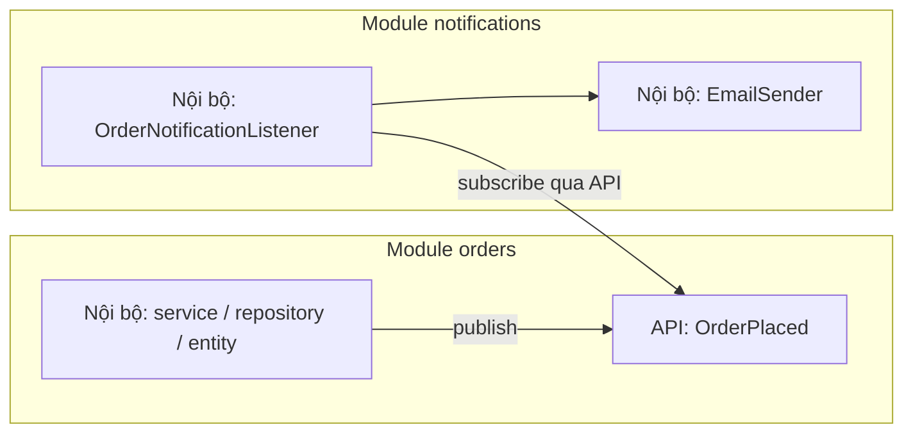

# Package nội bộ trong ranh giới module Spring Modulith

## 1. Tại sao cần package nội bộ?

Spring Modulith giúp xây dựng **modular monolith**: nhiều module nghiệp vụ chạy trong cùng một ứng dụng Spring Boot, nhưng mỗi module có **ranh giới phụ thuộc** có thể kiểm chứng. Trong module học `SPRING_MODULITH_APPLICATION_EVENTS`, ranh giới này đặc biệt quan trọng vì một mục tiêu của application events là để module phát sự kiện không phải biết module nào sẽ xử lý nó.

Ví dụ: khi module `orders` tạo đơn hàng, module `notifications` muốn gửi email xác nhận. Nếu `notifications` đọc thẳng bảng đơn hàng qua `OrderRepository` của `orders`, hai module đã bị gắn chặt vào chi tiết lưu trữ của nhau. Thay vào đó, `orders` có thể phát một sự kiện công khai `OrderPlaced`; `notifications` lắng nghe sự kiện mà không cần chạm tới repository, entity hay service triển khai đơn hàng.

**Package nội bộ** là nơi đặt những lớp **chỉ phục vụ cách triển khai bên trong một module**: repository, entity, adapter, helper, workflow cụ thể và listener chỉ dùng trong module đó. Cơ chế package của Java cho phép biên dịch và truy cập lớp theo `public`/`protected`/`private`/package-private; còn Spring Modulith bổ sung một lớp **quy ước kiến trúc và kiểm tra quan hệ phụ thuộc giữa các module**.

## 2. Module gốc và các package con

Giả sử lớp `ShopApplication` ở package `com.example.shop` và ứng dụng theo cách phát hiện module mặc định của Spring Modulith: mỗi package con trực tiếp như `orders`, `notifications` là một application module.

```text
com.example.shop
├── ShopApplication.java
├── orders/                           ← module orders
│   ├── OrderManagement.java          ← API ở base package
│   ├── OrderPlaced.java              ← event công khai
│   ├── internal/                      ← chi tiết nội bộ
│   │   ├── DefaultOrderManagement.java
│   │   ├── OrderRepository.java
│   │   └── OrderEntity.java
│   └── persistence/                   ← cũng là package nội bộ
│       └── OrderJpaMapper.java
└── notifications/                    ← module notifications
    └── internal/
        ├── OrderNotificationListener.java
        └── EmailSender.java
```

Trong mô hình mặc định:

| Vị trí | Ý nghĩa đối với module khác |
| --- | --- |
| `com.example.shop.orders` | **Base package** của module `orders`; các kiểu truy cập được từ ngoài theo quy tắc Java có thể thuộc API công khai mặc định của module |
| `com.example.shop.orders.internal` | Package con, **được coi là nội bộ** của `orders` |
| `com.example.shop.orders.persistence` | Cũng là package nội bộ, dù tên không phải `internal` |
| `com.example.shop.notifications.internal` | Chi tiết triển khai do module `notifications` sở hữu |

Điểm mấu chốt: **`internal` không phải từ khóa đặc biệt bắt buộc**. Trong cách tổ chức module mặc định, các **subpackage nằm dưới base package** được coi là phần nội bộ, trừ phần được công bố rõ thành một giao diện có tên. Đặt tên `internal` giúp lập trình viên nhận ra ý định thiết kế, nhưng bản thân việc đặt tên không tạo nên ranh giới.

> Những quy tắc mô tả ở đây áp dụng cho cấu trúc module theo convention mặc định. Khi dự án cấu hình chiến lược phát hiện module hoặc khai báo cấu trúc khác, phải xác định lại base package thực tế trước khi kết luận package nào là nội bộ.

## 3. Java `public` khác với API công khai của module

Một lớp được khai báo `public` trong `orders.internal` vẫn có thể **được Java compiler cho phép import** từ `notifications` nếu cả hai cùng nằm trên classpath. Nhưng phụ thuộc ấy **vi phạm ranh giới Spring Modulith theo convention**.

Ví dụ cần tránh:

```java
package com.example.shop.notifications.internal;

import com.example.shop.orders.internal.OrderRepository; // Phụ thuộc nội bộ!

class NotificationLookup {
    private final OrderRepository orders;

    NotificationLookup(OrderRepository orders) {
        this.orders = orders;
    }
}
```

Một số nhận thức dễ nhầm:

- `public` chỉ quyết định khả năng truy cập ở **mức ngôn ngữ Java**; nó không khẳng định kiểu đó nên trở thành API giữa các module.
- `package-private` không truy cập được từ package con của nó. Ví dụ `orders` và `orders.internal` là **hai package Java riêng biệt**.
- Spring component scanning vẫn có thể phát hiện bean `@Service`, `@Repository` hoặc `@Component` trong package nội bộ nếu chúng nằm trong vùng quét. **Bean có thể được Spring quản lý không có nghĩa bean đó là hợp đồng để module khác sử dụng**.
- Khi nhiều module cùng nằm trong một JVM, Spring Modulith **không phải sandbox hay tường lửa runtime**. Việc tuân thủ kiến trúc dựa vào thiết kế API và kiểm tra dependency, chẳng hạn `ApplicationModules.verify()`.

Để phân biệt rõ: một lớp `public` ở `orders.internal` có thể cần công khai do proxy Spring, mapping hoặc framework khác; nó vẫn **không nên bị module khác tham chiếu trực tiếp**.

## 4. Tổ chức API và phần triển khai khi phát application event

Với giao tiếp bằng application events, một bố cục rõ ràng thường gồm:

1. **Hợp đồng công khai** do module phát sở hữu: kiểu event và API nghiệp vụ mà module khác được phép dùng.
2. **Phần triển khai nội bộ**: service xử lý đơn, repository, entity, helper, logic phát sự kiện.
3. **Listener của module nhận**: đặt trong package nội bộ của chính module nhận; chỉ import kiểu event công khai của module phát.

### 4.1. Event ở API công khai của `orders`

```java
// File: orders/OrderPlaced.java
package com.example.shop.orders;

import java.time.Instant;
import java.util.UUID;

/** Sự thật nghiệp vụ: một đơn hàng đã được ghi nhận. */
public record OrderPlaced(
        UUID eventId,
        UUID orderId,
        Instant occurredAt
) {}
```

Đặt `OrderPlaced` tại base package giúp những module khác phụ thuộc vào một **hợp đồng nhỏ và ổn định** mà không cần biết `OrderEntity`, `OrderRepository` hoặc transaction bên trong `orders`. Dữ liệu event sử dụng giá trị bất biến phù hợp với việc lưu trữ, tái xử lý và truyền qua ranh giới module.

### 4.2. Publisher được triển khai ở package nội bộ

```java
// File: orders/internal/DefaultOrderManagement.java
package com.example.shop.orders.internal;

import com.example.shop.orders.OrderPlaced;
import org.springframework.context.ApplicationEventPublisher;
import org.springframework.stereotype.Service;
import org.springframework.transaction.annotation.Transactional;
import java.time.Instant;
import java.util.UUID;

@Service
class DefaultOrderManagement {
    private final OrderRepository repository;
    private final ApplicationEventPublisher events;

    DefaultOrderManagement(
            OrderRepository repository,
            ApplicationEventPublisher events
    ) {
        this.repository = repository;
        this.events = events;
    }

    @Transactional
    public void placeOrder(OrderEntity order) {
        repository.save(order);
        events.publishEvent(new OrderPlaced(
                UUID.randomUUID(),
                order.getId(),
                Instant.now()
        ));
    }
}
```

Ở đây `OrderRepository` và `OrderEntity` là chi tiết nội bộ; `OrderPlaced` mới là hợp đồng mà module khác cần nhìn thấy. Ví dụ minh họa tập trung vào vị trí package và ranh giới. Trong một ứng dụng thực tế, lời gọi vào `orders` nên đi qua một API công khai như `OrderManagement`, còn API nhận tham số/giá trị nghiệp vụ thay vì để module ngoài truyền trực tiếp `OrderEntity`.

Do phương thức `placeOrder` có transaction, listener sử dụng pha `AFTER_COMMIT` sẽ chỉ xử lý khi transaction commit thành công. **Việc phát event trước thời điểm commit không tự chứng minh event đã được giao bền vững**: muốn theo dõi và phục hồi lần giao cần cấu hình Event Publication Registry phù hợp.

### 4.3. Listener ở package nội bộ của `notifications`

```java
// File: notifications/internal/OrderNotificationListener.java
package com.example.shop.notifications.internal;

import com.example.shop.orders.OrderPlaced;
import org.springframework.modulith.events.ApplicationModuleListener;
import org.springframework.stereotype.Component;

@Component
class OrderNotificationListener {
    private final EmailSender emailSender;

    OrderNotificationListener(EmailSender emailSender) {
        this.emailSender = emailSender;
    }

    @ApplicationModuleListener
    void on(OrderPlaced event) {
        emailSender.sendOrderConfirmation(event.orderId());
    }
}
```

`OrderNotificationListener` là chi tiết triển khai **của `notifications`**, vì vậy đặt ở `notifications.internal` là hợp lý. Nó chỉ import `OrderPlaced` thuộc API công khai của `orders`. Module `orders` không cần import bất kỳ kiểu nào từ `notifications`.

`@ApplicationModuleListener` của Spring Modulith thuận tiện cho việc nhận event sau commit theo cách bất đồng bộ và xử lý trong transaction riêng. Nó không biến email thành tác dụng phụ có thể rollback, cũng không bảo đảm email chỉ được gửi đúng một lần. Khi listener có thể được chạy lại, nên áp dụng **idempotency key** hoặc cơ chế kiểm soát trùng lặp tại bên gửi/nhận phù hợp.

Sơ đồ phụ thuộc mong muốn:



**Không có chiều phụ thuộc ngược** từ `orders.internal` sang `notifications.internal`. Module phát công bố sự kiện; module nghe chủ động lựa chọn cách phản ứng.

## 5. Khi cần công khai một subpackage: Named Interface

Một module có thể có nhiều hợp đồng công khai, ví dụ muốn gom toàn bộ event vào `orders.events` thay vì để mọi kiểu ở base package. Theo convention mặc định, `orders.events` vẫn là package nội bộ. Để công khai phần đó như một **named interface**, dùng `@NamedInterface` ở `package-info.java`:

```text
orders/
├── OrderManagement.java
├── events/
│   ├── package-info.java
│   ├── OrderPlaced.java
│   └── OrderCancelled.java
└── internal/
    ├── DefaultOrderManagement.java
    └── OrderRepository.java
```

```java
// File: orders/events/package-info.java
@org.springframework.modulith.NamedInterface("events")
package com.example.shop.orders.events;
```

Sau đó, event thuộc `orders.events` là một phần của named interface `orders::events`. Các module dùng nó có thể import `com.example.shop.orders.events.OrderPlaced`; còn `orders.internal.OrderRepository` vẫn là nội bộ.

Nếu muốn giới hạn rõ dependency từ module `notifications`, có thể khai báo allowed dependencies của module này:

```java
// File: notifications/package-info.java
@org.springframework.modulith.ApplicationModule(
        allowedDependencies = "orders::events"
)
package com.example.shop.notifications;
```

Khi giới hạn bằng `allowedDependencies` như ví dụ, `notifications` chỉ được phụ thuộc theo hợp đồng `orders::events` đã khai báo. Muốn dùng thêm API ở base package hoặc interface khác thì phải **xem xét và khai báo những phụ thuộc được phép tương ứng**. Đây là cách thể hiện chủ đích kết nối giữa module qua một hợp đồng rất nhỏ.

Lưu ý: `@NamedInterface` chỉ làm rõ **vùng công khai của module**. Nó không khiến event chạy bất đồng bộ, có transaction hay được lưu lại; đó là những cơ chế riêng ở tầng Spring Events/Spring Modulith Events.

## 6. Làm gì khi một module khác cần dữ liệu nội bộ?

Tình huống phổ biến: `notifications` nhận `OrderPlaced`, nhưng cần email khách hàng để gửi thư, trong khi `orders.internal.OrderEntity` mới chứa địa chỉ email.

Có ba hướng thiết kế cần cân nhắc:

| Lựa chọn | Áp dụng khi | Ranh giới cần giữ |
| --- | --- | --- |
| Đưa dữ liệu tối thiểu vào event | Giá trị cần thiết có tại thời điểm phát và có thể lưu/truyền an toàn | Event chỉ chứa dữ liệu nghiệp vụ cần thiết; tránh đưa cả JPA entity |
| Truy vấn qua API công khai `orders` hoặc module sở hữu khách hàng | Listener cần dữ liệu hiện hành, hoặc không nên sao chép dữ liệu lớn vào event | API nằm ở base package/named interface; repository vẫn nội bộ |
| Tạo projection/read model dành cho module nhận | Cần giảm phụ thuộc thời gian chạy hoặc tối ưu truy vấn đọc | Đồng bộ bất đồng bộ; chấp nhận độ trễ và xử lý event trùng/sai thứ tự |

Không nên chuyển `OrderEntity` hay `OrderRepository` sang base package chỉ để **lách cảnh báo ranh giới**. Nếu nhiều module liên tục cần truy cập chi tiết đó, nên xem lại cách phân chia trách nhiệm module, thiết kế API công khai hoặc ownership dữ liệu.

Đặc biệt với xử lý sau commit, listener nên tránh dựa vào entity đang gắn với persistence context của publisher. Truyền một ID hoặc snapshot dữ liệu bất biến giúp tránh phụ thuộc lazy loading, lifecycle của transaction và các thay đổi nội bộ của ORM.

## 7. Kiểm tra ranh giới package bằng Spring Modulith

Thêm một bài kiểm thử kiến trúc để kiểm chứng dependency giữa các module:

```java
import com.example.shop.ShopApplication;
import org.junit.jupiter.api.Test;
import org.springframework.modulith.core.ApplicationModules;

class ModuleBoundaryTests {

    @Test
    void verifiesModuleBoundaries() {
        ApplicationModules.of(ShopApplication.class).verify();
    }
}
```

Với mô hình mặc định, phép kiểm tra này giúp phát hiện các phụ thuộc không hợp lệ như module `notifications` truy cập kiểu `orders.internal.OrderRepository` hoặc chu trình dependency giữa các module. Nó cũng có thể đối chiếu ràng buộc `allowedDependencies` và các named interface đã khai báo.

Ví dụ phân tích:

```text
// Phụ thuộc hợp lệ:
notifications.internal.OrderNotificationListener
    --> orders.OrderPlaced

// Phụ thuộc không nên có và bị kiểm tra kiến trúc phát hiện:
notifications.internal.NotificationLookup
    --> orders.internal.OrderRepository
```

Để bài test thực sự hữu ích, cần đặt nó vào luồng CI. Không chỉ nhìn vào lỗi import trực tiếp: phụ thuộc có thể xuất hiện qua constructor parameter, method signature, annotation hoặc kiểu trả về. Khi phát hiện vi phạm, hãy kiểm tra **ai sở hữu contract và dữ liệu**, rồi sửa thiết kế thay vì chỉ chuyển file để làm bài test xanh.

Kiểm thử ranh giới và kiểm thử giao sự kiện là hai vấn đề bổ trợ: `ApplicationModules.verify()` kiểm tra **kiến trúc phụ thuộc**, còn integration test phải kiểm tra **commit/rollback, listener, registry, retry và idempotency**. Bài test kiến trúc không thể chứng minh một event đã được xử lý thành công sau khi database commit.

## 8. Các lỗi thiết kế thường gặp

### Lỗi 1: Đặt event trong `orders.internal.events`

Nếu `notifications` phải import `orders.internal.events.OrderPlaced`, module nhận phụ thuộc vào package nội bộ của module phát. Nếu event là contract chia sẻ, hãy đưa nó vào base package hoặc một named interface công khai. Đường dẫn package cũng là một phần của hợp đồng kiểu Java; khi di chuyển các lớp event đã được lưu để replay, cần đánh giá tương thích dữ liệu và serializer.

### Lỗi 2: Công khai mọi repository/entity để dễ dùng

Việc đưa `OrderRepository` lên `orders` giúp module khác import được nó, nhưng khiến module khác biết cấu trúc database và quy trình lưu trữ. Về sau sửa ORM hoặc bảng có thể tác động đến nhiều module. Chỉ công khai các thao tác nghiệp vụ thật sự cần thiết.

### Lỗi 3: Để module phát gọi thẳng listener module nhận

`orders.internal.OrderService` gọi `notifications.internal.EmailSender` đồng nghĩa module phát biết chi tiết triển khai module nhận. Cách đó làm mất mục đích giảm coupling bằng application events; khi gửi email là tác dụng phụ độc lập, hãy phát event và để module nhận tự đăng ký listener.

### Lỗi 4: Cho rằng `public` hoặc `@Component` là được phép qua biên giới

Spring có thể khởi tạo bean và Java có thể biên dịch import, nhưng kiến trúc module vẫn có thể không hợp lệ. Tập trung kiểm tra hướng phụ thuộc giữa module thay vì chỉ dựa vào khả năng chạy của chương trình.

### Lỗi 5: Nhầm ranh giới package với bảo đảm giao sự kiện

Đưa listener vào `notifications.internal` và event vào `orders.events` giúp dependency rõ ràng. Nó **không** tự giải quyết mất publication, listener lỗi, xử lý trùng hoặc thứ tự event. Để giao sự kiện đáng tin cậy, cần chọn pha sau commit, cấu hình Event Publication Registry/phục hồi phù hợp, dùng retry có kiểm soát, thiết kế idempotency và quan sát được các publication chưa hoàn tất.

## 9. Checklist áp dụng cho module application events

Trước khi tích hợp hai module bằng application events, hãy kiểm tra:

1. **Owner**: event do module nào sở hữu? Tên event có biểu đạt một sự thật nghiệp vụ của module đó không?
2. **API**: kiểu event nằm ở base package hoặc named interface đã được công bố chưa?
3. **Internal**: repository, entity, helper và service triển khai vẫn nằm trong subpackage nội bộ của module sở hữu chứ?
4. **Hướng phụ thuộc**: module nhận chỉ import event/API công khai; module phát không cần import listener hay service nội bộ của module nhận chứ?
5. **Transaction**: event được publish khi nào; listener cần xử lý trong transaction gốc hay sau commit?
6. **Tin cậy**: nếu listener lỗi hoặc tiến trình restart, có cơ chế phát hiện, retry, phục hồi và chống xử lý trùng phù hợp không?
7. **Kiểm thử**: `ApplicationModules.verify()` có chạy trong CI, cùng với integration test cho tình huống commit, rollback và retry không?

**Ghi nhớ:** Package nội bộ bảo vệ **tính đóng gói và quyền sở hữu triển khai** của từng Spring Modulith module. Khi event được đặt ở một API công khai nhỏ, module phát và module nhận có thể thay đổi phần nội bộ mà ít ảnh hưởng lẫn nhau. Ranh giới package tạo nền tảng kiến trúc; transaction, Event Publication Registry, retry và idempotency mới giải quyết các yêu cầu vận hành của giao sự kiện đáng tin cậy.
