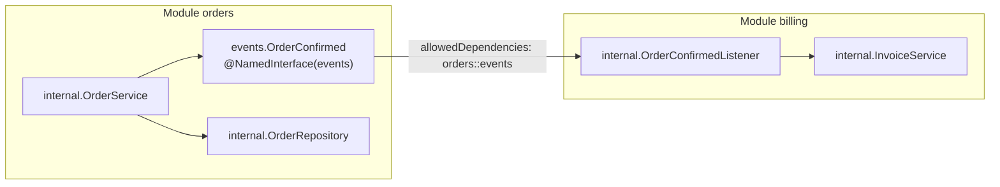
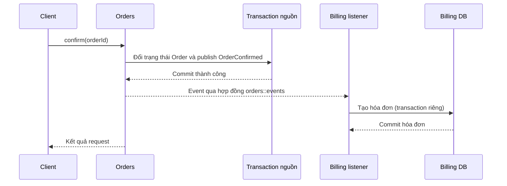

# Package được phép truy cập

> **Chương:** Ranh giới module  
> **Phạm vi module học:** `SPRING_MODULITH_APPLICATION_EVENTS` — tổ chức giao tiếp giữa các module Spring Modulith bằng application events để giảm phụ thuộc trực tiếp và bảo vệ ranh giới nghiệp vụ. Nội dung tập trung vào việc xác định **package và kiểu dữ liệu nào được phép dùng từ module khác**, từ đó công bố event contract đúng chỗ, viết listener hợp lệ và kiểm tra phụ thuộc ở mức kiến trúc.

## 1. Tại sao phải xác định package được phép truy cập?

Giả sử ứng dụng bán hàng có ba application module: `orders`, `billing` và `notifications`. Module `orders` sở hữu nghiệp vụ xác nhận đơn; `billing` tạo hóa đơn sau xác nhận; `notifications` gửi thông báo.

Một cách làm có vẻ tiện là cho Billing sử dụng trực tiếp repository của Orders:

```java
package com.acme.shop.billing.internal;

import com.acme.shop.orders.internal.OrderRepository;

class InvoiceService {

    private final OrderRepository orderRepository;

    InvoiceService(OrderRepository orderRepository) {
        this.orderRepository = orderRepository;
    }

    // Billing đọc trực tiếp mô hình lưu trữ của Orders.
}
```

Ngay cả khi `OrderRepository` là một `public interface` và Java cho phép import, đây vẫn là **phụ thuộc vào chi tiết triển khai nội bộ** của Orders. Chỉ một thay đổi schema, tên entity hoặc cách lưu trữ ở Orders có thể buộc Billing sửa theo.

Spring Modulith giúp xác định và kiểm chứng một hợp đồng kiến trúc rõ ràng:

- Module khác được dùng **API công khai** mà chủ sở hữu module chủ động công bố.
- Các lớp nằm trong **package nội bộ** được dùng để triển khai module đó; module bên ngoài không được phụ thuộc trực tiếp.
- Khi có nhu cầu công khai thêm một package con, module sở hữu có thể định nghĩa **named interface**.
- Module tiêu thụ có thể giới hạn tiếp **những module hoặc named interface cụ thể mà nó được phép phụ thuộc**.

Trong học phần Application Events, quy tắc này đặc biệt quan trọng: `OrderConfirmed` là **hợp đồng giao tiếp liên module**, còn `OrderRepository`, entity nội bộ hay service triển khai không phải hợp đồng mà consumer được tự ý sử dụng.

## 2. Ba lớp cần phân biệt: Java, ranh giới module và danh sách phụ thuộc

“Có thể import” và “được phép phụ thuộc” không đồng nghĩa.

| Lớp kiểm soát | Cơ chế | Câu hỏi được trả lời |
|---|---|---|
| **Ngôn ngữ Java** | `public`, `protected`, package-private, `private` | Trình biên dịch có cho phép một kiểu/phương thức được tham chiếu không? |
| **Spring Modulith module API** | Base package công khai, named interfaces, internal subpackages | Theo ranh giới ứng dụng, một module khác có được tham chiếu kiểu đó không? |
| **Explicit allowed dependencies** | `@ApplicationModule(allowedDependencies = ...)` | Module tiêu thụ có được phụ thuộc **module/named interface đích đó** không? |

Ví dụ: `com.acme.shop.orders.internal.OrderRepository` có thể là `public` để các package con bên trong Orders cùng sử dụng. Java không nhất thiết cấm Billing import. Tuy nhiên, nếu Orders là **closed application module** và package `internal` không được xuất qua named interface, `ApplicationModules.verify()` sẽ báo vi phạm ranh giới module.

Mặt khác, ngay cả khi `OrderConfirmed` đã được công khai đúng cách, một module có `allowedDependencies` hạn chế cũng phải **cho phép phụ thuộc đến API chứa kiểu đó**. Cả hai điều kiện đều cần được thỏa mãn.

Đây là các quy tắc về **phụ thuộc mã nguồn**. Chúng không thay thế các quy tắc bảo mật, phân quyền người dùng hay bảo vệ dữ liệu trong runtime.

## 3. Spring Modulith nhận diện application module bằng package thế nào?

Ở cấu hình mặc định, Spring Modulith coi **các subpackage trực tiếp** bên dưới package chứa lớp ứng dụng Spring Boot là những application module.

Ví dụ lớp khởi động:

```java
package com.acme.shop;

import org.springframework.boot.autoconfigure.SpringBootApplication;

@SpringBootApplication
public class ShopApplication {}
```

Một cấu trúc thư mục minh họa:

```text
src/main/java/
└── com/acme/shop/
    ├── ShopApplication.java
    ├── orders/                        <-- Application module: orders
    │   ├── OrderManagement.java       <-- API tại base package
    │   ├── internal/
    │   │   ├── OrderService.java
    │   │   └── OrderRepository.java
    │   └── events/
    │       ├── package-info.java
    │       └── OrderConfirmed.java
    ├── billing/                       <-- Application module: billing
    │   ├── package-info.java
    │   └── internal/
    │       └── OrderConfirmedListener.java
    └── notifications/                 <-- Application module: notifications
        └── internal/
            └── ConfirmationListener.java
```

Với cách sắp xếp trên:

- `com.acme.shop.orders` là **base package** của module Orders.
- `com.acme.shop.orders.internal` và `com.acme.shop.orders.events` là **subpackage** của module Orders, chưa tự động trở thành application module độc lập.
- `com.acme.shop.billing` và `com.acme.shop.notifications` là hai module ngang hàng, có ranh giới riêng.
- `com.acme.shop` chứa lớp khởi động; mặc định nó không phải là module `orders`, `billing` hay `notifications`.

Chú ý: đây là **chiến lược phát hiện mặc định**. Dự án có thể tùy biến phát hiện module, sử dụng module lồng nhau hoặc quy ước khác; khi đó kết luận phải dựa trên mô hình `ApplicationModules` thực tế, không chỉ nhìn cây thư mục.

### 3.1. Base package là API mặc định

Đối với **closed application module** thông thường, các **public types** nằm trực tiếp trong base package được coi là API để module khác sử dụng. Ví dụ:

```java
package com.acme.shop.orders;

import java.util.UUID;

public interface OrderManagement {

    boolean isConfirmed(UUID orderId);
}
```

Module Billing có thể gọi API này nếu hợp đồng phụ thuộc cho phép:

```java
package com.acme.shop.billing.internal;

import com.acme.shop.orders.OrderManagement;

class BillingPolicy {

    private final OrderManagement orders;

    BillingPolicy(OrderManagement orders) {
        this.orders = orders;
    }

    boolean canInvoice(java.util.UUID orderId) {
        return orders.isConfirmed(orderId);
    }
}
```

Việc `OrderManagement` được công bố tại base package là một **quyết định kiến trúc**. Không nên đặt mọi bean vào base package cho tiện: các public classes vô tình xuất hiện ở đây có thể trở thành phần API được Spring Modulith xem là công khai.

### 3.2. Subpackage là nội bộ, kể cả khi class khai báo `public`

Mặc định, kiểu nằm trong `orders.internal`, `orders.persistence`, `orders.service` hoặc **bất kỳ subpackage nào khác** không được coi là API chỉ vì tên package nghe có vẻ công khai.

```java
package com.acme.shop.orders.internal;

public interface OrderRepository {
    // Repository chỉ phục vụ triển khai của Orders.
}
```

Code khác trong module Orders có thể cần thấy `OrderRepository` nên kiểu này phải `public`. Điều đó không trao quyền cho Billing phụ thuộc trực tiếp vào repository. Spring Modulith sẽ phát hiện sự vi phạm qua bước kiểm chứng kiến trúc.

Tên package `internal` là quy ước dễ hiểu, nhưng **không phải từ khóa đặc biệt của Java**; một package `orders.data` cũng nội bộ theo mặc định nếu chưa được công khai qua cơ chế phù hợp.

## 4. Named interface: chủ động công khai một package con

Base package API phù hợp khi chỉ có ít kiểu dữ liệu công khai. Với hệ thống lớn, có thể muốn tách các hợp đồng sự kiện sang `orders.events` và API đồng bộ sang `orders`.

Khi đó cần khai báo **named interface** để Spring Modulith biết `orders.events` là package được phép truy cập từ module khác.

### 4.1. Khai báo `@NamedInterface` bằng `package-info.java`

Tạo file:

```text
src/main/java/com/acme/shop/orders/events/package-info.java
```

Nội dung:

```java
@org.springframework.modulith.NamedInterface("events")
package com.acme.shop.orders.events;
```

Nhờ đó các public types được công bố trong package `orders.events` thuộc named interface có tên logic `events` của module `orders`.

Ví dụ event contract:

```java
package com.acme.shop.orders.events;

import java.time.Instant;
import java.util.UUID;

public record OrderConfirmed(
        UUID eventId,
        UUID orderId,
        Instant occurredAt
) {}
```

Module Billing giờ có thể import `com.acme.shop.orders.events.OrderConfirmed` **qua hợp đồng được công khai**, trong khi vẫn không có quyền truy cập `orders.internal.OrderRepository` theo quy tắc module thông thường.

### 4.2. Sự khác biệt giữa package tên `api` và API thực sự

Đặt tên một subpackage là `orders.api` **không đủ để tự động cho phép module khác truy cập** trong chiến lược mặc định. Nếu muốn dùng `orders.api`, hãy khai báo named interface:

```java
@org.springframework.modulith.NamedInterface("api")
package com.acme.shop.orders.api;
```

Tương tự, `orders.events` không tự trở thành public chỉ vì chứa `OrderConfirmed`. Quy tắc cần nhớ là **base package công khai mặc định; package con phải được xuất rõ ràng khi muốn chia sẻ**.

> Lưu ý: Spring Modulith cũng hỗ trợ một số cách tùy biến nhận diện named interface, chẳng hạn annotation trên một kiểu metadata có `@PackageInfo` hoặc chiến lược phát hiện tùy chỉnh. Ví dụ trong bài dùng `package-info.java` vì gần với quy ước Java, dễ kiểm tra và áp dụng.

### 4.3. Khi nào nên tạo nhiều named interface?

Có thể tách hợp đồng theo mục đích:

```text
orders/
├── OrderManagement.java           # API đồng bộ tại base package
├── events/
│   ├── package-info.java          # @NamedInterface("events")
│   ├── OrderConfirmed.java
│   └── OrderCancelled.java
├── spi/
│   ├── package-info.java          # @NamedInterface("spi")
│   └── OrderFraudCheck.java
└── internal/
    ├── OrderService.java
    └── OrderRepository.java
```

Trong thiết kế này, một module có thể được phép chỉ nhận **events** mà không có quyền gọi API hoặc SPI khác. Điều đó đặc biệt hữu ích khi muốn consumer của event có sự phụ thuộc tối thiểu.

Không cần tạo named interface cho mọi package nhỏ. Chỉ xuất một nhóm loại mà module thực sự cam kết là **hợp đồng ổn định** cho các module còn lại.

## 5. `allowedDependencies`: giới hạn module tiêu thụ được phụ thuộc vào đâu

Việc Orders công bố `orders.events` có nghĩa package đó **có thể** được dùng qua ranh giới module. Nhưng Billing có thể chủ động áp dụng chính sách chặt hơn: **Billing chỉ được phụ thuộc vào hợp đồng event của Orders**.

Đặt metadata trong `billing/package-info.java`:

```java
@org.springframework.modulith.ApplicationModule(
        allowedDependencies = "orders::events"
)
package com.acme.shop.billing;
```

Ở đây:

- `orders` là **tên logic** của application module đích trong mô hình mặc định.
- `events` là tên named interface khai báo ở `orders.events`.
- `::` kết hợp **module ID** và **named interface**.
- Quy tắc được khai báo **trên module tiêu thụ Billing**, không phải trên publisher Orders.

Điều đó cho phép Billing tham chiếu `orders.events.OrderConfirmed`, nhưng không cho phép Billing tham chiếu `orders.OrderManagement` chỉ vì nó nằm trong API mặc định của Orders. Nếu Billing cần cả API base package lẫn events, phải cho phép cả hai:

```java
@org.springframework.modulith.ApplicationModule(
        allowedDependencies = { "orders", "orders::events" }
)
package com.acme.shop.billing;
```

### 5.1. Các cú pháp thường gặp

| Khai báo trong module tiêu thụ | Quyền được phép đối với module `orders` |
|---|---|
| Không cấu hình `allowedDependencies` | Không giới hạn **module đích** bằng allowlist; vẫn phải tuân thủ ranh giới API/named interface |
| `"orders"` | Chỉ API mặc định ở base package của Orders |
| `"orders::events"` | Chỉ named interface `events` của Orders |
| `{ "orders", "orders::events" }` | API base package và named interface `events` |
| `"orders::*"` | Các named interface được khai báo rõ của Orders; **không bao gồm** API base package |
| `"orders::**"` | API base package và tất cả named interface được khai báo của Orders |
| `allowedDependencies = {}` | Không cho phép phụ thuộc đến application module khác theo allowlist này; vẫn có thể dùng code ngoài phạm vi module theo quy tắc chung |

**Cẩn thận với wildcard:** `*` và `**` có ngữ nghĩa khác nhau; chúng không biến các package nội bộ chưa xuất thành API trong closed module.

Nếu tên logic của module được tùy biến (chẳng hạn `@ApplicationModule(id = "...")` hoặc chiến lược đặt tên khác), chuỗi `allowedDependencies` cần tham chiếu **đúng tên trong mô hình module**, không suy đoán theo tên thư mục.

### 5.2. `allowedDependencies` không thể cấp quyền truy cập internal package

Đoạn sau **không hợp lệ** theo ranh giới closed module:

```java
// billing/package-info.java
@org.springframework.modulith.ApplicationModule(
        allowedDependencies = "orders"
)
package com.acme.shop.billing;
```

```java
// billing/internal/WrongBillingService.java
package com.acme.shop.billing.internal;

import com.acme.shop.orders.internal.OrderRepository; // Sai ranh giới.
```

`"orders"` chỉ cho phép Billing phụ thuộc **API mặc định** của Orders. Nó không phải “thẻ thông hành” để gọi mọi class trong module Orders.

## 6. Ví dụ hoàn chỉnh: Orders phát event, Billing lắng nghe hợp đồng công khai

Mục tiêu là tổ chức giao tiếp bằng application events để Billing phản ứng sau khi đơn được xác nhận, không phụ thuộc trực tiếp vào service/repository nội bộ của Orders.

### 6.1. Cấu trúc và quan hệ mong muốn



Các mũi tên thể hiện **quan hệ phụ thuộc qua code/hợp đồng**, không khẳng định listener chạy đồng bộ hay rằng event đã được ghi bền vững.

### 6.2. Publisher ở phần triển khai Orders

```java
package com.acme.shop.orders.internal;

import com.acme.shop.orders.events.OrderConfirmed;
import java.time.Clock;
import java.time.Instant;
import java.util.UUID;
import org.springframework.context.ApplicationEventPublisher;
import org.springframework.stereotype.Service;
import org.springframework.transaction.annotation.Transactional;

@Service
public class OrderService {

    private final OrderRepository orders;
    private final ApplicationEventPublisher publisher;
    private final Clock clock;

    public OrderService(
            OrderRepository orders,
            ApplicationEventPublisher publisher,
            Clock clock
    ) {
        this.orders = orders;
        this.publisher = publisher;
        this.clock = clock;
    }

    @Transactional
    public void confirm(UUID orderId) {
        Order order = orders.findById(orderId).orElseThrow();
        order.confirm(); // Kiểm tra bất biến và chuyển trạng thái hợp lệ.

        publisher.publishEvent(new OrderConfirmed(
                UUID.randomUUID(),
                order.getId(),
                Instant.now(clock)
        ));
    }
}
```

Giả định `Order` là entity được quản lý và `Order.confirm()` chỉ cho phép chuyển trạng thái hợp lệ. Trong ứng dụng thực, cần làm rõ trường hợp xác nhận lặp lại: nếu không có sự kiện nghiệp vụ mới, không nên tạo một `OrderConfirmed` mới tùy tiện.

Orders được phép dùng cả `orders.internal` và `orders.events` vì **cùng một module**. Hạn chế công khai giữa module không cấm code nội bộ trong cùng module hợp tác với nhau.

### 6.3. Billing chỉ được tham chiếu event contract

```java
// src/main/java/com/acme/shop/billing/package-info.java
@org.springframework.modulith.ApplicationModule(
        allowedDependencies = "orders::events"
)
package com.acme.shop.billing;
```

```java
package com.acme.shop.billing.internal;

import com.acme.shop.orders.events.OrderConfirmed;
import org.springframework.modulith.events.ApplicationModuleListener;
import org.springframework.stereotype.Component;

@Component
class OrderConfirmedListener {

    private final InvoiceService invoices;

    OrderConfirmedListener(InvoiceService invoices) {
        this.invoices = invoices;
    }

    @ApplicationModuleListener
    void on(OrderConfirmed event) {
        invoices.createIfAbsent(event.orderId(), event.eventId());
    }
}
```

Code này chỉ cần biết `OrderConfirmed`. Billing tự quản lý repository, transaction và quy tắc lập hóa đơn của mình; Orders không inject `InvoiceService` của Billing.

`@ApplicationModuleListener` là tiện ích của Spring Modulith kết hợp listener gắn với transaction, thực thi bất đồng bộ và transaction mới cho listener. Cần cấu hình xử lý async phù hợp, chẳng hạn `@EnableAsync` với executor giới hạn tài nguyên. Đây là **lựa chọn xử lý thời điểm và transaction**, tách biệt với quy tắc “được phép import package nào”.

### 6.4. Kết quả xử lý sau commit và độ tin cậy



Sơ đồ thể hiện quan hệ logic; thời điểm phản hồi và việc listener async thực sự hoàn tất có thể khác tùy cấu hình.

Việc export package giúp **consumer được phép nhìn thấy loại event**, nhưng **không đảm bảo** event được giao lại khi lỗi. Nếu yêu cầu độ bền, ứng dụng cần cấu hình **Event Publication Registry** với publication store phù hợp và chính sách recovery/retry. Listener phải **idempotent**, ví dụ có unique constraint theo `orderId` khi mỗi đơn chỉ được lập một hóa đơn. Mọi cơ chế giao nhận, sau commit và quan sát cần được kiểm thử riêng.

## 7. Kiểm tra ranh giới bằng `ApplicationModules.verify()`

Spring Modulith cung cấp một mô hình application modules trích từ code. Việc kiểm tra ranh giới không đòi hỏi chạy toàn bộ ứng dụng với đầy đủ nghiệp vụ; có thể viết một kiểm thử kiến trúc:

```java
package com.acme.shop;

import org.junit.jupiter.api.Test;
import org.springframework.modulith.core.ApplicationModules;

class ModuleBoundaryTests {

    @Test
    void enforcesModuleBoundaries() {
        ApplicationModules.of(ShopApplication.class).verify();
    }
}
```

Trong cấu hình mặc định, phép kiểm tra này phát hiện các loại vấn đề quan trọng:

1. **Vòng phụ thuộc giữa các application module**, ví dụ Orders phụ thuộc Billing, Billing lại phụ thuộc Orders.
2. **Truy cập trái phép vào package nội bộ** của một closed module, ngay cả khi class được khai báo `public`.
3. **Phụ thuộc ngoài danh sách `allowedDependencies`** khi module đã khai báo danh sách cho phép.

Ví dụ một thay đổi sai:

```java
package com.acme.shop.billing.internal;

import com.acme.shop.orders.internal.OrderRepository;

class BadInvoiceService {

    private final OrderRepository orders;

    BadInvoiceService(OrderRepository orders) {
        this.orders = orders;
    }
}
```

Lớp `BadInvoiceService` dùng Java hợp lệ nếu `OrderRepository` là public, nhưng **vi phạm luật của Spring Modulith**. Một test kiến trúc như trên sẽ nêu vi phạm; không cần chờ đến lúc một nghiệp vụ gặp lỗi runtime.

### 7.1. Cần kiểm tra cả phía publisher lẫn consumer

Với ví dụ Orders/Billing, kiểm tra theo hai chiều:

| Nơi kiểm tra | Điều cần xác minh |
|---|---|
| Orders | `OrderConfirmed` nằm trong package được công khai qua `@NamedInterface("events")` |
| Billing | `allowedDependencies` cho phép chính xác `orders::events` |
| Billing | Không import `orders.internal.*`, entity/repository/service triển khai của Orders |
| Orders | Không gọi trực tiếp `billing.internal.InvoiceService` chỉ để kích hoạt phản ứng |
| Toàn ứng dụng | Không có vòng phụ thuộc module do các thay đổi mới |
| Listener | Nhận đúng loại event và làm đúng nghiệp vụ trong module mình |

**Giới hạn:** `verify()` kiểm tra phụ thuộc kiến trúc theo code mà công cụ nhận diện; nó không thay thế kiểm thử transaction, event delivery, cơ sở dữ liệu hay tracing. Những truy cập động bằng reflection, tên class ở dạng chuỗi hoặc SQL đi thẳng tới bảng của module khác cũng cần quy tắc kiểm soát riêng.

## 8. Module mở (Open module) và ảnh hưởng tới các package được phép

Mặc định một application module là **closed**: chỉ những kiểu được công bố từ base package và named interfaces mới được module ngoài tham chiếu.

Spring Modulith hỗ trợ **open application module** cho trường hợp chuyển đổi hệ thống cũ, khi nhiều package nội bộ đã bị các module khác phụ thuộc sâu:

```java
@org.springframework.modulith.ApplicationModule(
        type = org.springframework.modulith.ApplicationModule.Type.OPEN
)
package com.acme.shop.orders;
```

Theo semantics của open module, việc tham chiếu các kiểu nội bộ từ module khác về cơ bản được cho phép trong quá trình kiểm chứng; nhiều kiểu trong các subpackage trở thành phần của unnamed named interface, trừ những kiểu đã thuộc named interface được khai báo tường minh.

Đây là công cụ hỗ trợ **chuyển đổi dần** một kiến trúc cũ, không phải cách mặc định để thiết kế ranh giới tốt:

| Closed module | Open module |
|---|---|
| Phân biệt API và internal rõ ràng | Nới lỏng giới hạn truy cập tới internal |
| Bắt lỗi module ngoài import kiểu nội bộ | Cho phép nhiều phụ thuộc chưa được tách |
| Tốt cho mô hình module đã ổn định | Thích hợp khi đang di trú hệ thống cũ |
| Giảm rủi ro phụ thuộc lan rộng | Có nguy cơ kéo dài coupling nếu không có kế hoạch thu hẹp |

Trong một hệ thống event-driven mới, hãy ưu tiên **closed module + API nhỏ + named interfaces**. Nếu phải dùng open module, ghi rõ những phụ thuộc cần được thay thế và dần đưa module trở lại trạng thái closed.

## 9. Event contract là API: lựa chọn payload cần tôn trọng ranh giới

Khi một sự kiện được chia sẻ qua named interface, **mọi kiểu xuất hiện trong chữ ký công khai của nó** cũng cần được consumer sử dụng hợp lệ và không làm lộ chi tiết nội bộ.

### 9.1. Ví dụ vi phạm do lộ entity

Giả sử Orders có entity nội bộ:

```java
package com.acme.shop.orders.internal;

public class OrderEntity {
    // Mapping JPA nội bộ của Orders.
}
```

Không nên thiết kế hợp đồng public như sau:

```java
package com.acme.shop.orders.events;

import com.acme.shop.orders.internal.OrderEntity;

public record OrderConfirmed(OrderEntity order) {}
```

Mặc dù `OrderConfirmed` nằm trong named interface, payload vẫn chứa `OrderEntity` nội bộ. Consumer buộc biết tới chi tiết không được công khai, tạo coupling tới JPA mapping, lazy loading, serialization và khả năng thay đổi dữ liệu của module nguồn.

Một hợp đồng thích hợp hơn:

```java
package com.acme.shop.orders.events;

import java.time.Instant;
import java.util.UUID;

public record OrderConfirmed(
        UUID eventId,
        UUID orderId,
        Instant occurredAt
) {}
```

Nếu Billing cần thêm dữ liệu tại thời điểm đơn xác nhận, có thể công bố một **value object hoặc snapshot bất biến** nằm trong API được phép dùng. Cân nhắc tính nhạy cảm của dữ liệu, dung lượng sự kiện, versioning và yêu cầu xử lý các publication cũ.

### 9.2. Không dùng event để đi vòng quy tắc ownership

Việc Billing chỉ nhận `OrderConfirmed` **không trao quyền** cho nó cập nhật trực tiếp bảng Orders. Billing có thể ghi invoice thuộc quyền quản lý của Billing, gọi API được công khai của Orders nếu được cho phép, hoặc phát sự kiện riêng như `InvoiceIssued`.

Mỗi module vẫn chịu trách nhiệm **bất biến dữ liệu và trạng thái** của nó. Event chỉ giúp giảm sự phụ thuộc vào các service đích và truyền tải thông tin nghiệp vụ rõ ràng.

## 10. Tách quyền import khỏi quyền thực hiện hành vi

Một package được phép truy cập không đồng nghĩa:

- Ai cũng có quyền gọi một API dưới góc độ **bảo mật người dùng**.
- Gọi API ở bất kỳ thời điểm nào cũng hợp lệ dưới góc độ **quy tắc nghiệp vụ**.
- Listener có thể tự ý mở transaction, gửi email hay ghi dữ liệu mà không xét **độ tin cậy**.
- Event được phân phối sang tiến trình khác; `ApplicationEventPublisher` trước hết là cơ chế sự kiện **trong cùng ứng dụng Spring**.
- Phụ thuộc của một module tiêu thụ tới phần API đã công khai sẽ tự động phù hợp với tất cả các mô hình kiến trúc.

Ví dụ: Billing được phép import `OrderConfirmed` nghĩa là Billing nhận đúng **hợp đồng sự kiện**. Nó vẫn phải xử lý lỗi, rollback, retry và idempotency theo trách nhiệm của Billing. Với `@ApplicationModuleListener`, phản ứng thường diễn ra sau commit của publisher, trong transaction riêng và có thể đến trễ; cần mô hình hóa **eventual consistency**.

## 11. Những hiểu lầm thường gặp

| Hiểu lầm | Cách hiểu đúng |
|---|---|
| “Class là `public` thì module khác được dùng” | Java có thể cho phép import, nhưng Spring Modulith có thể coi đó là tham chiếu vào package nội bộ |
| “Chỉ package tên `internal` mới bị cấm” | Mọi subpackage không được export đều là nội bộ theo quy ước closed module |
| “Đặt tên `orders.api` là tự public” | Named interface phải được khai báo hoặc phát hiện qua cấu hình tương ứng |
| “`@NamedInterface` mở toàn bộ module” | Nó công khai phần giao diện đã chọn; các package nội bộ khác vẫn bị giới hạn |
| “`allowedDependencies = "orders"` cho phép gọi repository nội bộ” | Chỉ cho phép phụ thuộc API mặc định của Orders |
| “`orders::events` cũng ngầm cho phép `orders.OrderManagement`” | Named interface cụ thể không tự bao gồm API base package |
| “`orders::*` cho phép cả API mặc định” | `*` chỉ là các named interfaces được khai báo; `**` mới bao gồm cả API mặc định |
| “`ApplicationModules.verify()` làm cho Java compiler từ chối mọi import sai” | Kiểm tra kiến trúc được thực thi khi chạy bước verify/test; Java vẫn có thể compile |
| “Dùng event rồi không cần quản trị dependency” | Consumer vẫn phụ thuộc vào loại event và ý nghĩa payload |
| “Đã export event thì giao sự kiện đáng tin cậy” | Độ tin cậy cần transaction, registry/retry, idempotency và kiểm thử riêng |
| “Open module là cách đơn giản nhất để khỏi phải quan tâm ranh giới” | Mở module làm yếu kiểm soát và nên có mục tiêu thu hẹp khi di trú |

## 12. Quy trình thiết kế package công khai cho một module

Khi thêm một tương tác giữa Orders và Billing, có thể dùng quy trình sau:

1. **Xác định quyền sở hữu nghiệp vụ:** Orders quyết định khi nào đơn được xác nhận, Billing quyết định cách lập hóa đơn.
2. **Xác định loại giao tiếp:** Nếu Billing cần biết một sự việc đã xảy ra, dùng `OrderConfirmed`; nếu cần câu trả lời tức thì, cân nhắc API đồng bộ được công khai.
3. **Thiết kế hợp đồng:** Chọn kiểu dữ liệu, ngữ nghĩa, các ID và snapshot cần thiết; tránh entity/repository nội bộ.
4. **Chọn vị trí public:** Đặt hợp đồng nhỏ ở base package hoặc một package con xuất bằng `@NamedInterface`.
5. **Khai báo quyền phía consumer:** Dùng `allowedDependencies` nếu muốn giới hạn module tiêu thụ tới API cụ thể.
6. **Viết publisher/listener:** Publisher chịu trách nhiệm sự kiện nguồn; listener sở hữu hành động và dữ liệu module nhận.
7. **Kiểm chứng:** Chạy `ApplicationModules.verify()`, thêm test publisher, listener sau commit, retry/idempotency tùy mức độ quan trọng.
8. **Ghi lại hợp đồng:** Tài liệu hóa module nào phát, ai nhận, dữ liệu nào được chia sẻ và chính sách xử lý lỗi.

Quy trình này giúp các module có thể phát triển độc lập hơn và làm giảm nguy cơ vô tình phụ thuộc vào implementation của nhau.

## 13. Bài thực hành: sửa một phụ thuộc vi phạm ranh giới

**Bối cảnh:** dự án Spring Boot + Spring Modulith có ba module:

```text
com.acme.shop
├── orders
│   ├── OrderManagement.java
│   ├── events
│   │   └── OrderConfirmed.java
│   └── internal
│       ├── OrderEntity.java
│       └── OrderRepository.java
├── billing
│   ├── package-info.java
│   └── internal
│       └── BillingService.java
└── notifications
    └── internal
        └── NotificationService.java
```

Hiện tại `BillingService` inject `orders.internal.OrderRepository` để tự lấy đơn đã xác nhận; `Notifications` cũng đọc trực tiếp `OrderEntity`.

**Yêu cầu thực hiện:**

1. Viết `orders.events/package-info.java` với `@NamedInterface("events")`.
2. Định nghĩa `OrderConfirmed(eventId, orderId, occurredAt)` là `public record` trong package `orders.events`.
3. Cho Orders phát event sau khi chuyển trạng thái xác nhận hợp lệ trong transaction.
4. Chỉ cho Billing phụ thuộc `orders::events` bằng `@ApplicationModule(allowedDependencies = "orders::events")`.
5. Tạo listener của Billing nhận `OrderConfirmed`, không import repository/entity của Orders.
6. Chuyển Notifications sang nhận event contract được công khai và bỏ import entity nội bộ.
7. Viết kiểm thử `ApplicationModules.of(ShopApplication.class).verify()`.
8. Viết integration test xác minh listener không phản ứng với transaction Orders rollback; khi commit thành công, Billing tạo hóa đơn và xử lý lại event không tạo trùng.

**Tiêu chí nghiệm thu:**

| Tiêu chí | Cách xác minh |
|---|---|
| `orders.internal` không bị module ngoài import | Kiểm tra code và `ApplicationModules.verify()` |
| Event nằm trong named interface được công khai | Kiểm tra `orders.events/package-info.java` và mô hình module |
| Billing chỉ phụ thuộc `orders::events` | Kiểm tra metadata module và test kiến trúc |
| Orders không gọi trực tiếp implementation Billing | Kiểm tra import/injection của Orders |
| Listener phản ứng đúng sau commit | Integration test với transaction commit/rollback thật |
| Retry không tạo hóa đơn trùng | Test idempotency và unique constraint |

**Thử nghiệm lỗi có chủ đích:** Sau khi test xanh, thêm một import `com.acme.shop.orders.internal.OrderRepository` vào module Billing và chạy lại `ModuleBoundaryTests`. Test kiến trúc cần phát hiện vi phạm. Xóa import sai, chạy lại và xác nhận kết quả hợp lệ.

### Câu hỏi tự kiểm tra

1. Vì sao một `public class` vẫn có thể bị Spring Modulith coi là internal?
2. Base package và subpackage của một closed application module được xử lý khác nhau như thế nào?
3. Vì sao package `orders.events` cần `@NamedInterface` dù kiểu `OrderConfirmed` là public?
4. `allowedDependencies = "orders::events"` khác `allowedDependencies = "orders"` ở điểm nào?
5. `orders::*` và `orders::**` khác nhau ra sao?
6. Vì sao đưa `OrderEntity` nội bộ vào payload của event public làm suy yếu ranh giới module?
7. `ApplicationModules.verify()` kiểm tra được những điều gì và không thay thế những kiểm thử nào?
8. Một team đang di trú hệ thống cũ dùng open module nên lập kế hoạch ra sao để đóng ranh giới?

## 14. Ghi nhớ

Trong **Spring Modulith**, một application module thông thường công bố API ở **base package**. Những **subpackage** của closed module là chi tiết nội bộ nếu chưa được xuất bằng **`@NamedInterface`**. Module tiêu thụ có thể dùng **`@ApplicationModule(allowedDependencies = ...)`** để giới hạn thêm những hợp đồng mà nó được phép tham chiếu, còn **`ApplicationModules.verify()`** giúp kiểm tra các quy tắc đó ở mức kiến trúc.

Với **application events**, hãy đặt event contract tại package được công khai, giữ repository/entity triển khai ở bên trong, để mỗi module tự xử lý dữ liệu của mình. Quy tắc package giải quyết **ranh giới phụ thuộc**; xử lý sau commit, Event Publication Registry, retry, idempotency và observability giải quyết những khía cạnh **thời điểm và độ tin cậy** của giao tiếp giữa module.

### Tài liệu tham khảo

- [Spring Modulith — Fundamentals](https://docs.spring.io/spring-modulith/reference/fundamentals.html): default module base package, internal subpackages, named interfaces, explicit dependencies và open modules.
- [Spring Modulith — Verifying Application Module Structure](https://docs.spring.io/spring-modulith/reference/verification.html): kiểm tra vòng phụ thuộc, truy cập internal package và `allowedDependencies` qua `ApplicationModules.verify()`.
- [Spring Modulith — Working with Application Events](https://docs.spring.io/spring-modulith/reference/events.html): application events, transactional listeners, `@ApplicationModuleListener` và event publication registry.
