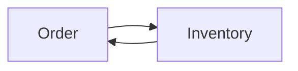
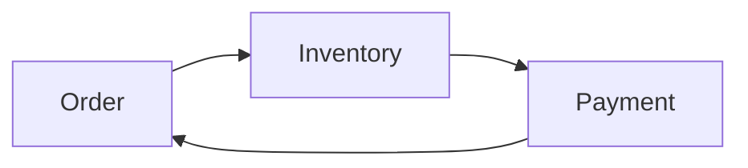
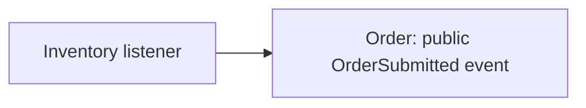
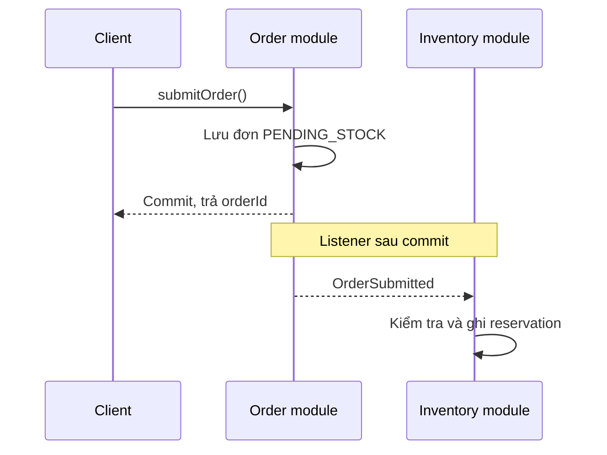
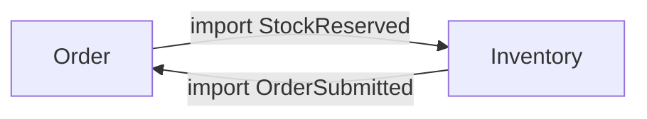
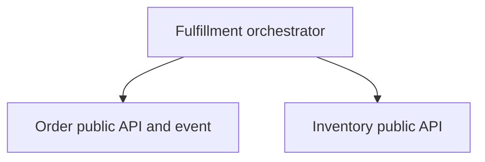

# Phụ thuộc vòng giữa các module trong Spring Modulith

## 1. Phụ thuộc vòng là gì?

Trong **kiến trúc theo module**, mỗi module chịu trách nhiệm cho một năng lực nghiệp vụ và chỉ sử dụng những hợp đồng mà module khác chủ động công khai. Nếu module `A` phải biết `B`, còn `B` lại phải biết `A`, hai module tạo thành **phụ thuộc vòng** (*cyclic dependency*). Vòng cũng có thể đi qua nhiều module: `A → B → C → A`.

Với Spring Modulith, vòng phụ thuộc cần được nhận diện ngay cả khi toàn bộ Java code vẫn biên dịch và ứng dụng vẫn khởi động. Một *modular monolith* có thể chạy trong cùng JVM và dùng chung database, nhưng ranh giới nghiệp vụ chỉ bền vững khi chiều phụ thuộc được kiểm soát.

Đây là bài thuộc chương **Ranh giới module** của **SPRING_MODULITH_APPLICATION_EVENTS**. Mục tiêu của module học là tổ chức giao tiếp giữa các module Spring Modulith bằng **application events**, giảm phụ thuộc và bảo vệ ranh giới nghiệp vụ. Hiểu phụ thuộc vòng giúp thiết kế publisher và listener đúng chiều, tránh tạo vòng qua event ngược, đồng thời chuẩn bị cho xử lý sau commit, event publication registry, retry, kiểm thử và quan sát sự kiện đáng tin cậy.

**Mục tiêu học tập:**

1. Đọc đồ thị phụ thuộc module và tìm vòng trực tiếp, gián tiếp.
2. Phân biệt vòng phụ thuộc kiến trúc, vòng Spring bean và vòng sự kiện lúc chạy.
3. Phát hiện vi phạm bằng `ApplicationModules.verify()` của Spring Modulith.
4. Tháo vòng bằng cách phân quyền nghiệp vụ, chọn API công khai, application events hoặc module điều phối.
5. Tránh đưa chu trình trở lại khi bổ sung sự kiện kết quả và retry.

## 2. Đọc đồ thị phụ thuộc có hướng

Hãy coi mỗi **application module** là một đỉnh. Có cạnh `A → B` khi mã nguồn của `A` phụ thuộc vào một kiểu thuộc `B`, ví dụ thông qua tham số method, kiểu trả về, field, interface hoặc lời gọi được mô hình Spring Modulith xác định.

**Vòng trực tiếp:**



**Vòng gián tiếp:**



Ở đồ thị thứ hai, không nhất thiết có hai module import nhau trực tiếp theo cả hai chiều. Nhưng `Order → Inventory → Payment → Order` vẫn là chu trình, làm các module trong vòng khó phát triển độc lập.

> **Quy tắc đọc mũi tên:** Mũi tên ở đây thể hiện **chiều phụ thuộc mã nguồn**, không mặc nhiên là chiều dữ liệu hay chiều thực thi nghiệp vụ. Event có thể đi từ `order` sang `inventory`, trong khi chính `inventory` import event class do `order` công khai.

### Phân biệt các loại vòng dễ nhầm

| Hiện tượng | Ví dụ | Ý nghĩa |
| --- | --- | --- |
| **Vòng phụ thuộc application module** | `order` import API `inventory`, `inventory` import API `order` | Vi phạm định hướng module độc lập cần bảo vệ |
| **Vòng khởi tạo Spring bean** | Bean A constructor-inject bean B và ngược lại | Có thể khiến Spring không tạo được bean; là vấn đề khác dù có thể cùng xuất hiện |
| **Vòng class/package nội bộ** | Hai class trong cùng application module tham chiếu qua lại | Cần xem xét thiết kế nội bộ, không tự động là vòng giữa các application module |
| **Vòng Gradle/Maven module** | Hai build subproject phụ thuộc qua lại | Là vấn đề đồ thị build; Spring Modulith không yêu cầu mỗi module nghiệp vụ là subproject |
| **Vòng event lúc chạy** | Listener nhận A phát B, listener nhận B lại phát A liên tục | Là vòng runtime, có thể tồn tại dù không có vòng import Java |

Việc chuyển lời gọi service thành event **không tự động** xóa vòng kiến trúc; cần kiểm tra kiểu sự kiện, interface và các kiểu dữ liệu được đặt ở module nào.

## 3. Ví dụ: API công khai nhưng vẫn phụ thuộc vòng

Giả sử ứng dụng bán hàng có cấu trúc:

```text
com.example.shop
├── ShopApplication.java
├── order/
│   ├── OrderOperations.java
│   └── internal/CheckoutService.java
└── inventory/
    ├── InventoryOperations.java
    └── internal/StockService.java
```

Trong mô hình nhận diện mặc định của Spring Modulith, các package con trực tiếp dưới package ứng dụng thường là application module. API công khai mặc định thường nằm ngay package gốc của module; `internal` là chi tiết triển khai.

**Module order** gọi API của inventory để giữ hàng:

```java
// com.example.shop.order.internal.CheckoutService
package com.example.shop.order.internal;

import com.example.shop.inventory.InventoryOperations;

class CheckoutService {
    private final InventoryOperations inventory;

    CheckoutService(InventoryOperations inventory) {
        this.inventory = inventory;
    }

    void submitOrder(CheckoutCommand command) {
        // Các bước nhận đơn thuộc order.
        // inventory.reserveForOrder(command.orderId(), ...);
    }
}
```

**Module inventory** gọi API của order khi không đủ hàng:

```java
// com.example.shop.inventory.internal.StockService
package com.example.shop.inventory.internal;

import com.example.shop.order.OrderOperations;

class StockService {
    private final OrderOperations orders;

    StockService(OrderOperations orders) {
        this.orders = orders;
    }

    void rejectReservation(java.util.UUID orderId) {
        // orders.markAsRejected(orderId);
    }
}
```

`CheckoutCommand` và các method đang chú thích là kiểu/logic minh họa do ứng dụng định nghĩa. `InventoryOperations` và `OrderOperations` có thể đều là **API được công khai hợp lệ**. Tuy nhiên `order → inventory` và `inventory → order` vẫn tạo vòng.

**Chỉ thay tham chiếu từ class `internal` thành interface `public` không xóa được vòng phụ thuộc.** Cũng không nên coi việc thêm `@Lazy` vào constructor injection là cách sửa kiến trúc: nó có thể thay đổi thời điểm tạo bean nhưng chu trình module vẫn còn.

### Vì sao vòng phụ thuộc gây hại?

- **Ranh giới thay đổi không rõ:** Sửa hợp đồng `order` tác động `inventory` và ngược lại.
- **Quyền sở hữu nghiệp vụ bị mờ:** Một module có thể tự quyết định hoặc sửa trạng thái thuộc module khác.
- **Kiểm thử khó cô lập:** Khởi tạo module này có thể kéo theo dependency module kia.
- **Quản lý giao dịch khó:** Callback hai chiều làm tăng độ phức tạp của commit, rollback và xử lý lỗi.
- **Khó tái cấu trúc:** Thay implementation lưu trữ hoặc tách module có thể tác động nhiều hướng.

## 4. Phát hiện bằng Spring Modulith

Spring Modulith cung cấp mô hình `ApplicationModules` để phân tích application modules và kiểm tra ranh giới. Có thể viết bài kiểm tra JUnit:

```java
package com.example.shop;

import org.junit.jupiter.api.Test;
import org.springframework.modulith.core.ApplicationModules;

class ModularityTests {

    @Test
    void shouldRespectModuleBoundaries() {
        ApplicationModules.of(ShopApplication.class).verify();
    }
}
```

`ShopApplication` là lớp `@SpringBootApplication` ở package gốc `com.example.shop`. Khi cấu trúc module được nhận diện đúng, `verify()` kiểm tra các quy tắc kiến trúc, bao gồm **chu trình phụ thuộc giữa application module** và những tham chiếu không hợp lệ vào phần nội bộ module khác.

Nếu vẫn có hai cạnh `order → inventory` và `inventory → order`, bài kiểm tra phát hiện vi phạm cấu trúc trước khi một use case cụ thể thất bại. Nên chạy kiểm tra trong CI để không tạo lại vòng khi bổ sung tính năng.

Khi đọc lỗi, hãy xác minh package gốc đã bao phủ đúng các module; class/method nào tạo từng cạnh; tham chiếu thuộc API công khai hay `internal`; và yêu cầu nghiệp vụ có thật sự cần gọi đồng bộ hay không.

`ApplicationModules.verify()` là phép kiểm tra cấu trúc, **không chứng minh** mọi quy trình nghiệp vụ đều đúng. Ví dụ `order` gửi SQL cập nhật trực tiếp bảng của `inventory` có thể xâm phạm quyền sở hữu dữ liệu mà không tạo import Java rõ ràng cho phép kiểm tra phát hiện.

## 5. Tháo vòng từ trách nhiệm nghiệp vụ

Trước khi tạo thêm interface hoặc package `common`, hãy xác định **ai sở hữu quy tắc và trạng thái**:

- `order` sở hữu việc tiếp nhận đơn, chính sách hủy và trạng thái đơn hàng.
- `inventory` sở hữu lượng tồn, chính sách reservation và việc chống giữ hàng trùng.
- `order` có thể **yêu cầu** giữ hàng nhưng không tự cập nhật stock ledger.
- `inventory` có thể **trả kết quả** giữ hàng nhưng không trực tiếp sửa entity nội bộ của `order`.

Nếu nghiệp vụ cho phép đơn hàng được ghi nhận trước rồi giữ hàng sau, `order` có thể phát `OrderSubmitted`, để `inventory` tự phản ứng. Khi đó `order` không cần import class của `inventory`:



Đây là sơ đồ **phụ thuộc tĩnh**: listener `inventory` import `OrderSubmitted` do `order` sở hữu, nên chiều là `inventory → order`. Trong **luồng chạy**, chính `order` phát event và `inventory` nhận event. Phân biệt hai chiều này rất quan trọng khi đọc dependency diagram của Spring Modulith.

Thiết kế này cần trạng thái chờ như `PENDING_STOCK`. Nếu nghiệp vụ bắt buộc giữ hàng thành công trước khi xác nhận đơn, không thể mong event sau commit trả kết quả ngay; hãy cân nhắc API đồng bộ hoặc quy trình điều phối rõ ràng.

## 6. Application event giúp bỏ chiều phụ thuộc nào?

Application event công khai **sự thật nghiệp vụ đã xảy ra**. Sự kiện nên thuộc module sở hữu sự thật đó và mang snapshot dữ liệu cần thiết, không truyền entity JPA hoặc object mutable chứa implementation nội bộ.

### 6.1. Kiểu sự kiện công khai của order

```java
// com/example/shop/order/OrderSubmitted.java
package com.example.shop.order;

import java.util.List;
import java.util.UUID;

public record OrderSubmitted(UUID orderId, List<Line> lines) {

    public OrderSubmitted {
        lines = List.copyOf(lines);
    }

    public record Line(UUID skuId, int quantity) {}
}
```

`OrderSubmitted` nghĩa là **đơn đã được tiếp nhận**, không khẳng định tồn kho đã được giữ. `List.copyOf` bảo vệ cấu trúc danh sách khỏi bị sửa sau khi tạo event, nhưng không thay thế validation nghiệp vụ. Use case tạo đơn còn phải kiểm tra số lượng dương, mã SKU hợp lệ và danh sách dòng hàng không rỗng.

### 6.2. Publisher không import listener

```java
// com/example/shop/order/internal/CheckoutService.java
package com.example.shop.order.internal;

import com.example.shop.order.OrderSubmitted;
import org.springframework.context.ApplicationEventPublisher;
import org.springframework.stereotype.Service;
import org.springframework.transaction.annotation.Transactional;

@Service
class CheckoutService {
    private final OrderRepository orders;
    private final ApplicationEventPublisher events;

    CheckoutService(OrderRepository orders, ApplicationEventPublisher events) {
        this.orders = orders;
        this.events = events;
    }

    @Transactional
    public void submit(CheckoutCommand command) {
        Order order = orders.save(Order.submitPendingStock(command));

        var lines = order.lines().stream()
                .map(line -> new OrderSubmitted.Line(
                        line.skuId(), line.quantity()))
                .toList();

        events.publishEvent(new OrderSubmitted(order.id(), lines));
    }
}
```

`Order`, `OrderRepository` và `CheckoutCommand` là kiểu minh họa do `order.internal` tự định nghĩa. Điểm chính: publisher chỉ phụ thuộc vào Spring và mã thuộc `order`. Nó không cần biết `inventory` có listener nào.

### 6.3. Listener giữ nguyên quyền sở hữu của inventory

```java
// com/example/shop/inventory/internal/OrderSubmittedListener.java
package com.example.shop.inventory.internal;

import com.example.shop.order.OrderSubmitted;
import org.springframework.modulith.events.ApplicationModuleListener;
import org.springframework.stereotype.Component;

@Component
class OrderSubmittedListener {
    private final StockReservationService reservations;

    OrderSubmittedListener(StockReservationService reservations) {
        this.reservations = reservations;
    }

    @ApplicationModuleListener
    void on(OrderSubmitted event) {
        var items = event.lines().stream()
                .map(line -> new ReservationItem(
                        line.skuId(), line.quantity()))
                .toList();

        reservations.reserveOnce(event.orderId(), items);
    }
}
```

`ReservationItem` và `StockReservationService` là kiểu nội bộ do `inventory` định nghĩa. Chính `reserveOnce(...)` phải kiểm tra tồn khả dụng, locking, ghi reservation và chống giữ hàng hai lần cho cùng `orderId`. `order` không cần biết các chi tiết này.

`@ApplicationModuleListener` của Spring Modulith hỗ trợ listener chạy **bất đồng bộ sau khi transaction phát event commit**, với transaction riêng cho listener theo cơ chế annotation. Do đó commit đơn hàng **không đồng nghĩa** việc giữ hàng đã hoàn tất; cần trạng thái chờ và chính sách xử lý kết quả sau đó.



**Luồng chạy:** `order` phát, `inventory` nhận. **Phụ thuộc Java:** `inventory` import kiểu `order.OrderSubmitted`, còn `order` không import class từ `inventory`. Nhờ vậy, bài kiểm tra module thấy một hướng dependency thay cho vòng hai chiều.

## 7. Cạm bẫy: Event phản hồi có thể làm vòng quay lại

Một lỗi thiết kế thường gặp là `order` phát `OrderSubmitted`, `inventory` nhận rồi phát `StockReserved`, sau đó `order` import `inventory.StockReserved` để lắng nghe. Khi ấy:

1. `inventory → order` vì listener ở inventory import `order.OrderSubmitted`.
2. `order → inventory` vì listener ở order import `inventory.StockReserved`.

**Vòng phụ thuộc vẫn tồn tại**, dù hai module chỉ giao tiếp qua sự kiện. Event không tự loại bỏ dependency vào kiểu dữ liệu nếu kiểu được đặt tại module nhận.



### 7.1. Thêm module điều phối khi quy trình cần phản hồi

Nếu quy trình cần đưa kết quả giữ hàng về trạng thái đơn hàng, có thể tạo module `fulfillment` phụ trách **điều phối**. `order` và `inventory` giữ trách nhiệm nghiệp vụ riêng; `fulfillment` phụ thuộc vào API công khai của cả hai.

```text
com.example.shop
├── order/
│   ├── OrderSubmitted.java
│   ├── OrderOperations.java
│   └── internal/...
├── inventory/
│   ├── InventoryOperations.java
│   ├── ReservationItem.java
│   ├── ReservationResult.java
│   └── internal/...
└── fulfillment/
    └── internal/OrderFulfillmentListener.java
```



`fulfillment → order` và `fulfillment → inventory`; `order` và `inventory` không import nhau. `fulfillment` sở hữu **trình tự**, còn `inventory` vẫn sở hữu phép giữ hàng và `order` vẫn sở hữu việc chuyển trạng thái.

```java
// Minh họa class thuộc com.example.shop.fulfillment.internal
@Component
class OrderFulfillmentListener {
    private final InventoryOperations inventory;
    private final OrderOperations orders;

    OrderFulfillmentListener(InventoryOperations inventory,
                            OrderOperations orders) {
        this.inventory = inventory;
        this.orders = orders;
    }

    @ApplicationModuleListener
    void on(OrderSubmitted event) {
        var items = event.lines().stream()
                .map(line -> new ReservationItem(
                        line.skuId(), line.quantity()))
                .toList();

        ReservationResult result =
                inventory.reserveForOrder(event.orderId(), items);

        if (result.isReserved()) {
            orders.confirmStock(event.orderId());
        } else {
            orders.rejectForInsufficientStock(event.orderId());
        }
    }
}
```

Trong ví dụ, `OrderSubmitted` và `OrderOperations` thuộc API `order`; `InventoryOperations`, `ReservationItem` và `ReservationResult` thuộc API `inventory`. Các method là API minh họa do ứng dụng định nghĩa. **Lưu ý ánh xạ DTO:** Public API `inventory` nhận `ReservationItem` do chính `inventory` sở hữu, nên `inventory` không cần import event `order`.

Khi listener chạy sau commit, quy trình phải quyết định cách phục hồi nếu giữ hàng thành công nhưng cập nhật đơn bị lỗi. Các bước với hệ thống ngoài cũng không tự động nằm trong cùng một transaction nguyên tử. Điều phối cần quan tâm idempotency, timeout và trạng thái phù hợp.

### 7.2. Khi nào không cần module điều phối?

Nếu `notification` chỉ gửi email khi nhận `OrderSubmitted`, nó có thể lắng nghe trực tiếp mà không cần `fulfillment`. Nếu `inventory` chỉ thực hiện tác vụ độc lập, không cần cập nhật ngược về `order`, cũng không cần orchestrator. Hãy tạo module mới khi nó thật sự sở hữu một quy trình liên module.

## 8. Named interface và allowedDependencies giữ ranh giới rõ ràng

Khi muốn đặt sự kiện trong `order.events` thay vì package gốc `order`, Spring Modulith cho phép khai báo một **named interface**:

```java
// com/example/shop/order/events/package-info.java
@org.springframework.modulith.NamedInterface("events")
package com.example.shop.order.events;
```

Trong phương án này, `OrderSubmitted` được **chuyển sang** `com.example.shop.order.events.OrderSubmitted`, các listener thay import theo đường dẫn mới. Đây là phương án **thay thế** cách đặt event ngay trong `com.example.shop.order` ở mục 6, không cần duy trì hai bản sao của event class.

Có thể giới hạn `inventory` chỉ tham chiếu bề mặt sự kiện:

```java
// com/example/shop/inventory/package-info.java
@org.springframework.modulith.ApplicationModule(
        allowedDependencies = { "order::events" }
)
package com.example.shop.inventory;
```

`order::events` tham chiếu named interface `events` do `order` công khai. Tương tự, module `fulfillment` có thể khai báo hai module được phép sử dụng:

```java
// com/example/shop/fulfillment/package-info.java
@org.springframework.modulith.ApplicationModule(
        allowedDependencies = { "order", "inventory" }
)
package com.example.shop.fulfillment;
```

`allowedDependencies` và `@NamedInterface` giúp kiểm soát **bề mặt được phép phụ thuộc** và phát hiện những import sai khi chạy kiểm tra kiến trúc. Tuy nhiên, hai annotation này **không tự loại bỏ vòng** nếu các module vẫn import chéo qua những API đã được công khai. Cần sửa đồ thị phụ thuộc thực tế trước, rồi dùng các ràng buộc để ngăn vòng quay trở lại.

## 9. So sánh các cách giải quyết

| Chiến lược | Khi nên dùng | Điều cần tránh |
| --- | --- | --- |
| **Chỉnh lại trách nhiệm nghiệp vụ** | Một module đang tự thực thi quy tắc thuộc module khác | Chỉ đổi tên class mà vẫn đọc/ghi repository chéo |
| **API công khai đồng bộ một chiều** | Caller bắt buộc có kết quả trước khi kết thúc thao tác | Module nhận gọi callback ngược về caller và tạo vòng |
| **Application event** | Các module phản ứng độc lập trước một sự thật đã xảy ra | Publisher import event class đặt tại module nhận |
| **Module điều phối** | Quy trình liên module phải theo dõi thứ tự, kết quả, timeout, bù | Đưa mọi business rule và entity nội bộ vào orchestrator |
| **Hợp đồng chung ổn định** | Có khái niệm chung thực sự trung lập, cần nhiều module sử dụng | Tạo `common` thành nơi chứa toàn bộ entity, repository và service |
| **Điều chỉnh ranh giới** | Hai phần không có trách nhiệm độc lập, luôn phải thay đổi cùng nhau | Cố duy trì phân chia package không phản ánh nghiệp vụ |

Tách interface vào một module hợp đồng trung lập có thể đổi đồ thị dependency, nhưng chỉ phù hợp khi hợp đồng có phạm vi ổn định và không mang chi tiết implementation. Nếu mọi thay đổi nghiệp vụ đều sửa `shared`, coupling chỉ bị chuyển sang vị trí khác.

Tương tự, sử dụng các tên `Port`, `Adapter`, `Facade` hay `Event` không đủ để chứng minh kiến trúc đã tốt. Hãy quan sát **đồ thị import thực tế** sau refactor và chạy lại phép kiểm tra module.

## 10. Vòng phản ứng event lúc chạy là vấn đề riêng

Giả sử `ApplicationModules.verify()` đã PASS, nhưng một chuỗi listener vẫn có thể tạo vòng xử lý:

```text
OrderSubmitted
   → Inventory giữ hàng, phát StockReserved
   → Handler cập nhật Order, phát OrderUpdated
   → Một listener khác lại phát yêu cầu giữ hàng
   → ... lặp tiếp
```

Đây là **vòng runtime**. Nó có thể xuất hiện dù các hợp đồng event đã được bố trí để không tạo vòng import Java.

Để tránh vòng runtime hoặc hiệu ứng trùng lặp:

1. **Chỉ phát event sau một chuyển trạng thái có ý nghĩa.** Khi trạng thái đã hoàn tất, nhận lại cùng yêu cầu không tự động phát cùng chuỗi event.
2. **Thiết kế trạng thái kết thúc rõ ràng**, chẳng hạn `PENDING_STOCK → CONFIRMED` hoặc `REJECTED`, và không chuyển ngược vô điều kiện.
3. **Dùng idempotency key** như `orderId` hoặc `reservationId`, kết hợp ràng buộc unique/transaction ở database để ngăn hai listener đồng thời ghi trùng.
4. **Phân biệt lệnh và sự kiện.** `ReserveStock` là yêu cầu thực hiện, còn `StockReserved` là sự thật đã hoàn thành; tên và payload cần phản ánh ý nghĩa.
5. **Đo lường luồng xử lý.** Dùng `eventId`, `correlationId`, `orderId` trong log/tracing và theo dõi lỗi listener để nhận ra chuỗi bất thường.

Không nên retry vô hạn cho một lỗi nghiệp vụ cố định như `INSUFFICIENT_STOCK`. Lỗi hạ tầng tạm thời có thể retry; kết quả từ chối nghiệp vụ nên đưa vào trạng thái hoặc sự kiện kết quả phù hợp.

### Xử lý sau commit, Event Publication Registry và retry

`@ApplicationModuleListener` phù hợp với xử lý sau commit khi phía nhận có thể thực hiện độc lập. Spring Modulith còn có **Event Publication Registry** để ghi nhận publication cho transactional listeners khi ứng dụng cấu hình các thành phần lưu trữ thích hợp, giúp quan sát publication chưa hoàn tất và hỗ trợ xử lý lại theo chiến lược được lựa chọn.

Tuy nhiên `ApplicationEventPublisher.publishEvent(...)` đơn thuần **không tự bảo đảm durable messaging hoặc exactly-once processing**. Listener có thể được chạy lại khi xử lý lỗi hoặc phục hồi publication. Đặc biệt, thao tác nghiệp vụ có thể đã hoàn tất nhưng bước đánh dấu xử lý thành công gặp lỗi, nên module sở hữu hành vi cần bảo vệ idempotency.

Ví dụ `inventory.reserveOnce(orderId, lines)` cần đảm bảo hai lần nhận cùng `OrderSubmitted` không trừ tồn hai lần:

```text
Lần 1: OrderSubmitted(42) → tạo Reservation(orderId=42) → giữ hàng
Lần 2: OrderSubmitted(42) → đã có Reservation(42) → không giữ thêm
```

Chỉ kiểm tra `existsByOrderId` rồi lưu không đủ nếu có xử lý đồng thời: hai transaction có thể cùng thấy chưa tồn tại. Ràng buộc unique hoặc cơ chế khóa phù hợp phải thực thi bất biến ở tầng dữ liệu. Nếu payload của cùng `orderId` khác nhau, module nên phát hiện xung đột, thay vì lặng lẽ coi là sự kiện trùng hợp lệ.

**Hai mục tiêu khác nhau nhưng liên quan:** Loại bỏ vòng phụ thuộc giúp thay đổi kiến trúc an toàn; publication registry, retry, idempotency và quan sát giúp quy trình event vận hành đáng tin cậy.

## 11. Quy trình sửa lỗi cyclic dependency

Giả sử bài kiểm tra Spring Modulith báo vòng `order → inventory → payment → order`. Thay vì chuyển ngẫu nhiên các class sang một package khác, làm tuần tự:

1. **Vẽ đồ thị module thực tế:** ghi rõ class, interface, field hoặc method nào tạo từng cạnh.
2. **Đọc use case nghiệp vụ:** mỗi cạnh phục vụ truy vấn, yêu cầu kết quả đồng bộ hay phản ứng sau một sự kiện?
3. **Xác định quyền sở hữu hành vi:** module nào có đủ ngữ cảnh bảo vệ bất biến và sửa trạng thái?
4. **Chọn hướng phụ thuộc:** điều chỉnh API đồng bộ một chiều, phát event của module sở hữu sự thật, hoặc tách phần điều phối quy trình.
5. **Kiểm tra hệ quả transaction:** thay một lời gọi đồng bộ thành event có làm thay đổi thời điểm xác nhận nghiệp vụ không? Có cần trạng thái chờ, thất bại, timeout?
6. **Chạy lại `ApplicationModules.verify()`**, sau đó kiểm thử hành vi, after-commit, rollback, retry và idempotency tại các module liên quan.
7. **Giữ kiểm tra trong CI** để thay đổi sau này không vô tình khôi phục vòng phụ thuộc.

### Ví dụ chọn giao tiếp theo yêu cầu thực tế

Yêu cầu: Khách đặt hàng; hệ thống cần giữ hàng; chỉ khi có hàng mới xác nhận đơn, sau xác nhận mới gửi email.

**Phương án A — Cần xác nhận tức thì:** `order` có thể gọi API công khai `inventory` một chiều và nhận kết quả giữ hàng. `inventory` không gọi ngược về `order`; `order` tự quyết định xác nhận/hủy đơn. Đồng thời cần thiết kế transaction và khả năng bù tùy nơi lưu trữ dữ liệu.

**Phương án B — Chấp nhận trạng thái chờ:** `order` lưu `PENDING_STOCK` rồi phát `OrderSubmitted`; module điều phối nghe event, yêu cầu `inventory` giữ hàng và dùng API `order` để hoàn thành trạng thái. `notification` chỉ gửi email xác nhận khi đơn thực sự chuyển thành `CONFIRMED`.

Hai phương án có **ngữ nghĩa nghiệp vụ khác nhau**. Không nên chọn event chỉ để có sơ đồ đẹp mà bỏ qua yêu cầu cần kết quả đồng bộ ngay.

## 12. Bài tập tự kiểm tra

**Bài 1 — Tìm chu trình trong đồ thị:**

```text
catalog      → pricing
pricing      → order
order        → inventory
inventory    → catalog
notification → order
```

Hãy liệt kê các đỉnh thuộc chu trình. Giải thích vì sao `notification` không thuộc vòng với các cạnh đã cho. Gợi ý: từ `catalog` có đường `pricing → order → inventory → catalog`; không có đường từ `order` quay lại `notification` trong đồ thị này.

**Bài 2 — Event hai chiều:** `order` công bố `OrderSubmitted`, `inventory` import event để giữ hàng, sau đó `inventory` công bố `StockReserved` và `order` import event ấy. Vẽ đồ thị phụ thuộc kiểu tĩnh. Đề xuất một phương án không có import hai chiều và xác định module nào chịu trách nhiệm đổi trạng thái đơn.

Một phương án là tạo `fulfillment` phụ thuộc vào `order` và `inventory`, nghe `OrderSubmitted`, gọi API `inventory`, rồi gọi API `order` cập nhật trạng thái. `inventory` vẫn sở hữu hành vi giữ hàng, `order` vẫn sở hữu trạng thái đơn.

**Bài 3 — Kiểm thử:** Viết JUnit dùng `ApplicationModules.of(ShopApplication.class).verify()`. Cố tình cho `order.internal.CheckoutService` import một class thuộc `inventory.internal` và quan sát lỗi. Sau đó loại bỏ tham chiếu và kiểm tra lại. Thêm một kiểm thử xử lý `OrderSubmitted` hai lần để chứng minh reservation không bị ghi trùng.

### Câu hỏi tự đánh giá

- Một interface `public` có đảm bảo không có vòng module không? **Không**, vì hai module vẫn có thể tham chiếu API công khai của nhau.
- Chuyển hai lời gọi service thành hai event ngược chiều có chắc chắn hết vòng không? **Không**, vì mỗi listener vẫn import kiểu sự kiện ở module kia.
- `verify()` PASS có chứng minh không có event loop runtime không? **Không**, cần test trạng thái và các chuỗi xử lý.
- Khi nào nên thêm module điều phối? **Khi** có một quy trình liên module cần một nơi sở hữu thứ tự, kết quả, timeout và xử lý bù, trong khi mỗi module vẫn sở hữu quy tắc riêng.

## 13. Ghi nhớ

**Phụ thuộc vòng** là chu trình trong đồ thị application module, có thể xuất hiện ngay cả khi mọi tham chiếu đều dùng API công khai. Spring Modulith giúp phát hiện bằng `ApplicationModules.verify()`. Cách sửa bền vững là xác lập lại quyền sở hữu nghiệp vụ và hướng dependency, rồi chọn cơ chế giao tiếp phù hợp.

Application events giúp publisher không phải biết listener, nhưng phải đặt kiểu event tại module sở hữu sự thật và tránh import ngược khi xử lý kết quả. Khi quy trình cần phối hợp nhiều module, dùng API hoặc module điều phối đúng ngữ nghĩa đồng bộ/bất đồng bộ. Sau khi tháo vòng, vẫn cần bảo vệ transaction, idempotency, retry và khả năng quan sát để luồng sự kiện đáng tin cậy.
