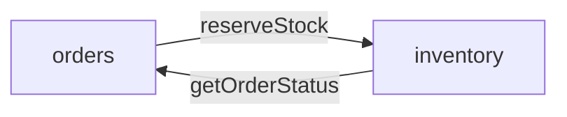
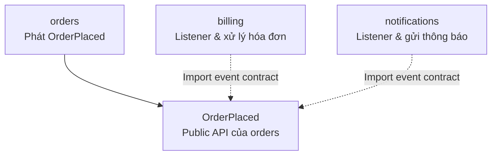
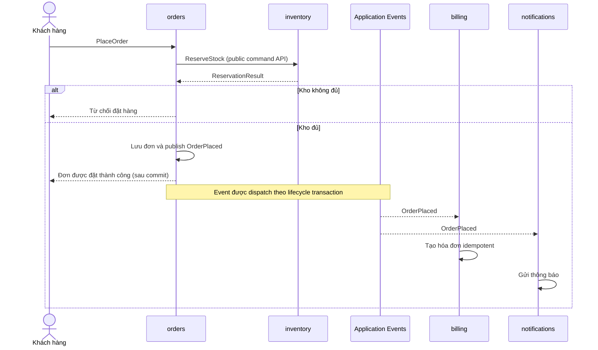

# Vi phạm boundary trong Spring Modulith: nhận diện, kiểm chứng và sửa đúng ranh giới

Trong một hệ thống Spring Modulith, việc chia mã nguồn thành nhiều package mới chỉ là bước đầu. **Ranh giới module (module boundary)** thực sự được giữ vững khi mỗi module có trách nhiệm nghiệp vụ rõ ràng, sở hữu dữ liệu và quy tắc của mình, đồng thời chỉ tương tác với module khác qua những hợp đồng công khai được chủ ý thiết kế.

Một **vi phạm boundary** xảy ra khi module vượt qua ranh giới này: tham chiếu cấu trúc nội bộ của module khác, tạo vòng phụ thuộc, gọi sang module không được phép hoặc chia sẻ quyền sửa dữ liệu trái với chủ sở hữu. Một số vi phạm phát hiện được tự động bằng Spring Modulith; một số khác chỉ lộ ra khi xem xét transaction, event, quyền sở hữu dữ liệu và hành vi thực tế.

Bài học thuộc chương **Ranh giới module**, lấy ví dụ ứng dụng bán hàng có các module `orders`, `inventory`, `billing` và `notifications`. Trọng tâm là cách nhận ra *vi phạm ở đâu*, *vì sao nguy hiểm*, *công cụ kiểm tra được gì* và *refactor thế nào để vẫn giữ đúng nghiệp vụ*. Spring Modulith application events được dùng để minh họa cách giảm phụ thuộc giữa các module, xử lý sau commit và phối hợp tin cậy.

## 1. Boundary bảo vệ điều gì?

Giả sử project có cấu trúc:

```text
com.example.shop
├── ShopApplication.java
├── orders
│   ├── Orders.java
│   ├── OrderPlaced.java
│   └── internal
│       ├── Order.java
│       ├── OrderRepository.java
│       └── DefaultOrders.java
├── inventory
│   ├── InventoryOperations.java
│   └── internal
│       ├── Stock.java
│       └── StockRepository.java
├── billing
│   └── internal
│       ├── InvoiceService.java
│       └── OrderPlacedListener.java
└── notifications
    └── internal
        └── OrderConfirmationListener.java
```

Theo cấu hình mặc định, Spring Modulith xem các **package trực tiếp dưới package ứng dụng** là application modules. Ở đây `orders`, `inventory`, `billing`, `notifications` là các module. Package gốc của mỗi module đóng vai trò API công khai; các subpackage như `orders.internal` là phần triển khai, trừ khi được công bố rõ ràng qua named interface.

Boundary có bốn loại trách nhiệm cần bảo vệ:

| Trách nhiệm | Ví dụ | Cách bảo vệ |
| --- | --- | --- |
| **Quy tắc nghiệp vụ** | `orders` quyết định đơn có được hủy không | Hành vi đi qua application/domain service của `orders` |
| **Dữ liệu** | `inventory` tính và sửa tồn khả dụng | Module khác không ghi thẳng bảng hoặc repository của kho |
| **API mã nguồn** | `Orders.place(...)` và `OrderPlaced` là public contract | Không import type dưới `orders.internal` |
| **Hướng phụ thuộc** | `notifications` biết `OrderPlaced`, `orders` không biết email sender | Giữ đồ thị phụ thuộc có hướng và không có chu trình |

Một module có thể public Java class mà vẫn là **API nội bộ về mặt kiến trúc**. Từ khóa `public` chỉ cho phép Java compiler truy cập; nó không có nghĩa class ấy được công bố cho module khác theo quy ước của Spring Modulith.

## 2. Phân loại vi phạm boundary

Các lỗi thường gặp được chia thành nhóm sau:

| Nhóm lỗi | Triệu chứng | Công cụ có thể bắt |
| --- | --- | --- |
| Truy cập implementation nội bộ | `billing` import `orders.internal.OrderRepository` | `ApplicationModules.verify()` với cấu trúc module phù hợp |
| Phụ thuộc vòng | `orders → inventory → orders` | `ApplicationModules.verify()` |
| Vượt `allowedDependencies` | Module được giới hạn chỉ phụ thuộc `orders` lại gọi `inventory` | `ApplicationModules.verify()` nếu khai báo giới hạn |
| Lạm dụng public API | Export entity hoặc mở named interface quá rộng | Cần đánh giá thiết kế; công cụ không tự biết API nào quá rộng |
| Xâm phạm dữ liệu của module khác | Dùng `JdbcTemplate` sửa trực tiếp bảng hóa đơn từ `orders` | Chủ yếu qua review, test nghiệp vụ, policy DB |
| Sai ownership qua event | Listener của `billing` cập nhật trạng thái đơn, hoặc event sai ngữ nghĩa | Chủ yếu qua review và test |
| Ghép transaction ngoài ý muốn | Listener phụ làm rollback transaction đặt hàng | Test và kiểm tra cách dùng listener/transaction |
| Không bảo đảm retry/idempotency | Event xử lý hai lần tạo hai hóa đơn | Test và kiểm soát persistence, không phải verify cấu trúc |

**Rất quan trọng:** Kiểm tra thành công bằng Spring Modulith có nghĩa cấu trúc phụ thuộc thỏa các quy tắc mà công cụ biết. Nó **không chứng minh** mọi quy tắc nghiệp vụ, quyền cập nhật dữ liệu, transaction hoặc giao event đều đúng.

## 3. Vi phạm loại 1: truy cập package nội bộ của module khác

### 3.1. Ví dụ sai

Module `billing` muốn lấy thông tin một đơn hàng để lập hóa đơn. Lập trình viên chọn cách ngắn nhất:

```java
// Trong com.example.shop.billing.internal
package com.example.shop.billing.internal;

import com.example.shop.orders.internal.OrderRepository; // Sai boundary
import org.springframework.stereotype.Service;

@Service
class InvoicePreparationService {

    private final OrderRepository orderRepository;

    InvoicePreparationService(OrderRepository orderRepository) {
        this.orderRepository = orderRepository;
    }

    // ... truy vấn Order entity nội bộ để tạo hóa đơn
}
```

Đoạn mã này giả định `OrderRepository` được khai báo `public`, do đó Java compiler có thể cho import. Tuy vậy, đây vẫn là **phụ thuộc vào implementation của module orders**.

Hậu quả:

- `billing` phụ thuộc schema và entity `Order` của `orders`.
- Thay đổi persistence bên `orders` có thể khiến `billing` hỏng dù hợp đồng nghiệp vụ không đổi.
- Logic đọc dữ liệu có thể bỏ qua validation, security hoặc quy tắc tại service.
- Nếu cho phép cập nhật, module sở hữu đơn không còn kiểm soát invariant của mình.

### 3.2. Cách sửa: public query API hoặc event snapshot

Một lựa chọn là công bố API đọc nhỏ:

```java
// Trong com.example.shop.orders
package com.example.shop.orders;

import java.util.UUID;

public interface OrderQueries {
    OrderSummary findForBilling(UUID orderId);
}
```

```java
// Trong com.example.shop.orders
package com.example.shop.orders;

import java.math.BigDecimal;
import java.util.UUID;

public record OrderSummary(
    UUID orderId,
    BigDecimal payableAmount,
    String currency
) {}
```

Bây giờ `billing` phụ thuộc `OrderQueries` và `OrderSummary` ở package API công khai của `orders`. `orders.internal` chịu trách nhiệm chuyển entity thành DTO.

Nếu `billing` cần **dữ liệu tại thời điểm sự kiện** thay vì dữ liệu hiện tại, event `OrderPlaced` có thể mang snapshot bất biến cần thiết. Cần chọn dựa trên nghiệp vụ: tra cứu trạng thái hiện tại và nhận bản chụp lịch sử là hai hợp đồng khác nhau.

### 3.3. Khi nào package con được truy cập?

Nếu có một subpackage thực sự là hợp đồng dùng chung giữa các module, Spring Modulith hỗ trợ **named interface** để công bố có chọn lọc. Đó phải là quyết định có chủ đích, không phải cách hợp thức hóa mọi import dưới `internal`.

## 4. Vi phạm loại 2: vòng phụ thuộc giữa các module

Xét chuỗi:

- `orders` gọi `inventory` để giữ hàng.
- `inventory` gọi ngược `orders` để kiểm tra trạng thái đơn.
- Một thay đổi nhỏ ở một phía dễ kéo theo thay đổi phía còn lại.



Đây là **chu trình phụ thuộc module**. Nó khiến việc kiểm thử, cô lập thay đổi và định nghĩa ai sở hữu điều phối trở nên khó khăn.

### Sửa vòng phụ thuộc theo quyền quyết định

Có vài hướng tùy nghiệp vụ:

**Cách A — Truyền dữ liệu cần thiết cùng command.** Khi yêu cầu giữ kho, `orders` cung cấp `orderId`, `sku`, `quantity`. Nếu `inventory` chỉ cần các giá trị này, nó không nên gọi `orders` để lấy thêm thông tin không liên quan.

```java
// Public API của inventory
package com.example.shop.inventory;

import java.util.UUID;

public record ReserveStock(UUID orderId, String sku, int quantity) {}

public interface InventoryOperations {
    ReservationResult reserve(ReserveStock command);
}
```

`ReservationResult` là DTO kết quả nghiệp vụ cần được định nghĩa trong public API của `inventory`; phần implement quyết định đủ hàng hay không.

**Cách B — Đưa luồng phối hợp vào module điều phối rõ ràng.** Nếu nhiều module liên tiếp phải thực hiện các bước phụ thuộc nhau, một workflow/application service ở module phù hợp có thể điều phối qua các API công khai, giữ hướng phụ thuộc không vòng.

**Cách C — Dùng domain event cho thông tin đã xảy ra.** Nếu `inventory` chỉ cần được báo “đơn đã hủy”, nó có thể đăng ký listener nhận `OrderCancelled` mà `orders` phát; `orders` không cần gọi trực tiếp service nội bộ của `inventory`.

Lưu ý: sử dụng event **không tự động** giải quyết mọi chu trình. Nếu `orders` cũng import class thuộc `inventory` và `inventory` import class event thuộc `orders`, đồ thị compile-time vẫn có thể tạo vòng. Phải xác định lại hướng phụ thuộc hoặc dùng hợp đồng/điều phối hợp lý.

## 5. Vi phạm loại 3: phụ thuộc vào module không được cho phép

Spring Modulith hỗ trợ khai báo danh sách module mà một module được phép phụ thuộc qua `@ApplicationModule`.

Ví dụ team quy định module `billing` chỉ được phụ thuộc vào các API thuộc `orders`:

```java
// com/example/shop/billing/package-info.java
@org.springframework.modulith.ApplicationModule(
    allowedDependencies = "orders"
)
package com.example.shop.billing;
```

Khi cấu trúc module và dependency được phát hiện đúng, nếu `billing` import API của `inventory`, `ApplicationModules.verify()` có thể báo vi phạm giới hạn đó. Ý nghĩa của `allowedDependencies` là **ràng buộc module-level** do nhóm đặt ra, không phải danh sách các package Java compiler cho phép theo cơ chế ngôn ngữ.

Cũng có thể giới hạn chi tiết hơn bằng named interface:

```java
// com/example/shop/orders/events/package-info.java
@org.springframework.modulith.NamedInterface("events")
package com.example.shop.orders.events;
```

```java
// com/example/shop/billing/package-info.java
@org.springframework.modulith.ApplicationModule(
    allowedDependencies = "orders::events"
)
package com.example.shop.billing;
```

Ví dụ này dành cho hệ thống đặt các event dùng chung trong `orders.events`. Khi áp dụng, listener của `billing` phải import type từ chính package đã được export và chỉ dùng các giao diện đã được cho phép. Nếu event đang ở package gốc `orders`, không cần chuyển mọi event sang subpackage chỉ để thêm named interface.

**Sai lầm thường gặp:** sửa `allowedDependencies` thành cho phép tất cả module chỉ để test qua. Làm như vậy bỏ mất ý nghĩa của quy tắc thiết kế. Cần hỏi dependency phát sinh có phải yêu cầu nghiệp vụ hợp lý hay là biểu hiện của việc đặt sai trách nhiệm.

## 6. Vi phạm loại 4: public API quá rộng, làm rò rỉ domain model

Ngay cả khi không import `*.internal`, boundary vẫn có thể yếu nếu module xuất toàn bộ entity và repository trong package API.

Ví dụ không nên công khai:

```java
// API của orders phơi toàn bộ entity có thể thay đổi
public interface Orders {
    OrderJpaEntity findOrder(long id);
    void save(OrderJpaEntity order);
}
```

Caller có thể thao tác đối tượng persistence mà không đi qua các use case được kiểm soát. Code có thể vượt qua xác minh cấu trúc nhưng vẫn chứa **rò rỉ hợp đồng nghiệp vụ**.

Một API lành mạnh nên mô tả hành vi hoặc dữ liệu đọc:

```java
public interface Orders {
    OrderId place(PlaceOrder command);
    void cancel(CancelOrder command);
    OrderView findById(OrderId id);
}
```

Các type `OrderId`, `PlaceOrder`, `CancelOrder`, `OrderView` trong ví dụ là hợp đồng nghiệp vụ công khai cần được định nghĩa tương ứng. Không bắt buộc phải tạo tất cả type trong một dự án nhỏ; mục tiêu là bảo đảm module bên ngoài không có quyền thực hiện mọi thay đổi trên entity nội bộ.

Tiêu chí thiết kế:

- Mỗi thao tác ghi mô tả rõ ý định như `cancel`, `reserve`, `issue`.
- Kiểu trả về không cho caller sửa ngầm trạng thái.
- API đủ nhỏ để có thể thay thế implementation mà ít ảnh hưởng các module khác.
- Không công khai repository/JPA entity chỉ vì cần tái sử dụng.

## 7. Vi phạm loại 5: module khác sửa dữ liệu mà mình không sở hữu

Đây là loại vi phạm rất nguy hiểm vì đôi khi **không xuất hiện dưới dạng dependency Java**.

Ví dụ `billing` tự cập nhật bảng của `orders`:

```java
// Trong billing - sai ownership dù không import class orders nào
jdbcTemplate.update(
    "UPDATE orders SET status = ? WHERE id = ?",
    "INVOICED",
    orderId
);
```

Spring Modulith kiểm tra đồ thị type/package, không hiểu tự động rằng câu SQL trên đang vượt ranh giới dữ liệu. Nếu chỉ chạy `ApplicationModules.verify()`, dạng lỗi này có thể lọt qua.

Cách thiết kế đúng tùy yêu cầu:

- `billing` tự quản lý hóa đơn và phát `InvoiceIssued` khi hóa đơn thật sự được tạo.
- `orders` có thể nhận `InvoiceIssued` và tự quyết định có cập nhật trạng thái đơn hay không.
- Nếu cần kết quả tức thì và cùng luồng, `billing` gọi một API công khai thích hợp của `orders`, đi qua quy tắc và transaction của module sở hữu.
- Nếu có tích hợp khác đọc dữ liệu, chỉ công bố query/read model cần thiết hoặc event chứa dữ liệu được định nghĩa trong hợp đồng.

Không nên dùng tên event “OrderStatusChanged” chung chung để module khác ra lệnh đổi trạng thái đơn: **module sở hữu** vẫn phải quyết định chuyển trạng thái nào được phép.

## 8. Vi phạm boundary trong thiết kế application events

Application events là công cụ quan trọng để Spring Modulith giảm phụ thuộc giữa module. Nhưng cách đặt event, listener và xử lý giao dịch không đúng vẫn làm hỏng ranh giới.

### 8.1. Event được đặt trong package private/internal

Ví dụ module `orders` đặt `OrderPlaced` dưới `orders.internal`, rồi module `notifications` phải import nó:

```java
// Trong notifications - sai vì event nằm trong package nội bộ
import com.example.shop.orders.internal.OrderPlaced;
```

Sửa bằng cách đưa public event vào package API `orders`, hoặc một named interface công khai có chủ đích. Event là **hợp đồng**, không phải implementation detail.

```java
// com.example.shop.orders.OrderPlaced
package com.example.shop.orders;

import java.time.Instant;
import java.util.UUID;

public record OrderPlaced(
    UUID eventId,
    UUID orderId,
    Instant occurredAt
) {}
```

Không nên phát toàn bộ entity `Order`, đặc biệt entity JPA mutable/lazy-loaded. Subscriber sẽ phụ thuộc vào representation nội bộ và có thể không truy cập được lazy fields sau khi transaction đóng.

### 8.2. Publisher biết quá nhiều subscriber

Ví dụ `orders` có những import:

```java
import com.example.shop.billing.internal.InvoiceService;
import com.example.shop.notifications.internal.EmailSender;
```

Rồi mỗi lần đặt hàng, `orders` gọi trực tiếp `InvoiceService` và `EmailSender`. Khi bổ sung module mới cần phản ứng với đơn hàng, ta phải sửa logic đặt hàng dù quy tắc của `orders` không đổi.

Nếu hai tác vụ thực sự là hệ quả sau khi đơn đã đặt, phương án là module sở hữu sự thật phát event:

```java
// Trong implementation của orders, sau khi lập trạng thái hợp lệ
publisher.publishEvent(new OrderPlaced(
    eventId,
    order.id(),
    occurredAt
));
```

Listener nằm ở từng module nhận:

```java
// com.example.shop.billing.internal.OrderPlacedListener
package com.example.shop.billing.internal;

import com.example.shop.orders.OrderPlaced;
import org.springframework.modulith.events.ApplicationModuleListener;
import org.springframework.stereotype.Component;

@Component
class OrderPlacedListener {

    private final InvoiceService invoices;

    OrderPlacedListener(InvoiceService invoices) {
        this.invoices = invoices;
    }

    @ApplicationModuleListener
    void on(OrderPlaced event) {
        invoices.createIfAbsent(event.orderId());
    }
}
```

Ở ví dụ, `InvoiceService.createIfAbsent` là API nội bộ giả định của `billing`. Cần hiện thực khóa nghiệp vụ duy nhất, chẳng hạn unique constraint trên `order_id`, để tránh tạo hóa đơn trùng khi giao lại event.

Mũi tên dependency code trong trường hợp này là **billing → public event của orders**, vì listener của `billing` import `OrderPlaced`. `orders` không phải import module `billing`.



### 8.3. Dùng event để che một command cần kết quả ngay

Giả sử quy tắc của hệ thống là “đặt hàng chỉ được xác nhận khi giữ kho thành công”. Nếu `orders` phát `ReserveStockRequested` rồi lập tức trả kết quả “đã đặt hàng”, caller có thể nhận thành công dù kho hết hàng.

Đây là **vi phạm hợp đồng nghiệp vụ giữa các module**. Không nhất thiết bị `ApplicationModules.verify()` phát hiện.

Khi cần quyết định ngay, dùng command qua public API của `inventory`:

```java
ReservationResult result = inventory.reserve(
    new ReserveStock(orderId, sku, quantity)
);

if (!result.successful()) {
    throw new OutOfStockException(sku);
}

// Chỉ tiếp tục xác nhận đơn khi điều kiện nghiệp vụ được đáp ứng.
```

Các type `ReservationResult`, `ReserveStock` và `OutOfStockException` là minh họa cần khai báo phù hợp trong ứng dụng. Lưu ý transaction xuyên module vẫn cần thiết kế: lưu kho và lưu đơn cùng transaction hay dùng cơ chế bù trừ tùy mức đảm bảo, không nên dựa vào tên command để suy ra tính nguyên tử.

### 8.4. Listener cùng transaction gây lan truyền thất bại

Với `@EventListener` mặc định, listener thường chạy đồng bộ tại thời điểm publish. Nếu listener gửi email chậm hoặc ném exception trong cùng transaction, việc đặt hàng có thể bị chậm hoặc rollback.

Khi tác vụ phụ trợ được phép thực hiện **sau khi đơn đã commit**, cân nhắc listener transactional:

| Annotation | Mốc xử lý điển hình | Hệ quả |
| --- | --- | --- |
| `@EventListener` | Ngay khi publish, mặc định cùng thread | Exception có thể ảnh hưởng publisher/transaction |
| `@TransactionalEventListener` | Mặc định sau commit của transaction nguồn | Không tự chạy async; event không có transaction thường bị bỏ qua nếu không bật fallback |
| `@ApplicationModuleListener` | Sau commit, bất đồng bộ, trong transaction mới | Giúp cô lập xử lý module nhận khỏi transaction nguồn |

Không có cơ chế listener nào tự hiểu nhiệm vụ nào cần nhất quán đồng bộ. Việc chọn phase, async và transaction phải dựa vào hợp đồng nghiệp vụ thực tế.

### 8.5. Dùng event nhưng bỏ qua độ tin cậy và retry

Nếu `orders` đã commit đơn nhưng tiến trình gặp lỗi trước khi listener xử lý, side effect có thể chưa diễn ra. Spring Modulith hỗ trợ **Event Publication Registry** để lưu trạng thái các publication cho transactional listener khi cấu hình một implementation persistence phù hợp (ví dụ JDBC/JPA/MongoDB).

Cần phân biệt:

- **Boundary cấu trúc:** module nghe chỉ phụ thuộc vào public event.
- **Boundary transaction:** listener sau commit không nằm trong transaction đặt hàng đã hoàn tất.
- **Boundary vận hành:** publication thất bại phải được quan sát, resubmit/retry hợp lệ và xử lý trùng an toàn.

Registry hỗ trợ tracking và recovery khi được cấu hình đúng. Nó không làm listener tự idempotent, không bảo đảm event chỉ được xử lý đúng một lần và không tự biến application event nội bộ thành message broker. Đây là điều kiện vận hành để module có thể độc lập về vòng đời xử lý.

## 9. Cách phát hiện vi phạm bằng ApplicationModules.verify()

Spring Modulith cung cấp API `ApplicationModules` để nhận diện cấu trúc module và **kiểm chứng ranh giới**. Trong một ứng dụng sử dụng starter/dependencies Spring Modulith phù hợp, có thể viết test:

```java
package com.example.shop;

import org.junit.jupiter.api.Test;
import org.springframework.modulith.core.ApplicationModules;

class ModuleBoundaryTests {

    @Test
    void modulesHaveValidBoundaries() {
        ApplicationModules.of(ShopApplication.class).verify();
    }
}
```

Đoạn test trên giả định ứng dụng có root class `ShopApplication` tại `com.example.shop` và các module nằm trực tiếp dưới root package. Việc xác định module có thể thay đổi nếu ứng dụng dùng cấu hình detection strategy khác.

Khi chạy, `verify()` có thể báo:

1. **Vòng phụ thuộc** giữa các application module.
2. **Truy cập package nội bộ** của module khác thay vì API được expose.
3. **Vi phạm `allowedDependencies`** nếu module khai báo ràng buộc đó.
4. Các kiểm tra kiến trúc bổ sung phù hợp với những thư viện/quy tắc tích hợp đã được cấu hình (nếu có).

Lỗi thường chứa tên module và quan hệ type/package liên quan. Cách xử lý nên bắt đầu từ **dependency được chỉ ra**, kiểm tra xem đó là một nhu cầu nghiệp vụ hợp lệ hay rò rỉ implementation.

### Trước và sau một lỗi điển hình

Trước khi sửa:

```text
billing.internal.InvoiceService
    -> orders.internal.OrderRepository
    -> orders.internal.Order
```

Sau khi sửa:

```text
billing.internal.InvoiceService
    -> orders.OrderQueries
    -> orders.OrderSummary
```

Spring Modulith có thể cho phép quan hệ thứ hai nếu `orders` là dependency được phép. Team vẫn cần xác minh rằng API mới không phơi thông tin nhạy cảm hoặc trao cho `billing` quyền cập nhật trái quy tắc.

### Ví dụ giới hạn allowedDependencies

```java
// com/example/shop/notifications/package-info.java
@org.springframework.modulith.ApplicationModule(
    allowedDependencies = "orders"
)
package com.example.shop.notifications;
```

Khi có constraint trên, một lần import `billing.internal.InvoiceRepository` vào `notifications` vi phạm **cả hai** vấn đề: truy cập implementation nội bộ và phụ thuộc sang module không được allow.

Không sửa lỗi bằng cách bỏ test, tắt verify hoặc thêm tất cả tên module vào allowlist. Hãy loại bỏ dependency không cần thiết hoặc công bố một hợp đồng có chủ đích.

## 10. Các lỗi mà kiểm tra cấu trúc không đủ để phát hiện

`ApplicationModules.verify()` rất hữu ích nhưng không thay thế review code, domain modeling hoặc integration tests.

| Hành vi | Vì sao khó bắt bằng kiểm tra dependency | Cách kiểm chứng bổ sung |
| --- | --- | --- |
| Viết SQL vào bảng module khác | Không nhất thiết có dependency tới class Java | Review query, policy database, integration test |
| Dùng reflection/string-based API để gọi implementation module khác | Reference không thể hiện trực tiếp trong đồ thị kiểu | Static analysis chuyên biệt, integration test |
| Listener gửi thông báo hai lần do retry | Cấu trúc module vẫn hợp lệ | Idempotency test, unique constraint, test failure/recovery |
| Publish `OrderPlaced` khi giao dịch thực tế rollback | Cần xét lifecycle transaction | Test commit/rollback và listener phase |
| Module khác diễn giải sai ngữ nghĩa event | Tên/type vẫn có thể hợp lệ | Contract test, domain review, kiểm thử tiêu thụ event |
| Shared `common` chứa toàn bộ nghiệp vụ | Có thể vẫn là dependency DAG hợp lệ | Đánh giá ownership, mô hình package, cohesion |
| Listener chậm làm timeout | Vấn đề runtime và resource | Tracing, metrics, test tải và transaction timing |

Khi thiết lập bảo vệ boundary, kết hợp **test cấu trúc** (compile-time dependencies), **test hành vi** (business use cases) và **quan sát vận hành** (event processing/retry/errors).

## 11. Phân tích tình huống thực tế: đơn hàng và hóa đơn

### Trạng thái đầu: coupling chặt

Ở một codebase cũ, khi nhận `PlaceOrder`, `orders` thực hiện tuần tự:

```text
OrderService.place()
    -> OrderRepository.save(order)
    -> InventoryRepository.decreaseStock()
    -> InvoiceRepository.save(invoice)
    -> EmailSender.send(order)
```

Vấn đề:

- `orders` thay đổi dữ liệu `inventory` và `billing` không qua hợp đồng công khai.
- Business rule của các module bị trộn trong một transaction khó quản lý.
- Nếu gửi email lỗi, luồng chính có thể chịu tác động dù đơn đã được lưu.
- Thay đổi hóa đơn buộc sửa `OrderService`, khiến module không còn độc lập.

### Thiết kế lại theo ownership

Giả định doanh nghiệp yêu cầu **giữ kho thành công** trước khi xác nhận đơn, còn hóa đơn và email được phép xử lý sau:



Lưu ý sơ đồ mô tả nghiệp vụ ở mức ý tưởng. Nếu giữ tồn và lưu đơn ở hai transaction không được phối hợp phù hợp, có thể xảy ra giữ hàng thành công nhưng lưu đơn thất bại. Cần chiến lược compensation, timeout và kiểm thử lỗi khi hợp đồng đòi hỏi tính nhất quán mạnh.

Hướng dependency hợp lệ dự kiến:

- `orders → inventory` qua public command API vì cần kết quả trước khi hoàn tất.
- `billing → orders` qua public event `OrderPlaced`.
- `notifications → orders` qua public event `OrderPlaced`.
- Không có import trực tiếp `billing.internal` hoặc `notifications.internal` từ `orders`.

**Điểm cần chú ý:** nếu module `inventory` cũng import event/API của `orders`, ta lại có nguy cơ `orders ↔ inventory`. Đồ thị type dependency phải được xem toàn cục; event chỉ giảm coupling khi đặt đúng nơi, không bảo đảm miễn nhiễm chu trình.

## 12. Quy trình sửa một boundary violation

Khi test kiến trúc báo lỗi, có thể theo thứ tự:

1. **Định vị liên kết sai:** chỉ ra module phát sinh dependency, package/type bị import, ranh giới nội bộ hay allowedDependencies nào bị vượt.
2. **Xác định nhu cầu nghiệp vụ:** module gọi cần dữ liệu đọc, cần command có kết quả, hay chỉ cần biết sự kiện đã xảy ra?
3. **Chốt ownership:** module nào có quyền quyết định và thay đổi trạng thái? Không chuyển quyền sở hữu chỉ để xóa lỗi import.
4. **Chọn hợp đồng phù hợp:** API/DTO công khai, named interface có chọn lọc, event mang sự thật nghiệp vụ, hoặc module điều phối.
5. **Refactor dependency:** thay import implementation bằng hợp đồng; loại bỏ đường gọi và update dữ liệu trực tiếp cũ.
6. **Đánh giá transaction:** xác định luồng nào cần kết quả ngay; tác vụ nào dùng listener sau commit; xử lý rollback, retry và idempotency.
7. **Xác minh:** chạy `ApplicationModules.verify()`, test nghiệp vụ, test lỗi transaction và kiểm tra publication chưa hoàn thành nếu dùng registry.

### Bảng quyết định nhanh

| Câu hỏi | Hướng xử lý |
| --- | --- |
| “Tôi cần gọi repository internal của module khác để lấy dữ liệu.” | Tạo query API/read DTO hoặc event snapshot phù hợp |
| “Hai module đều gọi implementation của nhau.” | Làm rõ hướng điều phối và quyền sở hữu, giảm vòng phụ thuộc |
| “Tôi chỉ muốn phản ứng khi nghiệp vụ khác hoàn thành.” | Dùng application event công khai, listener ở module nhận |
| “Tôi phải biết kết quả trước khi trả thành công.” | Gọi public command API hoặc thiết kế workflow trạng thái |
| “Tôi muốn mở cả subpackage internal để test pass.” | Chỉ expose named interface hẹp nếu đó thực sự là hợp đồng |
| “Verify xanh nhưng dữ liệu vẫn trùng sau retry.” | Kiểm tra listener idempotency, unique constraint, recovery |
| “Verify xanh nhưng module khác update thẳng bảng của tôi.” | Tăng cường review dữ liệu, kiểm soát quyền ghi và integration test |

## 13. Bài tập thực hành: tìm và sửa boundary violation

Xét class giả định sau trong `notifications.internal`:

```java
package com.example.shop.notifications.internal;

import com.example.shop.orders.internal.OrderRepository;
import com.example.shop.orders.internal.Order;
import org.springframework.stereotype.Component;

@Component
class OrderEmailJob {

    private final OrderRepository orders;

    OrderEmailJob(OrderRepository orders) {
        this.orders = orders;
    }

    void send(UUID orderId) {
        Order order = orders.findById(orderId).orElseThrow();
        // Lấy địa chỉ email và gửi thông báo...
    }
}
```

Giả sử có import `java.util.UUID` và các type nội bộ được khai báo public để snippet Java biên dịch được. Hãy trả lời:

1. Class này vi phạm boundary cụ thể nào?
2. Có cách nào cung cấp thông tin cần gửi email mà không cho `notifications` biết `OrderRepository` và entity `Order`?
3. Nếu gửi email có thể thất bại sau khi đơn đã được tạo, nên tổ chức xử lý như thế nào?
4. Nếu nhận lại cùng `OrderPlaced` hai lần, phải xử lý thế nào?
5. Test nào phát hiện lỗi import internal? Test nào phát hiện email gửi trùng?

<details>
<summary>Gợi ý lời giải</summary>

1. `notifications` import `orders.internal`, vi phạm API boundary mặc định của Spring Modulith.
2. Cung cấp public query API trả DTO đọc, hoặc bổ sung snapshot ổn định và phù hợp về quyền truy cập vào event `OrderPlaced`.
3. Đặt listener `@ApplicationModuleListener` trong `notifications` để xử lý sau commit và bất đồng bộ; dùng Event Publication Registry nếu muốn quản lý sự kiện chưa hoàn thành một cách bền vững.
4. Sử dụng khóa thông báo/idempotency, lưu trạng thái và xem xét hành vi của nhà cung cấp email; tránh coi mỗi lần nhận event là một email mới phải gửi.
5. `ApplicationModules.of(ShopApplication.class).verify()` kiểm tra truy cập internal. Integration test với cùng `eventId`/`orderId` giao hai lần kiểm tra idempotency; test failure/retry xác minh cơ chế recovery.

</details>

### Bài tập mở rộng: đồ thị phụ thuộc

Đồ thị sau có vấn đề gì?

```text
orders        -> inventory
inventory     -> orders
billing       -> orders
notifications -> orders
```

Cặp `orders ↔ inventory` tạo chu trình. Hãy thử chuyển dữ liệu kho cần nhận từ `orders` vào command `ReserveStock` để `inventory` không cần gọi lại `orders`, hoặc xây dựng một module điều phối phù hợp. Sau refactor, kiểm tra việc bỏ import ngược bằng `ApplicationModules.verify()` và xác minh use case giữ kho vẫn đúng khi thiếu hàng.

## 14. Kết luận và điểm nhớ

- **Boundary violation** là phụ thuộc hoặc hành vi vượt quá hợp đồng và quyền sở hữu đã xác định của module.
- Lỗi **import implementation internal**, **vòng phụ thuộc** và **vượt allowedDependencies** có thể được Spring Modulith phát hiện tự động bằng `ApplicationModules.verify()` khi mô hình module và quy tắc được cấu hình đúng.
- Không phải mọi lỗi nghiệp vụ đều là dependency lỗi. SQL trực tiếp, public API quá rộng, event sai ngữ nghĩa, retry gây trùng hoặc transaction sai cần được bảo vệ bằng review, test và giám sát.
- **Public API, named interface và application events** là công cụ thiết kế hợp đồng. Chọn cách nào phụ thuộc vào việc module nhận cần **ra lệnh và nhận kết quả** hay **phản ứng với sự thật đã xảy ra**.
- Với listener sau commit, cần suy nghĩ thêm về **Event Publication Registry, retry, idempotency và quan sát publication** để sự độc lập giữa các module có ý nghĩa trong thực tế.
- Khi sửa vi phạm, luôn bắt đầu bằng **quyền sở hữu nghiệp vụ**, sau đó mới chỉnh code và chạy test.

**Tài liệu tham khảo chính thức:**

- [Spring Modulith — Fundamentals: Application Modules và Named Interfaces](https://docs.spring.io/spring-modulith/reference/fundamentals.html)
- [Spring Modulith — Verifying Application Module Structure](https://docs.spring.io/spring-modulith/reference/verification.html)
- [Spring Modulith — Working with Application Events](https://docs.spring.io/spring-modulith/reference/events.html)
- [Spring Modulith — Testing Application Modules](https://docs.spring.io/spring-modulith/reference/testing.html)
