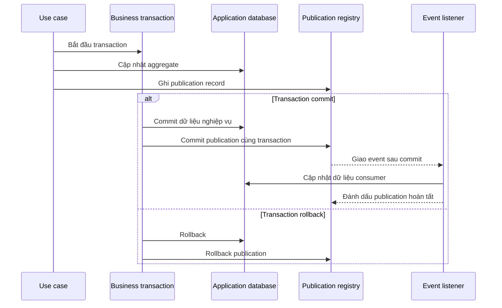

# Cấu hình registry

*Vận hành Event Publication Registry bền vững cho ứng dụng Spring Modulith*

Spring Modulith Event Publication Registry ghi nhận các publication cần được giao đến transactional listener hoặc externalization target. Khi event được phát trong transaction nghiệp vụ, registry lưu dấu publication cần xử lý; khi listener hoàn tất, publication được đánh dấu hoàn tất. Nếu tiến trình dừng giữa chừng hoặc listener thất bại, publication chưa hoàn tất có thể được tìm lại để điều tra và phục hồi.

Trong production, registry cần được cấu hình như một phần của hạ tầng dữ liệu quan trọng. Nếu dùng repository chỉ lưu trong bộ nhớ, trạng thái publication sẽ mất khi ứng dụng khởi động lại. Nếu registry dùng database khác transaction nghiệp vụ, hệ thống có thể ghi dữ liệu nghiệp vụ thành công nhưng không ghi được publication tương ứng. Cấu hình đúng cần bảo đảm lưu trữ bền vững, cùng transaction, schema được quản lý, chính sách phục hồi và retention rõ ràng.

## 1. Registry lưu những gì và bảo đảm điều gì?

Với một transactional event listener, registry theo dõi publication cho từng listener. Một event có thể tạo nhiều publication nếu có nhiều listener cần nhận event đó. Trạng thái publication phản ánh việc listener đã hoàn tất hay còn đang chờ xử lý.

Registry hỗ trợ các mục tiêu:

- Ghi nhận publication cần giao trong ranh giới transaction nghiệp vụ.
- Đánh dấu publication hoàn tất khi listener xử lý thành công theo cơ chế tích hợp.
- Giữ lại publication chưa hoàn tất để phát hiện lỗi hoặc phục hồi sau sự cố.
- Hỗ trợ resubmit có kiểm soát khi nguyên nhân lỗi đã được khắc phục.
- Cung cấp dữ liệu để quan sát backlog và tuổi publication.

Registry không phải message broker, không tự thay thế Kafka offset hoặc RabbitMQ queue, không phải kho event lịch sử vô thời hạn và không bảo đảm side effect của listener chỉ xảy ra đúng một lần. Nếu listener đã commit dữ liệu nhưng tiến trình dừng trước khi registry ghi nhận hoàn tất, publication có thể được giao lại. Consumer vẫn phải idempotent.

## 2. Chọn repository bền vững cho production

Registry cần một `EventPublicationRepository` có lưu trữ bền vững. Spring Modulith cung cấp các lựa chọn tích hợp persistence phù hợp với công nghệ dữ liệu của ứng dụng, chẳng hạn JDBC hoặc JPA tùy phiên bản và dependency được sử dụng.

Nguyên tắc lựa chọn:

- Dùng implementation persistent được Spring Modulith hỗ trợ và tương thích với BOM/phiên bản của ứng dụng.
- Ưu tiên cùng database và transaction manager với dữ liệu nghiệp vụ nếu cần publication được ghi nguyên tử cùng transaction nguồn.
- Dùng datasource, credential và connection pool được quản lý như các thành phần production khác.
- Tránh repository in-memory cho luồng event cần phục hồi sau restart.
- Chỉ viết repository tùy chỉnh khi có yêu cầu rõ ràng về persistence hoặc vận hành mà implementation chuẩn không đáp ứng.

Không tự tạo `EventPublicationRepository` bean chỉ để thay thế auto-configuration nếu chưa hiểu các thành phần registry, serializer và transaction integration đi kèm. Khi thêm dependency JDBC/JPA của Spring Modulith, dùng đúng artifact tương ứng với phiên bản dự án và để auto-configuration thiết lập các thành phần chuẩn trước khi cân nhắc override.

## 3. Đặt registry cùng transaction với dữ liệu nghiệp vụ

Một bảo đảm quan trọng là thay đổi nghiệp vụ và publication record phải cùng commit hoặc cùng rollback. Nếu aggregate được ghi vào database A nhưng publication được ghi vào database B độc lập, hai thao tác có thể lệch nhau khi một bên lỗi.

Luồng mong muốn:



Để đạt được điều này, repository registry và repository nghiệp vụ cần tham gia cùng transaction resource/transaction manager theo cấu hình ứng dụng. Với JDBC, cần bảo đảm dùng datasource và transaction manager phù hợp. Với JPA, cần bảo đảm entity manager và transaction manager quản lý các thao tác liên quan trong cùng transaction. Không chỉ dựa vào việc hai repository cùng trỏ đến một database URL; cách chúng tham gia transaction mới quyết định tính nguyên tử.

Nếu kiến trúc bắt buộc ghi publication qua một hệ thống lưu trữ khác, cần thiết kế outbox hoặc quy trình phối hợp riêng. Không tuyên bố atomicity xuyên hai database độc lập khi chưa có distributed transaction hoặc giao thức tương ứng.

## 4. Quản lý dependency và auto-configuration

Trong ứng dụng Spring Boot, hãy dùng dependency management/BOM của Spring Modulith để các module runtime và persistence integration cùng phiên bản. Chỉ thêm implementation cần thiết cho lựa chọn persistence của ứng dụng.

Trước khi deploy, xác nhận:

- Spring Modulith core và integration module cùng phiên bản tương thích.
- Persistence starter/module đúng với JDBC hoặc JPA đang dùng.
- Chỉ có một implementation repository được chọn cho registry, trừ khi cấu hình tùy chỉnh có chủ đích.
- Auto-configuration không bị loại trừ ngoài ý muốn.
- Application context khởi động được với datasource, transaction manager và serializer cần thiết.
- Các transactional listener được phát hiện và đăng ký đúng.

Không copy dependency version riêng lẻ từ một ví dụ trên mạng nếu dự án đã quản lý phiên bản bằng BOM. Việc nâng Spring Modulith nên đi cùng kiểm tra release notes, schema migration và contract test cho event payload đã lưu.

## 5. Cấu hình datasource và connection pool

Registry persistent sử dụng tài nguyên database, do đó cần được tính vào ngân sách connection và năng lực ghi của ứng dụng. Ví dụ cấu hình datasource production ở mức khái quát:

```yaml
spring:
  datasource:
    url: ${DATABASE_URL}
    username: ${DATABASE_USERNAME}
    password: ${DATABASE_PASSWORD}
    hikari:
      maximum-pool-size: ${DATABASE_POOL_MAX:20}
      minimum-idle: ${DATABASE_POOL_MIN:5}
      connection-timeout: 30000
```

Các giá trị là ví dụ, cần điều chỉnh theo tổng số instance, số connection database được cấp, lưu lượng transaction và các workload khác. Registry tăng thêm thao tác ghi publication và hoàn tất publication; khi listener xử lý bất đồng bộ, nó cũng có thể tạo thêm transaction và truy vấn trạng thái.

Không tăng pool size riêng cho registry mà bỏ qua giới hạn connection toàn database. Tổng pool của tất cả instance phải nằm trong ngân sách database, kể cả connection dành cho migration, batch và tác vụ vận hành.

## 6. Quản lý schema registry bằng migration

Schema của publication repository là dữ liệu vận hành cần tồn tại qua các lần deploy. Production nên quản lý việc tạo và thay đổi schema bằng công cụ migration của dự án như Flyway hoặc Liquibase, theo hướng dẫn của implementation Spring Modulith đang dùng.

Các nguyên tắc:

- Xác định rõ schema/table thuộc quyền sở hữu của integration module hay migration của ứng dụng.
- Chỉ có một cơ chế chịu trách nhiệm tạo/cập nhật schema trong production.
- Không để nhiều instance đồng thời tự chạy DDL không được kiểm soát khi khởi động.
- Migration phải tương thích với phiên bản ứng dụng trong giai đoạn rolling deployment.
- Backup và kiểm tra khả năng phục hồi trước migration có thay đổi cấu trúc hoặc dữ liệu.
- Giữ lại dữ liệu publication chưa hoàn tất khi nâng cấp schema.

Tên bảng, cột, kiểu dữ liệu và migration script phụ thuộc persistence implementation và phiên bản Spring Modulith. Không hardcode tên bảng nội bộ trong ứng dụng hoặc migration tùy chỉnh nếu implementation không cam kết đó là API schema ổn định. Dùng schema script được cung cấp hoặc tài liệu đúng phiên bản, sau đó đưa vào quy trình migration có kiểm soát.

## 7. Cấu hình listener và completion semantics

Registry theo dõi các transactional listener được Spring Modulith hỗ trợ. `@ApplicationModuleListener` thường được dùng khi muốn listener chạy bất đồng bộ sau commit trong transaction riêng.

```java
import org.springframework.modulith.events.ApplicationModuleListener;
import org.springframework.stereotype.Component;

@Component
class InvoiceProjectionListener {

    private final InvoiceProjection projection;

    InvoiceProjectionListener(InvoiceProjection projection) {
        this.projection = projection;
    }

    @ApplicationModuleListener
    void on(OrderCompleted event) {
        projection.apply(event);
    }
}
```

Listener cần để exception truyền ra khi xử lý chưa hoàn tất, để transaction rollback và registry không đánh dấu publication thành công. Nếu listener bắt exception rồi chỉ ghi log, framework có thể coi phương thức đã kết thúc bình thường. Chỉ bắt lỗi khi đã xử lý đầy đủ hoặc chuyển event sang trạng thái lỗi có thể theo dõi theo thiết kế.

Completion của publication biểu thị listener/adapter đã hoàn tất theo contract tích hợp. Với externalization, điều này không nhất thiết đồng nghĩa consumer ở hệ thống đích đã hoàn tất nghiệp vụ. Hãy phân biệt trạng thái gửi từ ứng dụng với trạng thái xử lý end-to-end.

## 8. Cấu hình externalization và target

Event được đánh dấu `@Externalized` có target identifier để adapter chuyển thành destination bên ngoài. Registry theo dõi publication cần giao cho externalization target theo integration đang dùng.

Ví dụ:

```java
import org.springframework.modulith.events.Externalized;

@Externalized("orders.completed")
public record OrderCompleted(
    UUID eventId,
    UUID orderId,
    Instant occurredAt
) {}
```

Chuỗi `orders.completed` là target logic. Exchange, routing key, topic hoặc queue thực tế phụ thuộc adapter và cấu hình mapping. Không mặc định target luôn là tên queue hoặc topic. Hãy quản lý mapping trong cấu hình integration, giữ target ổn định và kiểm thử destination thực tế.

Khi đổi target, cần có kế hoạch cho publication chưa hoàn tất được tạo bởi phiên bản cũ. Không xóa các publication đó hoặc giả định chúng tự động chuyển sang target mới. Xác định listener/adapter nào sẽ nhận lại publication cũ và cách xử lý nếu target cũ không còn tồn tại.

## 9. Serialization và khả năng đọc publication còn tồn tại

Persistent registry có thể lưu thông tin event cần thiết để phục hồi publication chưa hoàn tất. Vì vậy, nâng cấp event class hoặc serializer có thể ảnh hưởng đến khả năng đọc dữ liệu đã lưu từ phiên bản trước.

Trước khi thay đổi event contract:

- Xác định payload hoặc thông tin serialization mà repository lưu.
- Giữ reader tương thích với event class/version còn tồn tại.
- Dùng event ID và schema version ổn định.
- Kiểm thử đọc publication được tạo bởi phiên bản ứng dụng trước.
- Không xóa class hoặc đổi package event khi vẫn còn publication chưa hoàn tất cần deserialize.
- Dùng upcaster hoặc adapter chuyển đổi nếu hợp đồng cần thay đổi không tương thích.

Không giả định registry là kho lưu trữ lịch sử lâu dài. Nếu cần replay mọi event, cần event store, broker retention hoặc archive được thiết kế riêng. Tuy nhiên, các publication chưa hoàn tất có thể tồn tại lâu hơn một lần deploy, nên schema compatibility vẫn cần được duy trì cho đến khi chúng được xử lý hoặc được chuyển đổi có kiểm soát.

## 10. Retry và resubmission publication chưa hoàn tất

Registry giúp nhận diện publication chưa hoàn tất. Khi nguyên nhân lỗi được khắc phục, ứng dụng có thể dùng API phục hồi mà Spring Modulith cung cấp cho phiên bản đang sử dụng, hoặc quy trình vận hành được xây dựng trên abstraction được hỗ trợ.

Trước khi resubmit:

1. Xác định listener/target và event ID bị ảnh hưởng.
2. Kiểm tra lỗi gốc: database, broker, serializer, schema hay logic nghiệp vụ.
3. Xác nhận dependency đã phục hồi và consumer có capacity.
4. Xác định side effect trước đó có thể đã commit hay không.
5. Kiểm tra handler idempotent hoặc có inbox/deduplication.
6. Chọn phạm vi publication cần resubmit và giới hạn tốc độ.
7. Theo dõi publication hoàn tất, retry count và backlog sau thao tác.

Không resubmit toàn bộ publication chưa hoàn tất một cách mù quáng. Nếu handler đang lỗi do payload không hợp lệ, retry liên tục chỉ tạo thêm tải và log. Nếu broker vừa phục hồi, tăng dần tốc độ resubmit để tránh gây quá tải lần nữa.

## 11. Chạy resubmission trong môi trường nhiều instance

Trong production có nhiều application instance, cần xác định instance hoặc job nào chịu trách nhiệm phát hiện và resubmit publication cũ. Nếu nhiều instance cùng chạy một tác vụ phục hồi mà không có cơ chế phối hợp, một publication có thể được resubmit đồng thời.

Các lựa chọn vận hành gồm:

- Chạy một scheduler/worker chuyên trách có leader election hoặc distributed lock.
- Dùng job lock/lease có thời hạn để chỉ một instance sở hữu một lượt phục hồi.
- Chia phạm vi xử lý theo listener, target hoặc partition để tránh hai worker cùng thao tác một tập publication.
- Giới hạn batch size và tốc độ xử lý, có checkpoint cho job vận hành.
- Bảo đảm listener idempotent vì duplicate vẫn có thể xảy ra trong cửa sổ crash hoặc mất kết nối.

Không coi database registry tự động là distributed scheduler. Registry lưu trạng thái publication; cách điều phối resubmit và ngăn nhiều instance thực hiện cùng một tác vụ cần được thiết kế theo cơ chế của ứng dụng.

## 12. Retention và dọn publication đã hoàn tất

Publication chưa hoàn tất là dữ liệu cần cho phục hồi; không xóa chỉ vì đã cũ. Publication đã hoàn tất có thể được dọn theo retention để giới hạn kích thước bảng, nhưng phải xét yêu cầu kiểm toán, điều tra sự cố và khả năng resubmit.

Chính sách retention nên xác định:

- Thời gian giữ publication đã hoàn tất.
- Cách xử lý publication chưa hoàn tất quá hạn.
- Có archive metadata trước khi xóa hay không.
- Ai được quyền chạy cleanup và ở môi trường nào.
- Batch size, tần suất và giới hạn thời gian khóa database.
- Cách theo dõi số dòng bị xóa và thời gian chạy cleanup.

Không xóa publication chưa hoàn tất bằng một câu lệnh cleanup tổng quát. Những record đó có thể đại diện cho event nghiệp vụ chưa được giao. Nếu cần bỏ một publication lỗi vĩnh viễn, phải có quyết định nghiệp vụ, audit trail, lý do và quy trình xử lý dữ liệu liên quan.

## 13. Bảo mật dữ liệu registry

Publication repository có thể chứa metadata, event payload hoặc thông tin đủ để tái tạo message tùy implementation. Hãy coi dữ liệu này là dữ liệu nghiệp vụ, áp dụng chính sách tương ứng:

- Tài khoản database chỉ có quyền cần thiết cho ứng dụng và migration.
- Mã hóa kết nối database bằng TLS theo chính sách hạ tầng.
- Bảo vệ backup và bản sao dữ liệu bằng quyền truy cập, encryption và retention.
- Không log payload đầy đủ, token hoặc thông tin cá nhân khi resubmit.
- Hạn chế quyền đọc publication chi tiết cho người vận hành.
- Có audit trail cho thao tác resubmit, cleanup hoặc sửa trạng thái thủ công.
- Không đưa secret vào event contract hoặc target identifier.

Nếu payload chứa dữ liệu nhạy cảm, cân nhắc chỉ phát các trường tối thiểu, token hóa hoặc mã hóa theo key management của hệ thống. Đừng giả định rằng bảng registry chỉ chứa metadata và không cần bảo vệ.

## 14. Quan sát sức khỏe registry

Theo dõi registry như một thành phần production riêng:

- Số publication mới theo listener/target.
- Số publication chưa hoàn tất và tuổi publication lâu nhất.
- Số publication hoàn tất trong một khoảng thời gian.
- Retry/resubmission count và tỷ lệ thành công sau retry.
- Số lỗi deserialize, lỗi listener và lỗi kết nối database/broker.
- Kích thước bảng, tốc độ tăng dữ liệu và thời gian cleanup.
- Thời gian truy vấn registry và mức sử dụng connection pool.

Đặt alert khi publication tồn đọng vượt SLO, tuổi publication tăng liên tục, registry query lỗi hoặc bảng tăng bất thường. Tag metric chỉ nên dùng tập giá trị hữu hạn như module, listener, target và outcome; event ID nên nằm trong log/trace có kiểm soát.

Log vận hành nên có event ID, listener/target, publication age, attempt count, correlation ID và mã lỗi. Tránh log payload nhạy cảm. Dashboard cần phân biệt publication chưa hoàn tất với message đã gửi nhưng consumer bên ngoài chưa hoàn tất xử lý.

## 15. Kiểm thử cấu hình registry trước production

Trước khi triển khai, kiểm tra các tình huống sau với persistence implementation và transaction manager thực tế:

1. **Commit:** transaction nghiệp vụ commit thì publication record được lưu bền vững.
2. **Rollback:** transaction nghiệp vụ rollback thì publication tương ứng không tồn tại như một công việc đã commit.
3. **Listener success:** listener hoàn tất thì publication được đánh dấu hoàn tất.
4. **Listener failure:** exception làm transaction listener rollback và publication vẫn có thể được phát hiện.
5. **Restart:** dừng ứng dụng sau khi publisher commit nhưng trước khi listener hoàn tất; khởi động lại vẫn tìm thấy publication chưa hoàn tất.
6. **Resubmit:** sau khi sửa lỗi, publication có thể được giao lại và hoàn tất.
7. **Duplicate:** side effect không bị lặp nếu publication được giao lại sau khi listener đã commit nhưng chưa ghi nhận completion.
8. **Schema migration:** nâng phiên bản không làm mất hoặc không đọc được publication còn tồn tại.
9. **Multi-instance:** job phục hồi không xử lý đồng thời cùng một publication ngoài ý muốn.
10. **Retention:** cleanup chỉ xóa publication đã hoàn tất đủ điều kiện.
11. **Externalization:** target được ánh xạ đúng và trạng thái registry phản ánh đúng contract của adapter.
12. **Security:** credential, payload và thao tác vận hành tuân theo quyền truy cập.

Test với database thật hoặc Testcontainers phù hợp để xác nhận transaction, locking và schema. Mock repository không chứng minh được publication tồn tại qua restart hoặc transaction được commit nguyên tử.

## 16. Runbook khi registry có publication tồn đọng

Khi backlog tăng, xử lý theo thứ tự:

1. Xác định module, listener/target và thời điểm publication bắt đầu tồn đọng.
2. Kiểm tra tuổi publication lâu nhất, completion rate và số lỗi theo nhóm.
3. Kiểm tra database registry: kết nối, pool, transaction timeout, lock và dung lượng.
4. Kiểm tra listener hoặc adapter: lỗi deserialize, exception nghiệp vụ, broker availability và destination mapping.
5. Xác nhận side effect có thể đã commit trước lần lỗi gần nhất.
6. Khắc phục dependency hoặc payload/schema trước khi retry.
7. Resubmit theo batch có giới hạn và theo dõi kết quả.
8. Đối soát read model hoặc hệ thống đích, xác nhận không mất event và không nhân đôi side effect.
9. Ghi nhận nguyên nhân, publication bị ảnh hưởng và hành động phục hồi.

Không xóa bảng registry, truncate publication hoặc đánh dấu hàng loạt là completed để làm backlog biến mất. Những thao tác đó có thể che giấu event chưa được giao và làm mất khả năng phục hồi.

## 17. Những điểm cần nhớ

- Dùng persistent `EventPublicationRepository` cho production; repository in-memory không bảo vệ publication qua restart.
- Đặt registry cùng transaction resource với dữ liệu nghiệp vụ để publication và thay đổi aggregate commit/rollback cùng nhau.
- Quản lý schema bằng migration có kiểm soát và tương thích rolling deployment.
- `@ApplicationModuleListener` hỗ trợ listener bất đồng bộ sau commit; exception cần được xử lý để publication chưa hoàn tất còn quan sát được.
- `@Externalized` dùng target logic; destination thực tế do adapter/configuration ánh xạ.
- Registry lưu trạng thái giao publication, không phải broker, distributed scheduler hay event store lịch sử vô hạn.
- Resubmission cần idempotency, phối hợp multi-instance, giới hạn tốc độ và quan sát backlog.
- Chỉ cleanup publication đã hoàn tất theo retention; bảo vệ payload, credential và thao tác vận hành.
- Kiểm thử commit/rollback, restart, retry, duplicate, schema migration và multi-instance trước production.

Khi registry dùng persistence bền vững, tham gia cùng transaction nghiệp vụ, có schema migration và chính sách phục hồi rõ ràng, Spring Modulith có thể theo dõi publication chưa hoàn tất qua các lần restart và deploy. Kết hợp idempotent listener, resubmission có kiểm soát, retention và quan sát vận hành giúp event flow duy trì được độ tin cậy trong production.
