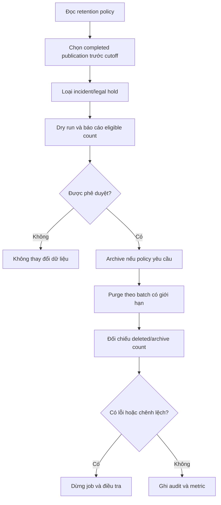

# Purge bản ghi cũ

Trong production, Spring Modulith có thể ghi nhận publication của application event tới từng listener để biết listener nào đã hoàn tất và publication nào cần phục hồi. Theo thời gian, số bản ghi publication tăng lên cùng lưu lượng event. Nếu giữ mọi bản ghi đã hoàn tất vô thời hạn, bảng registry và index có thể lớn dần, làm tăng chi phí lưu trữ, backup, truy vấn và bảo trì database.

Purge bản ghi cũ là quy trình xóa có kiểm soát những bản ghi đã hết thời hạn lưu giữ. Với Event Publication Registry, đối tượng thường được cân nhắc dọn là publication đã hoàn tất và đã qua retention window. Publication chưa hoàn tất có thể vẫn cần retry, resubmit hoặc điều tra sự cố; xóa chúng chỉ vì đã cũ có thể làm mất dấu vết cần thiết để phục hồi event. Vì vậy, purge phải dựa trên trạng thái xử lý, tuổi bản ghi, yêu cầu audit và chính sách lưu trữ của hệ thống.

Trong module `SPRING_MODULITH_APPLICATION_EVENTS`, purge registry là một phần vận hành vòng đời event. Nó cần được tách khỏi retention của broker, outbox, inbox, event store và dữ liệu nghiệp vụ vì mỗi loại bản ghi có mục đích và thời gian lưu khác nhau.

## Mục tiêu

Sau bài này, bạn có thể:

- Phân biệt publication đã hoàn tất và publication còn incomplete trước khi purge.
- Xây dựng retention policy theo thời điểm hoàn tất, retry window và yêu cầu audit.
- Lập kế hoạch purge có dry run, batch size và giới hạn thời gian.
- Dùng API được Spring Modulith hỗ trợ thay vì phụ thuộc schema nội bộ của registry.
- Tránh race condition với listener đang xử lý hoặc publication đang được retry.
- Tách archive, purge registry và retention của broker/outbox/inbox.
- Triển khai cleanup job an toàn trong môi trường nhiều instance.
- Theo dõi số bản ghi được giữ, lưu trữ, xóa và các publication quá hạn.
- Kiểm thử purge, backup/restore và khả năng phục hồi sau sự cố.

## 1. Vì sao cần purge bản ghi cũ?

Event Publication Registry lưu thông tin về việc một event đã được publish tới listener nào và trạng thái hoàn tất của publication đó. Với hệ thống có nhiều event, nhiều listener hoặc lưu lượng cao, số publication có thể tăng nhanh. Một event được nhiều listener xử lý có thể tạo nhiều publication record; vì vậy, số record không nhất thiết bằng số event nghiệp vụ.

Nếu không có retention policy, dữ liệu hoàn tất tiếp tục tích lũy. Điều này có thể gây:

- Tăng dung lượng bảng và index trong database.
- Tăng thời gian backup, restore và replication.
- Làm các truy vấn quản trị hoặc truy vấn incomplete phải làm việc trên tập dữ liệu lớn hơn.
- Tăng chi phí bảo trì, vacuum/compaction và lưu trữ.
- Giữ dữ liệu metadata lâu hơn mức cần thiết theo chính sách bảo vệ dữ liệu.

Purge có mục tiêu giữ registry đủ lâu để hỗ trợ retry, điều tra và vận hành, sau đó loại bỏ những record không còn giá trị vận hành. Xóa càng sớm không đồng nghĩa hệ thống càng tốt: nếu retention quá ngắn, đội vận hành có thể mất khả năng truy vết publication đã hoàn tất khi một sự cố được phát hiện muộn.

## 2. Phân loại bản ghi trước khi dọn

Không phải mọi record cũ đều có thể xóa. Trước hết, phân biệt trạng thái và vai trò của từng nhóm dữ liệu.

| Nhóm dữ liệu | Ý nghĩa | Chính sách thường dùng |
|---|---|---|
| Completed publication | Listener đã hoàn tất theo semantics registry | Giữ theo retention window, sau đó archive hoặc purge |
| Incomplete publication | Listener chưa được đánh dấu hoàn tất | Giữ lại để retry, resubmit hoặc điều tra |
| Publication đang xử lý | Listener đang thực thi hoặc vừa được claim | Không purge; tránh cạnh tranh với worker |
| Event/business history | Dữ liệu lịch sử nghiệp vụ hoặc event store | Retention riêng theo domain và yêu cầu audit |
| Outbox record | Bản ghi chờ hoặc đã gửi ra transport | Dọn theo trạng thái giao và chính sách outbox |
| Inbox/deduplication record | Dấu vết event đã được consumer áp dụng | Giữ đủ lâu để chống replay/duplicate trong cửa sổ hỗ trợ |
| Broker message | Message còn trong topic/queue hoặc log | Retention theo cấu hình broker và replay requirement |

Completed publication là ứng viên purge phổ biến nhất, nhưng vẫn cần kiểm tra retention và audit. Incomplete publication không nên bị xóa tự động chỉ vì `publishedAt` đã cũ. Một publication incomplete lâu ngày có thể là dấu hiệu listener lỗi liên tục, sai cấu hình hoặc dependency đã ngừng hoạt động; cần cảnh báo và xử lý như một incident.

## 3. Xây dựng retention policy

Retention policy phải trả lời ba câu hỏi: record nào được giữ, giữ trong bao lâu và ai có quyền thay đổi chính sách. Không dùng một con số chung cho registry, broker, inbox và business history.

Một policy cho completed publication có thể xét:

- Thời gian từ khi listener hoàn tất (`completedAt`), không chỉ thời gian event được publish.
- Thời gian tối đa mà đội vận hành thường cần điều tra một lỗi đã xảy ra.
- Thời gian retry/resubmit và thời gian replay được hỗ trợ.
- Yêu cầu audit, pháp lý hoặc hợp đồng với khách hàng.
- Mức độ nhạy cảm của metadata được lưu trong publication.
- Dung lượng database và tốc độ tăng record.

Ví dụ chính sách minh họa:

| Loại record | Thời gian giữ minh họa | Điều kiện purge |
|---|---:|---|
| Completed publication nội bộ | 14 ngày | Đã hoàn tất và không nằm trong incident đang điều tra |
| Completed publication quan trọng | 90 ngày | Đã archive nếu audit yêu cầu |
| Incomplete publication | Không tự xóa theo tuổi | Chỉ xử lý sau khi retry, resubmit hoặc quyết định nghiệp vụ kết thúc |
| Reconciliation/audit record | Theo chính sách audit riêng | Có bản lưu được phê duyệt và hết retention |
| Inbox/deduplication | Dài hơn replay window tối đa | Không còn message hợp lệ có thể được replay trong thời gian hỗ trợ |

Các con số trên chỉ là ví dụ để minh họa cách phân nhóm. Hãy xác định retention theo SLA, replay window, yêu cầu tuân thủ và dữ liệu thực tế của ứng dụng. Nếu một event có thể được replay sau 60 ngày, inbox record chỉ giữ 7 ngày có thể khiến replay tạo side effect trùng.

Dùng thời gian UTC (`Instant`) và một nguồn clock nhất quán. Định nghĩa rõ cutoff là “hoàn tất trước thời điểm hiện tại trừ retention” và xử lý sai lệch đồng hồ giữa các instance. Không dùng ngày local của máy chạy job làm tiêu chí nếu hệ thống phân tán nhiều múi giờ.

## 4. Tính cutoff từ thời điểm hoàn tất

Với completed publication, retention nên tính từ lúc publication được đánh dấu hoàn tất. Ví dụ, một event được publish ngày 1 nhưng listener chỉ hoàn tất ngày 10 sau nhiều lần retry. Nếu retention là 30 ngày tính từ `publishedAt`, record có thể bị purge ngày 31 dù mới hoàn tất 21 ngày. Nếu mục đích là giữ bằng chứng sau khi xử lý xong, cần dùng `completedAt`.

Quy tắc cutoff:

\[
cutoff = now_{UTC} - retentionDuration
\]

Chỉ các record thỏa cả hai điều kiện mới là ứng viên:

```text
publication.status == COMPLETED
publication.completedAt < cutoff
publication không thuộc incident/hold đang mở
```

Nếu implementation registry của phiên bản đang dùng không cung cấp trường hoặc API đúng như mô hình trên, hãy dùng abstraction và semantics được phiên bản đó hỗ trợ. Không suy luận trạng thái từ tên cột hoặc tự đọc schema database nội bộ của Spring Modulith để viết câu lệnh xóa.

## 5. Không xóa publication incomplete

Publication incomplete có thể cần được xử lý bởi `IncompleteEventPublications` hoặc quy trình recovery riêng. Xóa record này có thể khiến hệ thống không còn biết listener chưa hoàn tất, làm mất khả năng resubmit qua registry và gây khó khăn khi điều tra.

Với publication incomplete quá tuổi dự kiến:

1. Xác định event type, listener, thời điểm publish và tuổi publication.
2. Kiểm tra exception gần nhất, tình trạng dependency và cấu hình listener.
3. Xác định listener có đang chạy, bị kẹt hoặc đã dừng do restart hay không.
4. Kiểm tra event có thể được resubmit an toàn và listener có idempotent không.
5. Retry/resubmit theo ngân sách và chính sách phục hồi.
6. Nếu không thể tự phục hồi, chuyển sang manual intervention hoặc quy trình bù trừ có audit.
7. Chỉ kết thúc vòng đời record khi có quyết định rõ ràng về kết quả nghiệp vụ và bằng chứng cần lưu.

Không dùng purge như cách xóa backlog hoặc làm dashboard về 0. Số incomplete giảm do bị xóa không phải là bằng chứng event đã được xử lý.

## 6. Dùng API của Spring Modulith để quản lý publication

Event Publication Registry là một abstraction của Spring Modulith. Cách lưu trữ và schema có thể thay đổi theo phiên bản hoặc module persistence được cấu hình. Khi xóa completed publication, ưu tiên API quản lý publication mà phiên bản Spring Modulith đang sử dụng công bố, chẳng hạn API dành cho completed publications nếu có trong phiên bản đó.

Không viết `DELETE FROM EVENT_PUBLICATION ...` dựa trên giả định về tên bảng, cột hoặc enum trạng thái nội bộ. Cách đó có thể bỏ qua lifecycle callback, archive behavior, transaction semantics hoặc thay đổi schema giữa các phiên bản. Nếu ứng dụng có bảng retention riêng do mình sở hữu, có thể quản lý bảng đó bằng repository của ứng dụng; không đồng nhất nó với schema registry nội bộ.

Để tách chính sách khỏi API cụ thể, có thể định nghĩa một application service làm facade:

```java
import java.time.Instant;

public interface CompletedPublicationRetention {

    long countEligibleBefore(Instant cutoff);

    int purgeCompletedBefore(Instant cutoff, int batchSize);
}
```

Đây là interface do ứng dụng định nghĩa, không phải API dựng sẵn của Spring Modulith. Implementation cần gọi đúng API được phiên bản thư viện hỗ trợ và chỉ chọn completed publication thỏa cutoff. Facade giúp job, metric và test không phụ thuộc trực tiếp vào chi tiết persistence.

## 7. Lập kế hoạch purge bằng dry run

Trước khi xóa, chạy chế độ dry run để biết số record đủ điều kiện, phạm vi thời gian và ảnh hưởng dự kiến. Dry run không thay đổi dữ liệu; nó giúp phát hiện cutoff sai, retention cấu hình quá ngắn hoặc số lượng bất thường.

Một báo cáo dry run nên có:

- Thời điểm chạy và cutoff UTC.
- Retention duration và policy version.
- Số completed publication đủ điều kiện.
- Số incomplete publication quá tuổi (chỉ báo cáo, không purge).
- Số record bị loại khỏi purge vì legal hold hoặc incident hold.
- Dung lượng dự kiến giải phóng nếu database cung cấp số liệu đáng tin cậy.
- Batch size và giới hạn thời gian chạy.

Ví dụ kết quả:

```text
PurgeDryRun
  startedAt: 2026-11-25T10:00:00Z
  cutoff: 2026-11-11T10:00:00Z
  retention: PT336H
  eligibleCompleted: 128450
  incompleteOlderThanThreshold: 37
  heldForInvestigation: 12
  plannedBatchSize: 1000
  action: REPORT_ONLY
```

Các con số chỉ minh họa. Không đưa payload nhạy cảm hoặc dữ liệu cá nhân vào báo cáo. Dùng count và định danh scope đủ để đội vận hành xác nhận kế hoạch.

## 8. Purge theo batch có giới hạn

Xóa một lượng lớn record trong một transaction có thể giữ lock lâu, tạo transaction log lớn, làm replication lag hoặc ảnh hưởng truy vấn listener. Nên chia thành batch nhỏ và commit sau mỗi batch.

Ví dụ job dùng facade ứng dụng:

```java
import java.time.Clock;
import java.time.Duration;
import java.time.Instant;

import org.springframework.scheduling.annotation.Scheduled;
import org.springframework.stereotype.Component;

@Component
class CompletedPublicationPurgeJob {

    private final CompletedPublicationRetention retention;
    private final Clock clock;

    CompletedPublicationPurgeJob(
            CompletedPublicationRetention retention,
            Clock clock) {
        this.retention = retention;
        this.clock = clock;
    }

    @Scheduled(cron = "${app.events.purge.cron:0 30 2 * * *}")
    void purge() {
        Duration keepFor = Duration.ofDays(30);
        int batchSize = 1_000;
        int maxBatchesPerRun = 10;
        Instant cutoff = clock.instant().minus(keepFor);

        for (int batch = 0; batch < maxBatchesPerRun; batch++) {
            int deleted = retention.purgeCompletedBefore(cutoff, batchSize);
            if (deleted < batchSize) {
                break;
            }
        }
    }
}
```

`CompletedPublicationRetention` và implementation là abstraction của ứng dụng. Ví dụ minh họa cách tính cutoff và lặp batch; implementation cần bảo đảm mỗi batch có transaction ngắn, chỉ xóa completed record đủ điều kiện và có giới hạn tổng thời gian hoặc số batch mỗi lần chạy. Trong production, không nên chạy vòng lặp vô hạn nếu backlog lớn; có thể giới hạn `maxBatchesPerRun` rồi tiếp tục ở lần schedule sau.

`Clock` được inject để test cutoff xác định. Bật scheduling và cấu hình cron theo múi giờ vận hành đã thống nhất. Nếu Spring Modulith hoặc persistence module đã cung cấp cơ chế cleanup tương ứng, ưu tiên cơ chế được tài liệu của phiên bản đó hỗ trợ và bọc nó bằng retention policy của ứng dụng.

## 9. Tránh race condition với listener và recovery job

Purge chạy đồng thời với listener có thể gặp tình huống record vừa được đánh dấu completed trong lúc job đang chọn ứng viên. Nếu query chỉ dựa trên `publishedAt`, job có thể xóa record đang được xử lý hoặc chưa qua retention kể từ khi hoàn tất.

Các nguyên tắc bảo vệ:

- Chỉ chọn publication đã được xác nhận completed.
- Tính tuổi từ completion time nếu policy dựa trên thời gian sau xử lý.
- Kiểm tra lại điều kiện trước khi xóa trong transaction của batch.
- Không xóa publication đang được claim hoặc có trạng thái processing nếu implementation có trạng thái đó.
- Dùng API registry có semantics đồng bộ với lifecycle thay vì thao tác trực tiếp bảng nội bộ.
- Tránh để purge và recovery/resubmit job cùng thao tác một tập record mà không có cơ chế điều phối.
- Dùng cutoff cố định cho toàn bộ một lần chạy để batch sau không mở rộng phạm vi ngoài kế hoạch.

Trong môi trường nhiều instance, mỗi instance có thể kích hoạt cùng scheduled job. Dùng distributed lock, leader election hoặc scheduler bên ngoài để chỉ một worker điều phối purge tại một thời điểm. Nếu cleanup implementation được thiết kế idempotent và chia batch an toàn, vẫn cần xác nhận hành vi concurrent execution trước khi cho phép nhiều instance chạy song song.

## 10. Archive trước khi purge khi cần audit

Không phải hệ thống nào cũng cần archive completed publication. Nếu registry chỉ lưu metadata vận hành và không có yêu cầu audit dài hạn, purge sau retention có thể đủ. Nếu cần bằng chứng lịch sử, hãy archive phần metadata tối thiểu vào kho lưu trữ do ứng dụng quản lý trước khi xóa.

Archive record có thể giữ:

- Event ID hoặc định danh publication.
- Listener ID hoặc tên consumer.
- Event type và schema version.
- Thời điểm publish và hoàn tất.
- Kết quả xử lý và correlation ID.
- Migration/incident reference nếu có.
- Digest payload nếu cần đối chiếu, thay vì sao chép payload nhạy cảm.

Archive cần có retention, quyền truy cập, mã hóa, backup và quy trình xóa riêng. Nếu archive và purge nằm ở hai hệ thống khác nhau, thiết kế thao tác archive idempotent: chỉ purge record nguồn sau khi xác nhận bản archive đã ghi bền vững. Có thể dùng trạng thái `ARCHIVED` hoặc manifest theo batch để phục hồi nếu job dừng giữa chừng.

Không archive secret, token, toàn bộ payload hoặc dữ liệu cá nhân nếu mục tiêu audit chỉ cần metadata. Áp dụng nguyên tắc data minimization và quy định xóa theo chính sách bảo vệ dữ liệu của tổ chức.

## 11. Tách retention của registry, broker, outbox và inbox

Các lớp lưu trữ có vòng đời khác nhau. Xóa một record trong registry không xóa message trong broker và cũng không xóa dấu vết deduplication của consumer.

| Thành phần | Dữ liệu giữ | Tiêu chí dọn |
|---|---|---|
| Event Publication Registry | Trạng thái publication tới listener | Completed và quá retention; incomplete được xử lý riêng |
| Broker topic/queue | Message đang chờ hoặc retained log | Broker retention, acknowledgement và replay window |
| Outbox | Event cần gửi và trạng thái gửi | Chỉ xóa sau khi giao thành công và hết audit/replay window |
| Inbox/deduplication | Event ID đã áp dụng | Giữ lâu hơn cửa sổ redelivery/replay có thể xảy ra |
| Event store | Lịch sử domain event | Chính sách lịch sử và khả năng dựng lại state |
| Projection | Trạng thái đọc được xây từ event | Snapshot/rebuild policy và yêu cầu nghiệp vụ |
| Audit archive | Bằng chứng vận hành/nghiệp vụ | Retention pháp lý và kiểm soát truy cập |

Đặc biệt, không purge inbox cùng thời điểm với registry nếu broker hoặc operator vẫn có thể replay message cũ. Khi inbox record đã bị xóa, consumer có thể xem event replay là mới và lặp side effect. Retention inbox cần bao phủ tối đa thời gian message còn có thể được giao lại hoặc replay theo chính sách vận hành.

## 12. Bảo vệ dữ liệu và điều kiện legal hold

Retention không chỉ là bài toán dung lượng. Publication metadata có thể chứa event type, listener, timestamp, định danh aggregate hoặc thông tin liên quan tới khách hàng. Hãy phân loại dữ liệu và xác định thời gian lưu theo mục đích sử dụng.

Trước purge, kiểm tra:

- Record có thuộc incident, audit hoặc legal hold đang mở không?
- Có yêu cầu điều tra hoặc đối soát chưa hoàn tất không?
- Record có chứa dữ liệu cá nhân hoặc thông tin nhạy cảm không?
- Archive có cần giữ dữ liệu tối thiểu để đáp ứng audit không?
- Có quy trình phê duyệt cho việc thay đổi retention không?

Legal hold hoặc incident hold phải được áp dụng rõ ràng trong tiêu chí chọn ứng viên. Không dựa vào một danh sách thủ công nằm ngoài job mà không có cơ chế truy vết. Ghi nhận ai đặt hold, lý do, thời điểm và ai được phép gỡ hold.

## 13. Kiểm soát và quan sát cleanup job

Purge job là một workload production; nó cần metric, log, timeout và cảnh báo như các job khác.

Theo dõi:

- Số completed publication đủ điều kiện theo cutoff.
- Số record được archive và purge trong mỗi batch.
- Số incomplete publication quá tuổi, luôn tách riêng khỏi purge count.
- Thời gian chạy và số batch mỗi lần schedule.
- Số lỗi transaction, lock timeout và retry của cleanup.
- Database size, index size, replication lag và backup duration.
- Số record bị giữ bởi incident/legal hold.
- Thời điểm purge thành công gần nhất và cutoff đã áp dụng.

Log nên có `jobRunId`, cutoff UTC, retention policy version, batch number, deleted count, archived count và thời gian xử lý. Không log payload đầy đủ. Nếu một batch thất bại, ghi rõ batch nào đã commit để lần chạy tiếp theo tiếp tục an toàn.

Đặt cảnh báo khi purge không chạy trong khoảng thời gian dự kiến, số eligible record tăng bất thường, cleanup liên tục bị lock timeout hoặc incomplete publication quá tuổi vượt ngưỡng. Đừng chỉ cảnh báo khi database gần đầy; backlog publication có thể là dấu hiệu listener đang lỗi trước khi dung lượng trở thành vấn đề.

## 14. Kiểm thử purge trước khi production

Kiểm thử cần xác nhận điều kiện chọn và giới hạn xóa, không chỉ kiểm tra job kết thúc bình thường.

| Tình huống | Điều cần xác nhận |
|---|---|
| Completed publication cũ hơn cutoff | Được chọn và purge theo policy |
| Completed publication mới hơn cutoff | Được giữ lại |
| Incomplete publication đã rất cũ | Không bị purge; tạo tín hiệu cần điều tra |
| Publication vừa chuyển sang completed | Không bị xóa trước khi đủ retention từ completion time |
| Publication thuộc incident/legal hold | Được giữ lại |
| Batch size đạt giới hạn | Mỗi batch commit riêng và không vượt giới hạn |
| Job dừng giữa các batch | Chạy lại không xóa sai hoặc archive trùng |
| Hai instance chạy đồng thời | Không gây race hoặc xử lý không nhất quán |
| Archive thành công nhưng purge thất bại | Lần chạy lại không tạo archive duplicate không kiểm soát |
| Registry schema/API thay đổi sau nâng cấp | Cleanup vẫn dùng API được hỗ trợ |
| Inbox retention ngắn hơn replay window | Test phát hiện nguy cơ duplicate side effect |
| Backup/restore | Record cần phục hồi vẫn có thể được khôi phục theo policy |

Unit test có thể dùng `Clock` cố định để kiểm tra cutoff và batch policy. Integration test cần dùng registry persistence tương ứng để xác minh trạng thái completed/incomplete. Kiểm thử job nhiều instance hoặc distributed lock ở môi trường tích hợp nếu deployment có nhiều replica.

Trước khi bật purge thật, chạy dry run trên dữ liệu production-like, kiểm tra count và cutoff, sau đó triển khai với batch nhỏ. Quan sát lock, replication lag và thời gian chạy trước khi tăng batch size.

## 15. Runbook purge an toàn

Một runbook production có thể đi theo các bước:

1. Xác nhận retention policy và người phê duyệt.
2. Kiểm tra trạng thái registry, incomplete publication, recovery backlog và incident hold.
3. Chọn cutoff UTC cố định và chạy dry run.
4. So sánh số eligible với dự báo; dừng nếu chênh lệch bất thường.
5. Xác nhận archive đã sẵn sàng nếu policy yêu cầu.
6. Bật purge theo batch nhỏ và giới hạn thời gian mỗi lần chạy.
7. Theo dõi DB lock, replication lag, số record xóa và incomplete count.
8. Dừng job nếu xuất hiện lỗi bất thường; batch đã commit phải có thể xác định.
9. Xác minh số record còn lại, archive và dashboard sau khi chạy.
10. Lưu báo cáo `jobRunId`, cutoff, policy version và kết quả.

Nếu phát hiện purge nhầm publication cần phục hồi, dừng job ngay, xác định backup/archive còn lại và đánh giá event nào chưa được xử lý. Không tự phát lại toàn bộ event chỉ vì thiếu registry record; trước tiên đối chiếu consumer state và idempotency để tránh lặp side effect.

## 16. Những lỗi thường gặp

| Lỗi | Hệ quả | Cách khắc phục |
|---|---|---|
| Xóa mọi record cũ theo `publishedAt` | Có thể xóa publication incomplete hoặc vừa hoàn tất | Chỉ purge completed và tính retention từ completion time |
| Xóa incomplete để giảm backlog | Mất khả năng phục hồi và che giấu listener lỗi | Giữ lại, cảnh báo và xử lý recovery riêng |
| Xóa trực tiếp bảng registry nội bộ | Bỏ qua lifecycle và phụ thuộc schema | Dùng API được Spring Modulith hỗ trợ |
| Purge toàn bộ trong một transaction | Lock lâu, transaction log và replication lag tăng | Batch nhỏ, transaction ngắn |
| Mỗi instance chạy cleanup độc lập | Cạnh tranh và xử lý trùng | Distributed lock hoặc điều phối một job |
| Không có dry run | Không phát hiện cutoff sai trước khi xóa | Báo cáo eligible count và phê duyệt |
| Archive sau khi đã purge | Mất bằng chứng nếu archive thất bại | Archive bền vững trước rồi mới purge |
| Dọn inbox cùng registry | Replay có thể tạo side effect trùng | Retention inbox bao phủ replay/redelivery window |
| Không có legal/incident hold | Xóa dữ liệu đang cần điều tra | Tích hợp hold vào tiêu chí purge |
| Không quan sát job | Cleanup dừng hoặc lỗi mà không được phát hiện | Metric, log, alert và runbook |

## 17. Quy trình purge bản ghi cũ



Purge bản ghi cũ cần dựa trên trạng thái và retention policy rõ ràng. Giữ publication incomplete để phục hồi, chỉ chọn completed publication đã qua thời hạn lưu, loại trừ incident/legal hold, chạy dry run và xóa theo batch. Dùng API registry được phiên bản Spring Modulith hỗ trợ, tách retention của registry khỏi broker/outbox/inbox, rồi theo dõi kết quả qua metric và audit. Mục tiêu là giảm dữ liệu vận hành đã hết giá trị mà vẫn giữ khả năng retry, điều tra và replay trong thời gian hệ thống cam kết hỗ trợ.

## Tài liệu tham khảo

- [Spring Modulith — Working with Application Events](https://docs.spring.io/spring-modulith/reference/events.html)
- [Spring Modulith — Event Publication Registry](https://docs.spring.io/spring-modulith/reference/events.html#_event_publication_registry)
- [Spring Modulith API — CompletedEventPublications](https://docs.spring.io/spring-modulith/docs/current/api/org/springframework/modulith/events/CompletedEventPublications.html)
- [Spring Framework — Task Execution and Scheduling](https://docs.spring.io/spring-framework/reference/integration/scheduling.html)
