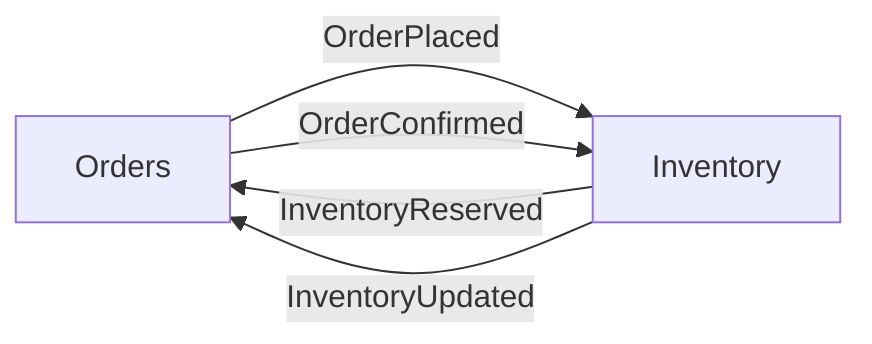
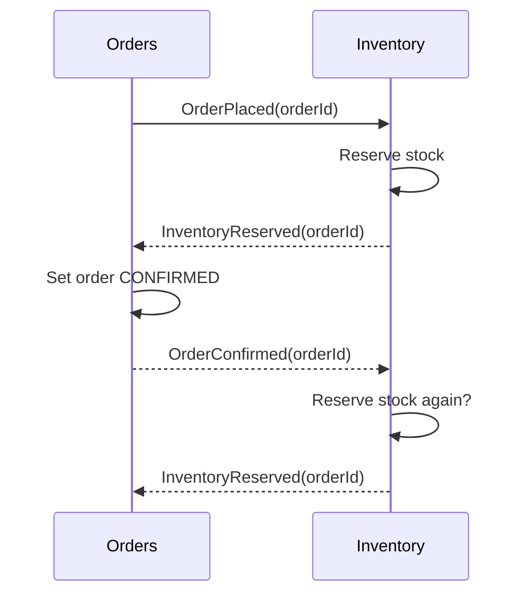
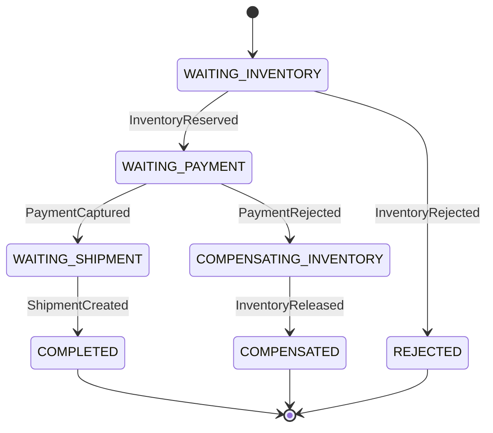

# Phụ thuộc vòng qua event

## Mục tiêu

Application events giúp các module Spring Modulith trao đổi kết quả nghiệp vụ mà không cần gọi trực tiếp implementation của nhau. Tuy nhiên, nếu module A phát event cho module B, B xử lý rồi phát event khiến A hoặc một chuỗi module khác quay lại kích hoạt A, hệ thống có thể hình thành một chu trình phụ thuộc ở thời gian chạy.

**Phụ thuộc vòng qua event** là tình trạng các module liên kết với nhau thành một chu trình thông qua quan hệ phát và nhận event. Chu trình có thể là một workflow hữu hạn được thiết kế có chủ đích, nhưng cũng có thể trở thành vòng lặp không kết thúc, tạo side effect lặp, khó truy vết và khiến ranh giới module mất ý nghĩa.

Sau bài học, bạn có thể:

- Phân biệt dependency cycle ở mã nguồn với cycle trong luồng event runtime.
- Nhận diện event ping-pong, chuỗi phản hồi và phụ thuộc nghiệp vụ ẩn.
- Hiểu vì sao event không tự động loại bỏ coupling giữa các module.
- Phát hiện chu trình bằng event flow map, correlation metadata, log và trace.
- Thiết kế lại luồng bằng ownership rõ ràng, command, process manager hoặc workflow hữu hạn.
- Ngăn lặp side effect bằng state transition, idempotency và giới hạn retry.

## 1. Phụ thuộc vòng qua event là gì?

Giả sử module Đơn hàng phát `OrderPlaced`. Module Kho nhận event, giữ hàng rồi phát `InventoryReserved`. Module Đơn hàng nhận event này, xác nhận đơn và phát `OrderConfirmed`. Nếu module Kho lại nghe `OrderConfirmed`, thay đổi trạng thái kho rồi phát một event khiến module Đơn hàng xử lý lại, hai module đã tạo một vòng phản hồi.

Sơ đồ đơn giản:



Vấn đề không nằm ở việc hai module trao đổi nhiều event. Vấn đề xuất hiện khi kết quả từ module này liên tục kích hoạt module kia theo một chu trình mà không có điều kiện kết thúc rõ ràng hoặc không có một thành phần sở hữu trạng thái workflow.

### Event graph và module dependency graph

Cần phân biệt hai đồ thị:

- **Module dependency graph:** biểu diễn module nào tham chiếu package/API của module nào trong mã nguồn.
- **Event flow graph:** biểu diễn module nào phát event, module nào nhận event và event tiếp theo có thể được phát ra.

Một chu trình trong event flow graph có thể tồn tại ngay cả khi các module chỉ phụ thuộc vào event contract công khai và không gọi trực tiếp implementation của nhau. Ngược lại, module dependency graph có thể có chu trình trực tiếp do import type hoặc gọi API chéo mà không cần event.

Spring Modulith có thể giúp kiểm tra một số dependency rule và chu trình cấu trúc thông qua `ApplicationModules.verify()`. Kiểm tra kiến trúc đó không thay thế việc phân tích event flow, điều kiện phát event và side effect ở thời gian chạy.

## 2. Vì sao event cycle nguy hiểm?

Phụ thuộc vòng qua event thường khó nhận ra hơn lời gọi method trực tiếp. Mỗi listener riêng lẻ có thể hợp lý, nhưng khi ghép các listener lại, toàn bộ luồng có thể tạo ra phản hồi ngoài dự kiến.

Các hậu quả thường gặp:

- **Event ping-pong:** A phát event cho B, B phát event tương tự hoặc event phản hồi khiến A chạy lại.
- **Side effect lặp:** gửi email, cập nhật số dư, giữ/giải phóng hàng hoặc gọi API ngoài nhiều lần.
- **Backlog tăng liên tục:** mỗi lần xử lý tạo thêm publication, làm executor hoặc broker queue bị lấp đầy.
- **Retry khuếch đại vòng lặp:** một event lỗi được resubmit và lại phát ra chuỗi event mới.
- **Trạng thái dao động:** hai module liên tục ghi đè hoặc hiệu chỉnh trạng thái của nhau.
- **Khó xác định owner:** không rõ module nào có quyền quyết định trạng thái cuối cùng.
- **Khó kiểm thử:** test từng listener đều pass nhưng tích hợp toàn luồng lại không dừng.
- **Khó vận hành:** log rời rạc khiến operator thấy nhiều event nhưng không biết chuỗi nào đã tạo ra chúng.

Một vòng lặp còn có thể tạo tải lên database và Event Publication Registry. Với listener được quản lý bởi Spring Modulith, publication được theo dõi theo listener; nếu mỗi lần xử lý lại phát event mới, số publication cần xử lý có thể tăng nhanh dù từng listener đều hoàn tất thành công.

## 3. Phân biệt workflow hữu hạn và vòng lặp ngoài ý muốn

Không phải mọi chu trình trong event flow đều là anti-pattern. Một quy trình nghiệp vụ có thể quay lại bước trước theo điều kiện rõ ràng, ví dụ yêu cầu bổ sung thông tin rồi tiếp tục phê duyệt. Điều quan trọng là chu trình phải có chủ sở hữu, trạng thái, điều kiện chuyển tiếp và tiêu chí kết thúc.

| Đặc điểm | Workflow hữu hạn có chủ đích | Vòng lặp ngoài ý muốn |
| --- | --- | --- |
| Chủ sở hữu tiến trình | Có process manager hoặc module sở hữu trạng thái rõ. | Nhiều listener tự kích hoạt lẫn nhau. |
| Điều kiện chuyển tiếp | Có precondition và state transition xác định. | Phát event mỗi khi nhận event mà không kiểm tra trạng thái. |
| Điều kiện kết thúc | Có trạng thái terminal hoặc deadline. | Không có terminal state hoặc điều kiện dừng không đáng tin cậy. |
| Duplicate | Có event ID/idempotency và xử lý lại an toàn. | Duplicate có thể kích hoạt thêm side effect. |
| Quan sát | Có correlation/causation và timeline theo workflow. | Chỉ thấy nhiều log/event rời rạc. |
| Kiểm thử | Test được đường đi thành công, nhánh lỗi và điểm kết thúc. | Test đơn lẻ pass nhưng luồng tích hợp có thể lặp vô hạn. |

Một vòng xử lý hữu hạn có thể được mô hình hóa bằng saga/process manager. Khi đó, chu trình là một phần của state machine được quản lý, không phải một chuỗi phản ứng tự phát giữa các listener.

## 4. Các dạng phụ thuộc vòng thường gặp

### Event echo

Module nhận event rồi phát lại cùng loại event mà không có thay đổi nghiệp vụ mới. Nếu listener của module phát ban đầu nhận event này, vòng lặp bắt đầu lại.

Ví dụ anti-pattern:

```java
@Component
class CustomerListener {

    private final ApplicationEventPublisher events;

    CustomerListener(ApplicationEventPublisher events) {
        this.events = events;
    }

    @ApplicationModuleListener
    void on(CustomerUpdated event) {
        // Chỉ chuẩn hóa lại dữ liệu, nhưng luôn phát CustomerUpdated.
        events.publishEvent(new CustomerUpdated(event.customerId()));
    }
}
```

Listener luôn phát lại event dù không có transition mới. Event mới có thể được listener này nhận lại và tiếp tục lặp.

### Hai module cùng cố sở hữu một trạng thái

Module Đơn hàng xem trạng thái thanh toán là dữ liệu của mình; module Thanh toán cũng tự quyết định trạng thái đơn. Khi mỗi bên phát event để “sửa” trạng thái của bên kia, hai nguồn sự thật có thể tranh chấp.

Ví dụ: Orders phát `OrderNeedsPayment`, Payments phát `PaymentStatusChanged`, Orders phát `OrderPaymentUpdated`, rồi Payments lại diễn giải event đó như một yêu cầu thay đổi thanh toán. Ranh giới giữa yêu cầu và sự kiện đã bị xóa nhòa.

### Event mang ý định thay vì sự kiện đã xảy ra

Nếu event `CancelOrder` thực chất là yêu cầu module khác hủy đơn, nó đang đóng vai trò command. Consumer xử lý xong lại phát `CancelOrder` để module đầu tiên thực hiện, tạo vòng phản hồi và làm mơ hồ owner của hành động.

Command biểu đạt điều cần được thực hiện; event biểu đạt điều đã xảy ra. Phân biệt hai loại message giúp xác định ai có quyền quyết định và khi nào event được phát.

### Phản hồi chéo qua nhiều module

Một vòng có thể đi qua nhiều module, ví dụ Orders → Inventory → Shipping → Orders. Khi đó, từng cặp module không có vẻ phụ thuộc vòng trực tiếp, nhưng toàn bộ đồ thị vẫn có chu trình.

### Vòng lặp do projection phát event

Read model/projection thường tiêu thụ event để cập nhật dữ liệu phục vụ truy vấn. Nếu việc cập nhật projection lại phát event có cùng ý nghĩa với event nguồn, các consumer khác có thể xem thay đổi đọc như một thay đổi nghiệp vụ mới và tạo vòng lặp.

Projection nên là kết quả đọc được xây dựng từ event; không nên phát lại domain event chỉ vì một dòng read model đã được cập nhật. Nếu cần thông báo projection đã sẵn sàng, dùng event kỹ thuật riêng với semantics rõ ràng và không để nó kích hoạt lại workflow nguồn.

## 5. Ví dụ vòng lặp giữa Orders và Inventory

Giả sử module Orders phát `OrderPlaced`. Inventory giữ hàng rồi phát `InventoryReserved`. Orders nghe event và chuyển đơn sang `CONFIRMED`, sau đó phát `OrderConfirmed`. Inventory lại nghe `OrderConfirmed` và gọi logic giữ hàng lần nữa.



Nếu Inventory không kiểm tra reservation đã tồn tại và không phân biệt event đầu vào với event phản hồi, nó có thể tạo reservation lặp. Orders cũng có thể xử lý `InventoryReserved` nhiều lần và phát `OrderConfirmed` lặp.

### Dấu hiệu trong code

- Listener của một module phát event mà chính module đó hoặc module nguồn đang lắng nghe.
- Handler không kiểm tra state hiện tại trước khi thay đổi và phát event.
- Event name giống nhau nhưng payload không có event ID, causation ID hoặc aggregate version.
- Nhiều module cùng cập nhật một trạng thái nghiệp vụ.
- Event được phát sau mỗi lần save, kể cả khi dữ liệu không đổi.
- Listener phát event “đã cập nhật” chỉ để báo cho producer biết listener đã nhận event.

## 6. Phát hiện chu trình trong thiết kế

### Lập event flow map

Với từng event, ghi lại producer, consumer và event tiếp theo mà mỗi consumer có thể phát. Dùng một đồ thị có hướng:

- Node là module hoặc process manager.
- Edge là quan hệ producer → consumer được gắn với event type.
- Edge tiếp theo được tạo khi consumer phát event mới.

Ví dụ bảng:

| Producer | Event | Consumer | Event tiếp theo |
| --- | --- | --- | --- |
| Orders | `OrderPlaced` | Inventory | `InventoryReserved` hoặc `InventoryRejected` |
| Inventory | `InventoryReserved` | Orders | `OrderConfirmed` |
| Orders | `OrderConfirmed` | Shipping | `ShipmentRequested` |
| Shipping | `ShipmentCreated` | Orders | `OrderShipped` |

Bảng này giúp nhìn thấy workflow nhiều bước. Nếu một edge quay lại module đã xuất hiện trước đó, cần xác định đó là workflow hữu hạn hay phản hồi ngoài ý muốn.

### Review consumer và publisher cùng nhau

Không review một listener riêng lẻ. Với mỗi listener, hỏi:

1. Event nào kích hoạt listener?
2. Listener thay đổi dữ liệu thuộc quyền sở hữu của module nào?
3. Nó phát event nào sau khi xử lý?
4. Những module nào nghe event tiếp theo?
5. Có đường đi nào quay lại producer hoặc consumer ban đầu không?
6. Điều kiện nào bảo đảm tiến trình dừng?

Đưa event flow map vào review khi thêm event mới ở các workflow quan trọng. Catalog producer/consumer và module diagram nên liên kết cùng event type/version.

### Dùng kiểm tra kiến trúc của Spring Modulith

`ApplicationModules.verify()` có thể phát hiện các dependency vi phạm quy tắc module, bao gồm một số chu trình dependency ở mức package/module khi các type được tham chiếu trực tiếp. Ví dụ:

```java
class ModularityTests {

    @Test
    void verifiesModuleStructure() {
        ApplicationModules.of(Application.class).verify();
    }
}
```

Đây là kiểm tra kiến trúc hữu ích, nhưng không đủ để chứng minh event flow không có cycle. Nếu module giao tiếp qua contract trung gian, externalized event, string destination hoặc adapter, quan hệ runtime có thể không hiện đầy đủ trong dependency graph của mã nguồn. Cần kết hợp kiểm tra module với event catalog, flow map và test tích hợp.

## 7. Dùng correlation và causation để truy vết

Mỗi event trong một workflow nên mang metadata đủ để nối các bước:

- `eventId`: định danh duy nhất của event.
- `correlationId`: định danh toàn bộ workflow hoặc business process.
- `causationId`: event/command trực tiếp gây ra event hiện tại.
- `aggregateId`: định danh aggregate liên quan.
- `aggregateVersion`: thứ tự thay đổi của aggregate nếu cần.
- `eventType` và `schemaVersion`: loại và phiên bản contract.
- `occurredAt`: thời điểm nghiệp vụ xảy ra.

Ví dụ chuỗi causation:

```text
OrderPlaced (eventId=E1, correlationId=C1)
  └─ InventoryReserved (eventId=E2, causationId=E1, correlationId=C1)
       └─ OrderConfirmed (eventId=E3, causationId=E2, correlationId=C1)
            └─ ShipmentRequested (eventId=E4, causationId=E3, correlationId=C1)
```

Khi trace cho thấy một correlation ID tạo ra cùng event type lặp nhiều lần hoặc số hop tăng bất thường, có thể phát hiện event ping-pong. Không dùng correlation ID thay cho idempotency key: correlation nối workflow, còn idempotency xác định một thao tác không được thực hiện lặp.

Có thể bổ sung `workflowStep`, `attempt` hoặc `hopCount` để chẩn đoán. Giới hạn hop count là cơ chế bảo vệ cuối cùng, không phải giải pháp thay thế cho thiết kế workflow và điều kiện kết thúc.

## 8. Thiết kế lại bằng ownership rõ ràng

Biện pháp quan trọng nhất là xác định module nào sở hữu dữ liệu và quyết định nghiệp vụ. Module khác gửi yêu cầu qua contract được công bố; module sở hữu dữ liệu quyết định có chấp nhận hay không và phát event mô tả kết quả.

Ví dụ:

- Orders sở hữu trạng thái đơn hàng.
- Inventory sở hữu tồn kho và reservation.
- Payments sở hữu giao dịch thanh toán.
- Shipping sở hữu shipment và trạng thái giao hàng.

Orders không tự cập nhật tồn kho; Inventory không tự đổi trạng thái đơn. Inventory phát `InventoryReserved` hoặc `InventoryRejected`; Orders quyết định bước tiếp theo dựa trên kết quả đó.

### Chỉ phát event khi có transition mới

Handler cần kiểm tra trạng thái trước khi tạo side effect:

```java
@ApplicationModuleListener
@Transactional
void on(OrderPlaced event) {
    if (reservations.existsByOrderId(event.orderId())) {
        return;
    }

    Reservation reservation = inventory.reserve(
            event.orderId(), event.lines());

    events.publishEvent(new InventoryReserved(
            event.eventId(),
            event.orderId(),
            reservation.id()));
}
```

Đoạn code minh họa ý tưởng idempotency, không phải implementation hoàn chỉnh. Trong production, cần unique constraint hoặc inbox/idempotency record để bảo vệ khi hai delivery đồng thời cùng kiểm tra chưa có reservation. `eventId` của event mới cần có định danh riêng và liên kết `causationId` tới event đầu vào; không nên tái sử dụng event ID nếu đó là một event khác.

Không phát event chỉ vì listener được gọi. Chỉ phát khi một transition nghiệp vụ mới đã xảy ra và transaction ghi transition đó được commit theo semantics đã chọn.

## 9. Phân biệt command và event

Một nguyên nhân phổ biến của event cycle là dùng event để yêu cầu module khác thực hiện hành động.

| Message | Ý nghĩa | Ví dụ |
| --- | --- | --- |
| Command | Yêu cầu một owner thực hiện hành động. | `ReserveInventory`, `CapturePayment`, `CancelShipment`. |
| Event | Sự kiện đã xảy ra và có thể được nhiều consumer quan tâm. | `InventoryReserved`, `PaymentCaptured`, `ShipmentCancelled`. |

Command thường có một owner xử lý quyết định. Event mô tả fact và có thể có nhiều listener. Tên `InventoryReservationRequested` có thể là event nếu fact “yêu cầu đã được ghi nhận” thực sự xảy ra; nếu nó chỉ là lời yêu cầu Inventory hãy giữ hàng, đó là command.

Trong cùng ứng dụng Spring Modulith, module có thể gọi application API công khai của module sở hữu hành động khi cần command-response trực tiếp. Nếu dùng message bất đồng bộ, hãy biểu diễn command và kết quả rõ ràng, có correlation ID và trạng thái xử lý.

Không phát một event phản hồi chỉ để module nguồn “gọi lại” chính mình nhằm hoàn tất một thao tác mà nó vẫn sở hữu. Module sở hữu trạng thái nên xử lý transition của mình trong application service, sau đó phát fact cho các module quan tâm.

## 10. Dùng process manager cho workflow nhiều bước

Khi quy trình đi qua nhiều module và có nhánh lỗi, retry hoặc compensation, process manager/saga giúp tập trung điều phối trạng thái workflow.

Process manager có thể:

- Lưu `sagaId`, business key, trạng thái và step hiện tại.
- Nhận event kết quả từ các module.
- Kiểm tra event có đúng step/version đang chờ không.
- Ghi command tiếp theo hoặc bắt đầu compensation.
- Dừng ở trạng thái terminal như `COMPLETED`, `REJECTED` hoặc `COMPENSATED`.
- Chuyển sang `MANUAL_REVIEW` khi không thể tự phục hồi.

Ví dụ workflow đặt hàng:



Sơ đồ là ví dụ rút gọn. Process manager sở hữu tiến trình, còn từng module vẫn sở hữu dữ liệu và quy tắc nội bộ của mình. Không biến process manager thành nơi truy cập trực tiếp repository của tất cả module.

### Chống vòng lặp trong process manager

- Chỉ nhận event phù hợp với step hiện tại.
- Lưu event ID đã xử lý để chống duplicate.
- Dùng optimistic locking hoặc row lock cho một saga instance.
- Chỉ phát command tiếp theo khi transition state thành công.
- Có deadline, retry budget và terminal state.
- Ghi command/outbox cùng transaction với state transition khi cần bảo đảm phát lệnh bền vững.

## 11. Idempotency, state transition và giới hạn retry

Ngay cả khi đã loại bỏ event cycle về mặt thiết kế, duplicate delivery và retry vẫn có thể làm listener chạy nhiều lần. Handler cần an toàn khi nhận lại cùng event.

Các biện pháp:

- Ghi inbox/processed-event với unique key `(listenerId, eventId)`.
- Cập nhật trạng thái nghiệp vụ và inbox trong cùng transaction.
- Dùng unique constraint cho side effect như reservation hoặc payment operation.
- Kiểm tra aggregate version và trạng thái hiện tại trước khi áp dụng event.
- Chỉ phát event mới khi có transition hợp lệ.
- Phân loại lỗi transient và permanent; đặt retry budget, backoff và jitter.
- Chuyển event không thể xử lý sang quarantine/DLQ có audit.

Không dùng “đã từng thấy event type này” làm điều kiện deduplicate. Một aggregate có thể phát nhiều event cùng type ở những thời điểm khác nhau. Cần event ID hoặc business operation ID đủ cụ thể.

### Không dùng cờ chống lặp trong memory làm bảo đảm

Một `Set<UUID>` trong bean singleton có thể chặn duplicate trong một instance, nhưng mất khi restart và không chia sẻ giữa nhiều instance. Dùng persistence/unique constraint hoặc cơ chế idempotency bền vững phù hợp với side effect.

### Giới hạn retry

Retry vô hạn một event nằm trong vòng lặp có thể làm tình hình nặng hơn. Đặt số lần thử, deadline và chính sách cách ly. Khi event bị quarantine, lưu correlation/causation và chuỗi event liên quan để operator xác định vòng phản hồi bắt đầu từ đâu.

## 12. Vai trò của `@ApplicationModuleListener` và Event Publication Registry

`@ApplicationModuleListener` hỗ trợ xử lý event giữa các module theo mô hình bất đồng bộ và sau commit của Spring Modulith. Bất đồng bộ giúp giảm coupling về thời gian, nhưng không tự loại bỏ coupling về nghiệp vụ hoặc ngăn event cycle.

Event Publication Registry theo dõi publication tới listener được quản lý và trạng thái hoàn tất. Nếu listener thất bại, publication chưa hoàn tất có thể được resubmit theo cơ chế ứng dụng cấu hình. Điều này tăng độ tin cậy giao event, nhưng khi listener có lỗi logic phát event lặp, retry có thể khiến chuỗi event tiếp tục xuất hiện.

Khi điều tra:

- Xem event type và listener có publication incomplete hay retry tăng bất thường không.
- Đối chiếu `eventId`, `correlationId`, `causationId` và aggregate version.
- Phân biệt một publication được resubmit với một event mới do listener phát ra.
- Xác định listener nào đã commit side effect trước khi publication bị giao lại.
- Kiểm tra event được externalize sang broker có tạo thêm một luồng phản hồi ngoài ứng dụng không.

Publication hoàn tất chỉ có nghĩa listener đã hoàn thành trách nhiệm publication đó theo registry. Nó không chứng minh workflow tổng thể đã kết thúc hoặc không còn chu trình event khác.

## 13. Kiểm thử phát hiện phụ thuộc vòng

Test từng listener riêng lẻ là chưa đủ. Cần có test cho toàn bộ luồng event liên quan, với số lần phát và trạng thái cuối có thể xác minh.

### Kiểm thử số lần phát

Với một workflow hữu hạn, xác định số event/transition mong đợi cho một business key. Ví dụ một đơn chỉ được tạo một reservation dù `OrderPlaced` bị giao lại.

### Kiểm thử terminal state

Kích hoạt workflow và chờ process manager đạt `COMPLETED`, `REJECTED` hoặc `COMPENSATED`. Sau khi đạt terminal state, xác minh không còn command/event nghiệp vụ mới được tạo từ cùng transition.

### Kiểm thử duplicate và echo

Phát lại cùng event ID và xác minh:

- Không có side effect thứ hai.
- Không có event echo mới.
- State/version không thay đổi ngoài dự kiến.
- Inbox/registry ghi nhận trạng thái phù hợp.

### Kiểm thử giới hạn hop

Có thể đặt một guard trong test harness để ghi số hop theo correlation ID. Nếu workflow vượt ngưỡng dự kiến, test thất bại và in chuỗi causation để chẩn đoán. Guard này phục vụ phát hiện, không thay thế state machine hoặc idempotency trong production.

### Kiểm thử kiến trúc

```java
@Test
void verifiesModuleDependencies() {
    ApplicationModules.of(Application.class).verify();
}
```

Kết hợp kiểm tra này với module test cho từng listener và integration test cho workflow nhiều module. Kiểm tra kiến trúc phát hiện một số dependency cycle ở mã nguồn; integration test chứng minh luồng event runtime có điều kiện kết thúc và không tạo side effect lặp.

## 14. Quan sát event cycle trong production

Các metric và log hữu ích:

- Số event được phát theo event type và producer.
- Số lần một event type xuất hiện trong cùng correlation ID.
- Độ sâu chuỗi causation/hop count.
- Số publication incomplete và tuổi publication lâu nhất.
- Retry/resubmission rate theo listener.
- Consumer lag, queue depth và event age.
- Số duplicate bị inbox/idempotency từ chối.
- Số transition bị từ chối do sai state/version.
- Số workflow không đạt terminal state trước deadline.

Log/trace nên mang `eventId`, `correlationId`, `causationId`, `producerModule`, `consumerModule`, `eventType`, `aggregateId`, `aggregateVersion`, `attempt` và `workflowStep`. Không đưa payload nhạy cảm vào trace.

Đặt cảnh báo khi cùng correlation ID tạo event lặp bất thường, hop count vượt ngưỡng, một event type tăng đột biến hoặc backlog tăng trong khi workflow không đạt terminal state. Tránh dùng correlation ID làm metric label nếu cardinality không kiểm soát; chi tiết từng workflow phù hợp hơn với log/trace.

## 15. Quy trình xử lý khi phát hiện event cycle

Khi production xuất hiện dấu hiệu event ping-pong:

1. Xác định correlation ID/business key và thu thập chuỗi event theo causation.
2. Tìm cặp producer/consumer đầu tiên bắt đầu lặp.
3. Phân biệt event mới do transition nghiệp vụ với publication cũ được retry.
4. Xác định side effect nào đã commit và module nào sở hữu dữ liệu.
5. Nếu cần, tạm dừng consumer hoặc routing cụ thể theo runbook để chặn tăng tải; giữ message và bằng chứng để điều tra.
6. Sửa điều kiện phát event, state transition hoặc command/event contract.
7. Bổ sung idempotency và kiểm tra terminal state trước khi mở lại luồng.
8. Replay có kiểm soát sau khi xác minh không lặp side effect.
9. Theo dõi backlog, duplicate, event age và trạng thái workflow sau phục hồi.
10. Ghi lại nguyên nhân gốc và bổ sung test tích hợp tái hiện vòng lặp.

Không xóa hàng loạt message hoặc publication để làm queue giảm nhanh nếu chưa biết side effect đã xảy ra hay chưa. Với thanh toán, tồn kho hoặc giao hàng, cần đối soát trạng thái authoritative trước khi replay hoặc bỏ qua event.

## 16. Những lỗi thiết kế thường gặp

| Lỗi | Hậu quả | Cách xử lý |
| --- | --- | --- |
| Listener luôn phát event sau khi nhận event | Tạo event echo và vòng lặp. | Chỉ phát khi có state transition mới. |
| Dùng event để yêu cầu module khác thực hiện hành động | Mơ hồ giữa command và fact; khó xác định owner. | Dùng command/API cho intent, event cho kết quả đã xảy ra. |
| Nhiều module cùng sở hữu một trạng thái | Hai bên liên tục sửa trạng thái của nhau. | Chỉ định một owner cho mỗi dữ liệu/aggregate. |
| Không có correlation/causation ID | Không truy được chuỗi phản hồi. | Gắn metadata xuyên suốt workflow. |
| Chỉ dựa vào `@Order` hoặc async dispatch | Giả định sai về thứ tự hoàn tất. | Điều phối bằng process manager/state transition. |
| Retry vô hạn | Khuếch đại event loop và backlog. | Retry budget, backoff, deadline và quarantine. |
| Dùng in-memory flag chống duplicate | Restart/multi-instance làm mất bảo đảm. | Inbox/unique constraint và idempotency bền vững. |
| Chỉ chạy `ApplicationModules.verify()` | Bỏ sót cycle chỉ xuất hiện trong runtime event flow. | Kết hợp event map, module test và integration test. |
| Replay khi chưa đối soát side effect | Tạo thanh toán/giữ hàng/giao hàng lặp. | Xác minh trạng thái authoritative trước replay. |

## 17. Quy trình áp dụng

Khi thiết kế hoặc review application events trong Spring Modulith:

1. Vẽ module dependency graph và event flow graph riêng biệt.
2. Ghi producer, consumer, event tiếp theo và side effect của từng listener.
3. Tìm mọi đường đi quay lại module hoặc workflow đã xuất hiện trước đó.
4. Xác định module owner của từng aggregate và trạng thái nghiệp vụ.
5. Phân biệt command với event; event chỉ mô tả fact đã xảy ra.
6. Chỉ phát event khi có transition mới và transaction đạt điều kiện commit.
7. Dùng process manager cho workflow nhiều bước có nhánh, retry hoặc compensation.
8. Bổ sung event ID, correlation ID, causation ID, sequence/version và idempotency.
9. Kiểm thử duplicate, echo, terminal state, retry và luồng nhiều module.
10. Theo dõi hop count, event rate, publication incomplete, backlog và workflow timeout.

Event giúp giảm phụ thuộc trực tiếp giữa các module, nhưng không làm biến mất quan hệ nghiệp vụ giữa chúng. Khi event flow có owner, điều kiện chuyển tiếp và điểm kết thúc rõ ràng, Spring Modulith có thể giữ được tính module hóa mà không tạo ra những chuỗi phản hồi khó kiểm soát.
