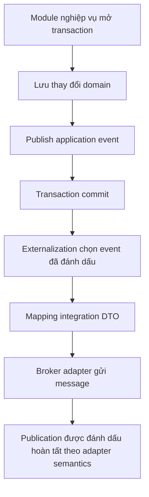
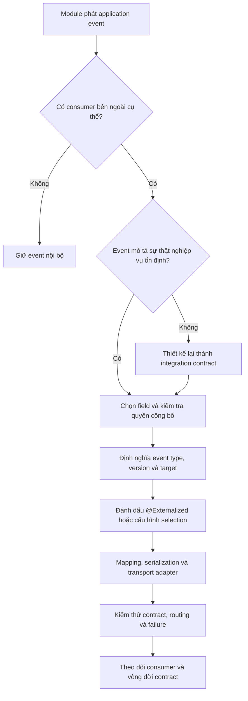

# Chọn event bên ngoài

Không phải application event nào cũng nên được gửi ra ngoài ứng dụng. Trong Spring Modulith, event nội bộ giúp các module phối hợp mà không cần gọi trực tiếp implementation của nhau. Khi một event được externalize qua Kafka, RabbitMQ hoặc một transport khác, nó trở thành hợp đồng tích hợp với consumer có thể được triển khai, vận hành và nâng cấp độc lập. Quyết định externalize vì vậy ảnh hưởng tới coupling, bảo mật, khả năng tương thích, độ tin cậy và chi phí vận hành lâu dài.

Chọn event bên ngoài là quyết định xác định sự kiện nghiệp vụ nào có giá trị đối với hệ thống khác, ai được phép nhận, dữ liệu nào được công bố, route tới đâu và hợp đồng được duy trì như thế nào. Một event phù hợp để externalize thường mô tả sự thật nghiệp vụ đã xảy ra và có ý nghĩa ổn định với consumer bên ngoài. Event chỉ phục vụ một bước triển khai nội bộ, chứa entity hoặc dữ liệu tạm thời, thường nên ở lại trong application context.

Trong module `SPRING_MODULITH_APPLICATION_EVENTS`, cần giữ ranh giới giữa application event nội bộ và integration event. Spring Modulith cung cấp cơ chế đánh dấu và externalize event được chọn; producer vẫn cần thiết kế contract, mapping, routing và chính sách bảo mật rõ ràng.

## Mục tiêu

Sau bài này, bạn có thể:

- Phân biệt application event nội bộ với integration event được externalize.
- Đánh giá event theo giá trị nghiệp vụ, consumer, độ ổn định và rủi ro công bố dữ liệu.
- Chọn event phù hợp và loại bỏ event chỉ phục vụ implementation nội bộ.
- Dùng `@Externalized` để đánh dấu event cần gửi ra ngoài.
- Thiết kế integration DTO, event type, schema version và routing target.
- Quyết định dữ liệu nào được công bố và dữ liệu nào cần giữ trong module.
- Kết hợp externalization với transaction, Event Publication Registry và adapter transport.
- Kiểm thử contract, routing, quyền truy cập và hành vi khi gửi thất bại.

## 1. Application event nội bộ và integration event

Application event là thông điệp được publish trong application context. Các module trong cùng ứng dụng có thể lắng nghe event để phản ứng với thay đổi nghiệp vụ. Event nội bộ thường phản ánh mô hình domain hoặc nhu cầu phối hợp trong một ứng dụng cụ thể; producer và consumer có thể được build, kiểm thử và triển khai cùng nhau.

Integration event là hợp đồng được công bố qua ranh giới ứng dụng. Consumer có thể là một service khác, một data platform, hệ thống báo cáo hoặc đối tác. Khi đã externalize, event có thể được lưu trong broker, replay sau nhiều ngày và được tiêu thụ bởi phiên bản phần mềm khác. Contract cần ổn định hơn implementation nội bộ.

| Tiêu chí | Application event nội bộ | Integration event bên ngoài |
|---|---|---|
| Phạm vi | Module trong cùng application context | Tiến trình, hệ thống hoặc tổ chức khác |
| Consumer | Do ứng dụng kiểm soát | Có vòng đời triển khai độc lập |
| Contract | Có thể refactor cùng ứng dụng nếu cập nhật đồng bộ | Cần versioning và compatibility policy |
| Payload | Có thể mang dữ liệu phục vụ phối hợp nội bộ | Chỉ công bố dữ liệu consumer được phép và thực sự cần |
| Transport | Spring application event mechanism | Broker hoặc transport adapter |
| Failure handling | Listener và Event Publication Registry | Thêm broker acknowledgement, retry, DLQ và consumer recovery |

Một event nội bộ có thể được chuyển thành integration event, nhưng không nên mặc định serialize nguyên object nội bộ rồi gửi ra ngoài. Việc chuyển đổi tại ranh giới externalization giúp bảo vệ mô hình domain và tạo hợp đồng dành riêng cho consumer.

## 2. Bắt đầu từ consumer và nhu cầu nghiệp vụ

Trước khi đánh dấu event để externalize, hãy xác định ai cần biết sự kiện và họ sẽ làm gì với nó. Nếu không có consumer cụ thể hoặc mục đích nghiệp vụ rõ ràng, event thường chưa cần được công bố.

Với mỗi consumer dự kiến, trả lời:

- Consumer nào cần nhận event và thuộc nhóm sở hữu nào?
- Consumer cần phản ứng với sự thật nghiệp vụ nào?
- Consumer có thể tự lấy thêm dữ liệu qua API hay cần dữ liệu trong event?
- Consumer cần độ mới dữ liệu và độ trễ ở mức nào?
- Consumer có cần nhận mọi transition hay chỉ trạng thái cuối?
- Event có chứa dữ liệu mà consumer không được phép xem không?
- Contract cần được hỗ trợ trong bao lâu và có replay hay không?

Ví dụ, khi đơn hàng được xác nhận, module kho hàng cần giữ chỗ; hệ thống phân tích cần ghi nhận số đơn hàng đã xác nhận; dịch vụ thông báo cần gửi email. Đây có thể là ba consumer hợp lệ, nhưng không nhất thiết tất cả phải nhận cùng một payload. Consumer kho cần order ID, SKU và quantity; hệ thống phân tích có thể chỉ cần tenant, channel và tổng giá trị; dịch vụ thông báo có thể lấy thông tin hiển thị từ API hoặc một notification contract riêng.

Không externalize một event chỉ vì “có thể sẽ có consumer trong tương lai”. Mỗi contract được công bố tạo thêm trách nhiệm tương thích, bảo mật, giám sát và hỗ trợ. Hãy công bố khi có nhu cầu đủ rõ hoặc một chiến lược tích hợp được phê duyệt.

## 3. Tiêu chí chọn event phù hợp

Một event thường phù hợp để externalize khi đáp ứng phần lớn các tiêu chí sau:

1. **Có ý nghĩa nghiệp vụ:** mô tả một sự thật đã xảy ra, chẳng hạn `OrderConfirmed` hoặc `PaymentCaptured`.
2. **Có consumer xác định:** có hệ thống hoặc nhóm chịu trách nhiệm sử dụng.
3. **Contract ổn định:** payload có thể duy trì qua nhiều lần phát hành và không phụ thuộc class nội bộ.
4. **Có thể xử lý độc lập:** consumer có đủ định danh và ngữ cảnh để phản ứng hoặc tra cứu dữ liệu bổ sung.
5. **Có quyền công bố:** dữ liệu trong payload được phép rời khỏi ranh giới ứng dụng.
6. **Có chính sách lỗi:** biết cách retry, deduplicate, xử lý schema không hỗ trợ và theo dõi consumer.
7. **Có giá trị hơn chi phí:** lợi ích tách coupling hoặc tích hợp lớn hơn chi phí vận hành contract và transport.

Một event thường không phù hợp khi chỉ phản ánh bước nội bộ như `OrderEntityLoaded`, `RepositorySaveRequested` hoặc `RecalculateTemporaryCache`. Các tên này mô tả implementation hơn là sự thật nghiệp vụ; consumer bên ngoài sẽ bị gắn vào cách module hiện tại hoạt động.

## 4. Dùng event mô tả sự thật, không mô tả yêu cầu nội bộ

Integration event nên dùng thì quá khứ hoặc tên thể hiện kết quả đã xảy ra. `OrderConfirmed` mô tả một đơn hàng đã được xác nhận. `ConfirmOrder` lại là command yêu cầu một bên thực hiện hành động. Hai loại thông điệp có ngữ nghĩa và trách nhiệm khác nhau.

| Thông điệp | Ngữ nghĩa | Có nên externalize như event? |
|---|---|---|
| `OrderConfirmed` | Đơn hàng đã được xác nhận | Có thể, nếu có consumer cần biết |
| `PaymentCaptured` | Thanh toán đã được ghi nhận | Có thể, nếu contract và dữ liệu được phép công bố |
| `ConfirmOrder` | Yêu cầu xác nhận đơn hàng | Đây là command; cần endpoint/command contract và người sở hữu xử lý |
| `LoadOrderEntity` | Yêu cầu lấy implementation detail | Không phù hợp làm integration event |
| `OrderRepositorySaved` | Bước lưu persistence đã xảy ra | Thường là chi tiết nội bộ |
| `OrderStatusChanged` | Trạng thái đã thay đổi | Có thể, nếu định nghĩa rõ trạng thái trước/sau và version |

Không dùng event broadcast như một cách gửi command mà không biết ai sẽ thực hiện. Nếu cần một kết quả bắt buộc từ một hệ thống cụ thể, API hoặc command message có response/correlation rõ ràng có thể phù hợp hơn. Event phù hợp khi producer công bố sự thật và không cần biết chính xác consumer nào sẽ phản ứng.

## 5. Chọn mức độ chi tiết của event

Event quá rộng có thể khiến consumer phải suy luận nhiều hoặc gọi lại producer để biết điều gì đã xảy ra. Event quá chi tiết lại làm lộ implementation và tạo nhiều contract nhỏ khó quản lý.

Ví dụ, `OrderUpdated` không cho biết thay đổi nào quan trọng. Consumer có thể phải tải toàn bộ đơn hàng để so sánh. Một event rõ hơn như `OrderAddressChanged` hoặc `OrderConfirmed` giúp consumer hiểu hành vi nghiệp vụ trực tiếp.

Ngược lại, không nhất thiết tạo một event cho từng thao tác persistence như `OrderLineRowInserted`, `OrderTableUpdated` hoặc `OrderIndexRefreshed`. Những chi tiết đó có thể thay đổi khi schema database hoặc cách lưu trữ được refactor.

Hãy chọn granularity theo câu hỏi mà consumer cần trả lời:

- Sự thật nghiệp vụ nào đã xảy ra?
- Aggregate hoặc entity nào bị ảnh hưởng?
- Consumer cần dữ liệu nào để xử lý đúng?
- Event có cần phản ánh một transition riêng hay chỉ trạng thái mới nhất?
- Nếu hai thao tác nội bộ được gộp trong tương lai, event contract có còn đúng không?

## 6. Phân biệt event nội bộ và event externalized trong code

Spring Modulith cho phép đánh dấu event cần externalize bằng `@Externalized`. Event không có annotation này có thể tiếp tục được sử dụng nội bộ mà không mặc định trở thành message bên ngoài.

Ví dụ event nội bộ:

```java
public record OrderValidationCompleted(
    String orderId,
    boolean valid
) {}
```

Event tích hợp được chọn để công bố:

```java
import org.springframework.modulith.events.Externalized;

@Externalized("orders")
public record OrderConfirmed(
    String eventId,
    String orderId,
    String customerReference,
    int totalAmountMinor,
    String currency
) {}
```

Giá trị `"orders"` là externalization target/route được adapter sử dụng theo cấu hình transport. Ý nghĩa cụ thể của target phụ thuộc adapter và cấu hình broker trong ứng dụng; không mặc định rằng chuỗi này luôn là tên topic, exchange hay queue trên mọi transport.

Chỉ thêm `@Externalized` sau khi event đã được xem xét như một contract tích hợp. Annotation không tự giải quyết quyền truy cập, schema compatibility, idempotency hoặc việc consumer xử lý thành công. Những trách nhiệm đó vẫn cần được thiết kế riêng.

## 7. Không externalize trực tiếp domain entity

Domain entity và aggregate thường chứa nhiều trạng thái, quan hệ, method và chi tiết persistence không dành cho consumer bên ngoài. Serialize trực tiếp entity có thể vô tình công bố dữ liệu nhạy cảm, tạo payload lớn và khiến contract thay đổi mỗi khi domain model refactor.

Hãy tạo integration DTO chỉ chứa dữ liệu consumer cần:

```java
public record OrderConfirmedV1(
    String eventId,
    String orderId,
    String customerReference,
    int totalAmountMinor,
    String currency,
    int schemaVersion
) {}
```

Mapping tại ranh giới tích hợp:

```java
OrderConfirmedV1 toIntegrationEvent(Order order) {
    return new OrderConfirmedV1(
        order.eventId().toString(),
        order.id().toString(),
        order.customerReference(),
        order.totalAmountMinor(),
        order.currency().getCurrencyCode(),
        1
    );
}
```

Đây là ví dụ mapping do ứng dụng định nghĩa. Trong hệ thống thực tế, integration DTO có thể được tạo trực tiếp như event contract hoặc được mapping từ domain event qua externalization configuration/adapter phù hợp với phiên bản Spring Modulith. Điều quan trọng là consumer chỉ nhận một contract có chủ đích, không nhận toàn bộ object graph của aggregate.

## 8. Chọn dữ liệu cần công bố

Payload nên chứa đủ dữ liệu để consumer nhận diện sự kiện và thực hiện hành động của mình, nhưng không nên biến thành bản sao đầy đủ của aggregate. Một payload gọn thường có:

- Event ID ổn định để deduplication và truy vết.
- Aggregate ID hoặc business key.
- Event type và schema version.
- Thời điểm nghiệp vụ xảy ra.
- Những thuộc tính cần thiết cho hành vi consumer.
- Tenant hoặc partition key nếu được phép và cần cho định tuyến.
- Correlation/causation ID nếu cần theo dõi luồng.

Tránh đưa vào payload:

- Password, access token, secret hoặc credential.
- Entity nội bộ, lazy relation và dữ liệu persistence không cần thiết.
- Toàn bộ thông tin khách hàng nếu consumer chỉ cần customer ID.
- Dữ liệu cá nhân nhạy cảm không có mục đích sử dụng rõ ràng.
- Field có thể được consumer tra cứu an toàn qua API được phân quyền.
- Thông tin debug hoặc stack trace.

Ví dụ, event `PaymentCaptured` có thể cần `paymentId`, `orderId`, `amountMinor`, `currency`, `capturedAt` và `eventId`. Nó thường không cần số thẻ đầy đủ, token thanh toán hoặc thông tin xác thực của cổng thanh toán.

## 9. Chọn target và routing

Externalized event cần được gửi tới đúng destination. Target có thể đại diện cho một logical channel hoặc route được adapter ánh xạ sang broker destination. Hãy đặt tên theo event domain hoặc nhóm consumer, tránh đặt theo tên class implementation hoặc tên máy chủ cụ thể.

Ví dụ:

| Event contract | Logical target minh họa | Consumer dự kiến |
|---|---|---|
| `OrderConfirmed` | `orders` | Inventory, analytics, notification |
| `PaymentCaptured` | `payments` | Ledger, order status, analytics |
| `CustomerAddressChanged` | `customers` | Delivery planning, search index |

Một target có nhiều consumer có thể phù hợp khi tất cả cần cùng contract và quyền truy cập. Nếu các consumer cần payload khác nhau hoặc có chính sách bảo mật khác nhau, tách contract hoặc route để giới hạn dữ liệu được công bố.

Không để consumer tự suy luận ý nghĩa từ routing key nếu event type trong payload nói điều khác. Consumer nên xác minh event type, schema version và target theo hợp đồng. Với broker hỗ trợ topic/partition key, chọn key có thể giữ thứ tự theo aggregate khi nghiệp vụ yêu cầu; không dùng một key chung khiến mọi event dồn vào một partition.

## 10. Chọn event theo khả năng thay đổi và vòng đời contract

Một integration event có thể tồn tại lâu hơn phiên bản producer đã tạo ra nó. Message có thể còn trong broker, DLQ, archive hoặc được replay sau nhiều tháng. Vì vậy, hãy đánh giá:

- Tên event và ý nghĩa có ổn định khi domain model thay đổi không?
- Field nào bắt buộc, field nào optional?
- Consumer cũ sẽ xử lý field hoặc enum value mới như thế nào?
- Có cần schema version hoặc event type mới khi thay đổi ngữ nghĩa không?
- Ai sở hữu contract và có thể phê duyệt breaking change?
- Retention và replay window yêu cầu hỗ trợ schema cũ trong bao lâu?

Thêm field optional thường ít rủi ro hơn xóa hoặc đổi tên field, nhưng chỉ an toàn nếu consumer cũ bỏ qua field lạ và logic cũ vẫn đúng. Đổi đơn vị hoặc ý nghĩa field là breaking change ngay cả khi kiểu dữ liệu không đổi. Nếu `amount` đổi từ đồng sang xu nhưng vẫn là `long`, consumer có thể xử lý sai mà không có lỗi deserialize.

Khi thay đổi contract, dùng expand-contract: consumer mới đọc cả dạng cũ và mới; producer phát dữ liệu tương thích trong thời gian chuyển tiếp; chỉ bỏ field cũ sau khi consumer inventory và backlog đã được xác nhận.

## 11. Event nào không nên externalize?

Một số loại event nên ở lại nội bộ:

| Event hoặc dữ liệu | Lý do không nên công bố trực tiếp |
|---|---|
| Event phục vụ orchestration nội bộ tạm thời | Consumer ngoài sẽ phụ thuộc vào flow implementation |
| Persistence event như `EntitySaved` | Gắn contract với cách lưu dữ liệu |
| Event chứa entity hoặc aggregate đầy đủ | Payload lớn, lộ implementation và dễ rò dữ liệu |
| Event debug/telemetry chi tiết | Không phải hợp đồng nghiệp vụ; dùng logging/metrics/tracing |
| Event có secret hoặc token | Không được phép công bố qua broker |
| Event quá thường xuyên nhưng không có consumer rõ | Tăng tải và chi phí vận hành không cần thiết |
| Event chỉ dùng để gọi một service cụ thể làm command | Dùng command/API với đích và phản hồi rõ ràng hơn |

Không phải mọi dữ liệu cần chia sẻ đều phải dùng event. Nếu consumer cần truy vấn trạng thái mới nhất theo yêu cầu, API query có thể phù hợp hơn. Nếu cần gửi lệnh bắt buộc tới một service cụ thể, command contract có thể rõ ràng hơn. Nếu chỉ cần quan sát kỹ thuật, metrics và tracing thường phù hợp hơn integration event.

## 12. Kết hợp với transaction và Event Publication Registry

Nếu producer thay đổi dữ liệu trong transaction rồi publish event, cần bảo đảm event chỉ được externalize khi transaction nghiệp vụ đã commit. Với listener dùng `@ApplicationModuleListener`, Spring Modulith hỗ trợ semantics xử lý bất đồng bộ và transaction-bound sau commit. Với externalization, Event Publication Registry có thể theo dõi publication tới externalizer để ứng dụng biết publication nào đã hoàn tất hoặc còn incomplete.

Luồng khái quát:



Registry giúp theo dõi publication và hỗ trợ phục hồi khi externalizer thất bại, nhưng không tự bảo đảm consumer bên ngoài đã xử lý nghiệp vụ. Nếu broker đã nhận message nhưng producer không nhận được acknowledgement, message có thể được gửi lại; consumer cần idempotency. Nếu cần bảo đảm ghi database và phát message nhất quán, xem xét transactional outbox phù hợp với kiến trúc và adapter đang dùng.

Không externalize event trước khi commit chỉ vì producer muốn giảm độ trễ. Nếu transaction rollback nhưng message đã ra ngoài, consumer có thể phản ứng với một sự thật chưa từng được commit.

## 13. Chọn một event hay nhiều event cho cùng nghiệp vụ

Một hành động nghiệp vụ có thể tạo ra nhiều sự thật khác nhau. Ví dụ, hoàn tất đơn hàng có thể dẫn tới `OrderConfirmed`, sau đó kho xác nhận `InventoryReserved`, và thanh toán ghi nhận `PaymentCaptured`. Đây là những sự kiện riêng vì chúng xảy ra ở thời điểm khác nhau và thuộc quyền sở hữu của module khác nhau.

Không gộp mọi trạng thái thành một event `OrderProcessUpdated` nếu consumer cần phân biệt ai đã hoàn thành bước nào. Ngược lại, không phát nhiều event chỉ khác nhau ở chi tiết nội bộ không có ý nghĩa với consumer.

Hãy cân nhắc:

- Sự thật có xảy ra độc lập và có thể thất bại riêng không?
- Module nào sở hữu sự thật đó?
- Consumer cần biết transition hay chỉ trạng thái tổng hợp?
- Một event có thể bị replay mà không gây hiểu nhầm về thứ tự không?
- Có cần correlation/causation ID để nối các bước của workflow không?

Event do module sở hữu dữ liệu phát ra nên phản ánh sự thật mà module đó có quyền xác nhận. Module orders không nên phát `InventoryReserved` nếu chính module inventory mới là nơi xác nhận reservation.

## 14. Externalization configuration và adapter

`@Externalized` là cách rõ ràng để đánh dấu event được chọn. Tùy phiên bản và nhu cầu, ứng dụng có thể cấu hình thêm mapping, routing và lựa chọn event tại ranh giới externalization. Adapter transport chịu trách nhiệm chuyển integration event sang API của broker hoặc hệ thống đích.

Một thiết kế tách trách nhiệm thường có:

1. Domain/application module phát application event.
2. Integration mapping chuyển event sang DTO công khai.
3. Externalization configuration chọn event và logical target.
4. Serializer tạo payload theo schema/version.
5. Transport adapter gửi message và báo kết quả theo contract của nó.
6. Event Publication Registry theo dõi publication tới externalizer nếu được cấu hình.

Không đặt logic broker vào aggregate hoặc domain service. Domain module không nên biết Kafka topic, RabbitMQ exchange hay credential kết nối. Những chi tiết đó thuộc adapter và cấu hình deployment.

Khi dùng adapter có sẵn của Spring Modulith, kiểm tra đúng module và phiên bản tương thích với Spring Modulith core. Khi dùng custom adapter, giữ contract gửi message và cách báo lỗi rõ ràng; lỗi gửi cần được truyền theo semantics để publication không bị đánh dấu hoàn tất sai.

## 15. Bảo mật và quyền công bố

Externalization làm dữ liệu vượt khỏi ranh giới process. Một event chỉ nên được chọn nếu producer có quyền công bố các trường trong payload tới destination đã định.

Trước khi externalize, kiểm tra:

- Consumer và broker destination có quyền truy cập phù hợp không?
- Payload có chứa dữ liệu cá nhân, bí mật hoặc thông tin nhạy cảm không?
- Có thể thay dữ liệu trực tiếp bằng reference ID không?
- Có cần mã hóa payload hoặc bảo vệ message integrity không?
- Producer identity và consumer identity được xác thực thế nào?
- Có audit về event type, target và consumer không?
- Có chính sách xóa/retention phù hợp với dữ liệu được công bố không?

TLS/mTLS bảo vệ kênh truyền; broker ACL giới hạn quyền publish/consume; chữ ký hoặc MAC có thể bảo vệ integrity end-to-end; authorization ở consumer quyết định publisher có quyền phát loại event đó hay không. Không cơ chế nào thay thế các cơ chế còn lại.

## 16. Kiểm thử quyết định externalize

Kiểm thử cần chứng minh đúng event được chọn, payload đúng và event không phù hợp không bị gửi ra ngoài.

| Tình huống | Điều cần xác nhận |
|---|---|
| Event được đánh dấu `@Externalized` | Externalizer chọn event và route tới target dự kiến |
| Event nội bộ không được đánh dấu | Không bị gửi ra ngoài ngoài ý muốn |
| Event có payload mapping | DTO chỉ chứa field contract được phê duyệt |
| Domain entity có field nhạy cảm | Field đó không xuất hiện trong integration payload |
| Event phát trong transaction rollback | Không externalize như một thay đổi đã commit |
| Broker tạm thời lỗi | Publication được theo dõi và có thể phục hồi theo policy |
| Broker nhận message nhưng acknowledgement mất | Consumer idempotency ngăn tác động lặp |
| Event version mới | Consumer cũ xử lý theo compatibility policy |
| Target/routing thay đổi | Chỉ consumer được phép nhận route mới có thể truy cập |
| Event không có consumer hợp lệ | Không tạo externalization không cần thiết |

Unit test có thể kiểm tra mapper và policy chọn event. Module test kiểm tra producer publish đúng application event. Integration test adapter kiểm tra target, serialization và acknowledgement. Broker test thật hoặc Testcontainers cần thiết khi routing, binding, partition hoặc broker semantics thuộc phạm vi cần xác minh.

## 17. Theo dõi event đã chọn và consumer thực tế

Sau khi externalize, cần biết event nào được phát, route nào được dùng và consumer có thực sự xử lý hay không. Theo dõi:

- Event count theo event type, schema version và target.
- Số publication externalization incomplete.
- Tỷ lệ gửi thành công, retry và thời gian gửi.
- Broker lag, queue depth, DLQ và redelivery.
- Consumer version và tỷ lệ xử lý theo event type.
- Lỗi deserialize, schema incompatibility và authorization failure.
- Event payload size và dữ liệu bị loại khỏi contract nếu có audit mapping.

Log nên có event ID, event type, schema version, target, producer identity, correlation ID và publication outcome. Không log toàn bộ payload nếu có dữ liệu nhạy cảm. Dùng metric label có cardinality ổn định như event type, target và outcome; giữ event ID trong log/trace.

Định kỳ rà soát consumer inventory. Nếu không còn consumer nào sử dụng một event contract, cân nhắc ngừng externalize sau khi kiểm tra replay, archive và cam kết với consumer cũ. Việc ngừng event cũng là một thay đổi contract cần thông báo và có kế hoạch.

## 18. Checklist quyết định

Trước khi thêm `@Externalized` hoặc cấu hình một event được gửi ra ngoài, hãy trả lời:

- [ ] Có consumer cụ thể và chủ sở hữu rõ ràng.
- [ ] Event mô tả sự thật nghiệp vụ ổn định.
- [ ] Event không chỉ là chi tiết persistence hoặc orchestration nội bộ.
- [ ] Payload là integration DTO, không serialize aggregate trực tiếp.
- [ ] Mỗi field có mục đích sử dụng và quyền công bố.
- [ ] Event ID, event type và schema version có quy tắc ổn định.
- [ ] Logical target và routing được xác định.
- [ ] Consumer có compatibility, idempotency và retry policy.
- [ ] Externalization gắn với transaction commit và registry semantics phù hợp.
- [ ] Có kiểm thử selection, mapping, routing và failure.
- [ ] Có metric, log, owner và quy trình ngừng hỗ trợ contract.

## 19. Những lỗi thường gặp

| Lỗi | Hệ quả | Cách khắc phục |
|---|---|---|
| Externalize mọi application event | Contract bên ngoài bám vào implementation nội bộ | Chỉ chọn event có consumer và giá trị nghiệp vụ rõ |
| Gửi domain entity trực tiếp | Lộ dữ liệu và coupling với model nội bộ | Map sang integration DTO |
| Dùng event để gửi command bắt buộc | Không rõ ai chịu trách nhiệm thực thi và phản hồi | Dùng command/API khi cần đích cụ thể |
| Payload chứa quá nhiều dữ liệu | Tăng rủi ro bảo mật, kích thước và compatibility | Chỉ gửi dữ liệu tối thiểu cần thiết |
| Target phản ánh tên class | Refactor class làm đổi routing contract | Dùng logical target ổn định |
| Không version contract | Consumer cũ có thể lỗi hoặc hiểu sai | Schema version và compatibility tests |
| Nhầm registry completion với consumer completion | Kết luận sai về xử lý đầu cuối | Theo dõi acknowledgement và trạng thái consumer riêng |
| Không kiểm tra side effect khi retry | Consumer có thể thực hiện nghiệp vụ trùng | Event ID và idempotency bền vững |
| Không có owner cho event | Không ai chịu trách nhiệm thay đổi hoặc ngừng contract | Gán producer owner và consumer inventory |

## 20. Quy trình chọn event bên ngoài



Chỉ externalize event khi có nhu cầu tích hợp cụ thể, event mô tả sự thật nghiệp vụ ổn định và payload có thể được công bố an toàn. Dùng `@Externalized` hoặc cấu hình selection ở ranh giới tích hợp, map sang DTO độc lập với domain model, chọn logical target rõ ràng và quản lý schema như một contract dài hạn. Event Publication Registry hỗ trợ theo dõi publication tới externalizer; consumer vẫn cần idempotency, compatibility và observability để hoàn tất luồng đầu cuối.

## Tài liệu tham khảo

- [Spring Modulith — Working with Application Events](https://docs.spring.io/spring-modulith/reference/events.html)
- [Spring Modulith — Event Externalization](https://docs.spring.io/spring-modulith/reference/events.html#_event_externalization)
- [Spring Modulith — `Externalized` API](https://docs.spring.io/spring-modulith/docs/current/api/org/springframework/modulith/events/Externalized.html)
