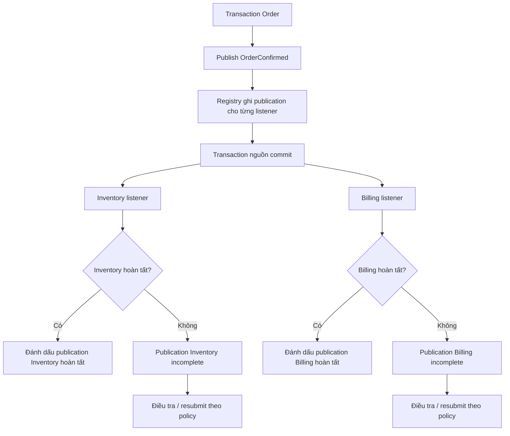
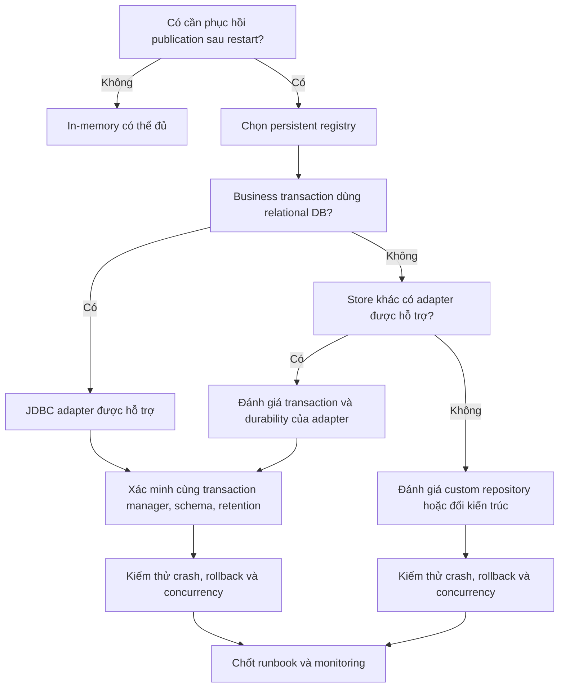

# Chọn registry

Event Publication Registry là cơ chế Spring Modulith dùng để theo dõi việc giao application event đến các transactional listener. Registry ghi nhận publication nào cần được xử lý, listener nào là đích nhận và publication nào đã hoàn tất. Khi listener lỗi hoặc ứng dụng dừng giữa chừng, publication chưa hoàn tất có thể được phát hiện và phục hồi theo cơ chế mà phiên bản Spring Modulith hỗ trợ.

Chọn registry là quyết định về độ bền dữ liệu, transaction, khả năng phục hồi và vận hành. Với ứng dụng thử nghiệm hoặc luồng không cần phục hồi sau restart, lưu trạng thái trong bộ nhớ có thể đủ. Với production cần bảo đảm event không bị quên sau khi transaction nghiệp vụ commit, nên dùng persistence implementation phù hợp với nền tảng dữ liệu và transaction manager của ứng dụng. Trong Spring Modulith, registry phục vụ theo dõi publication đến listener; nó không tự thay thế outbox, broker hay event store.

## 1. Registry giải quyết vấn đề gì?

Giả sử module Order commit đơn hàng rồi phát `OrderConfirmed`. Module Inventory nhận event qua `@ApplicationModuleListener` để giữ tồn kho. Listener chạy bất đồng bộ sau commit. Nếu process dừng trong lúc listener xử lý, hệ thống cần biết publication đã hoàn tất hay còn dang dở để quyết định phục hồi.

Registry theo dõi trạng thái của từng publication đích. Một event có thể được giao đến nhiều listener, vì vậy trạng thái hoàn tất cần gắn với từng listener/target. Listener hoàn tất thì publication tương ứng được đánh dấu hoàn tất. Nếu chưa hoàn tất, registry có thể cung cấp thông tin để vận hành điều tra và resubmit.

Registry giúp trả lời: listener nào chưa hoàn tất publication nào? Nó không tự trả lời vì sao listener lỗi, business side effect đã commit đến đâu, hoặc hệ thống ngoài đã nhận message hay chưa. Những câu hỏi đó cần log, trace, metric, inbox/outbox và trạng thái broker tương ứng.

## 2. Phân biệt registry với các cơ chế khác

Tên gọi “registry” đôi khi bị dùng lẫn với outbox, event store hoặc broker. Chúng giải quyết các vấn đề khác nhau.

| Cơ chế | Trách nhiệm chính | Khi cần |
| --- | --- | --- |
| Event Publication Registry | Theo dõi publication đến transactional listener trong ứng dụng và trạng thái hoàn tất. | Cần biết listener nào đã xử lý publication và publication nào còn incomplete. |
| Transactional Outbox | Ghi message cần gửi ra ngoài cùng transaction nghiệp vụ, sau đó relay publish. | Cần tránh mất message giữa database commit và broker publish. |
| Message broker | Lưu/chuyển message giữa process, quản lý subscription, acknowledgement và retention. | Consumer chạy độc lập hoặc giao tiếp qua ranh giới process. |
| Event Store | Lưu lịch sử event nghiệp vụ làm nguồn dữ liệu có thể đọc lại. | Cần event sourcing, audit history hoặc replay lịch sử dài hạn. |
| Consumer Inbox | Ghi nhận event consumer đã áp dụng để chống xử lý trùng. | Delivery có thể lặp và side effect cần idempotency. |

Một hệ thống có thể cần nhiều cơ chế cùng lúc. Ví dụ, Spring Modulith dùng registry cho listener nội bộ, outbox để chuyển event ra broker và inbox ở consumer ngoài để chống duplicate. Không nên chọn một cơ chế rồi kỳ vọng nó giải quyết mọi bảo đảm giao nhận.

## 3. Các lựa chọn persistence của registry

Về mặt vận hành, có thể phân loại lựa chọn theo nơi lưu publication state. Tên module, dependency và khả năng tích hợp cụ thể cần khớp phiên bản Spring Modulith mà dự án đang dùng.

| Lựa chọn | Đặc điểm | Phù hợp khi | Hạn chế cần cân nhắc |
| --- | --- | --- | --- |
| In-memory | Publication state chỉ tồn tại trong bộ nhớ tiến trình. | Unit test, integration test cô lập, demo hoặc luồng chấp nhận mất trạng thái khi restart. | Không phục hồi được publication sau process restart; không chia sẻ trạng thái giữa instance. |
| JDBC / relational database | Publication state được lưu trong database quan hệ qua persistence module tương ứng. | Ứng dụng đã dùng relational database và cần liên kết trạng thái publication với transaction nghiệp vụ. | Cần quản lý schema, index, transaction manager, connection pool và retention. |
| MongoDB hoặc document store được hỗ trợ | Publication state được lưu bằng persistence adapter cho document database. | Nền tảng đã vận hành MongoDB và transaction semantics phù hợp với yêu cầu. | Cần xác minh transaction support, replica set, index, write concern và cách tích hợp với transaction nguồn. |
| Custom repository | Tự triển khai persistence theo SPI/extension point được hỗ trợ. | Có yêu cầu đặc biệt mà adapter có sẵn không đáp ứng. | Tăng chi phí thiết kế, bảo trì, kiểm thử concurrency và tương thích khi nâng cấp. |

Không nên chọn in-memory cho production chỉ vì cấu hình đơn giản nếu yêu cầu nghiệp vụ là không được mất publication sau restart. Ngược lại, cũng không cần thêm một database mới chỉ để lưu registry nếu relational store hiện có đáp ứng được durability và transaction cần thiết.

## 4. Tiêu chí ra quyết định

Trước khi chọn implementation, đánh giá các tiêu chí sau:

1. **Durability:** publication có phải tồn tại qua restart, deploy, crash và failover không?
2. **Transaction atomicity:** việc ghi publication có thể tham gia cùng transaction với thay đổi nghiệp vụ không?
3. **Deployment topology:** ứng dụng chạy một instance hay nhiều instance, có rolling deployment và scale ngang không?
4. **Data platform:** ứng dụng đã vận hành relational database, MongoDB hay một kho dữ liệu khác?
5. **Recovery:** cần resubmit publication incomplete tự động hay qua thao tác vận hành có kiểm soát?
6. **Volume:** số publication mỗi giây, kích thước payload, số listener và thời gian giữ bản ghi là bao nhiêu?
7. **Operations:** đội vận hành có backup, monitoring, schema migration và on-call cho store đó không?
8. **Security:** payload được lưu ở đâu, ai có thể đọc và retention/xóa dữ liệu được quản lý thế nào?
9. **Consistency:** consumer có idempotent không và hệ thống xử lý duplicate như thế nào?
10. **Lifecycle:** publication completed được dọn khi nào, incomplete được giữ bao lâu và nâng cấp schema ra sao?

Độ bền của registry phải phù hợp với độ bền mà nghiệp vụ yêu cầu. Nếu đơn hàng đã commit nhưng event không được giao sau restart, hệ thống có thể giữ đơn hàng ở trạng thái không nhất quán với Inventory hoặc Billing. Với luồng quan trọng, đây là lý do thực tế để chọn persistent registry.

## 5. Khi nào in-memory là đủ?

In-memory phù hợp khi publication state chỉ cần tồn tại trong vòng đời của một tiến trình hoặc trong test. Ví dụ:

- Unit test kiểm tra publisher và listener.
- Test tạo application context ngắn hạn, không cần khôi phục sau khi JVM dừng.
- Demo hoặc prototype chưa có yêu cầu durability.
- Một event chỉ kích hoạt hiệu ứng phụ không quan trọng và mất event có thể chấp nhận.

In-memory không phù hợp nếu:

- Event đại diện cho thay đổi nghiệp vụ đã commit.
- Listener cập nhật dữ liệu quan trọng ở module khác.
- Ứng dụng triển khai nhiều instance và cần trạng thái publication dùng chung.
- Restart/deploy có thể xảy ra trước khi listener hoàn tất.
- Có yêu cầu audit, recovery hoặc SLA về event processing.

Trong môi trường nhiều instance, mỗi instance có bộ nhớ riêng. Một instance không thể nhìn thấy publication state mà instance khác đã ghi trong RAM. Vì vậy, in-memory không phải lựa chọn cho việc điều phối publication bền vững giữa các replica.

## 6. Khi nào nên chọn JDBC registry?

JDBC thường là lựa chọn tự nhiên khi ứng dụng Spring Modulith đã dùng relational database làm nguồn dữ liệu nghiệp vụ. Ưu điểm quan trọng là có thể tổ chức ghi publication state trong cùng hệ sinh thái transaction với thay đổi nghiệp vụ, nếu cấu hình dùng đúng datasource và transaction manager.

Ví dụ luồng:

1. Use case cập nhật Order trong transaction.
2. Application event được publish.
3. Registry ghi publication cần giao đến các transactional listener.
4. Transaction commit làm bền vững thay đổi nghiệp vụ và publication record theo cấu hình transaction chung.
5. Listener xử lý sau commit và registry ghi nhận completion.

Nếu transaction nguồn rollback, publication record thuộc transaction đó cũng cần rollback khi persistence adapter thực sự tham gia cùng transaction. Đây là bảo đảm cần xác minh bằng cấu hình và integration test, không nên chỉ suy ra từ việc hai thành phần cùng dùng JDBC.

JDBC registry phù hợp khi:

- Relational database đã là hạ tầng chuẩn của ứng dụng.
- Cần transaction semantics rõ và đội vận hành đã có backup/monitoring database.
- Lưu lượng publication phù hợp với capacity của database.
- Cần query publication incomplete để hỗ trợ vận hành.
- Muốn tránh thêm một hệ thống lưu trữ mới.

Các chi phí cần tính:

- Bảng publication tăng theo số event nhân số transactional listener.
- Index và cleanup có thể ảnh hưởng đến write/read performance.
- Connection pool dùng chung với workload nghiệp vụ có thể bị cạnh tranh.
- Schema migration và quyền database cần được quản lý như thành phần ứng dụng.
- Payload lớn có thể làm tăng dung lượng lưu nếu adapter serialize event.

## 7. Khi nào chọn MongoDB hoặc document store?

Nếu ứng dụng đã dùng MongoDB làm nền tảng dữ liệu chính, persistence adapter document store được Spring Modulith hỗ trợ có thể giúp thống nhất công cụ vận hành và mô hình lưu trữ.

Trước khi chọn, xác minh:

- Phiên bản Spring Modulith có adapter chính thức phù hợp không.
- Publication write có tham gia transaction với thay đổi nghiệp vụ không.
- Cluster MongoDB có cấu hình hỗ trợ transaction theo yêu cầu của ứng dụng không.
- Write concern và durability có đáp ứng RPO/RTO không.
- Index cho truy vấn incomplete/completed có được tạo và duy trì không.
- Nhiều instance có thể truy cập chung repository và xử lý cạnh tranh an toàn không.
- Backup/restore có giữ được quan hệ giữa business state và publication state không.

Không chọn MongoDB chỉ vì payload là JSON. Tiêu chí quyết định vẫn là transaction boundary, durability, concurrency và năng lực vận hành. Nếu business transaction nằm trong relational database nhưng registry nằm ở document store riêng, hai lần ghi không tự động atomic. Khi đó cần đánh giá kỹ khả năng mất publication hoặc tạo publication mồ côi.

## 8. Khi nào cần custom registry repository?

Custom implementation chỉ nên được chọn khi adapter có sẵn không đáp ứng yêu cầu cụ thể, ví dụ:

- Nền tảng lưu trữ nội bộ có transaction contract riêng.
- Chính sách partitioning hoặc tenant isolation đặc thù.
- Cần tích hợp với hệ thống persistence đã được chuẩn hóa toàn tổ chức.
- Có yêu cầu mã hóa, audit hoặc routing đặc biệt mà adapter hiện có không hỗ trợ.

Trước khi tự triển khai, cần xác định đầy đủ semantics mà registry cần giữ:

- Tạo publication record cho từng transactional listener.
- Giữ liên kết giữa event, listener target và thời điểm publish.
- Đánh dấu completion đúng publication.
- Truy vấn publication incomplete.
- Xử lý đồng thời từ nhiều application instance.
- Bảo đảm ghi nhận không mất publication khi transaction nguồn commit.
- Hỗ trợ serialization/schema evolution và đọc publication cũ.
- Dọn publication completed mà không xóa nhầm incomplete.

Custom repository có thể tạo lỗi tinh vi ở crash window hoặc concurrency. Cần kiểm thử crash/restart, rollback, duplicate completion, nhiều instance và upgrade compatibility. Nếu chỉ muốn đổi cách dashboard hiển thị, không nên viết lại persistence repository.

## 9. Registry và transaction manager

Một trong những tiêu chí quan trọng nhất là registry có tham gia đúng transaction boundary hay không. Nếu business state và publication record được ghi bởi hai transaction độc lập, có thể xuất hiện hai lỗi:

**Business commit nhưng publication không được lưu:**

1. Order được commit.
2. Ghi registry thất bại hoặc process dừng trước khi ghi.
3. Không còn publication record để phục hồi listener.

**Publication được lưu nhưng business rollback:**

1. Registry ghi publication ở transaction riêng.
2. Transaction Order rollback.
3. Listener có thể nhận event mô tả thay đổi chưa từng commit.

Vì vậy, với JDBC registry, ưu tiên cấu hình để publication record tham gia cùng transaction nguồn khi kiến trúc và adapter hỗ trợ. Nếu dùng store khác, không giả định atomicity; cần transactional outbox, coordination protocol hoặc cơ chế đối soát phù hợp.

`@ApplicationModuleListener` xử lý event sau commit trong transaction listener riêng theo semantics của Spring Modulith. Transaction listener và transaction nguồn là hai ranh giới khác nhau. Registry giúp theo dõi completion của listener; nó không biến mọi side effect ngoài database thành một transaction phân tán.

## 10. Registry trong ứng dụng nhiều instance

Ứng dụng chạy nhiều replica cần một nguồn publication state dùng chung và bền vững. Nếu mỗi instance lưu registry riêng trong RAM, restart hoặc request routing có thể làm mất khả năng quan sát publication.

Khi dùng persistent registry:

- Tất cả instance cần dùng cùng logical repository và schema.
- Cấu hình transaction manager nhất quán với business transaction.
- Cơ chế query/resubmit phải xử lý cạnh tranh khi nhiều operator hoặc worker cùng tác động.
- Tránh hai instance cùng resubmit một publication nếu API/cơ chế không bảo đảm coordination.
- Theo dõi connection pool, lock contention và query latency.
- Backup/restore cần bảo toàn publication state cùng business data liên quan.

Không coi persistent registry là distributed lock hoặc scheduler tổng quát. Nếu cần điều phối công việc giữa nhiều worker, dùng cơ chế locking/claiming hoặc job scheduler được thiết kế cho mục đích đó.

## 11. Quy mô và hiệu năng

Một event có thể tạo nhiều publication record nếu có nhiều transactional listener. Ước lượng số record:

\[
N_{records} \approx N_{events} \times N_{transactional\ listeners}
\]

Đây là ước lượng ban đầu; số bản ghi thực tế còn phụ thuộc listener được đăng ký, filter và implementation. Với event rate cao, registry có thể tạo tải ghi đáng kể.

Đánh giá:

- Số event trung bình và đỉnh mỗi giây.
- Số listener transactional trên mỗi event type.
- Kích thước serialized payload.
- Tỷ lệ publication hoàn tất và incomplete.
- Thời gian giữ publication completed.
- Số lượng truy vấn vận hành và resubmit.
- Ảnh hưởng lên database connection pool, index và vacuum/compaction tùy store.

Không tăng connection pool hoặc partition chỉ để che giấu query chậm. Đo write latency, cleanup latency và oldest incomplete age trước khi thay đổi capacity.

## 12. Retention và cleanup

Registry cần giữ incomplete publication đủ lâu để phục hồi và điều tra. Publication completed có thể được dọn theo chính sách, nhưng thời gian giữ phải phù hợp với audit, hỗ trợ và yêu cầu phục hồi.

Một chính sách cần xác định:

- Incomplete publication được giữ đến khi nào và ai có quyền xử lý.
- Completed publication giữ trong bao lâu.
- Có cần lưu metadata audit sau khi xóa payload không.
- Backup giữ bản ghi bao lâu và quy trình restore ra sao.
- Dữ liệu nhạy cảm trong event được bảo vệ/xóa như thế nào.
- Cleanup chạy theo batch, có giới hạn tải và có metric không.

Không xóa publication incomplete chỉ vì nó cũ. Trước khi dọn, phải xác định listener đã tạo side effect hay chưa và có nguồn phục hồi khác không. Cũng không dùng registry làm kho lưu trữ event lịch sử vô thời hạn; nếu cần replay dài hạn, thiết kế event store/archive riêng.

## 13. Bảo mật payload được lưu trong registry

Tùy persistence adapter, registry có thể lưu payload event hoặc thông tin đủ để phục hồi listener. Do đó, chọn registry cũng là quyết định về nơi dữ liệu event được lưu.

- Tối thiểu hóa event payload trước khi publish.
- Bảo vệ database/collection bằng quyền truy cập tối thiểu.
- Dùng encryption at rest và backup protection theo chính sách nền tảng.
- Không lưu password, token, private key hoặc credential trong event.
- Tránh log toàn bộ publication khi điều tra.
- Đặt retention và quy trình xóa phù hợp với dữ liệu nhạy cảm.
- Audit thao tác xem, resubmit và cleanup nếu dữ liệu có mức phân loại cao.

Không giả định registry chỉ lưu event ID và trạng thái. Kiểm tra serializer/persistence adapter thực tế để biết payload nào được giữ và trong bao lâu.

## 14. Registry có thay thế outbox không?

Không. Event Publication Registry theo dõi publication đến transactional listener của Spring Modulith. Outbox giải quyết việc chuyển message từ transaction database sang hệ thống ngoài như Kafka hoặc RabbitMQ.

Nếu ứng dụng cần bảo đảm thay đổi database và yêu cầu publish broker được ghi nhận cùng nhau, transactional outbox thường là mẫu phù hợp. Một relay đọc outbox và publish message; relay cần idempotency vì có thể publish lại khi crash trước khi đánh dấu đã gửi.

Registry có thể cùng tồn tại với outbox:

1. Domain event được publish trong ứng dụng.
2. Listener nội bộ được registry theo dõi.
3. Integration listener ghi outbox record trong transaction phù hợp.
4. Relay gửi outbox record sang broker.
5. Consumer ngoài dùng inbox/idempotency để xử lý duplicate.

Không suy ra broker đã nhận message chỉ vì publication nội bộ đã hoàn tất. Đó là hai chặng cần metric và trạng thái riêng.

## 15. Registry có thay thế event store không?

Không. Registry tập trung vào trạng thái giao publication, đặc biệt là publication chưa hoàn tất. Event store lưu lịch sử event nghiệp vụ như nguồn dữ liệu có thể truy vấn/replay.

Nếu cần dựng lại projection sau nhiều tháng, audit lịch sử hoặc chạy migration từ toàn bộ event, hãy dùng event store, broker retention hoặc archive được thiết kế cho mục tiêu đó. Không dựa vào registry để giữ mọi event đã hoàn tất; retention/cleanup của registry có thể loại bỏ publication completed.

## 16. Quy trình chọn registry

Có thể dùng luồng quyết định sau:

Thứ tự quyết định nên là:

1. Xác định có cần durability sau restart hay không.
2. Xác định transaction nguồn và store hiện tại.
3. Chọn adapter chính thức tương thích với phiên bản Spring Modulith.
4. Xác minh atomicity, multi-instance và recovery.
5. Ước lượng volume, retention và chi phí vận hành.
6. Kiểm thử failure mode trước khi đưa vào production.

## 17. Ví dụ các quyết định điển hình

| Bối cảnh | Lựa chọn thường hợp lý | Lý do |
| --- | --- | --- |
| Unit test listener | In-memory/test fixture | Không cần persistence qua restart. |
| Prototype một instance, event không quan trọng | In-memory có thể chấp nhận | Đơn giản, nhưng phải ghi rõ mất publication khi restart là chấp nhận được. |
| Ứng dụng production dùng PostgreSQL và event nghiệp vụ quan trọng | JDBC registry | Dùng nền tảng relational hiện có; có thể gắn publication với transaction nếu cấu hình đúng. |
| Ứng dụng dùng MongoDB làm transaction store chính | MongoDB adapter được hỗ trợ | Giữ persistence gần data platform hiện tại, sau khi xác minh transaction semantics. |
| Cần phát message ra Kafka đáng tin cậy | Registry nội bộ cộng outbox/relay phù hợp | Hai cơ chế bảo vệ hai ranh giới khác nhau. |
| Cần replay lịch sử nhiều tháng | Event store/archive riêng, registry cho listener | Registry không phải kho lịch sử dài hạn. |
| Hạ tầng persistence đặc thù | Custom repository chỉ khi cần | Chỉ chọn sau khi đánh giá chi phí duy trì và test semantics. |

Đây là hướng lựa chọn, không phải quy tắc cứng. Quyết định cuối cùng phải dựa trên yêu cầu durability, transaction boundary, phiên bản dependency và năng lực vận hành của hệ thống.

## 18. Kiểm thử registry trước production

Không nên chỉ kiểm tra ứng dụng khởi động thành công. Một bộ integration test cần xác nhận các failure mode quan trọng:

1. Transaction nguồn commit thì publication cần thiết được lưu.
2. Transaction nguồn rollback thì không còn publication cho sự kiện của thay đổi đã rollback.
3. Listener hoàn tất thì publication tương ứng được đánh dấu completed.
4. Listener thất bại thì publication chưa bị đánh dấu completed.
5. Process restart không làm mất incomplete publication với persistent adapter.
6. Resubmit publication incomplete hoạt động theo API/cơ chế được hỗ trợ.
7. Nhiều listener có trạng thái publication độc lập.
8. Nhiều instance không làm mất hoặc hoàn tất nhầm publication.
9. Cleanup không xóa incomplete publication cần phục hồi.
10. Serializer đọc được event cũ còn trong retry window.

Kiểm thử với database thật hoặc Testcontainers khi cần xác minh transaction, unique constraint, locking và restart behavior. Mock repository không thể chứng minh persistence adapter hoạt động đúng trong crash window.

## 19. Quan sát và cảnh báo

Các metric vận hành nên có:

- Số publication incomplete hiện tại.
- Tuổi publication incomplete lâu nhất.
- Số publication completed và tốc độ cleanup.
- Listener processing success/failure và latency.
- Retry scheduled/executed/exhausted nếu ứng dụng có retry coordinator.
- Database write/query latency và lỗi persistence.
- Số publication không deserialize được sau deploy/schema change.

Metric label nên là listener, event type và outcome có cardinality thấp. Không dùng event ID, aggregate ID hoặc exception message làm tag. Định danh cụ thể dùng trong log/trace có kiểm soát.

Alert khi publication incomplete vượt tuổi SLO, số lượng tăng liên tục, registry query lỗi hoặc database gần hết capacity. Nếu collector không truy vấn được registry, báo trạng thái collector lỗi; không hiển thị zero giả.

## 20. Các sai lầm khi chọn registry

| Sai lầm | Hậu quả | Cách tránh |
| --- | --- | --- |
| Dùng in-memory cho luồng cần durability | Restart có thể làm mất publication state. | Chọn persistent adapter và test restart. |
| Chọn store khác transaction nguồn mà không đánh giá atomicity | Business commit và publication write có thể lệch nhau. | Xác minh transaction manager hoặc dùng outbox/coordination phù hợp. |
| Nghĩ registry bảo đảm broker delivery | Có thể bỏ sót lỗi externalization hoặc consumer. | Theo dõi outbox, broker và consumer riêng. |
| Dùng registry làm event store | Không có lịch sử đầy đủ sau cleanup. | Dùng event store/archive cho replay dài hạn. |
| Không thiết kế retention | Bảng/collection tăng không giới hạn hoặc xóa nhầm incomplete. | Có cleanup policy, metric và audit. |
| Cho rằng persistent registry tự chống duplicate side effect | Listener có thể đã commit rồi process dừng trước khi completion được ghi. | Consumer idempotent bằng inbox/unique key. |
| Tự viết repository quá sớm | Tăng rủi ro concurrency và nâng cấp. | Ưu tiên adapter được hỗ trợ, custom chỉ khi có lý do. |

## 21. Checklist quyết định

- [ ] Đã xác định publication nào cần theo dõi và transactional listener nào là đích.
- [ ] Đã xác định yêu cầu durability sau restart/deploy.
- [ ] Đã phân biệt registry với outbox, broker, event store và inbox.
- [ ] Đã chọn adapter tương thích với phiên bản Spring Modulith.
- [ ] Đã xác minh registry tham gia transaction nguồn theo yêu cầu.
- [ ] Đã đánh giá multi-instance, concurrency và failover.
- [ ] Đã ước lượng event volume, listener count và payload size.
- [ ] Đã có retention/cleanup và backup/restore.
- [ ] Đã bảo vệ payload và quyền truy cập registry.
- [ ] Consumer có idempotency cho crash window và resubmit.
- [ ] Có integration test cho commit, rollback, listener failure và restart.
- [ ] Có metric, alert, runbook điều tra và quy trình resubmit.

Chọn registry phù hợp bắt đầu từ yêu cầu phục hồi publication sau transaction commit. In-memory có thể đủ cho test hoặc luồng chấp nhận mất trạng thái; persistent registry phù hợp với production cần theo dõi publication qua restart. JDBC thường là lựa chọn tự nhiên khi relational database và transaction manager hiện tại đáp ứng yêu cầu; document store hoặc custom repository cần được đánh giá theo transaction, durability và năng lực vận hành. Trong Spring Modulith, registry theo dõi listener publication; outbox bảo vệ việc gửi ra broker, inbox bảo vệ consumer khỏi duplicate và event store lưu lịch sử dài hạn. Phân biệt đúng trách nhiệm giúp chọn kiến trúc đơn giản nhưng vẫn đáp ứng mức tin cậy mà nghiệp vụ cần.
