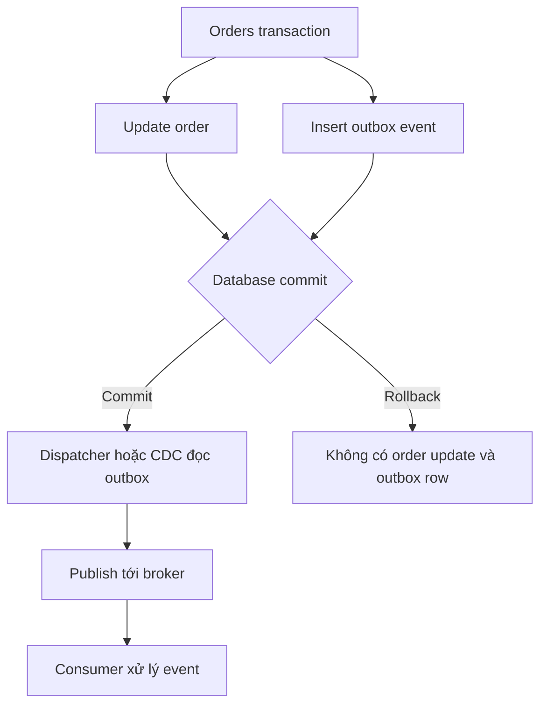
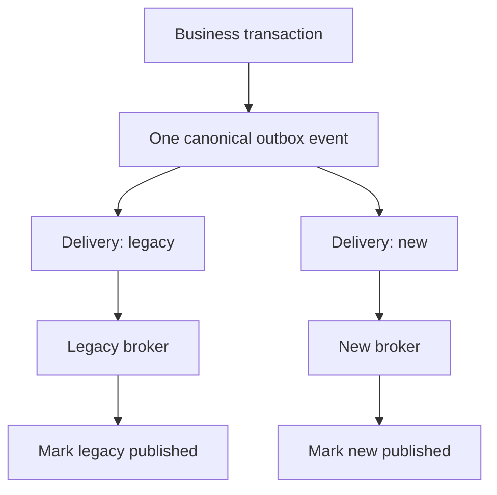

# Chọn outbox

Khi một thao tác nghiệp vụ vừa cập nhật database vừa cần phát event tới broker hoặc hệ thống khác, ứng dụng phải giải quyết một bài toán nhất quán: dữ liệu nguồn và ý định gửi event cần cùng được ghi nhận. Nếu database commit thành công nhưng publish thất bại, hệ thống có dữ liệu mới mà consumer không biết. Nếu publish thành công nhưng database rollback, consumer có thể nhận một event mô tả thay đổi chưa từng được commit.

**Transactional outbox** là một lựa chọn để giải quyết khoảng trống đó. Ứng dụng ghi thay đổi nghiệp vụ và một bản ghi outbox trong cùng transaction database. Sau khi transaction commit, một dispatcher hoặc CDC pipeline đọc outbox và chuyển event tới broker. Bài viết này trình bày khi nào nên chọn outbox, cách thiết kế và vận hành, cùng các trường hợp mà application event hoặc Event Publication Registry của Spring Modulith đã đủ.

## 1. Bài toán dual write

Giả sử module Orders tạo đơn hàng và cần gửi `OrderPlaced` tới Kafka để Inventory và Payments xử lý. Một cách triển khai trực tiếp thường trông như sau:

```java
@Transactional
public UUID placeOrder(PlaceOrderCommand command) {
    Order order = Order.place(command);
    orders.save(order);

    kafkaTemplate.send("orders", OrderPlaced.from(order));
    return order.id();
}
```

Database và Kafka là hai resource độc lập. Transaction database không tự bao trùm việc ghi message vào Kafka. Hai thứ tự thực thi đều có cửa sổ lỗi:

- **Database trước, broker sau:** database commit, process dừng trước khi gửi message. Đơn hàng tồn tại nhưng consumer không nhận được event.
- **Broker trước, database sau:** broker nhận message, transaction database rollback. Consumer xử lý một đơn hàng chưa được tạo thành công.

Đây là vấn đề dual write. Thêm `try/catch`, retry trong memory hoặc gọi `send()` trước/sau `save()` không loại bỏ được cửa sổ crash giữa hai thao tác.

## 2. Transactional outbox giải quyết điều gì?

Outbox lưu ý định phát event trong chính database transaction chứa thay đổi nghiệp vụ. Hai thao tác commit hoặc rollback cùng nhau:



Nếu transaction rollback, cả đơn hàng và outbox row đều không tồn tại. Nếu commit, outbox row tồn tại bền vững và có thể được gửi sau khi process khởi động lại. Dispatcher có thể thử lại cho tới khi broker xác nhận theo policy.

Outbox không tạo một transaction phân tán giữa database và broker. Nó chuyển việc gửi event thành công việc bền vững có thể phục hồi. Do kết quả publish có thể không xác định khi timeout hoặc process dừng sau khi broker nhận message, dispatcher thường cung cấp at-least-once delivery; consumer vẫn phải idempotent.

## 3. Khi nào nên chọn outbox?

Outbox phù hợp khi việc phát event là hệ quả bắt buộc của một thay đổi dữ liệu và mất event sẽ làm sai hoặc đình trệ quy trình nghiệp vụ.

Các dấu hiệu nên cân nhắc outbox:

- Một transaction commit phải tạo ra event để module/service khác tiếp tục xử lý.
- Hệ thống không chấp nhận khoảng trống giữa database commit và publish.
- Ứng dụng cần phục hồi việc gửi sau restart hoặc broker outage.
- Có nhiều destination và cần theo dõi trạng thái gửi riêng từng đích.
- Cần giữ event để replay, đối soát hoặc điều tra.
- Publish trực tiếp đã từng gây mất event, duplicate khó kiểm soát hoặc lỗi partial success.

Ví dụ: khi Payments xác nhận một khoản thanh toán, database phải lưu trạng thái `AUTHORIZED` và ý định phát `PaymentAuthorized`. Nếu chỉ lưu trạng thái mà mất event, Orders có thể chờ vô hạn; nếu phát event nhưng transaction thanh toán rollback, Orders có thể chuyển đơn sang trạng thái sai. Đây là trường hợp outbox thường có giá trị.

## 4. Khi nào chưa cần outbox?

Outbox tạo thêm bảng, dispatcher/CDC, retry, cleanup và vận hành. Không nên thêm chỉ vì hệ thống có application events.

| Tình huống | Lựa chọn thường phù hợp |
|---|---|
| Giao tiếp giữa module trong cùng JVM, không cần lưu event bền vững qua restart | Application event đơn giản |
| Cần theo dõi listener publication trong Spring Modulith và phục hồi listener chưa hoàn tất | Event Publication Registry với persistence phù hợp |
| Thông báo phụ, có thể mất và không ảnh hưởng invariant | Có thể dùng listener sau commit với policy đơn giản |
| Gửi event ra broker, event phải cùng commit với dữ liệu nguồn | Transactional outbox hoặc CDC trên outbox |
| Hệ thống đã có CDC/change stream phù hợp và event có thể được suy ra an toàn từ thay đổi dữ liệu | CDC, nếu semantics và schema được kiểm soát |
| Tác vụ đồng bộ trong cùng transaction/database | Gọi application service/repository trực tiếp nếu đúng boundary |

Nếu event chỉ dùng để cập nhật một cache có thể tái tạo, một cơ chế đơn giản hơn có thể đủ. Nếu event là bằng chứng nghiệp vụ hoặc kích hoạt side effect không thể bỏ qua, cần độ bền vững rõ ràng hơn.

## 5. Phân biệt Application Event, Event Publication Registry và Outbox

Ba khái niệm có liên quan nhưng phục vụ các mục đích khác nhau:

| Cơ chế | Trách nhiệm chính | Phạm vi |
|---|---|---|
| Spring application event | Giao event giữa publisher và listener trong application context | Nội bộ ứng dụng |
| Event Publication Registry | Theo dõi publication tới listener được Spring Modulith quản lý; persistence implementation có thể lưu trạng thái để phục hồi | Lifecycle của listener publication |
| Transactional outbox | Lưu intent gửi message cùng transaction dữ liệu nguồn | Database nguồn tới broker/hệ thống ngoài |
| Broker | Vận chuyển và lưu message theo semantics của broker | Giữa process/service |
| Inbox | Ghi nhận event đã xử lý để consumer chống duplicate | Phía consumer |

Event Publication Registry không mặc nhiên là transactional outbox tổng quát cho mọi broker destination. Registry theo dõi publication tới listener trong Spring Modulith. Outbox thường quản lý message sẽ được dispatcher gửi ra một hoặc nhiều destination. Tùy kiến trúc, hai cơ chế có thể cùng tồn tại nhưng cần tránh hai tầng retry không có owner rõ ràng.

Nếu ứng dụng chỉ cần listener nội bộ và registry đã đáp ứng yêu cầu phục hồi, không cần tự tạo outbox song song. Nếu cần bảo đảm intent gửi ra broker commit cùng dữ liệu nguồn, hãy xác định rõ outbox/CDC boundary.

## 6. Chọn polling dispatcher hay CDC

Sau khi outbox row commit, có hai cách phổ biến để đưa event tới broker.

| Cách | Cách hoạt động | Ưu điểm | Chi phí/giới hạn |
|---|---|---|---|
| Polling | Worker truy vấn các row chưa gửi theo chu kỳ | Dễ hiểu, dễ triển khai, ít hạ tầng bổ sung | Tạo query định kỳ, cần claim/lease và điều chỉnh polling interval |
| CDC | Công cụ đọc transaction log/change stream của database rồi phát thay đổi | Giảm polling query, độ trễ thấp trong một số cấu hình | Cần connector, quyền đọc log, schema/config và vận hành CDC |

Polling thường là điểm bắt đầu tốt cho hệ thống vừa/nhỏ hoặc khi muốn kiểm soát dispatcher trong ứng dụng. CDC phù hợp khi lưu lượng lớn, database hỗ trợ log capture tốt và tổ chức đã có năng lực vận hành Debezium hoặc nền tảng tương tự.

CDC không loại bỏ outbox schema hoặc consumer idempotency. CDC vẫn cần nhận diện row insert, phân biệt event với update trạng thái delivery, quản lý offset và xử lý schema evolution. Nếu connector đọc mọi update của outbox, cần tránh phát lại message khi dispatcher chỉ cập nhật `published_at` hoặc `status`.

## 7. Thiết kế outbox record

Một outbox record nên lưu đủ thông tin để dispatcher gửi event mà không cần đọc lại trạng thái domain đã thay đổi:

```sql
CREATE TABLE event_outbox (
    event_id UUID PRIMARY KEY,
    aggregate_type VARCHAR(120) NOT NULL,
    aggregate_id VARCHAR(200) NOT NULL,
    aggregate_version BIGINT,
    event_type VARCHAR(160) NOT NULL,
    schema_version INTEGER NOT NULL,
    occurred_at TIMESTAMP NOT NULL,
    created_at TIMESTAMP NOT NULL,
    payload JSON NOT NULL
);

CREATE INDEX idx_event_outbox_created
    ON event_outbox (created_at);
```

Các field quan trọng:

- `event_id`: định danh ổn định của event qua retry/replay.
- `aggregate_type`, `aggregate_id`: hỗ trợ routing và truy vết nguồn nghiệp vụ.
- `aggregate_version`: hỗ trợ ordering hoặc phát hiện gap khi cần.
- `event_type`: tên contract ổn định, không phụ thuộc class name tùy ý.
- `schema_version`: chọn reader/mapper phù hợp.
- `occurred_at`: thời điểm sự kiện nghiệp vụ xảy ra.
- `created_at`: thời điểm outbox row được ghi.
- `payload`: snapshot bất biến đủ để consumer xử lý.

Kiểu `JSON`, UUID và timestamp cần điều chỉnh theo database. Không lưu JPA entity hoặc object graph. Tránh payload chứa token, password hoặc dữ liệu cá nhân không cần thiết. Nếu event tham chiếu file lớn, cân nhắc object storage với reference, checksum và retention phù hợp.

## 8. Lưu trạng thái delivery

Một cột `published` đơn giản có thể đủ khi chỉ có một destination và yêu cầu tối giản. Khi cần retry, claim đồng thời hoặc gửi nhiều đích, nên có bảng delivery riêng:

```sql
CREATE TABLE event_outbox_delivery (
    event_id UUID NOT NULL,
    destination VARCHAR(120) NOT NULL,
    status VARCHAR(24) NOT NULL,
    attempt_count INTEGER NOT NULL DEFAULT 0,
    next_attempt_at TIMESTAMP,
    lease_owner VARCHAR(160),
    lease_until TIMESTAMP,
    published_at TIMESTAMP,
    last_error_code VARCHAR(120),
    PRIMARY KEY (event_id, destination),
    FOREIGN KEY (event_id) REFERENCES event_outbox(event_id)
);
```

Các trạng thái có thể gồm `PENDING`, `IN_FLIGHT`, `RETRY`, `PUBLISHED`, `FAILED` và `SKIPPED` theo policy. Với dual publish, mỗi destination có một delivery row để trạng thái đích đã thành công không bị gửi lại chỉ vì đích khác lỗi.

Không nhất thiết phải dùng đầy đủ mọi field trong ví dụ. Thiết kế cần đáp ứng các câu hỏi: worker nào đang giữ row, lease hết hạn lúc nào, lần thử tiếp theo khi nào, destination nào đã xác nhận và lỗi cuối cùng thuộc loại gì.

## 9. Ghi outbox cùng transaction nghiệp vụ

Application service cập nhật aggregate và thêm outbox record trong cùng transaction:

```java
@Service
class OrderManagement {

    private final OrderRepository orders;
    private final OutboxRepository outbox;
    private final Clock clock;

    OrderManagement(
        OrderRepository orders,
        OutboxRepository outbox,
        Clock clock
    ) {
        this.orders = orders;
        this.outbox = outbox;
        this.clock = clock;
    }

    @Transactional
    public UUID placeOrder(PlaceOrderCommand command) {
        Order order = Order.place(command);
        orders.save(order);

        var event = OrderPlaced.from(
            UUID.randomUUID(),
            order,
            clock.instant()
        );
        outbox.append(OutboxMessage.from(event));

        return order.id();
    }
}
```

`OutboxRepository` phải dùng cùng database và transaction manager với `OrderRepository`. Nếu hai repository ghi hai database khác nhau, atomicity không còn được bảo đảm. Event ID được tạo trước khi append và lưu cố định trong outbox.

Có thể đồng thời publish application event nội bộ cho listener trong cùng modular monolith. Khi đó cần xác định listener nào được phục vụ bởi application event, listener nào được phục vụ bởi broker, tránh xử lý cùng side effect hai lần. Outbox không yêu cầu mọi giao tiếp nội bộ đều phải đi qua broker.

## 10. Dispatcher polling theo batch

Dispatcher thường có ba giai đoạn:

1. Claim một nhóm delivery đang `PENDING` hoặc tới hạn retry.
2. Gửi message tới broker ngoài transaction claim.
3. Khi nhận confirm, cập nhật delivery thành `PUBLISHED`; khi lỗi, lên lịch retry hoặc chuyển `FAILED`.

Không giữ transaction database và row lock trong khi chờ network lâu. Có thể claim bằng lease trong một transaction ngắn, commit lease, gửi message, rồi cập nhật trạng thái trong transaction khác.

Pseudo SQL để claim row (cú pháp phụ thuộc database):

```sql
SELECT event_id, destination
FROM event_outbox_delivery
WHERE status IN ('PENDING', 'RETRY')
  AND (next_attempt_at IS NULL OR next_attempt_at <= CURRENT_TIMESTAMP)
  AND (lease_until IS NULL OR lease_until < CURRENT_TIMESTAMP)
ORDER BY next_attempt_at, event_id
FOR UPDATE SKIP LOCKED;
```

`SKIP LOCKED` được hỗ trợ khác nhau giữa các database và phiên bản. Worker cần giới hạn batch size, cập nhật `lease_owner`/`lease_until`, commit claim rồi mới gửi. Khi worker chết, lease hết hạn để worker khác có thể tiếp tục.

## 11. Gửi message và xử lý kết quả không xác định

Sau khi broker xác nhận, dispatcher đánh dấu delivery đã publish. Tuy nhiên, có một cửa sổ không thể loại bỏ hoàn toàn bằng thao tác tuần tự:

1. Broker nhận message và gửi confirm.
2. Process dừng trước khi cập nhật delivery row thành `PUBLISHED`.
3. Lease hết hạn, worker khác gửi lại cùng event.

Vì vậy, duplicate là kết quả có thể xảy ra. Outbox thường bảo đảm không mất intent đã commit và cho phép retry; nó không bảo đảm broker chỉ nhận đúng một bản. Consumer cần Inbox/unique constraint hoặc idempotency key để bảo vệ business effect.

`PUBLISHED` phải có semantics cụ thể. Kafka producer ack hoặc RabbitMQ publisher confirm chỉ chứng minh broker xác nhận publish theo cấu hình; chúng không chứng minh consumer cuối đã xử lý nghiệp vụ.

## 12. Retry và phân loại lỗi

Không phải lỗi nào cũng nên retry giống nhau:

| Lỗi | Hành động |
|---|---|
| Timeout/connection reset | Retry với exponential backoff và jitter |
| Broker tạm unavailable | Giữ delivery pending/retry và cảnh báo khi backlog tăng |
| Authentication/ACL sai | Giới hạn retry, cảnh báo và sửa cấu hình |
| Payload/schema không hợp lệ | Quarantine hoặc `FAILED`, không retry vô hạn |
| Destination không tồn tại | Sửa topology hoặc cấu hình route trước khi replay |
| Confirm timeout, kết quả không rõ | Retry cùng event ID; consumer deduplicate |

Chính sách cần có số lần thử hoặc tổng thời gian tối đa, `next_attempt_at`, error code và quy trình can thiệp. Exponential backoff có jitter giúp tránh nhiều worker đồng loạt dồn tải khi broker vừa phục hồi.

Không xóa row khi retry hết. Giữ payload và metadata đủ để điều tra/replay; nếu payload nhạy cảm, áp dụng retention và quyền truy cập riêng. Khi sửa nguyên nhân, dùng thao tác replay có audit và giữ nguyên event ID.

## 13. Ordering theo aggregate

Outbox polling nhiều worker có thể làm event của cùng aggregate được gửi sai thứ tự nếu worker claim song song hoặc một event retry lâu hơn event kế tiếp.

Nếu ordering là yêu cầu nghiệp vụ:

- Gắn `aggregate_id` và `aggregate_version` vào event.
- Claim theo aggregate hoặc chỉ gửi version tiếp theo khi version trước đã được xác nhận.
- Dùng aggregate ID làm Kafka key hoặc routing key phù hợp.
- Consumer kiểm tra sequence và phát hiện event stale/gap.
- Chỉ yêu cầu ordering trong phạm vi cần thiết, thường là một aggregate.

Không khóa toàn bộ outbox để bảo đảm thứ tự toàn cục nếu nghiệp vụ chỉ cần ordering theo order/account. Ordering toàn cục làm giảm khả năng xử lý song song và tạo bottleneck.

## 14. Outbox với nhiều destination

Khi cùng một event cần gửi tới broker cũ và mới, hoặc nhiều hệ thống tích hợp, không nên dùng một cột `published` chung. Lưu delivery state theo destination:



Nếu legacy thành công và new thất bại, chỉ retry new. Cả hai đường giữ canonical event ID để đối soát và deduplicate. Nếu wire contract khác nhau, dispatcher/adapter map từ canonical event sang từng schema nhưng không tạo event identity nghiệp vụ mới.

## 15. Polling hay CDC chi tiết hơn

### Polling dispatcher

Ưu điểm là dễ triển khai, dễ quan sát trạng thái từng delivery và không cần đọc transaction log. Phù hợp khi lượng event vừa phải, độ trễ vài trăm mili giây hoặc vài giây chấp nhận được và database có thể phục vụ query outbox.

Chi phí gồm query định kỳ, index cho trạng thái pending, lease/claim coordination và cleanup. Polling quá dày gây tải database; polling quá thưa làm tăng delivery latency. Điều chỉnh theo throughput, backlog và SLA.

### CDC connector

CDC đọc transaction log của database và phát thay đổi đã commit. Với Debezium, outbox event router có thể ánh xạ row outbox thành message. Cách này giảm query polling và tận dụng transaction log, nhưng cần vận hành connector, offset, schema history, permissions và monitoring.

CDC cần phân biệt insert event với update delivery status. Một thay đổi trạng thái outbox không nên vô tình phát lại cùng event. Thường thiết kế bảng event append-only riêng cho CDC, còn trạng thái delivery được quản lý bởi connector hoặc bảng khác tùy architecture.

CDC không làm biến mất duplicate. Connector có thể phát lại sau restart/offset recovery; consumer vẫn cần idempotency.

## 16. Outbox trong ứng dụng Spring Modulith

Spring Modulith hỗ trợ application events và Event Publication Registry để theo dõi publication tới listener. Khi ứng dụng chỉ giao tiếp giữa các module trong cùng process, registry với persistence phù hợp có thể là lựa chọn đủ.

Khi cần gửi event tới broker ngoài và phải bảo đảm intent gửi cùng commit dữ liệu nguồn, có thể bổ sung transactional outbox ở integration boundary. Module nghiệp vụ vẫn phát một event contract rõ ràng; application service hoặc adapter ghi outbox row trong transaction nguồn; dispatcher chuyển row sang broker.

Một cấu trúc minh họa:

```text
orders/
├── api/
├── events/
│   └── OrderPlaced.java
├── application/
│   └── PlaceOrder.java
└── persistence/
    ├── OrderRepository.java
    └── OutboxRepository.java

integration/
├── outbox/
│   ├── OutboxDispatcher.java
│   └── OutboxDeliveryRepository.java
└── kafka/
    └── OrderKafkaPublisher.java
```

Đây là một cách tổ chức tham khảo, không phải cấu trúc bắt buộc. Cần bảo đảm transaction ghi domain state và outbox dùng cùng datasource/transaction manager. Không để module Orders phụ thuộc vào chi tiết `KafkaTemplate`, topic hoặc schema registry.

## 17. Có nên dùng Event Publication Registry thay cho outbox?

Hãy xác định chính xác điều cần bảo đảm:

- Nếu cần theo dõi một listener Spring Modulith đã hoàn tất hay chưa và phục hồi publication chưa hoàn tất, Event Publication Registry là cơ chế đúng mục đích.
- Nếu cần ghi intent gửi tới broker cùng transaction database nghiệp vụ, transactional outbox là mô hình phù hợp.
- Nếu event được externalize qua integration của Spring Modulith, hãy kiểm tra cách integration sử dụng registry, persistence và retry trong đúng phiên bản; không suy luận từ tên annotation.
- Nếu registry đã cung cấp persistence/recovery đủ cho use case cụ thể, tránh thêm outbox chỉ để nhân đôi trạng thái.

Hai cơ chế có thể bổ trợ nhau nhưng phải có một nguồn trạng thái có thẩm quyền cho mỗi bước. Ví dụ, registry theo dõi listener nội bộ; outbox theo dõi delivery tới Kafka. Nếu cả hai cùng retry một lần gửi mà không phối hợp, hệ thống có thể tạo retry amplification và khó xác định message nào đã được gửi.

## 18. Idempotency ở consumer

Consumer nên lưu event ID đã xử lý trong Inbox cùng transaction với business state:

```sql
CREATE TABLE processed_event (
    consumer_name VARCHAR(160) NOT NULL,
    event_id UUID NOT NULL,
    processed_at TIMESTAMP NOT NULL,
    PRIMARY KEY (consumer_name, event_id)
);
```

Khi event đến:

1. Thử insert `(consumer_name, event_id)`.
2. Nếu key đã tồn tại, coi là duplicate đã xử lý.
3. Nếu insert thành công, áp dụng thay đổi nghiệp vụ.
4. Commit Inbox và business state cùng nhau.

Không dùng `exists` rồi `save` mà không có unique constraint; hai worker đồng thời có thể cùng thấy event chưa tồn tại. Nếu consumer gọi payment gateway, email hoặc API ngoài, cần idempotency key ổn định ở hệ thống đích hoặc operation state/reconciliation, vì transaction database không rollback được side effect ngoài.

## 19. Cleanup và retention

Outbox là dữ liệu vận hành, nhưng không nên giữ vô hạn nếu không có mục đích lưu trữ. Cần xác định:

- Chỉ xóa event sau khi mọi destination bắt buộc đã `PUBLISHED` hoặc được xử lý theo policy.
- Giữ thời gian đủ cho replay, đối soát và điều tra.
- Archive payload nếu yêu cầu audit/replay dài hạn.
- Partition theo thời gian nếu bảng tăng nhanh.
- Xóa theo batch nhỏ để tránh lock và transaction quá lớn.
- Giữ error metadata cần thiết trước khi xóa delivery row.
- Không xóa row `FAILED` chưa được xử lý chỉ để giảm backlog.

Retention của outbox và Inbox consumer cần tương thích với broker retention, DLQ retention, retry window và khả năng replay. Nếu xóa Inbox sớm hơn thời gian event có thể được replay, business effect có thể lặp.

## 20. Bảo mật và dữ liệu trong payload

Outbox thường nằm trong database nghiệp vụ và có thể được truy cập bởi DBA, backup, CDC connector và dispatcher. Payload phải tuân theo cùng nguyên tắc bảo vệ dữ liệu như message broker:

- Chỉ lưu field consumer cần.
- Không lưu password, token, credential hoặc secret.
- Mã hóa database/backup và bảo vệ kết nối CDC/broker.
- Giới hạn quyền đọc outbox; dispatcher chỉ cần quyền cần thiết.
- Mask hoặc tokenize dữ liệu cá nhân khi có thể.
- Không ghi toàn bộ payload vào log khi publish lỗi.
- Có retention và deletion policy phù hợp với dữ liệu được lưu.

Event contract nên ổn định và nhỏ. Nếu consumer cần dữ liệu nhạy cảm, cân nhắc reference tới API có phân quyền thay vì nhân bản dữ liệu vào nhiều broker và outbox.

## 21. Quan sát outbox

Outbox chỉ hữu ích khi vận hành có thể phát hiện backlog và delivery bị kẹt. Các metric nên theo dõi:

- Số row `PENDING`, `IN_FLIGHT`, `RETRY` và `FAILED`.
- Tuổi row pending lâu nhất.
- Publish latency từ `created_at` tới `published_at`.
- Attempt count và lỗi theo destination/event type.
- Số lease hết hạn hoặc worker claim thất bại.
- Throughput dispatcher và batch utilization.
- Số duplicate được consumer deduplicate.
- Consumer lag và DLQ size ở broker.
- Số event bị quarantine hoặc cần can thiệp.

Log/trace nên có `eventId`, `aggregateId`, `aggregateVersion`, destination, attempt và correlation ID. Không dùng ID duy nhất làm metric label có cardinality cao; giữ chúng trong log/trace. Đặt alert theo backlog age và SLA thay vì chỉ theo số row.

## 22. Kiểm thử outbox

Kiểm thử cần chứng minh atomicity, delivery, duplicate và recovery:

| Tình huống | Kết quả cần xác minh |
|---|---|
| Business transaction commit | Domain row và outbox row cùng tồn tại |
| Business transaction rollback | Không có domain update hoặc outbox row |
| Dispatcher publish thành công | Delivery chuyển sang trạng thái xác nhận |
| Broker unavailable | Delivery còn pending/retry, không mất event |
| Broker nhận nhưng confirm bị mất | Có thể gửi lại cùng event ID; consumer không lặp side effect |
| Process dừng sau broker confirm | Recovery tiếp tục và chấp nhận duplicate an toàn |
| Hai worker claim đồng thời | Không mất row; lease/locking hoạt động đúng |
| Một destination lỗi | Destination khác đã thành công không bị retry lại không cần thiết |
| Event sai schema | Được quarantine/failed theo policy |
| Ordering | Aggregate version được gửi/áp dụng theo quy tắc |
| Cleanup | Không xóa event còn pending hoặc trong replay window |

Dùng integration test với database engine tương ứng để kiểm tra transaction, unique constraint, `SKIP LOCKED` hoặc locking semantics. Dùng Testcontainers cho broker khi cần xác minh serializer, routing, confirm và consumer. Mock publisher chỉ phù hợp để test quyết định điều phối, không chứng minh broker nhận message.

## 23. Ví dụ kiểm thử atomicity

Một test quan trọng là ép lỗi sau khi application service đã lưu order và outbox, rồi xác minh cả hai rollback:

```java
@Test
void rollsBackOrderAndOutboxTogether() {
    assertThatThrownBy(() -> transactionTemplate.execute(status -> {
        orderManagement.placeOrder(command);
        throw new ForcedRollbackException();
    })).isInstanceOf(ForcedRollbackException.class);

    assertThat(orders.existsById(command.orderId())).isFalse();
    assertThat(outbox.existsByEventId(command.eventId())).isFalse();
}
```

Đây là pseudocode minh họa. Test thực tế cần điều chỉnh việc tạo event ID, transaction propagation và repository API. Điều cần chứng minh là hai thao tác dùng cùng transaction manager/datasource và không để lại một nửa kết quả.

## 24. Ma trận quyết định

| Câu hỏi | Nếu câu trả lời là Có | Hướng chọn |
|---|---|---|
| Event chỉ phục vụ listener nội bộ? | Không cần broker ngoài | Application event; thêm Publication Registry nếu cần recovery |
| Listener publication cần được theo dõi/phục hồi? | Có listener được Spring Modulith quản lý | Event Publication Registry persistence |
| Event phải được gửi ra broker và không được mất sau database commit? | Có yêu cầu atomic intent | Transactional outbox hoặc CDC trên outbox |
| Hệ thống đã có CDC platform và team vận hành được? | Có | Cân nhắc CDC thay polling dispatcher |
| Throughput vừa phải, muốn ít hạ tầng? | Có | Polling dispatcher |
| Cần gửi cùng event tới nhiều destination? | Có | Outbox delivery state theo destination |
| Side effect có thể chạy lại? | Có thể duplicate | Consumer Inbox/idempotency bắt buộc |
| Event chỉ là cache hint có thể tái tạo? | Mất event không ảnh hưởng invariant | Có thể không cần outbox |

## 25. Những sai lầm khi áp dụng outbox

- **Cho rằng outbox tạo exactly-once:** thực tế dispatcher có thể gửi lại sau kết quả không xác định.
- **Dùng database transaction bao trùm network publish:** giữ lock/connection lâu và vẫn có cửa sổ lỗi.
- **Một cột `published` cho nhiều destination:** không thể phục hồi partial success chính xác.
- **Không có lease/claim:** nhiều worker có thể xử lý cùng row hoặc tranh chấp dữ liệu.
- **Retry vô hạn:** backlog và tải broker tăng không kiểm soát.
- **Không có idempotency ở consumer:** duplicate tạo side effect lặp.
- **CDC phát cả update trạng thái delivery:** có thể tạo vòng lặp hoặc phát lại event.
- **Cleanup quá sớm:** mất khả năng replay/đối soát hoặc xóa event chưa gửi.
- **Payload chứa entity lớn:** tăng storage, coupling và rủi ro lộ dữ liệu.
- **Dùng outbox cho mọi application event:** tăng độ phức tạp mà không tạo giá trị tương xứng.

## 26. Quy trình đưa outbox vào hệ thống

1. Xác định event nào là hệ quả bắt buộc của transaction nghiệp vụ.
2. Xác định module sở hữu dữ liệu nguồn và transaction manager.
3. Thiết kế event contract nhỏ, có event ID, type và schema version.
4. Tạo outbox schema và delivery state theo số destination.
5. Ghi domain state và outbox row trong cùng transaction.
6. Chọn polling hoặc CDC dựa trên throughput, latency và năng lực vận hành.
7. Thiết kế claim/lease, retry, failure classification và cleanup.
8. Bảo đảm consumer idempotent và có ordering policy khi cần.
9. Thêm metric, alert, replay và runbook.
10. Kiểm thử rollback, broker outage, confirm timeout, restart và duplicate.

## 27. Checklist chọn outbox

- [ ] Việc phát event có phải hệ quả bắt buộc của transaction nghiệp vụ không?
- [ ] Mất event sau commit có làm sai hoặc đình trệ nghiệp vụ không?
- [ ] Application event/Publication Registry hiện tại có đáp ứng durability/recovery chưa?
- [ ] Outbox row dùng cùng datasource và transaction manager với dữ liệu nguồn?
- [ ] Event ID và payload được tạo một lần, giữ ổn định qua retry?
- [ ] Schema có event type, version, aggregate ID/version và timestamp cần thiết?
- [ ] Delivery state có theo dõi riêng từng destination khi cần?
- [ ] Dispatcher có claim/lease an toàn và không giữ DB lock khi chờ network?
- [ ] Retry có backoff, giới hạn và quarantine/manual recovery?
- [ ] Consumer có Inbox/idempotency và unique constraint?
- [ ] Ordering được bảo đảm trong đúng phạm vi aggregate nếu nghiệp vụ yêu cầu?
- [ ] Cleanup/retention không xóa event còn pending hoặc cần replay?
- [ ] Payload và quyền truy cập đáp ứng yêu cầu bảo mật?
- [ ] Có metric, alert, reconciliation và runbook?
- [ ] Integration test chứng minh atomicity, duplicate và recovery?

Chọn outbox khi ứng dụng phải bảo đảm ý định phát event được commit cùng thay đổi dữ liệu nguồn và có thể phục hồi việc gửi sau lỗi. Với Spring Modulith, application events và Event Publication Registry thường đủ cho giao tiếp nội bộ giữa module; transactional outbox phù hợp khi cần đưa event ra broker hoặc nhiều destination với durability rõ ràng. Chọn polling hay CDC theo quy mô và năng lực vận hành, sau đó kết hợp delivery state, retry có giới hạn, consumer idempotency và observability để hệ thống đáng tin cậy mà không tạo thêm độ phức tạp không cần thiết.
