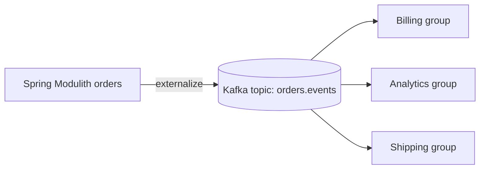
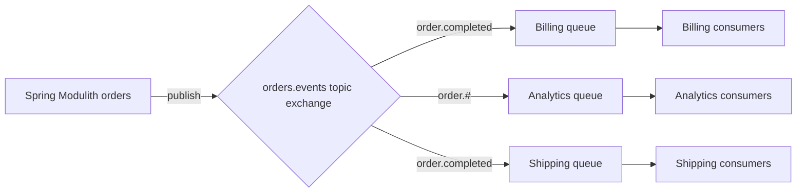

# Chọn broker cho application event

Khi các module Spring Modulith cần trao đổi bất đồng bộ qua ranh giới ứng dụng hoặc với hệ thống bên ngoài, broker có thể giúp tách producer khỏi consumer, lưu message trong lúc consumer gián đoạn và phân phối event tới nhiều nhóm xử lý. Tuy nhiên, Kafka, RabbitMQ và các dịch vụ messaging managed giải quyết những bài toán khác nhau. Chọn broker chỉ dựa trên tốc độ, mức độ phổ biến hoặc kinh nghiệm của đội ngũ có thể dẫn tới topology phức tạp, chi phí vận hành cao hoặc semantics không phù hợp với nghiệp vụ.

Với `SPRING_MODULITH_APPLICATION_EVENTS`, quyết định broker cần bắt đầu từ cách các module giao tiếp, yêu cầu lưu/replay event, thứ tự xử lý, số lượng consumer, độ trễ, khả năng phục hồi và năng lực vận hành. Spring Modulith cung cấp mô hình application event và các adapter externalization như AMQP/Kafka theo dependency tương ứng; broker là hạ tầng giao nhận ở bên ngoài application context. Không phải mọi application event đều cần externalize: listener nội bộ có thể đủ khi publisher và consumer cùng một ứng dụng và không cần hàng đợi phân tán.

## 1. Xác định bài toán trước khi chọn công nghệ

Broker không tự quyết định event nào có ý nghĩa nghiệp vụ, consumer nào được phép đọc hay khi nào một side effect được xem là hoàn tất. Những điều đó phải được xác định trước.

Hãy mô tả luồng cần hỗ trợ bằng các câu hỏi:

- Producer và consumer có nằm trong cùng một application process hay khác service?
- Consumer có thể tạm ngừng mà producer vẫn tiếp tục phát event không?
- Có cần lưu message lâu dài để consumer mới đọc lại hoặc dựng lại read model không?
- Một event cần được nhiều nhóm consumer độc lập nhận bản sao hay nhiều instance chỉ chia nhau xử lý?
- Cần thứ tự toàn cục, thứ tự theo aggregate, theo partition hay không cần thứ tự?
- Tải có dạng đều, burst, batch lớn hay nhiều message nhỏ?
- Consumer cần routing linh hoạt theo event type, routing key, header hay chỉ cần đọc một stream?
- Có yêu cầu retry, dead-letter, delayed delivery, priority hoặc request/reply không?
- Ai sẽ vận hành broker, theo dõi backlog, nâng cấp, backup và xử lý sự cố?
- Có quy định về data residency, mã hóa, tenant isolation hoặc managed service không?

Đầu ra của bước này là một tập yêu cầu có thể kiểm chứng, ví dụ: “consumer billing phải nhận mọi `OrderCompleted`, xử lý trong 30 giây ở p99, có thể dừng 20 phút mà không mất message, và phải giữ thứ tự theo từng order”. Yêu cầu như vậy giúp so sánh broker cụ thể hơn một tiêu chí chung như “cần throughput cao”.

## 2. Có thật sự cần broker không?

Nếu publisher và listener cùng một ứng dụng Spring Modulith, application event nội bộ có thể đáp ứng nhu cầu. Module phát event qua `ApplicationEventPublisher`; listener trong application context nhận event theo cấu hình Spring/Spring Modulith. Cách này đơn giản, không cần vận hành thêm broker và phù hợp khi các module cùng vòng đời triển khai.

Broker trở nên hữu ích khi cần một hoặc nhiều khả năng sau:

- Producer và consumer triển khai, mở rộng hoặc khởi động độc lập.
- Consumer có thể offline trong khi message vẫn được lưu tại broker.
- Nhiều ứng dụng cần nhận event qua ranh giới mạng.
- Cần fan-out tới các queue/topic độc lập.
- Cần retention và replay theo semantics của broker hoặc event platform.
- Cần kiểm soát tốc độ giữa producer và consumer bằng queue, partition hoặc backpressure.
- Cần tích hợp với hệ sinh thái messaging hiện có của tổ chức.

Không nên externalize mọi event nội bộ chỉ để “sẵn sàng mở rộng”. Broker tạo thêm network hop, serialization, schema evolution, credential, ACL, monitoring và failure mode. Nếu nhu cầu chỉ là tách trách nhiệm giữa hai module trong cùng ứng dụng, listener nội bộ thường dễ vận hành hơn.

## 3. Phân biệt broker, exchange/topic, queue và consumer group

Các khái niệm này khác nhau giữa hệ thống nhưng cần hiểu rõ trước khi thiết kế topology:

| Khái niệm | Vai trò |
| --- | --- |
| Broker | Hạ tầng nhận, lưu hoặc định tuyến message và quản lý kết nối consumer |
| Topic/stream | Luồng message có tên, thường được đọc theo offset hoặc subscription |
| Exchange | Điểm nhận publish và định tuyến message theo loại exchange, binding và routing key trong AMQP |
| Queue | Nơi lưu message chờ consumer; nhiều consumer có thể cạnh tranh nhận từ cùng queue |
| Consumer group | Nhóm consumer cùng chia việc đọc một topic/partition trong Kafka |
| Subscription | Quan hệ nhận message của một consumer hoặc nhóm consumer theo semantics nền tảng |
| Partition | Phân đoạn có thứ tự riêng trong một topic Kafka, là đơn vị phân phối song song trong consumer group |
| Offset/cursor | Vị trí đọc trong một partition hoặc stream |
| Acknowledgement/commit | Tín hiệu xác nhận tiến độ nhận/xử lý theo semantics của broker |

Một event được nhiều consumer độc lập xử lý cần có luồng nhận độc lập cho từng nhóm. Trong RabbitMQ, thường tạo queue riêng cho mỗi nhóm và bind các queue vào exchange. Trong Kafka, thường tạo consumer group riêng cho mỗi ứng dụng cần đọc toàn bộ topic. Nếu nhiều instance cùng một nhóm cần chia tải, chúng dùng chung queue hoặc group tương ứng.

Không nhầm “nhiều consumer cùng đọc” với “mỗi consumer đều nhận một bản sao”. Các consumer trong cùng RabbitMQ queue hoặc Kafka consumer group thường chia nhau message/partition. Muốn fan-out, cần queue hoặc group độc lập.

## 4. Kafka và RabbitMQ giải quyết những bài toán nào?

Kafka là nền tảng event streaming dựa trên topic, partition và log có retention. RabbitMQ là message broker hỗ trợ AMQP, exchange, binding và queue với nhiều kiểu định tuyến. Cả hai đều có thể giao application event, nhưng mô hình vận hành và cách consumer tiến triển khác nhau.

| Tiêu chí | Apache Kafka | RabbitMQ (AMQP 0-9-1) |
| --- | --- | --- |
| Mô hình chính | Distributed commit log/event stream | Message broker với exchange và queue |
| Định tuyến | Topic, partition key và consumer subscription | Exchange type, binding, routing key/header |
| Lưu message | Retention theo thời gian/kích thước; consumer đọc bằng offset | Queue giữ message tới khi được ack, hết TTL hoặc bị xử lý theo policy |
| Replay | Đọc lại record còn trong retention bằng offset/group | Queue mới không tự nhận message đã publish trước khi queue/binding tồn tại; replay cần nguồn riêng hoặc thiết kế lại |
| Thứ tự | Được bảo đảm trong một partition | Queue có thứ tự enqueue, nhưng concurrency/requeue/ack có thể làm thứ tự hoàn tất khác nhau |
| Fan-out | Consumer group riêng đọc cùng topic | Nhiều queue bind cùng exchange nhận bản sao |
| Consumer scale | Partition giới hạn mức song song trong một group | Nhiều consumer cạnh tranh trên queue; concurrency/prefetch ảnh hưởng phân phối |
| Routing linh hoạt | Chủ yếu topic/key và xử lý phía consumer | Direct, topic, fanout, headers exchange và binding |
| Request/reply và task queue | Có thể xây dựng nhưng cần thiết kế thêm | Các pattern queue, routing và reply thường tự nhiên hơn |
| Workload phù hợp | Event stream, nhiều consumer, replay, analytics và pipeline dữ liệu | Task/message routing, command queue, work distribution và tích hợp AMQP |
| Vận hành | Cần quản lý cluster, partition, replication, retention, consumer lag | Cần quản lý queue, exchange, binding, quorum/replication, memory/disk và unacked messages |

Đây là so sánh ở mức mô hình. Hiệu năng, độ trễ và độ bền thực tế phụ thuộc cấu hình cluster, loại queue/replication, batch, payload, storage, network và cách ứng dụng consume. Không nên kết luận một broker luôn nhanh hơn broker còn lại mà không benchmark workload tương đương.

## 5. Khi nào nên chọn Kafka?

Kafka thường phù hợp khi event được xem như một luồng dữ liệu có thể đọc lại trong một khoảng retention, có nhiều consumer độc lập và cần scale theo partition.

Các dấu hiệu phù hợp:

- Một event cần được nhiều ứng dụng đọc độc lập, mỗi ứng dụng có tiến độ riêng.
- Consumer mới cần replay các record còn trong retention để dựng read model.
- Có pipeline analytics, stream processing hoặc tích hợp dữ liệu với nhiều hệ thống.
- Throughput lớn và có thể phân vùng workload theo key.
- Cần lưu event theo log trong một khoảng thời gian đã xác định.
- Đội ngũ đã có năng lực vận hành Kafka hoặc dùng dịch vụ Kafka managed.

Ví dụ, `orders.events` chứa `OrderPlaced`, `OrderCompleted` và `OrderCancelled`. Consumer `billing`, `analytics` và `shipping` dùng các group ID riêng. Mỗi group có offset độc lập; một consumer mới có thể bắt đầu từ offset được chọn nếu record vẫn còn trong retention.

### Partition key và thứ tự

Nếu cần thứ tự theo đơn hàng, producer thường dùng `orderId` làm key để event của cùng order đi vào cùng partition. Kafka bảo đảm thứ tự record trong một partition, không bảo đảm thứ tự toàn cục giữa các partition.

Số partition giới hạn mức song song đọc của một consumer group. Nếu topic có 8 partition, thêm 20 consumer instance vào cùng group không tạo 20 luồng xử lý partition độc lập. Một số instance sẽ không được gán partition khi hệ thống ổn định.

Chọn key cần cân bằng giữa thứ tự và phân phối tải. Key quá ít giá trị có thể tạo partition nóng; key ngẫu nhiên phân phối đều nhưng làm mất thứ tự theo aggregate. Khi thay đổi partition count, cần đánh giá lại phân phối key và semantics thứ tự của dữ liệu cũ/mới.

### Replay và retention

Kafka cho phép consumer đọc lại record còn tồn tại trong retention. `auto.offset.reset=earliest` chỉ áp dụng khi group chưa có offset hợp lệ; nó không khôi phục record đã hết hạn. Nếu consumer cần lịch sử dài hơn retention của topic, cần event store, object storage, snapshot hoặc nguồn dữ liệu khác.

Kafka phù hợp cho replay nhưng không tự biến mọi topic thành event store bất biến. Retention, compaction, delete policy và quyền truy cập quyết định dữ liệu nào còn có thể đọc. Cần chọn policy theo mục tiêu: replay đầy đủ, giữ trạng thái mới nhất theo key hay chỉ lưu dữ liệu trong một khoảng thời gian.

## 6. Khi nào nên chọn RabbitMQ?

RabbitMQ thường phù hợp khi ứng dụng cần định tuyến message linh hoạt tới queue, phân phối công việc cho worker, xử lý task bất đồng bộ hoặc tích hợp qua AMQP.

Các dấu hiệu phù hợp:

- Cần routing theo routing key, pattern hoặc headers.
- Một event cần được fan-out tới nhiều queue độc lập.
- Workload thiên về task/message delivery và acknowledgement hơn là đọc lại stream dài hạn.
- Cần queue riêng với retry, TTL, dead-letter hoặc priority policy theo từng loại công việc.
- Hệ thống hiện có AMQP client, RabbitMQ cluster hoặc managed RabbitMQ.
- Đội ngũ cần mô hình exchange/queue dễ biểu đạt các luồng routing cụ thể.

Ví dụ exchange `orders.events` kiểu topic nhận routing key `order.completed`. Queue `billing.order-events` bind `order.completed`; queue `analytics.order-events` bind `order.#`; queue `shipping.order-completed` bind `order.completed`. Mỗi queue có consumer và chính sách xử lý riêng.

### Exchange type và routing

| Exchange type | Quy tắc | Trường hợp sử dụng |
| --- | --- | --- |
| Direct | Routing key khớp chính xác binding key | Phân phối theo loại event hoặc loại công việc cụ thể |
| Topic | Routing key khớp pattern với `*` và `#` | Định tuyến theo tên phân cấp như `order.*` hoặc `order.#` |
| Fanout | Gửi tới mọi queue được bind, bỏ qua routing key | Broadcast cùng message tới nhiều nhóm consumer |
| Headers | Định tuyến theo message header và binding arguments | Điều kiện định tuyến dựa trên metadata |

Exchange không phải nơi lưu message. Queue mới được tạo sau khi message đã đi qua exchange sẽ không tự nhận lại các message cũ. Nếu consumer mới cần backfill, cần nguồn replay riêng hoặc thiết kế lưu trữ khác.

### Acknowledgement, prefetch và queue

RabbitMQ queue lưu message tới khi được xử lý theo acknowledgement và policy. Consumer ack quá sớm có thể làm mất cơ hội redelivery nếu database chưa commit. Ack quá muộn hoặc consumer bị treo có thể làm tăng số message unacked.

Prefetch giới hạn số message chưa ack được giao trước cho consumer/channel. Prefetch quá cao có thể làm một consumer giữ nhiều message và phân phối tải không đều; quá thấp có thể giảm throughput do overhead giao nhận. Cần đo theo thời gian xử lý và kích thước payload.

Nếu cần message bền vững qua broker restart, cần xem xét durable exchange/queue, persistent message, publisher confirms và loại queue/replication phù hợp. Durable exchange chỉ giữ metadata exchange; nó không lưu message thay cho queue.

## 7. Các lựa chọn khác: managed messaging và cloud services

Không phải tổ chức nào cũng cần tự vận hành Kafka hoặc RabbitMQ. Managed service có thể giảm công việc quản lý cluster, patching, backup và capacity, nhưng cần xem xét lock-in, giới hạn tính năng, chi phí theo throughput/storage và khả năng tích hợp.

| Nhóm dịch vụ | Điểm mạnh thường gặp | Cần kiểm tra |
| --- | --- | --- |
| Managed Kafka | Giữ mô hình topic/partition/consumer group, giảm vận hành cluster | Retention, partition quota, replication, network cost và compatibility |
| Managed RabbitMQ | Giữ mô hình AMQP exchange/queue và routing | Plugin/queue type, connection limit, HA, policy và chi phí throughput |
| Cloud queue service | Queue managed, tích hợp IAM và các dịch vụ cloud | FIFO/ordering scope, deduplication window, visibility timeout, DLQ và quota |
| Cloud pub/sub | Fan-out và subscription managed | Ordering key, retention/replay, delivery guarantee và subscription semantics |
| NATS/JetStream | Messaging nhẹ, subject-based routing; JetStream bổ sung persistence/streaming | Durability, replay, clustering, consumer model và năng lực vận hành |

Tên dịch vụ và semantics cụ thể phụ thuộc nhà cung cấp. Không nên chọn dựa trên nhãn “serverless” hoặc “managed” mà chưa kiểm tra giới hạn retention, ordering, redelivery, quota, vùng triển khai và cách xử lý sự cố.

## 8. Bảng quyết định theo yêu cầu nghiệp vụ

Bảng sau giúp thu hẹp lựa chọn ban đầu; nó không thay thế benchmark hoặc đánh giá hạ tầng thực tế.

| Yêu cầu chính | Hướng lựa chọn ban đầu | Lý do |
| --- | --- | --- |
| Nhiều consumer độc lập cần replay stream | Kafka hoặc managed Kafka | Consumer group có offset riêng, đọc lại record trong retention |
| Routing theo nhiều pattern và queue | RabbitMQ | Exchange/binding thể hiện routing trực tiếp |
| Worker xử lý task, ack từng message | RabbitMQ hoặc cloud queue | Queue và acknowledgement là mô hình tự nhiên |
| Pipeline dữ liệu/analytics nhiều bước | Kafka hoặc streaming platform | Log, partition, retention và hệ sinh thái stream processing |
| Broadcast tới nhiều ứng dụng với tiến độ độc lập | Kafka group riêng hoặc RabbitMQ queue riêng | Mỗi consumer group/queue nhận bản sao độc lập |
| Consumer cần nhận message mới, không cần replay | RabbitMQ hoặc cloud queue | Queue delivery đơn giản có thể đủ |
| Cần thứ tự theo aggregate | Kafka với key theo aggregate; hoặc queue/consumer serialization có kiểm soát | Thứ tự được giữ trong phạm vi cụ thể |
| Cần delayed delivery/TTL/priority theo task | RabbitMQ hoặc dịch vụ queue hỗ trợ trực tiếp | Policy queue có thể biểu đạt các yêu cầu này |
| Đội ngũ đã vận hành một nền tảng ổn định | Ưu tiên nền tảng hiện có nếu đáp ứng yêu cầu | Giảm công nghệ, chi phí và vận hành phân mảnh |
| Event chỉ đi giữa module trong một process | Chưa cần broker | Application event nội bộ đơn giản hơn |

## 9. Xây dựng decision matrix có trọng số

Khi nhiều lựa chọn đều khả thi, có thể chấm điểm theo yêu cầu của chính tổ chức. Trọng số phải phản ánh mức quan trọng thực tế; điểm số không phải benchmark chung cho mọi hệ thống.

Ví dụ một nhóm có nhu cầu replay dài hạn, nhiều consumer độc lập và throughput lớn có thể dùng trọng số:

| Tiêu chí | Trọng số ví dụ | Câu hỏi đánh giá |
| --- | ---: | --- |
| Replay/retention | 20% | Consumer mới có thể đọc lại lịch sử cần thiết không? |
| Ordering | 15% | Có giữ được thứ tự trong phạm vi aggregate/partition không? |
| Fan-out/consumer isolation | 15% | Mỗi consumer có tiến độ và retry độc lập không? |
| Throughput/latency | 15% | Đạt tải và SLO với payload thực tế không? |
| Routing | 10% | Có thể biểu đạt các rule định tuyến cần thiết không? |
| Reliability/recovery | 10% | Có replication, ack/confirm, DLQ và quy trình phục hồi phù hợp không? |
| Operations/skills | 10% | Đội ngũ có thể vận hành và xử lý incident không? |
| Cost/compliance | 5% | Chi phí và yêu cầu vùng dữ liệu có phù hợp không? |

Có thể chấm mỗi broker từ 1 đến 5 cho từng tiêu chí, nhân với trọng số và so sánh tổng điểm. Tuy nhiên, một tiêu chí bắt buộc không được bù bằng điểm cao ở tiêu chí khác. Ví dụ nếu broker không đáp ứng yêu cầu data residency thì phải loại dù tổng điểm cao.

Trước khi chấm, hãy phân loại tiêu chí thành:

- **Must-have:** không đáp ứng thì không thể chọn.
- **Should-have:** có giá trị lớn nhưng có thể có giải pháp thay thế.
- **Nice-to-have:** chỉ giúp thuận tiện hoặc giảm chi phí nhỏ.

## 10. Đánh giá delivery semantics và độ tin cậy

Broker không bảo đảm toàn bộ workflow chỉ thực hiện đúng một lần. Cần xem riêng từng chặng:

- Publisher có biết broker đã nhận message không?
- Message có được lưu bền vững trước khi broker xác nhận không?
- Consumer ack/commit offset ở thời điểm nào?
- Nếu consumer commit database rồi dừng trước ack, message có thể được giao lại không?
- Nếu broker ack trước khi database commit, điều gì xảy ra khi consumer crash?
- Retry có thể tạo side effect trùng không?

Các khái niệm thường gặp:

| Cơ chế | Bảo đảm/phạm vi |
| --- | --- |
| Publisher confirm (AMQP) | Xác nhận broker xử lý publish theo semantics của confirm; không chứng minh consumer đã xử lý |
| Mandatory/return (AMQP) | Giúp phát hiện message không route được tới queue phù hợp theo cấu hình |
| Consumer acknowledgement (AMQP) | Consumer xác nhận message đã xử lý để broker loại khỏi queue theo semantics |
| Kafka offset commit | Lưu tiến độ consumer trong partition; không tự atomic với database ngoài Kafka |
| Kafka producer idempotence | Giảm duplicate do retry ở producer trong phạm vi cơ chế Kafka; không tạo exactly-once cho side effect database tùy ý |
| Transactional outbox | Ghi thay đổi nghiệp vụ và ý định publish trong cùng database transaction; relay vẫn có thể gửi lặp |
| Inbox/idempotency | Ngăn consumer áp dụng cùng event hoặc business operation nhiều lần |

Với Spring Modulith, Event Publication Registry theo dõi publication tới listener và hỗ trợ phát hiện/phục hồi publication chưa hoàn tất theo cấu hình. Nó giúp quản lý giao event nhưng không biến database, broker và API ngoài thành một transaction phân tán duy nhất. Cần chọn persistent registry khi yêu cầu phục hồi qua restart và thiết kế listener idempotent.

## 11. Transaction boundary và externalization trong Spring Modulith

Publisher nên phát event cùng transaction nghiệp vụ để event phản ánh thay đổi đã được commit theo thiết kế. Listener transaction-bound có thể chạy sau commit; externalization adapter chuyển event được chọn ra broker theo dependency/cấu hình đã cài.

Ví dụ:

```java
@Externalized("orders.events::order.completed")
public record OrderCompleted(
        UUID eventId,
        UUID orderId,
        Instant completedAt,
        int schemaVersion
) {}
```

```java
@Service
class OrderApplicationService {

    private final OrderRepository orders;
    private final ApplicationEventPublisher events;

    OrderApplicationService(
            OrderRepository orders,
            ApplicationEventPublisher events
    ) {
        this.orders = orders;
        this.events = events;
    }

    @Transactional
    public void complete(UUID orderId) {
        Order order = orders.findById(orderId).orElseThrow();
        order.complete();

        events.publishEvent(new OrderCompleted(
                UUID.randomUUID(),
                orderId,
                Instant.now(),
                1
        ));
    }
}
```

Ví dụ dùng annotation để minh họa event được đánh dấu externalize; cách ánh xạ target, routing key hoặc message key phụ thuộc adapter và phiên bản Spring Modulith. Với AMQP, target có thể được dùng để xác định exchange và routing key theo cấu hình adapter; với Kafka, topic/key mapping theo adapter tương ứng. Không áp dụng một quy tắc target cho mọi broker khi chưa xác nhận tài liệu phiên bản đang dùng.

Các dependency thường được cân nhắc gồm artifact externalization tương ứng của Spring Modulith và Spring AMQP/Kafka integration do dự án chọn. Hãy quản lý phiên bản bằng BOM tương thích Spring Boot/Spring Modulith. Không thêm đồng thời nhiều adapter chỉ vì có thể; mỗi adapter kéo theo cấu hình, schema, monitoring và semantics riêng.

## 12. Broker không thay thế event contract và schema versioning

Dù chọn Kafka hay RabbitMQ, consumer vẫn cần hiểu payload. Broker thường chuyển byte/message; nó không tự đảm bảo ý nghĩa trường dữ liệu tương thích.

Một integration event nên có:

- Event type ổn định.
- Schema version hoặc định danh schema rõ ràng.
- Event ID để deduplicate.
- Aggregate/business ID và sequence nếu cần thứ tự.
- Timestamp với semantics được mô tả.
- Correlation/causation metadata khi cần truy vết workflow.
- Trường bắt buộc/tùy chọn, quy tắc null và enum evolution.

Nếu có nhiều producer/consumer độc lập, cân nhắc JSON Schema, Avro, Protobuf hoặc schema registry. Kiểm tra backward/forward compatibility theo cách consumer triển khai và retention của nguồn. Một consumer mới có thể đọc payload cũ nhiều tháng; cần fixture cho mọi version còn có thể replay.

Không serialize trực tiếp JPA entity hoặc object nội bộ có cấu trúc thay đổi theo persistence. Hãy tạo integration DTO biểu diễn hợp đồng công khai. Broker không làm cho coupling vào class nội bộ biến mất nếu payload vẫn phụ thuộc vào implementation detail.

## 13. Chọn broker theo yêu cầu ordering

Thứ tự là một trong những tiêu chí có ảnh hưởng lớn nhất tới topology.

### Thứ tự theo aggregate

Nếu chỉ cần event của cùng order được xử lý theo thứ tự, Kafka có thể dùng `orderId` làm partition key. Với RabbitMQ, có thể serialize xử lý theo queue/key hoặc dùng topology phân vùng phù hợp; nhiều consumer cạnh tranh trên cùng queue có thể làm thứ tự hoàn tất khác thứ tự enqueue.

### Thứ tự toàn cục

Thứ tự toàn cục thường giới hạn khả năng song song và throughput. Nếu nghiệp vụ thực sự yêu cầu một thứ tự duy nhất cho tất cả event, cần xác định lý do và chi phí. Có thể một sequence theo aggregate hoặc một process manager là đủ, không cần thứ tự toàn cục của toàn hệ thống.

### Event đến muộn hoặc sai thứ tự

Dù broker có thứ tự trong phạm vi nào, retry, replay, nhiều nguồn và xử lý song song vẫn có thể làm thứ tự hoàn tất thay đổi. Consumer nên dùng sequence/version để phát hiện event cũ hoặc gap khi nghiệp vụ yêu cầu. Timestamp không phải sequence đáng tin cậy.

## 14. Chọn broker theo fan-out và isolation

Nếu một event cần được nhiều consumer độc lập nhận, cần đảm bảo tiến độ và lỗi của consumer này không chặn consumer khác.

Với Kafka, mỗi ứng dụng có consumer group riêng và đọc cùng topic theo offset độc lập. Với RabbitMQ, mỗi nhóm consumer có queue riêng và queue được bind vào exchange. Không cho hai hệ thống độc lập dùng chung một Kafka group hoặc RabbitMQ queue nếu cả hai cần nhận mọi event.

Hãy cân nhắc:

- Consumer có cần filter event theo type không?
- Consumer có tốc độ và SLO khác nhau không?
- Consumer có retention/replay window khác nhau không?
- Một consumer lỗi có làm backlog ảnh hưởng nhóm khác không?
- Có cần quyền đọc riêng theo team/tenant không?
- Có cần xóa hoặc giữ dữ liệu theo từng subscription không?

Fan-out độc lập thường làm tăng storage vì message được giữ theo từng subscription/queue hoặc consumer offset khác nhau. Cần tính chi phí theo số consumer và thời gian giữ message.

## 15. Chọn broker theo retry và dead-letter

Retry policy cần phân loại lỗi transient, permanent và unknown outcome. Không retry vô hạn mọi exception.

| Nhu cầu | Kafka | RabbitMQ |
| --- | --- | --- |
| Retry ngắn | Consumer retry/backoff hoặc pause theo thiết kế | Requeue có kiểm soát hoặc retry queue |
| Retry chậm | Retry topic/destination hoặc scheduler | TTL/delayed queue nếu plugin/cấu hình hỗ trợ |
| Cách ly poison event | Dead-letter topic/DLT hoặc quarantine topic | Dead-letter exchange/queue |
| Replay | Đọc lại offset/record còn retention | Re-publish từ DLQ hoặc nguồn lưu trữ/replay riêng |
| Thứ tự khi retry | Có thể ảnh hưởng thứ tự trong partition tùy chiến lược | Requeue có thể làm thay đổi thứ tự quan sát |

Các cơ chế retry có thể làm tăng tải và tạo retry storm. Hãy dùng số lần thử tối đa, exponential backoff, jitter, giới hạn thời gian và DLQ/quarantine. Với event có side effect ngoài, kiểm tra trạng thái trước khi retry hoặc dùng idempotency key ổn định.

## 16. Bảo mật và quản trị dữ liệu

Broker là ranh giới hạ tầng và thường được nhiều service truy cập. Cần bảo vệ cả đường truyền, lưu trữ và quyền đọc:

- TLS cho kết nối producer/consumer tới broker.
- Authentication riêng cho từng service hoặc workload identity.
- ACL giới hạn publish/consume theo topic, exchange, queue và virtual host.
- Encryption at rest theo khả năng broker/managed service.
- Secret rotation và không ghi credential vào config/log.
- Data classification và data minimization trong payload.
- Retention phù hợp với mục đích, quyền riêng tư và yêu cầu audit.
- Kiểm soát quyền truy cập dashboard, message browser, DLQ và backup.
- Không đưa PII vào routing key, topic name, metric label hoặc log nếu không cần.

Token hoặc customer reference vẫn có thể là dữ liệu giả danh nếu hệ thống có thể liên kết về cá nhân. Không coi việc thay email bằng UUID là ẩn danh hoàn toàn. Consumer chỉ nên nhận trường dữ liệu cần cho mục đích của nó.

## 17. Vận hành và năng lực đội ngũ

Broker phù hợp về mặt kỹ thuật nhưng đội ngũ không thể vận hành an toàn vẫn là lựa chọn rủi ro. Hãy đánh giá tổng chi phí sở hữu:

- Cluster deployment, upgrade, patch và capacity planning.
- Replication, failover, backup và disaster recovery.
- Monitoring broker, queue/topic, partition và consumer.
- Alert backlog, oldest message age, lag, unacked, DLQ và publication incomplete.
- On-call, runbook, replay và xử lý poison event.
- Quản lý schema, ACL, credential và data retention.
- Chi phí compute, storage, network, cross-zone/region và managed service.
- Năng lực developer tooling, local development và integration test.

Managed service giảm một phần vận hành hạ tầng nhưng không loại bỏ trách nhiệm thiết kế consumer, schema, retry, idempotency và alert. Tổ chức vẫn cần hiểu semantics của dịch vụ và giới hạn quota.

Nếu tổ chức đã có nền tảng Kafka vận hành tốt cho analytics và stream processing, dùng Kafka cho event integration có thể giảm số công nghệ. Nếu nền tảng AMQP hiện tại đã hỗ trợ routing, task queue và on-call tốt, RabbitMQ có thể là lựa chọn đơn giản hơn. Không tạo hai broker cho cùng một loại workload nếu không có yêu cầu rõ ràng.

## 18. Local development và kiểm thử

Broker cần được kiểm thử ở mức tương ứng với semantics mà ứng dụng dựa vào.

| Cấp độ | Mục tiêu | Công cụ/cách làm |
| --- | --- | --- |
| Unit test | Logic publisher/consumer, mapping và idempotency | Mock/fake dependency, không cần broker |
| Spring integration test | Application event dispatch và listener nội bộ | `@ApplicationModuleTest`, `Scenario` hoặc test context phù hợp |
| Adapter integration test | Serialization, destination mapping, retry/ack | Testcontainers hoặc broker test environment |
| Contract test | Schema và compatibility giữa producer/consumer | Schema fixture, registry compatibility check |
| Load test | Throughput, latency, backlog drain và resource limits | Workload đại diện và môi trường gần production |
| Failure test | Broker outage, redelivery, rebalance, DLQ và recovery | Fault injection có kiểm soát |

Unit test không chứng minh routing exchange hoặc Kafka partition. Ngược lại, không cần khởi động broker cho mọi test logic. Tách test theo mục tiêu giúp suite nhanh hơn và chỉ dùng hạ tầng thật ở nơi cần xác nhận semantics.

## 19. Tích hợp broker với Event Publication Registry

Spring Modulith Event Publication Registry theo dõi publication tới listener được cấu hình và có thể hỗ trợ phục hồi publication chưa hoàn tất. Khi externalize event, cần hiểu chính xác adapter tương tác với registry và broker như thế nào ở phiên bản đang sử dụng.

Các nguyên tắc cần giữ:

- Dùng persistent registry nếu cần trạng thái publication tồn tại qua restart.
- Không đánh dấu publication hoàn tất chỉ vì publisher đã gọi `publishEvent()`.
- Theo dõi lỗi serialization, connection, authorization và routing riêng.
- Xác nhận hành vi khi broker nhận message nhưng acknowledgement/confirm bị mất.
- Thiết kế consumer idempotent vì retry/resubmit có thể giao lặp.
- Dùng public API của registry để quan sát/resubmit publication incomplete.
- Không coi registry là kho lưu lịch sử để consumer mới replay mọi event đã hoàn tất.

Registry và broker có hai trạng thái khác nhau: publication tới listener có thể hoàn tất trong khi consumer downstream chưa xử lý xong, tùy điểm adapter xác nhận giao nhận. Catalog và monitoring cần chỉ rõ trạng thái nào đang được đo để tránh hiểu nhầm “publication complete” là “toàn bộ nghiệp vụ downstream hoàn tất”.

## 20. Kiến trúc tham khảo cho hai lựa chọn

### Phương án A: Kafka cho event stream



Mỗi consumer group có offset và tiến độ riêng. `orderId` có thể là key để giữ thứ tự event trong một partition. Retention cần đủ cho thời gian consumer có thể offline và nhu cầu replay.

### Phương án B: RabbitMQ cho routing/queue



Mỗi nhóm có queue, retry và DLQ riêng. Queue durable/persistent message và publisher confirms cần được cấu hình theo yêu cầu; queue mới không nhận lại message đã publish trước khi binding tồn tại.

## 21. Những anti-pattern khi chọn broker

| Anti-pattern | Hệ quả | Cách xử lý |
| --- | --- | --- |
| Chọn broker chỉ vì benchmark throughput | Không phản ánh routing, replay, vận hành và workload thật | Đánh giá theo yêu cầu và benchmark end-to-end |
| Dùng broker cho mọi application event | Tăng độ phức tạp và failure mode không cần thiết | Giữ event nội bộ trong process khi đủ dùng |
| Dùng Kafka như queue task đơn giản mà không cần replay | Phải quản lý partition, offset và consumer group không cần thiết | Cân nhắc RabbitMQ hoặc cloud queue |
| Dùng RabbitMQ làm event history dài hạn | Queue không tự cung cấp replay lịch sử cho subscription mới | Dùng event store/stream platform hoặc nguồn backfill |
| Dùng chung consumer group cho các ứng dụng cần bản sao | Các ứng dụng chia nhau record | Group riêng cho mỗi consumer độc lập |
| Dùng chung queue cho các consumer cần broadcast | Consumer cạnh tranh nhận message | Queue riêng và binding riêng |
| Tuyên bố exactly-once end-to-end | Side effect database/provider vẫn có thể lặp | Inbox, idempotency key và transaction boundary rõ |
| Không xác định ordering scope | Scale consumer làm sai sequence nghiệp vụ | Chọn key/partition/queue và sequence rõ ràng |
| Retry vô hạn hoặc requeue ngay | Retry storm và poison message chặn tiến độ | Backoff, retry cap, DLQ/quarantine |
| Tăng partition/consumer không có capacity plan | Chi phí tăng nhưng throughput không tăng hoặc downstream quá tải | Đo bottleneck và giới hạn tài nguyên |
| Không quản lý schema | Consumer mới không đọc được payload cũ | Version hóa schema và contract test |
| Coi Event Publication Registry là event store | Backfill consumer mới không có lịch sử cần thiết | Chọn nguồn replay riêng |
| Dùng nhiều broker không có ranh giới | Vận hành, monitoring và incident phân mảnh | Chuẩn hóa nền tảng trừ khi có yêu cầu phân biệt |

## 22. Quy trình ra quyết định và triển khai

Khi chọn broker cho một luồng application event, hãy thực hiện theo thứ tự:

1. Xác định publisher, consumer, ranh giới triển khai và mục tiêu nghiệp vụ.
2. Quyết định application event nội bộ đã đủ hay cần externalization.
3. Xác định retention, replay, fan-out, routing, ordering, latency và throughput.
4. Phân loại tiêu chí bắt buộc và tiêu chí ưu tiên; loại các lựa chọn không đáp ứng ràng buộc.
5. So sánh Kafka, RabbitMQ hoặc managed messaging theo topology và semantics thực tế.
6. Kiểm tra năng lực vận hành, chi phí, security, data residency và tooling của đội ngũ.
7. Thiết kế event contract, schema version, event ID, partition/routing key và idempotency.
8. Chọn adapter Spring Modulith tương ứng và quản lý dependency bằng BOM tương thích.
9. Kiểm thử transaction, externalization, serialization, redelivery, retry, DLQ và broker recovery.
10. Đo tải với payload thật, xác nhận SLO và giới hạn downstream trước production.
11. Chuẩn bị dashboard, alert, runbook, retention và quy trình nâng cấp broker.
12. Ghi quyết định vào ADR và event catalog để các module/consumer sử dụng nhất quán.

## 23. Ghi quyết định broker bằng ADR

Quyết định broker ảnh hưởng lâu dài tới event contract, vận hành và cách consumer scale. Nên ghi lại bằng Architecture Decision Record (ADR) thay vì chỉ lưu trong một cuộc trao đổi.

Một ADR nên có:

- **Context:** luồng nghiệp vụ, producer/consumer và yêu cầu đã xác định.
- **Decision drivers:** replay, ordering, fan-out, latency, throughput, routing, security và năng lực vận hành.
- **Options considered:** application event nội bộ, Kafka, RabbitMQ và managed alternatives.
- **Decision:** lựa chọn và phạm vi áp dụng.
- **Consequences:** giới hạn, chi phí, vận hành và trade-off được chấp nhận.
- **Reliability model:** acknowledgement, retry, idempotency, DLQ và recovery.
- **Migration/exit plan:** cách chuyển broker hoặc adapter nếu yêu cầu thay đổi.

Không ghi một broker là tiêu chuẩn bắt buộc cho toàn module nếu chỉ một luồng có nhu cầu đặc biệt. Có thể có nhiều lựa chọn theo bounded context, nhưng cần tránh phân mảnh không cần thiết và phải có owner rõ ràng.

Chọn broker là quyết định về cách hệ thống lưu, định tuyến và giao event trong điều kiện tải và lỗi thực tế. Khi yêu cầu nghiệp vụ được chuyển thành tiêu chí cụ thể, semantics của Kafka/RabbitMQ được hiểu đúng, consumer có idempotency và thứ tự phù hợp, còn vận hành được chuẩn bị từ đầu, Spring Modulith có thể externalize application event mà vẫn giữ ranh giới module và độ tin cậy của luồng nghiệp vụ.
