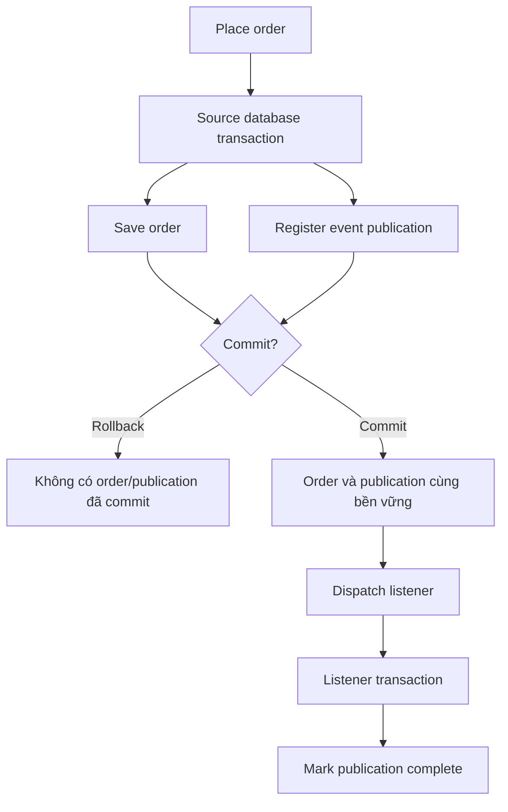

# Chọn mức đảm bảo

Không phải mọi application event đều cần cùng một mức đảm bảo giao nhận. Một event dùng để cập nhật cache có thể chấp nhận xử lý trễ hoặc thử lại; event liên quan đến thanh toán, giữ hàng hay audit cần kiểm soát chặt hơn về tính bền vững, duplicate và khả năng phục hồi. Chọn mức đảm bảo phù hợp giúp tránh hai thái cực: xây dựng hạ tầng quá phức tạp cho sự kiện ít quan trọng, hoặc dùng cơ chế best-effort cho một thay đổi nghiệp vụ không được phép mất.

Trong Spring Modulith, cần nhìn mức đảm bảo theo toàn bộ đường đi của event: transaction nguồn, Event Publication Registry, executor/listener, broker nếu externalize, consumer và tác dụng phụ cuối cùng. Một bước được bảo đảm không đồng nghĩa toàn bộ quy trình end-to-end được bảo đảm ở cùng mức.

## 1. Mức đảm bảo gồm những khía cạnh nào?

Khi nói một event được giao “đáng tin cậy”, cần xác định rõ điều gì được bảo đảm. Ít nhất có các khía cạnh sau:

| Khía cạnh | Câu hỏi cần trả lời |
| --- | --- |
| Acceptance | Producer được xem là đã gửi thành công ở thời điểm nào? |
| Durability | Event có còn sau khi process, broker hoặc node khởi động lại không? |
| Delivery cardinality | Consumer có thể không nhận, nhận một lần hay nhận nhiều lần? |
| Processing | Hệ thống biết listener đã hoàn tất nghiệp vụ hay chỉ biết message đã được nhận? |
| Ordering | Event có thứ tự toàn cục, theo partition hay theo aggregate? |
| Recovery | Khi listener/broker lỗi, ai retry và retry từ đâu? |
| Side effects | Database, API ngoài hoặc hệ thống khác có thể bị tác động trùng không? |
| Latency | Chấp nhận xử lý đồng bộ, gần thời gian thực hay trễ theo batch? |

Một hợp đồng delivery cần mô tả cả phạm vi và giới hạn. Ví dụ “at-least-once” có thể đúng với việc broker giao message cho consumer, nhưng không chứng minh database và API ngoài chỉ bị tác động một lần.

## 2. Các mức delivery phổ biến

### Best-effort

Producer gửi event và không có cơ chế lưu bền vững hoặc retry đáng tin cậy. Nếu process dừng, listener lỗi hoặc broker không sẵn sàng, event có thể bị mất. Cách này phù hợp với dữ liệu có thể tái tạo hoặc không ảnh hưởng nghiệp vụ cốt lõi, chẳng hạn một số telemetry hoặc cache hint.

### At-most-once

Event được giao không quá một lần theo phạm vi cơ chế đã chọn. Hệ thống tránh retry hoặc đánh dấu đã xử lý trước khi thực hiện tác dụng phụ. Đổi lại, event có thể bị mất nếu lỗi xảy ra giữa lúc đánh dấu và lúc xử lý. Mức này phù hợp khi duplicate gây hại hơn việc bỏ sót và có cơ chế tái tạo dữ liệu.

### At-least-once

Hệ thống tiếp tục thử giao cho tới khi consumer hoàn tất theo tiêu chí đã định hoặc chuyển sang trạng thái cần can thiệp. Event không dễ bị mất, nhưng consumer có thể nhận cùng event nhiều lần. Vì vậy, idempotency và deduplication là yêu cầu thiết kế bắt buộc.

### Effectively-once business effect

Hệ thống cho phép giao lại nhưng bảo đảm tác dụng phụ nghiệp vụ chỉ được áp dụng một lần về mặt kết quả. Thường đạt được bằng event ID ổn định, unique constraint/inbox, transaction bao quanh deduplication và cập nhật dữ liệu, hoặc idempotency key tại API đích.

### Exactly-once trong một phạm vi giới hạn

Một số nền tảng hỗ trợ exactly-once semantics trong một ranh giới kỹ thuật cụ thể, ví dụ transaction của Kafka khi đọc và ghi lại dữ liệu trong Kafka. Điều đó không tự động mở rộng sang database ngoài Kafka, email, HTTP API hoặc hệ thống thanh toán. Hãy ghi rõ phạm vi của lời hứa exactly-once.

| Mức | Có thể mất event? | Có thể nhận trùng? | Yêu cầu điển hình |
| --- | --- | --- | --- |
| Best-effort | Có | Có thể | Không yêu cầu recovery. |
| At-most-once | Có | Không theo cơ chế giao đã chọn | Chấp nhận mất; không retry. |
| At-least-once | Không trong giới hạn retention/recovery đã cam kết | Có | Durable publication, retry, idempotent consumer. |
| Effectively-once | Có thể có delivery trùng | Có | Deduplication và tác dụng phụ idempotent/transactional. |
| Exactly-once | Không trong phạm vi transaction được bảo đảm | Không trong phạm vi đó | Transactional protocol và giới hạn rõ ràng. |

## 3. Không nhầm publish thành processed

Một lời gọi `ApplicationEventPublisher.publishEvent(...)` chỉ cho biết event đã được gửi tới cơ chế application event trong process. Nó không tự chứng minh listener đã chạy, database của listener đã commit hay broker ngoài đã nhận event.

Các mốc cần phân biệt:

1. **Publish requested:** code đã yêu cầu publish event.
2. **Source transaction committed:** thay đổi nghiệp vụ và publication tương ứng đã commit.
3. **Listener started:** listener bắt đầu thực thi.
4. **Listener completed:** listener kết thúc thành công theo semantics của framework.
5. **External broker acknowledged:** broker xác nhận đã nhận/ghi message theo cấu hình producer và broker.
6. **Consumer processed:** consumer hoàn tất tác dụng phụ và xác nhận/commit tiến độ theo cơ chế của nó.

Không dùng một log `Event published` để đại diện cho tất cả các mốc này. Tên metric, log và dashboard cần thể hiện đúng trạng thái đang đo.

## 4. Mức đảm bảo của application event nội bộ

Spring application event có thể được xử lý đồng bộ hoặc bất đồng bộ tùy listener và cấu hình. Với listener đồng bộ, caller có thể nhận exception ngay trong luồng phát event; điều này tạo quan hệ chặt về thời gian thực thi và transaction. Với listener bất đồng bộ, caller không chờ listener hoàn tất và lỗi listener cần được quan sát, lưu trạng thái và phục hồi theo cơ chế riêng.

`@TransactionalEventListener` cho phép gắn listener với transaction phase, thường là `AFTER_COMMIT`. Nếu không có transaction phù hợp, listener mặc định không được gọi trừ khi cấu hình fallback execution. Điều này giúp listener phản ứng với thay đổi đã commit, nhưng bản thân annotation không biến mọi event thành message bền vững.

`@ApplicationModuleListener` là cách viết thuận tiện của Spring Modulith cho listener bất đồng bộ sau commit và chạy trong transaction riêng theo semantics của framework. Đây là lựa chọn thường dùng cho phản ứng liên module cần tách khỏi transaction nguồn.

```java
@Component
class InventoryOnOrderPlaced {

    private final InventoryService inventory;

    InventoryOnOrderPlaced(InventoryService inventory) {
        this.inventory = inventory;
    }

    @ApplicationModuleListener
    void reserve(OrderPlaced event) {
        inventory.reserveFor(event.orderId());
    }
}
```

Listener có transaction riêng giúp lỗi xử lý không rollback transaction nguồn đã commit. Tuy nhiên, điều đó không tự động bảo đảm event tồn tại sau process crash nếu publication state chỉ nằm trong bộ nhớ hoặc không có persistence adapter phù hợp.

## 5. Vai trò của Event Publication Registry

Event Publication Registry theo dõi publication tới transactional listener. Với mỗi listener được theo dõi, registry ghi nhận publication cần xử lý và trạng thái hoàn tất. Khi listener chạy thành công, publication được đánh dấu hoàn tất theo cơ chế framework; khi listener thất bại, publication có thể còn incomplete để điều tra và resubmit.

Để có khả năng phục hồi sau restart, cần cấu hình một implementation lưu publication bền vững phù hợp với ứng dụng, chẳng hạn relational/JDBC hoặc adapter được Spring Modulith hỗ trợ. Chỉ có registry trong bộ nhớ không đem lại durability qua process restart.

Registry cung cấp nền tảng cho việc theo dõi và phục hồi publication, nhưng mức đảm bảo cuối cùng còn phụ thuộc vào:

- Transaction nguồn có commit cùng publication record hay không.
- Repository của registry có lưu bền vững và backup phù hợp không.
- Listener có được dispatch và retry sau restart không.
- Lỗi có được truyền ra để framework nhận biết hay bị bắt rồi nuốt.
- Consumer có idempotent khi publication được gửi lại không.
- Operator có giám sát backlog và xử lý publication quá hạn không.

Không coi registry là event store tổng quát hoặc broker. Registry theo dõi việc giao event tới listener; lịch sử event đã hoàn tất chỉ được lưu lâu dài nếu ứng dụng có chiến lược lưu trữ riêng.

## 6. Transaction nguồn và tính nguyên tử của publication

Một yêu cầu quan trọng là không để database ghi nhận đơn hàng thành công nhưng event cần thiết lại biến mất trước khi được giao. Nếu event được phát trong transaction nguồn và publication registry persistent tham gia cùng transaction, thay đổi nghiệp vụ và trạng thái publication có thể được commit nguyên tử trong cùng database transaction.



Đây là nguyên tắc transactional publication. Việc có thực sự đạt được hay không phụ thuộc vào transaction manager, adapter registry và cách ứng dụng cấu hình. Nếu publication được gửi ra broker trực tiếp trước khi transaction nguồn commit, có thể xảy ra message đã tới broker trong khi database rollback.

Với external integration, cần dùng cơ chế externalization/outbox phù hợp và kiểm tra adapter. Không giả định một lời gọi publish event trong code tự động tạo atomic transaction giữa database và broker.

## 7. Chọn at-least-once khi không được phép mất công việc

At-least-once thường là lựa chọn thực tế cho event nghiệp vụ cần được xử lý cuối cùng, ví dụ cập nhật projection, đồng bộ trạng thái hoặc gửi yêu cầu downstream có idempotency.

Để triển khai mức này cần:

- Lưu publication/message bền vững trước khi xác nhận nguồn đã hoàn tất.
- Chỉ đánh dấu hoàn tất sau khi listener đã hoàn thành tác dụng phụ cần thiết.
- Giữ publication chưa hoàn tất khi listener ném exception.
- Có retry có backoff và giới hạn hợp lý.
- Có recovery sau restart và quy trình xử lý poison event.
- Có giám sát backlog, tuổi publication và số lần thất bại.
- Thiết kế consumer idempotent để chịu được duplicate.

At-least-once là một lời hứa có điều kiện: dữ liệu còn trong retention, storage không mất ngoài phạm vi backup, retry/recovery vẫn hoạt động và lỗi không bị đánh dấu thành công sai. Hãy ghi các giới hạn đó trong hợp đồng vận hành.

## 8. Vì sao at-least-once cần idempotency?

Giả sử listener nhận `OrderPlaced`, giữ hàng thành công và commit database. Ngay sau đó process dừng trước khi publication được đánh dấu hoàn tất. Khi hệ thống phục hồi, registry có thể resubmit publication. Listener nhận cùng event lần nữa.

Nếu listener tạo reservation mới mỗi lần, tồn kho có thể bị giữ hai lần. Cách xử lý là dùng event ID hoặc business key làm khóa idempotency và lưu deduplication cùng transaction với tác dụng phụ.

```sql
CREATE TABLE processed_event (
    consumer_name VARCHAR(120) NOT NULL,
    event_id UUID NOT NULL,
    processed_at TIMESTAMP NOT NULL,
    PRIMARY KEY (consumer_name, event_id)
);
```

Ví dụ luồng xử lý:

```java
@Transactional
void handle(OrderPlaced event) {
    if (processedEvents.exists(CONSUMER_NAME, event.eventId())) {
        return;
    }

    inventory.reserveFor(event.orderId());
    processedEvents.insert(CONSUMER_NAME, event.eventId());
}
```

Đoạn code chỉ minh họa ý tưởng. Trong implementation thực tế, thao tác kiểm tra/insert cần chống race condition bằng unique constraint và xử lý duplicate-key phù hợp. Việc ghi inbox và cập nhật dữ liệu nghiệp vụ phải nằm trong cùng transaction để không có trạng thái “đã xử lý” nhưng tác dụng phụ chưa commit.

## 9. Effectively-once với hệ thống ngoài

Nếu listener gọi HTTP API, transaction database của listener không thể tự rollback tác dụng phụ đã xảy ra ở dịch vụ ngoài. Ví dụ, payment provider đã thu tiền nhưng response bị timeout; listener không biết thao tác thành công hay thất bại.

Các biện pháp thường dùng:

- Gửi idempotency key ổn định, thường dựa trên event ID hoặc payment operation ID.
- Lưu trạng thái yêu cầu và kết quả provider để đối chiếu.
- Khi timeout không rõ kết quả, query trạng thái theo operation ID trước khi gửi lại.
- Dùng inbox/outbox và reconciliation job để phát hiện trạng thái lệch.
- Thiết kế compensation nếu nghiệp vụ cho phép và thao tác đã thực hiện cần được bù trừ.

Không tạo idempotency key mới cho mỗi lần retry. Nếu provider hỗ trợ idempotency, cùng một business operation phải dùng cùng key qua các lần thử.

## 10. Exactly-once cần giới hạn phạm vi

“Exactly-once” thường bị dùng quá rộng. Một broker có thể bảo đảm một số thao tác trong transaction nội bộ của broker, nhưng không thể tự đảm bảo email chỉ gửi một lần hoặc database ngoài chỉ cập nhật một lần nếu các hệ thống đó không tham gia cùng transaction protocol.

Ví dụ, Kafka transactions có thể cung cấp exactly-once semantics cho luồng consume-transform-produce trong Kafka khi producer, consumer isolation và offset được cấu hình đúng. Nếu cùng xử lý đó còn ghi vào PostgreSQL hoặc gọi payment API, phần tác dụng phụ bên ngoài Kafka vẫn cần idempotency, outbox/inbox hoặc một giao thức phối hợp khác.

Khi ai đó yêu cầu exactly-once, hãy hỏi:

1. Exactly-once ở ranh giới nào: broker, database, listener hay toàn bộ nghiệp vụ?
2. Những hệ thống nào tham gia cùng transaction?
3. Điều gì xảy ra nếu process dừng sau side effect nhưng trước acknowledgement?
4. Có idempotency key hoặc deduplication bền vững không?
5. Có thể đối chiếu và sửa trạng thái không nhất quán không?

Nếu không thể chỉ ra phạm vi kỹ thuật, hãy dùng mô tả chính xác hơn như “at-least-once delivery với idempotent processing”.

## 11. Ordering là một phần của guarantee

Delivery cardinality không đảm bảo thứ tự. Hai event của cùng aggregate có thể được xử lý song song hoặc đến consumer theo thứ tự khác nhau nếu không có cơ chế ordering phù hợp.

Các mức ordering thường gặp:

| Mức | Đặc điểm |
| --- | --- |
| Không bảo đảm thứ tự | Consumer xử lý theo khả năng đến và lịch chạy. |
| Theo partition/key | Broker giữ thứ tự trong một partition; cùng key cần được route vào cùng partition. |
| Theo aggregate version | Consumer kiểm tra version/sequence và từ chối hoặc trì hoãn event cũ. |
| Toàn cục | Đắt và khó mở rộng; chỉ chọn khi nghiệp vụ thực sự cần. |

Với Kafka, thứ tự được bảo đảm trong một partition, không phải toàn topic. Nếu số partition thay đổi hoặc partitioner đổi, key có thể được ánh xạ khác. Với listener bất đồng bộ trong cùng ứng dụng, nhiều thread cũng có thể làm thay đổi thứ tự hoàn tất.

Nếu thứ tự quan trọng, hãy đưa `aggregateId` và `aggregateVersion` vào event, dùng partition key phù hợp và thiết kế consumer phát hiện gap/duplicate. Không giả định timestamp đủ để tái tạo thứ tự chính xác.

## 12. Retry, backoff và poison event

Retry tăng khả năng hoàn tất nhưng cũng có thể tạo tải lên dependency đang lỗi. Một chính sách cần xác định:

- Lỗi nào retry được: timeout, lỗi mạng, HTTP 429/5xx hoặc database tạm thời.
- Lỗi nào không retry tự động: payload sai, schema không hỗ trợ, vi phạm invariant vĩnh viễn.
- Số lần retry, thời gian tối đa và backoff/jitter.
- Giới hạn concurrency và tốc độ retry.
- Khi nào chuyển sang DLT/quarantine hoặc yêu cầu operator can thiệp.
- Ai chịu trách nhiệm resubmit và cách ghi audit recovery.

Không retry vô hạn một poison event. Giữ payload gốc và metadata để điều tra, sửa nguyên nhân rồi mới resubmit. Với Spring Modulith, có thể dùng API phục hồi publication incomplete/failed được cung cấp bởi phiên bản đang chạy; không sửa trực tiếp bảng registry.

## 13. Chọn mức đảm bảo theo loại nghiệp vụ

Không nên gán cùng một policy cho mọi event. Hãy phân loại theo tác động nếu event mất, bị trùng hoặc đến trễ.

| Trường hợp | Mức thường phù hợp | Lý do và điều kiện |
| --- | --- | --- |
| Cache invalidation | Best-effort hoặc at-least-once | Cache có thể tái tạo; TTL/reload là đường phục hồi. |
| Search/read-model projection | At-least-once + idempotent | Có thể rebuild/replay; cần chống áp dụng trùng. |
| Notification/email | At-least-once với dedupe theo notification ID | Có thể retry nhưng phải tránh gửi trùng ngoài ý muốn; nhà cung cấp có thể không hỗ trợ exactly-once. |
| Audit nghiệp vụ | Durable append và reconciliation | Cần lưu đầy đủ, có retention và kiểm soát truy cập. |
| Giữ hàng/tồn kho | At-least-once + transaction/idempotency + version | Duplicate hoặc sai thứ tự có thể làm lệch tồn kho. |
| Thanh toán | At-least-once + provider idempotency + reconciliation | Timeout có thể xảy ra sau khi provider đã thực hiện charge. |
| Telemetry/diagnostic hint | Best-effort hoặc at-most-once | Có thể chấp nhận mất một số mẫu để giảm chi phí. |

Đây là điểm khởi đầu, không phải quy tắc tuyệt đối. Yêu cầu pháp lý, giá trị nghiệp vụ, khả năng tái tạo và SLA có thể khiến một hệ thống chọn mức khác.

## 14. Chi phí và trade-off của từng mức

Mức đảm bảo càng cao thường đòi hỏi nhiều cơ chế hơn:

| Cơ chế | Lợi ích | Chi phí/giới hạn |
| --- | --- | --- |
| Durable publication/outbox | Giảm nguy cơ mất event khi process dừng. | Database storage, cleanup và vận hành. |
| Retry | Tự phục hồi lỗi tạm thời. | Duplicate, tải tăng và poison event. |
| Inbox/deduplication | Ngăn side effect trùng trong transaction được kiểm soát. | Bảng trạng thái, unique index và retention. |
| Ordering/version | Bảo vệ thứ tự nghiệp vụ. | Giảm concurrency hoặc cần xử lý gap. |
| Reconciliation | Phát hiện trạng thái lệch giữa các hệ thống. | Job, truy vấn đối chiếu và quy trình xử lý. |
| Broker replication/ack | Tăng durability của message. | Latency, chi phí hạ tầng và cấu hình vận hành. |

Không tối ưu delivery guarantee bằng cách chỉ tăng retry count hoặc số replica. Cần xác định điểm có thể mất dữ liệu và điểm có thể tạo duplicate trước khi chọn cơ chế.

## 15. Cấu hình broker là một phần của hợp đồng

Khi externalize event, cần ghi rõ producer, broker và consumer settings ảnh hưởng đến mức đảm bảo.

Với Kafka, các yếu tố thường cần xem xét gồm:

- Producer acknowledgement và cấu hình idempotent producer.
- Replication factor và `min.insync.replicas`.
- Retention của topic và chính sách compaction.
- Consumer offset commit sau khi side effect đã hoàn tất.
- Consumer group và partition key.
- Transactional producer/isolation level nếu dùng Kafka transactions.

Với RabbitMQ, cần xem xét:

- Durable exchange/queue và loại queue phù hợp.
- Persistent message delivery mode.
- Publisher confirms để biết broker đã nhận publish theo semantics cấu hình.
- Consumer acknowledgement chỉ sau khi xử lý thành công.
- Quorum queue/replication nếu yêu cầu durability cao.
- Dead-letter exchange, retry và TTL.

Các thiết lập cụ thể phụ thuộc broker, client library và topology. Chỉ bật một tùy chọn riêng lẻ không đủ để tuyên bố toàn hệ thống at-least-once hoặc exactly-once.

## 16. Chọn mức đảm bảo với Spring Modulith

Với event nội bộ, có thể bắt đầu bằng `ApplicationEventPublisher` và listener phù hợp. Khi cần xử lý sau commit và theo dõi publication, dùng `@ApplicationModuleListener` cùng Event Publication Registry có persistence adapter.

Với event cần gửi ra hệ thống ngoài, Spring Modulith hỗ trợ externalization thông qua cơ chế như `@Externalized` và adapter được cấu hình. Cần xác nhận publication được lưu bền vững, cách adapter xác nhận giao nhận, cách listener/consumer lỗi được retry và cách cleanup publication đã hoàn tất.

Một cấu hình thiết kế nên trả lời:

- Event nào là internal event, event nào externalize?
- Listener nào được registry theo dõi?
- Registry dùng persistence adapter nào?
- Khi process restart, publication incomplete được phát hiện và resubmit bằng cách nào?
- Lỗi nào được retry tự động và lỗi nào cần operator?
- Consumer có idempotent không?
- Event history có được lưu riêng nếu cần replay dài hạn không?

Không coi `@ApplicationModuleListener` tự thân là cam kết durability qua restart. Durability phụ thuộc registry implementation, transaction và quy trình recovery đã triển khai.

## 17. Kiểm thử mức đảm bảo

Test cần mô phỏng failure ở ranh giới có thể tạo mất event hoặc duplicate:

- **Source rollback:** transaction nguồn rollback thì publication tương ứng không được xem là committed.
- **Process interruption:** dừng ứng dụng sau source commit nhưng trước listener completion; xác minh publication còn khả năng recovery.
- **Listener failure:** exception không bị nuốt và publication không bị đánh dấu hoàn tất sai.
- **Duplicate delivery:** gửi cùng event hai lần; tác dụng phụ nghiệp vụ không bị nhân đôi.
- **Crash window:** side effect đã commit nhưng publication acknowledgement chưa hoàn tất; retry vẫn an toàn.
- **Broker unavailable:** producer không nhận được acknowledgement; xác minh retry/outbox behavior.
- **Consumer restart:** consumer tiếp tục từ offset/checkpoint phù hợp.
- **Ordering:** event cùng aggregate được xử lý theo version/sequence đã cam kết.
- **Poison event:** record lỗi được quarantine/DLT và không retry vô hạn.
- **Reconciliation:** có thể phát hiện và xử lý chênh lệch giữa source và downstream.

Không chỉ test happy path bằng cách publish event rồi assert listener được gọi. Cần kiểm tra trạng thái persistence, registry, broker acknowledgement và side effect theo đúng mức bảo đảm đã chọn.

## 18. Quan sát và vận hành

Mức đảm bảo chỉ hữu ích nếu operator biết hệ thống có đang đáp ứng hợp đồng hay không. Các chỉ số quan trọng:

- Publication pending và tuổi publication cũ nhất.
- Số lần retry, resubmit và tỷ lệ thất bại theo listener/event type.
- Producer send failure và broker acknowledgement latency.
- Consumer lag, offset commit latency và processing duration.
- Duplicate detection count và idempotency conflict.
- DLT/quarantine count và tuổi record cũ nhất.
- Reconciliation mismatch.
- Số record outbox chưa gửi và tuổi record cũ nhất.

Log/trace cần có event ID, event type, aggregate ID, publication ID nếu có, listener/consumer ID, correlation ID, attempt và error category. Không đưa event ID hoặc aggregate ID vào metric label nếu cardinality cao.

Đặt cảnh báo dựa trên tuổi backlog và xu hướng lỗi, không chỉ dựa vào một publication vừa được tạo. Một event chậm vượt SLA nghiệp vụ đáng quan tâm hơn một publication mới đang chờ executor vài mili giây.

## 19. Quy trình ra quyết định

Khi thiết kế một event mới, hãy đi theo các bước:

1. Xác định tác động nếu event bị mất, bị trùng hoặc đến trễ.
2. Xác định ai cần xác nhận: producer, broker, listener hay hệ thống downstream.
3. Chọn delivery cardinality phù hợp: best-effort, at-most-once, at-least-once hoặc một phạm vi exactly-once rõ ràng.
4. Xác định durability cần thiết ở source, registry, broker và consumer.
5. Chọn ordering scope: không thứ tự, theo key/aggregate hay toàn cục.
6. Thiết kế idempotency và retry trước khi bật at-least-once.
7. Định nghĩa retention, quarantine, recovery và reconciliation.
8. Viết test cho crash window, duplicate và dependency outage.
9. Đặt metric, alert và runbook tương ứng.
10. Ghi hợp đồng guarantee cùng giới hạn và giả định vận hành.

## 20. Mẫu ghi nhận delivery contract

Một quyết định delivery có thể được ghi trong tài liệu event:

| Thuộc tính | Ví dụ giá trị cần điền |
| --- | --- |
| Event type | `orders.order-placed` |
| Producer owner | Module `orders` |
| Consumers | `inventory`, `billing`, `notifications` |
| Source atomicity | Order và publication được commit cùng transaction hay không. |
| Durability | Registry/broker adapter và retention được dùng. |
| Delivery guarantee | At-least-once trong phạm vi publication/consumer đã nêu. |
| Duplicate policy | Consumer dedupe theo `eventId`. |
| Ordering | Theo `orderId` và `aggregateVersion`. |
| Retry | Backoff, giới hạn, lỗi retry được. |
| Terminal failure | DLT/quarantine và owner xử lý. |
| Recovery | API/job resubmit, checkpoint và reconciliation. |
| Observability | Metric, log, trace và alert. |

Không điền “exactly-once” nếu chưa chỉ ra hệ thống và transaction boundary bảo đảm điều đó. Nếu guarantee chỉ áp dụng tới broker acknowledgement, hãy ghi đúng tới broker; consumer processing và side effect có hợp đồng riêng.

## 21. Những sai lầm thường gặp

- Cho rằng `publishEvent` đồng nghĩa listener đã xử lý xong.
- Cho rằng `@TransactionalEventListener(AFTER_COMMIT)` tự lưu event bền vững.
- Dùng `@ApplicationModuleListener` nhưng không cấu hình persistence/recovery khi cần chịu process restart.
- Tuyên bố at-least-once mà consumer không idempotent.
- Đánh dấu message/offset hoàn tất trước khi side effect cần thiết commit.
- Dùng exactly-once cho toàn bộ quy trình dù database/API ngoài không tham gia transaction.
- Retry mọi exception vô hạn và tạo retry storm.
- Không xác định ordering scope hoặc partition key.
- Chỉ kiểm tra broker ack mà không kiểm tra consumer completion.
- Dùng Event Publication Registry như event store hoặc command queue.
- Không có reconciliation cho tác dụng phụ ngoài hệ thống.

## Checklist chọn mức đảm bảo

- [ ] Đã xác định hậu quả nếu event mất, trùng hoặc đến trễ.
- [ ] Đã phân biệt publish, source commit, broker ack và consumer processed.
- [ ] Đã chọn best-effort, at-most-once, at-least-once hoặc exactly-once trong phạm vi cụ thể.
- [ ] Durability được cấu hình ở mọi ranh giới cần thiết.
- [ ] Transaction nguồn và publication được phối hợp nguyên tử khi yêu cầu.
- [ ] Consumer có idempotency/deduplication cho duplicate delivery.
- [ ] Ordering scope và aggregate version/partition key được xác định.
- [ ] Retry có backoff, giới hạn và phân loại lỗi.
- [ ] Có DLT/quarantine, recovery và reconciliation.
- [ ] Event Publication Registry dùng persistence adapter phù hợp nếu cần phục hồi sau restart.
- [ ] Broker acknowledgement, retention, replication và consumer offset được cấu hình theo contract.
- [ ] Test bao phủ rollback, crash window, duplicate, restart và dependency outage.
- [ ] Metric, log, alert và runbook giúp xác minh guarantee trong production.
- [ ] Tài liệu ghi rõ phạm vi và giới hạn của lời hứa delivery.

Chọn mức đảm bảo là quyết định về rủi ro nghiệp vụ và ranh giới kỹ thuật. Với Spring Modulith, hãy phối hợp transaction nguồn, Event Publication Registry, listener, broker và consumer theo một hợp đồng thống nhất. At-least-once cùng idempotency thường là lựa chọn thực tế cho công việc không được phép mất; exactly-once chỉ nên được tuyên bố trong phạm vi transaction thực sự bảo đảm.
