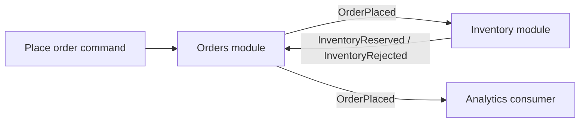

# Định nghĩa event contract

## Mục tiêu dự án

Trong Spring Modulith, application events là cách một module thông báo cho các module khác về điều đã xảy ra trong nghiệp vụ. Khi event chỉ được dùng trong cùng ứng dụng, publisher và listener có thể cùng được triển khai trong một codebase. Khi event được externalize tới Kafka, RabbitMQ hoặc hệ thống khác, payload trở thành một hợp đồng tích hợp cần được thiết kế, version hóa và duy trì tương thích.

Dự án thực hành này xây dựng một **event contract** cho luồng đặt hàng. Bạn sẽ xác định producer, consumer, ngữ nghĩa event, payload, metadata, version, quy tắc tương thích và cách kiểm thử hợp đồng. Kết quả là một contract đủ rõ để module khác hoặc ứng dụng bên ngoài có thể tiêu thụ mà không cần biết implementation nội bộ của module Orders.

Sau khi hoàn thành, bạn có thể:

- Phân biệt domain event, application event và integration event.
- Xác định điều kiện nghiệp vụ và transaction boundary của event.
- Thiết kế tên, payload, metadata và version cho event contract.
- Tách mô hình nội bộ khỏi DTO được công bố ra bên ngoài.
- Định nghĩa quy tắc nullability, đơn vị, timestamp, identity và ordering.
- Đánh giá backward/forward compatibility và cách tiến hóa contract.
- Viết kiểm thử cho producer, serialization và consumer contract.

## 1. Bối cảnh bài toán

Hệ thống có các module chính:

- `orders`: tiếp nhận yêu cầu đặt hàng và sở hữu trạng thái đơn hàng.
- `inventory`: quản lý tồn kho và reservation.
- `payments`: quản lý giao dịch thanh toán.
- `shipping`: quản lý việc giao hàng.

Khi đơn hàng được tạo thành công, module Orders cần thông báo cho các module quan tâm. Event đầu tiên của dự án là `OrderPlaced`.



Trong phạm vi bài thực hành, hãy định nghĩa contract cho `OrderPlaced`. Các event kết quả như `InventoryReserved` có thể được thiết kế sau, nhưng cần giữ cùng nguyên tắc ownership và versioning.

### Kết quả nghiệp vụ mà event phải diễn đạt

`OrderPlaced` có nghĩa: **một đơn hàng đã được tạo hợp lệ và thay đổi trạng thái của đơn đã được commit**. Nó không có nghĩa là hàng đã được giữ, thanh toán đã thành công hoặc đơn đã được giao.

Định nghĩa ngữ nghĩa này ngăn consumer hiểu nhầm event tạo đơn thành tín hiệu hoàn tất toàn bộ quy trình.

## 2. Phân biệt các loại event

Các khái niệm gần nhau nhưng có mục đích khác nhau:

| Loại | Vai trò | Ví dụ |
| --- | --- | --- |
| Domain event | Mô tả một sự kiện có ý nghĩa trong mô hình domain. | `OrderPlaced` bên trong domain Orders. |
| Application event | Cơ chế/contract được dùng trong ứng dụng để thông báo giữa các thành phần hoặc module. | Record được phát bằng `ApplicationEventPublisher`. |
| Integration event | Contract ổn định được công bố qua ranh giới ứng dụng hoặc tới broker/hệ thống khác. | `OrderPlacedV1` với schema và metadata công khai. |
| Command | Yêu cầu một owner thực hiện hành động. | `PlaceOrder`, `ReserveInventory`. |

Một domain event có thể được chuyển thành integration event, nhưng không nhất thiết phải dùng cùng một class. Tách hai mô hình giúp thay đổi domain không tự động làm thay đổi hợp đồng với consumer bên ngoài.

Trong dự án này, module Orders phát application/domain event sau khi lưu đơn. Adapter hoặc publisher boundary chuyển dữ liệu cần công bố thành `OrderPlacedV1`. Integration event chỉ chứa dữ liệu consumer được phép dựa vào.

## 3. Xác định producer, consumer và ownership

Trước khi viết schema, lập bảng trách nhiệm:

| Vai trò | Thành phần | Trách nhiệm |
| --- | --- | --- |
| Producer owner | Module `orders` | Quyết định khi nào đơn hàng được xem là đã đặt và chịu trách nhiệm về contract. |
| Event contract owner | Team sở hữu Orders | Review semantics, payload, version và deprecation. |
| Consumer nội bộ | Module `inventory` | Đọc event để bắt đầu quy trình giữ hàng. |
| Consumer bên ngoài | Analytics service | Cập nhật dữ liệu phân tích đơn hàng. |
| Transport owner | Platform/integration layer | Quản lý broker, routing, serializer, authentication và delivery. |

Producer sở hữu ý nghĩa của event. Consumer có thể yêu cầu bổ sung dữ liệu, nhưng không nên tự diễn giải lại sự kiện hoặc buộc producer đưa toàn bộ aggregate nội bộ vào payload.

### Hợp đồng phải trả lời được

- Event biểu diễn điều gì đã xảy ra?
- Điều kiện nào khiến producer phát event?
- Event được phát ở transaction phase nào?
- Consumer có thể dựa vào field nào?
- Field nào bắt buộc, field nào optional?
- Timestamp là thời điểm nào và dùng timezone/format nào?
- Tiền, số lượng và đơn vị đo được biểu diễn ra sao?
- Consumer xử lý duplicate và event đến sai thứ tự thế nào?
- Ai phê duyệt breaking change và thời gian hỗ trợ version cũ là bao lâu?

Nếu chưa trả lời được các câu hỏi này, contract chưa đủ rõ để công bố.

## 4. Chọn tên event và định nghĩa semantics

Tên event nên mô tả fact đã xảy ra, thường dùng dạng quá khứ. Ví dụ:

- `OrderPlaced`: đơn hàng đã được tạo.
- `PaymentCaptured`: khoản thanh toán đã được capture.
- `InventoryReserved`: tồn kho đã được giữ.
- `ShipmentCreated`: shipment đã được tạo.

Tránh tên mang ý định như `PlaceOrder`, `ReserveInventory` hoặc `CancelOrder` nếu message thực chất là yêu cầu thực hiện hành động. Những tên này phù hợp với command hơn.

### Mô tả contract mẫu

| Thuộc tính | Định nghĩa |
| --- | --- |
| Event name | `OrderPlaced` |
| Business meaning | Đơn hàng đã được tạo hợp lệ và transaction tạo đơn đã commit. |
| Producer | Module `orders`. |
| Trigger | Use case `PlaceOrder` hoàn tất validation và lưu aggregate thành công. |
| Không có nghĩa là | Hàng đã giữ, thanh toán thành công hoặc giao hàng hoàn tất. |
| Cardinality | Một event cho mỗi lần chuyển đơn sang trạng thái `PLACED`. |
| Consumer chính | `inventory`; các consumer khác có thể subscribe độc lập. |

### Điều kiện phát event

Event chỉ được phát sau khi use case đã tạo ra transition nghiệp vụ hợp lệ. Không phát `OrderPlaced` khi validation thất bại, đơn chỉ mới nằm trong bộ nhớ hoặc transaction đã rollback.

Nếu producer dùng transaction, event có thể được publish trong transaction để Spring Modulith ghi nhận publication và listener được xử lý theo phase đã cấu hình. Với listener module sau commit hoặc externalization, cần mô tả rõ semantics thực tế và kiểm thử rollback/commit.

## 5. Thiết kế payload

Payload phải đủ để consumer thực hiện trách nhiệm của mình, đồng thời không làm lộ toàn bộ aggregate hoặc dữ liệu không cần thiết.

Một phiên bản đầu tiên có thể dùng các field sau:

| Field | Kiểu | Bắt buộc | Ý nghĩa |
| --- | --- | --- | --- |
| `eventId` | UUID | Có | Định danh duy nhất của event, dùng cho trace và idempotency. |
| `orderId` | UUID | Có | Định danh đơn hàng. |
| `aggregateVersion` | integer | Có | Version trạng thái đơn tại thời điểm phát. |
| `occurredAt` | timestamp | Có | Thời điểm nghiệp vụ chuyển sang `PLACED`. |
| `customerId` | UUID | Có nếu consumer được phép cần | Tham chiếu khách hàng, không chứa hồ sơ cá nhân. |
| `currency` | string | Có | Mã tiền tệ của tổng tiền. |
| `totalAmountMinor` | integer/int64 | Có | Tổng tiền theo đơn vị nhỏ nhất của currency. |
| `items` | array | Có | Các dòng hàng tối thiểu cần cho consumer. |
| `correlationId` | string/UUID | Có theo tracing policy | Liên kết event với workflow bắt đầu từ yêu cầu đặt hàng. |
| `causationId` | string/UUID | Không ở event gốc | Event/command trực tiếp gây ra event hiện tại nếu có. |

`totalAmountMinor` tránh dùng floating point cho tiền. Contract cần định nghĩa rõ quy tắc đơn vị của từng currency và giới hạn giá trị. Nếu dùng số nguyên 64-bit, schema và client phải hỗ trợ cùng miền giá trị.

### Payload Java minh họa

```java
public record OrderLineV1(
        String sku,
        int quantity,
        long unitPriceMinor) {}

public record OrderPlacedV1(
        UUID eventId,
        UUID orderId,
        long aggregateVersion,
        Instant occurredAt,
        UUID customerId,
        String currency,
        long totalAmountMinor,
        List<OrderLineV1> items,
        String correlationId,
        String causationId) {}
```

Đây là integration DTO, không phải entity hay aggregate. Có thể đổi cấu trúc domain nội bộ mà vẫn giữ DTO V1 ổn định bằng mapper.

### Quy tắc field

Với mỗi field, tài liệu contract cần quy định:

- Có bắt buộc hay không; nếu optional thì khi thiếu consumer xử lý thế nào.
- Có chấp nhận `null` hay chỉ cho phép bỏ field.
- Format chính xác, ví dụ UUID dạng chuẩn, timestamp ISO-8601 UTC.
- Đơn vị, precision, range và quy tắc rounding nếu liên quan.
- Field có thể thay đổi sau khi event được phát hay là snapshot bất biến.
- Phân loại dữ liệu và consumer nào được phép nhận.

Không dùng `null`, chuỗi rỗng và field bị thiếu như ba cách biểu diễn đồng nghĩa. Chọn một quy tắc và giữ ổn định qua các version.

## 6. Metadata và envelope

Metadata giúp định tuyến, truy vết và version hóa mà không làm lẫn dữ liệu nghiệp vụ với thông tin vận chuyển.

Một envelope JSON minh họa:

```json
{
  "eventType": "com.example.orders.order-placed",
  "schemaVersion": 1,
  "eventId": "5f7f8c1e-0d91-4c16-9ad2-48d0e7e17c51",
  "occurredAt": "2026-11-25T08:30:00Z",
  "producer": "orders",
  "correlationId": "a9e26c7b-0c0f-4e8e-bf70-90aeb8db57a1",
  "causationId": null,
  "payload": {
    "orderId": "b1b6f69b-72fd-4a14-9d7e-1d40e7a6f33a",
    "aggregateVersion": 1,
    "customerId": "9fce90b2-0c10-42d0-a5a9-6b91ef55cba1",
    "currency": "VND",
    "totalAmountMinor": 125000,
    "items": [
      { "sku": "SKU-100", "quantity": 2, "unitPriceMinor": 62500 }
    ]
  }
}
```

Đây là ví dụ format tự định nghĩa, không phải envelope mặc định của Spring Modulith hoặc Kafka. Nếu dùng broker headers để truyền event type/version/correlation, hãy ghi rõ field nào nằm trong header và field nào nằm trong payload. Không lặp metadata ở nhiều nơi mà không có quy tắc ưu tiên.

### Phân biệt timestamp

- `occurredAt`: thời điểm sự kiện nghiệp vụ thực sự xảy ra.
- `publishedAt`: thời điểm producer/adapter gửi message ra transport nếu cần đo delivery delay.
- `receivedAt`: thời điểm consumer nhận message, thường do consumer ghi nhận.

Không dùng thời điểm publish thay cho thời điểm nghiệp vụ nếu consumer cần sắp xếp hoặc phân tích thời gian xảy ra sự kiện.

## 7. Định nghĩa version và quy tắc tương thích

Contract cần có version rõ ràng ngay từ V1. Có thể biểu diễn version trong event type, envelope, schema registry subject hoặc topic; tổ chức phải chọn một nguồn version chuẩn.

Ví dụ:

```text
eventType: com.example.orders.order-placed
schemaVersion: 1
```

### Thay đổi thường tương thích

- Thêm field optional với default hoặc cách xử lý khi thiếu được định nghĩa.
- Thêm metadata mà consumer cũ bỏ qua được.
- Mở rộng enum nếu consumer có nhánh xử lý giá trị chưa biết.
- Thêm event type mới mà không đổi ý nghĩa event cũ.

### Thay đổi thường phá vỡ tương thích

- Xóa hoặc đổi tên field consumer đang dùng.
- Đổi kiểu dữ liệu không tương thích.
- Đổi đơn vị hoặc ý nghĩa nghiệp vụ của field.
- Đổi `occurredAt` từ thời điểm nghiệp vụ sang thời điểm publish.
- Đổi event từ snapshot đầy đủ sang delta mà không version hóa.
- Đổi routing/topic khiến consumer cũ không còn nhận message.

“Thêm field” chỉ tương thích nếu serializer/deserializer và consumer thực sự cho phép field không biết. Schema có `additionalProperties: false` hoặc client strict có thể từ chối payload mới.

### Chính sách version

| Thay đổi | Hướng xử lý |
| --- | --- |
| Thay đổi tương thích | Giữ version nếu policy cho phép và cập nhật schema theo quy tắc. |
| Thay đổi bắt buộc | Tạo V2 hoặc contract mới; có kế hoạch dual-read/migration. |
| Ngừng hỗ trợ V1 | Công bố deprecation, đo consumer còn dùng V1 và chờ hết replay window. |
| Replay lịch sử | Giữ parser/upcaster cho mọi version còn nằm trong retention hoặc archive. |

Không xóa V1 ngay khi producer ngừng phát. Consumer có thể cần đọc lại message cũ sau sự cố hoặc backfill.

## 8. Định nghĩa delivery và ordering

Contract nên nêu các giả định giao nhận mà consumer cần tuân theo:

- Message có thể được giao nhiều lần hay không?
- Consumer cần idempotency theo `eventId` hay business key nào?
- Thứ tự được đảm bảo trong phạm vi nào: toàn topic, partition hay aggregate?
- Có thể có event đến trễ hoặc out-of-order không?
- Consumer cần xử lý version gap thế nào?
- Retry, dead-letter và replay được thực hiện ra sao?

Không tuyên bố “exactly once” chung chung nếu chỉ có broker-level guarantee. Side effect database hoặc HTTP bên ngoài vẫn có thể bị lặp ở crash window.

Ví dụ policy cho `OrderPlacedV1`:

| Thuộc tính | Quy tắc |
| --- | --- |
| Delivery | Consumer phải chịu được at-least-once delivery. |
| Idempotency | Dùng `eventId` để deduplicate; business operation có unique constraint phù hợp. |
| Ordering | Event của cùng `orderId` được key theo aggregate ID nếu transport hỗ trợ partitioning. |
| Version | `aggregateVersion` tăng đơn điệu theo thay đổi của aggregate. |
| Out-of-order | Consumer kiểm tra version; không áp dụng delta khi còn gap. |
| Retry | Lỗi transient được retry theo policy; lỗi permanent đi tới quarantine/DLQ. |

Đây là policy minh họa. Hệ thống phải ghi chính xác behavior của broker/adapter đang triển khai.

## 9. Tách domain model và integration contract

Không công bố trực tiếp entity hoặc aggregate vì chúng thường chứa dữ liệu và quan hệ chỉ phù hợp với persistence/domain logic. Thay vào đó, map sang integration DTO có cấu trúc ổn định.

```java
public record OrderPlaced(
        UUID orderId,
        UUID customerId,
        long version,
        Instant placedAt,
        Money total,
        List<OrderItem> items) {}

public final class OrderIntegrationMapper {

    public OrderPlacedV1 toV1(OrderPlaced event, UUID eventId, String correlationId) {
        return new OrderPlacedV1(
                eventId,
                event.orderId(),
                event.version(),
                event.placedAt(),
                event.customerId(),
                event.total().currencyCode(),
                event.total().minorUnits(),
                event.items().stream()
                        .map(item -> new OrderLineV1(
                                item.sku(), item.quantity(), item.unitPrice().minorUnits()))
                        .toList(),
                correlationId,
                null);
    }
}
```

Ví dụ minh họa cần điều chỉnh theo domain type thực tế. Mapper là nơi xử lý chuyển đổi field, đơn vị và format; nếu thiếu thông tin để chuyển đổi đúng, mapper phải từ chối hoặc yêu cầu contract mới, không tự đặt giá trị mặc định không có căn cứ.

### Externalize event trong Spring Modulith

Spring Modulith hỗ trợ đánh dấu event cần externalize, ví dụ:

```java
@Externalized("orders")
public record OrderPlacedV1(
        UUID eventId,
        UUID orderId,
        long aggregateVersion,
        Instant occurredAt,
        String currency,
        long totalAmountMinor) {}
```

`@Externalized` thể hiện ý định đưa event ra integration transport theo cấu hình tương ứng. Destination thực tế, serializer, headers, authentication và routing cần được cấu hình/kiểm tra ở integration layer. Annotation không thay thế tài liệu contract.

Nếu application event nội bộ khác integration DTO, dùng publisher/adapter để chuyển đổi sau khi xác định transaction boundary. Giữ contract ngoài ổn định ngay cả khi domain event nội bộ đổi.

## 10. Tổ chức tài liệu contract

Một event contract nên có tài liệu chuẩn, được version hóa cùng source control hoặc schema registry.

Gợi ý cấu trúc:

```text
contracts/
  orders/
    order-placed/
      v1/
        schema.json
        contract.md
      examples/
        order-placed-v1.json
```

Tài liệu contract nên chứa:

1. Tên event, version và owner.
2. Business meaning và điều kiện phát.
3. Producer, consumer đã biết và phạm vi sử dụng.
4. Payload schema cùng mô tả field.
5. Metadata, timestamp, identity và correlation.
6. Delivery, idempotency, ordering, retry và replay assumptions.
7. Data classification, retention và security constraints.
8. Compatibility policy, deprecation và migration history.
9. Ví dụ payload hợp lệ và trường hợp không hợp lệ.
10. Liên kết tới test chứng minh contract.

Không để README, Java record, JSON Schema và catalog mô tả các semantics khác nhau. Chọn một nguồn chuẩn cho schema và liên kết từ các tài liệu còn lại.

## 11. Kiểm thử event contract

Contract test cần kiểm tra cả producer lẫn consumer. Mục tiêu là phát hiện payload thay đổi ngoài ý muốn trước khi triển khai.

### Producer test

Kiểm tra:

- Use case hợp lệ phát đúng event type/version.
- Payload có đủ field bắt buộc và đúng semantics.
- Event chỉ được phát khi transaction commit theo policy.
- Transaction rollback không để consumer nhận một event nghiệp vụ chưa xảy ra.
- Mapper không đưa entity field hoặc dữ liệu nhạy cảm không được phép vào contract.

### Serialization test

Serialize DTO thành wire format rồi deserialize lại bằng serializer/deserializer mà consumer sử dụng. Xác minh UUID, timestamp, enum, số tiền, nullability và field optional không bị thay đổi.

Ví dụ kiểm tra JSON round-trip (API mapper tùy thư viện đang dùng):

```java
@Test
void serializesOrderPlacedContract() throws Exception {
    OrderPlacedV1 event = sampleOrderPlacedV1();

    String json = objectMapper.writeValueAsString(event);
    OrderPlacedV1 restored = objectMapper.readValue(json, OrderPlacedV1.class);

    assertThat(restored).isEqualTo(event);
}
```

Round-trip chỉ kiểm tra cùng model. Để chứng minh tương thích, cần test payload fixture đã phát hành và consumer version cần hỗ trợ.

### Consumer contract test

Consumer test với payload V1 thực tế, kiểm tra:

- Deserialize thành công.
- Field bắt buộc được validate.
- Unknown optional field được xử lý theo policy.
- Event cũ được upcast/map đúng nếu cần.
- Duplicate và out-of-order không tạo side effect sai.
- Event không hợp lệ đi tới failure route đã định nghĩa.

### Compatibility test

Nếu dùng Schema Registry, chạy compatibility check theo mode được tổ chức chọn. Dù registry báo compatible, vẫn cần semantic test cho đơn vị, timezone, enum và business meaning.

## 12. Các bước thực hiện dự án

Thực hiện theo trình tự sau:

### Bước 1 — Chọn sự kiện nghiệp vụ

Chọn `OrderPlaced` và viết một câu mô tả sự kiện đã xảy ra. Xác định rõ event không đại diện cho việc giữ hàng, thanh toán hay giao hàng thành công.

### Bước 2 — Xác định owner và consumer

Ghi module Orders là producer owner. Liệt kê Inventory và analytics là consumer dự kiến; đánh dấu consumer nào đã được xác minh trong implementation/test.

### Bước 3 — Xác định trigger và transaction

Mô tả use case `PlaceOrder`, validation, persistence và thời điểm event được công bố. Xác định behavior khi transaction rollback.

### Bước 4 — Thiết kế payload V1

Định nghĩa event ID, order ID, aggregate version, occurredAt, currency, total amount và items. Với từng field, ghi type, required/optional, nullability, format, unit và sensitivity.

### Bước 5 — Thiết kế envelope/metadata

Chọn nơi đặt event type, schema version, producer, correlation ID và causation ID. Quy định nguồn version chuẩn và không để header/payload mâu thuẫn.

### Bước 6 — Định nghĩa delivery assumptions

Ghi delivery semantics, idempotency key, ordering scope, retry, DLQ và replay. Không hứa exactly-once nếu chưa chứng minh được end-to-end.

### Bước 7 — Tách integration DTO

Tạo mapper từ domain/application event sang `OrderPlacedV1`. Không expose entity hoặc aggregate trực tiếp.

### Bước 8 — Viết contract fixture

Lưu ít nhất một payload hợp lệ và một số payload biên: thiếu optional field, enum chưa biết, số tiền lớn, timestamp UTC và payload không hợp lệ.

### Bước 9 — Viết test

Kiểm tra producer trigger, commit/rollback, serialization, consumer compatibility và idempotency. Thêm broker integration test khi cần xác minh transport behavior.

### Bước 10 — Review và công bố

Review với producer owner, consumer owner và platform owner. Chốt version, schema reference, deprecation policy và cách thông báo thay đổi trước khi cho consumer sử dụng.

## 13. Checklist nghiệm thu

Một event contract được xem là sẵn sàng review khi đáp ứng các mục sau:

- [ ] Tên event mô tả một fact đã xảy ra.
- [ ] Business meaning và điều kiện phát không mơ hồ.
- [ ] Producer owner và consumer đã biết được ghi nhận.
- [ ] Transaction boundary và publish phase được mô tả.
- [ ] Payload không expose entity hoặc dữ liệu không cần thiết.
- [ ] Mọi field có type, required/optional, nullability và semantics.
- [ ] Tiền, timestamp, timezone và đơn vị đo có quy tắc rõ.
- [ ] Event ID, aggregate version và correlation metadata được định nghĩa.
- [ ] Event type/schema version có nguồn chuẩn.
- [ ] Delivery, idempotency, ordering, retry và replay assumptions được ghi.
- [ ] Data classification và security requirements được xác định.
- [ ] Có payload fixture và serialization/consumer tests.
- [ ] Có compatibility/deprecation policy cho thay đổi tương lai.
- [ ] Producer, consumer và platform owner đã review contract.

## 14. Những sai lầm cần tránh

| Sai lầm | Rủi ro | Cách khắc phục |
| --- | --- | --- |
| Dùng tên command cho event | Consumer không biết hành động đã xảy ra hay mới được yêu cầu. | Dùng tên quá khứ và mô tả fact. |
| Expose entity/aggregate | Contract thay đổi theo persistence/domain implementation. | Dùng integration DTO và mapper. |
| Field không có đơn vị | Consumer tính sai tiền, thời gian hoặc số lượng. | Ghi unit, currency, timezone và precision. |
| Thiếu event ID | Khó deduplicate và truy vết. | Cấp identity ổn định cho mỗi event. |
| Không có aggregate version | Khó phát hiện event cũ/gap. | Thêm sequence/version khi thứ tự có ý nghĩa. |
| Ghi “exactly once” chung chung | Che giấu duplicate ở crash window và side effect ngoài broker. | Mô tả semantics thực tế và idempotency. |
| Đổi semantics mà không tăng version | Consumer deserialize được nhưng xử lý sai. | Đánh giá breaking change và version hóa. |
| Không có consumer inventory | Bỏ sót hệ thống đang dùng contract. | Ghi owner và consumer đã xác minh. |
| Để nhiều tài liệu làm nguồn chuẩn | Schema và mô tả bị lệch nhau. | Chọn canonical schema và liên kết từ catalog. |

## 15. Kết quả cần bàn giao

Sau dự án, nhóm phát triển nên có:

1. Một mô tả nghiệp vụ cho `OrderPlaced`.
2. Bảng producer/consumer và ownership.
3. Event contract V1 với payload schema và metadata.
4. Một payload JSON mẫu hợp lệ.
5. Quy tắc transaction, delivery, idempotency và ordering.
6. Chính sách compatibility/versioning/deprecation.
7. Mapper từ domain/application event sang integration DTO.
8. Producer, serialization và consumer contract tests.
9. Tài liệu review/approval và liên kết tới contract source of truth.

Event contract là thỏa thuận giữa producer và consumer về ý nghĩa, dữ liệu và cách xử lý một sự kiện. Khi contract mô tả đúng fact nghiệp vụ, có owner, payload tối thiểu, metadata/version rõ ràng và test tương thích, các module Spring Modulith có thể phát triển độc lập mà vẫn giao tiếp ổn định qua application events.
