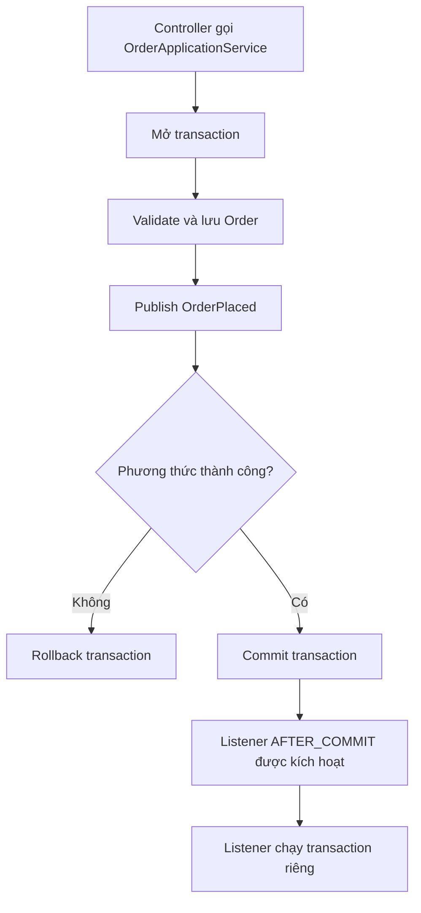
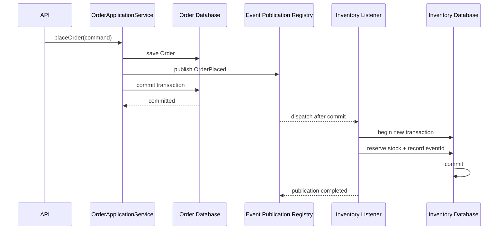

# Thêm transaction boundary

Một application event thường được publish trong lúc module đang thay đổi dữ liệu nghiệp vụ. Nếu không xác định rõ transaction boundary, listener có thể phản ứng với dữ liệu chưa commit, hoặc một side effect bên ngoài vẫn xảy ra dù transaction nguồn đã rollback. Trong dự án thực hành này, ta thêm transaction boundary quanh thao tác tạo đơn hàng và publish event trong cùng transaction; listener chỉ bắt đầu sau commit và xử lý trong transaction riêng.

Phạm vi thuộc module `SPRING_MODULITH_APPLICATION_EVENTS`: tổ chức giao tiếp giữa các module Spring Modulith bằng application events để giảm phụ thuộc và bảo vệ ranh giới nghiệp vụ. Bài tập kết hợp publisher, listener, xử lý sau commit, Event Publication Registry và kiểm thử commit/rollback. Mục tiêu là tạo luồng có ranh giới nhất quán: thay đổi nghiệp vụ và việc ghi nhận publication cùng thuộc transaction nguồn; side effect của listener có transaction riêng sau khi dữ liệu nguồn đã commit.

## Kết quả cần đạt

Sau khi hoàn thành, bạn sẽ có:

- Một application service mở transaction cho thao tác nghiệp vụ.
- Một application event bất biến được publish trong transaction đó.
- Một listener dùng `@ApplicationModuleListener` để xử lý sau commit.
- Một transaction riêng cho phần ghi dữ liệu của listener.
- Kiểm thử chứng minh commit kích hoạt listener và rollback không kích hoạt listener.
- Cách quan sát publication incomplete và phục hồi listener khi có lỗi.

## 1. Bài toán trước khi thêm transaction boundary

Giả sử module `orders` tạo đơn hàng rồi publish `OrderPlaced`. Module `inventory` lắng nghe event để giữ chỗ hàng. Luồng nghiệp vụ cần bảo đảm rằng kho chỉ xử lý một đơn hàng đã được lưu thành công.

Một implementation thiếu transaction boundary có thể trông như sau:

```java
public OrderId placeOrder(CreateOrderCommand command) {
    Order order = orders.save(Order.create(command));
    events.publishEvent(new OrderPlaced(order.id(), order.sku(), order.quantity()));
    return order.id();
}
```

Nếu `orders.save(...)` tự mở transaction rồi commit khi repository method kết thúc, event có thể được publish sau một transaction lưu đơn hàng riêng. Nếu bước nghiệp vụ tiếp theo thất bại, dữ liệu đơn hàng và event có thể không còn nằm trong cùng một đơn vị nguyên tử. Một listener đồng bộ cũng có thể chạy trong khi producer chưa hoàn tất các thay đổi cần thiết.

Một lỗi nghiêm trọng hơn xảy ra khi producer gọi hệ thống ngoài trực tiếp trước khi transaction commit: hệ thống ngoài đã giữ hàng hoặc gửi thông báo, nhưng transaction tạo đơn hàng lại rollback. Database nguồn không có đơn hàng trong khi side effect bên ngoài vẫn tồn tại.

Ta sẽ đặt transaction boundary tại application service để việc lưu đơn hàng và publish event thuộc cùng một transaction. Listener sẽ xử lý sau commit để chỉ phản ứng với dữ liệu đã được xác nhận.

## 2. Xác định transaction boundary

Transaction boundary nên bao quanh một thao tác nghiệp vụ hoàn chỉnh mà module sở hữu. Trong ví dụ này, `OrderApplicationService.placeOrder` chịu trách nhiệm:

1. Kiểm tra lệnh tạo đơn hàng.
2. Tạo và lưu aggregate `Order`.
3. Publish event `OrderPlaced` mô tả sự thật nghiệp vụ.
4. Commit transaction khi phương thức kết thúc thành công.

Nếu bất kỳ bước nào ném runtime exception trước commit, transaction rollback và event publication gắn với transaction đó không được xử lý như một sự kiện đã commit.



`@Transactional` của Spring hoạt động qua proxy. Lời gọi phải đi qua Spring bean được quản lý; gọi một method transactional từ method khác trong cùng instance (self-invocation) thường không đi qua proxy và có thể không mở transaction như mong đợi. Đặt annotation trên public application-service method được gọi từ bean khác hoặc từ controller.

## 3. Tạo event bất biến

Event nên mô tả sự thật đã xảy ra và mang định danh đủ để listener thực hiện công việc. Không đưa JPA entity hoặc aggregate đang được quản lý vào event; listener nhận một snapshot bất biến gồm các giá trị cần thiết.

```java
package com.example.shop.orders;

import java.math.BigDecimal;
import java.util.UUID;

public record OrderPlaced(
    UUID eventId,
    UUID orderId,
    String sku,
    int quantity,
    BigDecimal total
) {}
```

`eventId` giúp truy vết và deduplicate khi có retry hoặc redelivery. `orderId` liên kết event với aggregate. Các trường `sku`, `quantity` và `total` là dữ liệu minh họa; chỉ đưa những trường listener thực sự cần vào contract. Nếu event được externalize, cần xem đây là integration contract và quản lý schema version, quyền công bố dữ liệu cùng compatibility riêng.

## 4. Thêm transaction boundary vào application service

Đặt `@Transactional` trên phương thức nghiệp vụ lưu aggregate và publish event. Repository và `ApplicationEventPublisher` được inject qua constructor.

```java
package com.example.shop.orders;

import java.util.UUID;

import org.springframework.context.ApplicationEventPublisher;
import org.springframework.stereotype.Service;
import org.springframework.transaction.annotation.Transactional;

@Service
public class OrderApplicationService {

    private final OrderRepository orders;
    private final ApplicationEventPublisher events;

    public OrderApplicationService(
            OrderRepository orders,
            ApplicationEventPublisher events) {
        this.orders = orders;
        this.events = events;
    }

    @Transactional
    public UUID placeOrder(CreateOrderCommand command) {
        Order order = Order.create(command);
        orders.save(order);

        events.publishEvent(new OrderPlaced(
            UUID.randomUUID(),
            order.id(),
            order.sku(),
            order.quantity(),
            order.total()
        ));

        return order.id();
    }
}
```

Trong ví dụ, `OrderRepository`, `Order`, `CreateOrderCommand` là kiểu của ứng dụng. Điểm quan trọng là `orders.save(...)` và `events.publishEvent(...)` được gọi bên trong cùng phương thức transactional. Khi phương thức trả về bình thường, Spring commit transaction; khi có lỗi phù hợp chính sách rollback, Spring rollback.

Mặc định, Spring rollback transaction khi có `RuntimeException` hoặc `Error`. Nếu phương thức ném checked exception và nghiệp vụ yêu cầu rollback, khai báo rõ `rollbackFor`, ví dụ `@Transactional(rollbackFor = BusinessCheckedException.class)`. Không giả định mọi exception đều tự động kích hoạt rollback.

Không publish event trước khi các điều kiện nghiệp vụ cần thiết được xác nhận. Event phải phản ánh dữ liệu cuối cùng của transaction nguồn. Nếu cần event chứa giá trị sau khi database sinh ID hoặc cập nhật field, hãy tạo event sau khi đã có giá trị đó nhưng vẫn trước commit.

## 5. Cấu hình listener chạy sau commit

`@ApplicationModuleListener` kết hợp `@Async`, vì vậy ứng dụng cần bật async processing bằng `@EnableAsync` nếu cấu hình hiện tại chưa bật:

```java
import org.springframework.context.annotation.Configuration;
import org.springframework.scheduling.annotation.EnableAsync;

@Configuration
@EnableAsync
class AsyncConfiguration {}
```

Có thể đặt `@EnableAsync` trên application configuration hiện có thay vì tạo class riêng. Module nhận event dùng `@ApplicationModuleListener`:

```java
package com.example.shop.inventory;

import com.example.shop.orders.OrderPlaced;
import org.springframework.modulith.events.ApplicationModuleListener;
import org.springframework.stereotype.Component;

@Component
public class OrderPlacedListener {

    private final InventoryReservationService reservations;

    public OrderPlacedListener(InventoryReservationService reservations) {
        this.reservations = reservations;
    }

    @ApplicationModuleListener
    public void on(OrderPlaced event) {
        reservations.reserve(
            event.eventId(),
            event.orderId(),
            event.sku(),
            event.quantity()
        );
    }
}
```

`@ApplicationModuleListener` của Spring Modulith kết hợp xử lý bất đồng bộ với transaction-bound event listener ở phase `AFTER_COMMIT` và transaction mới cho listener (`REQUIRES_NEW`). Vì vậy:

- Listener chỉ được kích hoạt sau khi transaction phát event commit thành công.
- Listener chạy trên luồng xử lý bất đồng bộ, không giữ request thread của producer chờ công việc hoàn tất.
- Phần ghi dữ liệu của listener có transaction riêng; lỗi listener không thể rollback transaction tạo đơn hàng đã commit.

Annotation này thường đã cung cấp transaction boundary cho listener. Không cần thêm `@Transactional` chỉ để lặp lại cùng propagation nếu không có yêu cầu riêng. Nếu dùng `@TransactionalEventListener` thay thế, nhớ rằng phase mặc định là `AFTER_COMMIT`, nhưng listener không tự động có async behavior và transaction mới như `@ApplicationModuleListener`; khi listener cần ghi database, cân nhắc transaction mới một cách tường minh.

Nếu event được publish khi không có transaction đang hoạt động, listener transaction-bound mặc định có thể không được gọi. Không bật `fallbackExecution` chỉ để làm test pass nếu nghiệp vụ yêu cầu event phải gắn với commit. Hãy bảo đảm producer thực sự chạy trong transaction.

## 6. Vì sao không gọi listener trực tiếp?

Producer không nên gọi `InventoryReservationService` trực tiếp. Nếu làm vậy, module orders sẽ phụ thuộc vào module inventory và phải biết cách inventory thực hiện reservation. Application event cho phép producer công bố sự thật `OrderPlaced`; module inventory tự quyết định phản ứng.

Transaction boundary cũng phân tách hai đơn vị công việc:

| Giai đoạn | Transaction | Trách nhiệm |
|---|---|---|
| Producer | Transaction nguồn | Lưu đơn hàng và phát event |
| Listener | Transaction mới sau commit | Giữ chỗ tồn kho và lưu kết quả |
| Recovery | Transaction của lần chạy lại | Thử xử lý publication chưa hoàn tất |

Không có một transaction database duy nhất bao trùm cả producer và listener bất đồng bộ. Nếu producer commit thành công nhưng listener lỗi, đơn hàng vẫn tồn tại; hệ thống cần retry/recovery hoặc quy trình bù trừ. Đây là semantics cần được thiết kế và kiểm thử, không phải lỗi của transaction boundary.

## 7. Quan sát Event Publication Registry

Spring Modulith Event Publication Registry theo dõi publication tới listener. Khi registry persistence được cấu hình, publication record có thể được ghi cùng transaction nguồn và được đánh dấu hoàn tất khi listener xử lý thành công. Nếu transaction nguồn rollback, publication record tham gia transaction đó cũng rollback theo cơ chế persistence tương ứng.

Khi listener thất bại sau commit, transaction listener rollback và publication có thể vẫn ở trạng thái incomplete để được phục hồi. `IncompleteEventPublications` cung cấp API tìm và resubmit publication chưa hoàn tất theo chính sách ứng dụng.

Phân biệt ba trạng thái:

- Producer transaction đã commit: đơn hàng nguồn đã được lưu.
- Publication đã hoàn tất: listener tương ứng đã hoàn thành theo semantics registry.
- Nghiệp vụ đầu cuối đã hoàn tất: mọi bước cần thiết ở các module/hệ thống khác đã đạt kết quả mong muốn.

Ba trạng thái không đồng nghĩa. Registry không tự chứng minh toàn bộ workflow hoàn tất. Nếu có nhiều listener, mỗi publication có thể có trạng thái riêng. Nếu externalize qua broker, broker acknowledgement cũng không chứng minh consumer bên ngoài đã áp dụng nghiệp vụ.

## 8. Làm listener idempotent

Listener có thể được gọi lại khi publication được resubmit hoặc khi hạ tầng giao message theo semantics at-least-once. Vì vậy, thao tác reservation cần nhận `eventId` hoặc một business idempotency key và bảo đảm một event không tạo nhiều reservation.

Một cách triển khai là lưu event ID đã xử lý trong cùng transaction với side effect:

```java
import java.util.UUID;

import org.springframework.stereotype.Service;
import org.springframework.transaction.annotation.Transactional;

@Service
public class InventoryReservationService {

    private final ProcessedEventRepository processedEvents;
    private final InventoryRepository inventory;

    public InventoryReservationService(
            ProcessedEventRepository processedEvents,
            InventoryRepository inventory) {
        this.processedEvents = processedEvents;
        this.inventory = inventory;
    }

    @Transactional
    public void reserve(
            UUID eventId,
            UUID orderId,
            String sku,
            int quantity) {
        if (processedEvents.existsById(eventId)) {
            return;
        }

        inventory.reserve(orderId, sku, quantity);
        processedEvents.save(new ProcessedEvent(eventId));
    }
}
```

Đoạn code minh họa cần được củng cố bằng unique constraint trên `processed_event.event_id` để chống hai lần xử lý đồng thời. Việc kiểm tra `existsById` đơn lẻ không đủ chống race giữa hai worker. Ghi dấu deduplication và cập nhật tồn kho phải nằm trong cùng transaction; nếu transaction rollback, cả hai thay đổi cùng rollback.

Nếu side effect là gọi API ngoài, transaction database không thể rollback thao tác đã xảy ra ở hệ thống khác. Dùng idempotency key mà hệ thống ngoài hỗ trợ, outbox/command record hoặc quy trình compensation phù hợp. Không giữ transaction database mở trong thời gian dài chỉ để chờ network.

## 9. Thực hành: kiểm tra đường commit

Chuẩn bị dữ liệu tồn kho cho `SKU-42`, sau đó gọi `OrderApplicationService.placeOrder`. Khi transaction producer commit, listener được kích hoạt và reservation xuất hiện.

Test minh họa:

```java
package com.example.shop.inventory;

import java.time.Duration;

import com.example.shop.orders.CreateOrderCommand;
import com.example.shop.orders.OrderApplicationService;
import org.junit.jupiter.api.Test;
import org.springframework.beans.factory.annotation.Autowired;
import org.springframework.modulith.test.ApplicationModuleTest;

import static org.assertj.core.api.Assertions.assertThat;
import static org.awaitility.Awaitility.await;

@ApplicationModuleTest
class OrderTransactionBoundaryTests {

    @Autowired
    OrderApplicationService orders;

    @Autowired
    InventoryReservationRepository reservations;

    @Test
    void reservesInventoryAfterOrderTransactionCommits() {
        var orderId = orders.placeOrder(
            new CreateOrderCommand("SKU-42", 2)
        );

        await().atMost(Duration.ofSeconds(5)).untilAsserted(() ->
            assertThat(reservations.findByOrderId(orderId)).isPresent()
        );
    }
}
```

Test dùng Awaitility để chờ listener bất đồng bộ. Không dùng `Thread.sleep(1000)` vì thời gian xử lý có thể thay đổi theo máy và tải. Assertion kiểm tra side effect của listener, không chỉ kiểm tra producer trả về order ID.

Test được đặt trong package của module `inventory`, nơi sở hữu listener. Vì `inventory` phụ thuộc vào event contract của `orders`, bootstrap mode `DIRECT_DEPENDENCIES` có thể đưa producer module vào context. Đặt test ở module producer `orders` có thể không bootstrap module `inventory` vì dependency thường đi theo chiều consumer tới producer, không phải chiều ngược lại.

## 10. Thực hành: kiểm tra đường rollback

Bây giờ kiểm tra trường hợp transaction nguồn rollback sau khi event đã được publish. Có thể dùng `TransactionTemplate` để kiểm soát transaction trong test:

```java
package com.example.shop.inventory;

import java.util.UUID;

import com.example.shop.orders.Order;
import com.example.shop.orders.OrderPlaced;
import com.example.shop.orders.OrderRepository;
import org.junit.jupiter.api.Test;
import org.springframework.beans.factory.annotation.Autowired;
import org.springframework.context.ApplicationEventPublisher;
import org.springframework.modulith.test.ApplicationModuleTest;
import org.springframework.transaction.support.TransactionTemplate;

import static org.assertj.core.api.Assertions.assertThat;

@ApplicationModuleTest
class OrderRollbackPublicationTests {

    @Autowired TransactionTemplate transactions;
    @Autowired OrderRepository orders;
    @Autowired ApplicationEventPublisher events;
    @Autowired InventoryReservationRepository reservations;

    @Test
    void doesNotReserveInventoryWhenProducerTransactionRollsBack() {
        UUID orderId = UUID.randomUUID();

        transactions.executeWithoutResult(status -> {
            Order order = Order.createForTest(orderId, "SKU-42", 2);
            orders.save(order);

            events.publishEvent(new OrderPlaced(
                UUID.randomUUID(), orderId, "SKU-42", 2, order.total()
            ));

            status.setRollbackOnly();
        });

        assertThat(orders.findById(orderId)).isEmpty();
        assertThat(reservations.findByOrderId(orderId)).isEmpty();
    }
}
```

Các phương thức fixture và repository là ví dụ theo ứng dụng. Test cần chạy với transaction manager thật của module và không được bọc thêm một transaction test bên ngoài khiến thời điểm commit/rollback trở nên mơ hồ. Khi transaction template rollback, listener `AFTER_COMMIT` không được kích hoạt cho event đó.

Nếu test listener bất đồng bộ, có thể bổ sung một spy/counter trong test configuration để chứng minh listener không được gọi. Không chỉ kiểm tra ngay một repository sau rollback nếu test setup có một đường publish khác ngoài transaction vừa rollback.

## 11. Lỗi trong listener không rollback producer

Giả sử transaction tạo đơn hàng đã commit, nhưng `InventoryReservationService.reserve` ném exception vì database kho tạm thời không khả dụng. Kết quả đúng là:

- Đơn hàng vẫn tồn tại vì transaction nguồn đã commit.
- Transaction listener rollback, không để lại reservation dở dang.
- Publication tới listener chưa được đánh dấu hoàn tất nếu exception được truyền ra theo semantics registry.
- Recovery có thể resubmit publication sau khi dependency phục hồi.

Không bắt exception rồi bỏ qua nếu muốn registry biết listener thất bại:

```java
@ApplicationModuleListener
public void on(OrderPlaced event) {
    reservations.reserve(
        event.eventId(),
        event.orderId(),
        event.sku(),
        event.quantity()
    );
}
```

Nếu listener bắt exception và trả về bình thường, framework có thể xem listener đã hoàn tất. Chỉ bắt exception khi đã chuyển lỗi sang một cơ chế xử lý cuối có chủ đích, chẳng hạn ghi trạng thái rejected/quarantined và phát cảnh báo. Nếu cần retry publication, để exception truyền ra theo chính sách retry/recovery đã cấu hình.

## 12. Phục hồi publication chưa hoàn tất

Khi sử dụng Event Publication Registry có persistence, ứng dụng có thể tìm publication incomplete bằng `IncompleteEventPublications` và resubmit theo một quy trình vận hành. API cụ thể có thể khác giữa các phiên bản Spring Modulith; dùng method được phiên bản dự án cung cấp và giới hạn phạm vi resubmit theo event type, listener, tuổi publication hoặc incident.

Trước khi resubmit:

1. Xác định nguyên nhân listener thất bại.
2. Xác nhận dependency đã phục hồi hoặc lỗi dữ liệu đã được sửa.
3. Kiểm tra listener idempotent và có unique constraint phù hợp.
4. Xác định số publication và tốc độ resubmit để không tạo burst.
5. Ghi nhận migration/incident reference và kết quả xử lý.

Không resubmit toàn bộ incomplete publication liên tục theo một lịch quá ngắn. Retry storm có thể làm database hoặc dịch vụ phụ thuộc quá tải. Dùng retry budget, backoff, giới hạn concurrency và cảnh báo cho publication quá tuổi.

## 13. Kiểm tra transaction boundary trong ứng dụng

Sau khi triển khai, xác minh các điểm sau:

- `OrderApplicationService.placeOrder` được gọi qua Spring proxy.
- Repository và event publisher tham gia cùng transaction manager phù hợp.
- Event chỉ được publish sau khi các dữ liệu cần thiết đã được tạo.
- `@ApplicationModuleListener` nhận event sau commit.
- Listener ghi dữ liệu trong transaction riêng.
- Rollback producer không tạo side effect listener.
- Listener failure không làm mất đơn hàng đã commit và có thể được quan sát/phục hồi.
- Listener idempotent để xử lý resubmit hoặc delivery trùng.

Nếu ứng dụng có nhiều datasource hoặc transaction manager, cần chỉ rõ transaction manager cho producer, repository và listener. Một transaction chỉ bảo đảm atomicity trong phạm vi tài nguyên mà transaction manager điều phối; không giả định hai datasource hoặc broker tự động nằm trong cùng một local transaction.

## 14. Những lỗi thường gặp

| Lỗi | Hệ quả | Cách khắc phục |
|---|---|---|
| Chỉ dựa vào transaction của repository | Lưu entity và publish event có thể thuộc hai transaction khác nhau | Đặt `@Transactional` ở application service |
| Publish rồi gọi API ngoài trước commit | Side effect tồn tại dù transaction rollback | Xử lý sau commit qua listener hoặc outbox |
| Dùng `@EventListener` cho side effect cần sau commit | Listener có thể chạy trước khi transaction nguồn commit | Dùng `@ApplicationModuleListener` hoặc `@TransactionalEventListener` đúng phase |
| Gọi transactional method qua self-invocation | Proxy không áp dụng transaction như mong đợi | Gọi qua Spring bean/proxy |
| Nghĩ listener lỗi sẽ rollback producer | Đơn hàng đã commit nhưng listener có thể thất bại riêng | Thiết kế retry, recovery và compensation |
| Listener không idempotent | Resubmit tạo side effect trùng | Deduplication bền vững và unique constraint |
| Bắt exception rồi bỏ qua | Registry có thể đánh dấu publication hoàn tất | Truyền lỗi hoặc lưu trạng thái cuối có chủ đích |
| Test method tự mở transaction rồi rollback | `AFTER_COMMIT` không chạy trong lúc test mong đợi | Điều khiển transaction commit/rollback tường minh |
| Giữ transaction mở khi gọi network | Lock và connection bị giữ lâu | Tách external I/O khỏi transaction database |

## 15. Tiêu chí hoàn thành dự án

| Hạng mục | Bằng chứng hoàn thành |
|---|---|
| Transaction producer | Lưu Order và publish event trong một `@Transactional` method |
| Event contract | Event bất biến, có event ID và aggregate ID |
| Listener boundary | Listener dùng `@ApplicationModuleListener` và chạy sau commit |
| Commit path | Order commit thì reservation được tạo bất đồng bộ |
| Rollback path | Producer rollback thì không có reservation |
| Listener failure | Transaction listener rollback độc lập, producer vẫn được commit |
| Recovery | Publication incomplete có thể được điều tra và resubmit theo policy |
| Idempotency | Resubmit cùng event không tạo reservation trùng |
| Observability | Có log/metric cho publication, listener duration, failure và backlog |

## 16. Sơ đồ luồng cuối cùng



`Event Publication Registry` trong sơ đồ biểu diễn cơ chế theo dõi publication; chi tiết dispatch phụ thuộc cấu hình listener và phiên bản Spring Modulith. Nếu dùng registry in-memory thay vì persistence, khả năng phục hồi sau process restart sẽ khác. Với production cần recovery bền vững, cấu hình implementation persistence phù hợp và kiểm tra transaction manager/database tương ứng.

## Tài liệu tham khảo

- [Spring Modulith — Working with Application Events](https://docs.spring.io/spring-modulith/reference/events.html)
- [Spring Modulith — Application Module Listener](https://docs.spring.io/spring-modulith/reference/events.html#_application_module_listener)
- [Spring Framework — Transaction-bound Events](https://docs.spring.io/spring-framework/reference/data-access/transaction/event.html)
- [Spring Framework — Declarative Transaction Management](https://docs.spring.io/spring-framework/reference/data-access/transaction/declarative.html)
