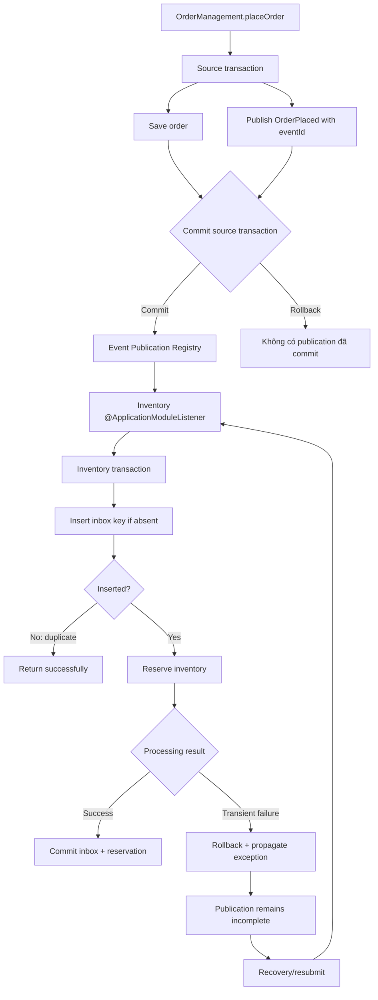

# Thêm retry và idempotency

Trong bài thực hành này, ta hoàn thiện luồng `OrderPlaced` để module inventory có thể xử lý lại khi gặp lỗi tạm thời mà không giữ hàng hai lần. Mục tiêu là kết hợp retry có kiểm soát với idempotency ở nơi lưu trạng thái nghiệp vụ. Hai cơ chế giải quyết hai vấn đề khác nhau: retry tăng khả năng hoàn tất công việc, còn idempotency bảo vệ hệ thống khi cùng một event được giao hoặc xử lý nhiều lần.

Ta sử dụng Spring Modulith application events và `@ApplicationModuleListener`. Khi listener thất bại, exception phải được truyền ra để publication chưa bị đánh dấu hoàn tất. Event Publication Registry có thể giữ publication chưa hoàn tất và cho phép phục hồi. Khi listener chạy lại, inbox/deduplication bảo đảm tác dụng phụ trong database không bị áp dụng lặp.

## 1. Mục tiêu và kiến trúc bài thực hành

Luồng nghiệp vụ cần hoàn thiện:

1. Module `orders` tạo đơn hàng trong transaction.
2. Module `orders` phát event `OrderPlaced` với `eventId` ổn định.
3. Sau khi transaction nguồn commit, listener của module `inventory` nhận event.
4. Listener ghi nhận `eventId` vào bảng inbox và giữ hàng trong cùng transaction.
5. Nếu dependency gặp lỗi tạm thời, transaction listener rollback và exception được truyền ra.
6. Publication còn incomplete và có thể được resubmit theo chính sách recovery.
7. Khi cùng event được gửi lại, inbox nhận ra duplicate và bỏ qua tác dụng phụ đã commit.



Sau bài này, một event có thể được giao lại mà không làm tăng số reservation đã tạo cho cùng một event. Lỗi tạm thời vẫn có cơ hội được xử lý lại, còn lỗi dữ liệu hoặc lỗi nghiệp vụ vĩnh viễn cần được phân loại để không retry vô hạn.

## 2. Chuẩn bị event có định danh ổn định

Idempotency cần một khóa ổn định để nhận diện cùng một thao tác logic. Dùng `eventId` được tạo khi event hình thành và giữ nguyên qua mọi lần retry.

```java
package com.acme.shop.orders;

import java.time.Instant;
import java.util.UUID;

public record OrderPlaced(
        UUID eventId,
        UUID orderId,
        long aggregateVersion,
        Instant occurredAt) {
}
```

Module nguồn tạo event trong transaction nghiệp vụ:

```java
@Service
class OrderManagementImpl implements OrderManagement {

    private final OrderRepository orders;
    private final ApplicationEventPublisher events;

    @Transactional
    public UUID placeOrder(PlaceOrder command) {
        Order order = orders.save(Order.create(command));

        OrderPlaced event = new OrderPlaced(
                UUID.randomUUID(),
                order.getId(),
                order.getVersion(),
                Instant.now());

        events.publishEvent(event);
        return order.getId();
    }
}
```

Ví dụ giả định `OrderManagementImpl` là service được Spring quản lý và `placeOrder` chạy trong transaction. Event được phát trong transaction nguồn; listener after-commit chỉ được xử lý khi transaction commit theo semantics của listener. Nếu transaction rollback, publication gắn với transaction đó không trở thành công việc đã commit.

Không tạo `eventId` mới trong listener hoặc mỗi lần retry. Nếu resubmit cùng publication, event ID phải giữ nguyên. Nếu một thao tác nghiệp vụ thực sự phát ra một event mới, event đó có ID mới.

## 3. Phân biệt retry và idempotency

Hai cơ chế thường đi cùng nhau nhưng không thể thay thế nhau:

| Cơ chế | Giải quyết vấn đề | Không giải quyết vấn đề |
| --- | --- | --- |
| Retry | Lỗi tạm thời, dependency không sẵn sàng, timeout. | Không tự ngăn tác dụng phụ bị lặp. |
| Idempotency | Cùng một event được xử lý lại mà kết quả nghiệp vụ không đổi thêm. | Không tự làm một event thất bại được thử lại. |
| Event Publication Registry | Theo dõi publication tới transactional listener và publication chưa hoàn tất. | Không tự bảo đảm consumer có tác dụng phụ idempotent. |
| Inbox/deduplication | Ghi nhận event đã được consumer xử lý trong transaction phù hợp. | Không tự retry khi listener lỗi hoặc process dừng. |

Ví dụ: listener gọi dịch vụ tồn kho và timeout. Nếu không biết dịch vụ đã giữ hàng hay chưa, retry có thể tạo reservation thứ hai. Idempotency cần được áp dụng ở nơi tác dụng phụ xảy ra, không chỉ ở nơi phát event.

## 4. Tạo bảng inbox cho consumer

Tạo bảng lưu event đã được consumer xử lý. Khóa chính gồm tên consumer và event ID để mỗi consumer có thể xử lý cùng event độc lập.

```sql
CREATE TABLE processed_event (
    consumer_name VARCHAR(150) NOT NULL,
    event_id UUID NOT NULL,
    processed_at TIMESTAMP WITH TIME ZONE NOT NULL,
    PRIMARY KEY (consumer_name, event_id)
);
```

Ví dụ trên dùng kiểu dữ liệu PostgreSQL. Với database khác, thay kiểu UUID/timestamp và cú pháp insert tương ứng. Bảng inbox nên nằm cùng database và transaction boundary với thay đổi nghiệp vụ mà consumer thực hiện.

`consumer_name` là định danh ổn định của logical consumer, ví dụ `inventory-reservation`. Không dùng tên pod, hostname hoặc UUID mỗi lần khởi động, vì điều đó làm cùng event được xem là chưa xử lý khi ứng dụng chạy trên instance khác.

Nếu hai listener có trách nhiệm nghiệp vụ độc lập, mỗi listener dùng một consumer name riêng. Không dùng chung một inbox key giữa các consumer khác nhau, vì một consumer có thể vô tình chặn consumer còn lại.

## 5. Insert inbox theo cách an toàn khi chạy đồng thời

Mẫu `existsBy...` rồi `save` có race condition: hai thread cùng kiểm tra chưa tồn tại và cùng tiếp tục xử lý. Unique constraint là lớp bảo vệ cuối cùng, nhưng nên dùng một thao tác insert nguyên tử để xác định consumer nào đã claim event.

Với PostgreSQL, có thể dùng `INSERT ... ON CONFLICT DO NOTHING`:

```java
@Repository
interface ProcessedEventRepository extends Repository<ProcessedEvent, UUID> {

    @Modifying
    @Query(value = """
            INSERT INTO processed_event (consumer_name, event_id, processed_at)
            VALUES (:consumerName, :eventId, :processedAt)
            ON CONFLICT (consumer_name, event_id) DO NOTHING
            """, nativeQuery = true)
    int insertIfAbsent(
            @Param("consumerName") String consumerName,
            @Param("eventId") UUID eventId,
            @Param("processedAt") Instant processedAt);
}
```

Phương thức trả về số dòng được insert: `1` nghĩa là event mới đối với consumer này; `0` nghĩa là khóa đã tồn tại. Đây là ví dụ dành cho PostgreSQL; với database khác, dùng cú pháp upsert/insert-ignore tương đương và xác nhận semantics concurrency.

Không chỉ dựa vào một lần đọc trước khi insert. Tính duy nhất ở database mới bảo vệ được hai instance xử lý đồng thời cùng event.

## 6. Đặt inbox và tác dụng phụ trong cùng transaction

Đây là phần quan trọng nhất của idempotency trong database. Inbox marker và thay đổi nghiệp vụ phải commit hoặc rollback cùng nhau.

```java
@Service
class InventoryReservationProcessor {

    private static final String CONSUMER_NAME = "inventory-reservation";

    private final ProcessedEventRepository processedEvents;
    private final InventoryService inventory;

    InventoryReservationProcessor(
            ProcessedEventRepository processedEvents,
            InventoryService inventory) {
        this.processedEvents = processedEvents;
        this.inventory = inventory;
    }

    @Transactional
    public void process(OrderPlaced event) {
        int inserted = processedEvents.insertIfAbsent(
                CONSUMER_NAME,
                event.eventId(),
                Instant.now());

        if (inserted == 0) {
            return;
        }

        inventory.reserveFor(event.orderId());
    }
}
```

Listener gọi processor:

```java
@Component
class InventoryOnOrderPlaced {

    private final InventoryReservationProcessor processor;

    InventoryOnOrderPlaced(InventoryReservationProcessor processor) {
        this.processor = processor;
    }

    @ApplicationModuleListener
    void onOrderPlaced(OrderPlaced event) {
        processor.process(event);
    }
}
```

Tách processor thành bean riêng giúp `@Transactional` được áp dụng qua Spring proxy. Nếu đặt method `@Transactional` trong cùng bean rồi gọi nội bộ bằng `this`, transaction proxy có thể không được kích hoạt như mong muốn.

Khi `inventory.reserveFor(...)` thành công, inbox marker và reservation commit cùng transaction. Khi method ném exception, cả hai thay đổi rollback; lần retry có thể insert inbox key và thực hiện lại. Nếu event được giao lại sau khi transaction đã commit, insert trả `0` và listener kết thúc thành công mà không giữ hàng lần nữa.

Điều kiện quan trọng: `InventoryService` phải ghi vào cùng transaction/database. Nếu nó gọi HTTP API hoặc một database khác, transaction hiện tại không thể rollback tác dụng phụ bên ngoài; xem phần xử lý external side effect bên dưới.

## 7. Xử lý lỗi nghiệp vụ và lỗi kỹ thuật khác nhau

Không phải exception nào cũng nên retry. Hãy phân loại trước khi viết recovery:

| Loại lỗi | Ví dụ | Cách xử lý |
| --- | --- | --- |
| Tạm thời | Database deadlock, connection reset, HTTP 503, timeout có thể phục hồi. | Rollback và retry có backoff. |
| Giới hạn tải | HTTP 429, dependency quá tải. | Retry sau thời gian chờ, tôn trọng `Retry-After` nếu có. |
| Dữ liệu không hợp lệ | Event thiếu `orderId`, schema không hỗ trợ. | Không retry liên tục; quarantine và điều tra. |
| Kết quả nghiệp vụ từ chối | Không đủ tồn kho, đơn đã hết hiệu lực. | Ghi nhận kết quả nghiệp vụ rõ ràng và hoàn tất listener nếu đó là kết quả hợp lệ. |
| Lỗi lập trình | Null ngoài dự kiến, invariant bị phá vỡ. | Báo lỗi, giữ publication incomplete và yêu cầu sửa code. |

Nếu tồn kho không đủ, đó có thể là một kết quả nghiệp vụ hợp lệ chứ không phải lỗi kỹ thuật để retry. Processor có thể ghi trạng thái reservation bị từ chối và phát `InventoryReservationRejected` trong transaction phù hợp. Khi đó listener hoàn tất vì nghiệp vụ đã xử lý xong kết quả từ chối.

Nếu lỗi tạm thời xảy ra, đừng bắt exception rồi return bình thường. Việc đó có thể khiến framework xem listener thành công và đánh dấu publication hoàn tất dù tác dụng phụ chưa được thực hiện.

## 8. Retry ngắn trong một lần thực thi

Một số lỗi tạm thời có thể được thử lại ngay trong cùng lần gọi listener với số lần giới hạn. Có thể dùng Spring Retry hoặc Resilience4j tùy stack của dự án.

Chính sách retry ngắn cần xác định:

- Chỉ retry các exception tạm thời đã phân loại.
- Giới hạn số lần thử, ví dụ tối đa 3 lần.
- Có backoff tăng dần và jitter để tránh nhiều instance retry cùng lúc.
- Đặt timeout cho mỗi lần gọi dependency.
- Không retry lỗi validation hoặc lỗi nghiệp vụ vĩnh viễn.
- Sau khi hết lần thử, ném exception cuối cùng để transaction rollback và publication còn incomplete.

Ví dụ cấu hình khái niệm:

```text
maxAttempts = 3
initialBackoff = 200 ms
multiplier = 2.0
maxBackoff = 2 s
jitter = enabled
retryOn = TransientInventoryException, DependencyTimeoutException
notRetryOn = InvalidEventException, InventoryRuleViolation
```

Các giá trị trên chỉ là điểm khởi đầu. Hãy điều chỉnh theo timeout, SLA và rate limit của dependency. Tổng thời gian retry trong listener phải nằm trong giới hạn transaction và executor.

Không lồng nhiều tầng retry mà không tính tổng số lần gọi. Nếu client HTTP retry 3 lần, listener retry 3 lần và publication recovery tiếp tục 5 lần, một event có thể tạo rất nhiều request. Ghi rõ retry budget end-to-end.

## 9. Giữ publication incomplete khi đã hết retry

Sau khi retry ngắn thất bại, listener cần ném exception ra khỏi phương thức. Với `@ApplicationModuleListener`, exception cho biết lần xử lý listener không hoàn tất; Event Publication Registry có thể giữ publication ở trạng thái incomplete theo adapter đã cấu hình.

```java
@ApplicationModuleListener
void onOrderPlaced(OrderPlaced event) {
    try {
        processor.process(event);
    } catch (TransientInventoryException ex) {
        log.warn("Inventory processing will require recovery", ex);
        throw ex;
    }
}
```

Không chuyển exception thành log rồi kết thúc bình thường. Không đánh dấu inbox hoàn tất trước khi nghiệp vụ commit. Nếu processor dùng transaction như ví dụ trước, exception sẽ rollback cả inbox marker và thay đổi tồn kho.

Để publication có thể phục hồi sau khi ứng dụng restart, cấu hình Event Publication Registry với persistence adapter phù hợp. Registry trong bộ nhớ không đủ để bảo đảm recovery sau process restart.

## 10. Resubmit publication chưa hoàn tất

Spring Modulith cung cấp abstraction `IncompleteEventPublications` để truy cập và resubmit publication chưa hoàn tất. Với phiên bản có API tương ứng, có thể tạo tác vụ phục hồi định kỳ:

```java
import java.time.Duration;

import org.springframework.modulith.events.IncompleteEventPublications;
import org.springframework.scheduling.annotation.Scheduled;
import org.springframework.stereotype.Component;

@Component
class IncompletePublicationRecovery {

    private final IncompleteEventPublications incompletePublications;

    IncompletePublicationRecovery(
            IncompleteEventPublications incompletePublications) {
        this.incompletePublications = incompletePublications;
    }

    @Scheduled(fixedDelayString = "${events.recovery.fixed-delay:60000}")
    void resubmitStalePublications() {
        incompletePublications
                .resubmitIncompletePublicationsOlderThan(Duration.ofMinutes(5));
    }
}
```

Đây là ví dụ theo API Spring Modulith cung cấp ở các phiên bản có `IncompleteEventPublications`; cần dùng đúng phiên bản dependency của dự án và xác nhận method signature tương ứng. Bật scheduling bằng cấu hình Spring phù hợp. Chọn ngưỡng tuổi publication lớn hơn thời gian xử lý bình thường để tránh resubmit một listener vẫn đang chạy.

Resubmit không tạo một event nghiệp vụ mới. Nó yêu cầu xử lý lại publication hiện có, do đó event ID phải giữ nguyên và listener phải idempotent. Không gọi resubmit liên tục với ngưỡng quá ngắn vì có thể tạo nhiều lần xử lý đồng thời.

## 11. Backoff, giới hạn và nhiều instance

Một tác vụ resubmit định kỳ đơn giản thường dùng ngưỡng tuổi cố định. Nếu cần exponential backoff theo từng publication, số lần thử tối đa hoặc quarantine sau một ngưỡng, hãy bổ sung metadata retry bền vững do ứng dụng sở hữu hoặc một recovery coordinator riêng.

Thiết kế recovery cần trả lời:

- Publication nào đủ cũ để thử lại?
- Đã retry bao nhiêu lần và lần tiếp theo được phép chạy lúc nào?
- Lỗi nào khiến publication chuyển sang trạng thái cần operator?
- Nhiều application instance có thể cùng resubmit một publication không?
- Làm thế nào ngăn một event đang xử lý bị resubmit lần nữa?
- Ai được quyền yêu cầu resubmit thủ công?

Nếu ứng dụng chạy nhiều replica, không giả định một `@Scheduled` task chỉ chạy trên một instance. Có thể dùng distributed lock, leader election hoặc một recovery worker riêng có cơ chế claim/lease bền vững. Dù có resubmit trùng, idempotency vẫn là lớp bảo vệ cuối cùng; nhưng tránh concurrency không cần thiết giúp giảm tải và giảm nguy cơ race condition ở dependency ngoài.

Registry không nhất thiết cung cấp attempt count hoặc exponential schedule theo yêu cầu ứng dụng. Nếu cần những thuộc tính đó, lưu chúng ở bảng recovery riêng với khóa publication/event ổn định và quy tắc đồng bộ rõ ràng.

## 12. Xử lý tác dụng phụ bên ngoài database

Inbox transaction chỉ bảo vệ tác dụng phụ nằm trong cùng transaction database. Nếu listener gọi payment provider, gửi email hoặc gọi một dịch vụ HTTP, không thể rollback tác dụng phụ bên ngoài khi transaction local thất bại.

Ví dụ failure window:

1. Listener gửi yêu cầu giữ hàng tới hệ thống ngoài.
2. Hệ thống ngoài đã giữ hàng thành công.
3. Response bị timeout trước khi listener nhận được.
4. Transaction local rollback và publication được retry.
5. Listener gửi lại yêu cầu giữ hàng.

Để xử lý, dùng idempotency key ổn định ở API đích:

```java
inventoryClient.reserve(
        event.orderId(),
        event.eventId().toString());
```

API đích cần lưu idempotency key và trả lại kết quả của lần thực hiện trước khi nhận yêu cầu trùng. Nếu API không hỗ trợ idempotency, cần một operation ID, truy vấn trạng thái trước khi retry hoặc reconciliation để xác định thao tác đã thành công hay chưa.

Một phương án khác là ghi một command/outbox record vào database local trong transaction của listener, sau đó worker riêng gửi command ra ngoài. Worker dùng retry và idempotency key; trạng thái gửi được theo dõi độc lập. Không đánh dấu event đã xử lý thành công nếu tác dụng phụ bắt buộc vẫn chưa được lưu bền vững vào một outbox hoặc workflow có thể phục hồi.

## 13. Kiểm thử duplicate delivery

Test quan trọng nhất cho idempotency là gửi cùng một event hai lần và xác nhận tác dụng phụ chỉ xảy ra một lần.

```java
@Test
void processesTheSameEventOnlyOnce() {
    OrderPlaced event = TestEvents.orderPlaced();

    processor.process(event);
    processor.process(event);

    assertThat(inventoryRepository.reservationCountFor(event.orderId()))
            .isEqualTo(1);
    assertThat(processedEvents.exists("inventory-reservation", event.eventId()))
            .isTrue();
}
```

Đây là test minh họa cho processor trong cùng transaction/database. Integration test nên dùng database phù hợp với cú pháp inbox đã chọn và xác minh cả reservation lẫn inbox row. Nếu xử lý đồng thời, bổ sung test concurrency để hai thread cùng gửi event có cùng ID.

Không chỉ verify method listener được gọi một lần bằng mock. Điều cần bảo đảm là tác dụng phụ bền vững không bị lặp dù listener được gọi nhiều lần.

## 14. Kiểm thử rollback và retry

Test rollback xác minh inbox marker không tồn tại nếu tác dụng phụ thất bại trong cùng transaction:

```java
@Test
void rollsBackInboxMarkerWhenReservationFails() {
    OrderPlaced event = TestEvents.orderPlaced();
    inventoryService.failNextReservation();

    assertThatThrownBy(() -> processor.process(event))
            .isInstanceOf(TransientInventoryException.class);

    assertThat(processedEvents.exists("inventory-reservation", event.eventId()))
            .isFalse();
    assertThat(inventoryRepository.reservationCountFor(event.orderId()))
            .isZero();
}
```

Sau đó gọi lại cùng event khi dependency hoạt động:

```java
@Test
void retriesTheSameEventAfterTransientFailure() {
    OrderPlaced event = TestEvents.orderPlaced();
    inventoryService.failNextReservation();

    assertThatThrownBy(() -> processor.process(event))
            .isInstanceOf(TransientInventoryException.class);

    processor.process(event);

    assertThat(inventoryRepository.reservationCountFor(event.orderId()))
            .isEqualTo(1);
    assertThat(processedEvents.exists("inventory-reservation", event.eventId()))
            .isTrue();
}
```

Hai test này minh họa transaction behavior. Trong integration test với `@ApplicationModuleListener`, cần xác minh transaction nguồn đã commit, listener thất bại để publication incomplete, sau đó recovery resubmit cùng publication và listener hoàn tất. Không dùng `Thread.sleep`; dùng Scenario, latch hoặc Awaitility với timeout hữu hạn để chờ trạng thái.

## 15. Kiểm thử race condition

Hai instance có thể nhận cùng event gần như đồng thời do retry, redelivery hoặc recovery task chạy trùng. Unique constraint và insert-if-absent phải bảo vệ được tình huống đó.

Test concurrency nên:

1. Tạo một event với `eventId` cố định.
2. Dùng hai thread hoặc hai transaction độc lập gọi processor cùng lúc.
3. Chờ cả hai hoàn tất.
4. Xác minh chỉ có một inbox row.
5. Xác minh chỉ có một reservation nghiệp vụ.

Không dùng một transaction test bao ngoài cả hai thread nếu nó làm thay đổi cách database khóa hoặc commit. Hãy để mỗi worker có transaction độc lập và dùng barrier/latch để tạo điểm bắt đầu gần đồng thời.

## 16. Kiểm thử recovery sau restart

Để xác minh khả năng phục hồi thực sự, cần test với registry persistent và listener có thể được khởi động lại:

- Phát event trong transaction nguồn và xác nhận commit.
- Làm listener thất bại sau khi bắt đầu xử lý.
- Xác nhận publication vẫn incomplete trong registry.
- Dừng/restart application context hoặc tiến trình theo test harness.
- Kích hoạt recovery/resubmit sau ngưỡng tuổi.
- Xác nhận listener xử lý lại cùng event ID.
- Xác nhận inbox và tác dụng phụ cuối cùng chỉ có một kết quả.

Test này khác với unit test gọi processor hai lần. Nó xác minh cả persistence của registry, transaction boundary và cơ chế phục hồi. Có thể dùng Testcontainers/database thật tương ứng với adapter registry của ứng dụng.

## 17. Quản lý retention của inbox

Inbox không thể tăng vô hạn. Nhưng xóa record quá sớm có thể khiến một event cũ được replay và tác dụng phụ bị thực hiện lại.

Retention cần xét:

- Retention của broker và retry/DLT.
- Khoảng thời gian operator có thể resubmit publication.
- Thời gian lưu archive và event history.
- Khả năng replay projection hoặc khôi phục backup.
- Quy định audit và retention dữ liệu nghiệp vụ.
- Cách nhận diện event cũ sau khi inbox record đã được archive.

Có thể partition inbox theo thời gian hoặc chuyển record cũ sang archive. Chỉ xóa khi đã hết mọi cửa sổ replay có thể xảy ra hoặc có một deduplication ledger khác vẫn bảo vệ event ID cũ.

Nếu event có tác dụng phụ tài chính hoặc không thể đảo ngược, retention của idempotency key cần dài theo yêu cầu nghiệp vụ và hợp đồng của hệ thống đích, không chỉ theo thời gian lưu topic.

## 18. Quan sát retry và idempotency

Thêm log và metric để biết event nào đang retry, listener nào bị lỗi và duplicate được xử lý ra sao.

Các field log hữu ích:

- `eventId`, `eventType`, `aggregateId`.
- `consumerName` hoặc `listenerId`.
- `publicationId` nếu framework/adapter cung cấp.
- `attempt` hoặc `recoveryRunId` nếu có dữ liệu đáng tin cậy.
- `outcome`: `SUCCEEDED`, `DUPLICATE`, `RETRY_PENDING`, `QUARANTINED`.
- `errorCategory`, `exceptionType` và `durationMs`.

Metric có thể gồm:

| Metric | Ý nghĩa |
| --- | --- |
| `event_listener_success_total` | Số lần listener xử lý thành công. |
| `event_listener_failure_total` | Số lần listener thất bại. |
| `event_listener_duplicate_total` | Số lần inbox nhận ra event đã xử lý. |
| `event_publication_incomplete` | Số publication chưa hoàn tất. |
| `event_publication_oldest_age` | Tuổi publication incomplete cũ nhất. |
| `event_recovery_resubmitted_total` | Số publication được yêu cầu resubmit. |
| `event_retry_exhausted_total` | Số lần retry ngắn đã hết ngân sách. |

Không đưa `eventId`, `orderId` hoặc correlation ID vào metric label vì cardinality cao. Dùng log để truy vấn từng event và metric để theo dõi xu hướng theo event type, listener hoặc consumer name.

## 19. Runbook khi publication bị incomplete

Khi dashboard báo publication tồn tại quá lâu:

1. Lọc theo listener/event type và tuổi publication.
2. Tìm log theo event ID để xác định exception gần nhất.
3. Phân loại lỗi là transient, dữ liệu không hợp lệ hay lỗi nghiệp vụ.
4. Kiểm tra dependency, database connection, rate limit và executor queue.
5. Xác nhận inbox marker và tác dụng phụ có cùng transaction hay không.
6. Với lỗi transient, chờ backoff hoặc yêu cầu resubmit theo quy trình.
7. Với lỗi vĩnh viễn, quarantine và sửa dữ liệu/code trước khi resubmit.
8. Sau recovery, xác nhận publication complete, inbox có một key và tác dụng phụ chỉ xuất hiện một lần.

Không resubmit hàng loạt khi dependency vẫn đang quá tải. Điều đó có thể tạo retry storm và làm backlog lớn hơn. Cần giới hạn concurrency và theo dõi error rate sau khi recovery bắt đầu.

## 20. Các lỗi triển khai thường gặp

- Tạo event ID mới mỗi lần retry.
- Chỉ kiểm tra inbox bằng `SELECT` rồi mới insert, không có unique constraint.
- Ghi inbox trong transaction riêng trước tác dụng phụ, khiến marker tồn tại dù nghiệp vụ rollback.
- Ghi tác dụng phụ trước, rồi mới ghi inbox trong transaction khác, khiến duplicate khi crash.
- Bắt exception và không ném lại, làm publication bị đánh dấu hoàn tất sai.
- Retry mọi exception kể cả lỗi schema hoặc vi phạm nghiệp vụ vĩnh viễn.
- Retry vô hạn không backoff và không giới hạn concurrency.
- Dùng consumer name chứa pod ID khiến idempotency không hoạt động giữa các instance.
- Giả định local database transaction rollback được HTTP API hoặc email đã gửi.
- Resubmit publication quá sớm khi listener cũ có thể vẫn đang chạy.
- Xóa inbox record trước khi hết cửa sổ replay.
- Coi Event Publication Registry là nơi lưu mọi event lịch sử.

## 21. Kế hoạch hoàn thành bài thực hành

Thực hiện theo thứ tự để mỗi bước có thể kiểm chứng:

1. Thêm `eventId` ổn định vào event `OrderPlaced`.
2. Tạo bảng `processed_event` với unique key theo consumer và event ID.
3. Viết repository insert-if-absent phù hợp database.
4. Tạo processor `@Transactional` để ghi inbox và giữ hàng trong cùng transaction.
5. Tạo listener `@ApplicationModuleListener` gọi processor.
6. Phân loại exception transient/permanent và cấu hình retry ngắn có giới hạn nếu cần.
7. Bảo đảm exception cuối cùng được truyền ra khi listener chưa hoàn tất.
8. Cấu hình persistent Event Publication Registry.
9. Tạo recovery job resubmit publication incomplete theo ngưỡng tuổi và chính sách vận hành.
10. Bổ sung idempotency key cho API ngoài nếu listener có external side effect.
11. Viết test duplicate, rollback, retry thành công, concurrency và recovery sau restart.
12. Thêm log, metric, retention và runbook.

## Checklist hoàn thành

- [ ] Event có `eventId` ổn định qua các lần retry.
- [ ] Inbox key gồm consumer identity và event ID.
- [ ] Database có unique constraint bảo vệ duplicate đồng thời.
- [ ] Inbox marker và tác dụng phụ local commit trong cùng transaction.
- [ ] Duplicate được xem là xử lý thành công mà không lặp side effect.
- [ ] Lỗi transient được retry có giới hạn, backoff và jitter.
- [ ] Lỗi permanent được phân loại, quarantine hoặc xử lý nghiệp vụ.
- [ ] Listener không nuốt exception khi publication chưa hoàn tất.
- [ ] Event Publication Registry có persistence khi cần recovery qua restart.
- [ ] Recovery không resubmit publication đang xử lý và có giới hạn concurrency.
- [ ] External API dùng idempotency key hoặc cơ chế reconciliation.
- [ ] Test bao phủ duplicate, rollback, retry, race condition và restart.
- [ ] Inbox retention không ngắn hơn cửa sổ replay cần hỗ trợ.
- [ ] Metric, log và runbook giúp operator xử lý publication incomplete.

Khi kết hợp retry có phân loại với inbox idempotency, hệ thống có thể tiếp tục xử lý event sau lỗi tạm thời mà không nhân đôi tác dụng phụ trong database. Event Publication Registry hỗ trợ theo dõi và phục hồi publication; transaction và idempotency bảo vệ kết quả nghiệp vụ khi event được giao lại. Đây là nền tảng thực tế để xây dựng luồng Spring Modulith đáng tin cậy qua restart, duplicate và lỗi dependency.
