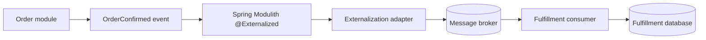

# Externalize một event

Trong bài thực hành này, ta sẽ đưa một application event từ ứng dụng Spring Modulith ra một message broker để một process khác có thể nhận và xử lý. Ví dụ xuyên suốt là module Order phát `OrderConfirmed` sau khi đơn hàng được xác nhận; một consumer bên ngoài nhận event để cập nhật hệ thống fulfillment.

Mục tiêu là giữ hợp đồng nghiệp vụ độc lập với hạ tầng truyền message. Module Order chỉ công bố fact `OrderConfirmed`; phần externalization adapter chịu trách nhiệm chuyển event thành message và gửi đến destination đã cấu hình. Consumer bên ngoài chịu trách nhiệm deserialize, xác thực message, xử lý idempotent và ghi nhận kết quả của nó.

Trong Spring Modulith, `@Externalized` đánh dấu event cần được externalize và cho phép khai báo target. Để event thực sự rời khỏi process, ứng dụng còn cần integration adapter tương ứng với broker, serializer và cấu hình kết nối. Annotation không tự tạo topic/queue, cấp quyền broker hoặc bảo đảm consumer đã xử lý thành công.

## 1. Kết quả cần đạt

Sau khi hoàn thành bài thực hành, bạn có thể:

- Thiết kế event contract có ID, aggregate version và schema version rõ ràng.
- Đánh dấu một event bằng `@Externalized` và chỉ định destination.
- Phát event từ use case trong transaction nghiệp vụ.
- Cấu hình integration adapter để gửi event đến broker.
- Kiểm tra message thực tế được tạo với payload và metadata đúng.
- Xây dựng consumer nhận message và xử lý duplicate an toàn.
- Quan sát publish failure, retry, backlog và lỗi deserialize.
- Phân biệt publication nội bộ, externalization và xử lý thành công ở consumer.

Luồng mẫu:



Trong ví dụ, broker có thể là Kafka hoặc RabbitMQ. Chọn một loại broker mà dự án đã có integration adapter tương thích với phiên bản Spring Modulith đang dùng. Các bước thiết kế contract, publisher và consumer tương tự nhau; cấu hình destination, serializer, acknowledgement và dependency cụ thể sẽ khác theo adapter.

## 2. Xác định ranh giới và trách nhiệm

Trước khi viết code, xác định rõ ai sở hữu từng phần:

| Thành phần | Trách nhiệm |
| --- | --- |
| Order module | Quyết định khi nào đơn hàng được xác nhận và phát domain event. |
| Event contract | Mô tả fact đã xảy ra và dữ liệu tối thiểu consumer cần. |
| Spring Modulith externalization | Nhận diện event cần gửi ra ngoài và điều phối theo integration được cấu hình. |
| Broker adapter | Chuyển event thành message, chọn destination và thực hiện publish. |
| Broker | Lưu/chuyển message theo retention, routing và delivery semantics đã cấu hình. |
| Fulfillment consumer | Deserialize, kiểm tra contract, deduplicate và thực hiện nghiệp vụ của nó. |
| Observability | Theo dõi publish, consumer lag, retry, DLQ và trạng thái nghiệp vụ. |

Không để use case Order phụ thuộc trực tiếp vào `KafkaTemplate`, `RabbitTemplate` hoặc tên queue. Điều đó khiến module nghiệp vụ biết chi tiết hạ tầng và khó thay broker. Use case chỉ phát event; externalization được khai báo ở event contract và adapter.

## 3. Thiết kế event contract

Event cần mô tả một sự kiện đã xảy ra, không phải một yêu cầu để consumer thực hiện. `OrderConfirmed` nói rằng đơn hàng đã được xác nhận; nó không phải command `ConfirmOrder` gửi đến hệ thống khác.

```java
import java.math.BigDecimal;
import java.time.Instant;
import java.util.UUID;

public record OrderConfirmed(
        UUID eventId,
        UUID orderId,
        long aggregateVersion,
        BigDecimal totalAmount,
        String currency,
        Instant occurredAt,
        int schemaVersion
) {
    public OrderConfirmed {
        if (eventId == null || orderId == null || occurredAt == null) {
            throw new IllegalArgumentException("Event identity and time are required");
        }
        if (aggregateVersion < 1 || schemaVersion < 1) {
            throw new IllegalArgumentException("Versions must be positive");
        }
        if (totalAmount == null || totalAmount.signum() < 0) {
            throw new IllegalArgumentException("Total amount must be non-negative");
        }
        if (currency == null || currency.isBlank()) {
            throw new IllegalArgumentException("Currency is required");
        }
    }
}
```

Các trường có mục đích riêng:

- `eventId`: định danh duy nhất của lần phát sinh event; giữ nguyên khi retry/redelivery.
- `orderId`: định danh aggregate nguồn.
- `aggregateVersion`: version của trạng thái Order tại thời điểm phát.
- `totalAmount` và `currency`: snapshot cần thiết nếu consumer cần đúng giá trị đã chốt khi xác nhận.
- `occurredAt`: thời điểm nghiệp vụ xảy ra, dùng UTC.
- `schemaVersion`: version của wire contract.

Không đưa JPA entity, toàn bộ customer profile, access token, payment credential hoặc object graph vào payload. Nếu Fulfillment cần địa chỉ giao hàng, hãy quyết định rõ có cần snapshot tại thời điểm xác nhận hay có thể lấy qua API được bảo vệ bằng `orderId`/reference. Không để consumer suy ra giá trị lịch sử bằng cách truy vấn trạng thái hiện tại nếu dữ liệu đó có thể thay đổi.

## 4. Đánh dấu event cần externalize

Đánh dấu event bằng annotation của Spring Modulith:

```java
import org.springframework.modulith.events.Externalized;

@Externalized("orders")
public record OrderConfirmed(
        UUID eventId,
        UUID orderId,
        long aggregateVersion,
        BigDecimal totalAmount,
        String currency,
        Instant occurredAt,
        int schemaVersion
) {
    // Constructor validation như ví dụ ở trên.
}
```

`orders` là target/destination logic được adapter sử dụng theo cách tích hợp của broker. Tên target phải thống nhất với cấu hình topic, exchange hoặc destination mapping. Không coi chuỗi này là một topic/queue đã tự động được tạo trên broker.

Một số integration cho phép biểu thức hoặc mapping target động. Chỉ dùng khi có nhu cầu định tuyến rõ ràng; destination động cần có allowlist để không tạo topic/queue không kiểm soát từ dữ liệu payload. Với bài thực hành đầu tiên, một target cố định giúp dễ quan sát và kiểm thử.

## 5. Phát event từ use case

Publisher dùng `ApplicationEventPublisher`. Nó không gọi broker trực tiếp và không cần biết adapter nào sẽ externalize event.

```java
@Service
public class ConfirmOrderService {

    private final OrderRepository orders;
    private final ApplicationEventPublisher events;
    private final Clock clock;

    public ConfirmOrderService(
            OrderRepository orders,
            ApplicationEventPublisher events,
            Clock clock) {
        this.orders = orders;
        this.events = events;
        this.clock = clock;
    }

    @Transactional
    public void confirm(UUID orderId) {
        Order order = orders.findById(orderId)
                .orElseThrow(() -> new OrderNotFoundException(orderId));

        order.confirm();
        orders.save(order);

        events.publishEvent(new OrderConfirmed(
                UUID.randomUUID(),
                order.getId(),
                order.getVersion(),
                order.getTotalAmount(),
                order.getCurrency(),
                clock.instant(),
                1
        ));
    }
}
```

Event được publish trong transaction của use case. Với externalization cần phản ánh một thay đổi nghiệp vụ đã commit, phải cấu hình và kiểm tra integration để việc ghi nhận publication không tạo message cho transaction rollback. Spring Modulith và persistence/externalization adapter cần được cấu hình theo transaction semantics được hỗ trợ; không tự giả định rằng mọi broker publish đều là một phần của transaction database.

Nếu đơn hàng không tồn tại, không hợp lệ hoặc transaction rollback, event không được xem là một fact đã xảy ra. Không publish event trước khi xác định trạng thái nghiệp vụ và transaction boundary.

## 6. Thêm broker integration adapter

Chọn một integration được Spring Modulith hỗ trợ cho broker và phiên bản dependency của dự án. Quản lý version bằng Spring Boot/Spring Modulith BOM tương thích; không trộn module adapter từ các release không tương thích.

Các bước cấu hình tổng quát:

1. Thêm dependency externalization/broker integration phù hợp.
2. Cấu hình bootstrap/server endpoint, authentication và TLS.
3. Cấu hình serializer cho event contract và metadata.
4. Ánh xạ target `orders` đến topic/queue/exchange mong muốn.
5. Tạo destination và quyền producer/consumer theo hạ tầng broker.
6. Cấu hình timeout, retry và publish confirmation theo adapter.
7. Khởi động ứng dụng và xác nhận adapter được auto-configuration/bean configuration kích hoạt.

Tên artifact, property prefix và cách khai báo destination phụ thuộc phiên bản Spring Modulith cùng loại broker. Đọc đúng reference của adapter được chọn và dùng cùng version line với ứng dụng. Không sao chép property của một adapter Kafka sang RabbitMQ hoặc ngược lại.

Ví dụ các giá trị cấu hình cần có (tên dưới đây là mô tả khái niệm, không phải property key dùng trực tiếp):

| Nhóm cấu hình | Ví dụ giá trị cần xác định |
| --- | --- |
| Broker endpoint | `localhost:9092` cho môi trường Kafka local |
| Destination | `orders` |
| Serialization | JSON hoặc schema format đã thống nhất |
| Producer identity | Service account riêng của Order application |
| Security | TLS, broker ACL và secret từ secret manager |
| Publish timeout | Giới hạn thời gian chờ broker acknowledgement |
| Retry | Số lần, backoff, jitter và exhaustion handling |

Không commit password, SASL secret, certificate private key hoặc credential vào repository. Với môi trường local, dùng profile riêng và credential giả lập.

## 7. Ánh xạ target đến broker destination

Externalization target là tên logic trong event contract. Adapter cần ánh xạ target đó đến destination thực tế.

Ví dụ mapping mong muốn:

| Event contract | Target | Broker destination |
| --- | --- | --- |
| `OrderConfirmed` | `orders` | Topic `orders` hoặc queue/exchange binding theo adapter |

Với Kafka, xác định topic, partition count, replication factor, retention, key và consumer group. Với RabbitMQ, xác định exchange type, routing key, queue, binding, durability và dead-letter exchange. Không dùng chung một mô hình routing cho cả hai broker.

Message key nên giữ thứ tự theo aggregate khi đó là yêu cầu nghiệp vụ. Với Kafka, dùng `orderId` làm key thường giúp event của cùng order vào cùng partition. Điều này không tạo thứ tự toàn cục giữa mọi order. Với RabbitMQ, ordering phụ thuộc queue, consumer concurrency, requeue và routing configuration.

## 8. Chọn serializer và wire format

Consumer ngoài process không nên phụ thuộc vào tên class Java hoặc package nội bộ của Order module. Wire format là contract độc lập.

Một payload JSON minh họa:

```json
{
  "eventId": "8b5e6c6d-8a2e-4d44-9b3f-41c7b8f7a2b1",
  "eventType": "OrderConfirmed",
  "schemaVersion": 1,
  "orderId": "2a7a3d42-17d4-4f52-93b8-0a4a0a0f1234",
  "aggregateVersion": 7,
  "totalAmount": 125000.00,
  "currency": "VND",
  "occurredAt": "2026-11-25T08:30:00Z"
}
```

Đây là ví dụ wire contract; adapter có thể bọc event trong envelope hoặc đặt metadata vào message header. Producer và consumer cần thống nhất chính xác nơi chứa `eventType`, `schemaVersion`, content type, correlation ID và event ID.

Quy tắc serialization:

- Dùng timestamp có timezone/UTC và format ổn định.
- Biểu diễn tiền bằng decimal cùng currency; không dùng floating point cho tính toán tài chính.
- Có schema version và chính sách compatibility.
- Xử lý field optional và enum chưa biết có chủ đích.
- Không serialize lazy entity, proxy hoặc class implementation nội bộ.
- Có fixture contract để consumer kiểm tra payload producer phát ra.

## 9. Chọn message key và metadata

Metadata giúp consumer deduplicate, truy vết và kiểm soát thứ tự:

| Metadata | Mục đích |
| --- | --- |
| `eventId` | Inbox/deduplication và nhận diện cùng event qua redelivery. |
| `eventType` | Chọn handler phù hợp. |
| `schemaVersion` | Chọn deserializer/mapper đúng contract. |
| `aggregateId` | Partitioning hoặc routing theo aggregate. |
| `aggregateVersion` | Phát hiện event cũ, trùng hoặc gap. |
| `correlationId` | Liên kết các bước trong một workflow. |
| `causationId` | Xác định event/command đã gây ra event hiện tại. |

Không đưa token, thông tin xác thực hoặc dữ liệu cá nhân vào header với giả định header ít nhạy cảm hơn payload. Header và payload đều có thể được broker, connector, tracing hoặc công cụ quản trị lưu lại.

## 10. Consumer bên ngoài

Consumer cần xác thực message, kiểm tra schema version, deduplicate và ghi nhận tác động nghiệp vụ trong transaction của chính nó.

Một handler minh họa:

```java
@Service
public class OrderConfirmedHandler {

    private final InboxRepository inbox;
    private final FulfillmentService fulfillment;

    @Transactional
    public void handle(OrderConfirmedMessage message) {
        boolean firstDelivery = inbox.insertIfAbsent(
                "fulfillment",
                message.eventId()
        );

        if (!firstDelivery) {
            return;
        }

        fulfillment.createShipmentRequest(
                message.orderId(),
                message.aggregateVersion()
        );
    }
}
```

`insertIfAbsent` cần được bảo vệ bằng unique constraint trên `(consumer_name, event_id)`. Việc ghi inbox và cập nhật dữ liệu Fulfillment phải cùng transaction để duplicate không tạo side effect lần hai. Nếu side effect là gọi API bên ngoài, dùng outbox hoặc idempotency key của hệ thống đích; không gọi API rồi kỳ vọng transaction database rollback có thể hoàn tác request.

Acknowledgement/offset chỉ nên được commit sau khi tác động consumer đã được lưu bền vững theo delivery semantics đã chọn. Nếu ack trước database commit, crash có thể làm mất tác động; nếu database commit trước ack, message có thể được giao lại và inbox phải xử lý duplicate.

## 11. Event Publication Registry và externalization

Event Publication Registry theo dõi publication đến transactional listener nội bộ. Externalization là một chặng giao event ra process khác. Tùy integration và phiên bản Spring Modulith, externalization có thể được điều phối qua cơ chế publication phù hợp; cần xác minh trạng thái nào được registry theo dõi và trạng thái nào thuộc broker/consumer.

Không suy ra rằng publication nội bộ completed đồng nghĩa consumer ngoài đã commit. Các mốc cần quan sát riêng:

1. Domain transaction nguồn commit.
2. Event được externalization adapter xử lý.
3. Broker xác nhận nhận message theo cấu hình producer.
4. Consumer nhận message.
5. Consumer commit transaction nghiệp vụ.
6. Consumer commit acknowledgement/offset.

Registry không thay thế broker offset, consumer inbox hoặc event store. Không sửa trực tiếp bảng nội bộ của registry để đánh dấu event đã externalize.

## 12. Retry và failure handling

Publish có thể thất bại do broker không khả dụng, timeout, authentication/ACL sai, destination chưa tồn tại hoặc serializer không đọc được event.

Phân loại lỗi:

| Lỗi | Cách xử lý |
| --- | --- |
| Broker tạm thời không khả dụng | Retry có giới hạn, exponential backoff và jitter. |
| Timeout/connection reset | Kiểm tra network, broker health và publish confirmation; retry idempotently. |
| Authentication/ACL | Sửa credential/quyền; không retry liên tục khi cấu hình sai. |
| Destination sai hoặc chưa tồn tại | Sửa mapping/topic/queue và xác minh policy tạo destination. |
| Serialization/schema | Quarantine và sửa contract/mapper; không retry mù. |
| Payload vượt giới hạn | Thu nhỏ payload hoặc chuyển file sang object storage. |

Producer có thể không biết broker đã nhận message hay chưa khi timeout xảy ra sau khi broker ghi message nhưng trước khi acknowledgement về đến ứng dụng. Retry có thể tạo duplicate. Vì vậy, `eventId` cần ổn định và consumer cần idempotent.

Không nuốt exception để làm publication được xem là thành công. Nếu adapter cung cấp retry/recovery thông qua Event Publication Registry hoặc cơ chế riêng, dùng đúng API được hỗ trợ và theo dõi retry exhaustion. Dead-letter queue là khả năng của broker/integration, không tự động xuất hiện chỉ vì event có `@Externalized`.

## 13. Security và quyền truy cập

Externalize event nghĩa là dữ liệu rời khỏi process và có thể được lưu ở broker, replica, consumer buffer, retry topic, DLQ và backup.

- Dùng TLS giữa producer, broker và consumer.
- Cấp ACL tối thiểu: producer chỉ publish destination cần thiết; consumer chỉ đọc destination được cấp.
- Dùng service account riêng theo workload.
- Không đưa password, token, private key, session cookie hoặc CVV vào event.
- Tối thiểu hóa dữ liệu cá nhân; dùng reference/API bảo vệ khi phù hợp.
- Mã hóa at rest và bảo vệ backup theo chính sách nền tảng.
- Giới hạn quyền đọc/export/replay DLQ.
- Không log toàn payload hoặc secret trong header.

Nếu consumer cần dữ liệu nhạy cảm, xác thực consumer tại API hoặc cấp quyền decrypt riêng. Biết `orderId` không đồng nghĩa có quyền đọc toàn bộ hồ sơ khách hàng.

## 14. Observability sau khi externalize

Theo dõi các metric ở producer, broker và consumer:

| Metric | Nơi đo | Ý nghĩa |
| --- | --- | --- |
| Externalization attempts/success/failure | Producer adapter | Adapter có gửi được message không? |
| Publish latency | Producer adapter | Thời gian từ yêu cầu publish đến broker acknowledgement. |
| Broker topic/queue depth | Broker | Message đang chờ bao nhiêu? |
| Consumer lag | Consumer/broker | Consumer đang chậm bao xa so với producer? |
| Processing success/failure | Consumer | Nghiệp vụ phía nhận có hoàn tất không? |
| Duplicate detected | Consumer inbox | Có redelivery/retry lặp không? |
| DLQ depth | Broker | Bao nhiêu message cần can thiệp? |
| Schema error | Producer/consumer | Có version không tương thích không? |

Nhãn metric nên có cardinality thấp như event type, destination, consumer và outcome. Không dùng event ID, order ID hoặc exception message làm metric tag. Định danh cụ thể dùng trong log/trace có kiểm soát.

Log nên ghi `eventId`, `eventType`, `schemaVersion`, `orderId` nếu chính sách cho phép, correlation ID, destination, publish outcome và consumer name. Không log toàn payload nếu có dữ liệu nhạy cảm.

## 15. Kiểm thử externalization

Nên chia test theo ranh giới:

### Unit test publisher

- Gọi use case hợp lệ thì phát đúng một `OrderConfirmed`.
- Event có event ID, order ID, aggregate version, amount, currency và timestamp hợp lệ.
- Validation thất bại không phát event.
- Không có entity hoặc dữ liệu bí mật trong payload.

### Spring Modulith integration test

- Event được đánh dấu externalized và target được nhận diện theo cấu hình.
- Transaction nguồn rollback không tạo message externalized mô tả thay đổi chưa commit.
- Publication state/recovery hoạt động theo persistence adapter đang dùng.
- Serializer tạo wire payload đúng schema.

### Broker integration test

- Message xuất hiện ở đúng topic/queue/destination.
- Key, headers, content type và schema version đúng.
- Publish failure được quan sát và xử lý theo retry policy.
- Consumer đọc message, ghi inbox và cập nhật dữ liệu.
- Redelivery cùng event ID không tạo side effect trùng.
- Ack/offset chỉ được commit theo transaction semantics đã chọn.

### Contract test

- Consumer đọc được payload fixture của schema version đang hỗ trợ.
- Field optional, enum mới và unknown version được xử lý có chủ đích.
- Producer payload tương thích với contract đã công bố.

Không dùng mock `KafkaTemplate`/`RabbitTemplate` để kết luận broker thật đã nhận message. Khi cần kiểm chứng routing, serialization, acknowledgement và restart, dùng broker test instance hoặc môi trường integration phù hợp.

## 16. Quy trình thực hành từ đầu đến cuối

Thực hiện theo thứ tự sau để có thể xác định lỗi ở đúng chặng:

1. Tạo event record `OrderConfirmed` với `eventId`, `orderId`, version, amount, currency, timestamp và schema version.
2. Đánh dấu event bằng `@Externalized("orders")`.
3. Cập nhật use case xác nhận đơn hàng để publish event trong transaction.
4. Thêm externalization adapter tương thích với phiên bản Spring Modulith và broker đã chọn.
5. Cấu hình endpoint, destination, serializer, authentication và TLS cho môi trường local/test.
6. Khởi động broker và ứng dụng; xác nhận adapter được kích hoạt.
7. Gọi use case xác nhận một đơn hàng thử nghiệm.
8. Kiểm tra broker có message đúng destination, event ID, schema version và payload.
9. Chạy consumer thử nghiệm; xác nhận inbox và dữ liệu Fulfillment được cập nhật.
10. Gửi lại cùng message để kiểm tra duplicate không tạo side effect lần hai.
11. Làm broker tạm thời không khả dụng trong môi trường test để quan sát failure/recovery.
12. Khôi phục broker, theo dõi retry/backlog và xác nhận message được giao.
13. Kiểm tra log/metric không lộ payload nhạy cảm.
14. Ghi lại event contract, destination, owner, retry policy, retention và cách điều tra sự cố.

Không thực hiện bước gây lỗi trên production. Dùng broker local/test và event dữ liệu giả lập.

## 17. Checklist hoàn thành

- [ ] Event biểu diễn một fact nghiệp vụ đã xảy ra.
- [ ] Payload nhỏ, immutable và không chứa entity graph/credential.
- [ ] Có event ID, aggregate version và schema version.
- [ ] Event được đánh dấu `@Externalized` với target rõ ràng.
- [ ] Broker integration adapter đúng phiên bản đã được cấu hình.
- [ ] Destination/topic/queue tồn tại và ACL đúng.
- [ ] Serializer và wire contract được consumer hiểu.
- [ ] Transaction rollback không externalize fact chưa commit.
- [ ] Consumer dùng inbox/unique key hoặc cơ chế idempotency tương đương.
- [ ] Ack/offset được commit sau khi tác động consumer bền vững.
- [ ] Retry có giới hạn, backoff và xử lý exhaustion.
- [ ] Có quan sát publish, broker lag, consumer failure và DLQ.
- [ ] Có test publisher, Spring Modulith integration, broker integration và contract.
- [ ] TLS, secret management, retention và payload privacy được cấu hình.
- [ ] Runbook có owner và hướng dẫn xử lý publish failure/redelivery.

## 18. Sự cố thường gặp

| Triệu chứng | Nguyên nhân có thể | Cách kiểm tra |
| --- | --- | --- |
| Không có message trong broker | Chưa có adapter, event chưa được externalize, transaction rollback hoặc target mapping sai | Kiểm tra dependency/auto-configuration, event annotation, transaction outcome và log adapter. |
| Message vào sai destination | Target mapping hoặc routing key không đúng | Đối chiếu `@Externalized` target với cấu hình adapter/broker. |
| Consumer deserialize thất bại | Schema version, content type hoặc serializer mismatch | Lấy fixture an toàn, kiểm tra header và contract version. |
| Message bị giao nhiều lần | Producer timeout/ack ambiguity, consumer crash trước ack hoặc retry | Đối chiếu event ID, inbox và broker delivery metadata. |
| Consumer lag tăng | Consumer chậm, dependency lỗi hoặc concurrency thấp | Kiểm tra processing latency, queue depth, database pool và dependency. |
| DLQ tăng | Poison message, schema error hoặc retry exhausted | Phân loại lỗi trước khi redrive; không replay toàn DLQ mù. |
| Publish bị từ chối | Authentication, ACL, quota hoặc destination policy | Kiểm tra service account, broker audit và destination configuration. |

Khi điều tra, phân biệt producer đã phát event, adapter đã gửi, broker đã nhận và consumer đã commit. Những mốc này không đồng nghĩa. Dùng event ID/correlation ID để nối log và trace giữa các process.

## 19. Kết quả cần ghi lại sau bài thực hành

Sau khi chạy xong, ghi nhận các thông tin sau trong tài liệu dự án hoặc pull request:

| Nội dung | Giá trị cần ghi |
| --- | --- |
| Event type | `OrderConfirmed` |
| Externalization target | `orders` |
| Broker/destination | Broker và topic/queue thực tế đã chọn |
| Schema version | Version wire contract |
| Producer module | Order |
| Consumer | Fulfillment |
| Message key | `orderId` nếu cần ordering theo aggregate |
| Delivery semantics | At-least-once/ack behavior theo cấu hình thực tế |
| Idempotency | Inbox key `(consumer, eventId)` hoặc giải pháp tương đương |
| Retry/DLQ | Giới hạn, backoff, nơi quarantine và owner |
| Security | TLS, ACL, service identity và secret location |
| Observability | Metric, dashboard và correlation fields |

Không ghi secret hoặc payload thật vào tài liệu. Các giá trị phụ thuộc môi trường phải được lấy từ cấu hình triển khai đã được phê duyệt.

Externalize một event là đưa một hợp đồng nghiệp vụ vượt qua ranh giới process. Trong Spring Modulith, publisher chỉ cần phát fact qua application event và `@Externalized` khai báo ý định gửi ra ngoài; integration adapter thực hiện serialization và publish đến broker. Độ tin cậy hoàn chỉnh còn phụ thuộc transaction boundary, broker acknowledgement, retry, consumer idempotency, schema compatibility và observability. Khi tách rõ trách nhiệm của module nguồn, adapter, broker và consumer, event có thể được chuyển ra ngoài mà không kéo chi tiết hạ tầng vào domain logic.
