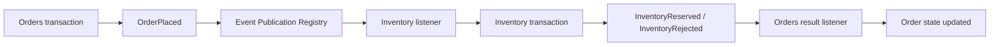
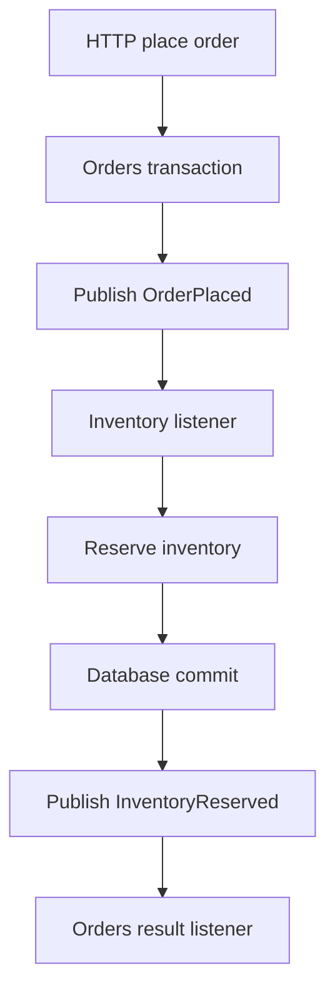

# Đo lường và vận hành

Một luồng application event chỉ đáng tin cậy khi nhóm phát triển biết event đang ở đâu, listener xử lý mất bao lâu, lỗi nào đang lặp lại và cần làm gì khi publication bị kẹt. Log rời rạc hoặc chỉ kiểm tra ứng dụng còn sống không đủ để vận hành một hệ thống bất đồng bộ. Cần kết hợp metrics, logs, traces, trạng thái publication, backlog và quy trình xử lý sự cố.

Bài thực hành này xây dựng bộ đo lường và vận hành cho luồng Spring Modulith: module Orders phát `OrderPlaced`, module Inventory nhận event để giữ hàng, sau đó phát `InventoryReserved` hoặc `InventoryRejected`. Ta sẽ xác định SLI/SLO, thêm instrumentation bằng Micrometer, theo dõi Event Publication Registry, thiết kế dashboard/alert, lập runbook và diễn tập các lỗi thường gặp.

## 1. Mục tiêu của dự án

Sau khi hoàn thành, hệ thống cần trả lời được các câu hỏi sau mà không phải đọc thủ công từng log:

- Có bao nhiêu event được phát và bao nhiêu listener xử lý thành công?
- Listener nào đang chậm hoặc có tỷ lệ lỗi tăng?
- Publication nào chưa hoàn tất và đã chờ bao lâu?
- Event có bị retry hoặc giao lại nhiều lần không?
- Nếu có broker, consumer lag và dead-letter queue đang ở trạng thái nào?
- Một order cụ thể đã đi qua những bước nào?
- Khi có cảnh báo, thao tác khôi phục an toàn là gì?

Phạm vi vận hành gồm cả luồng nội bộ trong modular monolith và phần externalization nếu ứng dụng gửi event ra broker. Không phải mọi ứng dụng đều cần Kafka/RabbitMQ; chỉ bật dashboard broker khi topology thực tế có broker.

## 2. Mô hình luồng cần quan sát

Ví dụ sử dụng hai module:

- `orders`: tạo đơn, lưu trạng thái `PENDING_INVENTORY` và phát `OrderPlaced`.
- `inventory`: nhận event, kiểm tra tồn kho, ghi reservation và phát event kết quả.



Nếu event được externalize, thêm adapter/outbox và broker vào đúng ranh giới. Hãy phân biệt trạng thái publication nội bộ với trạng thái delivery tới broker và trạng thái xử lý của consumer. Một broker confirm không đồng nghĩa business listener đã hoàn tất.

## 3. Xác định SLI và SLO trước khi tạo dashboard

SLI là chỉ số phản ánh chất lượng dịch vụ; SLO là mục tiêu cần đạt cho SLI trong một khoảng thời gian. Chọn chỉ số theo điều người dùng hoặc quy trình nghiệp vụ cảm nhận.

| SLI | Cách đo | Ý nghĩa |
|---|---|---|
| Event processing success rate | Số lần xử lý thành công / tổng số lần xử lý hợp lệ | Listener có hoàn thành công việc không? |
| Event processing latency | Thời gian từ nhận event đến khi listener hoàn tất | Consumer có xử lý đủ nhanh không? |
| End-to-end business latency | Từ `occurredAt` tới khi order rời trạng thái chờ | Quy trình nghiệp vụ có bị chậm không? |
| Oldest incomplete publication | Tuổi publication chưa hoàn tất lâu nhất | Có công việc bị kẹt không? |
| Retry rate | Số lần retry / số lần xử lý | Dependency có đang không ổn định? |
| Backlog size/age | Số publication hoặc outbox delivery đang chờ và tuổi của chúng | Hệ thống có theo kịp tốc độ phát event không? |
| Duplicate rate | Số event bị nhận diện là duplicate | Có redelivery hoặc retry bất thường không? |

Ví dụ SLO ban đầu cho một hệ thống nội bộ:

- 99% `OrderPlaced` được Inventory xử lý trong vòng 5 giây.
- 99,9% event hợp lệ được xử lý thành công hoặc chuyển sang trạng thái lỗi có thể quan sát trong 10 phút.
- Không có publication chưa hoàn tất nào tồn tại quá 15 phút mà không có cảnh báo.

Đây chỉ là giá trị khởi đầu minh họa. Hãy chọn ngưỡng dựa trên SLA nghiệp vụ, lưu lượng, thời gian xử lý thực tế và khả năng phục hồi. Đừng đặt SLO chỉ vì một con số đẹp trên dashboard.

## 4. Phân biệt các loại thời gian

Để tìm đúng bottleneck, không gộp tất cả độ trễ thành một con số:

| Thời gian | Điểm bắt đầu/kết thúc | Nơi giúp điều tra |
|---|---|---|
| Publish latency | Bắt đầu publish đến khi publisher hoàn tất theo API | Publisher/adapter |
| Publication wait | Publication được ghi nhận đến khi listener bắt đầu | Event infrastructure/executor |
| Listener duration | Listener bắt đầu đến khi xử lý xong | Listener/application service |
| Broker delivery latency | Producer gửi đến consumer nhận | Broker/transport |
| End-to-end latency | Event xảy ra đến khi trạng thái nghiệp vụ đích được commit | Correlation/trace và database |

Với listener `AFTER_COMMIT` hoặc `@ApplicationModuleListener`, thời điểm publish và thời điểm listener chạy có thể khác nhau. Dùng timestamp có semantics rõ ràng, đồng bộ clock giữa các process và ưu tiên trace/span duration cho các đoạn xử lý trong cùng một trace.

## 5. Thiết kế event metadata để truy vết

Event contract nên có định danh ổn định để nối các bước xử lý:

```java
public record OrderPlaced(
    UUID eventId,
    UUID orderId,
    String correlationId,
    String causationId,
    Instant occurredAt,
    List<OrderLineData> lines
) {}
```

Ý nghĩa:

- `eventId`: định danh một event; giữ nguyên qua retry và replay.
- `orderId`: business key để tra cứu trạng thái đơn hàng.
- `correlationId`: liên kết nhiều event trong cùng một luồng nghiệp vụ.
- `causationId`: event hoặc command trực tiếp tạo ra event hiện tại, nếu có.
- `occurredAt`: thời điểm nghiệp vụ xảy ra, không phải thời điểm consumer nhận.

Nếu event contract đã được phát hành, không thêm field tùy tiện mà bỏ qua schema compatibility. Có thể mang correlation metadata trong envelope/header nếu không muốn thay đổi payload nghiệp vụ. Event ID và order ID có cardinality cao; dùng chúng trong log/trace, không dùng làm metric label.

## 6. Structured logging

Log có cấu trúc giúp tìm kiếm theo event ID, module, listener, outcome và correlation ID. Tránh log câu văn không có field nhất quán hoặc log toàn bộ payload ở mọi bước.

Ví dụ với SLF4J:

```java
@Component
class InventoryEventListener {

    private static final Logger log = LoggerFactory.getLogger(
        InventoryEventListener.class
    );

    private final InventoryReservationService reservations;

    InventoryEventListener(InventoryReservationService reservations) {
        this.reservations = reservations;
    }

    @ApplicationModuleListener
    void on(OrderPlaced event) {
        try (var eventId = MDC.putCloseable("eventId", event.eventId().toString());
             var orderId = MDC.putCloseable("orderId", event.orderId().toString());
             var correlationId = MDC.putCloseable("correlationId", event.correlationId())) {
            log.info("Handling OrderPlaced");
            reservations.reserve(event);
            log.info("OrderPlaced handled successfully");
        } catch (RuntimeException exception) {
            log.error("OrderPlaced handling failed", exception);
            throw exception;
        }
    }
}
```

Ví dụ dùng `MDC.putCloseable` của SLF4J để tự khôi phục MDC sau khi xử lý. Cần xử lý trường hợp metadata có thể null và điều chỉnh theo phiên bản SLF4J. Với listener bất đồng bộ, không giả định MDC hoặc `ThreadLocal` tự truyền từ publisher thread sang executor thread; hãy dùng cơ chế context propagation phù hợp hoặc đưa correlation metadata trong event/envelope.

Log nên ghi các mốc chính: nhận event, bắt đầu use case, hoàn tất, retry hoặc chuyển trạng thái lỗi. Không ghi access token, thông tin thanh toán, địa chỉ đầy đủ hoặc payload chứa dữ liệu cá nhân nếu không có nhu cầu và policy rõ ràng.

## 7. Dùng Micrometer Observation cho listener

Micrometer Observation cung cấp một điểm instrumentation có thể tạo metrics và, khi có tracing bridge phù hợp, spans. Đặt observation quanh use case xử lý event để đo duration và ghi nhận lỗi:

```java
@Component
class InventoryEventListener {

    private final InventoryReservationService reservations;
    private final ObservationRegistry observationRegistry;

    InventoryEventListener(
        InventoryReservationService reservations,
        ObservationRegistry observationRegistry
    ) {
        this.reservations = reservations;
        this.observationRegistry = observationRegistry;
    }

    @ApplicationModuleListener
    void on(OrderPlaced event) {
        Observation.createNotStarted("app.event.process", observationRegistry)
            .lowCardinalityKeyValue("event.type", "OrderPlaced")
            .lowCardinalityKeyValue("listener", "inventory")
            .highCardinalityKeyValue("event.id", event.eventId().toString())
            .highCardinalityKeyValue("order.id", event.orderId().toString())
            .observe(() -> reservations.reserve(event));
    }
}
```

Tên observation và low-cardinality values nên ổn định. `event.id` và `order.id` chỉ nên là high-cardinality context cho trace/log; không chuyển chúng thành metric tags. Khi `reserve` ném exception, observation ghi nhận lỗi và exception tiếp tục đi lên để infrastructure xử lý theo policy.

Nếu ứng dụng đã dùng Spring Boot/Micrometer Observation hoặc instrumentation của Spring Modulith, tránh tạo span trùng lặp cho cùng một đoạn xử lý. Chọn một boundary rõ: framework span cho dispatch và observation riêng cho business use case nếu cần phân biệt hai thời gian.

## 8. Tạo metrics với Micrometer

Metrics nên trả lời câu hỏi vận hành bằng tập tag có cardinality thấp. Ví dụ dùng `MeterRegistry`:

```java
@Component
class EventProcessingMetrics {

    private final MeterRegistry registry;

    EventProcessingMetrics(MeterRegistry registry) {
        this.registry = registry;
    }

    void recordSuccess(String eventType, String listener) {
        Counter.builder("app.events.processed")
            .tag("event_type", eventType)
            .tag("listener", listener)
            .tag("outcome", "success")
            .register(registry)
            .increment();
    }

    void recordFailure(String eventType, String listener, String errorType) {
        Counter.builder("app.events.processed")
            .tag("event_type", eventType)
            .tag("listener", listener)
            .tag("outcome", "failure")
            .tag("error_type", errorType)
            .register(registry)
            .increment();
    }
}
```

Chỉ dùng `error_type` là nhóm exception đã chuẩn hóa, không dùng message hoặc stack trace làm tag. Không thêm `eventId`, `orderId`, email, tenant tùy ý hoặc URL đầy đủ vào metric labels vì số lượng time series có thể tăng không giới hạn.

Trong ứng dụng thực, nên bọc việc ghi metric trong một interceptor/decorator hoặc helper để listener không phải tự quản lý nhiều nhánh instrumentation. Đảm bảo mỗi lần xử lý chỉ tăng đúng một outcome. Nếu đã dùng Observation handler tạo metric, tránh đếm trùng bằng custom counter cùng ý nghĩa.

## 9. Bộ metrics tối thiểu

Một bộ metrics vận hành có thể gồm:

| Metric | Type gợi ý | Tags giới hạn |
|---|---|---|
| `app.events.received` | Counter | event type, listener |
| `app.events.processed` | Counter | event type, listener, outcome |
| `app.events.processing` | Timer | event type, listener |
| `app.events.retry` | Counter | event type, listener, retry reason |
| `app.events.duplicate` | Counter | event type, consumer |
| `app.events.incomplete` | Gauge | listener hoặc destination |
| `app.events.oldest.incomplete.seconds` | Gauge | listener hoặc destination |
| `app.outbox.pending` | Gauge | destination |
| `app.outbox.publish` | Timer | destination, outcome |
| `app.outbox.failed` | Counter | destination, error category |

Tên metric là convention do ứng dụng chọn, không phải metric mặc định được Spring Modulith bảo đảm cung cấp. Dùng prefix thống nhất và mô tả đơn vị. Với duration, dùng `Timer`; với số lượng đang tồn tại, dùng `Gauge`; với tổng sự kiện tích lũy, dùng `Counter`.

## 10. Đo publication chưa hoàn tất

Spring Modulith Event Publication Registry theo dõi publication tới listener được quản lý. Khi dùng persistence implementation phù hợp, có thể truy vấn hoặc resubmit publication chưa hoàn tất theo API được hỗ trợ trong phiên bản ứng dụng.

Nhóm vận hành cần biết:

- Có bao nhiêu publication chưa hoàn tất theo listener?
- Publication cũ nhất đã chờ bao lâu?
- Lỗi gần nhất thuộc loại nào?
- Listener nào có failure rate cao?
- Publication có tiếp tục được xử lý sau khi dependency phục hồi không?

Không truy cập hoặc sửa trực tiếp bảng nội bộ của registry để tạo dashboard hay đánh dấu publication hoàn tất. Dùng API/abstraction công khai được cung cấp bởi phiên bản Spring Modulith và persistence implementation. Nếu cần metric về incomplete publication, xây một adapter vận hành đọc qua abstraction phù hợp hoặc cập nhật metric từ luồng dispatch/recovery do ứng dụng sở hữu.

Phân biệt `incomplete` với `failed permanently`. Một publication có thể đang chờ listener, đang được retry hoặc cần can thiệp. Dashboard phải thể hiện trạng thái đủ rõ để operator không resubmit nhầm một event đang xử lý.

## 11. Theo dõi outbox và broker nếu có externalization

Nếu ứng dụng dùng transactional outbox, đo riêng trạng thái delivery:

- Số row `PENDING`, `IN_FLIGHT`, `RETRY`, `PUBLISHED`, `FAILED`.
- Tuổi outbox row pending lâu nhất.
- Attempt count và thời điểm retry tiếp theo.
- Lease hết hạn hoặc worker claim thất bại.
- Publish latency và confirm latency theo destination.

Nếu dùng Kafka, bổ sung consumer lag theo group/topic/partition, producer error, request latency và số record bị từ chối. Nếu dùng RabbitMQ, bổ sung queue depth, unacked messages, redelivery, publish confirm, returned message và DLQ depth.

Không trộn backlog registry nội bộ, outbox pending và broker consumer lag thành một chỉ số chung. Chúng biểu diễn các giai đoạn khác nhau của pipeline; một stage có thể khỏe trong khi stage kế tiếp bị nghẽn.

## 12. Distributed tracing và correlation

Trace giúp nối publisher, listener và các lời gọi downstream. Với một luồng nhiều module trong cùng process, có thể tạo span cho event dispatch và span cho business processing. Khi externalize qua broker, trace context có thể được truyền qua message headers nếu instrumentation và adapter hỗ trợ.

Một trace có thể biểu diễn:



Mỗi span nên có operation name ổn định và low-cardinality attributes như module, event type, listener, outcome. Event ID, order ID và correlation ID là dữ liệu định danh có cardinality cao; chỉ gắn ở span/log khi hệ thống tracing cho phép và có policy bảo mật.

Khi qua broker, trace có thể bị tách thành trace mới nếu context propagation không được cấu hình. Trong trường hợp đó, giữ correlation ID và causation ID trong envelope để liên kết bằng log hoặc trace links. Không tự copy toàn bộ `ThreadLocal` sang thread khác.

## 13. Health check không thay thế event health

Ứng dụng trả HTTP 200 hoặc health endpoint `UP` không chứng minh event pipeline đang xử lý bình thường. Broker có thể unavailable, listener có thể fail liên tục hoặc publication backlog tăng trong khi web server vẫn phục vụ request.

Phân biệt:

- **Liveness:** process còn hoạt động và không bị treo.
- **Readiness:** ứng dụng sẵn sàng nhận traffic theo dependency cần thiết.
- **Event pipeline health:** publication, listener, outbox và broker có đáp ứng mục tiêu vận hành không.

Không đưa mọi lỗi broker tạm thời vào liveness để orchestrator restart liên tục, tạo vòng lặp crash. Readiness có thể phản ánh dependency bắt buộc đối với use case cần publish đồng bộ; với outbox, ứng dụng có thể vẫn nhận request và lưu intent trong database khi broker tạm unavailable. Hãy quyết định theo kiến trúc và khả năng chịu backlog.

## 14. Cấu hình Actuator và export metrics

Spring Boot Actuator có thể cung cấp health, metrics và endpoint scrape cho hệ thống giám sát. Ví dụ cấu hình:

```yaml
management:
  endpoints:
    web:
      exposure:
        include: health,info,metrics,prometheus
  endpoint:
    health:
      probes:
        enabled: true
  metrics:
    tags:
      application: spring-modulith-application-events
```

Endpoint `prometheus` cần registry/exporter tương ứng trong dependency. Chỉ expose những endpoint cần thiết và bảo vệ bằng network policy/authentication. Không mở endpoint metrics hoặc environment/configuration ra Internet công khai.

Nếu dùng OpenTelemetry hoặc tracing backend khác, cấu hình exporter, sampling, resource attributes và propagation theo nền tảng vận hành. Không bật sampling 100% trong production lưu lượng lớn nếu chưa đánh giá chi phí và dữ liệu nhạy cảm.

## 15. Thiết kế dashboard vận hành

Dashboard nên được chia theo câu hỏi:

### Tổng quan event pipeline

- Event throughput theo event type.
- Success/failure rate theo listener.
- p50/p95/p99 processing latency.
- Incomplete publication count và oldest age.
- Retry/duplicate count.

### Theo module/listener

- Listener nào chậm nhất?
- Listener nào có failure rate cao?
- Số publication đang chờ theo listener?
- Processing duration có thay đổi sau deployment không?

### Theo broker/destination

- Outbox pending/failed theo destination.
- Broker publish latency và error rate.
- Consumer lag hoặc queue depth.
- DLQ size và redelivery rate.

### Theo nghiệp vụ

- Số order còn ở `PENDING_INVENTORY`.
- Tuổi order pending lâu nhất.
- Tỷ lệ order được giữ hàng thành công/từ chối.
- End-to-end latency từ tạo đơn đến kết quả inventory.

Dashboard kỹ thuật và dashboard nghiệp vụ bổ trợ nhau. Một listener có thể có latency thấp nhưng vẫn xử lý sai business state; ngược lại, broker lag tăng chưa chắc người dùng bị ảnh hưởng nếu consumer có đủ buffer và SLO chưa bị vi phạm.

## 16. Alert theo triệu chứng và tác động

Alert nên kích hoạt hành động cụ thể, không chỉ báo một metric tăng nhẹ.

| Alert | Điều kiện minh họa | Hành động đầu tiên |
|---|---|---|
| Old incomplete publication | Tuổi publication vượt SLO | Xác định listener và lỗi gần nhất |
| Listener failure spike | Failure ratio vượt ngưỡng trong cửa sổ đủ dài | Kiểm tra deployment, dependency và exception category |
| Backlog growing | Pending count/age tăng liên tục | So sánh ingress rate với processing throughput |
| Outbox stuck | Delivery pending/lease hết hạn quá lâu | Kiểm tra dispatcher, DB lock và broker connectivity |
| Consumer lag high | Lag vượt ngưỡng và tiếp tục tăng | Kiểm tra consumer capacity, rebalance và xử lý chậm |
| DLQ messages | DLQ có message mới hoặc tăng nhanh | Phân loại lỗi, giữ payload và mở quy trình điều tra |
| Business process stuck | Order ở trạng thái chờ vượt thời hạn | Tra trace/event ID và kiểm tra publication/consumer |

Dùng cửa sổ thời gian, mức độ và điều kiện kéo dài để tránh alert noise. Ví dụ, một lỗi đơn lẻ được retry thành công có thể chỉ cần metric; lỗi kéo dài làm backlog vượt SLO mới cần page on-call.

## 17. Runbook khi listener thất bại

Khi alert báo listener `inventory` thất bại, thực hiện theo trình tự:

1. Xác định event type, listener, thời điểm bắt đầu và phiên bản vừa deploy.
2. Xem failure rate, duration, retry count và oldest incomplete publication.
3. Lấy một `eventId` mẫu từ log/trace và kiểm tra trạng thái order tương ứng.
4. Phân loại lỗi: dữ liệu không hợp lệ, lỗi domain, database, dependency ngoài hay timeout.
5. Kiểm tra listener có nuốt exception hoặc đánh dấu publication hoàn tất nhầm không.
6. Xác minh dependency đã phục hồi và capacity còn đủ để xử lý backlog.
7. Dùng cơ chế retry/resubmit được hỗ trợ sau khi hiểu trạng thái xử lý.
8. Theo dõi duplicate, business state và backlog sau khi phục hồi.
9. Ghi lại nguyên nhân, event ID liên quan và thao tác đã thực hiện.

Không resubmit hàng loạt ngay khi thấy publication incomplete. Trước hết xác minh consumer idempotent và event có thể xử lý lại an toàn. Nếu listener đã thực hiện side effect ngoài database trước khi thất bại, cần reconciliation với hệ thống đích.

## 18. Runbook khi outbox hoặc broker bị nghẽn

Nếu ứng dụng dùng outbox/broker:

1. Kiểm tra oldest pending outbox row và số lượng delivery theo destination.
2. Xác định dispatcher còn chạy, lease có hết hạn và DB query có bị lock không.
3. Kiểm tra broker connectivity, authentication, publish confirm và quota.
4. So sánh event ingress rate với publish/consume throughput.
5. Khôi phục broker hoặc dispatcher theo quy trình hạ tầng.
6. Điều chỉnh concurrency/batch chỉ khi database và broker còn capacity.
7. Theo dõi backlog drain rate, consumer lag và DLQ.
8. Đối soát event ID trong khoảng thời gian bị ảnh hưởng.

Không xóa outbox row để làm giảm dashboard. Không tăng vô hạn worker concurrency khi broker đang quá tải; điều đó có thể làm lỗi và retry tăng thêm.

## 19. Retry, DLQ và phục hồi

Retry nên có giới hạn, exponential backoff và jitter. Phân biệt lỗi tạm thời với lỗi vĩnh viễn:

- Network timeout hoặc broker unavailable: có thể retry.
- Authentication/ACL sai: cảnh báo, tránh retry dày đặc.
- Payload không deserialize được: quarantine hoặc DLQ để điều tra.
- Vi phạm invariant nghiệp vụ: xử lý như kết quả domain hoặc exception có phân loại, không retry vô hạn.

DLQ giữ message không thể xử lý tự động để người vận hành điều tra. Khi replay, cần ghi nhận ai thực hiện, lý do, phạm vi event, thời gian và kết quả. Giữ nguyên event ID để consumer deduplicate. Nếu cần sửa payload, tạo quy trình repair có version/audit thay vì sửa message âm thầm.

Với Event Publication Registry, dùng API recovery/resubmission được hỗ trợ bởi phiên bản Spring Modulith. Không cập nhật trực tiếp bảng nội bộ để đánh dấu publication hoàn tất hoặc xóa lỗi.

## 20. Capacity planning và đo throughput

Một hệ thống có thể xử lý tốt ở tải bình thường nhưng backlog tăng khi event đến nhanh hơn tốc độ listener. Đo ít nhất:

- Ingress rate: event được phát mỗi giây.
- Processing rate: event listener hoàn tất mỗi giây.
- Average/p95 processing duration.
- Concurrency và queue/executor utilization.
- Database connection pool usage và transaction duration.
- Retry amplification: số lần xử lý trên mỗi event ID.
- Broker lag/queue depth nếu có.

Nếu ingress rate lớn hơn processing rate trong thời gian dài, backlog sẽ tăng. Tăng thread pool chỉ hữu ích khi bottleneck là concurrency và downstream còn capacity. Nếu database hoặc API đối tác đang nghẽn, tăng concurrency có thể làm tình hình xấu hơn.

Ví dụ ước lượng: nếu có 400 event/giây và mỗi listener trung bình dùng 25 ms CPU, lượng CPU thuần lý thuyết khoảng 10 core trước khi tính I/O, GC, serialization và contention. Dùng load test trên môi trường gần mục tiêu để xác nhận; không dùng phép tính này thay cho benchmark.

## 21. Load test và kiểm tra backpressure

Thiết kế load test với các mức:

1. **Baseline:** lưu lượng bình thường và payload trung bình.
2. **Peak:** lưu lượng đỉnh dự kiến trong khoảng thời gian xác định.
3. **Burst:** tăng đột ngột để quan sát queue/backlog.
4. **Slow consumer:** cố ý làm listener chậm để kiểm tra backpressure.
5. **Dependency degraded:** làm database hoặc service ngoài chậm/lỗi.
6. **Recovery:** khôi phục dependency và đo tốc độ backlog drain.

Theo dõi p95/p99 latency, error rate, backlog age, CPU, memory, GC, database pool và broker lag. Không chỉ đo tổng số event được gửi; cần kiểm tra business state cuối cùng và duplicate.

Backpressure có thể đến từ bounded executor queue, broker consumer pause, rate limit hoặc giảm producer rate. Chọn cơ chế theo kiến trúc. Queue không giới hạn trong memory có thể biến burst thành OutOfMemoryError thay vì tạo một backlog có thể quan sát.

## 22. Failure drills

Diễn tập lỗi có kiểm soát để xác minh runbook và cơ chế phục hồi:

| Drill | Cách tạo tình huống | Điều cần quan sát |
|---|---|---|
| Listener exception | Cho use case ném lỗi có chủ đích trong test/staging | Publication incomplete, retry/error log và alert |
| Slow listener | Thêm độ trễ có giới hạn trong môi trường test | Duration, backlog age và executor utilization |
| Database unavailable | Làm datasource test không truy cập được | Transaction rollback, connection errors và recovery |
| Broker unavailable | Dừng broker test hoặc chặn kết nối trong staging | Outbox pending, retry và publish recovery |
| Duplicate delivery | Gửi lại cùng event ID | Inbox ngăn business effect lặp |
| Process restart | Dừng ứng dụng khi còn publication/outbox pending | Công việc được phục hồi sau restart |
| Poison message | Gửi payload không hợp lệ | Quarantine/DLQ và alert |

Không thực hiện failure drill phá hoại trên production nếu chưa có quy trình được phê duyệt. Bắt đầu ở integration test hoặc staging, giới hạn blast radius và ghi nhận kết quả.

## 23. Kiểm tra tính đúng đắn của metrics

Metrics sai còn nguy hiểm hơn thiếu metrics vì có thể tạo cảm giác hệ thống khỏe. Kiểm tra:

- Counter success chỉ tăng sau khi use case hoàn tất theo semantics đã chọn.
- Failure counter tăng khi exception thực sự được truyền ra.
- Duplicate được đếm riêng, không gộp vào business failure.
- Retry attempt không bị tính như một event nghiệp vụ mới.
- Timer đo đúng listener/use case, không bao gồm thời gian chờ ngoài phạm vi.
- Gauge backlog phản ánh dữ liệu hiện tại và không giữ giá trị stale sau restart.
- Tag values có tập hữu hạn và không chứa ID riêng.

Nếu một event được xử lý ba lần do retry nhưng cuối cùng thành công, cần phân biệt số lần attempt và số event ID hoàn tất. Hai con số trả lời hai câu hỏi khác nhau.

## 24. Bảo mật và retention của telemetry

Logs, traces và DLQ có thể chứa dữ liệu nghiệp vụ. Đặt policy cho:

- Field nào được log và field nào phải mask.
- Ai được quyền tìm kiếm trace/log chứa order ID hoặc customer ID.
- Thời gian lưu log, trace và DLQ.
- Quy trình xóa hoặc ẩn dữ liệu theo yêu cầu hợp lệ.
- Secret không xuất hiện trong exception message, headers hoặc metric tags.
- Endpoint Actuator/Prometheus được giới hạn trong network nội bộ.

Correlation ID nên là opaque identifier, không nhúng email, số điện thoại hoặc thông tin cá nhân. Không dùng toàn bộ event payload làm trace attribute.

## 25. Kiểm thử instrumentation

Instrumentation cũng cần test để tránh metric sai hoặc làm thay đổi hành vi listener:

- Listener thành công tăng success counter đúng một lần.
- Listener thất bại tăng failure counter và exception vẫn được truyền ra.
- Timer ghi nhận duration cả khi method ném exception.
- Duplicate được đếm riêng theo outcome.
- Event ID không xuất hiện trong meter tags.
- MDC được dọn sau xử lý để không rò context sang message tiếp theo.
- Observation kết thúc khi method thành công hoặc thất bại.

Dùng `SimpleMeterRegistry` cho unit test metrics và integration test với cấu hình thực để xác minh exporter/Observation handler. Không cần broker cho mọi test instrumentation; chỉ dùng broker container khi cần kiểm tra end-to-end context propagation qua transport.

## 26. Kế hoạch triển khai theo từng bước

Một kế hoạch thực hành có thể chia thành các bước:

1. Chọn một event quan trọng, ví dụ `OrderPlaced`, và xác định business outcome cần theo dõi.
2. Thống nhất event ID, correlation ID, occurredAt và naming convention.
3. Thêm structured logs tại publisher, listener và kết quả nghiệp vụ.
4. Thêm Observation/Timer và counter với tag cardinality thấp.
5. Xác định cách đọc publication incomplete qua API được hỗ trợ.
6. Nếu có outbox/broker, thêm backlog, publish latency, consumer lag và DLQ metrics.
7. Tạo dashboard tổng quan, theo listener và theo nghiệp vụ.
8. Đặt alert theo SLO và oldest pending age.
9. Viết runbook cho listener failure, broker outage và backlog growth.
10. Diễn tập duplicate, restart, slow consumer và dependency outage ở test/staging.
11. Đo baseline, peak, burst và recovery throughput.
12. Review log/trace retention, quyền truy cập và dữ liệu nhạy cảm.

## 27. Checklist vận hành

- [ ] Event có event ID, correlation/causation metadata và timestamp rõ nghĩa.
- [ ] Structured logs có event type, listener, outcome và định danh truy vết.
- [ ] Listener duration, success, failure, retry và duplicate được đo.
- [ ] Metric tags có cardinality thấp; ID riêng chỉ nằm trong log/trace.
- [ ] Publication incomplete và oldest age được quan sát qua abstraction được hỗ trợ.
- [ ] Outbox/broker metrics được tách khỏi registry metrics nếu có externalization.
- [ ] Dashboard thể hiện kỹ thuật lẫn business process state.
- [ ] Alert gắn với SLO và có hành động/runbook cụ thể.
- [ ] Retry có giới hạn; DLQ/quarantine có quy trình replay có audit.
- [ ] Health check không gây restart loop khi dependency tạm thời lỗi.
- [ ] Capacity test đo ingress, processing, backlog và recovery rate.
- [ ] Failure drills xác minh restart, duplicate, slow listener và dependency outage.
- [ ] Telemetry không làm lộ secret hoặc dữ liệu nhạy cảm.
- [ ] Có owner chịu trách nhiệm theo dõi và xử lý cảnh báo.

Đo lường và vận hành application events cần theo dõi toàn bộ hành trình từ lúc event được tạo đến khi trạng thái nghiệp vụ đích được commit. Trong Spring Modulith, kết hợp Event Publication Registry, listener instrumentation, structured logs, Micrometer metrics và tracing giúp tìm ra publication bị kẹt, listener chậm hoặc lỗi lặp. Khi có outbox/broker, đo riêng delivery và consumer lag; sau đó dùng dashboard, alert, runbook, load test và failure drills để bảo đảm hệ thống có thể phát hiện, phục hồi và giải thích sự cố một cách an toàn.
