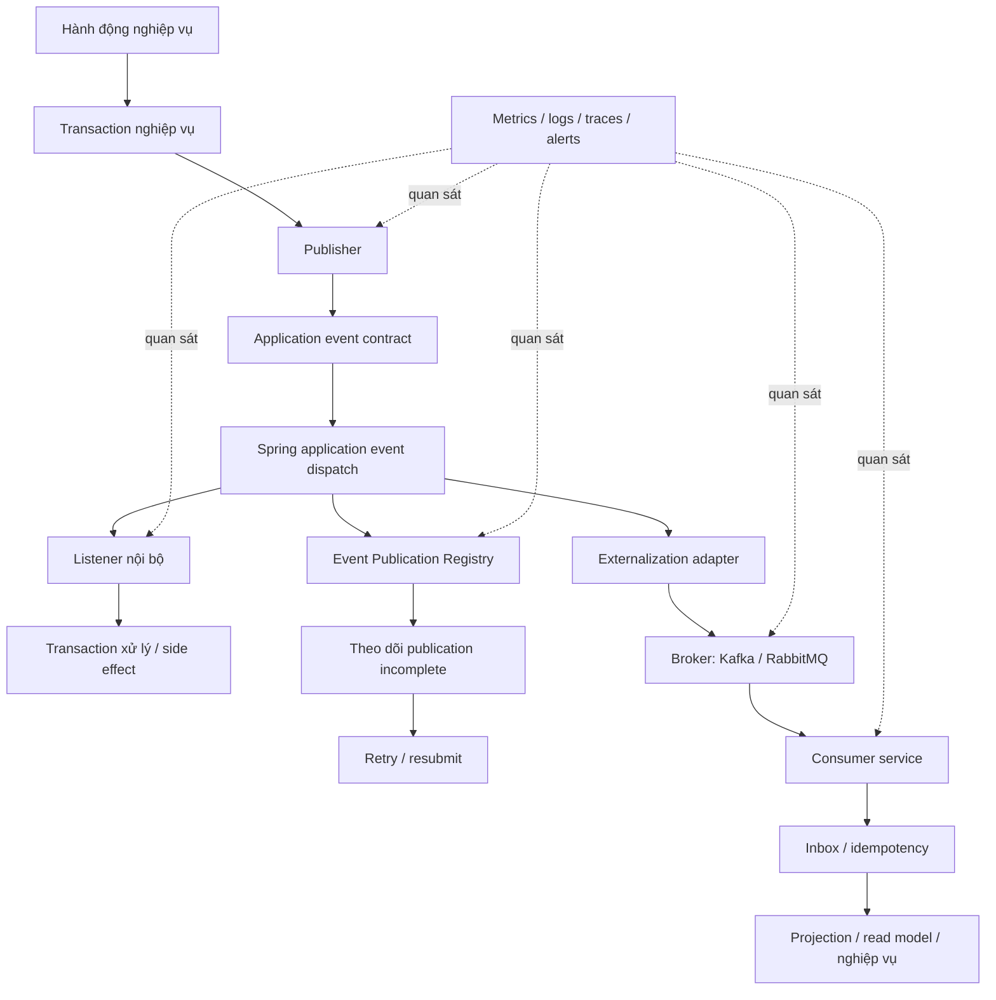
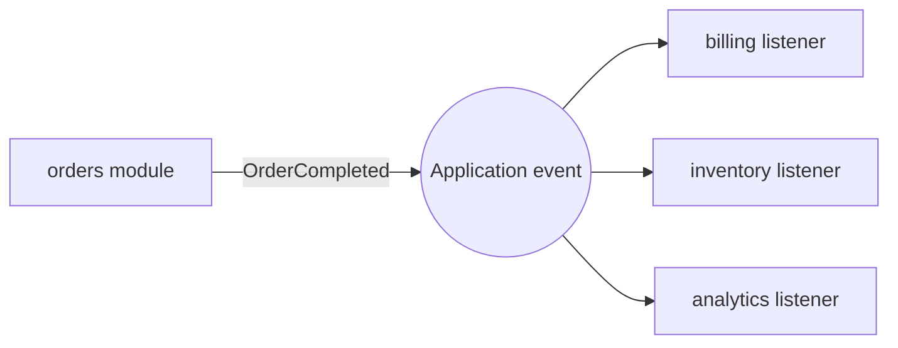
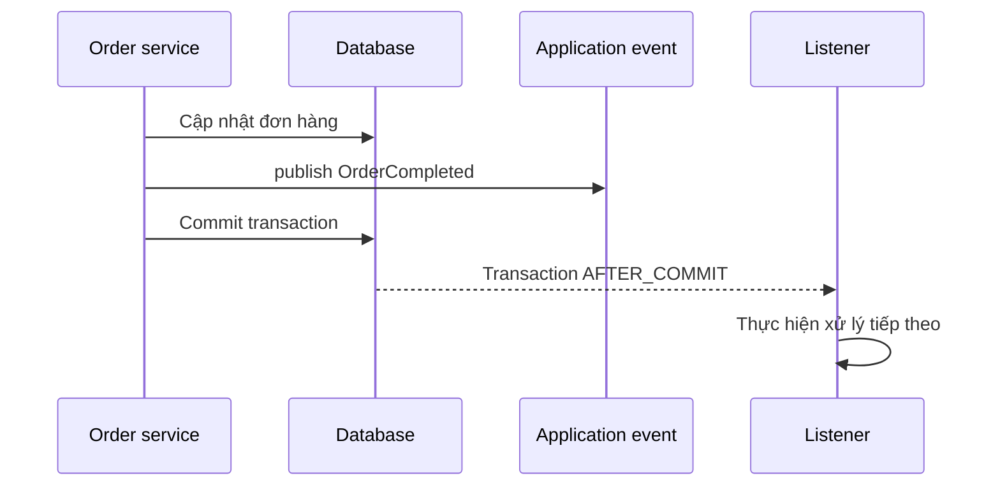
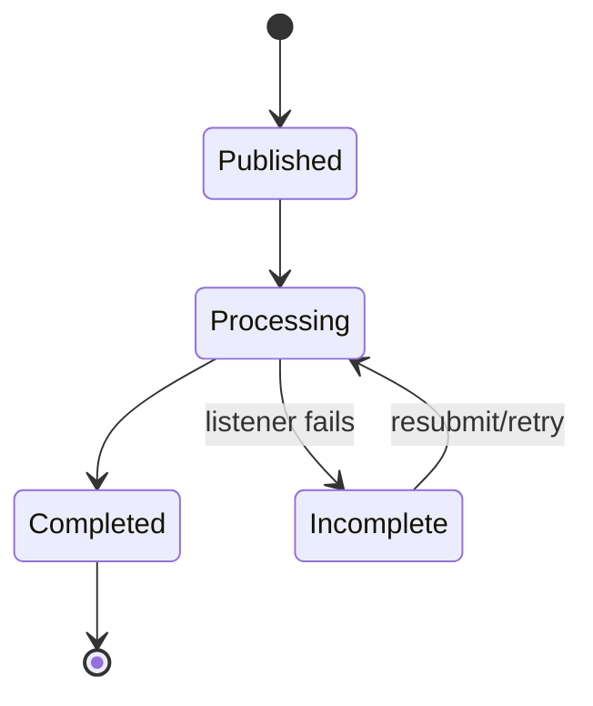
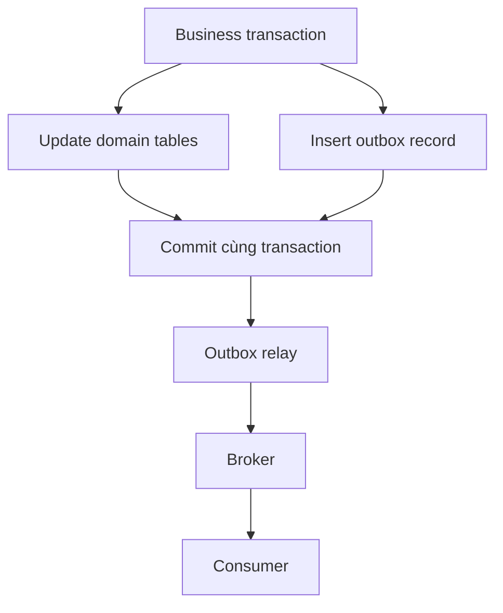
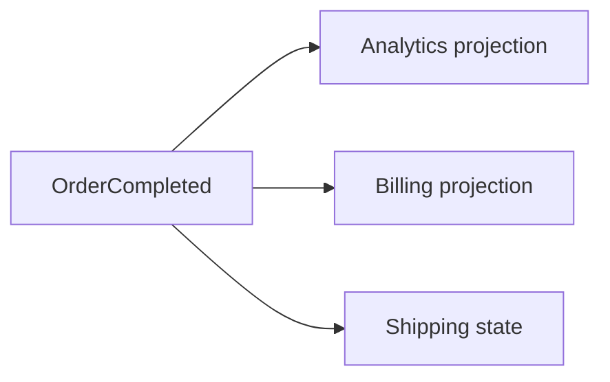

# Bản đồ khái niệm application events trong Spring Modulith

Application events là cơ chế để các module trao đổi thông tin về những điều đã xảy ra mà không cần gọi trực tiếp implementation của nhau. Module phát event công bố một hợp đồng có ý nghĩa nghiệp vụ; các module khác đăng ký listener và tự quyết định cách phản ứng. Spring Modulith bổ sung các cơ chế giúp tổ chức listener theo ranh giới module, xử lý theo transaction, theo dõi publication, externalize event và kiểm thử các luồng giao tiếp.

Trong module `SPRING_MODULITH_APPLICATION_EVENTS`, các khái niệm publisher, listener, transaction phase, Event Publication Registry, retry, broker, serialization, projection, idempotency, security, observability và testing liên kết thành một hệ thống. Bài này là bản đồ tổng hợp: mỗi khái niệm giải quyết phần nào của luồng, các khái niệm phụ thuộc nhau ra sao và nên dùng chúng khi nào.

## 1. Bản đồ tổng thể

Một luồng application event có thể được nhìn qua các lớp: nghiệp vụ phát sinh sự kiện, publisher công bố hợp đồng, cơ chế dispatch giao event tới listener, listener thực hiện side effect, registry/broker hỗ trợ giao nhận đáng tin cậy và observability giúp vận hành.



Sơ đồ biểu diễn các thành phần có thể xuất hiện trong một kiến trúc. Không phải mọi event đều đi qua broker hoặc cần projection. Listener nội bộ có thể xử lý trực tiếp trong ứng dụng; registry được dùng theo loại listener và cấu hình; externalization chỉ áp dụng cho event được chọn.

## 2. Những câu hỏi cốt lõi mà module giải quyết

| Câu hỏi | Nhóm khái niệm liên quan |
| --- | --- |
| Module nào công bố điều gì đã xảy ra? | Domain event, integration event, publisher, event contract |
| Ai nhận và thực hiện hành động tiếp theo? | Listener, module boundary, consumer |
| Event chỉ được xử lý sau khi dữ liệu nguồn commit như thế nào? | Transaction phase, `@TransactionalEventListener`, `@ApplicationModuleListener` |
| Làm sao biết listener đã xử lý xong hay còn lỗi? | Event Publication Registry, publication state, metrics |
| Làm sao phục hồi publication chưa hoàn tất? | Retry, resubmit, idempotency, DLQ/quarantine |
| Làm sao giao event tới service khác? | `@Externalized`, AMQP/Kafka adapter, broker topology |
| Consumer đọc được payload cũ và mới ra sao? | Serialization, schema versioning, compatibility, upcaster |
| Làm sao dựng read model và tránh cập nhật trùng? | Projection, inbox, checkpoint, event sequence |
| Làm sao biết event bị chậm hoặc bị kẹt? | Metrics, logs, traces, alert, runbook |
| Làm sao chứng minh luồng hoạt động đúng? | Unit/integration test, `@ApplicationModuleTest`, `Scenario`, event recording |
| Làm sao mở rộng khi tải tăng? | Concurrency, partition, prefetch, backpressure, autoscaling |
| Làm sao quản lý hợp đồng lâu dài? | Event catalog, ADR, lifecycle, ownership |

## 3. Event, command và ranh giới module

Event mô tả một điều đã xảy ra, ví dụ `OrderPlaced`, `PaymentAuthorized` hoặc `InventoryReserved`. Command biểu đạt yêu cầu thực hiện hành động, ví dụ `PlaceOrder` hoặc `AuthorizePayment`. Phân biệt hai khái niệm này giúp consumer không hiểu nhầm một yêu cầu là kết quả chắc chắn đã thành công.

Trong Spring Modulith, module phát event nên công bố điều có ý nghĩa trong miền nghiệp vụ mà module sở hữu. Consumer phản ứng thông qua listener và cập nhật dữ liệu thuộc trách nhiệm của chính nó. Publisher không cần biết danh sách tất cả consumer.



Mối quan hệ này giúp giảm phụ thuộc compile-time giữa publisher và consumer. Các consumer không nhất thiết là dependency trực tiếp của module phát event. Nếu một consumer cần thêm dữ liệu, nó nên dùng hợp đồng công khai hoặc event payload phù hợp thay vì truy cập database nội bộ của publisher.

### Domain event và integration event

| Loại | Phạm vi | Đặc điểm |
| --- | --- | --- |
| Domain event | Bên trong một bounded context/module | Phản ánh sự kiện miền; có thể dùng kiểu Java phù hợp với nội bộ module |
| Integration event | Qua ranh giới service hoặc hệ thống | Là hợp đồng công khai, cần schema ổn định và chính sách tương thích |

Một domain event có thể được externalize, nhưng việc đó biến payload thành hợp đồng tích hợp cần được quản lý kỹ hơn. Không nên serialize trực tiếp entity hoặc object persistence nội bộ.

## 4. Publisher và event contract

Publisher tạo event khi một điều kiện nghiệp vụ xảy ra và phát nó bằng `ApplicationEventPublisher`.

```java
@Service
class OrderApplicationService {

    private final OrderRepository orders;
    private final ApplicationEventPublisher events;

    OrderApplicationService(
            OrderRepository orders,
            ApplicationEventPublisher events
    ) {
        this.orders = orders;
        this.events = events;
    }

    @Transactional
    public void complete(UUID orderId) {
        Order order = orders.findById(orderId).orElseThrow();
        order.complete();

        events.publishEvent(new OrderCompleted(
                UUID.randomUUID(), orderId, Instant.now()
        ));
    }
}
```

Ví dụ event contract:

```java
public record OrderCompleted(
        UUID eventId,
        UUID orderId,
        Instant completedAt
) {}
```

Một contract tốt cần có ý nghĩa rõ ràng và các trường đủ cho consumer thực hiện trách nhiệm của mình. Những trường thường gặp:

- `eventId`: định danh một event cụ thể, dùng cho trace và deduplication.
- `aggregateId` hoặc business ID: xác định đối tượng nghiệp vụ liên quan.
- `occurredAt`: thời điểm nghiệp vụ xảy ra với semantics được mô tả.
- `schemaVersion`: phiên bản cấu trúc payload.
- `correlationId`: liên kết các event trong cùng workflow.
- `causationId`: event trực tiếp gây ra event hiện tại nếu cần truy vết nhân quả.
- `sequence`/aggregate version: thứ tự trong phạm vi aggregate nếu nghiệp vụ yêu cầu.

Không phải event nào cũng cần mọi metadata. Chỉ thêm trường khi consumer hoặc vận hành có nhu cầu rõ. Tránh đưa PII, access token, entity graph hoặc dữ liệu không cần thiết vào payload.

## 5. Listener và cách xử lý event

Listener là nơi consumer phản ứng với event. Listener nên tập trung vào việc nhận contract và chuyển trách nhiệm tới service sở hữu nghiệp vụ.

```java
@Component
class InventoryOnOrderCompleted {

    private final InventoryService inventory;

    InventoryOnOrderCompleted(InventoryService inventory) {
        this.inventory = inventory;
    }

    @ApplicationModuleListener
    void on(OrderCompleted event) {
        inventory.confirmOrder(event.orderId());
    }
}
```

Các dạng listener thường gặp:

| Dạng | Đặc điểm | Khi dùng |
| --- | --- | --- |
| `@EventListener` | Listener Spring thông thường; có thể chạy đồng bộ theo dispatch | Xử lý đơn giản trong application context |
| `@TransactionalEventListener` | Gắn với transaction phase như `BEFORE_COMMIT`, `AFTER_COMMIT`, `AFTER_ROLLBACK` hoặc `AFTER_COMPLETION` | Khi hành vi phụ thuộc kết quả transaction nguồn |
| `@ApplicationModuleListener` | Listener theo tiện ích Spring Modulith, kết hợp semantics transaction và xử lý module theo cấu hình | Listener module cần xử lý sau commit và theo cơ chế Modulith |

Listener cần giữ ranh giới module: consumer cập nhật dữ liệu do module của nó sở hữu. Nếu listener có logic nghiệp vụ phức tạp, đưa logic vào application/domain service để dễ kiểm thử và tái sử dụng.

## 6. Transaction phase và thời điểm xử lý

Publisher có thể phát event bên trong transaction nghiệp vụ. Nếu listener thực hiện side effect chỉ khi thay đổi nguồn đã commit, dùng transaction-bound listener ở phase phù hợp, thường là `AFTER_COMMIT`.



Các điểm cần nhớ:

- `publishEvent()` không tự chứng minh transaction đã commit.
- Listener `AFTER_COMMIT` chỉ chạy khi transaction nguồn commit thành công theo cấu hình.
- Nếu transaction rollback, listener `AFTER_COMMIT` không thực hiện side effect.
- Sau commit, listener không còn tham gia transaction nguồn; nếu cần ghi database, nó cần transaction xử lý riêng.
- Listener async có thể hoàn tất sau khi publisher trả về.
- Không có transaction phù hợp thì hành vi phụ thuộc `fallbackExecution` và loại listener; cần cấu hình có chủ đích.

Transaction phase trả lời “khi nào được xử lý”. Event Publication Registry trả lời “publication tới listener đã hoàn tất hay chưa”. Hai khái niệm bổ sung cho nhau nhưng không thay thế nhau.

## 7. Event Publication Registry và publication lifecycle

Spring Modulith Event Publication Registry theo dõi publication tới các transactional listener. Khi event được phát, registry ghi nhận các publication cần giao; khi listener hoàn tất theo semantics được quản lý, publication được đánh dấu hoàn tất. Publication lỗi hoặc chưa hoàn tất có thể được quan sát và phục hồi bằng API được hỗ trợ.

Một vòng đời khái quát:



Các ý quan trọng:

- Registry theo dõi publication theo listener; một event có nhiều listener có thể có nhiều publication riêng.
- Persistent registry giúp giữ trạng thái qua restart; registry trong bộ nhớ không cung cấp khả năng phục hồi tương đương.
- `IncompleteEventPublications` là abstraction để làm việc với publication chưa hoàn tất và resubmit theo API phiên bản.
- Nên dùng public API của Spring Modulith thay vì sửa bảng registry trực tiếp.
- Registry không phải event store tổng quát và không mặc định lưu lịch sử mọi event đã hoàn tất để consumer mới replay.
- Trạng thái publication hoàn tất không nhất thiết đồng nghĩa mọi hệ thống downstream đã hoàn tất nghiệp vụ; phải hiểu điểm xác nhận của adapter/listener.

## 8. Retry, resubmit và idempotency

Retry phục hồi lỗi tạm thời, nhưng có thể giao event nhiều lần. Consumer phải được thiết kế để xử lý duplicate an toàn.

Phân loại lỗi trước khi retry:

| Loại lỗi | Ví dụ | Hướng xử lý |
| --- | --- | --- |
| Transient | Timeout ngắn, mất kết nối tạm thời, rate limit | Retry có giới hạn, backoff và jitter |
| Permanent | Payload sai schema, thiếu trường bắt buộc, vi phạm invariant | Quarantine/DLQ và xử lý dữ liệu hoặc code |
| Unknown outcome | API ngoài có thể đã thực hiện side effect nhưng response bị mất | Đối soát hoặc retry với idempotency key ổn định |

Một inbox table có thể lưu event đã xử lý:

```sql
CREATE TABLE consumer_inbox (
    consumer_name VARCHAR(120) NOT NULL,
    event_id       VARCHAR(100) NOT NULL,
    processed_at   TIMESTAMP NOT NULL,
    PRIMARY KEY (consumer_name, event_id)
);
```

Trong cùng transaction, consumer ghi inbox entry và cập nhật read model. Unique constraint giúp chặn hai instance xử lý đồng thời cùng event. Với side effect ngoài database, cần idempotency key ở provider hoặc quy trình đối soát; transaction database không thể rollback một khoản thanh toán hay email đã được hệ thống ngoài ghi nhận.

### Retry và DLQ

- Giới hạn số lần thử và tổng thời gian retry.
- Dùng exponential backoff và jitter để tránh retry storm.
- Không requeue vô hạn poison event.
- Cách ly message lỗi vào DLQ/quarantine với owner và runbook.
- Chỉ resubmit sau khi hiểu nguyên nhân và xác nhận idempotency.
- Theo dõi retry rate, publication age, DLQ depth và kết quả phục hồi.

## 9. Outbox và tính nhất quán giữa database với broker

Một rủi ro phổ biến là cập nhật database thành công nhưng publish message ra broker thất bại, hoặc broker nhận message nhưng producer không nhận được xác nhận. Nếu hai hệ thống không cùng transaction, không thể giả định một lệnh publish đơn lẻ tạo ra atomic commit xuyên suốt.

Transactional outbox giải quyết phần ghi ý định publish bằng cách ghi thay đổi nghiệp vụ và outbox record trong cùng database transaction. Một relay sau đó đọc outbox và gửi message tới broker.



Relay có thể gửi lặp nếu broker đã nhận message nhưng xác nhận bị mất trước khi relay cập nhật trạng thái. Vì vậy outbox giảm nguy cơ mất ý định publish nhưng không loại bỏ nhu cầu idempotency ở consumer.

Event Publication Registry của Spring Modulith và transactional outbox có phạm vi/implementation khác nhau. Hãy hiểu cơ chế persistence, transaction và externalization của phiên bản/adapter đang dùng trước khi quyết định có cần outbox riêng hay không. Không triển khai hai cơ chế trùng lặp nếu chưa có yêu cầu rõ.

## 10. Externalization và broker

Khi consumer nằm ngoài application context hoặc cần giao nhận phân tán, event có thể được externalize qua adapter phù hợp. Spring Modulith hỗ trợ mô hình externalization với `@Externalized` và các integration tương ứng, chẳng hạn AMQP hoặc Kafka theo dependency được chọn.

```java
@Externalized("orders.events::order.completed")
public record OrderCompleted(
        UUID eventId,
        UUID orderId,
        Instant completedAt,
        int schemaVersion
) {}
```

Target và cách ánh xạ exchange/routing key hoặc topic/key phụ thuộc adapter và phiên bản. Không giả định cùng một cú pháp target áp dụng giống nhau cho mọi broker.

### Kafka và RabbitMQ

| Tiêu chí | Kafka | RabbitMQ |
| --- | --- | --- |
| Mô hình | Log/stream theo topic và partition | Exchange định tuyến message tới queue |
| Định tuyến | Topic, key, partition | Exchange type, binding, routing key/header |
| Replay | Đọc lại record còn trong retention theo offset | Queue mới không tự nhận message cũ; cần nguồn replay riêng |
| Thứ tự | Trong một partition | Queue có thứ tự enqueue; nhiều consumer/requeue có thể đổi thứ tự hoàn tất |
| Fan-out | Consumer group riêng | Queue riêng bind cùng exchange |
| Scale | Partition giới hạn mức song song trong group | Competing consumers, prefetch và queue capacity |
| Phù hợp | Event stream, analytics, nhiều consumer cần replay | Task queue, routing linh hoạt, acknowledgement và work distribution |

Chọn broker theo replay/retention, ordering, fan-out, routing, latency, throughput, retry, năng lực vận hành và chi phí. Nếu event chỉ đi giữa module trong cùng ứng dụng, application event nội bộ có thể đủ và đơn giản hơn.

## 11. Serialization, schema và versioning

Khi event đi qua broker, payload cần được serialize. Consumer phải hiểu schema của payload hiện tại và các version cũ còn có thể xuất hiện trong replay.

Một integration event nên định nghĩa:

- Event type và schema version.
- Required/optional fields và quy tắc null.
- Kiểu dữ liệu, format thời gian, currency, đơn vị và enum.
- Ý nghĩa nghiệp vụ của từng trường.
- Quy tắc tương thích backward/forward/transitive.
- Cách xử lý unknown field, unknown enum và missing required field.

Tách event/schema version khỏi producer application version. Một release producer có thể phát nhiều event type và schema version khác nhau.

### Tolerant reader và upcaster

Consumer có thể bỏ qua unknown optional field nếu hợp đồng cho phép. Trường bắt buộc bị thiếu, kiểu dữ liệu sai hoặc ý nghĩa trường thay đổi cần được phát hiện. Không gán default tùy tiện cho dữ liệu nghiệp vụ.

Upcaster/adapter có thể chuyển payload version cũ sang canonical model để phần logic nghiệp vụ không phải xử lý nhiều định dạng. Upcaster nên là bước xác định, không gọi mạng hoặc thay đổi database. Nếu version cũ thiếu thông tin không thể suy ra, consumer phải lấy từ nguồn khác hoặc đánh dấu dữ liệu không đầy đủ.

Schema Registry giúp quản lý schema và compatibility nhưng không tự đảm bảo semantics nghiệp vụ. Contract test vẫn cần kiểm tra payload fixture từ các version còn được hỗ trợ.

## 12. Consumer mới, backfill và replay

Thêm listener mới không mặc định khiến listener nhận lại mọi event đã phát trước khi nó được đăng ký. Event Publication Registry theo dõi publication theo listener đã được ghi nhận; nó không phải kho lịch sử tổng quát cho consumer mới.

Nguồn replay có thể là:

- Kafka record còn trong retention.
- Event store hoặc stream archive.
- Snapshot/export từ database nghiệp vụ.
- API của module sở hữu dữ liệu với watermark ổn định.

RabbitMQ queue mới không tự nhận message đã được publish trước khi queue/binding tồn tại. Nếu consumer cần lịch sử, phải có nguồn backfill khác.

### Backfill đồng thời live traffic

Một quy trình cần watermark/cursor rõ ràng:

1. Chọn watermark W từ offset, sequence hoặc cursor ổn định.
2. Bắt đầu giữ live stream từ W hoặc vị trí có thể bao phủ event mới.
3. Replay lịch sử tới W.
4. Hợp nhất replay với live traffic và deduplicate phần overlap.
5. Xác nhận consumer đã catch up và đối soát với nguồn chuẩn.

Không dùng timestamp tùy ý làm sequence nếu event có thể đến muộn hoặc đồng hồ producer lệch nhau.

## 13. Projection và read model

Projection là dữ liệu được xây dựng từ event để phục vụ truy vấn hoặc một mục đích tiêu thụ cụ thể. Ví dụ module analytics nhận `OrderCompleted` và cập nhật tổng doanh thu; module shipping nhận event và tạo trạng thái vận chuyển.



Read model thường thuộc quyền sở hữu của consumer. Publisher không cần biết cách projection được lưu. Khi projection có thể được dựng lại từ event history, cần xác định nguồn replay, checkpoint, version và chính sách xóa dữ liệu.

Các vấn đề cần quản lý:

- Projection có chấp nhận eventual consistency không?
- Event có thể bị duplicate hoặc đến sai thứ tự không?
- Cần rebuild projection từ đầu hay chỉ cập nhật gia tăng?
- Checkpoint có được commit cùng projection không?
- Consumer mới có nguồn backfill đầy đủ không?
- Khi schema thay đổi, projection có cần rebuild/upcast không?

## 14. Sequence, ordering và concurrency

Thứ tự publish không luôn bằng thứ tự listener hoàn tất. Với listener bất đồng bộ, nhiều event có thể được xử lý đồng thời. Cần xác định invariant cần giữ:

- Thứ tự theo aggregate.
- Thứ tự trong một partition/queue.
- Thứ tự bắt đầu xử lý.
- Thứ tự hoàn tất side effect.
- Quan hệ nhân quả giữa event trước và event sau.

Nếu cần thứ tự theo aggregate, có thể dùng aggregate ID làm Kafka partition key, serialize xử lý theo key hoặc kiểm tra sequence/version trong consumer. Không áp đặt thứ tự toàn cục khi chỉ cần thứ tự theo từng aggregate.

Khi tăng concurrency, phải xem database connection pool, downstream rate limit, broker partition, prefetch và queue capacity. Tăng thread có thể làm hệ thống quá tải hơn nếu bottleneck nằm ở database hoặc API ngoài.

## 15. Security và data minimization

Event payload là một kênh dữ liệu có thể được lưu trong registry, broker, DLQ, log, trace, backup và công cụ quản trị. Cần bảo vệ toàn bộ vòng đời dữ liệu.

- Chỉ đưa trường consumer cần dùng vào payload.
- Phân loại dữ liệu và đánh dấu trường PII/sensitive.
- Dùng pseudonymization/tokenization khi phù hợp; token vẫn có thể là dữ liệu cá nhân nếu liên kết được.
- Mask dữ liệu trong log; không ghi toàn bộ payload production.
- Mã hóa kết nối broker bằng TLS và bảo vệ dữ liệu lưu trữ theo nền tảng.
- Dùng identity/ACL riêng cho publisher và consumer.
- Giới hạn quyền đọc queue, topic, DLQ, message browser và backup.
- Đặt retention theo mục đích và yêu cầu dữ liệu.
- Không đưa PII, access token hoặc secret vào routing key, metric label hay trace baggage.

Security là thuộc tính của hợp đồng và vận hành, không chỉ là cấu hình broker.

## 16. Observability: metrics, logs, traces và alert

Để biết event có được giao đáng tin cậy, cần quan sát cả publication nội bộ và consumer/broker.

| Tín hiệu | Ví dụ | Câu hỏi được trả lời |
| --- | --- | --- |
| Metrics | Incomplete count, oldest age, completion rate, failure rate | Bao nhiêu publication đang chờ và có tiến triển không? |
| Broker metrics | Queue depth, consumer lag, unacked, DLQ | Broker/consumer có bị nghẽn không? |
| Logs | Event ID, listener, exception class, result | Một lần xử lý cụ thể thất bại vì sao? |
| Traces | Trace/correlation ID qua publisher, broker và consumer | Thời gian bị tiêu tốn ở chặng nào? |
| Alerts | Age vượt SLO, no progress, DLQ tăng | Khi nào cần người vận hành can thiệp? |

Metric custom có thể được xuất qua Micrometer. Tên metric và cách export phụ thuộc ứng dụng; không mặc định mọi metric đều được Spring Modulith xuất sẵn. Dùng label có tập giá trị hữu hạn như consumer, event type, destination và result. Không đưa event ID, order ID, email hoặc customer ID vào label vì cardinality cao.

### Alert event bị kẹt

Một alert tốt kết hợp tuổi publication, backlog và tiến triển. Chỉ có số publication incomplete lớn chưa đủ kết luận event bị kẹt. Alert nên nêu listener/consumer, event type, tuổi lớn nhất, số lượng đang chờ, thời gian không có tiến triển, tác động nghiệp vụ và link tới dashboard/runbook.

Runbook nên kiểm tra theo thứ tự: phạm vi/tác động, registry, listener health, thread pool, database, broker, retry/DLQ và dependency ngoài. Chỉ resubmit sau khi xác định lỗi và đánh giá idempotency. Không xóa publication hoặc đánh dấu hoàn tất bằng SQL để làm dashboard sạch.

## 17. Testing: chứng minh từng lớp của luồng

Không một loại test nào chứng minh toàn bộ semantics. Chọn cấp độ theo điều cần xác nhận.

| Cấp độ | Công cụ/cách tiếp cận | Mục tiêu |
| --- | --- | --- |
| Unit test | JUnit, Mockito | Logic listener, mapping, nhánh nghiệp vụ, idempotency |
| Spring integration | Application context, `ApplicationEventPublisher` | Spring phát hiện và dispatch listener thật |
| Module test | `@ApplicationModuleTest` | Kiểm tra module trong ranh giới kiến trúc |
| Scenario test | `Scenario` | Publish event và chờ event kết quả theo điều kiện |
| Event recording | `@RecordApplicationEvents`, `ApplicationEvents` | Kiểm tra event nào được publish và thứ tự publish |
| Transaction test | Commit/rollback thật | Xác nhận `AFTER_COMMIT` và transaction riêng của listener |
| Registry test | Persistent registry, `IncompleteEventPublications` | Publication incomplete và resubmit |
| Broker integration | Testcontainers/broker test | Serialization, routing, partition, ack, retry và DLQ |
| Contract test | Schema fixture/compatibility check | Consumer đọc được payload cũ và mới |
| Load/failure test | Workload và fault injection | Capacity, redelivery, outage và recovery |

### Bootstrap dependency trong module test

`@ApplicationModuleTest` có các bootstrap mode để chọn phạm vi context:

| Mode | Phạm vi |
| --- | --- |
| `STANDALONE` | Chỉ module đang kiểm thử |
| `DIRECT_DEPENDENCIES` | Module và dependency trực tiếp |
| `ALL_DEPENDENCIES` | Module cùng dependency trực tiếp/gián tiếp |
| `ALL` | Toàn bộ application modules |

Mode quyết định module nào được bootstrap, không tự động mock các hệ thống ngoài. Chọn mode nhỏ nhất đủ trả lời câu hỏi test. Với publisher và listener không có dependency trực tiếp, test từng module riêng rồi thêm một số workflow test rộng khi cần.

### Scenario và event sequence

`Scenario` có thể publish event và chờ event kết quả. `@RecordApplicationEvents` giúp quan sát thứ tự event được publish. Cần phân biệt publish order với listener start/completion order, nhất là khi xử lý async. Lọc theo aggregate/correlation ID; không áp đặt thứ tự toàn cục cho các nhánh độc lập.

Test async nên đợi điều kiện có ý nghĩa với timeout hữu hạn, không dùng `Thread.sleep()` cố định. Test `AFTER_COMMIT` phải commit transaction thật; test method tự rollback có thể khiến listener không chạy.

## 18. Mở rộng consumer và vận hành production

Mở rộng consumer là cân bằng giữa tốc độ event đến, throughput xử lý và giới hạn dependency.

Các chỉ số cần theo dõi:

- Arrival rate và completion/ack rate.
- Backlog, oldest message age và consumer lag.
- Processing duration p50/p95/p99.
- Executor active threads, queue size và rejected tasks.
- Database connection acquisition, lock wait và query latency.
- Retry rate, DLQ depth và publication incomplete.
- CPU, memory, GC, network và downstream latency.

Mô hình scale phụ thuộc cơ chế:

- Listener nội bộ: điều chỉnh executor/concurrency của process; thêm replica không tự chia event đang chờ trong executor cục bộ.
- Kafka: tăng consumer instance trong group tới giới hạn partition; partition key ảnh hưởng ordering và phân phối tải.
- RabbitMQ: tăng competing consumers, điều chỉnh prefetch và queue topology; nhiều consumer có thể làm thứ tự hoàn tất khác thứ tự enqueue.

Backpressure cần bounded queue, concurrency cap, timeout, rate limit và policy overload rõ. Không dùng queue vô hạn hoặc tăng replica vô hạn để che giấu bottleneck. Nếu database/provider quá tải, tăng concurrency có thể làm tình hình tệ hơn.

Graceful shutdown cần ngừng nhận công việc mới, hoàn tất hoặc trả lại tác vụ in-flight, commit dữ liệu trước ack/offset theo thiết kế và dựa vào idempotency khi có redelivery. Health check phải phân biệt liveness, readiness và consumer progress; backlog cao không nhất thiết là lý do restart process.

## 19. Event catalog, ownership và quyết định kiến trúc

Event catalog là danh mục các event contract được công bố. Một entry hữu ích có:

- Event name/type và ý nghĩa nghiệp vụ.
- Module sở hữu, owner team và trigger.
- Schema version, required/optional fields và schema reference.
- Publisher, transaction phase và internal/external delivery.
- Consumer và mục đích sử dụng.
- Ordering, delivery semantics, retry và idempotency.
- Data classification, PII, retention và authorization.
- Lifecycle: Proposed, Active, Deprecated, Retired.
- Dashboard, metrics và runbook.

Catalog khác schema registry, source code, Event Publication Registry và event store. Nó mô tả hợp đồng và nơi tra cứu; không lưu trạng thái runtime từng publication và không mặc định giữ lịch sử event.

Các quyết định lớn như chọn broker, chọn delivery semantics, retention, schema policy và topology nên được ghi bằng ADR. ADR lưu context, decision drivers, options, decision, consequences và migration/exit plan. Catalog và ADR nên được cập nhật cùng thay đổi code/schema để không trở thành tài liệu lỗi thời.

## 20. Các khái niệm liên kết với nhau như thế nào?

Bảng này tóm tắt quan hệ phụ thuộc giữa các phần:

| Bắt đầu từ | Cần nghĩ tiếp tới | Vì sao |
| --- | --- | --- |
| Thiết kế event contract | Schema versioning, ownership, security | Consumer cần hiểu payload và quyền sử dụng |
| Gọi `publishEvent()` trong transaction | Transaction phase, registry, outbox/externalization | Đảm bảo event phản ánh thay đổi đã commit và có thể phục hồi |
| Thêm listener | Idempotency, transaction riêng, failure handling | Listener có thể chạy lại hoặc thất bại sau side effect |
| Externalize event | Broker, serialization, routing, ack/confirm | Giao nhận qua mạng có failure mode riêng |
| Chọn Kafka/RabbitMQ | Ordering, fan-out, retention, scale, operations | Topology quyết định khả năng replay và phân phối |
| Thêm consumer mới | Schema compatibility, backfill, watermark, dedup | Consumer có thể cần lịch sử và gặp nhiều schema version |
| Xây projection | Checkpoint, sequence, rebuild, consistency | Read model phải chống duplicate/gap và có thể phục hồi |
| Tăng concurrency | Backpressure, database capacity, retry, ordering | Scale không được phá invariant hoặc quá tải dependency |
| Cần alert | Metrics, logs, traces, SLO, runbook | Người vận hành phải biết vị trí nghẽn và cách phục hồi |
| Thay đổi event | Catalog, ADR, consumer inventory, deprecation | Hợp đồng có nhiều consumer và vòng đời dài |

## 21. Luồng thiết kế từ yêu cầu tới production

Có thể dùng trình tự sau khi thiết kế một luồng event mới:

1. **Xác định nghiệp vụ:** điều gì đã xảy ra, module nào sở hữu sự thật và consumer cần phản ứng gì?
2. **Thiết kế contract:** event type, payload, ID, schema version, correlation và sequence nếu cần.
3. **Chọn dispatch:** listener nội bộ hay externalized event; không thêm broker nếu chưa cần.
4. **Xác định transaction:** event được phát trong transaction nào, listener chạy ở phase nào và có transaction riêng không?
5. **Chọn reliability:** persistent publication tracking, outbox nếu cần, retry, idempotency và DLQ.
6. **Chọn broker:** dựa trên replay, routing, fan-out, ordering, throughput, retention và năng lực vận hành.
7. **Thiết kế consumer:** validate schema, cập nhật dữ liệu sở hữu, inbox/checkpoint và xử lý duplicate/gap.
8. **Kiểm thử:** unit, module, scenario, transaction, registry, broker và contract test theo rủi ro.
9. **Quan sát:** metric, log, trace, alert, dashboard và runbook.
10. **Triển khai:** rollout tương thích schema, capacity limit, graceful shutdown và kế hoạch rollback.
11. **Quản lý vòng đời:** cập nhật event catalog, ADR, consumer inventory và deprecation plan.

## 22. Checklist rà soát một luồng application event

- [ ] Event biểu đạt một sự kiện nghiệp vụ đã xảy ra, không phải command trá hình.
- [ ] Module owner và consumer được xác định.
- [ ] Payload chỉ chứa dữ liệu cần thiết và có schema rõ.
- [ ] Event ID, aggregate ID và sequence/correlation được dùng đúng mục đích.
- [ ] Transaction phase phù hợp với thời điểm side effect.
- [ ] Listener có transaction xử lý phù hợp và idempotent.
- [ ] Publication tracking/recovery được cấu hình theo yêu cầu.
- [ ] Externalization/broker chỉ được dùng khi cần ranh giới phân tán.
- [ ] Routing, fan-out, ordering, retention và acknowledgement đã được xác định.
- [ ] Retry có giới hạn, backoff và DLQ/quarantine.
- [ ] Consumer xử lý schema cũ/mới, duplicate và event đến muộn.
- [ ] Projection có checkpoint/rebuild strategy nếu cần.
- [ ] PII, ACL, encryption và retention được đánh giá.
- [ ] Metrics, logs, traces, alert và runbook đủ để vận hành.
- [ ] Test chứng minh dispatch, transaction, sequence, failure và recovery.
- [ ] Event catalog và ADR được cập nhật cùng thay đổi.

## 23. Những hiểu nhầm cần tránh

| Hiểu nhầm | Cách hiểu đúng |
| --- | --- |
| `publishEvent()` nghĩa là mọi consumer đã xử lý xong | Nó chỉ phát event; listener có thể async hoặc sau commit |
| Event Publication Registry là event store | Registry theo dõi publication; lịch sử replay cần nguồn riêng |
| Publication `COMPLETED` nghĩa là toàn bộ downstream hoàn tất | Chỉ có nghĩa publication được xác nhận hoàn tất tại ranh giới được quản lý |
| Thêm listener mới sẽ nhận toàn bộ event cũ | Listener mới thường nhận event sau khi đăng ký; backfill cần nguồn lịch sử |
| Broker bảo đảm exactly-once cho toàn workflow | Side effect database/API ngoài vẫn có thể lặp; consumer cần idempotency |
| Kafka có thứ tự toàn cục | Kafka giữ thứ tự trong từng partition |
| RabbitMQ queue mới nhận message cũ | Queue/binding mới không tự replay message đã publish trước đó |
| Tăng consumer luôn tăng throughput | Partition, database, broker và downstream có thể là bottleneck |
| Event recording chứng minh listener hoàn tất | Nó ghi nhận event được publish; cần trạng thái/probe để chứng minh xử lý hoàn tất |
| Mọi event nên externalize | Event nội bộ có thể đủ khi module cùng application context |

## 24. Lộ trình học và áp dụng

Có thể tiếp cận module theo các tầng tăng dần:

1. Nắm event, command, publisher, listener và module boundary.
2. Thực hành listener đồng bộ, `AFTER_COMMIT` và `@ApplicationModuleListener`.
3. Hiểu Event Publication Registry, trạng thái incomplete và resubmit.
4. Thiết kế retry, idempotency, outbox và xử lý duplicate.
5. Externalize event, chọn broker và cấu hình serialization/schema.
6. Xây consumer, projection, backfill và event sequence.
7. Kiểm thử listener, module dependency, Scenario và broker integration.
8. Bổ sung security, metrics, alert, runbook và capacity planning.
9. Quản lý event catalog, schema lifecycle và ADR.
10. Kết hợp các phần thành một workflow production có quan sát và phục hồi.

Bản đồ khái niệm cho thấy application events không chỉ là thao tác publish và một phương thức listener. Đó là hợp đồng giao tiếp giữa các module, gắn với transaction, persistence, delivery, schema, consumer behavior, security và vận hành. Khi thiết kế từng phần theo đúng ranh giới và liên kết chúng bằng test, catalog cùng observability, Spring Modulith giúp hệ thống mở rộng giao tiếp theo event mà vẫn giữ được tính nhất quán và khả năng kiểm soát.
