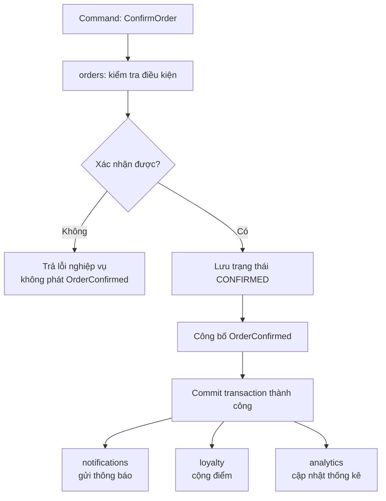
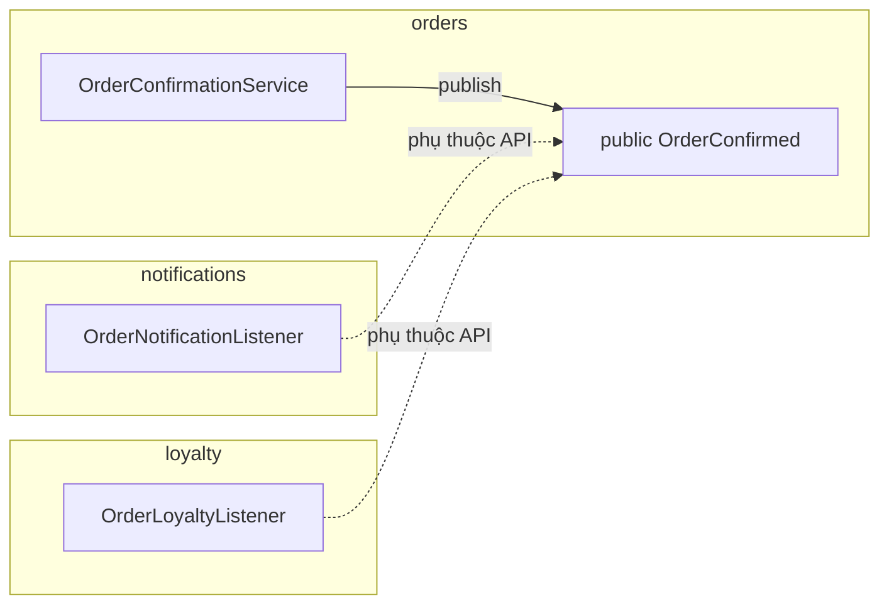
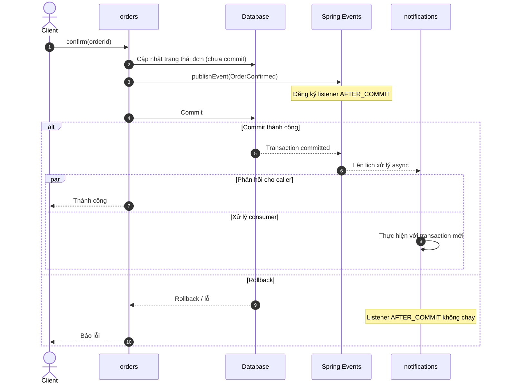
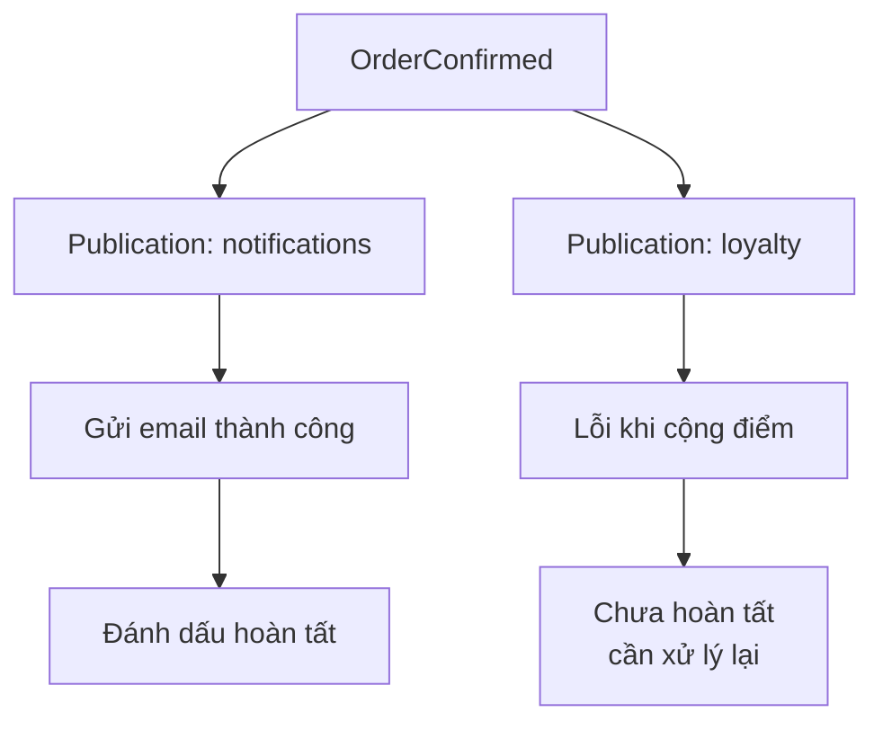

# Sự kiện nghiệp vụ trong mô hình application events của Spring Modulith

## 1. Sự kiện nghiệp vụ là gì?

**Sự kiện nghiệp vụ** (*business event*, thường được diễn đạt dưới dạng *domain event*) là một sự thật có ý nghĩa đối với nghiệp vụ và **đã xảy ra** trong hệ thống. Sự kiện thường đánh dấu thay đổi trạng thái hoặc một mốc quan trọng mà các bộ phận khác có thể cần biết.

Ví dụ trong một hệ thống bán hàng:

- `OrderConfirmed`: đơn hàng đã được xác nhận.
- `PaymentCaptured`: khoản thanh toán đã được thu thành công.
- `InventoryReserved`: lượng hàng cần thiết đã được giữ.
- `CustomerRegistered`: tài khoản khách hàng đã được tạo.

Trong **Spring Modulith**, sự kiện nghiệp vụ là cách các application module trao đổi thông tin mà vẫn bảo vệ ranh giới. Module `orders` công bố `OrderConfirmed`; module `notifications` có thể gửi email, module `loyalty` có thể cộng điểm và module `analytics` có thể ghi nhận số liệu. Module `orders` không cần gọi trực tiếp ba service đó.

Mục tiêu của bài là hiểu cách **nhận diện, đặt tên, thiết kế dữ liệu và sử dụng sự kiện nghiệp vụ** trong mô hình application events, đồng thời thấy được tác động của transaction, khả năng xử lý lại và độ tin cậy.

## 2. Phân biệt event, command, trạng thái và tín hiệu kỹ thuật

Không phải thông tin nào được truyền qua `ApplicationEventPublisher` cũng nên được coi là sự kiện nghiệp vụ.

| Khái niệm | Ý nghĩa | Ví dụ | Tính chất |
|---|---|---|---|
| **Command** | Yêu cầu thực hiện một hành động; có thể bị từ chối | `ConfirmOrder`, `CapturePayment` | Hướng tới tương lai, thường cần xử lý kết quả |
| **Business/domain event** | Ghi nhận một sự thật nghiệp vụ đã xảy ra | `OrderConfirmed`, `PaymentCaptured` | Hướng về quá khứ, không phải yêu cầu hành động |
| **State** | Trạng thái hiện tại của đối tượng | `order.status = CONFIRMED` | Có thể thay đổi theo thời gian |
| **Technical event** | Thông báo từ hạ tầng, không nhất thiết có ý nghĩa nghiệp vụ | `CacheInvalidated`, `ConnectionOpened` | Chủ yếu phục vụ vận hành/kỹ thuật |

Chẳng hạn, `ConfirmOrder` là hành động **được yêu cầu**; ứng dụng phải kiểm tra đơn có hợp lệ và còn có thể xác nhận không. Chỉ sau khi quyết định nghiệp vụ thành công, `OrderConfirmed` mới diễn tả đúng sự thật đã xảy ra.

Một sự kiện cần diễn đạt **điều đã thay đổi** hoặc **mốc nghiệp vụ đã đạt**, không mô tả chi tiết một consumer cần làm gì:

- Tốt: `OrderConfirmed`. Module nào quan tâm có thể tự phản ứng.
- Kém phù hợp: `SendOrderConfirmationEmail`. Tên này mã hóa hành động của riêng module email, khiến event phụ thuộc ngược vào nhu cầu consumer.
- Quá chung: `OrderUpdated`. Consumer khó biết thay đổi nào có ý nghĩa và vì sao nó nên phản ứng.

**Quy tắc đặt tên:** dùng tên nghiệp vụ cụ thể, thường ở thì quá khứ; không lạm dụng hậu tố `Event` nếu ngữ cảnh đã rõ. Với business event, tên quan trọng hơn công nghệ dùng để truyền nó.

## 3. Từ diễn biến nghiệp vụ đến danh sách sự kiện

Xét tình huống khách hàng đặt một đơn hàng:

1. Người dùng gửi yêu cầu xác nhận.
2. Module `orders` kiểm tra điều kiện: mặt hàng, số lượng, trạng thái đơn.
3. Module `orders` chuyển trạng thái đơn sang `CONFIRMED`.
4. Các module khác phản ứng với việc đơn đã được xác nhận.

Ta có thể mô hình hóa như sau:



Đây là **sơ đồ nghiệp vụ**: ở bước `Công bố OrderConfirmed`, publisher gọi API sự kiện trong transaction, còn các listener sau commit chỉ bắt đầu xử lý **khi transaction hoàn tất thành công**. Các consumer không được giả định chạy theo thứ tự N → L → A.

Một cách xác định event có giá trị là tự hỏi:

1. **Điều gì vừa xảy ra mà người làm nghiệp vụ cũng hiểu?** Ví dụ: đơn đã xác nhận, tiền đã thu, hàng đã dành.
2. **Module nào cần biết điều đó?** Nếu không có consumer hiện tại, event vẫn có thể có ý nghĩa để phục vụ kiểm toán hoặc mở rộng sau này, nhưng không nên phát mọi thay đổi nhỏ.
3. **Thời điểm nào điều đó được coi là sự thật?** Sau khi invariant được kiểm tra và transaction thay đổi dữ liệu thành công.
4. **Nếu consumer nhận sau vài giây hoặc nhận lại nhiều lần, nó vẫn xử lý được không?** Câu trả lời ảnh hưởng thiết kế payload và idempotency.

## 4. Hợp đồng sự kiện: dữ liệu đủ dùng, bất biến, có ý nghĩa

Một Java `record` phù hợp làm biểu diễn event trong JVM:

```java
package com.example.shop.orders;

import java.time.Instant;
import java.util.UUID;

public record OrderConfirmed(
        UUID eventId,
        UUID orderId,
        Instant occurredAt
) {
}
```

Ở ví dụ này:

| Trường | Ý nghĩa | Lưu ý |
|---|---|---|
| `eventId` | Định danh **lần phát sinh event** | Hỗ trợ đối chiếu log và phát hiện việc xử lý lại **cùng một event** |
| `orderId` | Định danh đối tượng nghiệp vụ | Consumer có thể đối chiếu hoặc tra cứu qua API công khai phù hợp |
| `occurredAt` | Thời điểm nghiệp vụ ghi nhận event | Khác với thời điểm listener nhận được; không nhất thiết trùng thời điểm commit |

`record` giúp payload bất biến nếu các thành phần bên trong cũng bất biến. `UUID` và `Instant` phù hợp với điều đó; với `List`, `Map` hoặc đối tượng mutable, vẫn phải sao chép phòng vệ hoặc dùng kiểu bất biến thực sự.

### Nên đưa những gì vào payload?

- **Đủ dữ liệu để consumer hiểu sự kiện:** loại sự kiện, ID đối tượng, những thuộc tính nghiệp vụ thật sự cần thiết.
- **ID ổn định để đối chiếu:** `eventId` cho việc nhận lại chính event đó; `orderId` cho đối tượng liên quan. Hai ID giải quyết hai bài toán khác nhau.
- **Thông tin phiên bản nếu hợp đồng sống lâu:** có thể thêm `eventVersion` hoặc xác định phiên bản qua tên loại/schema khi cần tương thích.
- **Thông tin trace nếu cần quan sát xuyên luồng:** `correlationId` giúp liên kết các bước của cùng một hành trình nghiệp vụ. Không nên dùng nó thay cho `eventId`.

Hạn chế đưa vào payload:

- Entity JPA đang được quản lý, Hibernate proxy hoặc quan hệ lazy.
- Service/repository, request HTTP, `SecurityContext` hay đối tượng gắn với thread.
- Thông tin bí mật hoặc dữ liệu cá nhân không cần cho consumer.
- Một bản sao quá lớn của toàn bộ đối tượng chỉ vì “có thể sau này cần”.

**Payload tối giản không đồng nghĩa luôn chỉ có ID.** Nếu listener phải hiểu trạng thái tại **thời điểm event xảy ra**, việc truy vấn đơn hàng hiện tại sau đó có thể cho kết quả khác. Khi đó nên đưa snapshot **các trường cần thiết và được phép chia sẻ** vào event, thay vì chỉ dựa vào truy vấn dữ liệu thay đổi theo thời gian.

Ví dụ, để tính điểm theo tổng tiền tại thời điểm xác nhận, có thể có event `OrderConfirmed` kèm `confirmedTotal` và `currency`. Giá trị này là snapshot nghiệp vụ và cần quy ước rõ cách làm tròn, đơn vị tiền tệ.

## 5. Ranh giới module và hướng phụ thuộc

Các module có thể được tổ chức như sau:

```text
com.example.shop
├── ShopApplication.java
├── orders
│   ├── OrderConfirmed.java          # Hợp đồng công khai
│   ├── OrderConfirmationService.java
│   └── internal
│       ├── Order.java
│       └── OrderRepository.java
├── notifications
│   └── OrderNotificationListener.java
└── loyalty
    └── OrderLoyaltyListener.java
```

Trong cách tổ chức module theo package mặc định của Spring Modulith, các package con trực tiếp của package ứng dụng có thể tương ứng với application module. `OrderConfirmed` đặt tại package gốc `orders` và để `public` giúp module tiêu thụ sử dụng hợp đồng này mà không phụ thuộc vào `orders.internal`.

Consumer **vẫn phụ thuộc vào kiểu event công khai của publisher**; event không xóa mọi phụ thuộc. Điều được cải thiện là module phát không cần biết tên các module tiếp nhận, interface của service tiếp nhận hoặc chuỗi tác vụ phía sau sự kiện.

Nếu sự kiện nằm trong package con như `orders.events`, cần kiểm tra quy tắc API của module và có thể công khai package đó qua **named interface** của Spring Modulith. Không nên làm lộ toàn bộ package nội bộ chỉ để chia sẻ một event.



Sơ đồ nét đứt biểu diễn **phụ thuộc type/contract** từ consumer tới publisher; việc phát và phân phối tại runtime do Spring quản lý.

## 6. Phát sự kiện tại ranh giới nghiệp vụ hợp lệ

Sau khi xác nhận rằng đơn hàng chuyển từ trạng thái chưa xác nhận sang xác nhận, module `orders` phát `OrderConfirmed` bằng `ApplicationEventPublisher`:

```java
package com.example.shop.orders;

import com.example.shop.orders.internal.Order;
import com.example.shop.orders.internal.OrderRepository;
import java.time.Clock;
import java.util.UUID;
import org.springframework.context.ApplicationEventPublisher;
import org.springframework.stereotype.Service;
import org.springframework.transaction.annotation.Transactional;

@Service
public class OrderConfirmationService {

    private final OrderRepository orders;
    private final ApplicationEventPublisher events;
    private final Clock clock;

    public OrderConfirmationService(
            OrderRepository orders,
            ApplicationEventPublisher events,
            Clock clock) {
        this.orders = orders;
        this.events = events;
        this.clock = clock;
    }

    @Transactional
    public void confirm(UUID orderId) {
        Order order = orders.findById(orderId)
                .orElseThrow(() -> new IllegalArgumentException(
                        "Không tìm thấy đơn hàng: " + orderId));

        if (order.isConfirmed()) {
            return;  // Ví dụ: đã xác nhận thì không phát thêm event.
        }

        order.confirm(); // Kiểm tra invariant và đổi trạng thái.
        orders.save(order);

        events.publishEvent(new OrderConfirmed(
                UUID.randomUUID(),
                order.getId(),
                clock.instant()));
    }
}
```

Các kiểu `Order` và `OrderRepository` là ví dụ thuộc module `orders`, chưa trình bày implementation. Giả định ứng dụng đã cấu hình `Clock` bean và cơ sở dữ liệu/transaction manager phù hợp.

Có ba điểm dễ nhầm:

1. **“Đã phát” không đồng nghĩa “đã commit”.** `publishEvent(...)` được gọi ngay trong transaction đang xử lý. Transaction có thể thất bại hoặc rollback sau đó.
2. **Phát event sau thay đổi trạng thái nghiệp vụ có chủ đích.** Event không nên được tạo chỉ vì repository thực hiện `save(...)`; cùng một đối tượng có thể được lưu nhiều lần mà không phát sinh mốc nghiệp vụ mới.
3. **Chống lặp ở cấp command và cấp event là hai lớp khác nhau.** Ví dụ kiểm tra `isConfirmed()` tránh phát event khi đơn đã được xác nhận, nhưng dưới truy cập đồng thời vẫn cần xử lý cạnh tranh như optimistic locking để không tạo hai quyết định xác nhận cùng lúc.

### Khi nào event có thể được tạo từ aggregate?

Trong thiết kế Domain-Driven Design, aggregate có thể ghi nhận domain events của chính nó khi thay đổi trạng thái. Spring Data cung cấp cơ chế như `@DomainEvents` hoặc `AbstractAggregateRoot` để công bố những event đã được aggregate đăng ký thông qua hoạt động repository thích hợp.

Cách dùng này hữu ích nếu muốn **quyết định nghiệp vụ và event cùng nằm trong aggregate**. Tuy nhiên, đó là một lựa chọn thiết kế riêng; không bắt buộc để sử dụng Spring Modulith. Trong ví dụ trên, application service tự phát qua `ApplicationEventPublisher` giúp luồng dễ quan sát. Dù dùng cách nào, cần bảo đảm event được công bố đúng một lần cho mỗi chuyển trạng thái có ý nghĩa và nằm trong ranh giới transaction mong muốn.

## 7. Consumer phản ứng với sự kiện nghiệp vụ

Trong module `notifications`, ta chỉ phụ thuộc vào `OrderConfirmed`:

```java
package com.example.shop.notifications;

import com.example.shop.orders.OrderConfirmed;
import org.springframework.modulith.events.ApplicationModuleListener;
import org.springframework.stereotype.Component;

@Component
class OrderNotificationListener {

    private final NotificationService notifications;

    OrderNotificationListener(NotificationService notifications) {
        this.notifications = notifications;
    }

    @ApplicationModuleListener
    public void on(OrderConfirmed event) {
        notifications.sendConfirmation(
                event.eventId(), event.orderId());
    }
}
```

`NotificationService` là một service riêng của `notifications`; ví dụ giả định module này tự lo việc tìm địa chỉ liên lạc và gửi thông báo theo chính sách của mình. Nếu cần truy vấn chi tiết đơn hàng, nó nên dùng **API công khai** của `orders` thay vì gọi `OrderRepository` nội bộ.

Tương tự, `loyalty` có thể đăng ký một listener khác cho cùng `OrderConfirmed` mà không phải sửa `OrderConfirmationService`. Một event có thể có **0, 1 hoặc nhiều consumer**.

**`@ApplicationModuleListener`** của Spring Modulith là annotation tiện ích tích hợp lắng nghe theo pha **sau commit**, thực thi **bất đồng bộ** và mở **transaction mới** cho logic listener. Vì vậy, lời gọi xác nhận đơn không cần chờ xử lý email hoặc cộng điểm kết thúc. Điều đó cũng có nghĩa trạng thái giữa các module có thể đạt **nhất quán cuối cùng**.

Không nên giả định `@ApplicationModuleListener` có thể đọc kết quả của request HTTP hoặc dùng session/security context của thread publisher; listener có thể chạy ở thread khác và tại thời điểm khác.

## 8. Sự kiện, transaction và thời điểm “sự thật” có hiệu lực

Xét chuỗi thời gian khi `confirm(...)` có `@Transactional`:



Phân biệt các kiểu listener:

| Annotation | Thời điểm thường gặp | Ảnh hưởng đến nghiệp vụ phát |
|---|---|---|
| `@EventListener` | Mặc định gọi đồng bộ khi Spring phân phối event, có thể trước commit | Lỗi listener đồng bộ có thể lan về publisher và khiến transaction chính rollback |
| `@TransactionalEventListener(phase = AFTER_COMMIT)` | Sau commit của transaction publisher | Không tự mở transaction mới; nếu ghi DB sau commit, phải chủ động mở transaction phù hợp |
| `@ApplicationModuleListener` | Sau commit, chạy async và transaction mới | Consumer xử lý độc lập với transaction publisher |

Lưu ý: `@TransactionalEventListener` mặc định không xử lý event nếu được phát **ngoài một transaction đang hoạt động**, trừ khi có cấu hình `fallbackExecution`. Annotation của Spring Modulith dựa trên cơ chế transaction event listener, nên cần bảo đảm transaction cho nguồn phát.

Đừng hiểu tên `OrderConfirmed` như một khẳng định rằng mọi consumer đã hoàn thành. Nó chỉ diễn đạt rằng module `orders` xác nhận đơn hàng theo nghiệp vụ; những hành động sau đó có thể cần thời gian, retry hoặc khôi phục.

## 9. Event Publication Registry và khả năng xử lý lại

Một ứng dụng có thể dừng sau khi transaction xác nhận đơn thành công nhưng trước khi listener hoàn tất. Hoặc listener có thể gặp lỗi mạng, timeout, dịch vụ ngoài không sẵn sàng. Nếu sự kiện chỉ sống trong bộ nhớ, công việc phụ có nguy cơ bị bỏ lỡ.

Spring Modulith có **Event Publication Registry** để theo dõi việc công bố event đến các transactional listener. Khi cài đặt và cấu hình module lưu trữ thích hợp (chẳng hạn JDBC hoặc JPA, tùy phiên bản và hạ tầng), registry giúp ghi nhận publication, đánh dấu listener đã xử lý thành công và phát hiện publication chưa hoàn tất để hỗ trợ khôi phục.

Điểm cần nhớ là một **business event** có thể có **nhiều publication theo listener**. Listener gửi email có thể đã hoàn thành trong khi listener cộng điểm vẫn lỗi; trạng thái xử lý cần phân biệt theo từng consumer.



**Registry không biến các side effect thành exactly-once tự động.** Khi retry hoặc khôi phục, consumer có thể nhận lại cùng một event. Ngoài ra, nếu email đã gửi nhưng ứng dụng chết trước khi ghi nhận hoàn tất, việc phát lại có thể khiến email được gửi lần nữa.

Một mô hình idempotency cơ bản:

- Gắn một `eventId` ổn định cho **cùng một event khi xử lý lại**.
- Lưu khóa xử lý với phạm vi **(consumer, eventId)** và bảo đảm uniqueness trong kho dữ liệu của consumer.
- Đặt việc đánh dấu đã xử lý cùng transaction với **thay đổi dữ liệu cục bộ** khi có thể.
- Với tác động bên ngoài (email, HTTP, thanh toán), tận dụng idempotency key do nhà cung cấp hỗ trợ, đồng thời thiết kế quy trình bù trừ hoặc đối soát nếu cần.
- Theo dõi publication chưa hoàn tất và chọn cơ chế resubmit/retry có kiểm soát. Không giả định ứng dụng tự retry mọi lỗi nếu chưa cấu hình rõ.

Spring Modulith application events chủ yếu phục vụ giao tiếp **giữa module trong cùng tiến trình ứng dụng**. Khi gửi sự kiện sang một process/hệ thống khác, cần đánh giá integration event, message broker hoặc outbox theo yêu cầu vận hành; không mặc định `ApplicationEventPublisher` tự gửi ra Kafka/RabbitMQ.

## 10. Phiên bản sự kiện và sự ổn định của hợp đồng

Khi nhiều module dùng chung `OrderConfirmed`, thay đổi event là thay đổi **API công khai** giữa các module. Những quyết định thường gặp:

| Thay đổi | Rủi ro | Hướng tiếp cận |
|---|---|---|
| Đổi tên `OrderConfirmed` thành `OrderStatusChanged` | Consumer phải thay tên type và có thể thay cách hiểu nghiệp vụ | Tránh nếu chỉ đổi cách đặt tên; cân nhắc loại event mới khi ý nghĩa đổi |
| Thêm trường vào Java `record` | Các chỗ khởi tạo record có thể không biên dịch do constructor thay đổi | Cập nhật consumer/publisher có kiểm soát; cung cấp constructor phụ khi thật sự cần tương thích |
| Đổi nghĩa `orderId` hoặc `occurredAt` | Consumer hiểu sai dữ liệu dù code vẫn biên dịch | Không tái sử dụng field cũ với ý nghĩa mới |
| Biến `OrderConfirmed` thành event chứa toàn bộ entity | Tăng phụ thuộc vào domain model nội bộ và chi phí serializer | Giữ payload theo hợp đồng ổn định, dùng dữ liệu snapshot có chủ đích |
| Chuyển event ra message broker | Phát sinh yêu cầu schema serialization và tương thích giữa các phiên bản ứng dụng | Thiết kế integration event/schema riêng nếu cần |

Với application event kiểu Java trong **cùng JVM**, thay đổi constructor/type sẽ được phát hiện tại bước biên dịch; khi event được lưu bền hoặc chuyển sang broker, còn phải xem xét **khả năng tuần tự hóa, khôi phục dữ liệu cũ và tương thích schema**. Không nên xem object Java thuần là định dạng wire format mặc định ổn định cho mọi mục đích.

## 11. Kiểm thử sự kiện nghiệp vụ theo từng trách nhiệm

Kiểm thử nên chứng minh ba điều: publisher tạo sự kiện đúng điều kiện, consumer phản ứng đúng, và ranh giới module không bị vi phạm.

### 11.1. Kiểm thử quyết định phát event

Có thể kiểm thử application service hoặc một integration test dùng hạ tầng Spring Modulith:

- Khi đơn chuyển từ chưa xác nhận sang `CONFIRMED`, phát đúng event `OrderConfirmed` chứa `orderId` mong đợi.
- Khi đơn đã `CONFIRMED` và nghiệp vụ không thay đổi, không phát thêm event.
- Khi `order.confirm()` thất bại, transaction rollback và không có tác vụ listener sau commit.

Spring Modulith có hỗ trợ kiểm thử với `@ApplicationModuleTest` và API thu thập published events. Điều quan trọng là kiểm tra **hành vi nghiệp vụ**, không chỉ kiểm tra rằng method `publishEvent` được gọi trong mã nguồn.

### 11.2. Kiểm thử consumer và idempotency

Tạo một event cố định `eventId` và gọi consumer theo kịch bản:

1. Xử lý lần đầu → tạo hiệu ứng nghiệp vụ mong đợi.
2. Xử lý lại **đúng cùng eventId** → không tạo hiệu ứng trùng.
3. Giả lập service ngoài lỗi → ghi nhận trạng thái thất bại để retry, không đánh dấu thành công nhầm.
4. Consumer nhận event sau khi dữ liệu đơn tiếp tục thay đổi → sử dụng các thuộc tính snapshot nếu kết quả phải phản ánh thời điểm xác nhận.

Với `@ApplicationModuleListener` bất đồng bộ, integration test phải chờ trạng thái đầu ra được quan sát một cách có kiểm soát; không giả định xử lý xong ngay khi `publishEvent(...)` trả về.

### 11.3. Kiểm tra phụ thuộc module

Spring Modulith cung cấp cách xác minh quan hệ module qua `ApplicationModules`:

```java
package com.example.shop;

import org.junit.jupiter.api.Test;
import org.springframework.modulith.core.ApplicationModules;

class ModulithArchitectureTest {

    @Test
    void moduleDependenciesAreValid() {
        ApplicationModules.of(ShopApplication.class).verify();
    }
}
```

Bài kiểm thử giả định `ShopApplication` là class ứng dụng gốc và dự án có các dependency Spring Modulith cần thiết. Ngoài verify tự động, hãy review import của consumer: consumer được phép tham chiếu hợp đồng `orders.OrderConfirmed`, nhưng không nên tham chiếu `orders.internal.OrderRepository`.

## 12. Những lỗi mô hình hóa thường gặp

**1. Dùng event như một lệnh gọi service trá hình.** Ví dụ `SendEmailEvent` chỉ phục vụ một thao tác chi tiết. Nên phát `OrderConfirmed` và cho module `notifications` tự quyết định gửi loại thông báo nào.

**2. Phát event cho mọi thay đổi thuộc tính.** Thay đổi tên hiển thị, lưu nháp nhiều lần hoặc cập nhật metadata kỹ thuật thường không phải mỗi lần đều có một sự kiện nghiệp vụ riêng. Nên ưu tiên các chuyển trạng thái có ý nghĩa cho consumer.

**3. Phát trước khi kiểm tra invariant.** Nếu công bố `PaymentCaptured` trước khi thanh toán được xác nhận, tên event truyền một sự thật không có căn cứ. Phải có điểm xác nhận nghiệp vụ rõ ràng trước khi công bố.

**4. Mang entity có trạng thái vào payload.** Consumer có thể gặp lỗi lazy loading hoặc đọc dữ liệu đang thay đổi. Ưu tiên record bất biến với các trường hợp đồng cần thiết.

**5. Đồng nhất “đã lưu” với “đã xử lý xong”.** Transaction publisher commit không cho biết email đã gửi hay điểm đã cộng. Với listener sau commit, các phản ứng là luồng độc lập.

**6. Xem retry là luôn an toàn.** Retry khi side effect đã xảy ra nhưng chưa kịp đánh dấu hoàn thành có thể gây lặp. Thiết kế idempotency ngay từ event contract và consumer.

## 13. Tiêu chí tự đánh giá một business event

Trước khi đưa event mới vào API module, hãy kiểm tra:

- Tên event diễn tả **sự thật đã xảy ra**, có ý nghĩa trong ngôn ngữ nghiệp vụ.
- Có điểm phát rõ ràng sau quyết định nghiệp vụ và trong transaction thích hợp.
- Hợp đồng nằm ở API được phép truy cập của module phát; không lộ entity/repository/service nội bộ.
- Payload bất biến, chỉ mang dữ liệu cần thiết, đủ để consumer xử lý đúng ở thời điểm sau.
- Có định danh phục vụ đối chiếu và chống xử lý lặp nếu tác động của consumer quan trọng.
- Người thiết kế biết listener nào cần `AFTER_COMMIT` và nghiệp vụ nào cần kết quả đồng bộ.
- Có kế hoạch ghi log, quan sát publication lỗi, retry và kiểm thử consumer nhận lại cùng event.
- Khi thay đổi event, đã cân nhắc tương thích của các module tiêu thụ và dữ liệu event đã lưu.

**Kết luận:** Một sự kiện nghiệp vụ là **hợp đồng mô tả điều đã xảy ra** trong phạm vi trách nhiệm của module. Trong Spring Modulith, sự kiện được phát qua cơ chế application events và được các module khác tiêu thụ qua listener; thiết kế đúng event giúp giảm phụ thuộc trực tiếp, giữ ranh giới nghiệp vụ và hỗ trợ mở rộng phản ứng sau commit. Độ tin cậy đòi hỏi thêm transaction đúng, publication registry khi phù hợp, chiến lược retry, idempotency và kiểm thử các tình huống lỗi thực tế.
