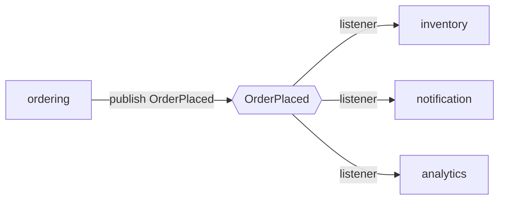
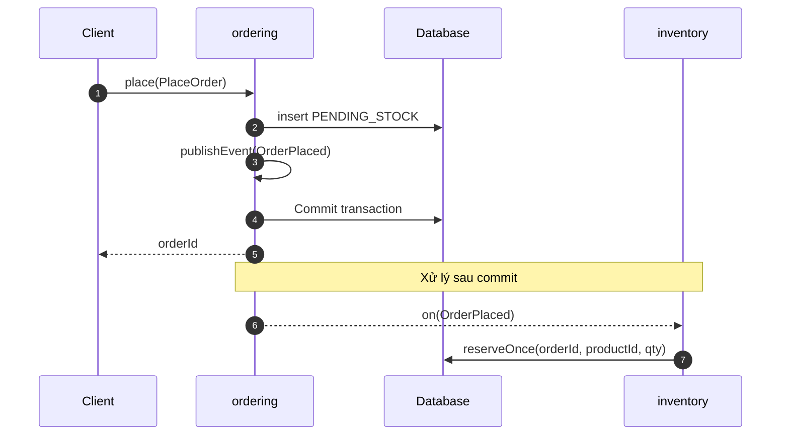
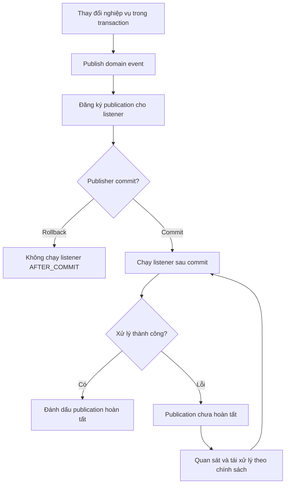

# Sự kiện miền (Domain Event) trong Spring Modulith

## 1. Sự kiện miền là gì?

Trong **Domain-Driven Design (DDD)**, **sự kiện miền** (*domain event*) là thông tin về một sự thật có ý nghĩa với nghiệp vụ **đã xảy ra**. Sự kiện ghi nhận kết quả của một hành động hoặc thay đổi trạng thái trong miền, chẳng hạn:

- `OrderPlaced` — đơn hàng đã được tiếp nhận.
- `PaymentAuthorized` — khoản thanh toán đã được chấp thuận.
- `StockReserved` — số lượng hàng cần thiết đã được giữ.
- `InvoiceIssued` — hóa đơn đã được phát hành.
- `MembershipExpired` — tư cách thành viên đã hết hạn.

Khác với lệnh `PlaceOrder` yêu cầu *hãy đặt hàng*, sự kiện `OrderPlaced` thông báo *đơn hàng đã được đặt*. Một sự kiện tốt thể hiện sự thật nghiệp vụ dưới dạng bất biến, đủ ngữ cảnh để các bên quan tâm có thể phản ứng mà không cần truy cập trực tiếp cấu trúc bên trong của module phát.

Trong **Spring Modulith**, sự kiện miền còn là hợp đồng giao tiếp giữa các **application module**. Module phát sự kiện công bố điều đã xảy ra; các module nhận đăng ký listener và xử lý nhiệm vụ thuộc trách nhiệm của mình. Cách giao tiếp này giúp giảm phụ thuộc vào service/repository nội bộ, trong khi ứng dụng vẫn có thể chạy như một **modular monolith** trong một JVM.

Phạm vi của module học `SPRING_MODULITH_APPLICATION_EVENTS` là sử dụng application events để bảo vệ ranh giới nghiệp vụ và thực hành publisher, listener, giao dịch sau commit, Event Publication Registry, retry, kiểm thử và quan sát giao sự kiện đáng tin cậy. Để làm đúng các kỹ thuật đó, trước hết cần hiểu **nghĩa nghiệp vụ của sự kiện** và **hợp đồng mà sự kiện đại diện**.

> Sự kiện miền mô tả *điều gì đã xảy ra trong nghiệp vụ*, không định nghĩa *bên nhận bắt buộc phải thực hiện câu lệnh nào*. Bên phát và bên nhận có thể hoạt động trong cùng ứng dụng Spring Boot nhưng sở hữu trách nhiệm khác nhau.

## 2. Khi nào một thay đổi xứng đáng là sự kiện miền?

Không phải mọi lần gọi hàm, chỉnh sửa trường dữ liệu hay cập nhật database đều cần phát domain event. Một sự kiện miền có ích khi sự thật đó:

1. Có **ý nghĩa nghiệp vụ** mà người làm sản phẩm và lập trình viên có thể cùng hiểu.
2. Tạo ra **hệ quả** ở phần khác của miền hoặc kích hoạt một chính sách nghiệp vụ.
3. Xảy ra ở **mốc trạng thái xác định**; có thể mô tả khi nào được coi là thành công.
4. Có tên, dữ liệu và thời điểm đủ rõ để lưu lại, kiểm thử và truy vết.

Ví dụ đối với cửa hàng:

| Biến đổi được quan sát | Có nên tạo domain event? | Lý do |
| --- | --- | --- |
| Đơn chuyển từ `DRAFT` sang `PLACED` | Thường có | Là một cột mốc nghiệp vụ; tồn kho/thông báo cần biết |
| Người dùng mở trang xem đơn | Thường không | Đó là thao tác truy vấn, không phải sự thật làm thay đổi miền |
| Repository gọi `save()` | Không phải tự nó | Đây là thao tác kỹ thuật, có thể được gọi nhiều lần |
| Thanh toán được chấp thuận | Có | Các bước hoàn tất đơn hàng/phát hành hóa đơn có thể phụ thuộc |
| Trường `updatedAt` thay đổi | Không phải tự nó | Thông tin kỹ thuật chưa nói rõ sự kiện nghiệp vụ nào |
| Hàng được giữ thành công | Có | Cho phép chuyển sang bước xác nhận đơn |

Một câu hỏi hữu ích khi thiết kế là: **“Đội nghiệp vụ sẽ gọi sự việc vừa xảy ra là gì?”**. Nếu chỉ trả lời được “đã gọi service X” hoặc “đã cập nhật bảng Y”, có thể đang mô hình hóa sự kiện kỹ thuật thay vì domain event.

### 2.1. Đặt tên ở thì đã xảy ra

Sử dụng tên phản ánh kết quả: `OrderPlaced`, `DeliveryScheduled`, `StockReservationRejected`. Tránh biến sự kiện thành mệnh lệnh:

```text
PlaceOrder              <-- command: hãy tạo đơn
SendConfirmationEmail   <-- command: hãy gửi email
OrderPlaced             <-- domain event: đơn đã được đặt
OrderConfirmed          <-- domain event: đơn đã được xác nhận
```

Lựa chọn tên cần chính xác với **trạng thái thực sự đã đạt được**. Nếu `OrderPlaced` mới chỉ có nghĩa “đã nhận yêu cầu nhưng vẫn chờ tồn kho”, không được gửi cho người dùng thông báo “đơn đã xác nhận thành công” chỉ dựa trên sự kiện này.

### 2.2. Nói rõ điều kiện phát

Một sự kiện có ngữ nghĩa vững chắc khi định nghĩa được:

- **Tiền điều kiện:** trạng thái hoặc dữ liệu nào phải hợp lệ trước thay đổi?
- **Sự thật đã xảy ra:** điều gì thay đổi và do module nào chịu trách nhiệm?
- **Thời điểm:** phát trong transaction nào; người nhận được chạy trước hay sau commit?
- **Khóa nhận diện:** làm sao phân biệt hai lần xảy ra cùng loại sự kiện?
- **Hệ quả dự kiến:** ai có thể quan tâm và được làm gì với sự kiện này?

Ví dụ `OrderPlaced` có thể được phát đúng một lần khi một đơn mới được ghi nhận ở trạng thái `PENDING_STOCK`. Thử ghi cùng đơn lần thứ hai không phải là một lần `OrderPlaced` mới nếu thao tác không thật sự tạo cột mốc mới.

## 3. Domain event khác command, application event và integration event thế nào?

Các khái niệm dễ bị lẫn vì đều có thể được truyền qua cơ chế “event” hoặc message.

| Khái niệm | Ý nghĩa | Ai quyết định xử lý? | Ví dụ |
| --- | --- | --- | --- |
| **Command** | Yêu cầu một hành vi; có thể thất bại | Bên nhận được yêu cầu | `PlaceOrder`, `ReserveStock` |
| **Domain event** | Sự thật nghiệp vụ vừa xảy ra | Các consumer quan tâm tự phản ứng | `OrderPlaced`, `StockReserved` |
| **Spring application event** | Cơ chế phát/nhận sự kiện trong `ApplicationContext` | Listener Spring đăng ký | `publisher.publishEvent(new OrderPlaced(...))` |
| **Integration event** | Hợp đồng sự kiện dành cho hệ thống/dịch vụ khác | Consumer ở ngoài ranh giới ứng dụng | `OrderPlacedV1` đưa lên broker |
| **Technical event** | Thay đổi hạ tầng hoặc trạng thái kỹ thuật | Các thành phần giám sát/xử lý kỹ thuật | `CacheEntryEvicted`, `JobTimedOut` |

**Domain event là một khái niệm mô hình nghiệp vụ; Spring application event là một cơ chế truyền tải.** Có thể dùng `ApplicationEventPublisher` để chuyển một domain event giữa các application module. Việc gọi `publishEvent()` không tự biến một thông báo kỹ thuật thành sự kiện miền có ý nghĩa.

**Integration event** thường cần hợp đồng ổn định qua ranh giới tiến trình, phiên bản và chính sách phân phối riêng. Có thể tạo integration event từ domain event, nhưng không bắt buộc chia sẻ nguyên xi cấu trúc nội bộ hoặc gửi domain event trực tiếp qua Kafka/RabbitMQ. Spring `ApplicationEventPublisher` không mặc nhiên là message broker.

**Domain events không đồng nghĩa với event sourcing.** Event sourcing lưu chuỗi sự kiện làm nguồn sự thật để khôi phục trạng thái. Một ứng dụng Spring Modulith có thể lưu trạng thái hiện tại trong cơ sở dữ liệu quan hệ và vẫn phát domain events để những module khác phản ứng; không cần triển khai event sourcing.

## 4. Domain event nằm ở đâu trong kiến trúc module?

Giả sử ứng dụng bán hàng được chia theo năng lực:

```text
com.example.shop
├── ShopApplication.java
├── ordering
│   ├── OrderCommands.java          # Hợp đồng công khai
│   ├── PlaceOrder.java             # Command/request công khai
│   ├── OrderPlaced.java            # Domain event công khai
│   └── internal
│       ├── OrderingService.java
│       └── OrderRepository.java
├── inventory
│   ├── StockReserved.java          # Event do inventory sở hữu
│   └── internal
│       ├── StockReservationListener.java
│       └── ReservationRepository.java
├── notification
│   └── internal
│       └── OrderPlacedListener.java
└── analytics
    └── internal
        └── OrderAnalyticsListener.java
```

`ordering` là module sở hữu khái niệm **đơn hàng đã đặt**, nên nó định nghĩa và phát `OrderPlaced`. `inventory`, `notification` hoặc `analytics` chỉ import kiểu event nằm trong **API công khai** của `ordering`; không import `ordering.internal.OrderRepository`.



Sơ đồ mô tả luồng sự kiện tại runtime. **Phụ thuộc mã nguồn** thực tế hướng từ các module consumer đến kiểu `OrderPlaced` công khai của `ordering`; `ordering` không phải import listener của consumer. Chính sự khác biệt giữa luồng dữ liệu và hướng phụ thuộc kiểu Java giúp tránh ràng buộc ngược không cần thiết.

Trong cấu trúc mặc định, package con trực tiếp của base package ứng dụng Spring Boot thường được nhận diện là application module. Các kiểu công khai của module thường nằm ở package gốc, còn phần triển khai ở package con `internal`. Khi cần công bố package con như `ordering.events`, có thể khai báo **named interface** bằng `@NamedInterface`; không được giả định mọi package sâu đều là API công khai.

## 5. Thiết kế một domain event có hợp đồng rõ ràng

### 5.1. Ưu tiên giá trị bất biến

Với Java hiện đại, `record` là cách gọn để biểu diễn payload không có trạng thái có thể thay đổi:

```java
// ordering/OrderPlaced.java
package com.example.shop.ordering;

import java.time.Instant;
import java.util.UUID;

public record OrderPlaced(
        UUID eventId,
        UUID orderId,
        UUID customerId,
        UUID productId,
        int quantity,
        Instant occurredAt) {
}
```

`eventId` nhận diện **một lần xảy ra cụ thể** của event. `orderId` là **khóa nghiệp vụ** để nhóm sự kiện liên quan đến cùng đơn. `occurredAt` ghi nhận thời điểm sự kiện được tạo; cần phân biệt thời điểm này với thời điểm transaction commit hoặc lúc listener bắt đầu xử lý.

`record` giúp bất biến ở mức các field tham chiếu nhưng **không tự tạo deep immutability** nếu chứa danh sách/đối tượng mutable. Khi event mang collection, hãy sao chép thành dữ liệu bất biến trước khi công bố. Ví dụ nên dùng `List.copyOf(items)` trong constructor để chặn bên ngoài sửa danh sách sau khi publish.

### 5.2. Mang đủ dữ liệu, tránh nhồi toàn bộ entity

Payload phải cung cấp những dữ kiện cần thiết để consumer xử lý, nhưng không nên chứa cả JPA entity, Hibernate proxy hay object graph nội bộ. Những kiểu đó tạo phụ thuộc vào persistence và dễ lỗi khi listener chạy sau transaction ban đầu.

Ví dụ, để `inventory` giữ hàng, `productId` và `quantity` có thể cần thiết; `analytics` có thể chỉ cần `orderId` và thời điểm. Không nên thêm trường nhạy cảm chỉ vì một consumer muốn dùng: thông tin cá nhân, chi tiết thanh toán, access token không nên lan truyền ngoài nhu cầu nghiệp vụ.

Có hai chiến lược lấy dữ liệu:

| Chiến lược | Ưu điểm | Lưu ý |
| --- | --- | --- |
| Event mang các giá trị thiết yếu | Consumer xử lý được ngay, ít gọi lại module phát | Payload lớn hơn, cần bảo vệ dữ liệu và version hóa |
| Event mang ID rồi consumer gọi API công khai | Payload nhỏ, có thể lấy dữ liệu mới nhất | Dễ tăng coupling/độ trễ; dữ liệu đọc sau có thể đã khác thời điểm event xảy ra |

Nếu consumer phải tính theo **ảnh chụp thời điểm xảy ra sự kiện**, chỉ mang ID rồi đọc dữ liệu hiện tại có thể không đủ. Hãy quyết định rõ event biểu diễn giá trị tại thời điểm nào.

### 5.3. Chỉ phát khi một chuyển đổi nghiệp vụ thực sự xảy ra

Ví dụ `OrderPlaced` chỉ được tạo khi lệnh tạo đơn mới thỏa điều kiện và ghi thành công. Không nên phát sự kiện đơn đã đặt khi chỉ thực hiện thao tác xác thực, xem giỏ hàng hoặc gọi `save()` cho một đơn không đổi.

Nếu có thao tác gửi lại lệnh `PlaceOrder` do client retry, ứng dụng phải bảo vệ khỏi tạo đơn và phát event mới ngoài ý muốn bằng khóa idempotency nghiệp vụ, ví dụ `checkoutRequestId`.

## 6. Thực hành: từ command đến domain event trong Spring

Giả sử API `ordering` tiếp nhận một yêu cầu đặt đơn, tạo trạng thái `PENDING_STOCK` và phát `OrderPlaced`. Phần kho vận có thể xử lý sau, nên **đặt hàng đã được tiếp nhận** không đồng nghĩa **đã giữ được tồn kho**.

### 6.1. Hợp đồng command và module API

```java
// ordering/PlaceOrder.java
package com.example.shop.ordering;

import java.util.UUID;

public record PlaceOrder(
        UUID customerId,
        UUID productId,
        int quantity) {
}
```

```java
// ordering/OrderCommands.java
package com.example.shop.ordering;

import java.util.UUID;

public interface OrderCommands {
    UUID place(PlaceOrder request);
}
```

### 6.2. Publisher tạo domain event trong transaction

```java
// ordering/internal/OrderingService.java
package com.example.shop.ordering.internal;

import com.example.shop.ordering.OrderCommands;
import com.example.shop.ordering.OrderPlaced;
import com.example.shop.ordering.PlaceOrder;
import java.time.Instant;
import java.util.UUID;
import org.springframework.context.ApplicationEventPublisher;
import org.springframework.stereotype.Service;
import org.springframework.transaction.annotation.Transactional;

@Service
class OrderingService implements OrderCommands {

    private final OrderRepository orders;
    private final ApplicationEventPublisher publisher;

    OrderingService(OrderRepository orders,
                    ApplicationEventPublisher publisher) {
        this.orders = orders;
        this.publisher = publisher;
    }

    @Override
    @Transactional
    public UUID place(PlaceOrder request) {
        if (request.quantity() <= 0) {
            throw new IllegalArgumentException("Quantity must be positive");
        }

        UUID orderId = UUID.randomUUID();
        orders.insertPending(
                orderId, request.customerId(),
                request.productId(), request.quantity());

        OrderPlaced event = new OrderPlaced(
                UUID.randomUUID(),
                orderId,
                request.customerId(),
                request.productId(),
                request.quantity(),
                Instant.now());

        publisher.publishEvent(event);
        return orderId;
    }
}
```

`OrderRepository` và phương thức `insertPending(...)` là hợp đồng lưu trữ **nội bộ được lược bỏ phần cài đặt** trong ví dụ. Để chạy thực tế, cần triển khai repository, schema database, validation, xử lý yêu cầu trùng và dependency Spring phù hợp.

Những điểm cần quan sát:

1. Chính service thuộc `ordering` quyết định **khi nào** một đơn thật sự được tạo.
2. Event là đối tượng dữ liệu nghiệp vụ, không chứa reference tới repository hoặc Spring bean.
3. `publishEvent()` được gọi **trong transaction** lưu đơn.
4. Việc phương thức `place()` trả về không khẳng định listener bất đồng bộ đã hoàn tất.
5. Nếu transaction tạo đơn rollback, listener theo phase `AFTER_COMMIT` sẽ không chạy.

**Lưu ý về thời gian:** Lúc `publishEvent()` chạy, transaction **chưa nhất thiết đã commit**. “Sự thật đã xảy ra” trong ngôn ngữ miền là trạng thái nghiệp vụ được service xác lập; consumer cần quan sát trạng thái đã lưu bền vững thường phải đợi commit thành công.

### 6.3. Listener ở module nhận

`inventory` chịu trách nhiệm giữ tồn kho. Nó lắng nghe `OrderPlaced` qua API Spring Modulith:

```java
// inventory/internal/StockReservationListener.java
package com.example.shop.inventory.internal;

import com.example.shop.ordering.OrderPlaced;
import org.springframework.modulith.events.ApplicationModuleListener;
import org.springframework.stereotype.Component;

@Component
class StockReservationListener {

    private final StockReservations reservations;

    StockReservationListener(StockReservations reservations) {
        this.reservations = reservations;
    }

    @ApplicationModuleListener
    void on(OrderPlaced event) {
        reservations.reserveOnce(
                event.orderId(),
                event.productId(),
                event.quantity());
    }
}
```

`StockReservations` là service/repository nội bộ `inventory` với phương thức `reserveOnce(...)` được **thiết kế là idempotent** theo `orderId`. Nếu tồn kho không đủ, service phải tạo kết quả nghiệp vụ thích hợp thay vì ghi nhận thành công giả; một triển khai đầy đủ có thể công bố `StockReserved` hoặc `StockReservationRejected` do `inventory` sở hữu.

`@ApplicationModuleListener` của Spring Modulith dùng mô hình **transactional event listener**, xử lý bất đồng bộ sau khi giao dịch phát sự kiện commit và thực thi listener trong giao dịch riêng. Điều này phù hợp khi module nhận cần xử lý sau khi dữ liệu của `ordering` đã được ghi nhận.



Sơ đồ biểu diễn **thứ tự logic**. Do listener bất đồng bộ, thời điểm response đến client và lúc listener bắt đầu không có cam kết thứ tự tuyệt đối giống đường mũi tên; chỉ có điều kiện **listener sau commit** cần được giữ.

### 6.4. Một domain event có nhiều consumer

Cùng `OrderPlaced` có thể được module `analytics` xử lý để cập nhật báo cáo, và module `notification` xử lý để gửi **thông báo đã tiếp nhận yêu cầu đặt hàng**. Những consumer này hoạt động độc lập ở mức trách nhiệm.

Không nên để `ordering` gọi `analytics.internal.DashboardRepository` hoặc `notification.internal.EmailSender`. Khi có consumer mới, module phát chỉ cần tiếp tục công bố sự thật `OrderPlaced` theo đúng contract.

## 7. Domain event và transaction: điều gì được đảm bảo?

Trong Spring Framework có ba kiểu listener dễ gặp:

| Cơ chế | Thời điểm thường gặp | Phù hợp khi |
| --- | --- | --- |
| `@EventListener` | Theo cơ chế multicaster; mặc định thường đồng bộ ngay lúc publish | Công việc nội bộ đơn giản, kiểm soát rõ tác động cùng lời gọi |
| `@TransactionalEventListener` | Mặc định `AFTER_COMMIT`; có thể chọn phase khác | Chỉ muốn xử lý khi transaction đạt mốc phù hợp |
| `@ApplicationModuleListener` | Transactional listener bất đồng bộ của Spring Modulith, chạy trong transaction riêng | Phối hợp giữa application module sau commit |

Với `@TransactionalEventListener`, có thể khai báo phase rõ ràng:

```java
import org.springframework.transaction.event.TransactionPhase;
import org.springframework.transaction.event.TransactionalEventListener;

@TransactionalEventListener(phase = TransactionPhase.AFTER_COMMIT)
void afterCommit(OrderPlaced event) {
    // Xử lý sau khi transaction publisher commit.
}
```

`@TransactionalEventListener` **không mặc nhiên bất đồng bộ**. `@ApplicationModuleListener` bổ sung mô hình thực thi phù hợp với Spring Modulith. Một transactional listener được kích hoạt khi không có transaction thường **không chạy** nếu không cấu hình `fallbackExecution`.

### 7.1. Ba thời điểm khác nhau

1. **Tạo event:** `OrderingService` tạo `OrderPlaced` với `occurredAt`.
2. **Commit dữ liệu gốc:** transaction của `ordering` hoàn thành, dữ liệu `PENDING_STOCK` trở thành dữ liệu bền vững.
3. **Consumer xử lý:** listener của `inventory` nhận event và thực hiện một giao dịch khác.

Nếu transaction ở bước 2 rollback, một listener sau commit sẽ không được gọi. Nếu bước 2 thành công nhưng bước 3 thất bại, **đơn hàng không tự động rollback**; hệ thống cần theo dõi và khôi phục bước sau. Đây là nhất quán cuối cùng (*eventual consistency*).

### 7.2. Không phát cùng một ý nghĩa ở nhiều nơi

Trong luồng nhập đơn, controller, aggregate, service và repository đều có thể được gọi. Chỉ nên có **một nơi sở hữu quyết định phát cùng một cột mốc nghiệp vụ**, hoặc một cơ chế tập hợp rồi phát event rõ ràng. Nếu cả controller và service đều tự tạo `OrderPlaced`, consumer có thể nhận hai sự kiện cho cùng một lần đặt hàng.

Nên quy định rõ: **ai phát, phát khi nào, dữ liệu nào mang theo, trạng thái trước/sau là gì**. Unit test cần xác minh không phát event khi validation hoặc transaction thất bại.

## 8. Phát sự kiện từ aggregate: `@DomainEvents` và `AbstractAggregateRoot`

Trong DDD, **aggregate root** là nơi chịu trách nhiệm giữ bất biến và quyết định chuyển trạng thái của một cụm đối tượng nghiệp vụ. Có hai cách phổ biến để đưa domain event ra ngoài aggregate.

**Cách 1 — Application service chủ động phát event:** như ví dụ `OrderingService` trên. Dễ theo dõi ranh giới transaction và phù hợp khi service trực tiếp xác lập cột mốc.

**Cách 2 — Aggregate ghi nhận event, repository phát khi lưu:** Spring Data hỗ trợ `@DomainEvents` để lấy những event do aggregate công bố, và `@AfterDomainEventPublication` để xóa danh sách event đã được công bố. Spring Data Commons cũng cung cấp `AbstractAggregateRoot` làm lớp hỗ trợ đăng ký event.

Ví dụ mô hình khái niệm:

```java
import java.util.UUID;
import org.springframework.data.domain.AbstractAggregateRoot;

class Order extends AbstractAggregateRoot<Order> {

    private final UUID id;
    private boolean placed;

    Order(UUID id) {
        this.id = id;
    }

    void place() {
        if (placed) {
            return;
        }
        placed = true;
        registerEvent(new OrderMarkedPlaced(id));
    }
}

record OrderMarkedPlaced(UUID orderId) {}
```

Đây là ví dụ thu nhỏ về **ghi nhận event trong aggregate**, không phải entity/repository Spring Data chạy độc lập. Để dùng thực tế cần ánh xạ persistence và cách lưu aggregate phù hợp; event cũng cần đặt ở API module nếu module khác phải tham chiếu kiểu đó.

**Cảnh báo dễ nhầm:** `registerEvent(...)` chỉ đăng ký event trong aggregate. Sự kiện được công bố thông qua cơ chế repository Spring Data ở các thao tác được hỗ trợ; nó **không phải** một lệnh gửi event ngay lập tức. Đừng dùng đồng thời cách service publish và cách aggregate đăng ký cùng sự kiện mà không kiểm soát, nếu không consumer có thể xử lý trùng.

Chọn cách phát phụ thuộc kiến trúc dự án: nếu invariant được đóng kín trong aggregate, việc ghi nhận sự kiện ngay tại lần chuyển trạng thái thường tự nhiên; nếu nghiệp vụ do application service điều phối, publisher ở service có thể rõ ràng hơn.

## 9. Event Publication Registry và giao sự kiện đáng tin cậy

Khi một domain event quan trọng được xử lý bởi listener sau commit, rủi ro lớn là **publisher đã commit nhưng listener gặp lỗi hoặc tiến trình dừng trước khi hoàn tất**. Spring Modulith hỗ trợ **Event Publication Registry** để theo dõi những publication dành cho transactional event listeners.

Luồng khái quát:



Registry hỗ trợ biết **một sự kiện đã được phát cho listener nào, và lần xử lý nào chưa hoàn tất**. Với triển khai lưu trữ bền vững thích hợp, thông tin này còn có thể được sử dụng để phục hồi sau khi tiến trình khởi động lại. Tuy nhiên, **việc kích hoạt, lưu trữ, cách tái gửi và chính sách retry phụ thuộc cấu hình/phiên bản**; không nên giả định chỉ đặt `@ApplicationModuleListener` là đã có cơ chế retry tự động đầy đủ.

Đặc biệt, registry ghi nhận hoàn tất một lần gọi listener không có nghĩa mọi hiệu ứng ở hệ thống ngoài đều **exactly once**. Giả sử listener gửi email thành công nhưng tiến trình dừng trước lúc publication được đánh dấu hoàn tất; khi retry, email có thể bị gửi lại. Consumer cần thiết kế idempotency của chính nghiệp vụ.

### 9.1. Event ID và idempotency key

Một ID riêng cho từng event giúp nhận diện thông điệp trùng, nhưng **chọn khóa nào để chống lặp phụ thuộc hành vi cần bảo vệ**:

| Hành vi | Khóa idempotency thường dùng | Điều cần bảo vệ |
| --- | --- | --- |
| Consumer ghi nhận một event | `(consumerName, eventId)` | Không áp dụng cùng một event hai lần trong consumer |
| Giữ hàng theo đơn | `orderId` | Không trừ tồn kho lặp khi nhận lại event |
| Tạo hóa đơn | `orderId` hoặc mã hóa đơn nghiệp vụ | Không phát hành hai hóa đơn cho cùng nghĩa vụ |
| Gửi xác nhận đơn | `(orderId, notificationType)` | Không tạo yêu cầu thông báo trùng |

Ví dụ bảng theo dõi event đã xử lý:

```sql
CREATE TABLE consumed_event (
    consumer_name VARCHAR(100) NOT NULL,
    event_id UUID NOT NULL,
    processed_at TIMESTAMP NOT NULL,
    PRIMARY KEY (consumer_name, event_id)
);
```

Việc ghi `consumed_event` và cập nhật dữ liệu nội bộ nên thuộc **cùng transaction** nếu có thể. Nếu ghi dấu “đã xử lý” trước rồi thực hiện nghiệp vụ trong transaction khác và bước sau lỗi, event sẽ bị bỏ qua khi retry dù chưa hoàn tất.

Với hệ thống ngoài như email provider, transaction SQL không bao trùm được việc gửi email; cần kết hợp idempotency key của provider (nếu có), trạng thái gửi, chính sách retry và nghiệp vụ cho phép gửi lại.

### 9.2. Phân loại lỗi để phản ứng đúng

**Lỗi kỹ thuật tạm thời:** timeout database, kết nối mạng ngắt, provider trả 503. Có thể retry với backoff và giới hạn số lần.

**Kết quả nghiệp vụ hợp lệ:** `inventory` phát hiện thiếu hàng. Nên thể hiện bằng kết quả rõ ràng như `StockReservationRejected`, thay vì ném exception làm retry vô hạn một yêu cầu không thể thỏa mãn.

**Lỗi hợp đồng:** trường bắt buộc bị thiếu, consumer không hỗ trợ schema, event gửi sai ý nghĩa. Cần quan sát, sửa và điều phối xử lý lại có kiểm soát.

**Lỗi không chắc đã thực hiện:** consumer gọi thành công hệ thống ngoài rồi mất kết nối trước khi nhận phản hồi. Phải xác minh hoặc xử lý idempotent trước khi lặp.

Vì vậy, thiết kế domain event tốt phải đi cùng khả năng **retry an toàn** và khả năng biết khi nào **không nên retry**.

## 10. Phiên bản hóa và tiến hóa hợp đồng sự kiện

Khi nhiều module cùng sử dụng `OrderPlaced`, thay đổi payload có thể gây ảnh hưởng chéo. Hãy quản lý event như một **public contract**.

- **Thêm trường tùy chọn:** có thể tương thích nếu tất cả consumer xử lý khi thiếu trường đó.
- **Đổi tên hoặc bỏ trường:** có thể phá consumer hiện tại; cần chuyển đổi có kế hoạch.
- **Đổi nghĩa event:** nguy hiểm hơn đổi tên kiểu; ví dụ biến `OrderPlaced` từ “đã tiếp nhận” thành “đã thanh toán” là vi phạm ngữ nghĩa.
- **Thay đổi kiểu dữ liệu:** `String` sang enum, `long` sang UUID cần đánh giá serializer và các consumer.
- **Thay đổi thứ tự xử lý:** không được mặc định một event được nhận theo cùng thứ tự bởi tất cả listener bất đồng bộ.

Đối với giao tiếp nội bộ JVM, cùng một lần build thường sử dụng các class chung nên sự không tương thích được phát hiện sớm hơn. Tuy vậy, **publication bền vững có thể tồn tại qua lần triển khai**; khi thay đổi event class, phải xét khả năng đọc lại payload được ghi theo phiên bản cũ. Với event được đưa ra broker, cần version hóa hoặc cơ chế tương thích phù hợp để phục vụ consumer độc lập.

Một hợp đồng nên mô tả:

| Thuộc tính | Câu hỏi cần trả lời |
| --- | --- |
| Tên và nghĩa | Sự kiện biểu thị mốc nghiệp vụ nào? |
| Owner | Module nào có quyền phát? |
| Trigger | Điều kiện chính xác để phát là gì? |
| Payload | Những trường nào bắt buộc và tại sao? |
| ID và thời điểm | Phân biệt hai lần xảy ra và đối chiếu transaction ra sao? |
| Consumer | Module nào lắng nghe và phụ thuộc vào field nào? |
| Schema evolution | Làm thế nào đọc được publication còn dang dở sau deploy? |

Không nên tự thêm eventVersion vào mọi record chỉ vì nguyên tắc hình thức; cần cách quản lý tương thích thực sự phù hợp phương thức lưu trữ/truyền tải.

## 11. Tránh coupling mới khi đã dùng event

Sử dụng domain event giúp giảm dependency trực tiếp nhưng **không tự bảo đảm kiến trúc module đúng**.

### 11.1. Không import lớp nội bộ của module phát

Sai:

```java
// Trong inventory: phụ thuộc chi tiết persistence của ordering.
import com.example.shop.ordering.internal.OrderRepository;
```

Tốt hơn: consumer sử dụng `OrderPlaced` thuộc API `ordering` và dữ liệu cần thiết nằm trong payload, hoặc gọi một API công khai của `ordering` khi thật sự cần đọc thêm.

### 11.2. Coi chừng phụ thuộc vòng giữa kiểu event

Giả sử `inventory` import `ordering.OrderPlaced`, còn `ordering` lại import `inventory.StockReserved` để nghe kết quả. Mối quan hệ loại Java trở thành `ordering → inventory → ordering` ở mức module dù runtime giao tiếp qua events.

Có thể tách một module **điều phối quy trình** theo hợp đồng công khai, hoặc bố trí lại nơi sở hữu event nếu đúng với nghiệp vụ. Ví dụ `fulfillment` nghe `StockReserved` và gọi `ordering.OrderWorkflow` mà không làm `ordering` import các kiểu của `inventory`.

```java
import org.junit.jupiter.api.Test;
import org.springframework.modulith.core.ApplicationModules;

class ArchitectureTests {
    @Test
    void dependenciesRespectModuleBoundaries() {
        ApplicationModules.of(ShopApplication.class).verify();
    }
}
```

Phép kiểm tra trên hỗ trợ phát hiện vi phạm ranh giới và phụ thuộc vòng. Để chạy thật phải có cấu trúc application package và dependency kiểm thử Spring Modulith tương ứng.

### 11.3. Event không phải lối tắt cho mọi lời gọi

Khi cần kiểm tra một điều kiện đồng bộ để ra quyết định tức thời, gọi **public API** của module khác có thể phù hợp hơn. Ví dụ nếu nghiệp vụ yêu cầu giữ tồn kho thành công trước khi trả kết quả `CONFIRMED`, một luồng bất đồng bộ dựa trên `OrderPlaced` sẽ cần trạng thái `PENDING_STOCK` và logic hoàn tất sau. Không được tuyên bố hoàn tất ngay khi mới publish event.

Một domain event nên được tạo vì **sự thật nghiệp vụ**, không phải chỉ để tránh mọi phụ thuộc API.

## 12. Kiểm thử domain event đúng theo ý nghĩa

Kiểm thử nên xác nhận **điều kiện phát, payload, transaction, listener và khả năng xử lý lại**, không chỉ kiểm tra có gọi `publishEvent()`.

| Tình huống | Kết quả mong đợi |
| --- | --- |
| Đặt đơn hợp lệ | Phát một `OrderPlaced` cho đúng `orderId` và sản phẩm |
| Số lượng không hợp lệ | Không tạo đơn, không phát `OrderPlaced` |
| Giao dịch publisher rollback | Listener `AFTER_COMMIT` không thực thi |
| `inventory` nhận cùng event hai lần | Không giữ hoặc trừ tồn kho hai lần |
| Listener lỗi tạm thời | Publication chưa hoàn tất được phát hiện với registry phù hợp |
| Retry thành công | Hoàn tất đúng một hiệu ứng nghiệp vụ và publication được cập nhật |
| Hai consumer nhận một event | Mỗi consumer phản ứng độc lập, không chia sẻ trạng thái mutable |
| Consumer import repository nội bộ | Test kiến trúc phát hiện vi phạm |

Spring Modulith cung cấp `@ApplicationModuleTest` để kiểm thử từng application module. Tùy phiên bản, công cụ `PublishedEvents` và `Scenario` giúp xác nhận sự kiện được phát và kết quả chờ sự kiện bất đồng bộ. Ví dụ bộ khung:

```java
import org.junit.jupiter.api.Test;
import org.springframework.modulith.test.ApplicationModuleTest;

@ApplicationModuleTest
class OrderingEventTests {

    @Test
    void publishesOrderPlacedAfterValidTransition() {
        // Arrange: tạo dữ liệu đơn hợp lệ, khởi tạo repository test.
        // Act: gọi public API OrderCommands.place(...).
        // Assert: kiểm tra đúng một OrderPlaced, đúng orderId,
        //         productId, quantity và eventId không rỗng.
    }
}
```

Đây là **khung minh họa**, chưa phải integration test chạy độc lập. Khi triển khai hãy viết assert thật bằng `PublishedEvents` hoặc `Scenario` theo phiên bản Spring Modulith của dự án. Listener bất đồng bộ nên được kiểm tra bằng cơ chế chờ điều kiện có timeout và các công cụ test hỗ trợ thay vì `Thread.sleep(...)` cố định.

Một test hữu ích đặc biệt là **event naming/meaning test**: với đơn ở `PENDING_STOCK`, `OrderPlaced` được phát nhưng `OrderConfirmed` **chưa** được phát. Nó ngăn lập trình viên vô tình thay đổi ý nghĩa hợp đồng khi refactor.

## 13. Quan sát và truy vết domain event trong vận hành

Giao tiếp qua event làm các bước xảy ra ở những thời điểm khác nhau, nên cần quan sát cả trạng thái nghiệp vụ lẫn kết quả xử lý sự kiện.

Nên thu thập:

- **Event identity:** `eventId`, loại event, owner module và `orderId`.
- **Correlation:** mã luồng nghiệp vụ chung để nối `OrderPlaced → StockReserved → OrderConfirmed`.
- **Thời gian:** thời điểm tạo, thời điểm commit, lúc listener bắt đầu và kết thúc (nếu công cụ đo được).
- **Publication:** listener đích, trạng thái hoàn tất/chưa hoàn tất, số lần thử và lỗi cuối.
- **Kết quả nghiệp vụ:** số đơn `PENDING_STOCK` vượt thời hạn, số đơn được xác nhận hoặc từ chối.

Ví dụ một bản ghi log đã lược bỏ dữ liệu cá nhân:

```json
{
  "eventId": "f86b2d5a-7ec9-4fb7-92e1-935b34c9f74d",
  "eventType": "OrderPlaced",
  "module": "ordering",
  "orderId": "11ae891c-cc5e-48c2-89a4-74764940b961",
  "correlationId": "b12bbff6-037b-40be-967b-7743091af178",
  "status": "PUBLISHED"
}
```

Các khóa trên có thể kết hợp với Micrometer/Tracing, Spring Boot Actuator và dashboard vận hành khi được cấu hình. **Không mặc định** Spring Modulith tự tạo tất cả các chỉ số/log này; cần instrument tương ứng. Tránh đưa thông tin cá nhân, thông tin thanh toán hoặc payload nhạy cảm vào log không được bảo vệ.

Việc đếm `OrderPlaced` được phát **không đủ** để chứng minh toàn bộ luồng đã hoàn tất. Cần đối chiếu số publication chưa hoàn tất với trạng thái thực tế của đơn hàng và kết quả consumer.

## 14. Các lỗi thường gặp

| Lỗi | Tác hại | Hướng sửa |
| --- | --- | --- |
| Đặt tên `SendEmailEvent` cho một domain event | Biến event thành command của module đích | Đặt tên theo sự thật nghiệp vụ, ví dụ `OrderPlaced` |
| Phát `OrderPlaced` trước khi xác nhận việc tạo đơn hợp lệ | Consumer xử lý một đơn chưa được lưu | Thiết kế điểm phát ở bước chuyển trạng thái nghiệp vụ; dùng after-commit listener |
| Cho event chứa JPA entity | Coupling với persistence, lỗi lazy loading/mutable state | Chỉ công bố ID và dữ liệu bất biến cần thiết |
| Coi `publishEvent()` là gửi message qua broker | Hiểu sai ranh giới tiến trình và đảm bảo delivery | Phân biệt application event với integration event |
| Nghĩ rằng `@EventListener` mặc định luôn chạy sau commit | Consumer có thể chạy khi publisher chưa commit | Chọn transactional listener đúng phase |
| Không có `eventId` hoặc khóa nghiệp vụ | Khó truy vết và chống xử lý trùng | Bổ sung identity/idempotency phù hợp |
| Bắt mọi exception rồi bỏ qua trong listener | Publication có thể bị xem là xử lý thành công dù nghiệp vụ thất bại | Phân biệt lỗi kỹ thuật và kết quả miền, xử lý lỗi rõ |
| Dùng event bất đồng bộ nhưng trả trạng thái cuối ngay | Khách hàng thấy đơn xác nhận dù kho chưa giữ hàng | Trả trạng thái trung gian hoặc dùng quy trình đồng bộ |
| Đổi nghĩa `OrderPlaced` sau khi đã có consumer | Consumer xử lý sai logic mà code vẫn biên dịch | Giữ semantic contract, xây chiến lược tiến hóa |
| Không kiểm tra quan hệ module | Event types vẫn có thể tạo phụ thuộc vòng | Chạy `ApplicationModules.verify()` trong CI |

## 15. Bài tập áp dụng

**Bối cảnh:** Ứng dụng có các module `ordering`, `inventory`, `notification`. Nghiệp vụ yêu cầu khi tiếp nhận đơn mới, hệ thống công bố `OrderPlaced`. `inventory` giữ hàng; `notification` gửi thông báo “đã nhận đơn” chứ chưa phải “đã xác nhận đơn”.

**Yêu cầu thực hiện:**

1. Viết một câu định nghĩa chính xác sự kiện `OrderPlaced`: điều gì đã xảy ra và điều gì **chưa** được bảo đảm?
2. Tạo record `OrderPlaced` có `eventId`, `orderId`, `productId`, `quantity`, `occurredAt`; xác định event thuộc package/API nào.
3. Trong `ordering`, tạo đơn `PENDING_STOCK` và phát event qua `ApplicationEventPublisher` trong `@Transactional`.
4. Trong `inventory`, dùng `@ApplicationModuleListener` và bảo vệ `reserveOnce()` trước việc nhận lại cùng event.
5. Kiểm thử trường hợp transaction đặt hàng rollback và đảm bảo listener sau commit không chạy.
6. Thử làm listener ném lỗi; khi có registry bền vững, kiểm tra publication chưa hoàn tất rồi thực hiện tái xử lý có kiểm soát.
7. Kiểm tra xem `notification` có cần dùng `OrderPlaced` hay nên đợi event `OrderConfirmed` để tránh gửi thông báo sai nghĩa.
8. Viết test kiến trúc `ApplicationModules.verify()` và ngăn module khác import các lớp `internal` của `ordering`.

**Câu hỏi mở rộng:**

- Một lệnh `PlaceOrder` được client retry hai lần có phải tạo hai event `OrderPlaced` không? Muốn tránh cần khóa gì ở cấp nghiệp vụ?
- Nếu `inventory` xử lý trùng, một `eventId` duy nhất đã đủ để chống trừ tồn kho hai lần trong mọi trường hợp chưa?
- Nếu transaction đã commit nhưng listener gửi email thành công rồi tiến trình dừng trước khi ghi nhận hoàn tất, registry sẽ giúp phát hiện điều gì và idempotency cần bảo vệ thao tác nào?
- Nếu sau này `OrderPlaced` có thêm giá trị đơn hàng, làm thế nào giữ tương thích với các consumer và publication được lưu theo phiên bản cũ?

**Tiêu chí hoàn thành:** Học viên nêu được ý nghĩa domain event, phân biệt command với event và application event với integration event; thiết kế được payload bất biến, đặt owner và ranh giới API hợp lý; giải thích được sau commit, registry, retry và idempotency; kiểm thử được luồng event mà không làm lộ chi tiết module nội bộ.

## 16. Tổng kết

**Sự kiện miền** là bản ghi bất biến về một cột mốc có ý nghĩa nghiệp vụ; nó khác command và khác cơ chế kỹ thuật truyền tải thông báo. Trong Spring Modulith, domain event như `OrderPlaced` có thể được phát bằng `ApplicationEventPublisher` và được các module khác phản ứng thông qua `@ApplicationModuleListener`, giúp giữ quyền sở hữu nghiệp vụ và API giữa các module rõ ràng. Chọn đúng thời điểm phát, xử lý sau commit, theo dõi publication chưa hoàn tất, idempotency, kiểm thử và truy vết là điều kiện để luồng event đáng tin cậy khi ứng dụng phát triển.
