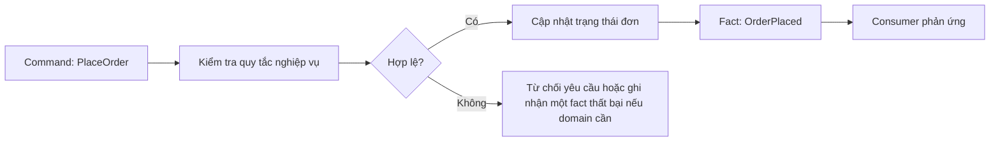
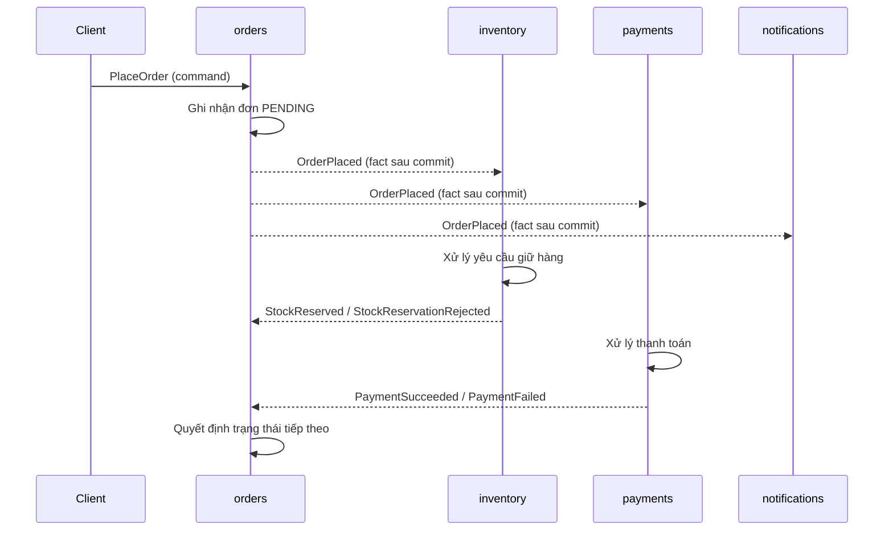
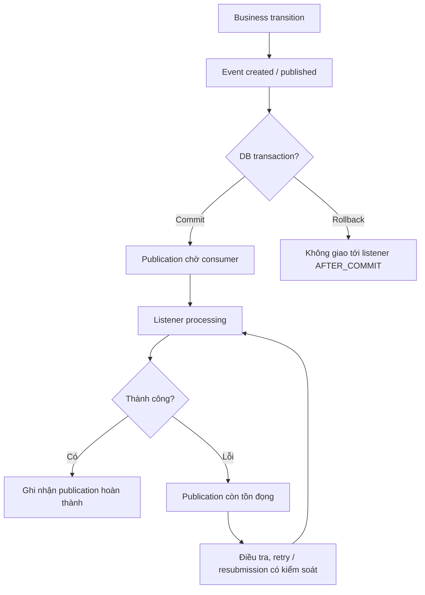

# Event xảy ra trong quá khứ: mô hình hóa sự thật nghiệp vụ trong Spring Modulith

## 1. Event là một sự thật đã xảy ra

Trong **mô hình sự kiện (event model)**, một *domain event* mô tả một sự kiện nghiệp vụ **đã xảy ra**, mang ý nghĩa đối với hệ thống và có thể khiến các thành phần khác phản ứng. Từ “đã” là đặc trưng quan trọng: event nói về **kết quả hoặc thay đổi trạng thái được ghi nhận**, thay vì yêu cầu ai đó thực hiện một hành động ở tương lai.

Ví dụ, sau khi khách hàng đặt đơn thành công theo quy tắc của hệ thống, module `orders` có thể phát `OrderPlaced` (Đơn hàng đã được đặt). Module `notifications` dùng thông tin đó để gửi thông báo; module `inventory` có thể chuẩn bị một bước giữ hàng tiếp theo nếu workflow cho phép. Các consumer **phản ứng với một thực tế nghiệp vụ**, không phải nhận một lời gọi phương thức được ngụy trang.

Bài học thuộc phạm vi **SPRING_MODULITH_APPLICATION_EVENTS**: tổ chức giao tiếp giữa các module Spring Modulith qua application events nhằm giảm phụ thuộc, bảo vệ ranh giới nghiệp vụ và xây dựng luồng publisher/listener có xét đến after-commit, lưu event publication, retry, kiểm thử và quan sát.

Sau bài này, bạn sẽ có thể:

- Nhận diện một sự kiện **đã xảy ra** so với command, intent và trạng thái đang dự kiến.
- Đặt tên event bằng **thì quá khứ**, xác định đúng ranh giới nghiệp vụ mà event xác nhận.
- Chọn dữ liệu tối thiểu, bất biến và đủ ngữ cảnh để consumer hiểu được sự kiện.
- Phân biệt **event được tạo trong transaction** với **giao dịch đã commit** và **consumer đã xử lý**.
- Thiết kế publisher/listener trong Spring Modulith, kiểm soát lỗi và xử lý trùng.
- Viết test và theo dõi luồng sự kiện qua các module.

> **Nguyên tắc trung tâm:** Khi đọc tên và payload của một event, người khác phải hiểu **điều gì đã xảy ra** và **ý nghĩa nghiệp vụ của nó** mà không cần biết consumer nào sẽ xử lý.

## 2. Command, event và state khác nhau thế nào?

Ba khái niệm thường bị dùng lẫn nhau:

| Khái niệm | Câu hỏi trả lời | Thời điểm/ngữ nghĩa | Ví dụ |
|---|---|---|---|
| **Command** | “Hãy làm gì?” | Ý định/yêu cầu; có thể thành công hoặc thất bại | `PlaceOrder`, `ReserveStock`, `CancelOrder` |
| **Domain event** | “Điều gì đã xảy ra?” | Sự thật nghiệp vụ mà module có thẩm quyền xác nhận | `OrderPlaced`, `StockReserved`, `OrderCancelled` |
| **State** | “Hiện giờ đang như thế nào?” | Ảnh chụp/trạng thái đang được lưu | `Order.status = PLACED`, `Stock.available = 12` |

Giả sử ứng dụng nhận lệnh `PlaceOrder`. Việc **nhận yêu cầu đặt hàng** không đồng nghĩa **đã đặt hàng thành công**. Chỉ sau khi kiểm tra quy tắc và chuyển trạng thái hợp lệ, module có thể tạo `OrderPlaced`.



Một thất bại kiểm tra đầu vào đơn thuần không nhất thiết cần domain event. Nhưng nếu hệ thống **ghi nhận một lần thanh toán bị từ chối** như sự kiện nghiệp vụ cần lưu vết, `PaymentDeclined` là event đúng nghĩa: nó mô tả kết quả đã xảy ra, không đơn thuần là exception.

Cần tránh suy luận rằng mọi từ có hậu tố `Requested` đều là command. Chẳng hạn `RefundRequested` có thể là một **event** nếu yêu cầu hoàn tiền đã được tạo và ghi nhận; còn `RequestRefund` là **command** yêu cầu hệ thống tạo yêu cầu đó. Điểm phân biệt nằm ở **ngữ nghĩa và trạng thái đã xác lập**, không chỉ tên tiếng Anh.

### 2.1. Vì sao “đã xảy ra” quan trọng đối với module?

Với event mô tả một sự thật:

1. **Publisher giữ quyền quyết định:** `orders` xác nhận đơn hàng đã được đặt theo quy tắc của chính nó.
2. **Consumer giữ quyền phản ứng:** `notifications` tự quyết định có gửi email, dùng template nào và xử lý lỗi ra sao.
3. **Không ép publisher biết consumer:** `orders` không cần inject `EmailService` hoặc gọi trực tiếp `InventoryService` chỉ để thông báo.
4. **Có thể bổ sung consumer mới:** Một module analytics có thể lắng nghe `OrderPlaced` mà không yêu cầu thay đổi logic publisher, miễn hợp đồng event vẫn đáp ứng.

Ngược lại, nếu publisher phát `SendConfirmationEmail` hoặc `UpdateInventory`, nó đang chỉ đạo các module khác phải làm gì. Đó có thể là command hợp lệ trong một hệ thống điều phối rõ ràng, nhưng không nên giả làm domain event để tuyên bố kiến trúc đã ít phụ thuộc.

## 3. Đặt tên event ở thì quá khứ

Tên event nên diễn đạt **một thay đổi nghiệp vụ cụ thể đã hoàn tất** ở mức độ mà module thực sự có thể bảo đảm.

| Tên nên xem xét | Ý nghĩa được cam kết | Tên dễ gây nhầm lẫn | Vì sao cần tránh |
|---|---|---|---|
| `OrderPlaced` | Hệ thống đã ghi nhận việc đặt đơn | `PlaceOrderEvent` | Tên theo hành động yêu cầu; không rõ là command hay fact |
| `OrderCancelled` | Đơn đã chuyển sang trạng thái hủy hợp lệ | `CancelOrderEvent` | Không nói được hành động đã thành công hay chưa |
| `PaymentCaptured` | Khoản tiền đã được capture theo hệ thống thanh toán | `ProcessPayment` | Quá chung và giống mệnh lệnh |
| `StockReserved` | Reservation tồn kho đã được ghi nhận | `ReserveStockEvent` | Chưa thể hiện kết quả |
| `ShipmentDispatched` | Kiện hàng đã được bàn giao để vận chuyển | `ShipOrder` | Gợi lệnh phải thực hiện tiếp |
| `EmailDeliveryFailed` | Một lần gửi email thất bại đã được ghi nhận | `RetryEmail` | Gợi hành động tương lai |

Không phải một hành động có một tên event đúng duy nhất. `OrderSubmitted`, `OrderPlaced` và `OrderConfirmed` có thể mang **ba nghĩa khác nhau** tùy nghiệp vụ:

- `OrderSubmitted`: khách đã gửi yêu cầu đặt đơn và ứng dụng ghi nhận.
- `OrderPlaced`: đơn đã được tạo theo điều kiện đặt hàng của hệ thống.
- `OrderConfirmed`: đơn đã đạt điều kiện xác nhận cuối cùng, chẳng hạn thanh toán/giữ hàng đã được chấp nhận nếu domain yêu cầu.

Nếu chưa thanh toán, không được dùng `OrderPaid`; nếu hệ thống mới tạo yêu cầu giữ hàng, không được phát `StockReserved`. **Tên event là một lời cam kết ngữ nghĩa** mà consumer sẽ dựa vào.

### 3.1. Cách kiểm tra tên event

Hãy đọc to câu: **“Có một [event] đã xảy ra vì [quy tắc nghiệp vụ] được thỏa mãn.”**

Một tên tốt trả lời được:

- **Chuyện gì** đã xảy ra? Ví dụ “đơn được hủy”.
- **Tại đâu** trong domain? Ví dụ đơn hàng, khoản thanh toán, giữ hàng.
- **Ai có thẩm quyền xác nhận**? Ví dụ module `orders`, `payments`, `inventory`.
- **Tới mức nào đã hoàn tất**? Ví dụ “đã gửi đi” khác “đã giao thành công”.

Nếu tên cần giải thích rằng “đây mới chỉ là yêu cầu cần consumer cố gắng thực hiện”, hãy cân nhắc mô hình command hoặc một event kiểu `...Requested` với nghĩa là **yêu cầu đã được ghi nhận**, cùng quy trình kết quả riêng.

## 4. “Xảy ra trong quá khứ” không đồng nghĩa “mọi việc đã hoàn thành”

Một event chỉ xác nhận **sự thật được mô tả bởi chính event ấy**. Nó không nhất thiết có nghĩa toàn bộ quy trình kinh doanh liên quan đã hoàn thành.

Ví dụ, sau `OrderPlaced`, hệ thống có thể chưa giữ hàng, chưa thu tiền và chưa gửi email. Những công việc đó là **hệ quả hoặc các bước tiếp theo**, có thể tạo các event khác:



Sơ đồ là ví dụ về **workflow nhiều bước**: việc phát event sau commit và phản hồi không tự tạo giao dịch nguyên tử xuyên module. Nếu giao diện trả về `CONFIRMED` trước khi xử lý tồn kho/thanh toán, trong khi quy tắc kinh doanh yêu cầu các bước này thành công, mô hình trạng thái đã sai. Hãy dùng `PENDING` hoặc trạng thái tương ứng cho đến khi các điều kiện hoàn tất, và có cơ chế timeout, retry, bồi hoàn hoặc xử lý thất bại.

Một event tốt cũng không áp đặt mệnh lệnh “mọi consumer phải xử lý” nếu nghiệp vụ không yêu cầu. Module analytics có thể ghi nhận `OrderPlaced`; notifications có thể gửi email; mỗi module có vòng đời và mức độ tin cậy riêng.

## 5. Chọn nội dung event: một fact bất biến, đủ ngữ cảnh

Event thường có hai nhóm thông tin:

- **Business payload**: dữ liệu mô tả sự thật đã xảy ra, ví dụ `orderId`, `customerId` hoặc tổng tiền đã chốt nếu consumer cần.
- **Metadata**: thông tin giúp truy vết/khôi phục, ví dụ `eventId`, `occurredAt`, phiên bản schema hoặc correlation ID.

Ví dụ Java `record` cho event công khai của module `orders`:

```java
package com.example.shop.orders;

import java.time.Instant;
import java.util.UUID;

public record OrderPlaced(
        UUID eventId,
        UUID orderId,
        Instant occurredAt,
        int schemaVersion
) {
    public OrderPlaced {
        if (eventId == null || orderId == null || occurredAt == null) {
            throw new IllegalArgumentException("Event metadata must be present");
        }
        if (schemaVersion < 1) {
            throw new IllegalArgumentException("schemaVersion must be positive");
        }
    }
}
```

Bản ghi `record` là cách thuận tiện để xây dựng event **không có setter và mang dữ liệu bất biến ở mức shallow immutability**. Nếu payload chứa collection hoặc object mutable, cần tạo bản sao bảo vệ hoặc chọn kiểu dữ liệu bất biến. Ví dụ trên dùng các kiểu bất biến (`UUID`, `Instant`, số nguyên).

Bộ trường trên mang ý nghĩa:

| Trường | Mục đích | Lưu ý |
|---|---|---|
| `eventId` | Nhận diện một lần xảy ra của fact | Phục vụ trace/dedup theo event, không mặc định là khóa nghiệp vụ |
| `orderId` | Nhận diện đơn hàng được đề cập | Consumer có thể dùng làm khóa cho hiệu ứng “một lần mỗi đơn” |
| `occurredAt` | Thời điểm phát sinh fact ở domain | Không đồng nhất với thời điểm consumer nhận hay xử lý |
| `schemaVersion` | Thể hiện phiên bản hợp đồng payload | Dùng khi có nhu cầu quản lý/đọc lại sự kiện được lưu trữ |

Có thể thêm `correlationId` hoặc `causationId` nếu thực sự có bài toán tracing theo workflow. Tránh thêm mọi trường “để dự phòng”, đặc biệt Entity JPA, token bí mật, dữ liệu cá nhân không cần thiết, hoặc cả graph object. Payload càng phụ thuộc vào implementation của publisher thì việc phát triển module độc lập càng khó.

### 5.1. Event thường là thông báo về fact, không phải ảnh chụp toàn bộ aggregate

Ví dụ nên tránh:

```java
// Không nên dùng JPA Entity trực tiếp làm payload giữa các module.
public record OrderPlaced(OrderJpaEntity order) {}
```

Consumer có thể vô tình gọi lazy association sau khi transaction của publisher đã kết thúc, hoặc phụ thuộc vào các field nội bộ của `OrderJpaEntity`. Một DTO/record xác định rõ hợp đồng công khai giúp kiểm soát thay đổi. Nếu consumer cần dữ liệu bổ sung, có thể:

1. Mang theo một **snapshot có chủ đích** của các trường cần thiết, với điều kiện phù hợp về bảo mật và phiên bản.
2. Truy vấn API đọc công khai của module sở hữu dữ liệu sau commit, nếu phù hợp với tính nhất quán và khả năng sẵn sàng.
3. Phát event chi tiết hơn khi domain có thực tế nghiệp vụ khác cần thông báo.

Không có quy tắc “event chỉ được chứa ID”. Chọn payload theo nhu cầu consumer và chính sách ownership; điều quan trọng là không để consumer lén dựa vào implementation.

### 5.2. Một thay đổi thực tế không được biến thành hai fact vô căn cứ

Nếu API nhận lệnh tạo đơn và repository thực hiện retry transaction, việc publish hai `OrderPlaced` có `eventId` khác nhau cho **cùng một đơn chưa từng đổi trạng thái lại** có thể khiến consumer coi đó là hai fact. Thiết kế event source, transaction và business idempotency sao cho **một chuyển trạng thái hợp lệ** dẫn tới một fact logic tương ứng.

Tuy nhiên, cùng một event có thể được **giao hoặc xử lý lại** nhiều lần do retry/resubmission. Vì thế phải tách hai khái niệm:

- **Sự kiện nghiệp vụ duy nhất**: một `eventId`/fact.
- **Số lần hệ thống cố giao sự kiện cho consumer**: có thể lớn hơn một.

Đây là lý do listener phải idempotent dù event record là immutable.

## 6. Trong Spring Modulith, một event “đã xảy ra” được publish lúc nào?

Có hai mốc thời gian cần phân biệt: **mốc nghiệp vụ cập nhật trạng thái trong transaction** và **mốc database commit làm thay đổi có hiệu lực bền vững**.

Xét module `orders`:

```java
package com.example.shop.orders;

import java.time.Clock;
import java.util.UUID;
import org.springframework.context.ApplicationEventPublisher;
import org.springframework.stereotype.Service;
import org.springframework.transaction.annotation.Transactional;

@Service
public class OrderService {

    private final OrderRepository orders;
    private final ApplicationEventPublisher events;
    private final Clock clock;

    public OrderService(
            OrderRepository orders,
            ApplicationEventPublisher events,
            Clock clock
    ) {
        this.orders = orders;
        this.events = events;
        this.clock = clock;
    }

    @Transactional
    public UUID place(PlaceOrderCommand command) {
        // Quy tắc domain xác nhận có thể đặt đơn.
        Order order = orders.save(Order.createPlaced(command));

        // Event nói về trạng thái vừa được xác lập trong transaction.
        events.publishEvent(new OrderPlaced(
                UUID.randomUUID(),
                order.id(),
                clock.instant(),
                1
        ));

        return order.id();
    }
}
```

`Order`, `OrderRepository` và `PlaceOrderCommand` là các kiểu minh họa của module `orders`. Với ví dụ chạy được, dự án cần định nghĩa chúng, khai báo bean `Clock`, transaction manager và persistence.

Phương thức `place` ở trên tạo event sau khi domain chấp nhận trạng thái đơn. Nhưng khi gọi `publishEvent`, **transaction có thể chưa commit**. Điều đó dẫn đến hai tình huống:

| Tình huống | Dữ liệu đơn hàng | Event được tạo/publish trong mã | Hệ quả đúng cho side effect sau commit |
|---|---|---|---|
| Transaction commit thành công | Đơn được ghi nhận bền vững | Có | Listener sau commit có thể bắt đầu xử lý |
| Transaction rollback do exception/vi phạm quy tắc | Đơn không được ghi nhận bền vững | Có thể đã gọi `publishEvent` | Listener `AFTER_COMMIT` không được xử lý sự kiện như một fact đã commit |

**Bẫy:** Nếu dùng `@EventListener` đồng bộ để gửi email ngay lúc `publishEvent`, email có thể được gửi **trước commit**. Nếu transaction rollback sau đó, email trở thành một side effect sai nghiệp vụ. Vì vậy với consumer hậu xử lý nên dùng transactional listener sau commit hoặc một cơ chế tích hợp phù hợp.

### 6.1. Ba thời điểm khác nhau

```mermaid
sequenceDiagram
    participant O as OrderService
    participant D as Database transaction
    participant E as Spring Event infrastructure
    participant L as Module listener
    O->>D: save(order)
    O->>E: publishEvent(OrderPlaced)
    Note over O,E: Event được công bố trong mã; TX vẫn mở
    O->>D: commit
    alt Commit thành công
        D-->>E: AFTER_COMMIT
        E-->>L: Giao event để xử lý
        L->>L: Thực thi side effect và ghi nhận hoàn tất
    else Rollback
        D-->>E: TX rollback
        Note over E,L: AFTER_COMMIT listener không chạy
    end
```

Sự kiện `OrderPlaced` trong hệ thống này **có nghĩa fact đơn hàng đã được đặt theo quy tắc domain và được commit thành công** đối với consumer sau commit. Việc record được khởi tạo trước commit là một chi tiết của cơ chế phát sự kiện trong transaction, không làm thay đổi cam kết của event đối với consumer.

Quan trọng: cơ chế event thông thường không biến việc gửi email, gọi API ngoài hay ghi vào hệ thống khác thành một phần của transaction database gốc. Sau commit, consumer thất bại **không tự rollback đơn hàng**.

## 7. Consumer nhận fact đã xảy ra, tự quyết định phản ứng

Spring Modulith tích hợp với cơ chế application events của Spring Framework. Module phát sự kiện dùng `ApplicationEventPublisher`; module tiêu thụ có thể khai báo `@ApplicationModuleListener`:

```java
package com.example.shop.notifications;

import com.example.shop.orders.OrderPlaced;
import org.springframework.modulith.events.ApplicationModuleListener;
import org.springframework.stereotype.Component;

@Component
class OrderNotificationListener {

    private final NotificationService notifications;

    OrderNotificationListener(NotificationService notifications) {
        this.notifications = notifications;
    }

    @ApplicationModuleListener
    void on(OrderPlaced event) {
        notifications.sendOrderReceivedOnce(
                event.orderId(),
                event.eventId()
        );
    }
}
```

Ví dụ giả định `NotificationService` có một nghiệp vụ gửi thông báo an toàn khi retry. Annotation `@ApplicationModuleListener` kết hợp semantics lắng nghe sự kiện giao dịch sau commit, xử lý bất đồng bộ và giao dịch riêng cho listener trong các phiên bản hỗ trợ. Hạ tầng async/transaction cần được cấu hình tương ứng, và cơ chế lưu event publication cần lựa chọn riêng nếu ứng dụng yêu cầu khôi phục tin cậy.

Sự khác biệt về ngữ nghĩa giữa các annotation:

| Listener | Thời điểm | Ý nghĩa với event dạng fact |
|---|---|---|
| `@EventListener` | Mặc định được gọi đồng bộ khi `publishEvent` (trừ khi cấu hình async riêng) | Có thể xử lý **trước commit**, cần cẩn trọng với side effect |
| `@TransactionalEventListener` với `AFTER_COMMIT` | Chỉ sau khi transaction gốc commit | Tôn trọng ranh giới fact đã được ghi nhận bền vững |
| `@ApplicationModuleListener` | Cơ chế tiện ích của Modulith cho listener sau commit, bất đồng bộ, giao dịch xử lý riêng | Thích hợp cho hậu xử lý giữa application modules |

`@TransactionalEventListener` mặc định có phase `AFTER_COMMIT`. Nếu event được publish **không có transaction đang hoạt động**, loại listener này thường không chạy trừ khi `fallbackExecution` được bật. Khi cần semantics sau commit, hãy bảo đảm publisher thực sự nằm trong transaction phù hợp.

### 7.1. Tách publisher khỏi nhiệm vụ của consumer

Publisher đúng nghĩa:

```java
events.publishEvent(new OrderPlaced(
    eventId, order.id(), occurredAt, 1
));
```

Publisher khó bảo trì nếu giả định phản ứng của consumer:

```java
// Tránh biến event thành lệnh gửi email được đổi tên.
events.publishEvent(new SendOrderEmail(order.id()));
```

Trong ví dụ sau, `SendOrderEmail` là tên tượng trưng của message kiểu command. Nếu mô hình tích hợp cần gửi command, hãy gọi rõ nó là command và định nghĩa quyền sở hữu, giao thức thành công/thất bại, cơ chế timeout; không khẳng định đó là domain event chỉ vì được truyền qua `publishEvent`.

### 7.2. Consumer không được diễn giải quá điều event khẳng định

`OrderPlaced` cho biết đơn được ghi nhận, không cho biết tiền đã capture hoặc hàng đã giao. Consumer gửi email “Thanh toán đã hoàn tất” dựa riêng vào `OrderPlaced` là sai. Với email đó, hãy dựa vào fact đúng như `PaymentCaptured` hoặc `OrderConfirmed` sau khi module có thẩm quyền bảo đảm điều kiện tương ứng.

Khi thêm consumer mới, hãy kiểm tra: “Consumer có thể đưa ra quyết định chỉ từ ý nghĩa đã được cam kết của event không?” Nếu không, contract hoặc luồng nghiệp vụ cần điều chỉnh.

## 8. Fact quá khứ và giao sự kiện đáng tin cậy là hai bài toán khác nhau

Việc event mô tả sự thật đã xảy ra **không có nghĩa event sẽ tự động được xử lý đúng một lần**. Trên thực tế có những điểm lỗi:

1. Transaction gốc commit thành công.
2. Ứng dụng dừng trước khi listener bắt đầu xử lý.
3. Listener đang gửi email thì mạng lỗi.
4. Side effect đã thực hiện thành công nhưng listener chưa kịp ghi dấu hoàn tất.
5. Khi xử lý lại, cùng event được nhận thêm lần nữa.

Vì vậy cần thiết kế **cả mô hình ngữ nghĩa lẫn delivery**.

### 8.1. Event publication registry

Spring Modulith cung cấp cơ chế theo dõi **event publication đến các listener**. Với cấu hình persistence phù hợp, có thể lưu publication chưa hoàn thành để phát hiện, điều tra và thử xử lý lại. Các lựa chọn lưu trữ, schema và cơ chế replay/resubmission phải được kiểm tra theo phiên bản Spring Modulith được dùng.

Ví dụ trạng thái logic cho một event `OrderPlaced` có hai listener:

| Fact | Consumer | Trạng thái xử lý | Hành động hợp lý |
|---|---|---|---|
| `event-123` | `notifications` | Đã hoàn thành | Không cần xử lý lại |
| `event-123` | `analytics` | Chưa hoàn thành | Xem lỗi, lên lịch replay/resubmit theo cơ chế đã cấu hình |

**Phân biệt:** “đã lưu publication” và “đã tự động retry” là hai tính năng khác nhau. Không tự mặc định rằng mọi phiên bản/starter Spring Modulith đều bật retry vô hạn hoặc tự phục hồi toàn bộ lỗi ứng dụng.

Khi cần recovery sau crash, cân nhắc starter lưu trữ publication (ví dụ JDBC/JPA nếu phù hợp), schema/migration, hạ tầng transaction, serialization sự kiện và cách monitor publication tồn đọng. Nếu sự kiện phải được gửi sang broker bên ngoài, cần thiết kế cơ chế kết nối/outbox/adapter riêng phù hợp; `ApplicationEventPublisher` đơn thuần không bảo đảm gửi tới một broker.

### 8.2. Consumer phải idempotent

Một listener có thể được gọi lại sau lỗi. Cần bảo đảm xử lý trùng không sinh tác dụng nghiệp vụ sai:

```java
@ApplicationModuleListener
void on(OrderPlaced event) {
    // API minh họa: dùng khóa nghiệp vụ/unique constraint để chống xử lý lặp.
    notifications.sendOrderReceivedOnce(event.orderId(), event.eventId());
}
```

`sendOrderReceivedOnce(...)` là API minh họa, không phải method của thư viện. Một triển khai cần xác định khóa khử trùng theo **ý nghĩa của side effect**:

- Nếu nghiệp vụ là “mỗi đơn chỉ gửi một email xác nhận”, khóa có thể là `(orderId, notificationType)`.
- Nếu nghiệp vụ là “xử lý mỗi fact một lần”, có thể dùng `(consumerId, eventId)`.
- Nếu hệ thống ngoài hỗ trợ idempotency key, truyền khóa phù hợp trong yêu cầu gửi.

Một kiểm tra `if (!exists) insert(...)` không có ràng buộc duy nhất/điều kiện nguyên tử vẫn có thể race khi retry đồng thời. Với side effect ngoài database, cần xem khoảng lỗi giữa “gửi thành công” và “đánh dấu đã gửi”. Không nên tuyên bố chính xác một lần khi cơ sở hạ tầng chỉ có khả năng thử lại theo hướng *at-least-once*.

### 8.3. Event ID, business ID và correlation ID

Ba loại ID không thay thế nhau:

| ID | Câu hỏi giải quyết | Ví dụ |
|---|---|---|
| `eventId` | Đây có phải **cùng một fact** được giao lại? | `event-123` |
| `orderId` | Fact này nói về **đơn hàng nào**? | `order-45` |
| `correlationId` | Fact này thuộc **chuỗi thao tác nghiệp vụ/request nào**? | `checkout-789` |

Một đơn hàng có thể có nhiều event hợp lệ (`OrderPlaced`, `OrderCancelled`), nên không dùng `orderId` làm dấu hiệu rằng mọi event của đơn đó đều trùng nhau. Ngược lại, một side effect “chỉ một email xác nhận mỗi đơn” có thể cần khóa theo order và loại email thay vì theo event ID.

## 9. Ngữ nghĩa thời gian và thứ tự sự kiện

Tên quá khứ tạo cảm giác sự việc diễn ra theo một trình tự duy nhất, nhưng delivery giữa các listener có thể **không đồng bộ, bị trễ, bị xử lý lại hoặc đến sai thứ tự**.

Giả sử `orders` phát:

```text
t1: OrderPlaced(order-42)
t2: OrderCancelled(order-42)
```

Một consumer đang chậm có thể xử lý `OrderCancelled` trước `OrderPlaced` nếu không có cơ chế đảm bảo thứ tự phù hợp. Không dựa riêng vào `occurredAt` để khẳng định thứ tự tuyệt đối: đồng hồ khác nhau có thể lệch, timestamp có độ chính xác giới hạn, và time-of-occurrence không giống time-of-commit hay time-of-delivery.

Khi thứ tự thực sự quan trọng, cân nhắc:

- Phiên bản aggregate tăng đơn điệu (`orderVersion`) hoặc sequence được định nghĩa tại chủ sở hữu dữ liệu.
- Consumer nhận diện event cũ/trùng và kiểm tra trạng thái hiện tại qua public contract nếu cần.
- Thiết kế state machine cho phép từ chối chuyển trạng thái không hợp lệ.
- Cơ chế điều phối và đảm bảo thứ tự của transport, nếu hệ thống dùng transport có hợp đồng thứ tự rõ ràng.

Không nên tự thêm thứ tự toàn cục hoặc đánh số từ timestamp nếu yêu cầu nghiệp vụ chỉ cần thứ tự trong phạm vi **một aggregate**.

## 10. Tiến hóa sự kiện đã công bố

Event là hợp đồng mà nhiều consumer dựa vào; một khi đã được phát và có thể nằm trong publication registry, thay đổi schema có thể ảnh hưởng **cả consumer đang chạy lẫn event cũ chưa xử lý**.

Ví dụ, `OrderPlaced` ban đầu có `eventId`, `orderId` và `occurredAt`. Khi thêm `customerSegment` hoặc đổi tên trường, cần xem:

- Consumer cũ có đọc được event mới không?
- Event cũ đã lưu có deserialize được khi deploy code mới không?
- Giá trị mặc định cho field mới có **đúng về mặt nghiệp vụ** hay chỉ nhằm vượt lỗi deserialization?
- Có cần hai phiên bản event song song, upcaster/migration dữ liệu publication hoặc kế hoạch rollout nhiều bước không?

### 10.1. Đặt tên phản ánh thay đổi *ngữ nghĩa*

Không giữ tên `PaymentSucceeded` nếu nghiệp vụ đổi từ “ủy quyền thanh toán thành công” sang “tiền đã thực sự được thu” nhưng payload/consumer vẫn hiểu nghĩa cũ. Khi nghĩa khác, cân nhắc dùng tên chính xác hơn như `PaymentAuthorized` và `PaymentCaptured`.

Việc thêm một trường có thể là thay đổi tương thích về cấu trúc nhưng vẫn phá contract nếu ý nghĩa fact đã khác. **Tương thích schema không đồng nghĩa tương thích ngữ nghĩa.**

### 10.2. Đừng biến domain event thành log kỹ thuật

Một event nghiệp vụ không cần mô tả mọi lần gọi method, query database hay thời gian render email. Những thông tin đó phù hợp hơn với log/trace/metric kỹ thuật. Ví dụ:

| Thông tin | Domain event? | Vì sao |
|---|---|---|
| `OrderCancelled` | Thường có | Thay đổi nghiệp vụ có ý nghĩa cho consumer |
| `PaymentCaptured` | Thường có | Fact thanh toán cần phối hợp với module khác |
| `RepositorySaveFinished` | Thường không | Chi tiết persistence, ít ý nghĩa nghiệp vụ |
| `HttpRequestStarted` | Không nhất thiết | Thuộc observability, không trực tiếp là domain fact |
| `EmailDeliveryFailed` | Có thể có | Hợp lý nếu thất bại gửi thông báo là fact nghiệp vụ cần phản ứng |

## 11. Kiểm thử: xác nhận sự thật, commit và xử lý lại

Bài kiểm thử event không dừng ở việc kiểm tra publisher đã gọi `publishEvent`. Với event quá khứ, cần phân biệt **sự thật đã được quyết định**, **commit thành công** và **consumer xử lý**.

### 11.1. Test publisher phát đúng fact

Spring Modulith hỗ trợ `@ApplicationModuleTest` và quan sát `PublishedEvents` (tùy dependency starter test phù hợp):

```java
package com.example.shop.orders;

import static org.assertj.core.api.Assertions.assertThat;

import org.junit.jupiter.api.Test;
import org.springframework.beans.factory.annotation.Autowired;
import org.springframework.modulith.test.ApplicationModuleTest;
import org.springframework.modulith.test.PublishedEvents;

@ApplicationModuleTest
class OrderModuleTests {

    @Autowired OrderService orders;
    @Autowired PublishedEvents publishedEvents;

    @Test
    void publishesOrderPlacedAfterValidBusinessTransition() {
        // Fixture minh họa, cần định nghĩa trong dự án.
        PlaceOrderCommand command = OrderFixtures.validCommand();

        var orderId = orders.place(command);

        assertThat(publishedEvents.ofType(OrderPlaced.class))
                .anySatisfy(event -> {
                    assertThat(event.orderId()).isEqualTo(orderId);
                    assertThat(event.schemaVersion()).isEqualTo(1);
                });
    }
}
```

Test này kiểm tra event đã phát và payload phù hợp với thao tác nghiệp vụ. Nó **chưa chứng minh transaction đã commit** hoặc side effect của listener bất đồng bộ đã hoàn tất.

### 11.2. Test ranh giới commit

Với `@ApplicationModuleListener` hoặc `@TransactionalEventListener(phase = AFTER_COMMIT)`, cần kiểm thử hai trường hợp:

1. **Commit thành công:** Consumer nhận fact và thực hiện side effect.
2. **Rollback:** Consumer sau commit không thực hiện side effect cho dữ liệu chưa tồn tại bền vững.

Lưu ý: test method có `@Transactional` thường rollback ở cuối trong Spring Test. Nếu test không commit thật, listener after-commit sẽ không chạy như dự kiến. Cần điều khiển transaction được commit hoặc dùng hỗ trợ transaction test phù hợp.

Đối với listener async, hãy chờ **điều kiện nghiệp vụ có timeout**, chẳng hạn trạng thái thông báo đã chuyển sang `SENT`, thay vì `Thread.sleep(...)` cố định.

### 11.3. Test xử lý trùng và thất bại

Nên bổ sung các trường hợp:

| Kịch bản | Điều cần xác minh |
|---|---|
| Gửi cùng `eventId` hai lần | Consumer không tạo side effect trùng nếu hợp đồng yêu cầu |
| Cùng `orderId` có hai fact khác nhau | Consumer không nhầm event hợp lệ thành bản sao |
| Listener throw exception | Publication chưa hoàn thành được nhận diện theo registry đang dùng |
| Replay sau khi consumer xử lý một phần | Idempotency ngăn trạng thái nghiệp vụ sai |
| Payload event phiên bản cũ được đọc lại | Consumer/deserializer tương thích hoặc có migration |
| Hai event cùng aggregate đến sai thứ tự | Consumer có cơ chế phát hiện/giải quyết hợp lệ |
| Event phát ngoài transaction | Hành vi listener đúng theo `fallbackExecution` và thiết kế |

Nếu event có hiệu ứng hệ thống ngoài (email, thanh toán), các test tích hợp cần mô phỏng rõ lần gửi thành công/thất bại và điểm lỗi ở bước ghi nhận kết quả.

## 12. Quan sát event như một fact có vòng đời delivery

Một event “đã xảy ra” thường đi qua nhiều bước kỹ thuật. Khi debug, cần ghi nhận chúng tách biệt:



Các tín hiệu hữu ích để vận hành:

| Tín hiệu | Giúp trả lời |
|---|---|
| `eventId`, loại event, `orderId` | Consumer đang xử lý fact nào? |
| `occurredAt`, thời gian nhận/xử lý | Fact bị trễ bao lâu? |
| Correlation/trace ID | Request hoặc workflow nào tạo event? |
| Listener identity | Module nào nhận event? |
| Số publication chưa hoàn thành | Có backlog cần khôi phục không? |
| Lỗi listener, số lần retry | Vì sao sự kiện chưa xử lý xong? |
| Thời gian xử lý và executor queue | Có nghẽn luồng async hay service ngoài không? |

Không log toàn bộ payload có dữ liệu cá nhân hoặc bí mật. Tính sẵn có của các metric/tracing span tự động phụ thuộc phiên bản, starter và cấu hình; khi chưa có thì bổ sung instrumentation ở ranh giới publisher/listener và cơ chế registry.

Đừng nhầm việc thấy log `publishEvent(OrderPlaced)` với bằng chứng listener đã xử lý thành công. Cần log/metric/registry cho các bước tiếp theo.

## 13. Những lỗi mô hình hóa thường gặp

| Lỗi | Tại sao sai hoặc rủi ro | Cách sửa |
|---|---|---|
| Đặt tên `PlaceOrderEvent` cho thông điệp chưa xử lý | Không biết đây là lệnh hay fact | Dùng `PlaceOrder` cho command, `OrderPlaced` cho fact |
| Phát `PaymentCaptured` khi mới bắt đầu thu tiền | Tuyên bố sai trạng thái nghiệp vụ | Phát `PaymentCaptureRequested` nếu yêu cầu đã ghi nhận; `PaymentCaptured` sau khi có kết quả thật |
| Gửi email từ `@EventListener` đồng bộ trước commit | Transaction có thể rollback sau side effect | Listener sau commit nếu hành động phải dựa vào dữ liệu đã commit |
| Cho consumer đọc `orders.internal.OrderRepository` | Rò rỉ mô hình nội bộ, tăng coupling | Event contract công khai hoặc public read API phù hợp |
| Nhét Entity JPA vào payload | Lazy loading, phụ thuộc schema, serialization khó | Event DTO/record bất biến, đủ dữ liệu cần thiết |
| Mọi event đặt tên `SomethingChanged` | Consumer phải suy đoán thay đổi gì | Phát các fact có ý nghĩa nghiệp vụ riêng |
| Xem retry là xử lý chính xác một lần | Event có thể giao lại sau lỗi | Thiết kế idempotency bằng khóa và thao tác nguyên tử |
| Xem `OrderPlaced` là “đã thanh toán” | Consumer suy diễn quá mức event cam kết | Định nghĩa event theo ranh giới trạng thái có thực |
| Mặc định các consumer async xử lý đúng thứ tự | Executor/scheduling/retry có thể làm thay đổi thứ tự | Có version/sequence hoặc quy tắc xử lý stale event khi cần |
| Thay payload mà bỏ quên event đã lưu | Replay event cũ có thể thất bại | Kế hoạch tiến hóa schema, compatibility/migration |

## 14. Bài tập thực hành

### Bài tập 1 — Chuyển command sang fact

Phân loại các tên sau thành *command*, *domain event* hoặc *chưa đủ rõ nghĩa*: `SendEmail`, `InvoiceIssued`, `MakePayment`, `PaymentDeclined`, `ProductUpdated`, `StockReservationRequested`, `RequestRefund`.

**Yêu cầu:** Với những tên chưa rõ, mô tả **trạng thái nghiệp vụ trước/sau** và ai có quyền xác nhận. Đặt lại tên nếu đó là command đang bị gọi nhầm là event.

**Gợi ý:** `InvoiceIssued` là fact khi hóa đơn thực sự được phát hành; `MakePayment` là command; `StockReservationRequested` có thể là fact nếu một yêu cầu giữ hàng đã được ghi nhận, nhưng không có nghĩa hàng đã được giữ.

### Bài tập 2 — Thiết kế event công khai

Cho luồng: “Người dùng gửi yêu cầu hủy đơn; hệ thống chấp nhận hủy và lưu trạng thái, sau đó giải phóng tồn kho và gửi email”.

Hãy thiết kế:

1. Command yêu cầu hủy.
2. Event xác nhận hủy thành công ở thì quá khứ.
3. Payload cần thiết với `eventId`, `orderId` và `occurredAt`.
4. Listener của `inventory` và `notifications`, mỗi listener chịu trách nhiệm riêng.
5. Test kiểm tra rollback và xử lý trùng.

Đặt câu hỏi bổ sung nếu nghiệp vụ “chỉ được hủy sau khi hoàn tiền xong”: event hủy nên phát lúc nào để **không tuyên bố fact chưa xảy ra**?

### Bài tập 3 — Truy vết lỗi giao sự kiện

Giả sử log cho thấy `OrderPlaced(eventId=abc)` được publish, đơn đã commit, listener gửi email thành công nhưng tiến trình dừng trước khi ghi nhận publication hoàn thành. Sau khi replay, khách hàng nhận hai email.

Hãy giải thích:

- Vì sao tên event vẫn đúng dù delivery bị lặp?
- Vì sao publication registry một mình không giải quyết duplicate email?
- Chọn idempotency key nào cho nghiệp vụ “mỗi đơn một email xác nhận”?
- Cần những log/metric nào để điều tra và kiểm chứng cách sửa?

## 15. Tổng kết

**Domain event ở thì quá khứ** là lời khẳng định về một sự thật nghiệp vụ đã xảy ra, được phát bởi module sở hữu sự thật đó. Đặt tên chính xác như `OrderPlaced`, `PaymentCaptured` hoặc `StockReserved` giúp consumer hiểu **đã xảy ra điều gì**, giới hạn phụ thuộc vào publisher và phát triển độc lập qua application events.

Trong Spring Modulith, một event có thể được khởi tạo và `publishEvent` **trước khi transaction commit**; consumer sau commit chỉ nên phản ứng với fact đã được ghi nhận bền vững. Sau commit, việc xử lý listener là một bước khác, có thể thất bại, trễ hoặc lặp. Vì vậy, **event đúng nghĩa, ranh giới commit, event publication registry, retry, idempotency, kiểm thử và quan sát** phải được thiết kế cùng nhau để giao tiếp module đáng tin cậy.

