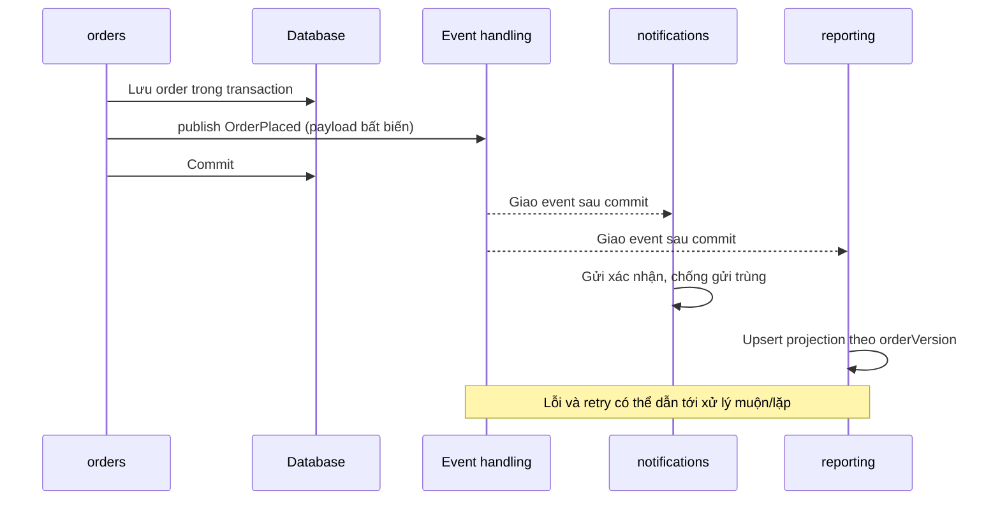

# Payload của event trong Spring Modulith

## 1. Payload là gì và vì sao thiết kế của nó quan trọng?

Trong module học **SPRING_MODULITH_APPLICATION_EVENTS**, các application event giúp module phát thông báo một sự thật nghiệp vụ mà không cần biết module nào sẽ xử lý. Chẳng hạn, module `orders` công bố sự kiện `OrderPlaced`; module `notifications` gửi email và module `reporting` cập nhật báo cáo. Các module nhận chỉ cần hiểu **hợp đồng dữ liệu của event**.

**Payload** là dữ liệu mang theo một sự kiện. Nó mô tả *điều gì đã xảy ra*, *đối tượng nghiệp vụ nào bị tác động* và *thông tin tối thiểu cần thiết để các bên nhận phản ứng đúng*. Một payload được thiết kế tốt giúp giảm phụ thuộc giữa các module, hỗ trợ xử lý sau commit, ghi nhận publication, retry và kiểm thử. Payload thiết kế kém có thể làm lộ entity, bắt listener phụ thuộc trạng thái transaction của publisher, hoặc khiến sự kiện cũ không thể phục hồi sau khi đổi mã nguồn.

Ví dụ một sự kiện:

```json
{
  "eventId": "c56c44f5-4bdb-4e85-b31e-e08cbcc5193e",
  "orderId": "588fa778-c3a6-4fb0-a93d-4c9af16c399a",
  "orderVersion": 1,
  "occurredAt": "2026-11-25T08:00:00Z",
  "totalAmount": 125000.00,
  "currencyCode": "VND"
}
```

Đây là **minh họa dạng JSON** cho cấu trúc dữ liệu nghiệp vụ, không phải lời khẳng định Spring Modulith mặc định truyền event bằng JSON. Với Spring application events trong cùng JVM, publisher thường truyền **đối tượng Java**; việc có lưu thành bản ghi hoặc tuần tự hóa sang JSON/phương thức khác hay không phụ thuộc cơ chế registry, serializer hoặc kênh tích hợp đang sử dụng.

### Payload nghiệp vụ và `PayloadApplicationEvent` của Spring

Trong Spring Framework, có thể phát một đối tượng Java thông thường bằng `ApplicationEventPublisher.publishEvent(Object)`:

```java
events.publishEvent(orderPlaced); // orderPlaced là một đối tượng OrderPlaced đã tạo.
```

Nếu đối tượng truyền vào không kế thừa `ApplicationEvent`, Spring có thể bao nó trong `PayloadApplicationEvent<?>` ở tầng cơ chế phát sự kiện. Listener khai báo nhận `OrderPlaced` vẫn có thể nhận payload theo kiểu `OrderPlaced` như bình thường. Vì vậy cần phân biệt:

- **Payload nghiệp vụ:** những field như `eventId`, `orderId`, `totalAmount` của `OrderPlaced`.
- **`PayloadApplicationEvent`:** lớp wrapper mà Spring Framework dùng để biểu diễn đối tượng phát sự kiện trong cơ chế application events.

Trong đa số bài toán Spring Modulith, một `record` hoặc lớp dữ liệu bất biến là đủ; không cần kế thừa `ApplicationEvent` chỉ để tạo một domain event.

## 2. Payload phải biểu đạt một sự thật nghiệp vụ

Tên event và các field phải cùng diễn tả **một điều đã xảy ra**. Ví dụ:

| Event | Payload cần thể hiện | Ý nghĩa |
| --- | --- | --- |
| `OrderPlaced` | ID đơn hàng, dữ liệu đặt hàng cần thiết | Đơn hàng đã được hệ thống chấp nhận/ghi nhận theo quy tắc nghiệp vụ |
| `PaymentCaptured` | ID thanh toán, ID đơn, số tiền và đơn vị tiền | Một giao dịch thu tiền đã được ghi nhận thành công |
| `StockReserved` | ID lần giữ hàng, ID đơn, thông tin giữ hàng | Tồn kho đã được giữ theo quy tắc nghiệp vụ |
| `OrderCancelled` | ID đơn, lý do hoặc trạng thái nếu cần | Đơn hàng đã được hủy |

Event như `SendEmailNow` hoặc `RefreshDashboard` thiên về **mệnh lệnh** dành cho một listener cụ thể. Nếu mục tiêu là giảm phụ thuộc giữa module, nên công bố một sự thật như `OrderPlaced` và để module nhận tự quyết định có cần gửi email hay cập nhật dashboard. Nếu thật sự muốn ra lệnh, hãy mô hình hóa đó là command với hợp đồng và kỳ vọng phản hồi rõ ràng, thay vì ngầm coi mọi thông điệp là event nghiệp vụ.

Payload chỉ nên chứa dữ liệu phản ánh sự kiện đã xảy ra và những giá trị cần thiết để xử lý nó. Không nên đưa vào payload các đối tượng điều khiển cơ chế thực thi như `EntityManager`, `ApplicationContext`, `HttpServletRequest`, thread context hoặc một callback Java.

## 3. Xây dựng payload bất biến bằng Java `record`

Trong kiến trúc Spring Modulith mặc định, một event dùng chung thường đặt ở **base package của module phát** hoặc ở **named interface** được công bố, để listener của module khác có thể import mà không tham chiếu package nội bộ. Ví dụ đặt file ở `com.example.shop.orders.OrderPlaced`:

```java
package com.example.shop.orders;

import java.math.BigDecimal;
import java.time.Instant;
import java.util.Objects;
import java.util.UUID;

public record OrderPlaced(
        UUID eventId,
        UUID orderId,
        long orderVersion,
        Instant occurredAt,
        BigDecimal totalAmount,
        String currencyCode
) {
    public OrderPlaced {
        Objects.requireNonNull(eventId, "eventId");
        Objects.requireNonNull(orderId, "orderId");
        Objects.requireNonNull(occurredAt, "occurredAt");
        Objects.requireNonNull(totalAmount, "totalAmount");
        Objects.requireNonNull(currencyCode, "currencyCode");

        if (orderVersion < 1) {
            throw new IllegalArgumentException("orderVersion must be positive");
        }
        if (totalAmount.signum() < 0) {
            throw new IllegalArgumentException("totalAmount must not be negative");
        }
        if (currencyCode.isBlank()) {
            throw new IllegalArgumentException("currencyCode must not be blank");
        }
    }
}
```

Các trường đóng vai trò khác nhau:

| Trường | Vai trò | Lưu ý |
| --- | --- | --- |
| `eventId` | Định danh **một lần phát sinh sự kiện** | Giữ nguyên khi retry hoặc replay cùng sự kiện; hỗ trợ chống xử lý trùng |
| `orderId` | Định danh **đối tượng nghiệp vụ** | Các event khác nhau của cùng đơn có thể dùng chung `orderId` |
| `orderVersion` | Phiên bản/trình tự thay đổi của **đơn hàng** | Dùng để phát hiện event cũ, nếu phiên bản được quản lý đúng và tăng đơn điệu |
| `occurredAt` | Thời điểm sự kiện được ghi nhận tại nguồn | Phải thống nhất định nghĩa; không mặc nhiên là thời điểm database commit |
| `totalAmount` | Giá trị nghiệp vụ tại thời điểm đặt hàng | `BigDecimal` phù hợp cho số tiền; cần đi kèm đơn vị tiền |
| `currencyCode` | Đơn vị tiền tệ | Phải định nghĩa chuẩn mã (chẳng hạn ISO 4217) và cách kiểm tra hợp lệ |

**Không bắt buộc event nào cũng phải có đủ sáu trường.** Chỉ thêm field khi phục vụ yêu cầu xác định được. Chẳng hạn, một sự kiện chỉ phục vụ invalidation cache có thể chỉ cần `orderId`; một luồng lập báo cáo tài chính cần cả số tiền, đơn vị tiền và thông tin nghiệp vụ tương ứng.

Sử dụng `record` bảo đảm các component reference là `final`, nhưng **không tự làm bất biến sâu** các đối tượng mà record giữ. `UUID`, `Instant`, `String` và `BigDecimal` là các kiểu bất biến phù hợp. Nếu payload chứa `List`, `Map` hoặc đối tượng tùy biến có thể sửa đổi, cần sao chép/phòng vệ thích hợp.

### Payload có danh sách phần tử

Ví dụ cần gửi snapshot các dòng hàng tới một module phân tích:

```java
import java.math.BigDecimal;
import java.util.List;
import java.util.Objects;

public record OrderLineSnapshot(
        String productCode,
        int quantity,
        BigDecimal unitPrice
) {
    public OrderLineSnapshot {
        Objects.requireNonNull(productCode, "productCode");
        Objects.requireNonNull(unitPrice, "unitPrice");
        if (quantity <= 0 || unitPrice.signum() < 0) {
            throw new IllegalArgumentException("Invalid order line");
        }
    }
}

public record OrderItemsSnapshot(List<OrderLineSnapshot> items) {
    public OrderItemsSnapshot {
        items = List.copyOf(Objects.requireNonNull(items, "items"));
    }
}
```

`List.copyOf(...)` tạo danh sách không sửa đổi được và sao chép cấu trúc danh sách; các phần tử `OrderLineSnapshot` cũng dùng thành phần bất biến. Nếu phần tử là một đối tượng mutable, sao chép danh sách **chưa đủ**: cần sao chép/đóng băng từng phần tử.

## 4. Phát event từ module sở hữu dữ liệu

Publisher nên tạo payload từ dữ liệu nghiệp vụ đã được xác định trong module của nó. Ví dụ minh họa dưới đây giả định `OrderRepository` và `OrderEntity` nằm trong package nội bộ, còn `OrderPlaced` là contract công khai:

```java
package com.example.shop.orders.internal;

import com.example.shop.orders.OrderPlaced;
import org.springframework.context.ApplicationEventPublisher;
import org.springframework.stereotype.Service;
import org.springframework.transaction.annotation.Transactional;
import java.time.Clock;
import java.time.Instant;
import java.util.UUID;

@Service
class PlaceOrderService {
    private final OrderRepository orders;
    private final ApplicationEventPublisher events;
    private final Clock clock;

    PlaceOrderService(
            OrderRepository orders,
            ApplicationEventPublisher events,
            Clock clock
    ) {
        this.orders = orders;
        this.events = events;
        this.clock = clock;
    }

    @Transactional
    public UUID place(OrderEntity order) {
        OrderEntity saved = orders.save(order);

        OrderPlaced event = new OrderPlaced(
                UUID.randomUUID(),
                saved.getId(),
                saved.getVersion(),
                Instant.now(clock),
                saved.getTotalAmount(),
                saved.getCurrencyCode()
        );

        events.publishEvent(event);
        return saved.getId();
    }
}
```

Đây là đoạn minh họa; dự án cần cung cấp `Clock` bean, các lớp repository/entity và API công khai gọi tới service. Trong thực tế, không nên công khai `OrderEntity` trong chữ ký của một API module để module khác trực tiếp thao tác entity nội bộ.

Một vài lưu ý về thời điểm tạo payload:

- Lấy **dữ liệu đã được chốt theo nghiệp vụ** thay vì truyền nguyên aggregate đang thay đổi.
- Phát event trong transaction của publisher **không đồng nghĩa transaction đã commit**. Listener dùng `@TransactionalEventListener(phase = TransactionPhase.AFTER_COMMIT)` hoặc `@ApplicationModuleListener` để làm việc sau commit khi yêu cầu như vậy.
- `Instant.now(clock)` là thời điểm ứng dụng tạo sự kiện; không phải chứng nhận thời điểm commit hay thứ tự tuyệt đối giữa các instance.
- Nếu `saved.getVersion()` dùng optimistic locking do JPA quản lý, cần chắc rằng phiên bản được đưa vào event phản ánh trạng thái mong muốn, vì giá trị version có thể chỉ cập nhật sau flush. Trong trường hợp cần số thứ tự sự kiện chặt chẽ, hãy quản lý sequence/version nghiệp vụ rõ ràng thay vì mặc định một giá trị JPA luôn đúng ở mọi thời điểm.
- Nếu một yêu cầu bị thực hiện lại như **một tác vụ nghiệp vụ mới**, cần chính sách chống tạo event trùng; `UUID.randomUUID()` chỉ tạo ID mới, không tự suy ra hai yêu cầu có cùng ý nghĩa.

## 5. Thin payload hay rich payload?

Có hai chiến lược phổ biến khi chọn dữ liệu:

**Thin payload** chỉ mang định danh và metadata tối thiểu:

```java
public record OrderPlaced(
        UUID eventId,
        UUID orderId,
        Instant occurredAt
) {}
```

Listener sau commit dùng `orderId` để truy vấn qua API của module sở hữu dữ liệu. Cách này có payload nhỏ, ít ràng buộc schema và dễ tránh sao chép dữ liệu. Tuy nhiên, listener phải truy cập dữ liệu nguồn lúc xử lý, có thể chậm hoặc bị ảnh hưởng bởi thay đổi trạng thái sau đó.

**Rich payload** mang thêm snapshot dữ liệu có ý nghĩa tại thời điểm phát, chẳng hạn `totalAmount`, `currencyCode` hoặc các dòng hàng. Nhờ đó, listener có thể xây read model, gửi thông báo hoặc ghi nhận audit dựa vào dữ liệu lịch sử đúng với event, ít cần truy vấn ngược module phát. Đổi lại, payload lớn hơn, contract nhiều field hơn và có thêm trách nhiệm bảo vệ dữ liệu và tương thích phiên bản.

| Tiêu chí | Thin payload | Rich payload |
| --- | --- | --- |
| Kích thước | Nhỏ, dễ vận chuyển/lưu trữ | Có thể tăng theo số field và số dòng |
| Phụ thuộc runtime | Listener thường phải gọi nguồn dữ liệu | Có thể xử lý độc lập hơn |
| Dữ liệu lịch sử | Nguồn có thể đã thay đổi khi listener đọc | Snapshot phản ánh trạng thái đã ghi lúc phát |
| Thay đổi contract | Ít field nên thường ít tác động | Phải quản lý tương thích nhiều trường |
| Dữ liệu nhạy cảm | Ít nguy cơ lộ thông tin hơn nếu chỉ dùng ID | Cần cân nhắc quyền truy cập, lưu trữ, log |

**Không có lựa chọn tối ưu cho mọi trường hợp.** Hãy bắt đầu từ nhu cầu cụ thể của consumer:

- Gửi email “đơn được ghi nhận với số tiền X” cần số tiền **tại lúc đặt đơn**, nên snapshot số tiền có thể tốt hơn truy vấn tổng tiền hiện tại.
- Cập nhật cache về **trạng thái mới nhất** thường chỉ cần ID và truy vấn lại nguồn, hoặc có event kèm version để tránh áp dụng dữ liệu cũ.
- Hệ thống audit yêu cầu lưu dấu lịch sử cần các field biểu diễn chính xác sự thật lúc phát; không nên tính lại từ entity có thể bị sửa sau này.
- Nếu phải truyền hàng nghìn dòng hàng hoặc dữ liệu nhị phân, cân nhắc phân tách, tham chiếu tài nguyên bền vững hay cơ chế truyền phù hợp thay vì tăng vô hạn kích thước một application event.

Truyền `orderId` để consumer truy vấn không được xem là vượt ranh giới module nếu consumer đi qua **API công khai được thiết kế rõ ràng**. Ngược lại, cho consumer import trực tiếp `orders.internal.OrderRepository` để lấy thêm dữ liệu là coupling vào chi tiết triển khai.

## 6. Tách biệt các định danh và thông tin theo dõi

Một số trường thường dễ bị nhầm với nhau:

```text
eventId       = định danh sự kiện (retry cùng event → giữ nguyên)
orderId       = định danh aggregate nghiệp vụ
orderVersion  = phiên bản aggregate (phát hiện dữ liệu cũ)
schemaVersion = phiên bản cấu trúc/hợp đồng payload, nếu có chính sách dùng
correlationId = định danh chuỗi yêu cầu/quy trình, nếu cần trace
occurredAt    = thời điểm sự kiện nghiệp vụ được tạo/ghi nhận
```

Ví dụ một đơn hàng có ba event:

| Event | `eventId` | `orderId` | `orderVersion` |
| --- | --- | --- | --- |
| `OrderPlaced` | `e-001` | `o-100` | 1 |
| `OrderPaid` | `e-002` | `o-100` | 2 |
| `OrderCancelled` | `e-003` | `o-100` | 3 |

ID trong bảng là ký hiệu minh họa, không phải UUID hợp lệ. Mỗi event có `eventId` riêng; cả ba cùng tác động tới `orderId`. Nếu consumer nhận event phiên bản 3 trước phiên bản 2, nó có thể tránh ghi đè projection mới bằng trạng thái cũ bằng cách kiểm tra `orderVersion`.

**Lưu ý:** `orderVersion` chỉ có ý nghĩa nếu module phát bảo đảm nó tăng đơn điệu cho các thay đổi liên quan. Không dùng `occurredAt` thay thế một cách mặc định: đồng hồ giữa các node có thể lệch, timestamp có thể trùng và retry có thể xảy ra muộn.

`correlationId`, `causationId`, `tenantId` hay `schemaVersion` là các trường **tùy nhu cầu**. Thêm chúng cần định nghĩa rõ:

- `correlationId` nối các sự kiện/operation trong một luồng; không đồng nghĩa định danh duy nhất của event.
- `causationId` xác định sự kiện/command tạo ra một sự kiện kế tiếp, hữu ích khi điều tra luồng.
- `tenantId` giúp truy vấn và kiểm soát ranh giới dữ liệu đa tenant; nó không thay thế kiểm tra quyền truy cập.
- `schemaVersion` biểu thị phiên bản hợp đồng, khác với version của aggregate. Thêm số phiên bản mà không có cơ chế đọc dữ liệu cũ sẽ không tự giải quyết vấn đề tương thích.

Không nên sao chép toàn bộ tracing baggage hoặc thông tin xác thực của request vào payload vì có thể làm rò rỉ dữ liệu và khiến event phụ thuộc môi trường HTTP. Cần định nghĩa metadata nghiệp vụ và metadata vận hành theo nhu cầu thực.

## 7. Độ bền, retry và idempotency phụ thuộc payload

Trong Spring Modulith, `@ApplicationModuleListener` hỗ trợ listener chạy sau commit, bất đồng bộ và dùng transaction riêng. Event Publication Registry có thể theo dõi publication cho các listener phù hợp khi đã thiết lập lưu trữ/cấu hình cần thiết. Payload quyết định **sau khi xử lý thất bại hoặc ứng dụng restart, listener có còn đủ thông tin để xử lý lại không**.

Ví dụ listener cập nhật dữ liệu thống kê:

```java
package com.example.shop.reporting.internal;

import com.example.shop.orders.OrderPlaced;
import org.springframework.modulith.events.ApplicationModuleListener;
import org.springframework.stereotype.Component;

@Component
class OrderReportingListener {
    private final OrderSummaryProjection projection;

    OrderReportingListener(OrderSummaryProjection projection) {
        this.projection = projection;
    }

    @ApplicationModuleListener
    public void on(OrderPlaced event) {
        projection.upsertIfNewer(
                event.orderId(),
                event.orderVersion(),
                event.totalAmount(),
                event.currencyCode()
        );
    }
}
```

`OrderSummaryProjection.upsertIfNewer(...)` là phương thức nghiệp vụ giả định. Nó phải kiểm tra phiên bản đã lưu và chỉ áp dụng event mới hơn để tránh việc retry một event cũ làm hỏng kết quả. Nếu consumer cần ghi một hoạt động **chỉ một lần cho mỗi event**, hãy cân nhắc bảng processed-event có ràng buộc khóa duy nhất theo `eventId`, cập nhật trạng thái và dấu đã xử lý trong cùng transaction của consumer.

Đối với hệ thống bên ngoài như email hoặc HTTP payment API, không có transaction database chung chỉ nhờ phát event. Dù registry thấy listener lỗi và có thể phát lại, tác dụng phụ bên ngoài có thể đã hoàn tất trước khi lỗi xảy ra. Khi đó, payload nên có **định danh/idempotency key ổn định** và bên nhận phải hỗ trợ chống xử lý trùng hoặc đối soát kết quả.

Một số quy tắc quan trọng:

1. **Retry cùng sự kiện phải giữ cùng `eventId` và cùng dữ liệu nghiệp vụ**; tạo UUID mới ở mỗi lần xử lý lại sẽ làm mất khả năng nhận diện một lần giao trùng.
2. **Có thể giao lại hoặc giao trễ**: thiết kế listener idempotent, kiểm tra version và dùng transaction cho các thay đổi trong database.
3. **Payload độc lập với transaction gốc**: tránh dựa vào entity lazy-loading, persistence context hoặc request-scoped bean vốn không còn hợp lệ sau commit.
4. **Registry không phải hợp đồng exactly-once**: lưu/truy hồi publication là một phần của độ tin cậy, còn semantics của tác dụng phụ phải được kiểm chứng.
5. **Thời điểm phát và trạng thái commit**: event được phát trong transaction nên chỉ kích hoạt xử lý sau commit khi nghiệp vụ yêu cầu; payload riêng lẻ không tự tạo ra bảo đảm này.

## 8. Payload phải tương thích với việc lưu và đọc lại

Một application event chỉ xử lý đồng bộ trong bộ nhớ có yêu cầu khác với event được lưu trong Event Publication Registry hoặc gửi qua message broker. Khi có lưu và replay, payload trở thành **dữ liệu tồn tại lâu hơn vòng đời của một phiên bản ứng dụng**.

Các thay đổi dễ gây vấn đề:

| Thay đổi | Nguy cơ |
| --- | --- |
| Đổi tên class hoặc package chứa event | Bản ghi cũ có thể không được ánh xạ về kiểu event mới, tùy serializer/registry |
| Xóa/đổi tên một field | Consumer hoặc dữ liệu cũ thiếu/mất ngữ nghĩa |
| Đổi `amount` từ `BigDecimal` sang một kiểu khác | Khác quy tắc số học, format, precision hoặc cách giải mã |
| Đổi đơn vị của một field nhưng giữ tên | Consumer giải thích sai giá trị dù dữ liệu vẫn đọc được |
| Thêm field bắt buộc không có default | Dữ liệu event cũ có thể không còn deserialize được |
| Thay đổi ý nghĩa `OrderPlaced` | Consumer cũ tiếp tục chạy nhưng thực hiện sai nghiệp vụ |

Các nguyên tắc duy trì contract:

- Định nghĩa rõ **kiểu, đơn vị, nullable, miền giá trị, ngữ nghĩa và thời điểm chụp dữ liệu**.
- Coi payload từng được lưu là một phiên bản hợp đồng cần cân nhắc khi nâng cấp ứng dụng.
- Khi thêm field mới, cân nhắc giá trị mặc định/khả năng đọc event cũ, cũng như listener cũ có bỏ qua field mới an toàn không.
- Khi đổi nghĩa đáng kể, cân nhắc loại event mới và chiến lược chuyển đổi rõ ràng.
- Kiểm thử **round-trip serialization/deserialization bằng công nghệ thực tế của registry hoặc kênh tích hợp** và đọc lại dữ liệu cũ đã lưu.
- Đảm bảo quá trình triển khai phiên bản mới không làm mắc kẹt các publication chưa xử lý do thay đổi schema/class.

Không có một định dạng serialization hay cơ chế versioning cố định cho mọi cấu hình Spring Modulith. Khả năng đọc event cũ phụ thuộc phiên bản, backend của registry, serializer và cách hệ thống triển khai. Chỉ gắn `schemaVersion = 2` vào record sẽ **không tự tạo** logic chuyển đổi schema phiên bản 1.

### Đừng vô tình truyền cả JPA entity

Ví dụ nên tránh:

```java
// Không nên làm payload đi qua ranh giới module bằng entity đang quản lý.
public record OrderPlaced(OrderEntity order) {}
```

Rủi ro bao gồm:

- Consumer phụ thuộc chi tiết ORM và cấu trúc package nội bộ.
- Entity có thể thay đổi trạng thái sau thời điểm phát.
- Truy cập thuộc tính lazy-loading sau commit có thể thất bại.
- Đồ thị quan hệ có thể rất lớn, có chu trình hoặc chứa dữ liệu không nên xuất hiện trong event.
- Serializer của kho lưu trữ publication có thể gặp khó khăn khi lưu/proxy/đọc lại entity.

Thay bằng **ID và snapshot bất biến vừa đủ**; nếu consumer cần trạng thái mới nhất, hãy dùng API công khai của module sở hữu dữ liệu.

## 9. Bảo vệ dữ liệu và tối ưu kích thước

Không phải mọi dữ liệu trong entity đều nên trở thành field của event. Event có thể xuất hiện trong log, kho lưu publication, bản sao lưu hoặc một tích hợp tương lai, nên phạm vi tiếp xúc của payload có thể rộng hơn biến cục bộ trong service.

Không đưa mật khẩu, access token, khóa bí mật hoặc thông tin xác thực vào event. Với email, số điện thoại, địa chỉ, dữ liệu tài chính và định danh cá nhân, chỉ truyền khi có nhu cầu được xác định và biện pháp kiểm soát phù hợp. Không log nguyên payload nếu nó chứa thông tin nhạy cảm; log có thể chỉ cần `eventId`, `orderId`, loại event, trạng thái xử lý và thời gian.

Đối với dữ liệu có nhiều phần tử, cần quan tâm **số lượng field, kích thước danh sách, độ sâu object graph, số lần copy và tốc độ serialization** nếu có lưu. Một payload lớn có thể tiêu tốn bộ nhớ, tăng thời gian xử lý, tăng dung lượng registry và làm chậm retry. Chọn các trường cần thiết, quy định giới hạn kích thước và đưa đối tượng lớn sang một kho phù hợp nếu nghiệp vụ cần.

Payload bất biến còn giúp debug: cùng một `eventId` luôn gắn với cùng một nội dung nghiệp vụ, khiến việc đối chiếu log, audit và thử lại có ý nghĩa.

## 10. Kiểm thử thiết kế payload

Một bài test chỉ xác nhận `publishEvent(...)` được gọi chưa đủ cho giao sự kiện đáng tin cậy. Với payload, nên kiểm tra cả hợp đồng dữ liệu và các trường hợp thực thi.

| Nhóm kiểm thử | Điều cần xác minh |
| --- | --- |
| Tạo payload | Field bắt buộc hợp lệ; eventId/orderId/đơn vị tiền rõ nghĩa; không có giá trị âm ngoài quy tắc |
| Bất biến | Không sửa được các component; list/map có defensive copy khi cần |
| Ranh giới module | Consumer chỉ dùng event/API công khai, không import repository/entity nội bộ |
| Transaction | Event sau commit có dữ liệu như dự kiến; rollback không gây side effect cho listener sau commit |
| Idempotency | Giao cùng eventId nhiều lần không làm tăng kết quả nghiệp vụ ngoài ý muốn |
| Thứ tự | Event phiên bản cũ đến sau không ghi đè projection mới |
| Khôi phục | Publication chưa hoàn tất có thể đọc lại và xử lý bằng payload đã lưu theo cấu hình registry |
| Schema evolution | Phiên bản triển khai mới đọc được những payload cũ cần tiếp tục xử lý |
| Dữ liệu nhạy cảm | Payload và log không chứa thông tin vượt nhu cầu đã xác định |

Ví dụ unit test xác minh dữ liệu được bảo vệ khỏi giá trị không hợp lệ:

```java
import static org.junit.jupiter.api.Assertions.assertThrows;
import java.math.BigDecimal;
import java.time.Instant;
import java.util.UUID;
import org.junit.jupiter.api.Test;

class OrderPlacedTest {

    @Test
    void rejectsNegativeAmount() {
        assertThrows(IllegalArgumentException.class, () -> new OrderPlaced(
                UUID.randomUUID(),
                UUID.randomUUID(),
                1L,
                Instant.parse("2026-11-25T08:00:00Z"),
                new BigDecimal("-10.00"),
                "VND"
        ));
    }
}
```

Unit test giúp xác minh constructor, nhưng test tích hợp mới đánh giá được vòng đời transaction, cấu hình Event Publication Registry và khả năng retry/replay thực tế. Nếu ứng dụng dùng serializer lưu event, hãy có test riêng để đọc lại những bản ghi đã tạo bởi phiên bản trước.

## 11. Tình huống thiết kế: gửi email và cập nhật báo cáo

Yêu cầu: sau khi đơn hàng được ghi nhận, `notifications` gửi email xác nhận, còn `reporting` cập nhật báo cáo doanh thu. Cần chọn payload cho `OrderPlaced`.

Một phương án hợp lý là giữ `eventId` để chống xử lý trùng, `orderId` để định danh đơn, `orderVersion` để phát hiện dữ liệu cũ, `occurredAt` để phân tích thời điểm phát sinh, cùng `totalAmount` và `currencyCode` là snapshot cần cho báo cáo. Nếu `notifications` cần địa chỉ email, cân nhắc lấy qua API công khai của module sở hữu thông tin khách hàng, hoặc bổ sung dữ liệu email chỉ khi đã xem xét nhu cầu lịch sử, quyền truy cập và lưu trữ.

Luồng xử lý:



Trong hệ thống có cấu hình Event Publication Registry phù hợp, cần quan sát những publication chưa hoàn tất và chiến lược xử lý lại. Các listener vẫn chịu trách nhiệm đảm bảo idempotency, kiểm soát dữ liệu cũ và xử lý lỗi ở hệ thống bên ngoài. Dù payload được thiết kế chuẩn, một application event trong bộ nhớ **không tự trở thành thông điệp bền vững giữa các tiến trình**.

## 12. Checklist trước khi chốt event payload

1. **Đúng sự thật:** tên event và các field thể hiện chính xác hành động nghiệp vụ đã xảy ra chưa?
2. **Đủ và gọn:** mỗi field có consumer hoặc nhu cầu vận hành cụ thể không? Có trường nào thừa hoặc dữ liệu quá lớn không?
3. **Ổn định:** payload có dùng dữ liệu bất biến thay vì entity/proxy, bean hoặc đối tượng request không?
4. **Ranh giới:** event nằm trong API công khai của module phát; listener không phụ thuộc package nội bộ của publisher chứ?
5. **Định danh:** `eventId`, aggregate ID, business version và timestamp có ngữ nghĩa phân biệt và ổn định khi retry không?
6. **Lịch sử:** listener cần snapshot tại thời điểm sự kiện hay trạng thái mới nhất? Đã chọn thin/rich payload theo yêu cầu đó chưa?
7. **Tương thích:** có chiến lược đọc lại event cũ nếu registry hoặc broker lưu payload không?
8. **Tin cậy:** thử lại, xử lý trùng, sai thứ tự, rollback và khôi phục sau restart đã được tính đến chưa?
9. **Bảo mật:** payload và log chỉ chứa dữ liệu được phép, đủ dùng, có giới hạn kích thước chưa?

**Điểm cốt lõi:** Payload là **hợp đồng giữa các module**. Đối với Spring Modulith application events, một payload nhỏ, bất biến, có ngữ nghĩa rõ và có thể dùng lại khi retry là nền tảng để publisher và listener giao tiếp ít phụ thuộc hơn. Transaction sau commit, Event Publication Registry, cơ chế phục hồi và kiểm thử bổ sung độ tin cậy vận hành; chúng không thay thế trách nhiệm thiết kế dữ liệu event.
