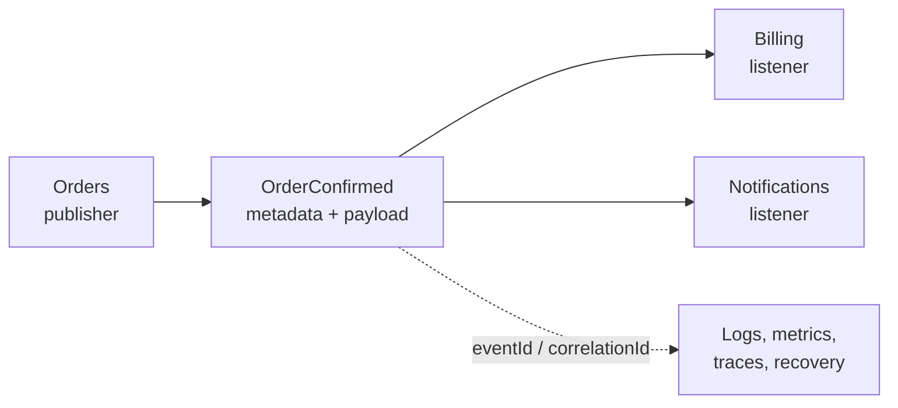
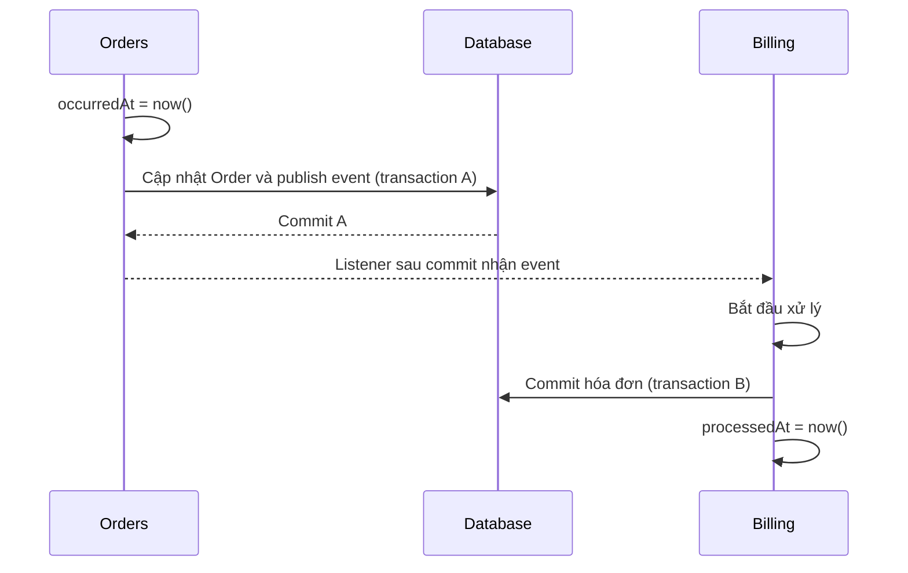
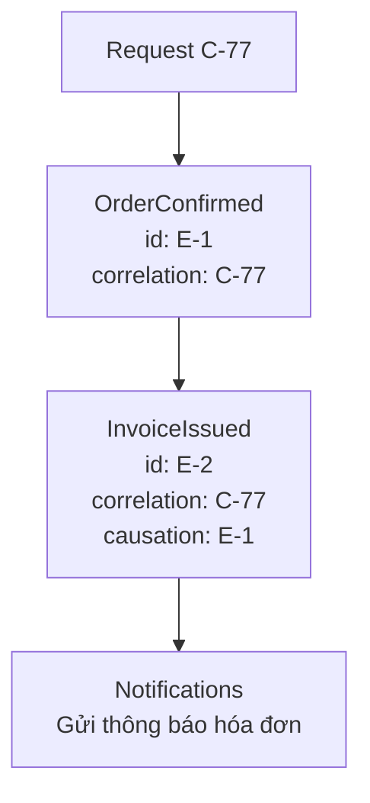
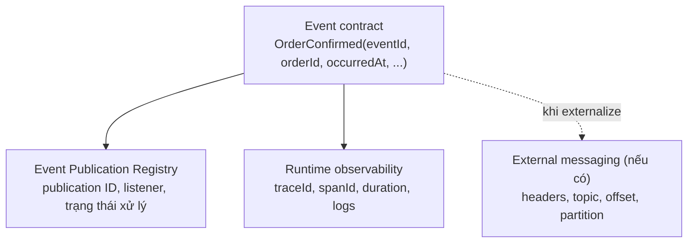
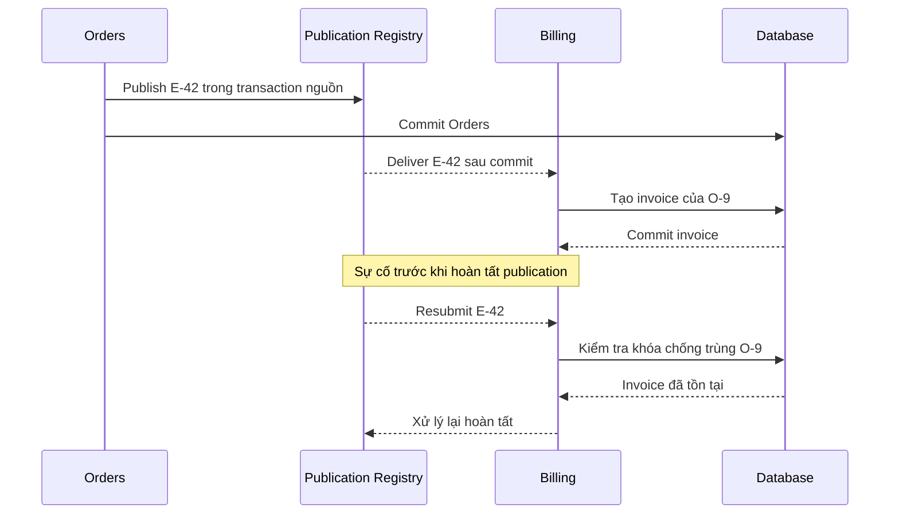

# Metadata của event

> **Chương:** Mô hình sự kiện  
> **Phạm vi:** `SPRING_MODULITH_APPLICATION_EVENTS` — tổ chức giao tiếp giữa các module Spring Modulith bằng application events để giảm phụ thuộc, bảo vệ ranh giới nghiệp vụ, đồng thời thiết kế publisher, listener sau commit, Event Publication Registry, retry, kiểm thử và quan sát việc xử lý sự kiện đáng tin cậy.

## 1. Vì sao event cần metadata?

Trong một ứng dụng bán hàng được chia thành các module `Orders`, `Billing`, `Notifications`, sự kiện `OrderConfirmed` có thể mang thông tin đơn hàng đã xác nhận:

```java
public record OrderConfirmed(UUID orderId) {}
```

Mẫu này đủ để Billing biết **đơn nào** vừa được xác nhận, nhưng khi có lỗi xảy ra, rất khó trả lời:

- Đây là **lần phát sinh sự kiện nào**? Có phải listener đang nhận lại cùng một event?
- Sự việc xảy ra **lúc nào**? Listener xử lý trễ bao lâu?
- Event có liên quan đến request, tác vụ hay **chuỗi sự kiện** nào?
- Payload thuộc **phiên bản hợp đồng** nào khi hệ thống đã triển khai code mới?
- Nếu xử lý song song, sự kiện này liên quan đến **phiên bản trạng thái** nào của đơn hàng?
- Làm sao biết việc tạo hóa đơn thất bại là ở publisher, Event Publication Registry hay một listener cụ thể?

**Event metadata** là những thuộc tính mô tả *danh tính, nguồn gốc, thời điểm, quan hệ nhân quả, ngữ cảnh và cách diễn giải* của một sự kiện. Metadata giúp các module hiểu và vận hành sự kiện; phần **business payload** mô tả sự thật nghiệp vụ mà sự kiện công bố.



Trong Spring Modulith, metadata đặc biệt hữu ích vì listener có thể chạy **sau commit**, **bất đồng bộ** hoặc được **xử lý lại** sau lỗi. Một HTTP request thành công chưa chứng minh mọi listener đã hoàn thành. Metadata tạo các khóa kết nối giữa sự kiện nguồn, lần xử lý và kết quả vận hành.

## 2. Phân biệt business payload và metadata

Một sự kiện `OrderConfirmed` có thể có hai nhóm thông tin:

| Nhóm | Ví dụ | Câu hỏi trả lời |
|---|---|---|
| **Business payload** | `orderId`, `confirmedTotal`, `currency` | Điều gì đã xảy ra đối với nghiệp vụ? |
| **Event metadata** | `eventId`, `occurredAt`, `correlationId`, `schemaVersion` | Sự kiện này là lần nào, xảy ra lúc nào, liên quan đến luồng nào và đọc bằng hợp đồng nào? |

Sự phân chia trên là **quy ước thiết kế**, không phải một quy tắc tuyệt đối. `orderId` đồng thời là **business identifier** và thường được dùng làm **aggregate identifier** để truy vết sự kiện. `occurredAt` đôi khi cũng có ý nghĩa nghiệp vụ, chẳng hạn thời điểm thanh toán được ghi nhận.

Điểm quan trọng là sự kiện phải đủ **ngữ nghĩa** để consumer xử lý đúng, chứ không chỉ mang một tập trường có tên gọi đẹp.

### 2.1. Event type khác event instance

`OrderConfirmed` là **event type** (loại sự kiện); mỗi lần xác nhận đơn hợp lệ tạo ra một **event instance** riêng:

```text
Event type: OrderConfirmed
  ├─ eventId = 5b4... ; orderId = A100 ; occurredAt = T1
  ├─ eventId = 1ac... ; orderId = A101 ; occurredAt = T2
  └─ eventId = 7e9... ; orderId = A102 ; occurredAt = T3
```

Khi một listener được retry, nó có thể nhận **lại chính instance event** có `eventId` như trước. Nếu publisher tạo một event mới sau một chuyển trạng thái nghiệp vụ mới, event mới cần danh tính riêng. Không được nhầm `eventId` với `orderId`: một đơn hàng có thể sinh ra nhiều sự kiện khác loại hoặc nhiều sự kiện hợp lệ theo thời gian.

## 3. Các nhóm metadata thường gặp

| Thuộc tính | Ý nghĩa | Mức ưu tiên | Lưu ý |
|---|---|---|---|
| `eventId` | Định danh duy nhất của một **lần phát sinh sự kiện** | Cao với retry/tracing | Giữ ổn định khi xử lý lại cùng event |
| `eventType` | Loại sự kiện, ví dụ `OrderConfirmed` | Có thể suy từ Java type | Cần định danh tường minh nếu externalize |
| `occurredAt` | Thời điểm nghiệp vụ nhận biết sự việc | Cao khi phân tích độ trễ | Không mặc định là commit timestamp |
| `aggregateId` / `orderId` | Định danh đối tượng nghiệp vụ nguồn | Cao | Không thay thế `eventId` |
| `aggregateVersion` | Phiên bản trạng thái của aggregate nguồn | Tùy nhu cầu ordering | Không đồng nghĩa schema version |
| `correlationId` | Nhận diện toàn bộ chuỗi hành động liên quan | Hữu ích cho tracing | Thường giữ nguyên qua nhiều event |
| `causationId` | Event/command gây ra event hiện tại | Tùy workflow | Liên kết nhân quả trực tiếp |
| `schemaVersion` | Phiên bản cấu trúc/hợp đồng event | Cần khi tiến hóa payload | Không tự động giải quyết compatibility |
| `source` / `producerModule` | Module phát sự kiện | Hữu ích ở ranh giới hệ thống | Có thể suy ra bằng contract nội bộ |
| `tenantId` | Phạm vi tenant trong hệ thống đa thuê | Tùy kiến trúc | Cần kiểm soát quyền và dữ liệu |
| `traceId` / `spanId` | ID do hệ thống tracing tạo | Chủ yếu observability | Không dùng thay khóa nghiệp vụ |

**Không phải mọi event đều cần tất cả các trường.** Chọn metadata theo yêu cầu nghiệp vụ, khả năng phục hồi và vận hành. Nhiều trường không liên quan sẽ làm hợp đồng phình to và tăng rủi ro lộ dữ liệu.

## 4. Event ID: danh tính của một lần phát sinh

`eventId` giúp nhận biết **một sự kiện cụ thể**:

```java
public record OrderConfirmed(
        UUID eventId,
        UUID orderId
) {}
```

Mỗi lần Orders thực hiện một **chuyển trạng thái xác nhận hợp lệ**, nó tạo `eventId` mới. Khi listener xử lý lại **cùng sự kiện**, `eventId` phải giữ nguyên.

Ví dụ:

```text
Orders phát OrderConfirmed(eventId=E-42, orderId=O-9)
  ├─ Billing xử lý E-42 lần đầu -> timeout
  ├─ Billing retry E-42            -> xử lý lại
  └─ Billing nhận lại E-42        -> phải chống tạo hóa đơn trùng
```

Nếu retry tái tạo event bằng `UUID.randomUUID()`, listener có thể hiểu đó là **event khác** và bỏ qua cơ chế chống trùng dựa trên ID. Chính sách retry đúng cần giữ **danh tính event gốc**; nếu một request nghiệp vụ được thực hiện lại, publisher còn phải quyết định yêu cầu đó có tạo **sự kiện mới** hay không dựa trên **bất biến nghiệp vụ**.

### 4.1. Event ID và idempotency không hoàn toàn giống nhau

Trong ví dụ “mỗi đơn hàng có tối đa một hóa đơn”, `orderId` là **business idempotency key** rất mạnh vì nó phản ánh bất biến nghiệp vụ. `eventId` hữu ích để chặn xử lý lại cùng một event, nhưng có thể vẫn tồn tại hai event khác ID cho cùng `orderId` do yêu cầu đồng thời hoặc lỗi publisher.

| Cơ chế | Chặn được gì? | Giới hạn |
|---|---|---|
| Khóa theo `eventId` | Xử lý lại đúng một event instance | Không tự ngăn hai event khác ID của cùng đơn |
| Unique constraint `invoice.order_id` | Hai hóa đơn cho cùng đơn theo quy tắc ví dụ | Không phù hợp nếu nghiệp vụ cho phép nhiều hóa đơn |
| Unique `(consumerId, eventId)` trong bảng processed event | Mỗi consumer đánh dấu đã xử lý event nào | Cần cùng transaction với side effect DB cần bảo vệ |
| Idempotency key với API ngoài | Giảm gọi lặp tạo tác dụng phụ ở phía nhận | Phụ thuộc hợp đồng idempotency của dịch vụ ngoài |

Nếu một listener có tác vụ ngoài DB như gửi email hay gọi cổng thanh toán, chỉ lưu `eventId` tại DB ứng dụng **không tạo ra giao dịch nguyên tử** với hệ thống ngoài. Cần kết hợp API hỗ trợ idempotency, trạng thái nghiệp vụ, retry có kiểm soát và quan sát.

## 5. Thời gian: occurredAt, publishedAt, processedAt

Ba thời điểm thường bị nhầm:

| Thời điểm | Ai xác định? | Ý nghĩa |
|---|---|---|
| `occurredAt` | Publisher/domain | Khi sự việc nghiệp vụ được ghi nhận trong logic ứng dụng |
| `publishedAt` | Lớp phát/lưu publication nếu được ghi lại | Khi event được publish hoặc publication được ghi nhận |
| `processedAt` | Listener hoặc hệ thống theo dõi xử lý | Khi một lần xử lý đạt trạng thái mong muốn |

Trong transaction, `occurredAt` có thể được lấy **trước khi commit**. Nếu transaction rollback, không nên xem event đó như một sự thật nghiệp vụ đã **commit** ở hệ thống khác; listener sau commit sẽ giúp tránh phản ứng cho transaction rollback.



Nhờ giữ `occurredAt` và đo thời gian xử lý, ta có thể tính **độ trễ từ khi sự kiện phát sinh đến lúc phản ứng hoàn thành**. Độ trễ này phụ thuộc thời gian commit, lịch executor, retry và trạng thái hệ thống.

**Thực hành nên dùng `Instant` và UTC** cho timestamp trao đổi, tránh `LocalDateTime` thiếu múi giờ. Khi muốn test thời gian chính xác, inject `Clock` thay vì gọi `Instant.now()` trực tiếp ở nhiều nơi. Trong hệ thống đa máy, sai lệch đồng hồ có thể ảnh hưởng metric; cần đồng bộ clock và không suy ra thứ tự tuyệt đối giữa các máy chỉ từ timestamp.

## 6. Correlation ID và causation ID: ghép nối chuỗi nghiệp vụ

Giả sử:

1. Client gửi yêu cầu xác nhận đơn với `correlationId = C-77`.
2. Orders xác nhận và phát `OrderConfirmed(eventId = E-1)`.
3. Billing nghe `E-1`, phát `InvoiceIssued(eventId = E-2)`.
4. Notifications nghe `E-2` để gửi email.

`correlationId` giữ một giá trị xuyên suốt luồng liên quan. `causationId` giúp chỉ rõ **bước trực tiếp dẫn tới** một event.



Phân biệt:

- **`correlationId`:** ID dùng để nhóm nhiều bước cùng một tác vụ/luồng; không nhất thiết trùng event ID.
- **`causationId`:** ID của command/event trực tiếp khởi phát event hiện tại. Nếu command chưa có ID, có thể dùng một command/request ID có quy tắc rõ.
- **`traceId`:** ID từ hệ thống distributed tracing; hữu ích cho chẩn đoán nhưng có thể không tồn tại hoặc không giữ nguyên sau restart, retry và xử lý kéo dài.

Không có chuẩn duy nhất bắt buộc `causationId` phải có ở mọi sự kiện. Với workflow đơn giản, có thể chỉ cần `eventId` và `correlationId`; với chuỗi sự kiện dài, `causationId` giúp tái dựng quan hệ nhân quả.

### 6.1. Vì sao không chỉ dựa vào MDC/ThreadLocal?

`@ApplicationModuleListener` thường xử lý bất đồng bộ. Khi chuyển thread, các biến `ThreadLocal` và MDC không nhất thiết đi theo. Khi xử lý lại publication sau restart, request HTTP gốc thậm chí không còn tồn tại.

Nếu một ID là điều kiện cần để **liên kết nghiệp vụ, idempotency hoặc audit**, hãy cân nhắc đưa nó vào **event contract**, hoặc bảo đảm transport/persistent metadata có cách mang và phục hồi nó ổn định. Tracing context nên được cấu hình thông qua công cụ observability phù hợp, nhưng **không thay thế dữ liệu nghiệp vụ cần thiết trong event**.

## 7. Event version khác aggregate version

Hai loại version trả lời hai câu hỏi khác nhau:

| Field | Câu hỏi | Ví dụ |
|---|---|---|
| `schemaVersion` / `eventVersion` | Payload và ngữ nghĩa của **loại event** đang theo hợp đồng phiên bản nào? | `OrderConfirmed v2` thêm `confirmedTotal` |
| `aggregateVersion` | Đây là thay đổi thứ mấy của **thực thể nghiệp vụ nguồn**? | Đơn hàng `O-9` đã chuyển tới version `12` |

**Schema version** phục vụ evolution của event: thêm trường, đổi tên trường, thay đổi ý nghĩa. **Aggregate version** có thể hỗ trợ ordering, kiểm tra stale event hoặc phát hiện thiếu bước, nếu mô hình nghiệp vụ có version có ý nghĩa và giữ được nhất quán.

Ví dụ:

```java
public record OrderConfirmed(
        UUID eventId,
        UUID orderId,
        long orderVersion,
        Instant occurredAt
) {}
```

Ở đây `orderVersion` là **business state version** của đơn, không phải phiên bản cấu trúc Java record. Nếu một đơn phát nhiều event theo các lần thay đổi, mỗi event có thể mang version tăng theo trạng thái nguồn. Tuy nhiên:

- `@Version` của JPA có ngữ nghĩa riêng và có thể chỉ được cập nhật ở flush/commit; không được giả định đọc trước flush luôn cho số version cuối cùng.
- Có version tăng **không tự bảo đảm listener nhận hoặc xử lý đúng thứ tự** khi chạy async, retry hoặc nhiều worker.
- Nếu cần strict ordering cho mỗi aggregate, phải thiết kế thêm điều kiện, serialization, xử lý gap và chính sách concurrency.

### 7.1. Hợp đồng event cần tương thích với dữ liệu cũ

Khi Spring Modulith dùng publication store bền vững, có thể tồn tại publication chưa xử lý từ **bản ứng dụng cũ**. Sau triển khai, code listener mới có thể phải đọc event được serialize từ phiên bản trước.

Vì vậy, thay đổi payload cần xét:

1. Trường được thêm là optional hay bắt buộc?
2. Serializer/deserializer đang dùng có đọc được phiên bản cũ không?
3. Ý nghĩa của event có thay đổi hay chỉ bổ sung thông tin?
4. Các publication tồn đọng sẽ được migrate, giữ tương thích hay xử lý hết trước khi triển khai?

Chỉ thêm field `schemaVersion` **không tự động tạo migration**. Nhóm cần viết quy tắc tương thích, kiểm thử payload cũ và quy trình triển khai phù hợp. Với event chỉ dùng trong bộ nhớ, không nhất thiết phải lưu schema version nếu không có nhu cầu tương thích xuyên phiên bản; dùng Java type và catalog có thể đủ.

## 8. Ngữ cảnh nguồn, tenant và thông tin bảo mật

Trong ứng dụng đa thuê hoặc có các miền nghiệp vụ nhạy cảm, metadata có thể cần `tenantId`, `sourceModule`, `actorId` hay `requestId`. Chọn lọc rất quan trọng:

| Trường | Khi nào hữu ích? | Nguy cơ nếu dùng thiếu kiểm soát |
|---|---|---|
| `tenantId` | Listener cần phân vùng dữ liệu theo tenant | Cross-tenant access nếu không xác thực và áp dụng cách ly |
| `sourceModule` | Event được externalize hoặc có nhiều producer | Có thể thành dữ liệu trùng với event type trong nội bộ |
| `actorId` | Audit yêu cầu biết ai khởi phát hành động | Chứa thông tin cá nhân, cần chính sách lưu trữ |
| `requestId` | Nối event với request nguồn | Request có thể hết vòng đời trước listener |
| `traceId` | Liên hệ telemetry với hành vi runtime | Không nên xem là định danh nghiệp vụ bền vững |

**Metadata không tự cấp quyền truy cập.** Chỉ vì event có `tenantId` không có nghĩa consumer được phép truy vấn mọi dữ liệu tenant đó. Mỗi module vẫn phải áp dụng phân quyền, cách ly dữ liệu và bảo vệ thông tin nhạy cảm.

Không ghi access token, password, cookie, số thẻ hay payload cá nhân không cần thiết vào metadata. Event có thể được ghi log, persist trong Event Publication Registry hoặc chuyển đến nhiều listener. Nếu cần thông tin liên hệ, cân nhắc ID tham chiếu và API được phép của module sở hữu thay vì sao chép thông tin nhạy cảm.

## 9. Thiết kế event contract bất biến với metadata tối thiểu

Một ví dụ thực tế cho Spring Modulith có thể bắt đầu với `eventId`, `orderId`, `occurredAt` và `correlationId`:

```java
package com.acme.shop.orders.events;

import java.time.Instant;
import java.util.Objects;
import java.util.UUID;

public record OrderConfirmed(
        UUID eventId,
        UUID orderId,
        Instant occurredAt,
        UUID correlationId
) {
    public OrderConfirmed {
        Objects.requireNonNull(eventId, "eventId");
        Objects.requireNonNull(orderId, "orderId");
        Objects.requireNonNull(occurredAt, "occurredAt");
        Objects.requireNonNull(correlationId, "correlationId");
    }
}
```

`record` tạo các trường bất biến theo tham chiếu và giảm boilerplate. `UUID`, `Instant` là các kiểu immutable phù hợp. Với payload chứa collection hay đối tượng mutable, cần thiết kế copy phòng vệ nếu muốn event bất biến thật sự.

Trong Spring, `ApplicationEventPublisher` có thể phát POJO/`record` trực tiếp; không bắt buộc kế thừa `ApplicationEvent`. Metadata nằm trong các trường Java ở ví dụ trên là **quy ước hợp đồng do ứng dụng thiết kế**, không phải tên field bắt buộc mà Spring Modulith tự động đọc để xử lý retry.

### 9.1. Publisher tạo metadata ở điểm nào?

```java
package com.acme.shop.orders.internal;

import com.acme.shop.orders.events.OrderConfirmed;
import java.time.Clock;
import java.time.Instant;
import java.util.UUID;
import org.springframework.context.ApplicationEventPublisher;
import org.springframework.stereotype.Service;
import org.springframework.transaction.annotation.Transactional;

@Service
public class OrderService {

    private final OrderRepository orders;
    private final ApplicationEventPublisher publisher;
    private final Clock clock;

    public OrderService(
            OrderRepository orders,
            ApplicationEventPublisher publisher,
            Clock clock
    ) {
        this.orders = orders;
        this.publisher = publisher;
        this.clock = clock;
    }

    @Transactional
    public void confirm(UUID orderId, UUID correlationId) {
        Order order = orders.findById(orderId).orElseThrow();
        boolean changed = order.confirmIfAllowed();
        if (!changed) {
            return; // Không có sự việc mới => không phát event mới.
        }

        publisher.publishEvent(new OrderConfirmed(
                UUID.randomUUID(),
                order.getId(),
                Instant.now(clock),
                correlationId
        ));
    }
}
```

Ví dụ giả định `confirmIfAllowed()` trả về `true` **chỉ khi có chuyển trạng thái hợp lệ**. Với nghiệp vụ không cho phép xác nhận lại, method cũng có thể ném exception thay vì trả `false`. Cần tạo `correlationId` ở ranh giới tác vụ (controller/job/consumer trước đó) và truyền xuống service; không nhận một ID chưa xác thực từ bên ngoài rồi xem đó là bằng chứng quyền truy cập.

**Lưu ý transaction:** Sự kiện được tạo **trong transaction nguồn**; nếu transaction rollback, dữ liệu đơn chưa commit. Hãy dùng listener gắn với pha commit khi phản ứng chỉ được thực hiện sau khi thay đổi nguồn thành công.

### 9.2. Listener dùng metadata đúng mục đích

```java
package com.acme.shop.billing.internal;

import com.acme.shop.orders.events.OrderConfirmed;
import org.springframework.modulith.events.ApplicationModuleListener;
import org.springframework.stereotype.Component;

@Component
class OrderConfirmedListener {

    private final InvoiceService invoices;

    OrderConfirmedListener(InvoiceService invoices) {
        this.invoices = invoices;
    }

    @ApplicationModuleListener
    void on(OrderConfirmed event) {
        invoices.issueIfAbsent(
                event.orderId(),
                event.eventId(),
                event.correlationId()
        );
    }
}
```

`@ApplicationModuleListener` là annotation tiện ích của Spring Modulith cho transactional listener chạy **sau commit**, **bất đồng bộ** và **trong transaction mới**. Cần bật/cấu hình asynchronous execution phù hợp, ví dụ `@EnableAsync` và executor có giới hạn. Billing xử lý dữ liệu của mình; nó không cần import entity/repository nội bộ từ Orders.

Ở đây:

- `orderId` là định danh nghiệp vụ dùng để lập hóa đơn và thực thi bất biến “mỗi đơn có tối đa một hóa đơn”.
- `eventId` hỗ trợ phát hiện xử lý lại cùng event và truy vết lần phát.
- `correlationId` kết nối log/tracing giữa Orders và Billing.

Trong database, việc kiểm tra “hóa đơn chưa tồn tại” trước khi tạo **chưa đủ nếu có concurrency**. Cần unique constraint trên khóa nghiệp vụ phù hợp và xử lý xung đột đúng cách.

## 10. Metadata đặt trong event hay trong envelope?

Có hai cách thường gặp.

### 10.1. Metadata là trường của event cụ thể

```java
public record OrderConfirmed(
        UUID eventId,
        UUID orderId,
        Instant occurredAt,
        UUID correlationId
) {}
```

Ưu điểm: đơn giản, type rõ ràng, listener `on(OrderConfirmed event)` nhận đầy đủ dữ liệu. Hạn chế: nhiều event có thể lặp lại những field metadata và quy tắc tạo chúng.

### 10.2. Event payload được bọc trong envelope

```java
public record EventMetadata(
        UUID eventId,
        Instant occurredAt,
        UUID correlationId,
        String eventType,
        int schemaVersion
) {}

public record EventEnvelope<T>(
        EventMetadata metadata,
        T payload
) {}

public record OrderConfirmedPayload(UUID orderId) {}
```

Envelope tách metadata chung khỏi business payload. Phù hợp khi phải serialize, externalize hoặc tích hợp với những hệ thống cần cấu trúc thông điệp thống nhất.

**Nhưng có một đánh đổi quan trọng trong Spring application events:** Nếu mọi publisher đều phát `EventEnvelope<T>`, lớp event runtime chung là `EventEnvelope`. Do type erasure, việc định tuyến listener theo `EventEnvelope<OrderConfirmedPayload>` **không nên được giả định có hành vi y hệt** listener nhận trực tiếp `OrderConfirmed` trong mọi cách đăng ký/serialization. Phải kiểm thử cơ chế matching, định tuyến và module dependency với phiên bản Spring đang dùng.

Vì vậy, với giao tiếp nội bộ Spring Modulith, một `record` event cụ thể chứa những metadata cần thiết thường là lựa chọn dễ hiểu. Nếu dùng envelope, có thể xây lớp adapter chuyên trách và để các listener nghiệp vụ nhận kiểu event cụ thể, hoặc có cơ chế định tuyến tường minh đã được kiểm thử.

## 11. Metadata trong event khác metadata của hạ tầng

Một hệ thống event-driven có thể chứa **nhiều lớp metadata**:



| Lớp | Mục đích | Ví dụ |
|---|---|---|
| **Event contract** | Mô tả sự việc và thông tin business/correlation mà listener cần | `eventId`, `orderId`, `occurredAt` |
| **Event Publication Registry** | Theo dõi publication dành cho transactional listener và trạng thái hoàn tất | ID publication, listener target, completion state |
| **Tracing/logging** | Chẩn đoán đường đi và hiệu năng | `traceId`, `spanId`, duration |
| **Broker headers** (nếu tích hợp ngoài tiến trình) | Chuyển metadata phục vụ định tuyến và xử lý thông điệp | message key, content type, header correlation |
| **Event catalog** | Mô tả **loại sự kiện** và hợp đồng ở cấp kiến trúc | owner, consumers, schema, semantics |

Đặc biệt, **Event Publication Registry ID không nhất thiết trùng `eventId` do ứng dụng định nghĩa**. Không được viết code giả định registry tự lấy `eventId` từ record để định danh publication, retry hay deduplication. Registry và business event đều có thể sở hữu ID riêng.

Spring Modulith cũng không tự đảm bảo mọi field metadata đi qua broker khi externalize; mapping sang message headers, serializer và schema phải được cấu hình/kiểm thử theo công nghệ truyền tin cụ thể.

## 12. Metadata và ranh giới module trong Spring Modulith

Metadata có thể trở thành một phần **hợp đồng công khai** mà nhiều module phụ thuộc. Ví dụ `OrderConfirmed` thuộc module Orders, Billing có thể nhận nó mà không được phép tham chiếu vào `OrderRepository` hay `OrderEntity` nội bộ.

```text
com.acme.shop
├── orders
│   ├── events
│   │   ├── package-info.java        # @NamedInterface("events")
│   │   └── OrderConfirmed.java     # Public event contract
│   └── internal
│       ├── OrderService.java
│       └── OrderRepository.java
└── billing
    ├── package-info.java           # allowedDependencies = "orders::events"
    └── internal
        └── OrderConfirmedListener.java
```

Ví dụ khai báo named interface:

```java
@org.springframework.modulith.NamedInterface("events")
package com.acme.shop.orders.events;
```

Và giới hạn phụ thuộc từ Billing:

```java
@org.springframework.modulith.ApplicationModule(
        allowedDependencies = "orders::events"
)
package com.acme.shop.billing;
```

Với kiến trúc closed module mặc định, việc đặt event trong một subpackage có tên `events` **không tự động xuất nó thành API**; `@NamedInterface` hoặc cách tổ chức API được phép tương ứng mới làm rõ hợp đồng.

Lưu ý thêm: nếu metadata chứa một kiểu Java tùy chỉnh, ví dụ `OrderContext`, kiểu này cũng cần là **phần hợp đồng được truy cập hợp lệ** và có quy tắc tương thích. Tránh đưa entity JPA, lazy proxy hay object mutable nội bộ vào metadata; điều đó làm consumer bị ràng buộc vào implementation Orders.

Kiểm thử:

```java
import org.junit.jupiter.api.Test;
import org.springframework.modulith.core.ApplicationModules;

class ArchitectureTests {

    @Test
    void verifyModuleDependencies() {
        ApplicationModules.of(ShopApplication.class).verify();
    }
}
```

Kiểm thử này giúp phát hiện phụ thuộc module vi phạm hoặc vòng phụ thuộc, nhưng **không chứng minh độ tin cậy của listener và cách xử lý metadata**; cần kiểm thử nghiệp vụ và giao dịch riêng.

## 13. Vai trò metadata trong retry và Event Publication Registry

Một tình huống điển hình:

1. Orders commit một đơn đã xác nhận và event `OrderConfirmed(E-42, O-9)`.
2. Billing xử lý, tạo invoice thành công nhưng ứng dụng lỗi trước khi một publication được đánh dấu hoàn tất.
3. Sau recovery, publication chưa hoàn tất được gửi lại cho listener Billing.
4. Nếu không chống trùng, Billing có thể tạo thêm invoice.



Spring Modulith có **Event Publication Registry** để theo dõi các publication gửi tới transactional event listener khi dùng cơ chế lưu phù hợp. Để tăng độ tin cậy, cần cấu hình **persistent event publication store** và chính sách xử lý lại các publication chưa hoàn tất.

Metadata hỗ trợ các trách nhiệm khác nhau:

| Metadata / khóa | Vai trò khi retry |
|---|---|
| `eventId` | Liên kết lần phát với các lần thử và log; chặn xử lý lại cùng event khi phù hợp |
| `orderId` | Thực thi bất biến nghiệp vụ “mỗi đơn một invoice” |
| `correlationId` | Liên kết các lần retry với yêu cầu hoặc quy trình gốc |
| `occurredAt` | Tính tuổi event và độ trễ xử lý |
| `schemaVersion` | Giúp đọc sự kiện đã được lưu từ phiên bản ứng dụng cũ nếu được thiết kế |

**Metadata không tự tạo bảo đảm exactly-once.** Có thể xảy ra giao nhận lặp sau lỗi. Cần listener idempotent, ràng buộc dữ liệu, cấu hình retry và cơ chế quan sát. Event Publication Registry không phải event store cho event sourcing và không tự thay thế message broker cho giao tiếp khác tiến trình.

### 13.1. Ví dụ chống trùng bằng database

```java
@Service
public class InvoiceService {

    private final InvoiceRepository invoices;

    public InvoiceService(InvoiceRepository invoices) {
        this.invoices = invoices;
    }

    @Transactional
    public void issueIfAbsent(
            UUID orderId,
            UUID eventId,
            UUID correlationId
    ) {
        if (invoices.existsByOrderId(orderId)) {
            return;
        }

        invoices.save(Invoice.forOrder(
                orderId, eventId, correlationId
        ));
    }
}
```

Đây là phần logic minh họa; hệ thống thực phải thêm **unique constraint** lên `invoice.order_id` nếu bất biến nghiệp vụ cho phép tối đa một invoice mỗi order. Hai listener chạy song song có thể cùng vượt qua `existsByOrderId`, vì thế query kiểm tra trước khi insert **không đủ bảo đảm**.

## 14. Quan sát sự kiện bằng metadata

Khi listener chạy async sau commit, metadata cho phép trả lời “hóa đơn của đơn O-9 đang ở đâu?” bằng một chuỗi liên kết rõ ràng.

### 14.1. Structured logging

Ví dụ các bản ghi log được tổ chức theo trường riêng:

```json
{
  "eventType": "OrderConfirmed",
  "eventId": "e42a68f0-ec1e-4b47-ad47-791f68e06ee9",
  "orderId": "b6028fa9-1e4e-4797-9ff2-625ee1e0f39c",
  "correlationId": "fd76b7db-0441-449f-a027-9ddb333c4a7b",
  "listener": "BillingOrderConfirmedListener",
  "processingStatus": "RETRYING",
  "attempt": 2,
  "errorCategory": "DATABASE_TIMEOUT"
}
```

Các trường trong ví dụ là **schema log do ứng dụng lựa chọn**, không phải format mặc định Spring Modulith tự sinh. Không ghi toàn bộ event chứa dữ liệu nhạy cảm, token hoặc thông tin cá nhân không cần thiết.

### 14.2. Metrics và traces

| Tín hiệu | Khóa liên hệ | Mục tiêu |
|---|---|---|
| Số publication chưa hoàn tất | Event type, listener | Phát hiện backlog |
| Tuổi publication cũ nhất | Thời gian, listener | Cảnh báo vượt ngưỡng xử lý |
| Độ trễ event → hoàn tất | `occurredAt`, completion time | Đo eventual consistency |
| Số lần retry | Event type, listener, error category | Tìm lỗi dai dẳng |
| Lỗi nghiệp vụ theo consumer | Module và loại event | Phát hiện nơi xử lý hỏng |
| Trace xuyên module | `correlationId`/trace context | Truy nguyên luồng phát và nhận |

**Tránh dùng `eventId`, `orderId`, `correlationId` làm label của metrics** nếu hệ thống metrics tính cardinality cao; chúng phù hợp hơn cho structured logs và trace attributes. Metrics nên dùng các nhãn có số lượng giá trị giới hạn như `eventType`, `listener` hoặc `outcome`.

Trong async và retry, phải cân nhắc cơ chế lan truyền trace context và correlation qua thread/transaction/khởi động lại; không mặc định một MDC tạo ở HTTP request sẽ còn hiện diện ở listener sau đó.

## 15. Kiểm thử metadata cần bao quát những gì?

Một test chỉ kiểm tra publisher gọi `publishEvent` chưa chứng minh metadata chính xác hoặc event được xử lý đáng tin cậy. Hãy chia kiểm thử theo bảo đảm:

| Trường hợp | Bằng chứng mong muốn |
|---|---|
| Xác nhận đơn hợp lệ | Event type đúng, `orderId` đúng, `eventId` không null |
| Đồng hồ xác định | `occurredAt` khớp `Clock.fixed(...)` |
| Cùng một yêu cầu nghiệp vụ | `correlationId` được truyền đúng qua publisher/consumer |
| Không có chuyển trạng thái mới | Không phát event mới hoặc xử lý theo hợp đồng idempotency rõ |
| Transaction nguồn rollback | Listener `AFTER_COMMIT` không thực hiện side effect |
| Commit thành công | Listener được kích hoạt sau commit và ghi kết quả đúng |
| Listener được retry cùng event | `eventId` không đổi; invoice không bị nhân đôi |
| Publication tồn đọng | Có thể phát hiện và resubmit theo cấu hình registry |
| Payload event phiên bản cũ | Listener/serializer mới đọc được hoặc có migration xác định |
| Listener xử lý async | Correlation có thể tra cứu và hành vi không phụ thuộc thứ tự ngầm định |
| Kiểm tra boundary | Event contract nằm ở package công khai; không import internal của module khác |

### 15.1. Kiểm thử publisher bằng `PublishedEvents`

Spring Modulith cung cấp `@ApplicationModuleTest` và `PublishedEvents` để xác minh sự kiện được công bố. Ví dụ khung:

```java
@ApplicationModuleTest
class OrderEventMetadataTests {

    @Autowired
    OrderService orders;

    @Test
    void publishesEventWithCorrelation(PublishedEvents events) {
        UUID orderId = createConfirmableOrder();
        UUID correlationId = UUID.randomUUID();

        orders.confirm(orderId, correlationId);

        assertThat(
                events.ofType(OrderConfirmed.class)
                        .matching(OrderConfirmed::correlationId, correlationId)
                        .matching(OrderConfirmed::orderId, orderId)
        ).hasSize(1);
    }

    private UUID createConfirmableOrder() {
        // Thay bằng fixture của domain đang triển khai.
        throw new UnsupportedOperationException("Provide fixture");
    }
}
```

Ví dụ là **khung để chỉnh theo dự án**, cần bổ sung fixture, import, dependency và phiên bản API test tương ứng. Để kiểm thử timestamp độc lập thời gian thực, cấu hình `Clock.fixed(...)` thành Spring bean trong test và so sánh `occurredAt` với thời gian cố định.

### 15.2. Kiểm thử transaction và registry

Với `@TransactionalEventListener` hoặc `@ApplicationModuleListener`, test phải tạo được **commit thực**. Nếu test dùng một transaction bao quanh và rollback sau khi chạy, listener `AFTER_COMMIT` có thể không được gọi. Với listener async, chờ điều kiện hoàn tất bằng công cụ phù hợp như `Scenario`, thay vì dùng `Thread.sleep(...)` cố định.

Test registry phải dùng persistence và cơ chế recovery thực tế. Nên mô phỏng listener thất bại, kiểm tra publication chưa hoàn tất, sau đó xử lý lại cùng event và xác minh không có tác dụng phụ trùng.

## 16. Những lỗi thiết kế thường gặp

| Lỗi | Hệ quả | Cách xử lý |
|---|---|---|
| Dùng `orderId` làm `eventId` | Nhiều event của một đơn bị xem như một | Tách event instance ID khỏi aggregate ID |
| Tạo `eventId` mới mỗi lần retry | Không nhận diện lại cùng event | Dùng lại payload/ID event gốc |
| Coi `occurredAt` là commit timestamp | Tính sai thời điểm dữ liệu bền vững | Phân biệt sự kiện phát sinh và transaction commit |
| Coi `schemaVersion` là thứ tự nghiệp vụ | Bỏ qua hoặc sắp xếp event sai | Dùng aggregate sequence/version nếu nghiệp vụ yêu cầu |
| Chỉ dựa vào timestamp để ordering tuyệt đối | Clock skew và xử lý async gây đảo thứ tự | Thiết kế ordering/gap handling riêng |
| Dùng `traceId` làm khóa idempotency | Trace không phải định danh nghiệp vụ bền vững | Dùng event/business idempotency key |
| Đưa entity JPA trong metadata | Rò rỉ ranh giới, lazy loading và serialization khó kiểm soát | Dùng ID/value object bất biến thuộc API công khai |
| Ghi token/PII vào metadata | Dữ liệu nhạy cảm lan tới logs, registry, consumers | Giảm payload và áp dụng bảo vệ phù hợp |
| Tưởng `ApplicationEventPublisher` tự lưu bền vững | Rủi ro mất phản ứng sau commit khi crash | Cấu hình Event Publication Registry + store + recovery |
| Tưởng metadata tự đảm bảo exactly-once | Trùng side effect khi retry | Idempotency và unique constraint |
| Đưa ID có cardinality cao vào metric labels | Tăng chi phí và tải hệ thống quan sát | Đặt ID trong logs/traces, dùng metric labels ít giá trị |
| Dùng một `EventEnvelope<?>` mà không test listener dispatch | Sai kiểu định tuyến do generic/serialization | Kiểm chứng matching hoặc dùng concrete event type |

## 17. Bài thực hành: thiết kế metadata cho OrderConfirmed

**Bối cảnh:** ứng dụng Spring Boot sử dụng Spring Modulith có `Orders`, `Billing` và `Notifications`. Orders phát event xác nhận đơn, Billing tạo hóa đơn sau commit, Notifications gửi xác nhận; cần truy vết và xử lý lại event bị lỗi.

**Yêu cầu:**

1. Định nghĩa public `OrderConfirmed` trong package API/named interface của Orders với `eventId`, `orderId`, `occurredAt` và `correlationId`.
2. Dùng `Clock` có thể inject để tạo thời gian nhất quán và test được.
3. Khi một yêu cầu xác nhận bắt đầu, tạo hoặc nhận `correlationId` đã được xác thực và truyền xuyên các lớp cần thiết.
4. Chỉ phát event khi đơn chuyển trạng thái thành công trong transaction Orders.
5. Dùng `@ApplicationModuleListener` để Billing xử lý sau commit, tạo invoice trong transaction riêng; cấu hình executor phù hợp.
6. Bảo đảm idempotency theo `orderId` bằng unique constraint, đồng thời ghi `eventId` để truy vết.
7. Cấu hình Event Publication Registry với persistent publication store; kiểm tra khả năng phát hiện publication chưa hoàn tất và resubmit theo chính sách.
8. Viết test publisher, rollback, retry, concurrency, correlation và khả năng đọc event tồn đọng khi đổi version.
9. Bổ sung structured logs theo `eventId`/`correlationId`, metric theo event type và listener, cảnh báo publication tồn đọng.

**Tiêu chí nghiệm thu:**

| Tiêu chí | Cách xác minh |
|---|---|
| Mỗi event instance có `eventId` riêng | Test tạo hai sự kiện nghiệp vụ hợp lệ |
| Retry cùng event không đổi ID | Test resubmit cùng payload |
| Timestamp có nghĩa và test được | Test `Clock.fixed(...)` |
| Correlation truyền đúng qua module | Test/structured log của publisher và listener |
| Rollback không gây tác dụng phụ ở listener sau commit | Integration test commit/rollback thật |
| Không nhân đôi hóa đơn khi xử lý lặp | Test idempotency + unique constraint |
| Publication chưa hoàn tất có thể được quan sát | Test persistent registry và recovery |
| Metadata không chứa dữ liệu nhạy cảm dư thừa | Review contract, log và chính sách dữ liệu |

### Câu hỏi tự kiểm tra

1. `eventId` và `orderId` khác nhau như thế nào? Khi nào mỗi trường được dùng làm khóa chống trùng?
2. Tại sao `occurredAt` không nhất thiết là thời điểm transaction commit?
3. `correlationId` khác `causationId` và `traceId` ra sao?
4. Vì sao `aggregateVersion` không giống `schemaVersion`?
5. Tại sao listener async/retry không nên chỉ dựa vào MDC để lấy correlation?
6. Event Publication Registry có tự dùng `eventId` để định danh publication không?
7. Tại sao phải kiểm thử tương thích payload cũ khi ứng dụng có publication bền vững?
8. Vì sao unique constraint vẫn cần thiết dù listener đã gọi `existsByOrderId`?
9. Khi nào cần bọc event trong envelope, và điều gì phải kiểm thử khi dùng `EventEnvelope<T>` trong Spring?
10. Nên đặt `eventId` vào metric label hay log/trace attribute? Vì sao?

## 18. Ghi nhớ

**Metadata của event** làm rõ một sự kiện là **lần nào, xảy ra khi nào, liên quan đến tác vụ nào, có nguồn gốc và phiên bản ra sao**. Các trường thường hữu ích nhất là `eventId`, `occurredAt`, business identifier và `correlationId`; những trường khác như causation, schema version, aggregate version, tenant hoặc tracing tùy theo nhu cầu hệ thống.

Trong **Spring Modulith**, metadata là phần hợp đồng mà publisher và listener cần thống nhất, đặc biệt khi giao tiếp liên module diễn ra **sau commit, bất đồng bộ hoặc có retry**. Nó hỗ trợ quan sát, kiểm thử và idempotency nhưng **không tự bảo đảm delivery bền vững hay exactly-once**. Độ tin cậy cần được xây dựng đồng thời bằng ranh giới module rõ ràng, Event Publication Registry có persistence, transaction thích hợp, chống trùng ở tầng dữ liệu và các kiểm thử phục hồi.

### Tài liệu tham khảo

- [Spring Framework — Standard and Custom Events](https://docs.spring.io/spring-framework/reference/core/beans/context-introduction.html#context-functionality-events): `ApplicationEventPublisher` và listener của Spring.
- [Spring Framework — Transaction-bound Events](https://docs.spring.io/spring-framework/reference/data-access/transaction/event.html): `@TransactionalEventListener` và các pha transaction.
- [Spring Modulith — Working with Application Events](https://docs.spring.io/spring-modulith/reference/events.html): `@ApplicationModuleListener` và Event Publication Registry.
- [Spring Modulith — Fundamentals](https://docs.spring.io/spring-modulith/reference/fundamentals.html): ranh giới module và API được phép sử dụng.
