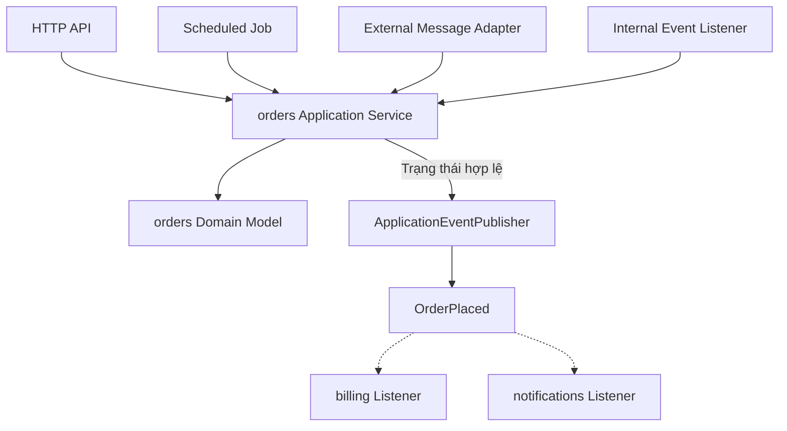
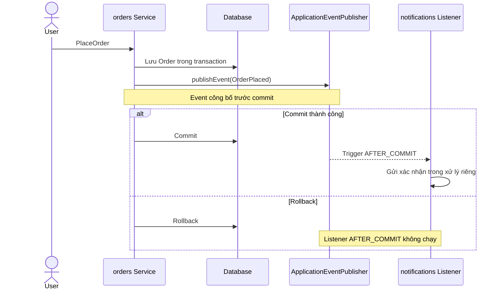
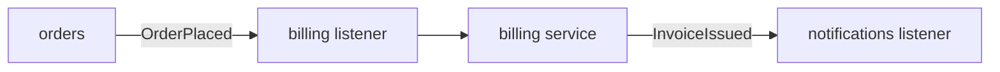
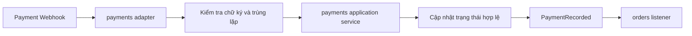

# Nguồn phát sinh sự kiện trong Spring Modulith

Khi thiết kế hệ thống giao tiếp bằng application events, biết **sự kiện gì đã xảy ra** mới là một nửa của vấn đề. Cần xác định: **sự kiện phát sinh từ đâu, module nào có thẩm quyền xác nhận nó, điều gì kích hoạt nghiệp vụ và khi nào được phép công bố sự kiện?**

Ví dụ, khách hàng gửi request đặt hàng là **nguồn kích hoạt** xử lý, nhưng sự kiện `OrderPlaced` phải do nghiệp vụ đặt hàng thuộc module `orders` xác nhận. Controller, module gửi email hoặc consumer của message broker không nên tự khẳng định rằng đơn hàng đã tạo thành công trước khi `orders` thực sự tạo đơn.

Bài học thuộc chương **Mô hình sự kiện** của Spring Modulith Application Events, tập trung vào **nguồn phát sinh (event origin/source)**: nguồn nghiệp vụ, nguồn kích hoạt, điểm publish, transaction, metadata truy vết, adapter nhận thông điệp ngoài, listener, độ tin cậy và kiểm thử.

## 1. Ba lớp nghĩa của “nguồn phát sinh”

Cụm từ *nguồn phát sinh sự kiện* có ba lớp nghĩa cần phân biệt:

1. **Nguồn nghiệp vụ (business authority):** module hoặc aggregate có thẩm quyền xác nhận sự thật đã xảy ra.
2. **Nguồn kích hoạt (trigger):** tác nhân hoặc hoạt động khiến use case bắt đầu, chẳng hạn HTTP request, scheduled job, một application event khác hoặc message từ broker.
3. **Điểm công bố (publication point):** vị trí trong mã thực hiện `ApplicationEventPublisher.publishEvent(...)` hoặc cơ chế Spring tương đương.

Các lớp này thường khác nhau trong cùng một use case.

| Lớp nghĩa | Ví dụ | Câu hỏi |
| --- | --- | --- |
| Nguồn nghiệp vụ | Module `orders` | Ai có quyền khẳng định đơn đã được đặt? |
| Nguồn kích hoạt | `POST /orders` | Điều gì khiến nghiệp vụ bắt đầu? |
| Điểm công bố | `PlaceOrderService` | Mã nào chuyển kết quả thành event? |
| Hạ tầng phân phối | Spring `ApplicationEventPublisher` | Event đến listener bằng cách nào? |
| Nơi tiêu thụ | `billing` và `notifications` | Ai cần phản ứng với sự thật đó? |

**Publisher là nơi phát thông báo, không nhất thiết là tác nhân khởi tạo yêu cầu.** HTTP có thể kích hoạt đặt hàng, còn module `orders` vẫn sở hữu sự thật `OrderPlaced`.

### Nguồn sự kiện khác Event Sourcing

*Event sourcing* là phương pháp lưu trạng thái bằng chuỗi sự kiện. Ở bài này, nguồn phát sinh là **chủ sở hữu và vị trí phát event nghiệp vụ**. Spring Modulith application events không bắt buộc dùng Event Sourcing: bạn có thể lưu aggregate bằng JPA và phát event sau khi nghiệp vụ chuyển trạng thái hợp lệ.

## 2. Nguồn nghiệp vụ là module sở hữu sự thật

Xét một ứng dụng bán hàng:

```text
com.example.shop
├── ShopApplication.java
├── orders
│   ├── PlaceOrder.java
│   ├── OrderPlaced.java
│   └── internal
│       ├── Order.java
│       ├── OrderRepository.java
│       └── PlaceOrderService.java
├── inventory
│   ├── InventoryOperations.java
│   └── internal
│       └── StockService.java
├── billing
│   └── internal
│       └── OrderPlacedListener.java
└── notifications
    └── internal
        └── OrderPlacedListener.java
```

Theo cách nhận diện mặc định của Spring Modulith, các package con trực tiếp của package ứng dụng là application modules. Package gốc của module là API công khai mặc định; `internal` được giữ làm chi tiết triển khai.

| Module sở hữu | Trạng thái và quyết định | Event do module phát |
| --- | --- | --- |
| `orders` | Vòng đời đơn: đặt, hủy, xác nhận | `OrderPlaced`, `OrderCancelled` |
| `inventory` | Tồn khả dụng, giữ hoặc trả hàng | `StockReserved`, `StockReleased` |
| `billing` | Hóa đơn và trạng thái chứng từ | `InvoiceIssued` |
| `notifications` | Trạng thái gửi thông báo | `NotificationSent` khi thực sự cần công bố |

Nếu `orders` yêu cầu `inventory` giữ hàng, `orders` **không được tự phát** `StockReserved` chỉ vì đã gửi command. Chỉ `inventory` có đủ quyền và thông tin để quyết định việc giữ hàng thành công hay không.

### Command mô tả ý định; event mô tả sự thật

| Câu nghiệp vụ | Thông điệp | Chủ thể xử lý/xác nhận |
| --- | --- | --- |
| Hãy tạo đơn hàng | Command `PlaceOrder` | `orders` thực thi |
| Đơn hàng đã được đặt | Event `OrderPlaced` | `orders` xác nhận |
| Hãy giữ ba sản phẩm | Command `ReserveStock` | `inventory` thực thi |
| Ba sản phẩm đã được giữ | Event `StockReserved` | `inventory` xác nhận |
| Hãy gửi email xác nhận | Command `SendConfirmation` | `notifications` thực thi |
| Email đã gửi thành công | Event `ConfirmationSent` | `notifications` xác nhận |

Một command có thể bị từ chối; nhận được command không chứng minh event thành công đã xảy ra.

## 3. Một nghiệp vụ có thể có nhiều nguồn kích hoạt

Nhiều đầu vào khác nhau có thể dẫn đến **cùng một use case**:

| Nguồn kích hoạt | Ví dụ | Cách tổ chức hợp lý |
| --- | --- | --- |
| HTTP API | Người dùng nhấn “Đặt hàng” | Controller gọi public/application service của `orders` |
| Scheduled job | Tự hủy đơn hết hạn | Job gọi use case của `orders` |
| Message broker | ERP gửi yêu cầu tạo đơn | Adapter xác thực rồi gọi application service của `orders` |
| Application event | `PaymentCaptured` có thể kích hoạt xác nhận đơn | Listener gọi use case của `orders`, module này quyết định có phát `OrderConfirmed` |
| CLI/batch | Nhập đơn từ file | Import adapter gọi cùng use case |



**Không nên** để từng controller, scheduled job và message adapter trực tiếp tự phát `OrderPlaced`. Nếu mỗi đầu vào định nghĩa điều kiện thành công khác nhau, cùng một tên event sẽ mang những sự thật mâu thuẫn.

Đặt logic ở một use case thuộc module sở hữu giúp tất cả đường vào dùng chung validation, transaction và quy tắc phát sự kiện.

## 4. Chọn điểm công bố event

Ba lựa chọn thường gặp:

| Vị trí | Khi thích hợp | Điều cần chú ý |
| --- | --- | --- |
| Domain aggregate ghi nhận domain event | Domain phong phú; sự kiện gắn chặt với invariant | Aggregate nên giữ độc lập khỏi infrastructure Spring |
| Application service gọi publisher | Luồng use case và transaction cần dễ quan sát | Cần bảo đảm các đường vào dùng cùng service |
| Adapter chuyển đổi thông điệp ngoài | Hệ thống nhận integration event/command từ bên ngoài | Adapter không nên tự xác nhận domain event chưa qua nghiệp vụ |

Trong nhiều dự án Spring Modulith, lựa chọn dễ hiểu là **aggregate quyết định trạng thái, application service quản lý transaction và publisher**.

### 4.1. Public event dưới dạng record

```java
// com.example.shop.orders.OrderPlaced.java
package com.example.shop.orders;

import java.time.Instant;
import java.util.UUID;

public record OrderPlaced(
        UUID eventId,
        UUID orderId,
        Instant occurredAt,
        UUID correlationId
) {}
```

Ý nghĩa:

- `eventId`: định danh một sự kiện đã tạo; giúp tracing/idempotency theo event.
- `orderId`: khóa nghiệp vụ của aggregate phát sinh.
- `occurredAt`: thời điểm ghi nhận sự kiện, **không mặc nhiên là thời điểm transaction commit**.
- `correlationId`: liên kết các hoạt động trong cùng một luồng, nếu ứng dụng có chiến lược truyền/gắn ID nhất quán.

Record có trường không gán lại được, thích hợp làm thông điệp giữa các module. Không đưa nguyên JPA entity mutable hoặc entity có lazy relations vào public event.

### 4.2. Application service phát event sau chuyển trạng thái

```java
// com.example.shop.orders.PlaceOrder.java
package com.example.shop.orders;

import java.util.UUID;

public record PlaceOrder(
        UUID customerId,
        String sku,
        int quantity,
        UUID correlationId
) {}
```

```java
// com.example.shop.orders.internal.PlaceOrderService.java
package com.example.shop.orders.internal;

import com.example.shop.orders.OrderPlaced;
import com.example.shop.orders.PlaceOrder;
import java.time.Clock;
import java.time.Instant;
import java.util.UUID;
import org.springframework.context.ApplicationEventPublisher;
import org.springframework.stereotype.Service;
import org.springframework.transaction.annotation.Transactional;

@Service
public class PlaceOrderService {

    private final OrderRepository orders;
    private final ApplicationEventPublisher publisher;
    private final Clock clock;

    public PlaceOrderService(
            OrderRepository orders,
            ApplicationEventPublisher publisher,
            Clock clock) {
        this.orders = orders;
        this.publisher = publisher;
        this.clock = clock;
    }

    @Transactional
    public UUID place(PlaceOrder command) {
        // Order là aggregate của module orders.
        Order order = Order.place(
                command.customerId(),
                command.sku(),
                command.quantity()
        );

        orders.save(order);

        publisher.publishEvent(new OrderPlaced(
                UUID.randomUUID(),
                order.id(),
                Instant.now(clock),
                command.correlationId()
        ));

        return order.id();
    }
}
```

Ví dụ này dùng `Order` và `OrderRepository` giả định, cần cài đặt trong project thật. Cũng phải cấu hình bean `Clock`, ví dụ `Clock.systemUTC()`, và kiểm tra dữ liệu/validation nghiệp vụ phù hợp.

Luồng có ý nghĩa:

1. Caller gửi command, chưa thể khẳng định `OrderPlaced`.
2. Aggregate `Order` tạo chuyển trạng thái hợp lệ.
3. Repository đưa thay đổi vào transaction.
4. Application service phát `OrderPlaced`.
5. Transaction kết thúc; listener sau commit chỉ chạy khi commit thành công.

**Lưu ý kỹ thuật:** Trong đoạn mã, `publishEvent(...)` chạy **trước khi transaction commit**. Một `@EventListener` đồng bộ thông thường có thể chạy ngay lúc publish, khi dữ liệu còn chưa commit. Để người nghe chỉ phản ứng với trạng thái đã commit, phải chọn cơ chế listener tương ứng.

### 4.3. Domain aggregate giữ pending events

Một thiết kế domain phong phú có thể để aggregate ghi nhận event tại điểm kiểm tra bất biến:

```java
// Pseudocode trong domain aggregate Order.
void confirm() {
    if (!canConfirm()) {
        throw new IllegalStateException("Cannot confirm order");
    }
    status = OrderStatus.CONFIRMED;
    pendingEvents.add(new OrderConfirmed(id, ...));
}
```

Application layer hoặc infrastructure sẽ thu thập danh sách pending events rồi publish. Nhờ đó nguồn sự thật vẫn gần domain, trong khi aggregate không cần biết `ApplicationEventPublisher`.

Spring Data cũng cung cấp `@DomainEvents` và `@AfterDomainEventPublication` để công bố và dọn event từ aggregate khi thực hiện những thao tác repository được hỗ trợ. Nếu chọn cơ chế Spring Data, phải hiểu rõ callback nào phát event và tránh **publish thủ công cùng một event thêm lần nữa**, gây trùng lặp.

## 5. Nguồn phát sinh và transaction phải nhất quán

Giả sử tạo đơn và phát `OrderPlaced` trong transaction. Nếu transaction rollback, listener của `billing` không được coi đơn đã lưu bền vững.

| Listener | Mốc xử lý điển hình | Hệ quả |
| --- | --- | --- |
| `@EventListener` | Mặc định xử lý đồng bộ ngay khi publish | Có thể thấy dữ liệu chưa commit; lỗi listener có thể ảnh hưởng transaction nguồn |
| `@TransactionalEventListener` | Mặc định `AFTER_COMMIT` | Xử lý sau khi commit thành công; event phát ngoài transaction mặc định không được xử lý |
| `@ApplicationModuleListener` | Sau commit, bất đồng bộ, trong transaction mới | Thích hợp cho phản ứng của module khác có thể hoàn tất sau |

Ví dụ module `notifications`:

```java
// com.example.shop.notifications.internal.OrderNotificationListener.java
package com.example.shop.notifications.internal;

import com.example.shop.orders.OrderPlaced;
import org.springframework.modulith.events.ApplicationModuleListener;
import org.springframework.stereotype.Component;

@Component
class OrderNotificationListener {

    private final NotificationService notifications;

    OrderNotificationListener(NotificationService notifications) {
        this.notifications = notifications;
    }

    @ApplicationModuleListener
    void on(OrderPlaced event) {
        notifications.sendConfirmationOnce(
                event.eventId(),
                event.orderId()
        );
    }
}
```

`NotificationService.sendConfirmationOnce(...)` là implementation nghiệp vụ giả định của module thông báo, cần bảo vệ chống gửi trùng và chịu trách nhiệm lưu trạng thái gửi.



Sơ đồ mô tả lifecycle chứ không bảo đảm thứ tự tuyệt đối giữa HTTP response và listener bất đồng bộ.

**Hai điểm dễ sai:**

- Ghi `occurredAt` trước commit **không biến timestamp thành bằng chứng commit**. Nếu cần thời điểm commit thực tế, phải thiết kế riêng.
- `@TransactionalEventListener` mặc định phụ thuộc transaction đang hoạt động. Nếu publish ngoài transaction, listener thường không chạy trừ khi bật `fallbackExecution`. Self-invocation đi vòng Spring proxy cũng có thể làm `@Transactional` không có hiệu lực như mong đợi.

## 6. Một event khác có thể kích hoạt nguồn nghiệp vụ mới

Phản ứng với một sự kiện có thể khiến module nhận thực hiện nghiệp vụ riêng và tạo ra một sự kiện mới.

Ví dụ:

1. `orders` phát `OrderPlaced` sau khi đặt hàng.
2. `billing` nghe `OrderPlaced` rồi phát hành hóa đơn.
3. Khi hóa đơn phát hành thành công, `billing` phát `InvoiceIssued`.
4. `notifications` nghe `InvoiceIssued` và gửi email hóa đơn.



**Nguồn nghiệp vụ của `InvoiceIssued` là `billing`**, dù yêu cầu ban đầu đến từ thao tác đặt hàng. Để biết mối quan hệ nhân quả, có thể truyền metadata:

- **Correlation ID:** định danh chung cho toàn bộ chuỗi nghiệp vụ.
- **Causation ID:** trỏ đến command/event trực tiếp gây ra event tiếp theo.

```text
HTTP PlaceOrder, correlationId=C-100
  -> OrderPlaced, eventId=E-1, correlationId=C-100
    -> InvoiceIssued, eventId=E-2,
       causationId=E-1, correlationId=C-100
      -> InvoiceEmailSent, eventId=E-3,
         causationId=E-2, correlationId=C-100
```

Đây là **quy ước ứng dụng**; Spring Modulith không tự tạo các field `causationId`/`correlationId` trong mọi record event. Ứng dụng phải định nghĩa và truyền chúng nếu cần.

### Chặn event loop

Một anti-pattern là listener nhận `OrderPlaced` rồi phát `OrderPlaced` thêm lần nữa, hoặc `orders`/`billing` phát qua lại sự kiện khi không có chuyển trạng thái thực. Hậu quả là vòng lặp, retry vô hạn hoặc tạo dữ liệu trùng.

Khi nhận event, chỉ publish event tiếp nếu:

1. Use case của module nhận thực sự đã thay đổi trạng thái đúng nghĩa.
2. Sự kiện mới thuộc quyền xác nhận của module nhận.
3. Handler có quy tắc idempotency và không phát lại cùng sự thật khi trạng thái đã hoàn tất.

## 7. Nguồn bên ngoài: adapter chỉ là điểm vào

Giả sử cổng thanh toán gửi webhook `payment_succeeded`. Đây là thông báo của hệ thống ngoài, không tự động đồng nghĩa hệ thống nội bộ đã ghi nhận thanh toán hợp lệ.

Phải phân biệt:

- **External event:** nhà cung cấp báo giao dịch thành công theo hợp đồng của họ.
- **Internal domain event:** module `payments` đã xác thực message, kiểm tra giao dịch và cập nhật trạng thái hợp lệ, sau đó có thể phát `PaymentRecorded`.



Adapter cần áp dụng xác thực chữ ký, đối chiếu mã giao dịch, chống message trùng, xử lý message đến sai thứ tự theo hợp đồng nhà cung cấp. Module `payments` mới sở hữu sự thật về trạng thái nội bộ của thanh toán.

Nếu một ứng dụng chỉ chuyển tiếp external event mà không thay đổi nghiệp vụ, nên đặt tên sự kiện thể hiện đúng nguồn như `ProviderPaymentSucceeded`, tránh gán ngữ nghĩa “đã hạch toán nội bộ” khi hệ thống chưa thực hiện.

## 8. Metadata giúp truy vết nguồn phát sinh

Các trường thường hữu ích:

| Metadata | Ý nghĩa | Ghi chú |
| --- | --- | --- |
| `eventId` | ID của một event | Tạo một lần khi sự kiện hình thành |
| `aggregateId`/`orderId` | Đối tượng nghiệp vụ liên quan | Dùng khóa ổn định |
| `eventType` | Loại sự kiện | Thường có thể suy từ class |
| `occurredAt` | Thời điểm sự kiện được ghi nhận | Có thể dùng `Clock` để test |
| `sourceModule` | Module phát event | Không bắt buộc nếu kiểu event đã rõ |
| `correlationId` | Liên kết chuỗi tác vụ | Cần quy ước truyền xuyên adapter/listener |
| `causationId` | Event/command trực tiếp dẫn đến event mới | Hữu ích trong tracing |
| `schemaVersion` | Phiên bản hợp đồng dữ liệu | Đặc biệt hữu ích khi externalize event |

Không nên đưa nguyên `HttpServletRequest`, `SecurityContext`, `EntityManager` hoặc entity có lazy relationships vào public event. Các đối tượng này gắn với thread/transaction và dễ không còn hợp lệ khi listener chạy bất đồng bộ.

Tên field `sourceModule="orders"` không tự chứng minh `orders` đã kiểm tra đúng invariant. **Nguồn nghiệp vụ được bảo đảm bằng kiến trúc và use case**, metadata phục vụ quan sát.

## 9. Nguồn hợp lệ chưa bảo đảm giao sự kiện tin cậy

Cần phân biệt bốn giai đoạn:

1. **Hình thành:** module sở hữu ghi nhận `OrderPlaced`.
2. **Publish:** `ApplicationEventPublisher` phát event vào Spring.
3. **Xử lý:** listener của từng module phản ứng và thực hiện nghiệp vụ riêng.
4. **Theo dõi/khôi phục:** ghi nhận publication còn chờ, thành công hoặc cần resubmit.

Spring Modulith cung cấp **Event Publication Registry** để theo dõi publication tới transactional listeners khi có cấu hình lưu trữ phù hợp (như JDBC, JPA hoặc MongoDB). Registry hỗ trợ xác định event chưa hoàn tất và cơ chế phục hồi/resubmit theo chính sách ứng dụng.

| Câu hỏi | Trách nhiệm |
| --- | --- |
| Đơn thật sự được đặt chưa? | `orders` và transaction nguồn |
| Event đã phải gửi đến listener nào? | Hạ tầng application events/registry đã cấu hình |
| Hóa đơn đã tạo xong chưa? | `billing` và side effect của nó |
| Event được giao hai lần thì sao? | Listener phải có idempotency |
| Publication chưa hoàn tất được xử lý ra sao? | Chính sách vận hành/recovery của ứng dụng |

Registry không tự tạo bảo đảm **exactly once** cho các tác vụ ngoài database, không làm listener idempotent và cũng không tự chuyển application event thành Kafka/RabbitMQ message. Muốn externalize event ra broker cần thiết kế tích hợp và hợp đồng dữ liệu tương ứng.

### Idempotency ở cả nguồn và người nhận

- **Nguồn:** nếu cùng request nghiệp vụ được gọi lại với idempotency key, cần tránh tạo chuyển trạng thái và event nghiệp vụ trùng khi hợp đồng yêu cầu.
- **Người nhận:** event được giao lại do retry/resubmit phải không gây side effect lặp; ví dụ `billing` có unique constraint theo `orderId`.
- **Hạ tầng:** ghi nhận publication và hỗ trợ khôi phục, nhưng không thay thế kiểm tra nghiệp vụ của hai đầu.

`eventId` duy nhất không tự làm xử lý idempotent. Listener phải có cơ chế ghi nhận/đối chiếu khóa phù hợp và chống race condition bằng transaction, unique constraint hoặc dịch vụ ngoài có hỗ trợ idempotency.

## 10. Những cách phát sai nguồn

| Sai lầm | Hệ quả | Cách sửa |
| --- | --- | --- |
| Controller phát `OrderPlaced` trước khi gọi service | Chưa có bằng chứng tạo đơn thành công | Controller gọi use case; module `orders` phát event khi hợp lệ |
| `notifications` tự phát `OrderPlaced` cho `billing` | Không đúng module sở hữu sự thật | `orders` phát; consumer tự xử lý hệ quả |
| Cả HTTP, batch và webhook tự publish | Mỗi đường vào có quy tắc phát khác nhau | Dồn nghiệp vụ về application service |
| Listener đồng bộ xử lý side effect trước khi commit | Có thể chạy trên trạng thái chưa commit hoặc làm rollback nguồn | Chọn transactional listener sau commit khi thích hợp |
| Vừa dùng `@DomainEvents` vừa publish thủ công cùng event | Có thể phát trùng một sự kiện | Chọn một chiến lược phát, kiểm tra số lần |
| Webhook ngoài trực tiếp phát domain event nội bộ chưa kiểm chứng | Có thể bị giả mạo, sai trạng thái, trùng message | Xác thực, đối chiếu rồi gọi module sở hữu |
| Event mang JPA entity mutable | Coupling nội bộ, lỗi lazy loading sau transaction | Immutable event/DTO công khai |
| Nghe event rồi phát lại event vô điều kiện | Vòng lặp và trùng side effect | Chỉ phát khi có chuyển trạng thái mới |
| Cho rằng có registry thì không bao giờ nhận lại event | Retry có thể giao lại | Idempotency và unique constraint |
| Coi `occurredAt` là thời điểm commit | Diễn giải sai timestamp | Mô tả rõ nghĩa thời gian trong hợp đồng |

Tiêu chí tốt để kiểm tra mô hình sự kiện: **“Nếu listener nhìn thấy event này, nó được phép tin điều gì đã xảy ra?”** Câu trả lời phải dựa trên module sở hữu và lifecycle transaction, không chỉ trên tên class.

## 11. Kiểm thử đúng nguồn và thời điểm phát

Kiểm thử cần chứng minh **đúng điều kiện, đúng event, đúng số lần và đúng module sở hữu**, ngoài việc kiểm tra publisher có được gọi.

### 11.1. Xác minh event công bố bằng Spring Modulith

```java
package com.example.shop.orders;

import static org.assertj.core.api.Assertions.assertThat;
import java.util.UUID;
import org.junit.jupiter.api.Test;
import org.springframework.beans.factory.annotation.Autowired;
import org.springframework.modulith.test.ApplicationModuleTest;
import org.springframework.modulith.test.PublishedEvents;

@ApplicationModuleTest
class PlaceOrderEventsTest {

    @Autowired Orders orders;

    @Test
    void placingOrderPublishesOrderPlaced(PublishedEvents events) {
        UUID orderId = orders.place(
            new PlaceOrder(
                UUID.randomUUID(), "BOOK-01", 2, UUID.randomUUID()
            )
        );

        assertThat(events.ofType(OrderPlaced.class)
                         .matching(OrderPlaced::orderId, orderId))
            .hasSize(1);
    }
}
```

Ví dụ giả định đã có public API `Orders.place(PlaceOrder)`, persistence test phù hợp và dữ liệu hợp lệ. Test chứng minh **publisher đã phát đúng event**, chưa chứng minh listener `AFTER_COMMIT` đã hoàn tất. Nếu test transaction được rollback sau test, việc ghi nhận bởi `PublishedEvents` cũng không đồng nghĩa event được xử lý sau commit.

### 11.2. Các ca lỗi cần kiểm tra

| Trường hợp | Kỳ vọng |
| --- | --- |
| `PlaceOrder` sai dữ liệu hoặc bị từ chối | Không tạo `OrderPlaced` |
| Transaction lưu đơn rollback | Listener `AFTER_COMMIT` không thực hiện side effect |
| HTTP và batch cùng gọi nghiệp vụ | Hai đường vào đều áp dụng cùng quy tắc use case |
| Command có idempotency key bị gọi lặp | Không tạo cùng chuyển trạng thái hai lần theo hợp đồng |
| Listener fail và event được retry | Không tạo hai hóa đơn hoặc hai thông báo |
| `billing` nhận `OrderPlaced` nhưng phát hành hóa đơn thất bại | Không phát `InvoiceIssued` khi hóa đơn chưa phát hành |
| Webhook sai chữ ký hoặc trùng | Không xác nhận domain event nội bộ sai |
| Sự kiện có correlation/causation | Có thể truy lại luồng event trước và sau |

### 11.3. Kiểm tra boundary

```java
package com.example.shop;

import org.junit.jupiter.api.Test;
import org.springframework.modulith.core.ApplicationModules;

class ModuleStructureTest {

    @Test
    void boundariesRemainValid() {
        ApplicationModules.of(ShopApplication.class).verify();
    }
}
```

`verify()` kiểm tra những ràng buộc cấu trúc được Spring Modulith hỗ trợ, ví dụ import package nội bộ hoặc phụ thuộc vòng. Nó không tự chứng minh `OrderPlaced` xuất phát từ use case hợp lệ, hay listener được xử lý sau commit; các điều này cần test hành vi/transaction.

## 12. Quan sát nguồn sự kiện lúc vận hành

Khi người dùng báo “đơn đã tạo mà chưa có hóa đơn”, hệ thống cần trả lời:

- Event nào khởi đầu luồng? `eventId` là gì?
- Module nào công bố sự kiện và aggregate nào thay đổi?
- Event được tạo lúc nào? Transaction nguồn đã commit chưa?
- Listener nào hoàn thành, lỗi hoặc đang chờ retry?
- `correlationId` và `causationId` liên quan đến event nào?
- Side effect như ghi hóa đơn/email đã xảy ra lần nào chưa?

Ví dụ log có cấu trúc **minh họa** (không phải schema mặc định của Spring Modulith):

```json
{
  "eventType": "OrderPlaced",
  "eventId": "2d7df282-3c59-410c-9c94-5ce0b1d6d2d8",
  "sourceModule": "orders",
  "aggregateId": "2a3577b0-afac-4baa-83ec-02613715a9f0",
  "correlationId": "e6f966c9-bfa2-4f0a-a9ef-34c81505ca58",
  "listener": "billing.OrderPlacedListener",
  "processingStatus": "FAILED",
  "attempt": 2
}
```

Cần phân biệt `processingStatus` của **listener** với trạng thái nghiệp vụ nguồn: `OrderPlaced` vẫn có thể là sự thật đã commit dù listener của `billing` đang lỗi. Không đưa toàn bộ payload khách hàng hoặc dữ liệu nhạy cảm vào log; chỉ ghi các ID và trường cần thiết cho vận hành.

Nếu dùng Event Publication Registry, theo dõi publication chưa hoàn thành, cảnh báo tồn đọng và thiết kế quy trình resubmit phù hợp với cấu hình lưu trữ/version framework. Registry bổ trợ cho logging, metrics và tracing, không thay thế chúng.

## 13. Bài tập nhận diện nguồn phát sinh

Một ứng dụng có REST API, webhook thanh toán và scheduled job. Hãy đánh giá:

**Tình huống A:** REST controller nhận `POST /orders`, tạo `OrderPlaced` rồi gọi `publisher.publishEvent` trước khi service lưu đơn.

**Tình huống B:** Webhook báo thanh toán thành công; adapter xác thực chữ ký, khử trùng message và gọi `payments.recordSuccess(...)`. Module `payments` cập nhật dữ liệu rồi phát `PaymentRecorded`.

**Tình huống C:** Job quét đơn hết hạn, gọi application service của `orders`. Service kiểm tra từng đơn và chỉ phát `OrderExpired` cho đơn thực sự chuyển sang hết hạn.

<details>
<summary>Gợi ý lời giải</summary>

- **A không đúng:** controller là trigger, chưa có thẩm quyền xác nhận sự thật. Cần phát từ logic của `orders` sau chuyển trạng thái hợp lệ, kết hợp transaction/listener đúng.
- **B hợp lý:** external provider là nguồn kích hoạt; module `payments` mới là nguồn sự thật nội bộ `PaymentRecorded` sau validation và cập nhật.
- **C hợp lý:** scheduler chỉ gọi use case; module `orders` kiểm tra trạng thái và phát event khi có chuyển trạng thái mới.

</details>

**Câu hỏi mở rộng:** Nếu `notifications` nhận cùng `OrderPlaced` hai lần do retry và gửi hai email, sự kiện phát từ `orders` có nhất thiết sai không? **Không.** Giao lại event có thể hợp lệ; module nhận phải xử lý idempotent theo business key/eventId và tình trạng side effect.

## 14. Ghi nhớ

- **Nguồn nghiệp vụ**, **nguồn kích hoạt** và **điểm công bố** là ba vai trò khác nhau.
- **Module sở hữu sự thật** mới có quyền công bố domain event tương ứng; controller, scheduler và external adapter nên gọi use case của module đó.
- Có thể ghi nhận event ở aggregate và publish qua infrastructure, hoặc publish trong application service; quan trọng là **chuyển trạng thái hợp lệ và đường phát nhất quán**.
- `ApplicationEventPublisher.publishEvent(...)` không tự chứng minh transaction commit. Với tác vụ phụ chỉ xử lý khi dữ liệu đã bền vững, dùng listener sau commit theo yêu cầu.
- External event cần được xác thực, đối chiếu và chuyển đổi trước khi khẳng định sự thật nghiệp vụ nội bộ.
- `eventId`, `occurredAt`, `correlationId` và `causationId` hỗ trợ truy vết; chúng không thay thế ownership hoặc nghiệp vụ.
- Event Publication Registry, retry, idempotency và quan sát publication giúp giao tiếp giữa module đáng tin cậy khi có lỗi.

**Tài liệu tham khảo:**

- [Spring Modulith — Working with Application Events](https://docs.spring.io/spring-modulith/reference/events.html)
- [Spring Modulith — Application Modules and Public Interfaces](https://docs.spring.io/spring-modulith/reference/fundamentals.html)
- [Spring Modulith — Testing Application Modules](https://docs.spring.io/spring-modulith/reference/testing.html)
- [Spring Data Commons — Publishing Events from Aggregate Roots](https://docs.spring.io/spring-data/commons/reference/repositories/core-domain-events.html)
