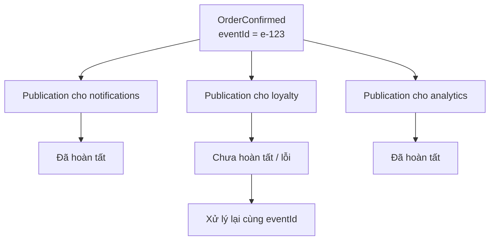

# Thiết kế payload cho application events trong Spring Modulith

## 1. Payload quyết định chất lượng hợp đồng giữa các module

Trong kiến trúc **Spring Modulith**, module phát sự kiện và các module nhận sự kiện được tách khỏi lời gọi service trực tiếp. Tuy nhiên, chúng vẫn chia sẻ một **hợp đồng dữ liệu**: kiểu event và các trường bên trong event đó. Phần dữ liệu này gọi là **payload**.

Giả sử module `orders` công bố `OrderConfirmed` khi đơn hàng được xác nhận. Module `notifications` cần mã đơn để gửi thông báo; module `loyalty` cần tổng tiền tại thời điểm xác nhận để tính điểm; module `analytics` cần thời điểm và số tiền để thống kê. Nếu payload thiếu dữ liệu, consumer phải gọi ngược quá nhiều vào `orders`. Nếu payload chứa cả entity nội bộ, mọi consumer lại bị ràng buộc vào mô hình dữ liệu và cách lưu trữ của `orders`.

Vì vậy, thiết kế payload cần đáp ứng đồng thời:

1. **Đúng ngữ nghĩa:** các trường mô tả sự kiện đã xảy ra, không phải một lệnh yêu cầu module khác làm việc.
2. **Đủ dữ liệu:** consumer có thể xử lý sau commit, thậm chí sau một khoảng trễ hoặc khi phát lại sự kiện.
3. **Giữ ranh giới module:** không làm lộ entity JPA, repository, service hay chi tiết persistence.
4. **Bất biến và an toàn:** một event đã phát không bị thay đổi trong lúc các listener xử lý.
5. **Bền với thay đổi:** dễ đọc, kiểm thử, quan sát và tiến hóa khi hợp đồng thay đổi.

Bài này tập trung vào **thiết kế payload**, từ chọn trường và kiểu dữ liệu đến triển khai Java record, xử lý transaction, idempotency, versioning và các phép kiểm thử hữu ích.

## 2. Phân biệt sự kiện nghiệp vụ với dữ liệu trạng thái

Một payload tốt bắt đầu bằng tên event đúng. `OrderConfirmed` nghĩa là **đơn hàng đã được xác nhận**; `ConfirmOrder` chỉ là yêu cầu xác nhận và có thể thất bại. Sự khác biệt quyết định dữ liệu nào có giá trị:

| Tên/kiểu thông điệp | Ý nghĩa | Payload nên tập trung vào |
|---|---|---|
| `ConfirmOrder` (command) | Hãy xác nhận đơn, nếu hợp lệ | `orderId`, thông tin yêu cầu và danh tính người ra lệnh khi cần |
| `OrderConfirmed` (event) | Đơn đã chuyển sang trạng thái được xác nhận | `orderId`, thời điểm, số tiền hoặc snapshot cần thiết |
| `Order` (entity/state) | Toàn bộ trạng thái hiện tại của đơn | Dữ liệu và hành vi bên trong aggregate; không mặc định trở thành payload |
| `SendConfirmationEmail` (command) | Hãy gửi email xác nhận | Thông tin thực thi riêng của module `notifications` |

Hạn chế những event quá rộng như `OrderUpdated` rồi bắt consumer đọc một trường `changedFields` phức tạp để đoán ý nghĩa. Các mốc `OrderConfirmed`, `OrderCancelled` và `OrderShipped` thường rõ ràng hơn khi có hành vi nghiệp vụ khác nhau.

Đồng thời, không phải thao tác `save()` nào cũng tạo ra một sự kiện. Chỉ phát khi có **mốc nghiệp vụ thật**; một lệnh cập nhật lại cùng trạng thái không nên tự động tạo thêm event có ý nghĩa giống hệt.

## 3. Ba chiến lược chọn dữ liệu

Payload không có một kích thước phù hợp cho mọi consumer. Có ba chiến lược chính.

### 3.1. Chỉ mang ID: payload tối giản

```java
public record OrderConfirmed(
        UUID eventId,
        UUID orderId,
        Instant occurredAt
) {}
```

Ưu điểm: hợp đồng gọn, ít lộ dữ liệu, ít trường phải duy trì. Nhược điểm: consumer cần gọi API công khai của `orders` để biết thêm chi tiết. Khi listener xử lý muộn, **trạng thái đơn hiện tại có thể đã thay đổi** so với lúc xác nhận.

Ví dụ: `loyalty` xử lý `OrderConfirmed` sau khi đơn đã được hoàn tiền một phần. Nếu đọc tổng tiền hiện tại thay vì tổng tiền tại lúc xác nhận, điểm thưởng có thể sai với quy tắc ban đầu.

Phù hợp khi consumer chỉ cần ID để liên kết dữ liệu, hoặc cần truy vấn **trạng thái mới nhất**, không cần ảnh chụp lịch sử.

### 3.2. Mang snapshot: dữ liệu tại thời điểm xảy ra sự kiện

```java
public record OrderConfirmed(
        UUID eventId,
        UUID orderId,
        Instant occurredAt,
        BigDecimal confirmedTotal,
        String currencyCode
) {}
```

`confirmedTotal` và `currencyCode` mô tả **giá trị đã được xác nhận lúc event phát sinh**. Nếu tổng tiền sau đó thay đổi, payload của event cũ vẫn giữ ý nghĩa ban đầu. Consumer có thể dùng snapshot mà không phải truy vấn lại trạng thái hiện tại.

Đổi lại, payload lớn hơn và việc thêm hoặc thay đổi trường ảnh hưởng tới các consumer dùng chung hợp đồng.

Phù hợp khi consumer tính toán từ dữ liệu lịch sử tại thời điểm phát event, cần thực hiện lại chính xác hoặc cần giảm số lần truy vấn chéo module.

### 3.3. Kết hợp ID và một số snapshot quan trọng

Trong ứng dụng thực tế, phương án **hybrid** thường cân bằng tốt:

- `eventId` và `orderId` để định danh.
- `occurredAt` để biết thời điểm sự kiện phát sinh.
- `confirmedTotal`, `currencyCode` để tính điểm và thống kê.
- Không mang địa chỉ, số điện thoại, toàn bộ entity `Order` hoặc cấu trúc bảng nội bộ nếu consumer không cần.

| Tiêu chí | Chỉ ID | Snapshot đầy đủ | ID + snapshot chọn lọc |
|---|---|---|---|
| Kích thước event | Nhỏ | Có thể rất lớn | Vừa phải |
| Phụ thuộc truy vấn ngược | Dễ tăng | Thấp | Tùy dữ liệu thiếu |
| Độ chính xác theo thời điểm xảy ra | Cần tra cứu phiên bản dữ liệu phù hợp | Tốt nếu snapshot đúng | Tốt với các trường đã chọn |
| Lộ thông tin, thay đổi schema | Ít hơn | Nhiều hơn | Có thể kiểm soát |
| Phù hợp nhất | Chỉ cần ID/trạng thái mới nhất | Bản ghi lịch sử đầy đủ có yêu cầu rõ | Phần lớn event tích hợp giữa module |

**Nguyên tắc thực hành:** hỏi mỗi consumer cần *dữ liệu tại thời điểm event* hay *trạng thái hiện tại*. Với trường hợp đầu, cân nhắc snapshot. Với trường hợp sau, cân nhắc ID và một API truy vấn công khai phù hợp.

## 4. Phân loại các trường trong payload

Một hợp đồng event thường có các nhóm trường sau:

| Nhóm | Trường ví dụ | Mục đích | Lưu ý thiết kế |
|---|---|---|---|
| Định danh event | `eventId` | Đối chiếu một lần phát sinh event | Giữ ổn định khi retry/phát lại cùng event |
| Định danh nghiệp vụ | `orderId` | Xác định aggregate liên quan | Không sử dụng thay thế hoàn toàn cho `eventId` |
| Thời gian | `occurredAt` | Ghi nhận thời điểm sự kiện xảy ra | Phân biệt với thời điểm listener nhận/hoàn tất |
| Snapshot nghiệp vụ | `confirmedTotal`, `currencyCode` | Giúp consumer xử lý dữ liệu đúng thời điểm | Tránh đổi ý nghĩa trường giữa các phiên bản |
| Truy vết | `correlationId`, `causationId` | Liên kết các bước trong một luồng nghiệp vụ | Không mặc định là khóa chống lặp |
| Phiên bản | `schemaVersion` hoặc loại event có version | Hỗ trợ thay đổi hợp đồng | Chỉ thêm khi có chính sách versioning rõ ràng |

### `eventId` khác `orderId` như thế nào?

Một đơn hàng có thể tạo nhiều sự kiện: `OrderCreated`, `OrderConfirmed`, `OrderShipped`. Các sự kiện đều mang cùng `orderId` nhưng có `eventId` khác nhau.

Nếu listener đã nhận `OrderConfirmed` rồi sau đó registry phát lại **chính event ấy**, nó phải nhận **cùng `eventId`**. Tự sinh `eventId` mới trong mỗi lần retry sẽ khiến cơ chế chống lặp không nhận biết được đó là cùng một công việc.

### Thời điểm nghiệp vụ và thời điểm nhận không giống nhau

Trong Spring, `publishEvent(...)` có thể được gọi **trước khi transaction commit**. `occurredAt` thường biểu diễn thời điểm nghiệp vụ xác nhận sự kiện trong transaction, không nhất thiết là dấu thời gian của transaction commit. Listener chạy sau commit hoặc khôi phục sau lỗi có thể nhận event muộn hơn nhiều. Vì thế nên dùng `Instant` hoặc định dạng thời gian có múi giờ rõ ràng, tránh lấy thời gian nhận event thay cho thời gian phát sinh nghiệp vụ.

### ID truy vết không phải khóa nghiệp vụ

`correlationId` liên kết nhiều thao tác thuộc cùng yêu cầu; `causationId` có thể chỉ ra event/command đã dẫn đến event hiện tại. Chúng giúp quan sát, nhưng **không thay thế `eventId`** trong logic idempotency và không nên mặc định mang thông tin nhận diện người dùng.

## 5. Thiết kế Java record bất biến, có kiểm tra dữ liệu

Ví dụ dưới đây là **payload hợp đồng** của module `orders`. Nó không chứa entity JPA hay service. Snapshot chỉ giữ tổng tiền và các dòng hàng cần thiết cho consumer báo cáo; tùy bài toán có thể bỏ danh sách dòng hàng để thu gọn thêm.

```java
package com.example.shop.orders;

import java.math.BigDecimal;
import java.time.Instant;
import java.util.List;
import java.util.Objects;
import java.util.UUID;

public record OrderConfirmed(
        UUID eventId,
        UUID orderId,
        Instant occurredAt,
        BigDecimal confirmedTotal,
        String currencyCode,
        List<LineSnapshot> lines
) {
    public OrderConfirmed {
        Objects.requireNonNull(eventId, "eventId");
        Objects.requireNonNull(orderId, "orderId");
        Objects.requireNonNull(occurredAt, "occurredAt");
        Objects.requireNonNull(confirmedTotal, "confirmedTotal");
        Objects.requireNonNull(currencyCode, "currencyCode");
        Objects.requireNonNull(lines, "lines");

        if (confirmedTotal.signum() < 0) {
            throw new IllegalArgumentException(
                    "confirmedTotal không được âm");
        }
        if (!currencyCode.matches("[A-Z]{3}")) {
            throw new IllegalArgumentException(
                    "currencyCode phải là mã tiền tệ ba chữ cái");
        }

        lines = List.copyOf(lines);
    }

    public record LineSnapshot(
            String productCode,
            int quantity,
            BigDecimal unitPrice
    ) {
        public LineSnapshot {
            Objects.requireNonNull(productCode, "productCode");
            Objects.requireNonNull(unitPrice, "unitPrice");
            if (productCode.isBlank()) {
                throw new IllegalArgumentException("productCode rỗng");
            }
            if (quantity <= 0 || unitPrice.signum() < 0) {
                throw new IllegalArgumentException(
                        "quantity/unitPrice không hợp lệ");
            }
        }
    }
}
```

Điểm thiết kế đáng chú ý:

- `record` bất biến ở cấp tham chiếu; các thành phần như `UUID`, `Instant`, `BigDecimal`, `String` cũng là các kiểu bất biến.
- `List.copyOf(lines)` tạo một danh sách không thể sửa trực tiếp và chống trường hợp bên ngoài thay đổi danh sách gốc sau khi event được tạo. Đây là **sao chép nông**; vì từng `LineSnapshot` cũng bất biến nên hợp đồng cụ thể này an toàn. Với phần tử mutable, cần sao chép sâu.
- `currencyCode` là chuỗi mã tiền tệ (ví dụ `VND`, `USD`); kiểm tra regex trong ví dụ chỉ xác minh hình thức, không xác nhận mã có thuộc danh sách ISO 4217.
- Số tiền dùng `BigDecimal` thay vì `double` để tránh sai lệch số học dấu phẩy động trong dữ liệu tài chính.
- `confirmedTotal` là **giá trị đã chốt theo quy tắc nghiệp vụ**, không phải tổng được consumer tự tính lại tùy ý từ danh sách dòng hàng. Trong ứng dụng thật, cần quy ước rõ thuế, chiết khấu, phí vận chuyển và cách làm tròn.

Ví dụ khởi tạo:

```java
OrderConfirmed event = new OrderConfirmed(
        UUID.randomUUID(),
        orderId,
        Instant.now(),
        new BigDecimal("249000.00"),
        "VND",
        List.of(
                new OrderConfirmed.LineSnapshot(
                        "BOOK-01", 2, new BigDecimal("124500.00"))
        )
);
```

Giả định `orderId` đã được xác định từ một đơn hàng hợp lệ. Trong dự án thật, dữ liệu snapshot phải lấy từ quyết định nghiệp vụ đã xác nhận, không tạo ngẫu nhiên từ consumer.

## 6. Phát payload đúng lúc, đúng nguồn dữ liệu

Publisher cần xây payload từ dữ liệu mà module `orders` sở hữu, và chỉ phát sau khi đã kiểm tra điều kiện nghiệp vụ.

```java
package com.example.shop.orders;

import com.example.shop.orders.internal.Order;
import com.example.shop.orders.internal.OrderRepository;
import java.time.Clock;
import java.util.UUID;
import org.springframework.context.ApplicationEventPublisher;
import org.springframework.stereotype.Service;
import org.springframework.transaction.annotation.Transactional;

@Service
public class OrderConfirmationService {

    private final OrderRepository orders;
    private final ApplicationEventPublisher publisher;
    private final Clock clock;

    public OrderConfirmationService(
            OrderRepository orders,
            ApplicationEventPublisher publisher,
            Clock clock) {
        this.orders = orders;
        this.publisher = publisher;
        this.clock = clock;
    }

    @Transactional
    public void confirm(UUID orderId) {
        Order order = orders.findById(orderId).orElseThrow();

        if (order.isConfirmed()) {
            return;
        }

        order.confirm();  // Xác nhận quy tắc nghiệp vụ.
        orders.save(order);

        OrderConfirmed event = new OrderConfirmed(
                UUID.randomUUID(),
                order.getId(),
                clock.instant(),
                order.getConfirmedTotal(),
                order.getCurrencyCode(),
                order.getLines().stream()
                        .map(line -> new OrderConfirmed.LineSnapshot(
                                line.getProductCode(),
                                line.getQuantity(),
                                line.getUnitPrice()))
                        .toList()
        );

        publisher.publishEvent(event);
    }
}
```

`Order` và `OrderRepository` là các kiểu minh họa thuộc module `orders`; ví dụ giả định application đã có bean `Clock` và transaction manager. Thực tế cần xử lý đồng thời (optimistic locking hoặc cơ chế phù hợp) để hai yêu cầu xác nhận song song không phát nhiều sự kiện cho cùng một chuyển trạng thái.

**Điểm quan trọng:** `publishEvent(event)` được gọi bên trong transaction, nhưng bản thân lời gọi này **không bảo đảm transaction đã commit**. Chỉ các listener dùng cơ chế sau commit, như `@ApplicationModuleListener` hoặc `@TransactionalEventListener(phase = AFTER_COMMIT)`, mới chờ transaction publisher commit thành công trước khi xử lý.

Khi nhiều consumer phản ứng, không cần tạo nhiều phiên bản payload tương ứng với từng consumer. Một `OrderConfirmed` có thể đủ để các module `notifications`, `loyalty` và `analytics` tự giải thích dữ kiện theo nghiệp vụ riêng.

## 7. Payload ảnh hưởng trực tiếp đến cách listener xử lý

Ví dụ listener trong module `loyalty`:

```java
package com.example.shop.loyalty;

import com.example.shop.orders.OrderConfirmed;
import org.springframework.modulith.events.ApplicationModuleListener;
import org.springframework.stereotype.Component;

@Component
class LoyaltyEventListener {

    private final LoyaltyService loyalty;

    LoyaltyEventListener(LoyaltyService loyalty) {
        this.loyalty = loyalty;
    }

    @ApplicationModuleListener
    public void on(OrderConfirmed event) {
        loyalty.creditOnce(
                event.eventId(),
                event.orderId(),
                event.confirmedTotal(),
                event.currencyCode()
        );
    }
}
```

`LoyaltyService` là service giả định của module `loyalty`. `creditOnce(...)` cần hiện thực cơ chế **không cộng điểm trùng**: ví dụ lưu khóa duy nhất theo cặp `(consumerName, eventId)` trong cùng transaction với cập nhật số dư điểm.

Annotation `@ApplicationModuleListener` trong Spring Modulith kết hợp lắng nghe **sau commit**, **bất đồng bộ** và xử lý listener với **transaction mới**. Vì consumer có thể chạy trễ hoặc được gọi lại sau lỗi, payload phải:

- Giữ nguyên dữ liệu trong suốt vòng đời xử lý và phát lại.
- Không phụ thuộc vào session HTTP, thread-local, entity chưa load hoặc transaction của publisher.
- Có định danh đủ để đối soát lần xử lý.
- Chứa snapshot khi kết quả phụ thuộc trạng thái tại **thời điểm phát sinh event**.

Payload cho phép `loyalty` tính điểm từ `confirmedTotal` ngay cả khi đơn hàng bị chỉnh sửa sau khi event được tạo. Tuy nhiên, `OrderConfirmed` **không có nghĩa** mọi consumer đã hoàn tất; nó chỉ đánh dấu sự thật nghiệp vụ thuộc `orders`.

## 8. Ranh giới công khai và phụ thuộc kiểu dữ liệu

Đặt hợp đồng dùng chung tại package API công khai của module phát, ví dụ:

```text
com.example.shop
├── orders
│   ├── OrderConfirmed.java             # Public event contract
│   └── internal
│       ├── Order.java                  # Domain entity nội bộ
│       └── OrderRepository.java        # Persistence nội bộ
├── loyalty
│   └── LoyaltyEventListener.java
└── notifications
    └── NotificationEventListener.java
```

Theo cách tổ chức mặc định của Spring Modulith, package gốc của module là bề mặt API công khai. Các module khác có thể import `orders.OrderConfirmed` nhưng không nên import `orders.internal.Order`. Nếu muốn đặt event ở subpackage riêng, hãy khai báo **named interface** phù hợp theo cơ chế xác minh module.

Tránh các trường payload dạng:

```java
// Ví dụ thiết kế không phù hợp cho event liên module.
public record OrderConfirmed(
        OrderEntity entity,
        EntityManager entityManager,
        HttpServletRequest request
) {}
```

Các kiểu như `OrderEntity` hoặc `EntityManager` và `HttpServletRequest` thể hiện chi tiết nội bộ/phiên xử lý; việc chia sẻ chúng phá vỡ ranh giới và gây lỗi khi listener chạy sau commit ở thread khác.

Một payload sử dụng toàn `UUID`, `String`, `BigDecimal`, `Instant`, `record` bất biến và collection không sửa được thường dễ kiểm thử và dễ đưa qua lớp serialization hơn. Nhưng **khả năng serialize thực tế** vẫn phụ thuộc serializer, cấu hình kiểu dữ liệu, phiên bản thư viện và cách lưu registry của ứng dụng.

## 9. Payload và khả năng ghi bền/phát lại sự kiện

Với Spring application events thuần, `ApplicationEventPublisher` truyền object trong **cùng tiến trình ứng dụng**. Không có bảo đảm rằng event tự được lưu trong database hoặc tự đưa lên Kafka/RabbitMQ.

Spring Modulith cung cấp **Event Publication Registry** để theo dõi các publication cho transactional listener. Khi cài đặt phần tích hợp lưu trữ thích hợp, registry có thể lưu trạng thái publication chưa hoàn tất và hỗ trợ khôi phục việc phân phối theo cấu hình ứng dụng.

Điều đó khiến payload cần phù hợp với **quy trình lưu và đọc lại**:

| Quyết định về payload | Ảnh hưởng khi registry lưu/phát lại |
|---|---|
| Mang entity JPA hoặc proxy lazy | Có thể gặp lỗi truy cập dữ liệu hoặc serialization |
| Mang kiểu giá trị đơn giản, bất biến | Dễ tạo bản ghi có thể tái dựng ổn định hơn |
| Đổi tên kiểu event/trường khi còn publication cũ | Payload đã lưu có thể không deserialize được theo schema mới |
| Sinh `eventId` mới mỗi lần phát lại | Consumer khó nhận biết cùng một event bị xử lý lại |
| Mang dữ liệu nhạy cảm không cần thiết | Tăng phạm vi lưu giữ và nguy cơ lộ thông tin trong storage/log |

**Registry không tự tạo bảo đảm exactly-once cho side effect.** Ví dụ, consumer gửi email thành công nhưng ứng dụng lỗi trước khi đánh dấu publication hoàn tất; lần khôi phục tiếp theo có thể gửi lại email. Hợp đồng nên có định danh để hỗ trợ idempotency, và consumer phải triển khai chính sách tương ứng.

### Một event, nhiều listener, nhiều trạng thái xử lý



Sơ đồ dùng chuỗi `e-123` để minh họa ID, không phải giá trị UUID hợp lệ trong Java. Khi registry theo dõi publication theo listener, kết quả của một listener không tự suy ra kết quả của những listener khác. Khi listener lỗi, xử lý lại chính **payload cũ** tốt hơn tự dựng một payload mới từ trạng thái hiện tại của entity.

## 10. Tiến hóa schema và ý nghĩa của hợp đồng

Trong một ứng dụng Java monolith theo module, mọi consumer có thể được biên dịch cùng nhau. Điều này giúp phát hiện sớm một số thay đổi type, nhưng **không giải quyết toàn bộ bài toán tương thích** nếu event đã được lưu bền để xử lý sau.

Ví dụ phiên bản đầu:

```java
public record OrderConfirmed(
        UUID eventId,
        UUID orderId,
        BigDecimal confirmedTotal
) {}
```

Sau đó hệ thống cần hỗ trợ nhiều tiền tệ:

```java
public record OrderConfirmed(
        UUID eventId,
        UUID orderId,
        BigDecimal confirmedTotal,
        String currencyCode
) {}
```

Thêm trường vào Java record có thể làm lỗi những nơi khởi tạo constructor cũ, và payload đã lưu trước đây có thể không có `currencyCode`. Cần định nghĩa chính sách tương thích cụ thể cho serializer và dữ liệu tồn đọng.

Các cách tiến hóa phổ biến:

1. **Thêm trường có giá trị mặc định được định nghĩa rõ:** phù hợp khi có thể đọc đúng cả event cũ và mới; kiểm tra deserialization thực tế.
2. **Giữ lại constructor hoặc factory tương thích:** giảm lỗi biên dịch cho code Java gọi constructor, nhưng không tự xử lý mọi trường hợp dữ liệu cũ được serialize.
3. **Tạo event/type phiên bản mới:** chẳng hạn `OrderConfirmedV2` khi ý nghĩa thay đổi đáng kể; cần kế hoạch chuyển consumer và xử lý backlog.
4. **Tránh đổi nghĩa trường cũ:** không biến `confirmedTotal` từ *tổng đã gồm thuế* thành *tổng trước thuế* mà vẫn giữ nguyên tên và cách giải thích.

Nếu event chỉ chạy trong bộ nhớ và không lưu bền, yêu cầu tương thích khác với trường hợp event có thể ở lại trong registry qua nhiều lần triển khai. Khi dùng persistence hoặc message broker, cần kiểm thử **deserialize event được tạo bởi phiên bản cũ** với ứng dụng mới.

## 11. Bảo mật và quyền riêng tư của payload

Event có thể được phân phối đến nhiều consumer, được lưu trong registry, được in vào log hoặc gửi qua cơ chế tích hợp trong tương lai. Bởi vậy, payload nên áp dụng nguyên tắc **tối thiểu hóa dữ liệu**:

- Không đưa mật khẩu, access token, số thẻ, thông tin xác thực, session hoặc secret vào event.
- Tránh mang email, số điện thoại, địa chỉ nếu consumer có thể làm việc bằng mã tham chiếu và API có kiểm soát.
- Nếu bắt buộc mang dữ liệu cá nhân, xác định rõ mục đích, phạm vi người nhận, cách bảo vệ, thời gian lưu và cách xử lý khi dữ liệu cần xóa.
- Log các khóa như `eventId`, `orderId` và loại event để quan sát. Tránh ghi toàn bộ payload bằng `toString()` khi có thể chứa dữ liệu nhạy cảm.
- Đừng coi việc một field nằm trong record là bằng chứng mọi module đều có quyền sử dụng nó; cần áp dụng quy tắc phân quyền của ứng dụng.

Với yêu cầu vận hành, có thể ghi nhận thời gian từ lúc event phát đến lúc consumer hoàn tất, số lần retry và số publication chưa hoàn thành. Metadata quan sát có thể được lưu riêng, không nhất thiết phải nhồi toàn bộ vào business payload.

## 12. Kiểm thử hợp đồng payload

Với payload có collection, một kiểm thử nhỏ có thể chứng minh **danh sách đầu vào không thay đổi được nội dung của event**:

```java
package com.example.shop.orders;

import static org.junit.jupiter.api.Assertions.assertEquals;
import static org.junit.jupiter.api.Assertions.assertThrows;

import java.math.BigDecimal;
import java.time.Instant;
import java.util.ArrayList;
import java.util.List;
import java.util.UUID;
import org.junit.jupiter.api.Test;

class OrderConfirmedTest {

    @Test
    void keepsLineSnapshotImmutable() {
        var original = new ArrayList<>(
                List.of(new OrderConfirmed.LineSnapshot(
                        "BOOK-01", 2, new BigDecimal("124500.00"))));

        var event = new OrderConfirmed(
                UUID.randomUUID(),
                UUID.randomUUID(),
                Instant.parse("2026-01-01T00:00:00Z"),
                new BigDecimal("249000.00"),
                "VND",
                original
        );

        original.clear();

        assertEquals(1, event.lines().size());
        assertThrows(UnsupportedOperationException.class,
                () -> event.lines().clear());
    }
}
```

Kiểm thử trên minh họa riêng lớp `OrderConfirmed`, giả định có JUnit Jupiter và Java hỗ trợ record. Nó không thay thế các kiểm thử nghiệp vụ và tích hợp.

Đối với payload dùng trong application events, nên kiểm tra thêm:

| Tình huống | Điều cần xác minh |
|---|---|
| Xác nhận đơn thành công | Publisher phát payload đúng `orderId`, số tiền, đơn vị tiền, thời điểm |
| Xác nhận bị từ chối hoặc transaction rollback | Listener `AFTER_COMMIT` không thực hiện side effect |
| Consumer xử lý sau khi Order đổi trạng thái | Kết quả dùng snapshot theo thời điểm event nếu đó là yêu cầu nghiệp vụ |
| Consumer nhận lại cùng `eventId` | Không cộng điểm hoặc gửi hiệu ứng nghiệp vụ lặp ngoài chính sách |
| Payload đã lưu trước khi nâng version | Ứng dụng mới đọc và xử lý được theo hợp đồng đã công bố, hoặc có migration rõ ràng |
| Event payload được ghi log | Không làm lộ dữ liệu nhạy cảm |

Spring Modulith có `@ApplicationModuleTest`, hỗ trợ xác minh ranh giới module và quan sát published events trong kiểm thử. Với listener bất đồng bộ, kiểm thử cần chờ kết quả bằng cơ chế kiểm soát thời gian phù hợp; không giả định listener chạy xong ngay khi `publishEvent(...)` trả về.

## 13. Các lỗi thiết kế payload thường gặp

### Lỗi 1: Payload chứa toàn bộ aggregate

Đưa nguyên `Order` vào event tưởng như tiện vì consumer không phải truy vấn thêm, nhưng nó kéo các consumer phụ thuộc vào entity, có thể phát sinh lazy-loading và lộ những trường không cần thiết. Hãy chọn **ID cùng snapshot tối thiểu** có lý do nghiệp vụ rõ ràng.

### Lỗi 2: Chỉ có ID dù consumer cần dữ liệu lịch sử

Nếu listener dựa trên giá trị tiền lúc xác nhận, đọc lại `Order` hiện tại sau khi chỉnh sửa/hoàn tiền có thể làm sai kết quả. Bổ sung snapshot số tiền cùng tiền tệ tại thời điểm event.

### Lỗi 3: Dùng `double` cho tiền hoặc `LocalDateTime` không có quy ước múi giờ

`double` có thể sai lệch số học; `LocalDateTime` không cho biết múi giờ. Dùng `BigDecimal` cho tiền và `Instant` cho thời điểm sự kiện khi phù hợp; quy định rõ làm tròn và ISO currency.

### Lỗi 4: Xem Java record là bất biến sâu một cách tự động

Một record chứa `List<MutableLine>` vẫn có thể quan sát thay đổi bên trong phần tử. Cần collection không sửa được **và** kiểu phần tử bất biến hoặc bản sao phòng vệ.

### Lỗi 5: Dùng `orderId` làm khóa chống lặp duy nhất

Một đơn có thể trải qua nhiều event hợp lệ. Dùng `orderId` để bỏ qua mọi event sau đó khiến consumer bỏ lỡ việc cần xử lý. Hãy phân biệt **định danh đối tượng**, **định danh event** và **quy tắc idempotency theo consumer**.

### Lỗi 6: Thay đổi payload mà không kiểm tra backlog

Code mới có thể biên dịch nhưng registry vẫn giữ event cũ chưa xử lý. Với event lưu bền, cần kiểm tra việc deserialize và cách consumer hiểu dữ liệu cũ trước khi triển khai.

### Lỗi 7: Nhồi chi tiết của một consumer vào event

Trường `sendEmailImmediately` hoặc `loyaltyMultiplierForCurrentCampaign` làm hợp đồng của module `orders` lệ thuộc quy tắc nội bộ của module nhận. Nếu business fact cần thể hiện chiến dịch hoặc mức giá, hãy đặt trường theo **ngữ nghĩa thuộc publisher**, còn quyết định cách phản ứng thuộc consumer.

## 14. Bài tập thực hành: tối ưu một payload quá tải

Giả sử bạn thấy thiết kế sau:

```java
public record PaymentCompleted(
        PaymentJpaEntity payment,
        UserSession session,
        String emailTemplate,
        boolean sendEmailNow
) {}
```

Hãy tự đánh giá: event này làm lộ hạ tầng nào? Có trường nào ra lệnh cho module khác? Payload có thể được lưu và phát lại khi request HTTP đã kết thúc không?

Một hướng cải thiện minh họa:

```java
public record PaymentCompleted(
        UUID eventId,
        UUID paymentId,
        UUID orderId,
        BigDecimal capturedAmount,
        String currencyCode,
        Instant occurredAt
) {}
```

Ở đây `PaymentCompleted` chỉ nói về khoản tiền đã được ghi nhận, loại tiền và đối tượng nghiệp vụ có liên quan. Module `notifications` quyết định có gửi email hay không và dùng template nào. Module `accounting` có thể ghi nhận số tiền mà không cần biết entity JPA hoặc session HTTP.

**Yêu cầu mở rộng:** nếu nghiệp vụ thanh toán có hoàn một phần, hãy xác định có nên tạo event `PaymentPartiallyRefunded` với số tiền hoàn và ID giao dịch hoàn riêng hay không. Giải thích vì sao việc sửa lại payload cũ `PaymentCompleted` không biểu diễn được lịch sử diễn biến nghiệp vụ.

## 15. Checklist trước khi công khai event contract

- Tên event diễn đạt một **sự thật nghiệp vụ đã xảy ra**.
- Mỗi trường có người dùng hoặc mục đích nghiệp vụ cụ thể; không mang dữ liệu thừa.
- Có `eventId` ổn định cho xử lý lại và ID nghiệp vụ cho đối chiếu đối tượng.
- Có snapshot ở những trường mà consumer phải đọc theo **thời điểm xảy ra**, thay vì theo trạng thái mới nhất.
- Kiểu dữ liệu bất biến, collection được bảo vệ, tiền và thời gian có quy ước rõ ràng.
- Không chứa entity JPA, framework context, repository, service, proxy, secret hay dữ liệu cá nhân không cần thiết.
- Event nằm trong API công khai được cho phép của module phát; consumer không truy cập chi tiết nội bộ.
- Đã xác định pha transaction của listener và cách lỗi sau commit được xử lý.
- Có chiến lược idempotency, retry/khôi phục và khả năng deserialize nếu sử dụng registry lưu bền.
- Khi thay đổi schema, đã kiểm tra consumer đang dùng và publication cũ còn tồn tại.

**Tổng kết:** Thiết kế payload trong Spring Modulith là thiết kế một **hợp đồng nghiệp vụ bền vững** giữa các module. Payload tối ưu cung cấp đủ sự thật để consumer tự xử lý sau commit, vẫn hạn chế phụ thuộc vào trạng thái và cấu trúc nội bộ của publisher. Với những luồng quan trọng, việc chọn trường hợp lý phải đi cùng bất biến, versioning, quan sát, Event Publication Registry khi được cấu hình, retry và idempotency.
