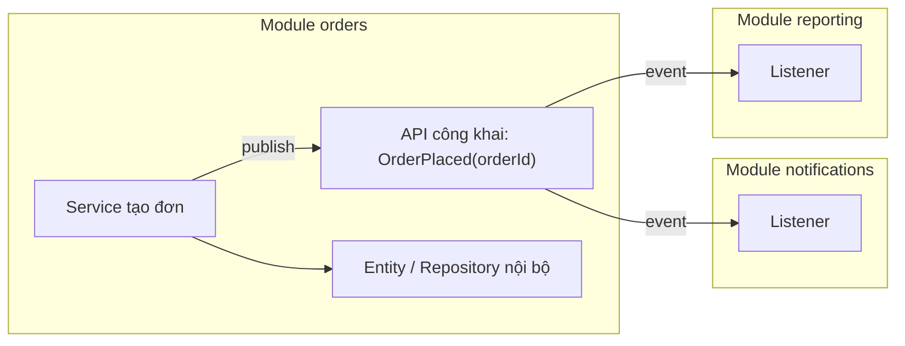

# Event tối thiểu trong thiết kế Spring Modulith

## 1. Event tối thiểu là gì?

Trong Spring Modulith, application event là cách một module thông báo **một sự thật nghiệp vụ đã xảy ra** để module khác chủ động phản ứng, không cần publisher gọi trực tiếp từng listener. Với module học `SPRING_MODULITH_APPLICATION_EVENTS`, thiết kế event tối thiểu là nền tảng để giảm phụ thuộc, giữ ranh giới nghiệp vụ và tiếp tục xây dựng xử lý sau commit, Event Publication Registry, retry, kiểm thử và quan sát việc giao sự kiện.

**Event tối thiểu (minimal event)** là một hợp đồng sự kiện chứa **ít dữ liệu nhất nhưng vẫn đủ để các consumer thực hiện đúng trách nhiệm của mình**. “Tối thiểu” không có nghĩa là event luôn chỉ có một ID. Điểm cần tối ưu là mức độ phụ thuộc vào chi tiết nội bộ của publisher, tính rõ ràng của ngữ nghĩa và khả năng xử lý đúng khi event bị giao trễ hoặc giao lại.

Ví dụ, đơn hàng được tạo thành công:

```java
package com.example.shop.orders;

import java.util.Objects;
import java.util.UUID;

public record OrderPlaced(UUID orderId) {
    public OrderPlaced {
        Objects.requireNonNull(orderId, "orderId");
    }
}
```

Đây có thể là **hợp đồng đủ dùng** nếu tất cả consumer chỉ cần biết đơn hàng nào vừa được đặt, có thể truy vấn trạng thái phù hợp qua API công khai của module `orders` và không cần phân biệt nhiều lần xảy ra của cùng một nghiệp vụ. Tuy nhiên, nếu cần chống xử lý trùng theo từng sự kiện, dựng dữ liệu lịch sử hoặc xử lý đúng thứ tự, payload một ID có thể **quá ít**. Cần xuất phát từ yêu cầu thực tế thay vì áp dụng một mẫu duy nhất.

## 2. Chọn ít field để bảo vệ ranh giới module

Giả sử hệ thống có ba module:

- `orders` lưu đơn hàng và phát `OrderPlaced`.
- `notifications` gửi thông báo cho khách.
- `reporting` cập nhật thống kê đơn hàng.

Nếu `orders` phát cả một đối tượng `OrderEntity` chứa quan hệ JPA, dữ liệu thanh toán, địa chỉ và cờ nội bộ, mọi consumer có thể phụ thuộc sâu vào cách `orders` triển khai lưu trữ. Khi repository/entity thay đổi, các module kia cũng phải sửa.

Với event tối thiểu, `orders` chỉ công bố **dữ liệu có ý nghĩa nghiệp vụ ổn định**; module nhận xử lý bằng API của chính mình hoặc gọi một API công khai được chủ đích thiết kế.



**Publisher sở hữu tên và ý nghĩa event.** Consumer không nên import `orders.internal.OrderEntity` hoặc `orders.internal.OrderRepository`. Trong cấu trúc Spring Modulith mặc định, kiểu event chia sẻ nên nằm trong **base package** của module phát, hoặc trong subpackage được công khai bằng **named interface**.

## 3. Ba câu hỏi để tìm payload tối thiểu

Trước khi định nghĩa record, trả lời lần lượt:

1. **Điều gì đã xảy ra?** Chẳng hạn “đơn hàng đã được chấp nhận” thay vì “hãy gửi email”.
2. **Consumer cần nhận diện đối tượng nào?** Ví dụ `orderId`; có thể đủ để cập nhật projection hoặc xóa cache.
3. **Consumer có cần dữ liệu ngay tại thời điểm xảy ra hay chỉ cần trạng thái hiện tại?** Nếu cần tổng tiền lúc đặt hàng, chỉ gửi `orderId` rồi đọc tổng tiền hiện tại sau vài phút có thể cho kết quả sai.

Điều này cho thấy thiết kế event phụ thuộc **ý nghĩa và yêu cầu nhất quán** của consumer:

| Nhu cầu | Payload tối thiểu có thể đủ | Lý do |
| --- | --- | --- |
| Invalidate cache theo đơn | `orderId` | Consumer chỉ cần biết khóa cần xóa |
| Tải lại bản đọc hiện tại | `orderId` | Consumer có thể đọc nguồn chuẩn qua API công khai |
| Ghi nhận doanh thu **tại thời điểm đặt** | `orderId`, `totalAmount`, `currency`; có thể cần ID event | Giá trị hiện tại của đơn có thể đã đổi khi listener chạy |
| Cập nhật read model trong luồng event có thể đảo thứ tự | `orderId`, `aggregateVersion` hoặc cơ chế đọc lại nguồn chuẩn | Chống event cũ ghi đè event mới |
| Thực hiện tác vụ ngoài hệ thống có thể bị retry | `eventId`/idempotency key cùng dữ liệu cần thiết | Consumer cần nhận ra sự kiện đã xử lý |

Các ví dụ trong bảng là **thiết kế theo yêu cầu**, không phải danh sách field bắt buộc của Spring Modulith. Bổ sung một field chỉ có giá trị khi làm rõ hành vi xử lý.

## 4. Từ event nhiều dữ liệu sang event tối thiểu

### 4.1. Thiết kế quá tải

Ví dụ dưới đây minh họa một hợp đồng không nên công bố giữa các module:

```java
// Tránh mô hình hóa event bằng toàn bộ cấu trúc triển khai.
public record OrderPlaced(
        OrderEntity order,
        CustomerEntity customer,
        PaymentEntity payment,
        HttpServletRequest request,
        EntityManager entityManager
) {}
```

Các kiểu phụ thuộc ORM, request và transaction context tạo ra những rủi ro:

- Consumer biết cấu trúc và package nội bộ của `orders`.
- Lazy loading có thể thất bại khi listener chạy sau commit.
- Dữ liệu có thể đã thay đổi kể từ lúc publish; consumer không thấy snapshot cố định.
- Serializer của cơ chế lưu publication có thể không thể lưu/đọc lại object graph.
- Payload chứa dữ liệu nhạy cảm hoặc tham chiếu vào đối tượng chỉ tồn tại trong request hiện tại.

### 4.2. Thiết kế tối thiểu có chủ đích

Khi mục tiêu chỉ là yêu cầu index tải lại trạng thái mới nhất:

```java
package com.example.shop.orders;

public record OrderPlaced(UUID orderId) {}
```

Trong code thực tế, vẫn nên giữ kiểm tra `orderId != null` như ví dụ ở mục 1. Khi consumer cần một snapshot:

```java
package com.example.shop.orders;

import java.math.BigDecimal;
import java.util.UUID;

public record OrderPlaced(
        UUID orderId,
        BigDecimal totalAmount,
        String currencyCode
) {}
```

Mẫu thứ hai **nhiều field hơn nhưng có thể là tối thiểu đúng** cho báo cáo doanh thu tại thời điểm đặt. Cần định nghĩa chính xác số tiền là trước hay sau giảm giá, tiền tệ theo mã nào và có bao gồm thuế/ship không; tên field đơn giản không thay cho hợp đồng ngữ nghĩa.

**Nguyên tắc:** Chỉ truyền ID khi consumer thật sự có thể lấy dữ liệu cần thiết sau đó mà vẫn đảm bảo nghĩa của sự kiện. Chọn snapshot bất biến khi dữ liệu lịch sử tại thời điểm phát là một phần kết quả nghiệp vụ.

## 5. Demo publisher và listener với một ID

Đối với một chức năng tìm kiếm cần **đồng bộ trạng thái mới nhất**, event một ID thường rất phù hợp.

### 5.1. Publisher trong module `orders`

```java
package com.example.shop.orders.internal;

import com.example.shop.orders.OrderPlaced;
import org.springframework.context.ApplicationEventPublisher;
import org.springframework.stereotype.Service;
import org.springframework.transaction.annotation.Transactional;
import java.util.UUID;

@Service
class OrderCreationService {
    private final OrderRepository orderRepository;
    private final ApplicationEventPublisher publisher;

    OrderCreationService(
            OrderRepository orderRepository,
            ApplicationEventPublisher publisher
    ) {
        this.orderRepository = orderRepository;
        this.publisher = publisher;
    }

    @Transactional
    public UUID place(PlaceOrderCommand command) {
        UUID orderId = orderRepository.create(command);
        publisher.publishEvent(new OrderPlaced(orderId));
        return orderId;
    }
}
```

`OrderRepository` và `PlaceOrderCommand` ở đây là các kiểu minh họa thuộc phần triển khai; ứng dụng thực tế cần định nghĩa chúng, đồng thời công bố **API gọi tạo đơn** phù hợp ở ranh giới module. Việc phát event trong method `@Transactional` không đồng nghĩa event đã được commit: transaction có thể rollback sau khi `publishEvent(...)` được gọi.

### 5.2. Listener trong module nhận

```java
package com.example.shop.search.internal;

import com.example.shop.orders.OrderPlaced;
import org.springframework.modulith.events.ApplicationModuleListener;
import org.springframework.stereotype.Component;

@Component
class OrderSearchListener {
    private final OrderSearchProjection projection;

    OrderSearchListener(OrderSearchProjection projection) {
        this.projection = projection;
    }

    @ApplicationModuleListener
    void on(OrderPlaced event) {
        // Giả định projection tải trạng thái hiện tại qua API công khai
        // rồi upsert theo orderId; xử lý lại không tạo thêm bản ghi.
        projection.refreshCurrentOrder(event.orderId());
    }
}
```

`@ApplicationModuleListener` của Spring Modulith hỗ trợ listener bất đồng bộ, được kích hoạt sau commit và xử lý trong transaction riêng. Cách thiết kế này tránh phụ thuộc trực tiếp từ `orders` sang `search`; listener chỉ tham chiếu event công khai.

`projection.refreshCurrentOrder(...)` là **API minh họa**, chưa phải một implementation hoàn chỉnh: nó phải xác định cách lấy trạng thái mới nhất, tình huống đơn đã bị xóa/hủy và cách cập nhật idempotent. Nếu projection chỉ cập nhật thành trạng thái hiện hành, event cùng `orderId` chạy lại thường không tạo kết quả trùng; nếu nó **tăng bộ đếm**, xử lý lại sẽ có thể làm sai dữ liệu.

## 6. Đừng nhầm payload tối thiểu với bảo đảm giao event

Event `OrderPlaced(orderId)` có ít dữ liệu, nhưng nó **không tự đảm bảo** xử lý sau commit, độ bền, retry hay exactly-once.

| Cơ chế | Hành vi liên quan | Payload một ID có giải quyết được không? |
| --- | --- | --- |
| `@EventListener` mặc định | Thường chạy đồng bộ ngay khi publish | Không; publisher có thể bị ảnh hưởng bởi listener chậm/lỗi |
| `@TransactionalEventListener(AFTER_COMMIT)` | Gọi sau khi transaction của publisher commit | Không; cần dùng đúng loại listener và transaction |
| `@ApplicationModuleListener` | Listener bất đồng bộ, giao sau commit, transaction riêng | Không; còn khả năng lỗi và xử lý lặp |
| Event Publication Registry | Theo dõi publication chưa hoàn tất với listener/hạ tầng hỗ trợ | Không; cần cấu hình lưu trữ và chính sách phục hồi |
| Idempotency tại consumer | Ngăn cùng thao tác bị áp dụng nhiều lần | Tùy logic; có thể cần thêm `eventId` hoặc khóa nghiệp vụ ổn định |

Trong một Spring Modulith có cấu hình Event Publication Registry phù hợp, registry theo dõi publication cho các transactional listener được hỗ trợ. Khi listener thất bại, bản ghi chưa hoàn tất có thể phục vụ xử lý lại theo cơ chế đang cấu hình hoặc vận hành. **Registry không tự biến mỗi side effect bên ngoài thành exactly-once**, và không phải listener nào cũng mặc nhiên được theo dõi.

Một event tối thiểu tốt phải vẫn đủ thông tin để **consumer xử lý lại an toàn**. Nếu không thể suy ra một idempotency key từ ý nghĩa nghiệp vụ, hãy bổ sung `eventId` ổn định.

## 7. Khi nào phải thêm `eventId`?

Nếu một đơn chỉ có **một** sự kiện `OrderPlaced` trong toàn bộ vòng đời, `(eventType, orderId)` đôi khi có thể làm khóa nghiệp vụ để tránh xử lý trùng. Nhưng giả định đó cần được kiểm chứng: hệ thống có cho phép đặt lại, sửa, tạo lại cùng ID hoặc phát nhiều sự kiện có ý nghĩa khác nhau trên cùng aggregate không?

Nếu cần phân biệt **mỗi lần xảy ra sự kiện**, payload có thể thêm `eventId`:

```java
package com.example.shop.orders;

import java.util.Objects;
import java.util.UUID;

public record OrderPlaced(UUID eventId, UUID orderId) {
    public OrderPlaced {
        Objects.requireNonNull(eventId, "eventId");
        Objects.requireNonNull(orderId, "orderId");
    }
}
```

Điều kiện quan trọng: **retry/replay cùng sự kiện phải giữ cùng `eventId`**. Không được tạo một UUID mới bên trong listener mỗi lần chạy lại rồi dùng ID đó để chống trùng.

Ví dụ bảng đánh dấu xử lý cho consumer dùng PostgreSQL:

```sql
CREATE TABLE processed_event (
    consumer_name VARCHAR(120) NOT NULL,
    event_id UUID NOT NULL,
    PRIMARY KEY (consumer_name, event_id)
);
```

Một consumer có thể ghi dấu đã xử lý và cập nhật dữ liệu nghiệp vụ **trong cùng transaction**. Cần xử lý trường hợp insert xung đột theo quy định của database/ORM. Nếu gọi HTTP hoặc email bên ngoài, khóa trong database của consumer **không đủ để bảo đảm tác dụng phụ bên ngoài chỉ xảy ra một lần**; khi có thể, dùng idempotency key tại phía nhận hoặc cơ chế đối soát.

**Không thêm `eventId` chỉ để làm đẹp payload.** Hãy thêm khi cần một danh tính sự kiện có giá trị sử dụng rõ ràng: deduplication, đối chiếu log, khôi phục hoặc liên kết kết quả xử lý.

## 8. Khi nào phải thêm snapshot, version hoặc thời điểm?

### 8.1. Snapshot: consumer cần sự thật ở thời điểm xảy ra

Ví dụ yêu cầu: “mỗi khi có đơn hàng mới, cộng đúng giá trị được xác nhận **lúc đặt đơn** vào doanh thu theo ngày”. Nếu `reporting` nhận `orderId` và truy vấn tổng tiền hiện tại sau khi khách đã chỉnh đơn, báo cáo có thể dùng sai giá trị lịch sử.

Giải pháp là đưa vào event các dữ liệu **vừa đủ**:

```java
public record OrderPlaced(
        UUID eventId,
        UUID orderId,
        BigDecimal placedTotal,
        String currencyCode
) {}
```

Không bắt buộc snapshot tất cả dòng hàng hoặc địa chỉ khách. Chỉ thêm những giá trị cần để consumer tính đúng kết quả. Cần quy định thời điểm chụp dữ liệu và định nghĩa `placedTotal` (đã gồm thuế, phí, giảm giá chưa).

### 8.2. Version: consumer có thể nhận event sai thứ tự

Nếu một read model áp dụng `OrderPlaced` rồi `OrderCancelled`, và listener xử lý bất đồng bộ hoặc retry, thứ tự tới đích có thể khác thứ tự phát.

```text
Nguồn: OrderPlaced(version=1) → OrderCancelled(version=2)
Đích:  OrderCancelled(version=2) → OrderPlaced(version=1)
```

Nếu ghi đè trạng thái không kiểm tra, đích có thể trở lại “đã đặt” sau khi đã hủy. Bổ sung `aggregateVersion` hoặc dùng **đọc lại trạng thái mới nhất** tại nguồn có thể là cách giải quyết. Version chỉ hữu ích khi publisher đảm bảo nó được quản lý ổn định và tăng theo thay đổi nghiệp vụ liên quan; không suy diễn rằng mọi `@Version` JPA đều đúng trong mọi thời điểm publish trước khi flush.

### 8.3. Thời điểm: dùng khi phục vụ yêu cầu cụ thể

Trường `occurredAt` có ích cho báo cáo theo thời gian, audit, đo độ trễ và phân tích vận hành. Tuy nhiên, cần phân biệt **thời điểm sự kiện phát sinh theo nghiệp vụ**, **thời điểm publisher tạo object**, **thời điểm commit** và **thời điểm consumer nhận event**.

Các thời điểm này có thể khác nhau. `Instant.now()` lấy trong transaction không có nghĩa là dấu thời gian commit; timestamp cũng không thể mặc nhiên thay cho sequence đảm bảo thứ tự, nhất là khi nhiều instance có đồng hồ khác nhau.

### 8.4. Metadata khác có bắt buộc không?

`correlationId`, `causationId`, `tenantId` và `schemaVersion` đều có thể cần trong những hệ thống cụ thể. Nhưng mỗi field làm contract và trách nhiệm xử lý lớn hơn. Hãy định nghĩa mục đích và cách tạo của từng field trước khi đưa vào payload; tránh copy token xác thực, session hay toàn bộ HTTP request context.

## 9. Event tối thiểu phải rõ nghĩa và có thể tiến hóa

Một event nhỏ vẫn là **API giữa các module**. Nếu đổi ý nghĩa của `OrderPlaced` từ “đã nhận yêu cầu” thành “đã thanh toán”, consumer có thể tiếp tục chạy mà thực hiện sai nghiệp vụ dù kiểu dữ liệu không thay đổi.

Quy tắc hợp đồng:

1. **Tên event biểu thị sự thật đã xảy ra**, không chỉ tên phương thức hay lệnh muốn consumer thực hiện.
2. **Các field có ý nghĩa cố định**: `orderId` định danh loại đơn nào, `placedTotal` dùng đơn vị gì, trường nào có thể null.
3. **Không lộ thực thể nội bộ**: không đưa JPA entity, repository, lazy proxy hoặc request/transaction object vào event.
4. **Không phụ thuộc vào trạng thái mutable**: dùng `record` chứa các kiểu bất biến và defensive copy nếu có list/map.
5. **Cân nhắc tương thích khi lưu event**: nếu Event Publication Registry hoặc broker tuần tự hóa event, đổi tên package/class/field có thể khiến publication cũ không đọc lại được.
6. **Không dùng version number như phép màu**: thêm `schemaVersion` chỉ có tác dụng khi đã có chiến lược chuyển đổi/đọc dữ liệu cũ.

Nếu consumer ngày càng cần nhiều dữ liệu khác nhau, có thể phải phân biệt sự kiện nghiệp vụ cụ thể hơn hoặc mở một API truy vấn công khai. Tránh dùng một kiểu `EverythingChanged` với payload khổng lồ để thỏa mãn mọi consumer.

### Ví dụ hợp đồng có named interface

Nếu dự án tổ chức event trong `orders.events`, có thể công khai chính subpackage đó bằng `@NamedInterface`:

```java
// File: orders/events/package-info.java
@org.springframework.modulith.NamedInterface("events")
package com.example.shop.orders.events;
```

Mọi event mà module khác cần dùng phải được đặt trong API module công khai theo convention hoặc named interface thích hợp. Module nhận import `orders.events.OrderPlaced`, nhưng không nên import `orders.internal.OrderRepository`.

## 10. Kiểm tra event tối thiểu bằng tình huống cụ thể

Không đánh giá “tối thiểu” chỉ bằng số field. Hãy viết một bảng yêu cầu trước khi chốt contract:

| Consumer | Điều kiện nghiệp vụ | Event một `orderId` có đủ? | Cần bổ sung gì? |
| --- | --- | --- | --- |
| Cache invalidator | Xóa cache của đơn khi nhận thông báo | Có | Không bắt buộc |
| Search projector | Tải trạng thái đơn mới nhất, upsert theo khóa | Có, nếu API nguồn và cách cập nhật phù hợp | Có thể cần version nếu áp dụng snapshot |
| Notification sender | Gửi đúng một email xác nhận | Không luôn đủ | Chiến lược chống trùng; eventId khi cần |
| Revenue projector | Cộng số tiền gốc tại lúc đặt | Thường không | Snapshot tiền tệ/số tiền, kiểm soát trùng |
| Audit log | Ghi dấu sự kiện với thời điểm và người thực hiện theo yêu cầu | Không luôn đủ | occurredAt, actor phù hợp, có kiểm soát dữ liệu |

Sau đó kiểm thử các trường hợp:

- **Commit/rollback:** listener sau commit không gây tác dụng phụ khi transaction publisher rollback.
- **Xử lý lặp:** cùng một event giao hai lần vẫn dẫn tới kết quả đúng.
- **Trễ:** trạng thái nguồn thay đổi trước khi consumer nhận event; kết quả vẫn đúng với mục tiêu “hiện tại” hay “lịch sử”.
- **Đảo thứ tự:** nếu event có thể áp dụng sai thứ tự, consumer biết cách tránh ghi đè dữ liệu mới.
- **Restart/khôi phục:** payload có thể đọc lại từ kho publication thực và vẫn đủ dữ liệu để hoàn thành.
- **Biên giới module:** consumer không phải import entity/repository nội bộ của publisher.
- **Dữ liệu nhạy cảm:** payload, log và nơi lưu publication không chứa field vượt nhu cầu.

Một bài test kiến trúc sử dụng Spring Modulith:

```java
import com.example.shop.ShopApplication;
import org.junit.jupiter.api.Test;
import org.springframework.modulith.core.ApplicationModules;

class ModuleBoundariesTest {
    @Test
    void verifiesModuleDependencies() {
        ApplicationModules.of(ShopApplication.class).verify();
    }
}
```

Kiểm tra này xác minh quan hệ phụ thuộc giữa các module theo mô hình Spring Modulith. Nó **không** thay thế integration test về transaction, giao event, registry và retry. Đối với giao sự kiện đáng tin cậy, nên đo số publication chưa hoàn tất, tuổi publication cũ nhất, số lần xử lý lại và thời gian hoàn tất listener theo các khả năng giám sát trong hệ thống.

## 11. Bài tập thực hành: chọn payload cho ba yêu cầu

Giả sử module `orders` phát `OrderPlaced`. Lần lượt xét:

**Yêu cầu A — Xóa cache khi đơn mới xuất hiện.** Consumer chỉ cần khóa cache. Đề xuất: `OrderPlaced(UUID orderId)`. Nếu listener chạy lại, thao tác xóa cùng khóa vẫn cho hiệu quả tương tự.

**Yêu cầu B — Gửi email xác nhận với tổng tiền đúng tại thời điểm đặt.** Cần `orderId`, số tiền/số tiền tệ tại thời điểm đặt và chiến lược chống gửi trùng. Đề xuất: `OrderPlaced(UUID eventId, UUID orderId, BigDecimal placedTotal, String currencyCode)`. Địa chỉ email nên được xử lý theo quyền sở hữu dữ liệu và yêu cầu bảo mật, ví dụ tra qua API của module khách hàng hoặc snapshot được phép nếu có yêu cầu lịch sử.

**Yêu cầu C — Đồng bộ projection trạng thái có thể nhận event trễ.** Nếu consumer chỉ đọc **trạng thái hiện hành**, `orderId` có thể đủ. Nếu consumer dùng dữ liệu snapshot và cập nhật tăng dần, cần định danh/version nghiệp vụ được quản lý đúng, cùng logic bỏ qua event cũ.

Ba trường hợp minh họa một nguyên tắc: **cùng một sự thật nghiệp vụ không buộc mọi consumer có cùng cách đọc dữ liệu**, nhưng tất cả phải dựa trên contract nhất quán. Khi thiết kế event dùng chung, cần chọn payload đáp ứng các yêu cầu đã biết với mức coupling thấp nhất có thể chấp nhận.

## 12. Checklist thiết kế event tối thiểu

Trước khi lưu một event dùng liên module, tự kiểm tra:

1. Event nói rõ **sự thật nghiệp vụ nào đã xảy ra** và module nào sở hữu?
2. Field nào được **consumer thực sự dùng**? Có thể bỏ field mà vẫn xử lý đúng không?
3. Với dữ liệu không có trong event, consumer có thể **đọc lại qua API công khai** mà không đổi nghĩa lịch sử không?
4. Payload có truyền **entity, repository, object mutable, request context hoặc dữ liệu bí mật** không?
5. Event có đủ **định danh phục vụ idempotency**, và có giữ nguyên ID khi retry/replay không?
6. Hệ thống có cần **snapshot, version, thời điểm** để tránh sai lệch do xử lý trễ/sai thứ tự không?
7. Event có thể **đọc lại sau restart** nếu được lưu trong Event Publication Registry hay broker không?
8. Publisher và consumer có giữ **ranh giới package/API module** khi triển khai listener?
9. Kiểm thử có bao phủ **sau commit, rollback, xử lý lặp, phục hồi và giám sát** theo yêu cầu không?

**Ghi nhớ:** Event tối thiểu tốt là event có **đủ thông tin để xử lý đúng và ít ràng buộc nhất với triển khai nội bộ**. Bắt đầu với định danh nghiệp vụ khi nó đã đủ, chỉ thêm snapshot, version, thời điểm hay event ID khi một yêu cầu cụ thể chứng minh sự cần thiết. Spring Modulith giúp tổ chức publisher/listener qua ranh giới module; tính bền vững và đáng tin cậy còn cần transaction sau commit, registry, retry có kiểm soát, idempotency và kiểm thử thực tế.
