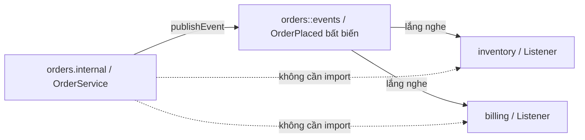
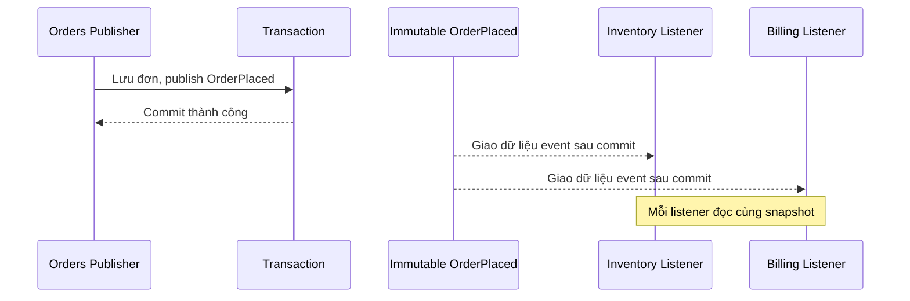

# Immutable event trong Spring Modulith

## 1. Vì sao event nên bất biến?

Trong kiến trúc theo module, **application event** là thông điệp mô tả một sự thật nghiệp vụ đã xảy ra, chẳng hạn `OrderPlaced` (đơn hàng đã được tạo) hay `PaymentCompleted` (thanh toán đã hoàn tất). Module phát sự kiện công bố điều đã xảy ra; các module quan tâm sẽ nhận và xử lý theo trách nhiệm của mình.

Một event được coi là **immutable (bất biến)** khi trạng thái có ý nghĩa của nó **không thể bị thay đổi sau lúc tạo**. Cùng một event được chuyển cho nhiều listener, xử lý bất đồng bộ hoặc thử lại vẫn phải mang cùng dữ liệu nghiệp vụ ban đầu.

Trong module học `SPRING_MODULITH_APPLICATION_EVENTS`, tính bất biến giúp đạt các mục tiêu:

- **Bảo vệ ranh giới module:** listener nhận một hợp đồng dữ liệu rõ ràng, không được cầm và sửa trực tiếp entity nội bộ của publisher.
- **Tránh thay đổi ngoài ý muốn:** một listener không thể sửa payload để làm listener khác nhận dữ liệu khác.
- **Phù hợp xử lý sau commit và bất đồng bộ:** event là ảnh chụp dữ liệu cần thiết tại thời điểm phát, không phụ thuộc đối tượng đang tiếp tục bị sửa ở luồng khác.
- **Dễ kiểm thử và xử lý lại:** có thể đối chiếu nhiều lần giao cùng event bằng `eventId`, `orderId` và các giá trị ban đầu.
- **Dễ kiểm soát phiên bản:** hợp đồng event có trường và kiểu dữ liệu được định nghĩa tường minh, thuận lợi cho thay đổi có chủ đích.

Ví dụ: khi đơn hàng được chốt với tổng tiền 250.000 VND, event `OrderPlaced` nên luôn phản ánh trạng thái đã chốt đó. Nếu sau khi phát event, một mã nguồn khác sửa tổng tiền qua tham chiếu dùng chung, module thanh toán có thể nhận giá trị khác với module thông báo.

> **Immutable event không đồng nghĩa giao sự kiện chắc chắn thành công.** Tính bất biến thuộc về thiết kế payload; transaction, Event Publication Registry, retry và idempotency giải quyết các khía cạnh khác của giao sự kiện tin cậy.

## 2. Tính bất biến có nhiều cấp độ

Trong Java, có sự khác nhau giữa **không thể gán lại tham chiếu** và **không thể thay đổi trạng thái dữ liệu mà tham chiếu trỏ đến**.

```java
import java.util.ArrayList;
import java.util.List;

List<String> source = new ArrayList<>();
source.add("SKU-01");

final List<String> items = source;
// items = new ArrayList<>();  // Không được gán lại tham chiếu.
items.add("SKU-02");          // Vẫn thay đổi được nội dung List.
```

Từ khóa `final` chỉ ngăn gán lại biến hoặc trường. Nó **không đóng băng** đối tượng `ArrayList` được tham chiếu.

| Khái niệm | Ý nghĩa | Ví dụ |
| --- | --- | --- |
| Trường `final` | Tham chiếu hoặc giá trị trường không thể được gán lại sau khởi tạo | `private final List<String> items` |
| Đối tượng không cho sửa (*unmodifiable*) | Không thể gọi thao tác sửa thành công thông qua giao diện đó | `List.copyOf(items)` |
| Bất biến nông (*shallow immutability*) | Các trường không gán lại được, nhưng đối tượng lồng bên trong có thể còn thay đổi | `record Event(List<MutableItem> items)` |
| Bất biến sâu về mặt thực tế (*deep immutability*) | Toàn bộ dữ liệu quan sát được qua các thành phần của event đều ổn định | `record Event(List<ImmutableItem> items)` với bản sao list bảo vệ và item bất biến |

Để một event thật sự an toàn khi chia sẻ giữa nhiều listener, phải xét cả **collection**, **array**, **đối tượng lồng nhau**, **getter/accessor** và **tham chiếu được tái sử dụng từ entity nghiệp vụ**.

## 3. Vì sao Java record là lựa chọn phù hợp?

Từ Java 16, `record` là cách ngắn gọn để khai báo một kiểu dữ liệu mang giá trị. Java tự cung cấp constructor chính, accessor, `equals()`, `hashCode()` và `toString()` dựa trên các thành phần record.

Ví dụ event chỉ chứa kiểu dữ liệu bất biến:

```java
package com.example.shop.orders.events;

import java.time.Instant;
import java.util.UUID;

public record OrderPlaced(
        UUID eventId,
        UUID orderId,
        Instant occurredAt) {
}
```

Các trường thành phần của record là `private final`; accessor như `orderId()` trả về giá trị của thành phần. `UUID` và `Instant` là các kiểu bất biến. Nếu các giá trị đầu vào hợp lệ, payload này có trạng thái ổn định sau khi khởi tạo.

Các trường ở đây có vai trò khác nhau:

- `eventId`: định danh **lần phát sinh sự kiện cụ thể**, hữu ích để đối chiếu publication và khử trùng xử lý.
- `orderId`: định danh **đối tượng nghiệp vụ** mà sự kiện mô tả; một đơn hàng có thể có nhiều sự kiện khác nhau.
- `occurredAt`: thời điểm nghiệp vụ hoặc publisher ghi nhận sự kiện, **không tự động là thời điểm giao dịch commit hoặc listener nhận**.

Record giảm công viết boilerplate, nhưng **không mặc định tạo bất biến sâu**. Nếu thành phần là `List`, `Map`, array hoặc một object mutable, nội dung bên trong vẫn có thể thay đổi.

### 3.1. Không dùng entity JPA làm payload sự kiện

Một anti-pattern là công bố trực tiếp đối tượng entity thuộc module:

```java
// Ví dụ KHÔNG NÊN dùng
public record OrderPlaced(OrderEntity order) {}

// orders thay đổi entity sau khi đã phát event:
publisher.publishEvent(new OrderPlaced(order));
order.setStatus(OrderStatus.CANCELLED);
```

Hai vấn đề xuất hiện:

1. Payload giữ **tham chiếu trực tiếp đến một object có thể thay đổi**. Giá trị listener quan sát có thể khác dữ liệu lúc event được phát.
2. `OrderEntity` là chi tiết triển khai dữ liệu của module `orders`. Nếu module `inventory` phải import kiểu entity đó, hợp đồng sự kiện gây phụ thuộc vào nội bộ, có thể vi phạm ranh giới Spring Modulith.

Entity JPA còn có thể chứa quan hệ lazy, proxy, chu trình tham chiếu hoặc dữ liệu nhạy cảm. Những yếu tố này khiến event khó kiểm thử và có thể gây vấn đề khi một cơ chế lưu trữ publication cần biểu diễn payload bền vững.

Hãy dùng **giá trị được trích xuất và sao chụp** từ entity; chỉ đưa những trường module tiêu thụ thực sự cần.

## 4. Thiết kế một immutable event có dữ liệu lồng nhau

Giả sử module `orders` phải thông báo danh sách mặt hàng đã được đặt để module `inventory` tiến hành giữ hàng. Một payload đủ rõ có thể gồm `eventId`, `orderId`, `occurredAt` và các dòng hàng.

Ví dụ Java 17+:

```java
package com.example.shop.orders.events;

import java.time.Instant;
import java.util.List;
import java.util.Objects;
import java.util.UUID;

public record OrderPlaced(
        UUID eventId,
        UUID orderId,
        Instant occurredAt,
        List<LineItem> items) {

    public OrderPlaced {
        Objects.requireNonNull(eventId, "eventId");
        Objects.requireNonNull(orderId, "orderId");
        Objects.requireNonNull(occurredAt, "occurredAt");
        Objects.requireNonNull(items, "items");

        items = List.copyOf(items);
        if (items.isEmpty()) {
            throw new IllegalArgumentException("items must not be empty");
        }
    }

    public record LineItem(UUID productId, int quantity) {
        public LineItem {
            Objects.requireNonNull(productId, "productId");
            if (quantity <= 0) {
                throw new IllegalArgumentException(
                    "quantity must be positive");
            }
        }
    }
}
```

Thiết kế này có các điểm chủ chốt:

1. `OrderPlaced` là record, do đó các thành phần không được gán lại sau constructor.
2. `items = List.copyOf(items)` tạo một list không cho sửa và không bị thay đổi chỉ vì caller tiếp tục chỉnh sửa **list nguồn**.
3. Mỗi phần tử là `LineItem`, một record chỉ chứa `UUID` và `int` bất biến. Vì thế phần tử cũng không có trạng thái mutable để listener sửa.
4. Compact constructor của mỗi record kiểm tra dữ liệu tại thời điểm tạo, giúp event không tồn tại với `eventId` rỗng hoặc số lượng hàng không hợp lệ.
5. `List.copyOf` không chấp nhận phần tử `null`; không có phần tử null lọt vào `items`.

Lưu ý: `List.copyOf` tạo **bản sao cấu trúc hoặc tái sử dụng một danh sách không thể sửa được** theo hợp đồng API. Điều bảo đảm quan trọng là caller không thể thay đổi list trong event thông qua list nguồn và event không cung cấp thao tác sửa. `List.copyOf` **không clone sâu từng phần tử**, nên việc dùng `LineItem` bất biến là thiết yếu.

### 4.1. Kiểm tra event không bị thay đổi sau khi tạo

```java
import java.time.Instant;
import java.util.ArrayList;
import java.util.List;
import java.util.UUID;

UUID productId = UUID.randomUUID();
List<OrderPlaced.LineItem> source = new ArrayList<>();
source.add(new OrderPlaced.LineItem(productId, 2));

OrderPlaced event = new OrderPlaced(
    UUID.randomUUID(),
    UUID.randomUUID(),
    Instant.now(),
    source
);

source.clear();                 // Chỉ thay đổi danh sách nguồn.
assert event.items().size() == 1;

// event.items().clear();       // UnsupportedOperationException.
// event.items().get(0).quantity = 3; // Không thể gán record component.
```

Ví dụ dùng `assert` để làm rõ ý tưởng; trong kiểm thử tự động nên dùng assertion của JUnit thay vì phụ thuộc vào cờ JVM `-ea`.

## 5. Những bẫy bất biến thường gặp

### 5.1. Record chứa collection mutable

```java
import java.util.List;

// Anti-pattern: record chỉ bất biến ở lớp ngoài.
public record BadOrderPlaced(List<String> productCodes) {}
```

```java
List<String> codes = new java.util.ArrayList<>();
codes.add("SKU-01");
BadOrderPlaced event = new BadOrderPlaced(codes);

codes.add("SKU-02");       // event.productCodes() cũng quan sát SKU-02.
event.productCodes().clear(); // Listener có thể sửa payload.
```

Giải pháp là sao chép phòng vệ ở constructor:

```java
public record BetterOrderPlaced(List<String> productCodes) {
    public BetterOrderPlaced {
        productCodes = List.copyOf(productCodes);
    }
}
```

Vì `String` là bất biến, list chứa các chuỗi và được sao chép như trên đáp ứng yêu cầu ổn định của ví dụ.

### 5.2. Collections.unmodifiableList không tạo snapshot

```java
List<String> source = new java.util.ArrayList<>();
source.add("SKU-01");
List<String> view = java.util.Collections.unmodifiableList(source);

source.add("SKU-02");
// view vẫn quan sát được SKU-02 vì chỉ bọc cùng list nguồn.
```

`Collections.unmodifiableList(source)` ngăn sửa **qua view**, nhưng không bảo vệ khỏi việc một mã nguồn khác sửa `source`. Khi tạo event, nên tạo snapshot độc lập, ví dụ `List.copyOf(source)`.

### 5.3. List.copyOf không đóng băng phần tử mutable

```java
class MutableLine {
    int quantity;
    MutableLine(int quantity) { this.quantity = quantity; }
}

public record LeakyEvent(List<MutableLine> lines) {
    public LeakyEvent {
        lines = List.copyOf(lines);
    }
}
```

Mặc dù `lines` không thể thêm/xóa phần tử, caller hoặc listener vẫn có thể sửa `event.lines().get(0).quantity`. Hãy dùng `record LineItem(...)` với các thành phần bất biến, hoặc thực hiện **deep copy** có kiểm soát khi dữ liệu đầu vào là object mutable.

### 5.4. Array và các kiểu thời gian mutable

```java
public record UnsafePayload(byte[] checksum) {}
```

Constructor của record lưu tham chiếu array đầu vào; accessor `checksum()` trả lại cùng array. Caller hoặc listener có thể thay đổi các byte. Nếu thực sự cần array, phải **clone khi nhận và clone khi trả**:

```java
import java.util.Objects;

public record SafePayload(byte[] checksum) {
    public SafePayload {
        checksum = Objects.requireNonNull(checksum).clone();
    }

    @Override
    public byte[] checksum() {
        return checksum.clone();
    }
}
```

Lưu ý thêm: array có `equals()` tham chiếu; record chứa array vẫn có ngữ nghĩa `equals()`/`hashCode()` mặc định dựa vào so sánh array theo tham chiếu. Nếu cần so sánh theo **nội dung bytes**, hãy cân nhắc kiểu giá trị khác hoặc chủ động cài đặt semantics phù hợp.

Tương tự, `java.util.Date` là kiểu mutable; nên dùng `java.time.Instant`, `LocalDate` hoặc kiểu thời gian bất biến phù hợp với ý nghĩa nghiệp vụ. Với `Map<K,V>`, `Map.copyOf` chỉ bảo vệ cấu trúc map, còn key/value cần được xem xét riêng.

## 6. Tạo snapshot tại ranh giới publisher

Sự kiện là **bản tường thuật điều đã xảy ra**. Vì vậy publisher nên sao chụp dữ liệu nghiệp vụ ổn định ngay tại thời điểm quyết định phát, không chuyển tham chiếu đến entity hoặc collection đang thuộc quản lý của ORM.

Giả sử module đơn hàng có entity `Order`, mỗi dòng có `productId` và `quantity`. Đoạn sau minh họa cách tạo event từ dữ liệu vừa lưu:

```java
// Trích đoạn minh họa trong OrderService; Order/Repository là kiểu nội bộ.
@Transactional
public UUID placeOrder(PlaceOrderCommand command) {
    Order order = repository.create(command);

    var lines = order.getLines().stream()
        .map(line -> new OrderPlaced.LineItem(
            line.getProductId(),
            line.getQuantity()))
        .toList();

    var event = new OrderPlaced(
        UUID.randomUUID(),
        order.getId(),
        java.time.Instant.now(),
        lines
    );

    publisher.publishEvent(event);
    return order.getId();
}
```

`OrderPlaced.LineItem` và `OrderPlaced` sao chụp **giá trị**, không sao chụp entity. Đoạn trích dựa trên API `repository.create(...)` và `Order` giả định của ví dụ, không phải một ứng dụng hoàn chỉnh có thể chạy ngay.

Có hai quyết định thiết kế cần tách biệt:

- **Những gì xảy ra tại thời điểm phát:** payload được tạo từ trạng thái nghiệp vụ hiện tại. `occurredAt` của ví dụ là lúc event được khởi tạo, chưa chắc là thời điểm giao dịch commit.
- **Những gì xảy ra tại thời điểm xử lý:** listener có thể chạy sau commit hoặc muộn hơn khi được thử lại. Dữ liệu hiện tại trong database lúc listener xử lý có thể đã tiếp tục thay đổi, còn snapshot trong event thì không.

Nếu listener cần xử lý đúng **số lượng sản phẩm tại thời điểm đặt hàng**, event nên mang số lượng đó. Nếu listener cần biết **trạng thái mới nhất**, có thể chỉ nhận `orderId` và đọc qua một API công khai phù hợp, nhưng phải chấp nhận rằng trạng thái đọc được có thể khác thời điểm event phát.

### 6.1. Payload nhỏ và đủ ý nghĩa nghiệp vụ

Không phải event nào cũng cần chở toàn bộ dòng hàng. Chọn dữ liệu theo nhu cầu xử lý và mức độ độc lập giữa các module:

| Thiết kế payload | Phù hợp khi | Đánh đổi |
| --- | --- | --- |
| `OrderPlaced(UUID eventId, UUID orderId)` | Listener chỉ cần định danh đơn để thực hiện một bước khác | Có thể phải gọi API/query để lấy thông tin |
| `OrderPlaced(..., List<LineItem> items)` | Kho cần lượng hàng tại đúng thời điểm đơn được tạo | Payload lớn hơn; hợp đồng có nhiều trường cần quản lý |
| Mang nguyên `OrderEntity` vào event | Không nên dùng làm hợp đồng giữa module | Rò rỉ triển khai, dữ liệu mutable, rủi ro lazy loading và serialization |

Tránh sao chép dữ liệu cá nhân nhạy cảm hoặc nội dung không cần thiết vào event, nhất là khi hệ thống có thể lưu publication hoặc xuất thông tin phục vụ chẩn đoán.

## 7. Immutable event và ranh giới module

Để một listener ở module `inventory` sử dụng `OrderPlaced` hợp lệ, kiểu event cần nằm trong **API được công bố** của `orders`. Có thể đặt event trực tiếp ở package gốc `orders`, hoặc đặt ở `orders.events` rồi công bố named interface:

```java
// orders/events/package-info.java
@org.springframework.modulith.NamedInterface("events")
package com.example.shop.orders.events;
```

Nếu muốn chỉ cho phép `inventory` tham chiếu nhóm sự kiện này, dùng:

```java
// inventory/package-info.java
@org.springframework.modulith.ApplicationModule(
    allowedDependencies = "orders::events"
)
package com.example.shop.inventory;
```

Khi đó module `inventory` phụ thuộc vào **hợp đồng giá trị bất biến `orders::events`**, không phụ thuộc vào repository, service hoặc entity nội bộ của `orders`.



Hợp đồng immutable giúp hạn chế quyền sửa dữ liệu giữa module. Nó **không thay thế** kiểm chứng kiến trúc bằng `ApplicationModules.of(ShopApplication.class).verify()` và không cấm một module gọi trực tiếp repository của module khác nếu dự án chưa kiểm tra đúng quy tắc ranh giới.

## 8. Immutable event khi xử lý sau commit, bất đồng bộ và retry

Trong Spring Framework, `ApplicationEventPublisher.publishEvent(event)` là thao tác công bố sự kiện; bản thân nó không đồng nghĩa mọi listener đều chạy bất đồng bộ hoặc sau commit. Một `@EventListener` thông thường mặc định xử lý đồng bộ trong quá trình công bố.

Với Spring Modulith, `@ApplicationModuleListener` là lựa chọn tiện dụng để xử lý sự kiện giữa các module sau commit, bất đồng bộ và có transaction riêng khi được cấu hình phù hợp:

```java
package com.example.shop.inventory.internal;

import com.example.shop.orders.events.OrderPlaced;
import org.springframework.modulith.events.ApplicationModuleListener;
import org.springframework.stereotype.Component;

@Component
class OrderPlacedListener {
    private final StockReservationService reservationService;

    OrderPlacedListener(StockReservationService reservationService) {
        this.reservationService = reservationService;
    }

    @ApplicationModuleListener
    void on(OrderPlaced event) {
        reservationService.reserveOnce(
            event.eventId(),
            event.orderId(),
            event.items()
        );
    }
}
```

`StockReservationService.reserveOnce(...)` là API nghiệp vụ nội bộ **giả định** trong module kho. Nó cần được hiện thực để xử lý transaction, chống trùng và cập nhật tồn kho theo chính sách thực tế.

### 8.1. Một event, nhiều thời điểm xử lý



Sơ đồ biểu diễn hai listener được cấu hình xử lý sau commit. Thứ tự chạy và thời gian hoàn tất của các listener có thể khác nhau; không nên giả định listener kho luôn chạy trước listener thanh toán.

Vì các listener có thể xử lý đồng thời hoặc cách xa thời điểm publisher tạo event, tính bất biến giảm rủi ro *data race do sửa chung payload*. Tuy nhiên, bất biến của event **không làm các thao tác cơ sở dữ liệu trong listener tự trở thành thread-safe** và không thay thế các quy tắc đồng bộ dữ liệu nghiệp vụ.

### 8.2. Event Publication Registry, retry và idempotency

Khi giao dịch tạo đơn đã commit mà một listener thất bại, event bất biến giúp quá trình xử lý lại sử dụng **cùng dữ liệu nghiệp vụ**. Spring Modulith cung cấp cơ chế **Event Publication Registry** để theo dõi publication tới transactional event listener khi ứng dụng cấu hình cơ chế lưu trữ phù hợp.

Registry có thể ghi nhận publication chưa hoàn thành để phục vụ phát hiện và tái xử lý. Phương thức retry, lịch phát lại, thời điểm kích hoạt và lưu trữ bền vững phụ thuộc vào phiên bản, dependency và cấu hình cụ thể. Chỉ dùng record bất biến hoặc thêm annotation listener **không tự bảo đảm** retry tự động, at-least-once hay exactly-once trong mọi tình huống.

Tính bất biến và **idempotency** bổ sung cho nhau:

- **Bất biến:** `eventId`, `orderId` và `items` luôn mang cùng nội dung khi xử lý lại cùng publication.
- **Idempotency:** listener kiểm tra khóa xử lý, ràng buộc duy nhất hoặc dữ liệu nghiệp vụ để không giữ hàng hay thu tiền hai lần khi sự kiện được giao lại.
- **Quan sát:** cần theo dõi số publication chưa hoàn tất, thời gian trễ, số lần xử lý lỗi và số lần trùng để xác nhận hệ thống vận hành đúng.

Đừng tạo `eventId` mới ở từng lần **retry cùng một sự kiện**: hành động đó sẽ khiến listener khó nhận biết đây là một lần xử lý lại. Nếu một sự kiện nghiệp vụ **mới** xảy ra, khi đó event mới có định danh riêng.

## 9. Tương thích phiên bản và khả năng lưu trữ

Một immutable event là **hợp đồng giữa các module**, vì vậy thay đổi cấu trúc record cần được quản lý như thay đổi API.

Ví dụ event ban đầu:

```java
public record OrderPlaced(UUID eventId, UUID orderId) {}
```

Sau đó nghiệp vụ muốn thêm `occurredAt`. Thay đổi constructor thành ba thành phần có thể buộc tất cả vị trí khởi tạo record và một số listener phải được cập nhật:

```java
public record OrderPlaced(
        UUID eventId,
        UUID orderId,
        java.time.Instant occurredAt) {}
```

Các ứng dụng chạy cùng mã nguồn có thể cập nhật đồng bộ trong một đợt build, nhưng **event publication đã lưu từ trước** (nếu có) hoặc hệ thống ngoài đang tiêu thụ event có thể vẫn dựa trên phiên bản payload cũ. Cần cân nhắc:

1. **Ý nghĩa nghiệp vụ có đổi không?** Đổi từ “đơn đã được tạo” thành “đơn đã thanh toán” là thay đổi ngữ nghĩa, không nên chỉ sửa lại nội dung cũ mà giữ nguyên tên `OrderPlaced`.
2. **Có publication đang chờ xử lý không?** Nếu registry lưu payload đã được tuần tự hóa, việc nâng cấp kiểu event hoặc serializer có thể ảnh hưởng quá trình khôi phục/tái phát.
3. **Có cần version event không?** Có thể dùng loại event hoặc phiên bản hợp đồng mới khi có thay đổi không tương thích, kèm quy trình chuyển đổi được kiểm thử.
4. **Có nên chỉ thêm trường tùy chọn?** Quyết định phụ thuộc quy tắc miền và cơ chế serialization; không mặc định `null` là lựa chọn phù hợp cho mọi dữ liệu.

**Lưu ý kỹ thuật:** Spring application events thông thường được truyền dưới dạng object trong tiến trình. Việc **serialize/deserialize** để lưu hoặc phát lại phụ thuộc cơ chế Event Publication Registry và bộ chuyển đổi được cấu hình. Record bất biến không bảo đảm một mình khả năng tương thích serialization của mọi phiên bản.

## 10. Kiểm thử các tính chất bất biến

Một thiết kế tốt nên có kiểm thử chuyên biệt cho trạng thái payload, bên cạnh các bài kiểm thử về luồng phát/nhận sự kiện.

### 10.1. Kiểm thử phòng vệ list nguồn và list được trả về

```java
import static org.junit.jupiter.api.Assertions.*;

import java.time.Instant;
import java.util.ArrayList;
import java.util.List;
import java.util.UUID;
import org.junit.jupiter.api.Test;

class OrderPlacedTest {

    @Test
    void eventKeepsStableItemsSnapshot() {
        var original = new ArrayList<OrderPlaced.LineItem>();
        original.add(new OrderPlaced.LineItem(UUID.randomUUID(), 2));

        var event = new OrderPlaced(
            UUID.randomUUID(),
            UUID.randomUUID(),
            Instant.parse("2026-01-01T00:00:00Z"),
            original
        );

        original.clear();
        assertEquals(1, event.items().size());
        assertThrows(UnsupportedOperationException.class,
            () -> event.items().clear());
        assertEquals(2, event.items().get(0).quantity());
    }

    @Test
    void eventRejectsInvalidQuantities() {
        assertThrows(IllegalArgumentException.class,
            () -> new OrderPlaced.LineItem(UUID.randomUUID(), 0));
    }
}
```

Kiểm thử trên bảo đảm caller không thể thay đổi list trong event thông qua tham chiếu nguồn và listener không thể tự sửa collection của event. Kiểu `LineItem` bất biến bảo vệ luôn dữ liệu phần tử.

### 10.2. Các lớp kiểm thử khác cần thiết

| Loại kiểm thử | Điều cần xác minh |
| --- | --- |
| Unit test event | Constructor từ chối dữ liệu sai; dữ liệu lồng nhau không bị sửa ngoài ý muốn |
| Publisher test | Payload phản ánh đúng trạng thái nghiệp vụ tại thời điểm phát; `eventId` được tạo một lần |
| Module boundary test | Listener chỉ import hợp đồng sự kiện được công bố; không dùng entity/repository của publisher |
| After-commit test | Listener sau commit không thực hiện nghiệp vụ khi giao dịch publisher rollback |
| Retry/idempotency test | Giao lại cùng event không nhân đôi thao tác; payload không biến đổi qua các lần xử lý |
| Persistence/compatibility test | Nếu dùng registry lưu publication, dữ liệu có thể lưu và khôi phục theo cấu hình và phiên bản đang dùng |

Không nên dùng việc record có trường `final` làm bằng chứng duy nhất cho tính bất biến. Hãy thử thay đổi collection đầu vào, phần tử lồng nhau và dữ liệu trả về qua accessor trong kiểm thử.

## 11. Checklist trước khi công bố immutable event

1. **Sự kiện mô tả sự thật nghiệp vụ:** tên ở dạng đã xảy ra (`OrderPlaced`, `PaymentCompleted`), có thời điểm và định danh phù hợp.
2. **Không mang entity nội bộ:** payload dùng kiểu giá trị, không dùng entity JPA hoặc object mutable được chia sẻ qua module.
3. **Đảm bảo bất biến cả dữ liệu lồng nhau:** `record` không đủ nếu chứa `List<MutableItem>`, `Map` có value mutable hoặc array.
4. **Sao chụp tại ranh giới phát sự kiện:** dùng `List.copyOf`/`Map.copyOf` khi thích hợp, chuyển phần tử mutable sang immutable DTO và bảo vệ accessor nếu cần.
5. **Kiểm tra đầu vào:** tránh `null` không mong muốn, quantity âm hoặc payload thiếu thông tin nghiệp vụ bắt buộc.
6. **Bảo vệ API module:** công bố event qua package API hoặc `@NamedInterface`; kiểm tra `allowedDependencies` và `ApplicationModules.verify()`.
7. **Thiết kế thời điểm xử lý:** chọn listener phù hợp với transaction, tránh nhầm publish với xử lý sau commit.
8. **Sẵn sàng cho xử lý lại:** event có định danh ổn định, listener có chính sách idempotency, cơ chế theo dõi publication và quan sát lỗi phù hợp.
9. **Quản lý thay đổi hợp đồng:** kiểm tra tác động tới listener, dữ liệu publication tồn đọng và cơ chế serialization nếu có.

**Ghi nhớ:** Immutable event là một **snapshot bất biến của điều đã xảy ra trong nghiệp vụ**, được thể hiện bằng hợp đồng dữ liệu nhỏ, rõ nghĩa và an toàn khi dùng chung giữa các module. Java `record` là nền tảng tốt, nhưng cần chủ động sao chụp các thành phần mutable. Trong Spring Modulith, thiết kế này hỗ trợ giao tiếp ít kết dính; sự tin cậy đầu cuối vẫn đòi hỏi xử lý sau commit, lưu vết publication, retry, idempotency, kiểm thử và quan sát.
