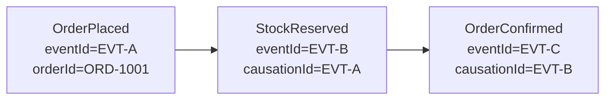
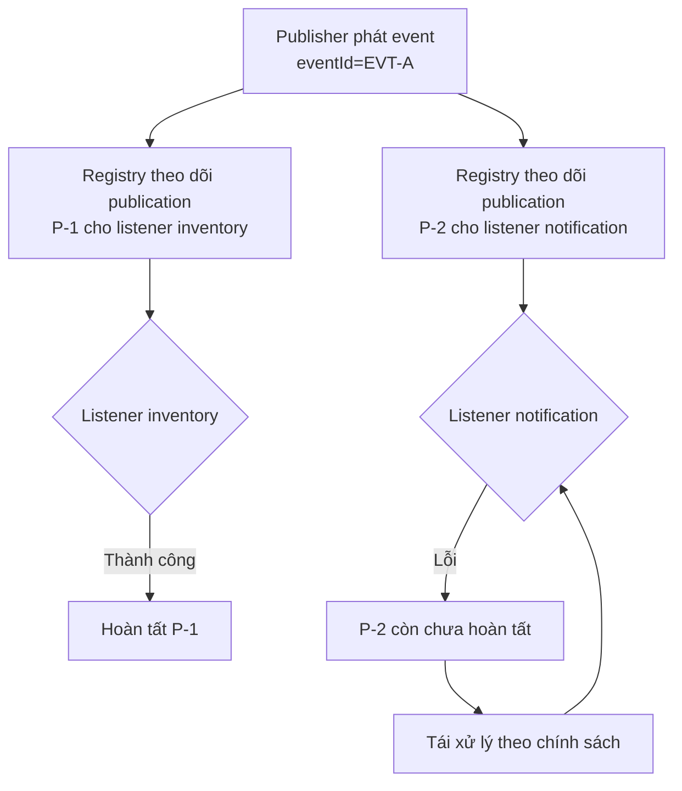

# Định danh event trong thiết kế Spring Modulith

## 1. Vì sao phải định danh sự kiện?

Trong kiến trúc theo module, một **domain event** thông báo rằng một sự thật nghiệp vụ đã xảy ra: `OrderPlaced`, `StockReserved`, `PaymentCaptured` hoặc `OrderConfirmed`. Spring Modulith cho phép các application module giao tiếp qua Spring application events để giảm phụ thuộc trực tiếp vào service và repository của nhau. Tuy nhiên, nếu chỉ gửi nội dung “đơn hàng đã được đặt” mà không có định danh rõ ràng, các module nhận sẽ khó trả lời:

- Đây là **lần xảy ra nào** của `OrderPlaced`, hay là bản gửi lại của một lần trước?
- Các sự kiện `OrderPlaced → StockReserved → OrderConfirmed` có thuộc cùng một luồng đặt hàng không?
- Sự kiện `StockReserved` được tạo **do** `OrderPlaced` nào?
- Khi listener thất bại rồi retry, thao tác giữ kho đã thực hiện hay chưa?
- Khi quan sát Event Publication Registry, một bản ghi publication liên quan đến sự kiện nghiệp vụ nào?

**Định danh event** là thiết kế các khóa nhận diện và mối quan hệ giữa sự kiện, đối tượng nghiệp vụ, yêu cầu khởi phát và chuỗi nguyên nhân. Định danh đúng giúp truy vết, kiểm thử, phát hiện xử lý trùng và phục hồi sau lỗi. Đây là một phần quan trọng trong module **SPRING_MODULITH_APPLICATION_EVENTS**, vốn tập trung vào publisher, listener, xử lý sau commit, registry, retry và giao tiếp đáng tin cậy giữa các module.

Một nguyên tắc nền tảng: **ID của sự kiện không đồng nghĩa ID của đối tượng nghiệp vụ**. Một đơn hàng có thể trải qua nhiều sự kiện khác nhau; cùng một sự kiện có thể được nhiều listener xử lý hoặc xử lý lại.

## 2. Bốn định danh cần phân biệt

Hãy xét đơn hàng `ORD-1001`: người dùng đặt đơn, module tồn kho giữ hàng, module đơn hàng xác nhận. Các ID phục vụ những mục đích khác nhau:

| Trường | Nhận diện | Thay đổi khi nào? | Dùng để |
| --- | --- | --- | --- |
| `eventId` | **Một lần xảy ra** của sự kiện cụ thể | Mỗi sự kiện nghiệp vụ mới | Nhận biết sự kiện trùng, log, đối soát |
| `aggregateId` / `orderId` | **Đối tượng nghiệp vụ** chịu tác động | Giữ nguyên trong vòng đời đối tượng | Tải trạng thái, ràng buộc bất biến, nhóm dữ liệu |
| `correlationId` | **Toàn bộ luồng** hoặc yêu cầu nghiệp vụ liên quan | Thường giữ nguyên qua các bước trong cùng workflow | Ghép log, trace nghiệp vụ, đo thời gian end-to-end |
| `causationId` | **Sự kiện hoặc command trực tiếp gây ra** sự kiện hiện tại | Trỏ đến bước ngay trước; có thể rỗng ở sự kiện gốc | Truy vết quan hệ nguyên nhân–kết quả |

Ví dụ một luồng:

```text
Lần tiếp nhận đơn:
    orderId       = ORD-1001
    eventType     = OrderPlaced
    eventId       = EVT-A
    correlationId = FLOW-91
    causationId   = null       (sự kiện gốc)

Khi giữ hàng thành công:
    orderId       = ORD-1001
    eventType     = StockReserved
    eventId       = EVT-B
    correlationId = FLOW-91
    causationId   = EVT-A

Khi đơn được xác nhận:
    orderId       = ORD-1001
    eventType     = OrderConfirmed
    eventId       = EVT-C
    correlationId = FLOW-91
    causationId   = EVT-B
```

`EVT-A`, `EVT-B`, `EVT-C` là nhãn minh họa; ứng dụng thực tế có thể dùng UUID. Có **ba sự kiện khác nhau** cùng tham chiếu **một đơn hàng** và **một luồng nghiệp vụ**. Nếu listener nhận lại `EVT-A`, việc giao lại vẫn mang `eventId = EVT-A`; nó không trở thành lần đặt hàng mới chỉ vì được xử lý thêm một lượt.



Ở cả ba sự kiện, `correlationId` đều là `FLOW-91`. **Correlation** trả lời “cùng quy trình nào?”, còn **causation** trả lời “bước nào trực tiếp gây ra bước này?”.

### 2.1. Phân biệt event ID và loại sự kiện

`OrderPlaced` là **event type**: tên của một loại sự thật nghiệp vụ. `eventId` là định danh của **một instance** thuộc loại đó. Hai khách hàng đặt hai đơn khác nhau có thể tạo hai đối tượng `OrderPlaced` với hai `eventId` riêng. Ngay cả cùng một đơn, nếu nghiệp vụ cho phép một cột mốc xảy ra nhiều lần, mỗi lần thực sự xảy ra cũng cần ID riêng.

Không nên dùng tên class `OrderPlaced` hoặc chuỗi `"OrderPlaced"` làm khóa chống xử lý trùng, vì nó khiến mọi instance thuộc loại này bị gộp thành một.

### 2.2. Phân biệt event ID và business ID

`orderId` trả lời “đơn nào?”, còn `eventId` trả lời “sự kiện nào?”. Ví dụ, `OrderPlaced`, `OrderConfirmed`, `OrderCancelled` đều có thể mang cùng `orderId` nhưng không có cùng `eventId`.

Trong bài toán chống gửi trùng email xác nhận, **khóa nghiệp vụ** `(orderId, notificationType)` đôi khi quan trọng hơn `eventId`. Hai event khác ID vẫn có thể dẫn đến cùng một hiệu ứng không được lặp. Vì vậy, chống xử lý trùng event và bảo vệ bất biến nghiệp vụ là **hai lớp kiểm soát khác nhau**.

## 3. Thiết kế hợp đồng event mang định danh

Một domain event Java nên là dữ liệu bất biến, có ý nghĩa nghiệp vụ và được công bố từ module sở hữu. Ví dụ module `ordering` phát `OrderPlaced`:

```java
// com/example/shop/ordering/OrderPlaced.java
package com.example.shop.ordering;

import java.time.Instant;
import java.util.UUID;

public record OrderPlaced(
        UUID eventId,
        UUID orderId,
        UUID productId,
        int quantity,
        UUID correlationId,
        UUID causationId,
        Instant occurredAt) {

    public OrderPlaced {
        if (eventId == null || orderId == null || productId == null
                || correlationId == null || occurredAt == null) {
            throw new IllegalArgumentException("Missing event identity or data");
        }
        if (quantity <= 0) {
            throw new IllegalArgumentException("Quantity must be positive");
        }
    }
}
```

Kiểu `record` giúp các trường không thể gán lại sau khi tạo đối tượng; phần constructor kiểm tra những trường bắt buộc. `causationId` được cho phép `null` khi đây là sự kiện gốc. Trong hệ thống có phân biệt ID của **command** với ID của event, `causationId` ở event gốc cũng có thể tham chiếu command ID nếu hợp đồng quy định như vậy. Cần chọn và ghi rõ một quy ước nhất quán.

Không phải event nào cũng bắt buộc mang cả bốn loại ID. Với một ứng dụng rất nhỏ, `eventId` và khóa đối tượng nghiệp vụ có thể đủ. Khi nhiều module phản ứng bất đồng bộ, cần kiểm soát retry hoặc điều tra quy trình đa bước, `correlationId` và `causationId` trở nên hữu ích. Tránh biến metadata thành danh sách trường không có ai quản lý hoặc dùng đến.

### 3.1. Mô hình metadata riêng khi nhiều event chia sẻ định dạng

Khi nhiều event dùng cùng hệ định danh, có thể nhóm những giá trị chung vào value object bất biến:

```java
package com.example.shop.eventcontract;

import java.time.Instant;
import java.util.UUID;

public record EventMetadata(
        UUID eventId,
        UUID correlationId,
        UUID causationId,
        Instant occurredAt) {

    public static EventMetadata root(UUID workflowId) {
        return new EventMetadata(UUID.randomUUID(), workflowId, null,
                Instant.now());
    }

    public static EventMetadata causedBy(EventMetadata previous) {
        return new EventMetadata(UUID.randomUUID(),
                previous.correlationId(), previous.eventId(), Instant.now());
    }
}
```

Trong ví dụ, `eventcontract` là module hợp đồng công khai mà các module khác **được phép** phụ thuộc; không nên đặt `EventMetadata` ở `ordering.internal` rồi cho module `inventory` import. Cũng không cần tạo một module chia sẻ chỉ cho một DTO nếu số lượng event còn ít. Cần kiểm tra hướng phụ thuộc thực tế bằng công cụ kiến trúc của Spring Modulith.

`EventMetadata.causedBy(previous)` minh họa cách một sự kiện phản hồi có ID mới nhưng giữ correlation ID của chuỗi trước và chỉ ra nguồn gây ra trực tiếp. Nó không tự động truyền metadata giữa các thread hay listener: bên xử lý phải lấy ID từ event nguồn và truyền vào event mới.

### 3.2. Không nhét entity hoặc thông tin nhạy cảm vào ID

ID của event và correlation nên là mã **opaque**: consumer không cần suy đoán trạng thái, địa chỉ email, số thẻ hay định danh bí mật từ cấu trúc chuỗi. Payload chứa ID nghiệp vụ chỉ khi consumer có lý do sử dụng.

Không truyền JPA entity hoặc proxy Hibernate trong event để thay cho khóa đối tượng; điều đó làm rò rỉ chi tiết module, có thể gây lỗi truy cập dữ liệu lazy sau commit và khó serialization khi dùng registry bền vững.

## 4. Tạo event ID ở đâu và khi nào?

`eventId` nên được tạo **khi một sự thật nghiệp vụ mới được xác lập**. Bên chịu trách nhiệm phát sự kiện là bên chịu trách nhiệm gán ID đó; listener chỉ tiếp nhận và sử dụng, không tự thay bằng ID mới cho event đang xử lý.

Một quy trình hợp lý:

1. Nhận command và xác minh điều kiện nghiệp vụ.
2. Xác định việc chuyển trạng thái có thật sự xảy ra hay không.
3. Tạo event cùng `eventId` mới cho lần xảy ra đó.
4. Phát event trong transaction của publisher.
5. Listener sau commit tiếp nhận đúng event và ID được lưu/truyền đến nó.

Nếu transaction rollback, lần phát đó chưa tạo ra một cột mốc đã commit để consumer sau commit xử lý. Lần thử hợp lệ tiếp theo có thể tạo event mới. Điều quan trọng là **một cột mốc đã commit không bị biến thành nhiều event nghiệp vụ** chỉ vì HTTP request hoặc message bị gửi lại.

### 4.1. UUID, UUID có thứ tự thời gian và khóa tự sinh

| Cách định danh | Ưu điểm | Điểm cần cân nhắc |
| --- | --- | --- |
| UUID ngẫu nhiên, ví dụ `UUID.randomUUID()` | Dễ tạo độc lập giữa các module, xác suất va chạm cực thấp | Không mang thứ tự thời gian đáng tin cậy |
| UUIDv7/ULID khi thư viện và hệ thống hỗ trợ | Có đặc tính sắp xếp gần theo thời gian, hữu ích cho lưu trữ/log | Không được coi ID là timestamp chuẩn hoặc thứ tự commit tuyệt đối |
| Sequence/identity từ database | Đơn giản trong một cơ sở dữ liệu quản lý tập trung | Phải lấy ID từ nơi cấp phát; khó duy trì duy nhất khi dữ liệu tách hệ thống |
| Khóa kết hợp từ dữ liệu nghiệp vụ | Hữu ích cho quy tắc chống lặp một hiệu ứng cụ thể | Không thể thay thế event ID khi cùng nghiệp vụ có nhiều lần xảy ra hợp lệ |

UUID ngẫu nhiên là lựa chọn thực dụng cho đa số ví dụ Spring Modulith. Nếu cần biết thứ tự nghiệp vụ, dùng **thứ tự trạng thái, version của aggregate hoặc timestamp được quản lý phù hợp**; không suy ra thứ tự commit từ chuỗi UUID ngẫu nhiên. Ngay cả UUID có tính thời gian cũng không tự bảo đảm thứ tự khi xử lý bất đồng bộ qua nhiều listener.

### 4.2. Vì sao không tự tạo ID mới ở listener?

Sai về ngữ nghĩa:

```java
@ApplicationModuleListener
void on(OrderPlaced event) {
    UUID eventId = UUID.randomUUID(); // Sai nếu định dùng làm ID event nguồn
    process(eventId, event.orderId());
}
```

Mỗi lần retry sẽ sinh ID khác, nên consumer không nhận ra cùng một event nguồn. Đúng hơn:

```java
@ApplicationModuleListener
void on(OrderPlaced event) {
    process(event.eventId(), event.orderId());
}
```

Nếu listener phát **một event kết quả mới**, chẳng hạn `StockReserved`, lúc đó nó tạo **eventId mới cho `StockReserved`**, đặt `causationId = event.eventId()` và kế thừa `correlationId`. Đây là một cột mốc nghiệp vụ khác, không phải đổi ID của `OrderPlaced`.

## 5. Phân biệt retry command, phát lại event và sự kiện mới

Ba tình huống sau thường bị nhầm lẫn:

| Tình huống | `commandId` | `eventId` | Hành vi kỳ vọng |
| --- | --- | --- | --- |
| Người dùng đặt đơn mới | ID command mới | ID event mới nếu tạo đơn thành công | Tạo một đơn và một sự kiện tương ứng |
| Client retry cùng yêu cầu đã thành công | Giữ nguyên ID command | Không tạo `OrderPlaced` mới | Trả kết quả lần đầu; tránh tạo đơn mới |
| Listener xử lý lại publication chưa hoàn tất | Không liên quan trực tiếp | **Giữ nguyên ID của event nguồn** | Hoàn tất an toàn, không áp dụng tác động trùng |
| Một hành vi nghiệp vụ mới xảy ra với cùng đơn | ID command khác nếu có | ID event mới | Ví dụ `OrderConfirmed` sau `OrderPlaced` |

**`commandId`** hoặc **idempotency key của request** nhận diện yêu cầu logic từ client. **`eventId`** nhận diện sự kiện phát sinh từ thay đổi nghiệp vụ được chấp nhận. Nếu request thành công nhưng client mất kết nối rồi retry, hệ thống phải xác định đó là **cùng command** để không tạo ra đơn và event trùng.

Định danh event chỉ giải quyết một phần vấn đề này. Cần một ràng buộc nghiệp vụ hoặc cơ chế idempotency ở command handler.

### 5.1. Publisher tránh phát event mới khi client gửi lại request

```java
// com/example/shop/ordering/PlaceOrder.java
package com.example.shop.ordering;

import java.util.UUID;

public record PlaceOrder(
        UUID commandId,
        UUID productId,
        int quantity) {}
```

```java
// com/example/shop/ordering/internal/OrderingService.java
package com.example.shop.ordering.internal;

import com.example.shop.ordering.OrderPlaced;
import com.example.shop.ordering.PlaceOrder;
import java.time.Instant;
import java.util.UUID;
import org.springframework.context.ApplicationEventPublisher;
import org.springframework.stereotype.Service;
import org.springframework.transaction.annotation.Transactional;

@Service
class OrderingService {

    private final OrderRepository orders;
    private final ApplicationEventPublisher events;

    OrderingService(OrderRepository orders,
                    ApplicationEventPublisher events) {
        this.orders = orders;
        this.events = events;
    }

    @Transactional
    public UUID place(PlaceOrder command) {
        // createIfAbsent phải chống tranh chấp theo commandId trong database.
        CreationResult result = orders.createIfAbsent(
                command.commandId(), command.productId(), command.quantity());

        if (result.newlyCreated()) {
            events.publishEvent(new OrderPlaced(
                    UUID.randomUUID(),
                    result.orderId(),
                    command.productId(),
                    command.quantity(),
                    command.commandId(),  // correlationId của luồng này
                    null,                 // sự kiện gốc, không có event gây ra
                    Instant.now()));
        }

        return result.orderId();
    }
}
```

`OrderRepository` và `CreationResult` trong ví dụ là các kiểu **nội bộ cần được triển khai thêm**. Phương thức `createIfAbsent` phải dựa vào khóa duy nhất trên `commandId` và được bảo vệ khi hai request cạnh tranh. Không thể chỉ `SELECT` kiểm tra rồi `INSERT` mà không có cơ chế khóa/ràng buộc dữ liệu.

Một request mới với cùng `commandId` nhưng payload khác phải bị từ chối hoặc xử lý theo chính sách rõ ràng; không được ngầm trả kết quả của một lệnh khác. Khi command đã thành công, lần retry không phát `OrderPlaced` mới vì `newlyCreated() == false`.

Đoạn mã tập trung vào **định danh**: chưa cung cấp schema repository, validation đầy đủ, xử lý concurrent insert hoặc logic khác. Khi triển khai thực tế, các bước tạo đơn và phát sự kiện cần nằm trong transaction phù hợp; với cơ chế registry bền vững phải kiểm tra cấu hình lưu publication cùng ranh giới giao dịch.

## 6. Bảo toàn correlation ID và causation ID qua các module

Giả sử `ordering` phát `OrderPlaced`; `inventory` xử lý và công bố `StockReserved`.

```java
// com/example/shop/inventory/StockReserved.java
package com.example.shop.inventory;

import java.time.Instant;
import java.util.UUID;

public record StockReserved(
        UUID eventId,
        UUID orderId,
        UUID correlationId,
        UUID causationId,
        Instant occurredAt) {}
```

Khi sự kiện `OrderPlaced` đã được xử lý thành công:

```java
StockReserved reserved = new StockReserved(
        UUID.randomUUID(),     // eventId mới cho StockReserved
        placed.orderId(),      // cùng đối tượng nghiệp vụ
        placed.correlationId(),// giữ nguyên ID của workflow
        placed.eventId(),      // OrderPlaced gây ra StockReserved
        Instant.now());

publisher.publishEvent(reserved);
```

`placed` là event `OrderPlaced` nguồn do listener nhận, còn `publisher` là `ApplicationEventPublisher` được inject vào module `inventory`.

Nếu `fulfillment` tiếp tục tạo `OrderConfirmed` từ `StockReserved`, `OrderConfirmed.causationId` phải trỏ đến **`StockReserved.eventId`**, không trỏ ngược mọi lần về `OrderPlaced.eventId`. Khi muốn biết cả chuỗi thuộc cùng hành trình đặt hàng, dùng `correlationId`.

Điều này tạo thành đồ thị nguyên nhân rõ ràng, giúp phân biệt:

- **Một–nhiều:** một `OrderPlaced` có thể kích hoạt `StockReserved` và một phản ứng phân tích dữ liệu độc lập.
- **Nhiều–một:** một bước cuối có thể phụ thuộc nhiều điều kiện nghiệp vụ; khi đó chỉ một `causationId` có thể chưa đủ để biểu diễn mọi nguyên nhân, cần mô hình quan hệ hoặc metadata bổ sung.
- **Chuỗi dài:** `correlationId` nối tất cả bước, `causationId` mô tả quan hệ trực tiếp.

Không nên tin rằng các ID này tự động được Spring truyền xuyên các luồng bất đồng bộ. Chúng là **dữ liệu trong event contract** do ứng dụng chủ động tạo và chuyển tiếp. Mã trace/span của hệ thống observability có thể tồn tại đồng thời nhưng là khái niệm khác.

## 7. Event ID, publication ID và Event Publication Registry

Đây là sự khác biệt quan trọng trong Spring Modulith.

**`eventId`** trong record `OrderPlaced` là định danh **nghiệp vụ do ứng dụng thiết kế**. Trong khi đó, **Event Publication Registry** theo dõi các **publication** của event dành cho các transactional event listener. Một event có thể được phân phối tới nhiều listener và tạo nhiều bản ghi theo dõi publication riêng.

```text
OrderPlaced
  eventId = EVT-A
       |
       +--> listener inventory       --> publication P-1
       |
       +--> listener notification    --> publication P-2
       |
       +--> listener analytics       --> publication P-3
```

| ID / khóa | Ai định nghĩa hoặc quản lý? | Đơn vị được nhận diện |
| --- | --- | --- |
| `eventId` trong payload | Ứng dụng/module phát | Một sự thật nghiệp vụ được công bố |
| ID nội bộ của publication | Cơ chế Event Publication Registry | Một bản ghi giao event cho listener |
| ID của consumer/listener | Hợp đồng hoặc hệ thống listener | Bên đang xử lý publication |
| `(consumer, eventId)` | Ứng dụng consumer | Một lần áp dụng tác động của một event tại consumer |

**Không giả định ID của publication chính là `eventId`** hoặc có thể dùng trực tiếp làm khóa idempotency nghiệp vụ. Cấu trúc và lưu trữ publication phụ thuộc implementation/phiên bản Spring Modulith; không cần gắn logic nghiệp vụ với schema nội bộ của registry.

Khi có registry được cấu hình với triển khai lưu trữ bền vững thích hợp, quá trình khái quát:



Listener có thể thành công/không thành công độc lập nhau. Registry hỗ trợ nhận diện publication còn dang dở để phục vụ quan sát và tái xử lý. Cách tự động resubmit, retry, lịch chạy và chính sách giới hạn phụ thuộc cấu hình và phiên bản đang dùng; **không tự động suy ra “exactly once” từ việc có registry**.

Nếu publication được gửi lại sau lỗi, consumer phải giữ ngữ nghĩa **cùng event nguồn**, tức dùng lại `eventId` đã được payload mang theo. Khi xử lý thành công, hệ thống ghi nhận publication hoàn tất theo cơ chế registry, còn ràng buộc chống trùng trong database nghiệp vụ vẫn thuộc trách nhiệm consumer.

## 8. Idempotency: event ID cần đi cùng khóa nghiệp vụ

**Idempotent** nghĩa là áp dụng cùng một thao tác nhiều lần vẫn cho kết quả nghiệp vụ phù hợp như thực hiện một lần. Định danh event giúp nhận biết một event bị giao lặp, nhưng **một event ID duy nhất không đủ ngăn mọi tác động trùng**.

Có hai trường hợp cần bảo vệ riêng:

1. **Cùng event giao lại:** `OrderPlaced(eventId=A, orderId=1001)` được xử lý hai lượt. Consumer nên phát hiện `(consumerName, A)` đã hoàn tất.
2. **Hai event khác ID nhưng cùng hiệu ứng:** `OrderPlaced(eventId=A, orderId=1001)` và `OrderPlaced(eventId=B, orderId=1001)` có thể do publisher tạo trùng. Dù `A ≠ B`, module tồn kho không được trừ hàng hai lần cho đơn `1001`.

Vì vậy nên kết hợp:

- **Chống xử lý lặp theo event:** unique `(consumerName, eventId)`.
- **Bảo vệ bất biến nghiệp vụ:** unique hoặc điều kiện cập nhật theo `orderId`, `paymentId`, `invoiceId`, v.v.

### 8.1. Ví dụ inbox lưu ID event đã xử lý

Với PostgreSQL, có thể tạo bảng:

```sql
CREATE TABLE consumed_event (
    consumer_name VARCHAR(120) NOT NULL,
    event_id UUID NOT NULL,
    processed_at TIMESTAMPTZ NOT NULL DEFAULT CURRENT_TIMESTAMP,
    PRIMARY KEY (consumer_name, event_id)
);
```

Một repository dùng `JdbcTemplate` để đăng ký việc xử lý:

```java
// inventory/internal/ConsumedEventRepository.java
package com.example.shop.inventory.internal;

import java.util.UUID;
import org.springframework.jdbc.core.JdbcTemplate;
import org.springframework.stereotype.Repository;

@Repository
class ConsumedEventRepository {

    private final JdbcTemplate jdbc;

    ConsumedEventRepository(JdbcTemplate jdbc) {
        this.jdbc = jdbc;
    }

    boolean registerOnce(String consumerName, UUID eventId) {
        int inserted = jdbc.update("""
                INSERT INTO consumed_event (consumer_name, event_id)
                VALUES (?, ?)
                ON CONFLICT (consumer_name, event_id) DO NOTHING
                """, consumerName, eventId);
        return inserted == 1;
    }
}
```

`ON CONFLICT DO NOTHING` là cú pháp PostgreSQL; với database khác cần cách upsert tương đương. Repository phải chạy **trong cùng transaction** với thay đổi nghiệp vụ mà consumer thực hiện. Nếu thao tác nghiệp vụ thất bại và transaction rollback, dấu đã xử lý cũng rollback để lần retry sau không bị bỏ qua sai.

### 8.2. Listener dùng cả event ID và khóa đơn hàng

```java
// inventory/internal/OrderPlacedListener.java
package com.example.shop.inventory.internal;

import com.example.shop.ordering.OrderPlaced;
import org.springframework.modulith.events.ApplicationModuleListener;
import org.springframework.stereotype.Component;

@Component
class OrderPlacedListener {

    private final ConsumedEventRepository consumed;
    private final StockReservations stock;

    OrderPlacedListener(ConsumedEventRepository consumed,
                        StockReservations stock) {
        this.consumed = consumed;
        this.stock = stock;
    }

    @ApplicationModuleListener
    void on(OrderPlaced event) {
        if (!consumed.registerOnce("inventory.OrderPlaced", event.eventId())) {
            return; // Event này đã được xử lý thành công trước đó.
        }

        // reserveOnce cần chống giữ/trừ tồn kho trùng theo orderId.
        // Cả registerOnce và reserveOnce phải dùng cùng transaction.
        stock.reserveOnce(event.orderId(),
                          event.productId(),
                          event.quantity());
    }
}
```

`StockReservations` là thành phần nghiệp vụ nội bộ cần được triển khai. `reserveOnce` cần xử lý thiếu tồn kho thành kết quả nghiệp vụ thích hợp (`StockReservationRejected`) và không tự giảm số lượng tồn kho hai lần. Nếu phát event kết quả, event phải nằm trong transaction cập nhật tồn kho phù hợp và có ID mới, correlation ID kế thừa từ event nguồn.

`@ApplicationModuleListener` trong Spring Modulith kết hợp cơ chế transactional listener bất đồng bộ với giao dịch riêng. Ví dụ này dựa vào cùng transaction dành cho listener; không được để `registerOnce` tự commit riêng trước khi `reserveOnce` bắt đầu.

**Tình huống cần lưu ý:** nếu `stock.reserveOnce(...)` gọi hệ thống ngoài như dịch vụ email hoặc cổng thanh toán, transaction JDBC không thể tự rollback hành động đã xảy ra bên ngoài. Cần thiết kế idempotency key cho API đích, outbox hoặc quy trình phục hồi phù hợp. Không dựa riêng vào `consumed_event` để tuyên bố giao tác end-to-end exactly once.

## 9. ID bền vững qua transaction và khi xử lý lại

Một quy tắc đáng kiểm tra là **ID phải ổn định trong các bản sao hoặc lượt xử lý cùng sự kiện**. Cụ thể:

- Tạo event với ID tại publisher, rồi lưu/truyền payload ấy; đừng tạo ID lại khi serialize, log hoặc dispatch.
- Khi listener thất bại và publication được tái xử lý, dùng `eventId` **của event gốc**.
- Nếu producer thật sự tạo **event mới**, nó nhận ID mới; đừng tái sử dụng ID cũ cho một sự thật khác.
- Nếu cần tồn tại qua khởi động lại, bảo đảm định dạng payload và cách deserialize có thể khôi phục ID sau khi ứng dụng nâng phiên bản.
- Không xây hệ thống phụ thuộc vào việc event được nhận đúng thứ tự chỉ nhờ ID tăng dần.

Ví dụ timeline:

```text
T0: TX đặt đơn phát OrderPlaced(eventId=A).
T1: TX đặt đơn commit.
T2: Listener nhận A, ghi tồn kho rồi gặp lỗi kỹ thuật.
T3: TX listener rollback; publication của A chưa hoàn tất.
T4: Sau phục hồi, listener được gọi lại với A.
T5: Consumer áp dụng một lần và publication được đánh dấu hoàn tất.
```

Nếu TX ở T2 thực sự rollback, thay đổi database cùng transaction cũng rollback. Nếu một thao tác bên ngoài đã thành công trước lỗi, retry có thể gặp hiệu ứng đã xảy ra; lúc này idempotency của **hệ thống bên ngoài** hoặc hành vi đối soát mới giải quyết được tính đúng đắn.

Trường hợp **consumer đã commit xong nhưng registry chưa đánh dấu hoàn tất** cũng có thể khiến event được gọi lại. Do đó, ứng dụng không thể bỏ qua idempotency chỉ vì listener có transaction riêng hoặc registry có lưu bền vững.

## 10. Định danh và thời điểm của event không phải một

Một event có thể có nhiều mốc thời gian:

| Trường / mốc | Ý nghĩa |
| --- | --- |
| `occurredAt` | Thời điểm publisher xác lập event trong xử lý nghiệp vụ |
| Thời điểm commit | Khi transaction gốc hoàn tất thành công |
| Thời điểm publication được đăng ký | Khi cơ chế giao nhận theo dõi event cho listener |
| `receivedAt` | Khi consumer bắt đầu nhận/xử lý |
| `processedAt` | Khi consumer ghi nhận đã xử lý thành công |

Không thể dùng `occurredAt` thay thế `eventId` để phân biệt event, vì hai event có thể có cùng timestamp ở độ phân giải ghi nhận hoặc đồng hồ các máy khác nhau có thể lệch nhau.

`eventId` cũng không bảo đảm thứ tự nghiệp vụ. Khi cần biết sự kiện nào là bản mới nhất của một aggregate, có thể kèm `aggregateVersion` được tăng có kiểm soát:

```java
public record OrderStatusChanged(
        UUID eventId,
        UUID orderId,
        long aggregateVersion,
        String newStatus) {}
```

Ví dụ `aggregateVersion = 5` là một dữ liệu nghiệp vụ riêng, **không phải** kết quả được tính từ `eventId`. Nếu consumer cần phát hiện event nhận ngoài thứ tự, nó phải giữ và kiểm tra version theo chính sách phù hợp. Thêm version không tự động khiến các listener bất đồng bộ thực thi theo thứ tự phát.

## 11. Correlation ID, tracing và bảo mật dữ liệu

**Correlation ID nghiệp vụ** và **trace ID kỹ thuật** liên quan nhưng không giống nhau:

| Khía cạnh | Correlation ID | Trace ID |
| --- | --- | --- |
| Phạm vi điển hình | Một workflow kéo dài, có thể qua nhiều giao dịch và retry | Một trace quan sát các thao tác được instrument |
| Được tạo/quản lý bởi | Quy ước/hợp đồng của ứng dụng | Hạ tầng tracing, ví dụ Micrometer Tracing/OpenTelemetry |
| Truyền vào event | Chủ động qua payload/metadata | Cần instrumentation/context propagation |
| Dùng để | Tìm tất cả bước của cùng nghiệp vụ | Phân tích độ trễ, span và quan hệ gọi kỹ thuật |

Khi listener chạy bất đồng bộ, thread-local MDC hoặc tracing context của publisher không được bảo đảm tự tồn tại nguyên vẹn ở thread listener trong mọi cấu hình. Truyền `correlationId` như một trường event khiến việc đối chiếu nghiệp vụ rõ ràng hơn; tracing context cần được truyền theo cơ chế được framework và instrumentation hỗ trợ.

Ví dụ log khi listener xử lý:

```json
{
  "module": "inventory",
  "eventType": "OrderPlaced",
  "eventId": "0ec5d69e-dfaf-4361-9a44-70e7e997de36",
  "orderId": "289b85bf-fbed-42ce-a5ad-4f9f211aec20",
  "correlationId": "915df36d-cb92-461b-a17a-e57aa3b3f35f",
  "consumer": "inventory.OrderPlaced",
  "outcome": "RESERVED"
}
```

ID giúp tìm được các bản ghi liên quan mà không cần đưa toàn bộ payload vào log. Tránh mã hóa địa chỉ email, số điện thoại, token hoặc dữ liệu nhạy cảm vào correlation ID. Cũng không mặc định rằng có ID là đã có đủ dashboard/metric; cần cấu hình logging và observability.

## 12. Tiến hóa event contract mà vẫn giữ định danh

Khi bổ sung trường vào `OrderPlaced`, logic nghiệp vụ và event ID phải vẫn có ý nghĩa ổn định. Một số lưu ý:

1. **Không đổi nghĩa `eventId` giữa các phiên bản.** Nếu ban đầu nó là ID của lần xảy ra, đừng chuyển thành `orderId` chỉ vì thuận tiện.
2. **Giữ quan hệ nguồn–đích.** Consumer phát event mới vẫn dùng `causationId` trỏ đến ID sự kiện nguồn đã gây ra nó.
3. **Đảm bảo publication chưa hoàn tất đọc được.** Khi registry lưu payload bền vững, nâng phiên bản class/serializer cần đánh giá bản ghi cũ còn trong lưu trữ.
4. **Không tái sử dụng ID của event cũ cho một event thay thế có nghĩa khác.** Khi cột mốc mới xảy ra, tạo ID mới và liên hệ bằng metadata.
5. **Đặt ownership rõ ràng.** Module phát sở hữu semantic contract; module nhận không tự ý “sửa” event để khớp mô hình nội bộ của mình.

Với giao tiếp nội bộ một lần build, thay đổi kiểu Java có thể được trình biên dịch phát hiện. Nhưng khi dữ liệu được lưu cho retry hoặc truyền qua broker, tương thích serialization và version hóa cần được quản lý rõ. Định danh ổn định là điều kiện cần để đối soát, **không thay thế** thiết kế phiên bản hợp đồng.

## 13. Những sai lầm thường gặp

| Sai lầm | Vì sao sai? | Cách xử lý |
| --- | --- | --- |
| Dùng `orderId` làm `eventId` của mọi event | Nhiều cột mốc khác nhau của cùng đơn bị nhập làm một | Mỗi lần xảy ra có `eventId` riêng; giữ `orderId` riêng |
| Tạo UUID mới mỗi lần listener nhận lại | Retry bị hiểu thành event khác | Dùng `event.eventId()` từ publisher |
| Chỉ dedup bằng `eventId` khi thao tác có thể trùng business effect | Hai event khác ID vẫn có thể trừ hàng hai lần | Bảo vệ thêm `orderId`/khóa nghiệp vụ |
| Dùng một ID cho correlation và causation ở mọi bước | Mất quan hệ nguyên nhân trực tiếp | Correlation giữ nguyên; causation trỏ tới event nguồn gần nhất |
| Cho rằng UUID cung cấp thứ tự commit | Thứ tự ID không phản ánh chắc chắn thứ tự xử lý | Dùng version, trạng thái và quy tắc ordering phù hợp |
| Coi publication ID của registry là domain event ID | Registry theo dõi từng publication/listener | Phân biệt identity tầng nghiệp vụ và tầng giao nhận |
| Bỏ qua retry vì dùng `@ApplicationModuleListener` | Sau commit và bất đồng bộ không loại trừ lỗi | Registry, retry policy, idempotency và giám sát |
| Ghi inbox ID ở transaction khác với cập nhật nghiệp vụ | Có thể đánh dấu thành công khi tác động chưa hoàn tất | Cùng transaction với thay đổi local |
| Nhét toàn bộ entity vào event | Rò rỉ nội bộ, lỗi persistence và serialization | Event payload bất biến, tối thiểu, dùng public contract |
| Dùng `occurredAt` làm khóa duy nhất | Timestamp không đủ bảo đảm duy nhất | Dùng event ID thực sự |

## 14. Chiến lược kiểm thử định danh event

Kiểm thử nên xác minh không chỉ việc **có** event, mà cả **đúng ID và đúng quan hệ** giữa các bước.

| Tình huống kiểm thử | Kỳ vọng |
| --- | --- |
| Hai đơn mới được đặt | Hai `eventId` khác nhau; `orderId` đúng từng đơn |
| Cùng command được gửi lại sau khi commit | Không sinh thêm đơn hoặc `OrderPlaced` mới |
| Event gốc `OrderPlaced` | `eventId` không rỗng, `correlationId` có giá trị, `causationId` theo quy ước root |
| Từ `OrderPlaced` phát `StockReserved` | Event ID mới; correlation ID giữ nguyên; causation ID bằng event ID nguồn |
| Listener nhận lại cùng `eventId` | Không giảm tồn kho hoặc áp dụng cùng tác động hai lần |
| Nhận hai event khác ID cho cùng `orderId` | Bất biến nghiệp vụ vẫn giữ; không reserve trùng |
| Listener thất bại giữa transaction | Dấu đã xử lý và cập nhật local rollback cùng nhau |
| Event được xử lý lại từ registry | Payload vẫn giữ ID gốc; kết quả consumer idempotent |
| Nâng phiên bản ứng dụng khi còn publication | Bản ghi event cũ vẫn có thể được đọc/khôi phục hoặc được migration phù hợp |

### 14.1. Kiểm tra quy ước ID ngay ở unit test

Ví dụ kiểm tra một event kết quả có quan hệ nhân quả phù hợp:

```java
import static org.assertj.core.api.Assertions.assertThat;
import java.time.Instant;
import java.util.UUID;
import org.junit.jupiter.api.Test;

class EventIdentityTest {

    @Test
    void reservedEventKeepsCorrelationAndPointsToCause() {
        UUID orderId = UUID.randomUUID();
        UUID flowId = UUID.randomUUID();
        UUID placedEventId = UUID.randomUUID();

        OrderPlaced placed = new OrderPlaced(
                placedEventId, orderId, UUID.randomUUID(), 2,
                flowId, null, Instant.now());

        StockReserved reserved = new StockReserved(
                UUID.randomUUID(), orderId, placed.correlationId(),
                placed.eventId(), Instant.now());

        assertThat(reserved.eventId()).isNotEqualTo(placed.eventId());
        assertThat(reserved.orderId()).isEqualTo(placed.orderId());
        assertThat(reserved.correlationId()).isEqualTo(placed.correlationId());
        assertThat(reserved.causationId()).isEqualTo(placed.eventId());
    }
}
```

Test minh họa giả định import hai record `OrderPlaced` và `StockReserved` từ public API tương ứng. Nó kiểm tra quy ước của các giá trị được tạo; **chưa chứng minh** một workflow thật tự động truyền metadata đúng. Khi triển khai hãy bổ sung integration test gọi publisher và listener thật, kiểm tra ID ở sự kiện thực tế consumer phát ra.

### 14.2. Kiểm thử ranh giới kiến trúc

Spring Modulith có thể xác minh phụ thuộc của application module:

```java
import org.junit.jupiter.api.Test;
import org.springframework.modulith.core.ApplicationModules;

class ModulithArchitectureTest {

    @Test
    void checksModuleBoundaries() {
        ApplicationModules.of(ShopApplication.class).verify();
    }
}
```

Record event dùng giữa các module phải nằm trong API công khai/named interface hợp lệ. Nếu listener của `inventory` import `ordering.internal.OrderRepository` chỉ để lấy ID đơn, cần chỉnh event contract hoặc cung cấp public API thích hợp. Test kiến trúc giúp phát hiện phụ thuộc không mong muốn và vòng phụ thuộc; cần thêm dependencies JUnit/Spring Modulith cho dự án thực tế.

### 14.3. Kiểm thử retry và publication bền vững

Đối với Event Publication Registry, cần kiểm thử bằng cấu hình lưu trữ thật hoặc môi trường kiểm thử tương đương:

1. Transaction publisher commit và tạo publication được theo dõi.
2. Listener ném lỗi có chủ đích; kiểm tra publication vẫn chưa hoàn tất.
3. Tái xử lý theo API/cơ chế được phiên bản Spring Modulith hỗ trợ.
4. Đối chiếu `eventId` trước và sau retry: phải **giữ nguyên**.
5. Kiểm tra tồn kho, đơn hàng hoặc email theo khóa nghiệp vụ: tác động không bị lặp.
6. Sau listener hoàn tất, kiểm tra publication được đánh dấu hoàn tất theo registry.

Không nên chỉ dùng `Thread.sleep(...)` cố định để chờ listener bất đồng bộ; hãy đợi điều kiện có timeout hoặc dùng hỗ trợ test của Spring Modulith, chẳng hạn `@ApplicationModuleTest` và API kịch bản sự kiện theo phiên bản dự án.

## 15. Bài tập thực hành

**Bối cảnh:** Ứng dụng gồm các module `ordering`, `inventory`, `fulfillment` và `notification`. Khi khách đặt đơn thành công, `ordering` phát `OrderPlaced`. `inventory` giữ hàng rồi phát `StockReserved`. `fulfillment` xác nhận đơn và phát `OrderConfirmed`; `notification` gửi xác nhận sau khi trạng thái đơn đã commit.

**Yêu cầu:**

1. Định nghĩa các contract `OrderPlaced`, `StockReserved`, `OrderConfirmed` với `eventId`, `orderId`, `correlationId`, `causationId`, `occurredAt`. Chọn rõ event owner.
2. Tại publisher, tạo `eventId` một lần cho mỗi thay đổi nghiệp vụ thực sự. Sử dụng `commandId` từ request để tránh tạo đơn và event trùng khi client retry.
3. Khi `inventory` phát `StockReserved`, tạo event ID mới, giữ correlation ID và trỏ causation ID đến `OrderPlaced.eventId`.
4. Khi `fulfillment` xử lý `StockReserved`, giữ `correlationId`; khi tạo `OrderConfirmed`, `causationId` phải bằng ID của `StockReserved`.
5. Dùng `@ApplicationModuleListener` cho một bước sau commit, thêm bảng inbox có unique `(consumerName, eventId)` và quy tắc nghiệp vụ chỉ giữ hàng một lần cho `orderId`.
6. Gây lỗi ở listener rồi tái xử lý publication theo cấu hình Event Publication Registry của dự án. Xác minh ID gốc vẫn giữ nguyên.
7. Tạo log có `eventType`, `eventId`, `orderId`, `correlationId`, `causationId`, listener và kết quả để truy vết toàn luồng.
8. Kiểm thử hai event cùng `orderId` nhưng khác `eventId`; việc giữ tồn kho hoặc gửi xác nhận vẫn phải đúng bất biến nghiệp vụ.

**Câu hỏi tự kiểm tra:** Nếu một `OrderPlaced` đã được xử lý thành công bởi `analytics` nhưng thất bại tại `inventory`, có bao nhiêu event nghiệp vụ đã xảy ra và registry cần theo dõi điều gì? Khi retry `inventory`, có tạo `eventId` mới hay không? Nếu hai request trùng cùng tạo ra hai event khác ID cho một `orderId`, lớp kiểm soát nào giúp tránh giữ hàng hai lần?

**Tiêu chí hoàn thành:** Học viên phân biệt được ID của event, aggregate, correlation, causation và publication; xây dựng được record bất biến và code publisher/listener; giữ được ID xuyên retry; kiểm tra idempotency ở cả cấp event và nghiệp vụ; quan sát được một luồng xuyên module.

## 16. Ghi nhớ

Định danh event là nền tảng để tổ chức giao tiếp giữa các module Spring Modulith đáng tin cậy. **`eventId`** xác định một sự kiện đã xảy ra; **`orderId`/aggregate ID** xác định đối tượng nghiệp vụ; **`correlationId`** nối những bước của cùng workflow; **`causationId`** ghi quan hệ nguyên nhân trực tiếp. Event Publication Registry theo dõi publication tới listener nên ID publication không thay thế event ID nghiệp vụ. Khi xử lý sau commit và retry, cần giữ ổn định ID sự kiện nguồn, tạo ID mới cho sự kiện kết quả thực sự, đồng thời kết hợp inbox/dedup với ràng buộc nghiệp vụ, kiểm thử và quan sát để tránh tác động trùng.
