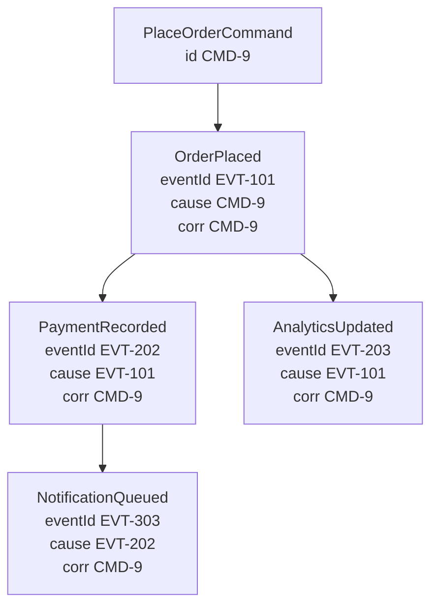
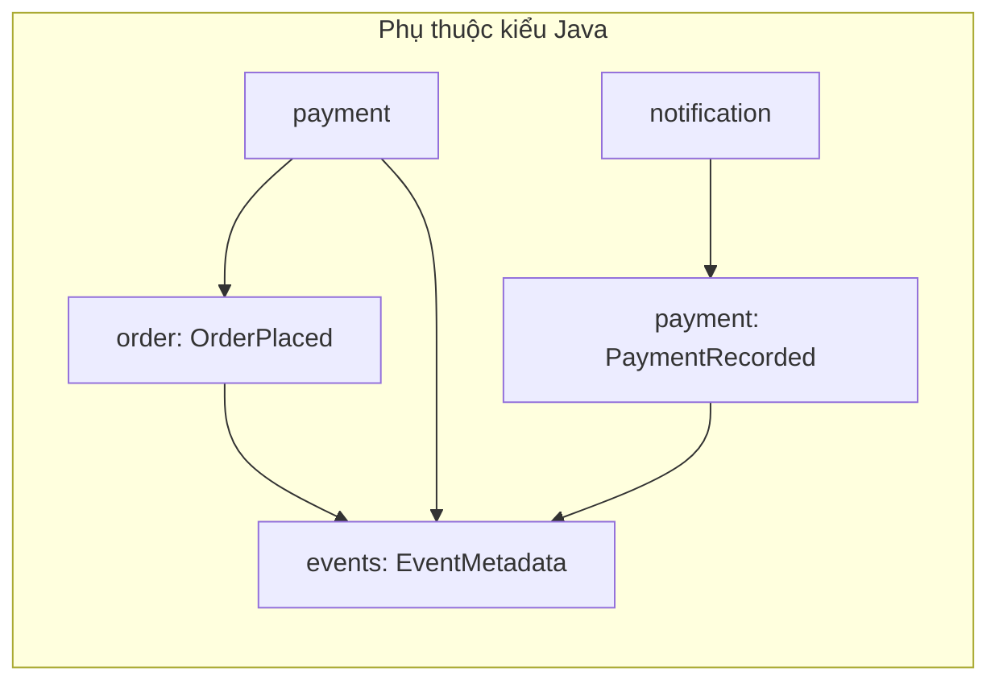
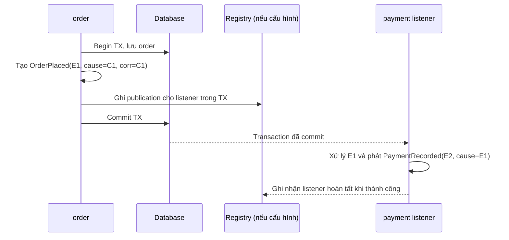

# Causation identifier: xác định nguyên nhân trong chuỗi application events

## 1. Bài toán: sự kiện này được tạo ra vì điều gì?

Giả sử ứng dụng bán hàng được chia thành các module `order`, `payment` và `notification` theo kiến trúc Spring Modulith. Sau khi người dùng xác nhận đơn hàng, hệ thống có thể thực hiện chuỗi xử lý:

1. Module `order` tạo đơn và phát `OrderPlaced`.
2. Module `payment` nhận `OrderPlaced`, ghi nhận việc thanh toán và phát `PaymentRecorded`.
3. Module `notification` nhận `PaymentRecorded` và gửi thông báo cho người dùng.

Khi có lỗi tại bước 3, chỉ biết `paymentId` hoặc thời gian gửi thông báo thường **không đủ** để trả lời: thông báo này đến từ sự kiện thanh toán nào, sự kiện thanh toán ấy do đơn hàng nào kích hoạt, và ban đầu người dùng đã gửi yêu cầu nào?

**Causation identifier** (thường đặt tên `causationId`) là mã tham chiếu đến **nguyên nhân trực tiếp** làm phát sinh một thông điệp hoặc một sự kiện. Bằng cách đưa mã này vào metadata của từng domain event, ta có thể lần ngược chuỗi nguyên nhân, dù các listener chạy bất đồng bộ, xử lý sau commit hoặc được retry.

Bài học thuộc chương **Thiết kế event** của module học **SPRING_MODULITH_APPLICATION_EVENTS**. Trọng tâm là thiết kế hợp đồng event rõ ràng để giao tiếp giữa các module Spring Modulith giảm phụ thuộc nhưng vẫn truy vết được nguyên nhân, phục vụ kiểm thử, quan sát và khôi phục xử lý sự kiện đáng tin cậy.

> `causationId` là **quy ước metadata do ứng dụng thiết kế**. Spring Framework và Spring Modulith không mặc định tự thêm trường tên `causationId` vào mọi POJO/record được publish. Muốn giữ chuỗi nguyên nhân, ta phải chủ động tạo và truyền metadata trong hợp đồng event hoặc trong một envelope tương đương.

## 2. Phân biệt bốn loại identifier quan trọng

Các trường hay xuất hiện trong hệ thống event-driven có ý nghĩa khác nhau:

| Trường | Ý nghĩa | Thường thay đổi khi nào? | Ví dụ |
| --- | --- | --- | --- |
| `eventId` | Định danh **chính sự kiện đang xét** | Mỗi lần tạo **sự kiện mới** | `E-200` của `PaymentRecorded` |
| `causationId` | ID của **thông điệp/lệnh/sự kiện trực tiếp gây ra** sự kiện hiện tại | Khi sự kiện được tạo bởi một nguyên nhân khác | `E-100` (ID của `OrderPlaced`) |
| `correlationId` | ID dùng để gom các bước của **cùng một luồng nghiệp vụ** | Thường giữ nguyên suốt workflow | `C-900` cho quy trình đặt hàng |
| `traceId` | ID của một trace quan sát phân tán, ví dụ theo OpenTelemetry/W3C Trace Context | Theo phạm vi trace instrumented, sampling và propagation | Một trace ID của HTTP request |

Đặt tên rõ hơn bằng một ví dụ:

```text
HTTP PlaceOrderCommand (commandId = CMD-9)
       |
       v
OrderPlaced
  eventId       = EVT-101
  causationId   = CMD-9
  correlationId = CMD-9
       |
       v
PaymentRecorded
  eventId       = EVT-202
  causationId   = EVT-101
  correlationId = CMD-9
       |
       v
NotificationQueued
  eventId       = EVT-303
  causationId   = EVT-202
  correlationId = CMD-9
```

Ở ví dụ này, ứng dụng chọn **ID lệnh khởi đầu** làm `correlationId` của toàn luồng. Đây là một quy ước đơn giản, không phải quy định bắt buộc. Dự án khác có thể sinh `correlationId` riêng cho workflow, kể cả khi đã có request ID.

### 2.1. Hai câu hỏi quan sát khác nhau

- **Correlation:** “Những bước nào thuộc cùng một lần đặt hàng?” → lọc theo một `correlationId`.
- **Causation:** “Sự kiện `PaymentRecorded` cụ thể này bắt nguồn **trực tiếp** từ sự kiện nào?” → lấy `causationId` của nó và tìm bản ghi có `eventId` trùng khớp.

Chỉ dùng `correlationId` sẽ cho biết nhiều bản ghi có liên quan đến cùng một workflow nhưng **không phân biệt được quan hệ cha–con**. Chỉ dùng `causationId` mà không có ID riêng cho từng event sẽ khó nhận diện chính xác node trong chuỗi và xử lý lặp.

### 2.2. Causation ID khác idempotency key

`Idempotency-Key` do client truyền vào thường giúp API nhận biết một yêu cầu được gửi lại. `causationId` giúp xác định nguyên nhân của event. Hai mục đích có thể dùng cùng một giá trị ở bước đầu **nếu đó là quy ước chủ động của ứng dụng**, nhưng không mặc định là một.

Đặc biệt, **không nên dùng riêng `causationId` để deduplicate event**: cùng một event nguồn có thể hợp lệ tạo ra **nhiều sự kiện con**, tất cả đều có chung `causationId` nhưng có `eventId` riêng.

## 3. Đọc chuỗi nguyên nhân qua sơ đồ



Sơ đồ thể hiện **fan-out**: một `OrderPlaced` có thể đồng thời gây ra `PaymentRecorded` và `AnalyticsUpdated`. Hai event con có:

- `eventId` **khác nhau** (`EVT-202` và `EVT-203`).
- `causationId` **giống nhau** (`EVT-101`).
- `correlationId` **giống nhau** (`CMD-9`).

Điều đó hoàn toàn hợp lệ: một nguyên nhân trực tiếp có thể dẫn tới nhiều kết quả.

Nếu `PaymentRecorded` được xử lý lại do listener thất bại, bản event gốc vẫn là `EVT-202` với cause `EVT-101`. **Retry cùng một publication không phải một sự kiện nghiệp vụ mới**, vì vậy không được tùy tiện sinh `eventId`/`causationId` mới cho bản event đang phát lại.

### 3.1. Quy ước với sự kiện đầu tiên

Sự kiện gốc cũng cần xác định một nguyên nhân theo quy ước. Có ba cách phổ biến:

| Tình huống | Quy ước causation |
| --- | --- |
| Phát event từ một command có ID | `causationId = commandId` |
| Job chạy theo lịch và không có command từ client | Tạo một `jobExecutionId` hoặc `commandId` đại diện cho lần chạy |
| Event tự phát sinh, chưa biết nguyên nhân | Cho phép `causationId = null` và ghi nhận đây là root, **nếu schema hợp đồng cho phép** |

Trong ví dụ Java của bài này, chúng ta chọn **bắt buộc có một command ID ngay cả ở root**. Nhờ đó, mọi event đều có `causationId` khác null và không cần suy đoán nguồn gốc từ thời gian hoặc thread.

Để tránh mơ hồ giữa ID của command và ID của event, ứng dụng có thể bổ sung `causationType` (ví dụ `COMMAND`/`EVENT`) hoặc dùng ID có prefix/tên miền riêng. Khi chỉ dùng UUID, cần thống nhất trong tài liệu rằng ID nguyên nhân có thể trỏ tới một command hoặc event.

## 4. Các bất biến nên có trong hợp đồng event

Một metadata đủ dùng cho kiến trúc Spring Modulith có thể tuân thủ những quy tắc sau:

1. **Mỗi sự kiện nghiệp vụ mới có một `eventId` duy nhất.** Không tái sử dụng ID cho hai sự kiện khác nhau.
2. **`causationId` trỏ tới nguyên nhân trực tiếp**, không tự động trỏ tới root. Với event con, nó thường bằng `eventId` của event cha.
3. **`correlationId` được kế thừa** qua các bước của cùng workflow. Khi một quy trình thực sự mới bắt đầu, có thể tạo một correlation ID mới và lưu quan hệ với quy trình cũ nếu cần.
4. **Metadata là bất biến** sau khi event đã được tạo/publish. Event đem đi retry hoặc replay phải giữ lại ID và thời gian xuất hiện nghiệp vụ ban đầu.
5. **Không giả định event đến đúng thứ tự**: hệ thống có thể nhận event con trước bản ghi phục vụ truy vấn của event cha. ID cho phép liên kết trễ khi dữ liệu xuất hiện.
6. **Không đồng nhất ID nghiệp vụ với ID của registry/broker**: `eventId` thuộc hợp đồng của ứng dụng; message ID hoặc publication ID do hạ tầng tự quản lý có thể khác.
7. **Không đưa dữ liệu nhạy cảm vào ID hoặc log**: dùng UUID/tokens không chứa email, số điện thoại, mã xác thực hoặc payload bí mật.

### 4.1. Thời gian không thay thế được causation ID

Hai sự kiện có timestamp sát nhau chưa chắc liên quan nhân quả. Event xử lý bất đồng bộ, retry và nhiều worker có thể khiến thứ tự log khác thứ tự tạo event. `occurredAt` hữu ích để quan sát nhưng **không thay cho liên kết `eventId → causationId`**.

Tương tự, `traceId` rất hữu ích cho observability nhưng có thể bị mất khi vượt queue/job hoặc khi trace không được giữ lâu; correlation/causation metadata là hợp đồng nghiệp vụ có tuổi thọ riêng, không nên phụ thuộc hoàn toàn vào tracing context.

## 5. Thiết kế metadata dùng chung trong Spring Modulith

Xét ứng dụng `com.example.shop` với các module `events` (hợp đồng metadata), `order`, `payment` và `notification`:

```text
com.example.shop
├── ShopApplication.java
├── events/
│   └── EventMetadata.java            API ổn định, dùng chung
├── order/
│   ├── OrderPlaced.java              sự kiện do order sở hữu
│   └── OrderManagement.java          publisher
├── payment/
│   ├── PaymentRecorded.java          sự kiện do payment sở hữu
│   └── internal/
│       └── PaymentOnOrderPlaced.java  listener tạo event tiếp theo
└── notification/
    └── internal/
        └── PaymentNotificationListener.java
```

`events` là module cung cấp **một hợp đồng metadata nhỏ**, tránh việc `order` và `payment` phải import những kiểu cài đặt nội bộ của nhau chỉ để truyền các identifier. Nếu hệ thống lớn hơn, cần cân nhắc giới hạn API của module dùng chung để nó không trở thành nơi chứa mọi entity nghiệp vụ.

### 5.1. Record EventMetadata bất biến

File `src/main/java/com/example/shop/events/EventMetadata.java`:

```java
package com.example.shop.events;

import java.time.Clock;
import java.time.Instant;
import java.util.Objects;
import java.util.UUID;

public record EventMetadata(
        UUID eventId,
        UUID correlationId,
        UUID causationId,
        Instant occurredAt) {

    public EventMetadata {
        Objects.requireNonNull(eventId, "eventId");
        Objects.requireNonNull(correlationId, "correlationId");
        Objects.requireNonNull(causationId, "causationId");
        Objects.requireNonNull(occurredAt, "occurredAt");

        if (eventId.equals(causationId)) {
            throw new IllegalArgumentException(
                    "An event cannot directly cause itself");
        }
    }

    // Event đầu tiên xuất phát từ một command có ID ổn định.
    public static EventMetadata fromCommand(UUID commandId, Clock clock) {
        Objects.requireNonNull(commandId, "commandId");
        Objects.requireNonNull(clock, "clock");

        return new EventMetadata(
                UUID.randomUUID(),
                commandId,
                commandId,
                clock.instant());
    }

    // Event mới được tạo trực tiếp do một event khác.
    public static EventMetadata causedBy(
            EventMetadata parent,
            Clock clock) {

        Objects.requireNonNull(parent, "parent");
        Objects.requireNonNull(clock, "clock");

        return new EventMetadata(
                UUID.randomUUID(),
                parent.correlationId(),
                parent.eventId(),
                clock.instant());
    }
}
```

Lợi ích của record và các factory method:

- `eventId` được sinh **một lần khi sự kiện mới hình thành**.
- `fromCommand()` chọn `causationId` là ID của command; ví dụ cũng chọn command ID làm `correlationId`.
- `causedBy()` tự động kế thừa `correlationId` nhưng lấy `eventId` **của cha** làm `causationId` cho con.
- Trường `occurredAt` biểu diễn thời điểm tạo event theo clock được truyền vào, **không phải** thời điểm commit transaction hay thời điểm broker giao thành công.
- Đưa `Clock` vào factory giúp kiểm thử thời gian một cách xác định, không phải phụ thuộc đồng hồ máy thật.

Ví dụ dùng `UUID.randomUUID()` cho ngắn gọn. Nếu tích hợp broker hoặc định danh event giữa nhiều hệ thống, cần thống nhất chính sách tạo ID, serialization, tính duy nhất và hỗ trợ versioning của hợp đồng.

### 5.2. Dữ liệu nghiệp vụ không phải metadata truy vết

Event còn chứa **payload riêng** như `orderId`, `amount` hoặc `paymentId`. Các ID nghiệp vụ này dùng để tìm thực thể và thực hiện quy tắc domain; chúng **không thay** cho `eventId`:

- Một đơn hàng `orderId` có thể sinh `OrderPlaced`, `OrderCancelled`, `OrderPaid`… với những `eventId` khác nhau.
- Một lần retry xử lý `OrderPlaced` vẫn là **cùng eventId**, dù phát sinh thêm nhiều attempt.
- Một event có thể có nhiều consumer; mỗi consumer có trạng thái xử lý khác nhau, nhưng cùng tham chiếu event gốc.

## 6. Ví dụ end-to-end: kế thừa causationId qua module

### 6.1. Module order tạo event gốc

File `src/main/java/com/example/shop/order/OrderPlaced.java`:

```java
package com.example.shop.order;

import com.example.shop.events.EventMetadata;
import java.util.UUID;

public record OrderPlaced(EventMetadata metadata, UUID orderId) {}
```

File `src/main/java/com/example/shop/order/OrderManagement.java`:

```java
package com.example.shop.order;

import com.example.shop.events.EventMetadata;
import java.time.Clock;
import java.util.UUID;
import org.springframework.context.ApplicationEventPublisher;
import org.springframework.stereotype.Service;
import org.springframework.transaction.annotation.Transactional;

@Service
public class OrderManagement {

    private final ApplicationEventPublisher publisher;
    private final Clock clock;

    public OrderManagement(ApplicationEventPublisher publisher, Clock clock) {
        this.publisher = publisher;
        this.clock = clock;
    }

    @Transactional
    public UUID placeOrder(UUID commandId, UUID orderId) {
        // Ứng dụng thật: validate và lưu order bằng repository tại đây.
        var metadata = EventMetadata.fromCommand(commandId, clock);
        publisher.publishEvent(new OrderPlaced(metadata, orderId));
        return orderId;
    }
}
```

Đăng ký `Clock` dùng chung ở package gốc ứng dụng (ví dụ `ShopApplication.java`):

```java
package com.example.shop;

import java.time.Clock;
import org.springframework.boot.SpringApplication;
import org.springframework.boot.autoconfigure.SpringBootApplication;
import org.springframework.context.annotation.Bean;

@SpringBootApplication
public class ShopApplication {

    public static void main(String[] args) {
        SpringApplication.run(ShopApplication.class, args);
    }

    @Bean
    Clock eventClock() {
        return Clock.systemUTC();
    }
}
```

Lớp `OrderManagement` công bố event **trong transaction xử lý đơn hàng**. Đoạn mẫu chủ ý bỏ chi tiết persistence. Khi đưa vào dự án thực, phải có transaction manager phù hợp và thao tác lưu order thực sự để sự kiện phản ánh trạng thái nghiệp vụ đã ghi.

Nếu command đến từ HTTP, tầng controller/command handler cần xác định `commandId` theo hợp đồng idempotency của API. Không nên sinh commandId mới ở mỗi lần HTTP retry của **cùng một command nghiệp vụ** khi mục tiêu là nhận diện và khử trùng lặp request.

### 6.2. Module payment nhận event và phát event con

File `src/main/java/com/example/shop/payment/PaymentRecorded.java`:

```java
package com.example.shop.payment;

import com.example.shop.events.EventMetadata;
import java.util.UUID;

public record PaymentRecorded(EventMetadata metadata, UUID orderId) {}
```

File `src/main/java/com/example/shop/payment/internal/PaymentOnOrderPlaced.java`:

```java
package com.example.shop.payment.internal;

import com.example.shop.events.EventMetadata;
import com.example.shop.order.OrderPlaced;
import com.example.shop.payment.PaymentRecorded;
import java.time.Clock;
import org.springframework.context.ApplicationEventPublisher;
import org.springframework.modulith.events.ApplicationModuleListener;
import org.springframework.stereotype.Component;

@Component
class PaymentOnOrderPlaced {

    private final ApplicationEventPublisher publisher;
    private final Clock clock;

    PaymentOnOrderPlaced(ApplicationEventPublisher publisher, Clock clock) {
        this.publisher = publisher;
        this.clock = clock;
    }

    @ApplicationModuleListener
    void on(OrderPlaced source) {
        // Demo: giả định nghiệp vụ thanh toán đã được ghi nhận thành công.
        // Hệ thống thật cần xác thực, persistence, idempotency và lỗi thanh toán.

        var metadata = EventMetadata.causedBy(source.metadata(), clock);
        publisher.publishEvent(
                new PaymentRecorded(metadata, source.orderId()));
    }
}
```

Điểm quyết định nằm ở dòng `EventMetadata.causedBy(source.metadata(), clock)`:

```text
source.metadata().eventId()       = E1
source.metadata().correlationId() = C1

child.metadata().eventId()       = E2     (mới)
child.metadata().causationId()   = E1     (event cha)
child.metadata().correlationId() = C1     (kế thừa)
```

Ta tạo **metadata mới cho event mới**; không sao chép nguyên metadata của `OrderPlaced` sang `PaymentRecorded`, vì nếu làm vậy hai sự kiện sẽ bị gán chung `eventId` và làm sai đồ thị nguyên nhân.

`@ApplicationModuleListener` là cách Spring Modulith khai báo listener bất đồng bộ, lắng nghe sau commit và thực hiện trong transaction riêng (thường tương đương kết hợp `@Async`, `@TransactionalEventListener` và `@Transactional(propagation = REQUIRES_NEW)`). Vì listener có thể chạy trên thread khác, việc lấy causation từ **payload event** đáng tin cậy hơn việc đọc một `ThreadLocal` hoặc MDC được thiết lập trong thread HTTP.

### 6.3. Module notification truy vết chuỗi đã nhận

File `src/main/java/com/example/shop/notification/internal/PaymentNotificationListener.java`:

```java
package com.example.shop.notification.internal;

import com.example.shop.payment.PaymentRecorded;
import org.slf4j.Logger;
import org.slf4j.LoggerFactory;
import org.springframework.modulith.events.ApplicationModuleListener;
import org.springframework.stereotype.Component;

@Component
class PaymentNotificationListener {

    private static final Logger log =
            LoggerFactory.getLogger(PaymentNotificationListener.class);

    @ApplicationModuleListener
    void on(PaymentRecorded event) {
        var meta = event.metadata();

        log.info(
                "Payment notification: eventId={} causationId={} "
                        + "correlationId={} orderId={}",
                meta.eventId(),
                meta.causationId(),
                meta.correlationId(),
                event.orderId());

        // Demo: thao tác gửi thông báo sẽ nằm ở đây.
        // Hệ thống thật cần cơ chế chống gửi trùng.
    }
}
```

Ở đây listener biết `eventId` của `PaymentRecorded` và `causationId` trỏ về `OrderPlaced`. Nếu muốn lần ngược đến command ban đầu, hệ thống tra cứu `OrderPlaced` bằng `eventId` đó rồi đọc `causationId` của event cha.

Điều kiện tiên quyết: các bản ghi phục vụ truy vấn phải được lưu đủ lâu. **Trường causationId không tự tạo một kho lịch sử event**. Nếu không lưu event/audit log hoặc bản ghi liên kết, log chỉ cho phép truy vết trong phạm vi dữ liệu còn giữ lại.

### 6.4. Ranh giới dependency được giữ như thế nào?



Đây là **đồ thị phụ thuộc tĩnh**: module nhận import hợp đồng event do module phát sở hữu. Trong khi đó, **luồng xử lý ở runtime** là `order → payment → notification`. Module `order` không cần import `PaymentOnOrderPlaced` và module `payment` không cần import `PaymentNotificationListener`.

Đối với `ApplicationModules.verify()`, các loại phụ thuộc vẫn phải đi qua **API được công bố** của module đích; event đặt ở package gốc của `order`/`payment` là một cách đơn giản để đáp ứng ranh giới mặc định. Nếu chuyển kiểu event vào package con, cần công bố named interface tương ứng.

## 7. Propagation: đưa causationId qua các ranh giới xử lý

“Propagation” nghĩa là **chuyển tiếp metadata** qua từng bước, sao cho một sự kiện mới biết được sự kiện/lệnh trực tiếp đã tạo ra nó.

| Chặng | Cách làm đáng tin cậy | Điều dễ sai |
| --- | --- | --- |
| Controller → command handler | Truyền `commandId` / workflow context thành tham số có kiểu | Đọc request ID từ log rồi coi đó là command ID |
| Command handler → event gốc | Gọi `EventMetadata.fromCommand(commandId, clock)` | Không sinh nguyên nhân, để event không có nguồn |
| Event → `@ApplicationModuleListener` | Đọc metadata trong chính event được truyền vào listener | Phụ thuộc `ThreadLocal` của thread publisher |
| Listener → event mới | Gọi `causedBy(parent.metadata(), clock)` | Sao chép nguyên `eventId` của cha cho con |
| Event → broker/queue bên ngoài | Serialize metadata trong payload hoặc headers theo hợp đồng | Chỉ gửi domain payload, quên metadata khi vượt process |
| Broker → consumer khác | Parse/validate metadata và giữ ID khi xử lý lại | Tạo `eventId` mới mỗi lần broker redeliver |
| Listener → log/tracing | Gắn ID từ event hiện hành vào log/span | Tưởng `traceId` tự thay thế `causationId` |

### 7.1. Tại sao không dựa hoàn toàn vào MDC hoặc ThreadLocal?

Giả sử controller lưu `causationId` vào `MDC`. Một listener chạy với `@Async` có thể thực thi ở thread pool khác, nơi MDC của thread HTTP không được kế thừa tự động hoặc context cũ đã bị xóa/tái sử dụng.

Vì vậy, **nguồn chân lý là metadata nằm trong event**. MDC chỉ là lớp trình bày để có log dễ tìm. Trong listener, có thể tạm đưa ID từ event vào MDC:

```java
try (var correlation = org.slf4j.MDC.putCloseable(
             "correlationId", event.metadata().correlationId().toString());
     var causation = org.slf4j.MDC.putCloseable(
             "causationId", event.metadata().causationId().toString())) {

    // Các log được tạo trong đoạn này có context truy vết.
    // Vẫn lấy metadata trực tiếp từ event khi phát event con.
}
```

Các cơ chế context propagation của Micrometer Tracing/OpenTelemetry có thể truyền trace/span context qua thread hoặc transport khi được cấu hình phù hợp. Chúng hỗ trợ quan sát, nhưng không thay thế yêu cầu hợp đồng `eventId` và `causationId` của domain.

### 7.2. Fan-in và quy trình phức tạp

Nếu một bước cần **hai hoặc nhiều nguyên nhân độc lập** (ví dụ chỉ phát `ShipmentReady` khi cả `PaymentRecorded` và `StockReserved` đã hoàn tất), một trường `causationId` đơn lẻ không mô tả được toàn bộ đồ thị nguyên nhân.

Có thể lựa chọn:

- Chọn một **trigger trực tiếp** làm `causationId` và giữ các prerequisite khác trong trường/hồ sơ liên kết riêng.
- Định nghĩa `causationIds` là một tập ID cha nếu hợp đồng và công cụ truy vết hỗ trợ quan hệ nhiều cha.
- Ghi bảng audit “process step depends on event IDs” trong workflow/process manager.

Nếu dự án quyết định dùng một trường `causationId`, cần tài liệu hóa rõ nó là **trigger trực tiếp cuối cùng**, không phải danh sách đầy đủ mọi điều kiện nghiệp vụ đã được thỏa mãn.

## 8. Causation identifier với transaction, registry và retry

### 8.1. Phát event trong transaction và xử lý sau commit

Với `@ApplicationModuleListener`, listener mặc định được gọi sau khi transaction nguồn commit thành công, bất đồng bộ và thường trong transaction riêng. Điều này phù hợp cho nhiều tác vụ liên module: gửi thông báo, cập nhật projection, thực hiện hoạt động phụ sau khi dữ liệu nguồn được chốt.

Điều kiện quan trọng: cần một transaction nguồn thực sự và event phải được publish trong transaction đó. Nếu publish ngoài transaction, `@TransactionalEventListener` mặc định có thể không chạy, trừ khi có cấu hình xử lý không có transaction phù hợp. Do đó bài kiểm thử phải bao gồm cả tình huống commit và rollback.

Chuỗi thời gian:



Sơ đồ thể hiện **trường hợp có Event Publication Registry đã được cấu hình**; dòng ghi publication tương ứng với những listener giao dịch mà registry quản lý. Chi tiết triển khai, thời điểm cập nhật trạng thái và chế độ lưu completion phụ thuộc phiên bản/cấu hình Spring Modulith.

### 8.2. Publication ID có phải causation ID không?

**Không.** Event Publication Registry của Spring Modulith phục vụ theo dõi **việc giao một event đến từng listener**. Một event gốc có thể tạo nhiều publication record khác nhau cho những listener đủ điều kiện.

| Đối tượng | Có thể dùng làm gì? | Không nên đồng nhất với |
| --- | --- | --- |
| `OrderPlaced.metadata.eventId` | ID bất biến của domain event | ID của database row publication |
| `OrderPlaced.metadata.causationId` | Truy tới command/event làm phát sinh `OrderPlaced` | Listener ID |
| `OrderPlaced.metadata.correlationId` | Gom workflow liên quan | HTTP trace ID bắt buộc |
| Publication record của registry | Trạng thái phát/giao tới **một listener cụ thể** | Domain event ID do ứng dụng sở hữu |
| Listener ID | Xác định consumer/handler của event | Nguyên nhân nghiệp vụ của event |

Registry ghi lại serialized event (khi có backend persistence và serializer phù hợp). Vì metadata của ví dụ nằm trong chính event, nó có thể được giữ cùng nội dung event để phục vụ xử lý lại. **CausationId không phải metadata có sẵn do registry tự thêm**.

### 8.3. Quy tắc khi listener thất bại và được retry

Nếu `PaymentOnOrderPlaced` xử lý `OrderPlaced` có `eventId = E1` nhưng lỗi:

1. Publication có thể còn ở trạng thái chưa hoàn tất/thất bại để được phát lại theo cơ chế áp dụng.
2. Khi xử lý lại **chính `OrderPlaced(E1)`**, nó vẫn có `eventId = E1`, `causationId` gốc và `correlationId` gốc.
3. Không phát sinh một `OrderPlaced` mới chỉ để biểu diễn attempt thứ hai; số lần thử là dữ liệu vận hành của consumer/publication.
4. Nếu listener đã tạo side effect nhưng bị crash trước khi xác nhận completion, retry có thể lặp lại side effect. `eventId` giúp thiết kế idempotent consumer.

Spring Modulith hỗ trợ Event Publication Registry, theo dõi publication và các cách khôi phục những publication chưa hoàn thành. **Không được mặc định cho rằng retry luôn tự động ở mọi phiên bản/cấu hình**. Cần cấu hình persistence, chính sách resubmission và kiểm tra hành vi cụ thể; trong hệ thống nhiều instance phải cân nhắc cạnh tranh xử lý.

### 8.4. Retry không phải một event mới

```text
OrderPlaced E1 -> payment listener attempt 1: FAILED
               -> payment listener attempt 2: SUCCESS

Đây là một event E1 được xử lý hai lần.
Không tạo E1' chỉ vì có attempt 2.
```

Ngược lại, một nghiệp vụ **thật sự mới** như yêu cầu khách hàng trả lại hàng hoặc hoàn tiền tạo sự kiện mới `RefundRequested(E3)`, với `causationId` trỏ tới command/event trực tiếp làm phát sinh quyết định hoàn tiền.

## 9. Idempotency: giữ đúng quan hệ nhân quả khi giao sự kiện lặp

Giả sử listener nhận `OrderPlaced(E1)`, ghi nhận thanh toán, publish `PaymentRecorded(E2)`, nhưng ứng dụng sập trước khi registry ghi nhận đã hoàn tất việc giao `E1`. Sau khởi động, `E1` được phát lại. Nếu listener cứ thực hiện lại mà không kiểm tra, có thể:

- Thu tiền hai lần.
- Sinh `PaymentRecorded(E3)` cho cùng một quyết định thanh toán.
- Gửi hai email do downstream consumer nhận cả `E2` lẫn `E3`.

Vấn đề này không được giải quyết chỉ bằng một `causationId` chính xác.

### 9.1. Khóa deduplication của một consumer

Một thiết kế thường dùng bảng:

```sql
CREATE TABLE processed_event (
    listener_name VARCHAR(200) NOT NULL,
    event_id      VARCHAR(36)  NOT NULL,
    processed_at  TIMESTAMP    NOT NULL,
    PRIMARY KEY (listener_name, event_id)
);
```

Một event có thể được nhiều listener hợp lệ xử lý, nên khóa `(listener_name, event_id)` giúp phân biệt trạng thái từng consumer. Listener cần kiểm tra/chèn marker theo **cùng transaction** với thay đổi nghiệp vụ nếu chúng nằm trong một database; trên database phù hợp, unique constraint chặn hai attempt cùng ghi marker thành công.

Đặc biệt:

- Chỉ đánh dấu đã xử lý khi side effect nghiệp vụ đã được bảo đảm tương ứng. Nếu đánh dấu quá sớm rồi lỗi, retry có thể bị bỏ qua sai.
- Nếu listener gọi hệ thống ngoài như cổng thanh toán hoặc email, một database transaction **không thể tự biến thao tác ngoài thành exactly-once**. Cần idempotency key với nhà cung cấp, trạng thái giao dịch/đối soát hoặc cơ chế phù hợp.
- Nếu một event sinh hai kết quả hợp lệ trong cùng listener, không dùng `causationId` như khóa unique cho toàn bộ event con: nhiều sibling có cùng parent là bình thường.
- Khi listener phát event downstream, chỉ nên tạo event downstream **một lần cho một kết quả nghiệp vụ đã được quyết định**. Nếu cần bền vững qua crash, ghép marker/side effect/outbox với transaction đúng phạm vi và chiến lược phát lại hợp lý.

### 9.2. CausationId trong điều tra sự cố

Một bản ghi log có thể ghi:

```json
{
  "service": "shop-monolith",
  "module": "payment",
  "handler": "PaymentOnOrderPlaced",
  "eventType": "OrderPlaced",
  "eventId": "e63a7187-1e9c-49db-a19c-bd58030e2092",
  "causationId": "e3f95767-47b4-4d2f-a0cc-9e69854a882d",
  "correlationId": "e3f95767-47b4-4d2f-a0cc-9e69854a882d",
  "attempt": 2,
  "result": "RETRY_SUCCEEDED"
}
```

Đây là **log minh họa do ứng dụng tự thiết kế**: các khóa `eventId`, `causationId`, `attempt`, `handler` không nhất thiết là các trường log mà Spring Modulith tự xuất. `attempt` lấy từ bộ đếm xử lý/registry hoặc context vận hành; nó **không nên** nằm trong metadata bất biến của domain event.

## 10. Kiểm thử hợp đồng causation bằng JUnit

Kiểm thử tốt nhất là xác minh **bất biến nhân quả** tại nơi tạo metadata, rồi xác minh publisher và listener nhận đúng metadata khi chạy.

### 10.1. Test thuần Java cho event metadata

```java
package com.example.shop.events;

import static org.junit.jupiter.api.Assertions.*;

import java.time.Clock;
import java.time.Instant;
import java.time.ZoneOffset;
import java.util.UUID;
import org.junit.jupiter.api.Test;

class EventMetadataTests {

    private final Clock clock = Clock.fixed(
            Instant.parse("2026-01-01T10:00:00Z"),
            ZoneOffset.UTC);

    @Test
    void childPointsToImmediateParentAndKeepsCorrelation() {
        UUID commandId = UUID.randomUUID();
        EventMetadata root = EventMetadata.fromCommand(commandId, clock);
        EventMetadata child = EventMetadata.causedBy(root, clock);

        assertEquals(commandId, root.causationId());
        assertEquals(commandId, root.correlationId());
        assertEquals(root.eventId(), child.causationId());
        assertEquals(root.correlationId(), child.correlationId());
        assertNotEquals(root.eventId(), child.eventId());
        assertEquals(Instant.parse("2026-01-01T10:00:00Z"),
                child.occurredAt());
    }

    @Test
    void siblingsCanShareSameCauseButHaveDifferentIds() {
        EventMetadata parent =
                EventMetadata.fromCommand(UUID.randomUUID(), clock);

        EventMetadata first = EventMetadata.causedBy(parent, clock);
        EventMetadata second = EventMetadata.causedBy(parent, clock);

        assertEquals(parent.eventId(), first.causationId());
        assertEquals(parent.eventId(), second.causationId());
        assertNotEquals(first.eventId(), second.eventId());
    }
}
```

### 10.2. Test publisher giữ đúng command ID

Dùng Mockito để bắt sự kiện được publish:

```java
package com.example.shop.order;

import static org.junit.jupiter.api.Assertions.*;
import static org.mockito.Mockito.*;

import java.time.Clock;
import java.time.Instant;
import java.time.ZoneOffset;
import java.util.UUID;
import org.junit.jupiter.api.Test;
import org.mockito.ArgumentCaptor;
import org.springframework.context.ApplicationEventPublisher;

class OrderManagementTests {

    @Test
    void publishesEventCausedByCommand() {
        ApplicationEventPublisher publisher =
                mock(ApplicationEventPublisher.class);
        Clock clock = Clock.fixed(
                Instant.parse("2026-01-01T10:00:00Z"),
                ZoneOffset.UTC);
        OrderManagement order = new OrderManagement(publisher, clock);
        UUID commandId = UUID.randomUUID();
        UUID orderId = UUID.randomUUID();

        order.placeOrder(commandId, orderId);

        var captor = ArgumentCaptor.forClass(OrderPlaced.class);
        verify(publisher).publishEvent(captor.capture());

        var event = captor.getValue();
        assertEquals(orderId, event.orderId());
        assertEquals(commandId, event.metadata().causationId());
        assertEquals(commandId, event.metadata().correlationId());
        assertNotNull(event.metadata().eventId());
    }
}
```

Test này không chạy Spring transaction; nó chỉ chứng minh publisher **đóng gói đúng metadata**. Trong ứng dụng thật, cần thêm integration test cho `@ApplicationModuleListener` và Event Publication Registry nếu được cấu hình.

### 10.3. Ma trận tích hợp nên xác minh

| Kịch bản | Kỳ vọng về causation và hành vi |
| --- | --- |
| Command phát `OrderPlaced(E1)` | `E1.causationId = commandId` |
| Listener xử lý `E1` phát `PaymentRecorded(E2)` | `E2.causationId = E1.eventId`, correlation được kế thừa |
| Hai listener xử lý cùng `E1` | Hai event mới có ID khác nhau nhưng cùng cause `E1` |
| Transaction tạo `E1` rollback | Listener after-commit không xử lý như một giao dịch đã commit |
| Listener lỗi sau commit | Publication đủ điều kiện còn có thể được truy xuất/xử lý lại theo registry |
| Retry `E1` | Metadata `E1` không đổi; consumer tránh lặp side effect |
| Nhận event sau khi context HTTP biến mất | Causation được đọc từ event, không phụ thuộc MDC |
| Event cha đã hết thời gian lưu trữ | Hệ thống báo “không tìm thấy parent” thay vì tự bịa quan hệ |
| Event bản cũ chưa có metadata | Có chính sách compatibility/migration rõ ràng |

Không nên kết luận “test bảo đảm exactly-once” chỉ vì sự kiện có `eventId`/`causationId`. Mức độ bảo đảm phụ thuộc transactional persistence, consumer idempotency và hành vi của hệ thống ngoài.

## 11. Những sai lầm thường gặp

| Sai lầm | Vì sao không đúng | Cách sửa |
| --- | --- | --- |
| Gán `causationId = correlationId` cho mọi event | Mọi event đều trỏ root, mất quan hệ cha–con | Event mới lấy `eventId` của nguyên nhân trực tiếp |
| Dùng `orderId` làm `eventId` | Một order có thể phát nhiều event khác nhau | Tạo `eventId` độc lập, giữ `orderId` trong payload |
| Sao chép nguyên metadata cha sang event con | Event con bị trùng ID với cha | Tạo metadata mới qua factory `causedBy()` |
| Sinh `eventId` mới cho mỗi retry cùng event | Không còn nhận diện được bản giao trùng | Giữ nguyên event gốc, tách `attempt` khỏi domain metadata |
| Dùng `causationId` để dedup toàn hệ thống | Hai event con hợp lệ có cùng nguyên nhân | Dedup theo `eventId` cộng định danh consumer |
| Tin rằng Spring Modulith tự gắn causationId | API publish event không tự làm việc đó | Định nghĩa trường/envelope và truyền tường minh |
| Đồng nhất registry publication ID với event ID | Một event có thể có nhiều publication theo listener | Giữ ID domain riêng và ID hạ tầng riêng |
| Chỉ truyền ID qua MDC | Listener async có thể chạy thread khác | Đặt ID trong event hoặc headers được serialize |
| Giữ payload có token/email trong ID/log | Có nguy cơ rò rỉ dữ liệu | Dùng opaque ID, quy định retention và hạn chế log |
| Xem `traceId` là `causationId` | Trace thể hiện phạm vi quan sát, không chắc là parent event | Truy vết nghiệp vụ bằng ID bất biến trong hợp đồng |
| Dùng một cause ID cho workflow cần nhiều parent mà không ghi chú | Không thể tái dựng mọi điều kiện nhân quả | Hỗ trợ nhiều parent hoặc lưu hồ sơ các prerequisite |
| Đưa cả entity JPA vào event để “tra cứu nguyên nhân” | Rò rỉ ranh giới module và coupling | Dùng event metadata cùng ID/payload ổn định |

## 12. Bài thực hành: dựng causal chain cho quy trình đặt hàng

**Bối cảnh:** ứng dụng `com.example.booking` gồm module `reservation`, `billing` và `email`. Khi nhận `ConfirmReservationCommand`, module `reservation` phát `ReservationConfirmed`; module `billing` xử lý, phát `InvoiceCreated`; module `email` phát `ConfirmationEmailQueued` sau khi nhận `InvoiceCreated`.

### Yêu cầu

1. Tạo `EventMetadata` với các trường `eventId`, `causationId`, `correlationId` và `occurredAt`.
2. Cho `ConfirmReservationCommand` có `commandId`; sử dụng nó làm cause và correlation của event gốc.
3. Khi `billing` nhận `ReservationConfirmed`, tạo một `InvoiceCreated` **mới** với causation trỏ đến `ReservationConfirmed.eventId`.
4. Khi `email` nhận `InvoiceCreated`, tạo event thứ ba với cause trỏ đến `InvoiceCreated.eventId`.
5. Tạo thêm listener `analytics` nhận `ReservationConfirmed` và phát `ReservationViewed`; xác định `causationId` của event này và sự khác biệt với `InvoiceCreated.eventId`.
6. Viết unit test xác minh mọi cạnh parent–child và correlation xuyên suốt workflow.
7. Giả lập listener `billing` thất bại một lần rồi retry; chỉ ra những ID phải giữ nguyên, và đề xuất khóa idempotency hợp lệ cho từng listener.

### Kết quả mong đợi

```text
Command C1
  └── ReservationConfirmed E1
         ├── InvoiceCreated E2
         │      └── ConfirmationEmailQueued E3
         └── ReservationViewed E4

E1.causationId = C1
E2.causationId = E1
E3.causationId = E2
E4.causationId = E1

E1/E2/E3/E4.correlationId = C1
E1, E2, E3, E4 có eventId riêng
```

Khi retry `E1`, event gốc vẫn giữ `eventId = E1`. Với consumer `billing`, có thể dùng khóa `(billing-listener, E1)` để chống xử lý cùng thông điệp nhiều lần; nhưng để bảo vệ việc phát hành hóa đơn thực tế, vẫn cần khóa nghiệp vụ/idempotency cho thao tác tạo hóa đơn và transaction/outbox phù hợp.

## 13. Checklist khi thiết kế causation identifier

- Event có **eventId duy nhất và bất biến** hay không?
- Event có **causationId trỏ đúng nguyên nhân trực tiếp** hay không?
- Quy ước event gốc từ command/job có được viết rõ, kể cả trường hợp không có parent?
- Các event cùng workflow có giữ **correlationId ổn định**?
- Khi fan-out, các event con có ID riêng dù cùng parent?
- Listener bất đồng bộ/sau commit có lấy metadata **từ event** thay vì chỉ từ ThreadLocal/MDC?
- Khi retry/replay, ID event gốc có được giữ nguyên và attempt được ghi riêng?
- Consumer có idempotency phù hợp với tác vụ và từng listener?
- Event Publication Registry (nếu dùng) có backend persistence, chính sách khôi phục, lưu trữ và quan sát rõ ràng?
- Có lịch sử event/log đủ để truy được cause và có retention hợp lý?
- Các thử nghiệm đã bao phủ root, child, fan-out, rollback, retry và trường hợp dữ liệu parent không còn?
- Schema event có chiến lược versioning/migration nếu nhiều hệ thống tiêu thụ hoặc còn event cũ được lưu bền?

**Điểm cần nhớ:** `correlationId` trả lời “cùng một hành trình nghiệp vụ nào?”, còn `causationId` trả lời “bước này do bước nào trực tiếp tạo ra?”. Khi Spring Modulith giúp các module giao tiếp bằng application events, hai định danh này cùng `eventId` cho phép truy vết chính xác mà không buộc publisher biết các consumer. Để giao sự kiện đáng tin cậy, vẫn cần xử lý transaction, registry, retry, idempotency và quan sát riêng.

### Tài liệu tham khảo

- [Spring Modulith — Working with Application Events](https://docs.spring.io/spring-modulith/reference/events.html): `@ApplicationModuleListener`, Event Publication Registry, externalization và xử lý publication.
- [Spring Modulith — Verifying Application Module Structure](https://docs.spring.io/spring-modulith/reference/verification.html): ranh giới phụ thuộc giữa module.
- [Spring Framework — Transaction-bound Events](https://docs.spring.io/spring-framework/reference/data-access/transaction/event.html): hành vi `@TransactionalEventListener` và transaction phase.
- [W3C Trace Context](https://www.w3.org/TR/trace-context/): định nghĩa `traceparent` và trace identifiers trong distributed tracing.
- [CloudEvents Specification](https://github.com/cloudevents/spec/blob/v1.0.2/cloudevents/spec.md): ví dụ một tiêu chuẩn envelope chứa `id`, `source`, `type` và metadata mở rộng khi externalize event. Không coi `causationId` là thuộc tính bắt buộc của CloudEvents core.
