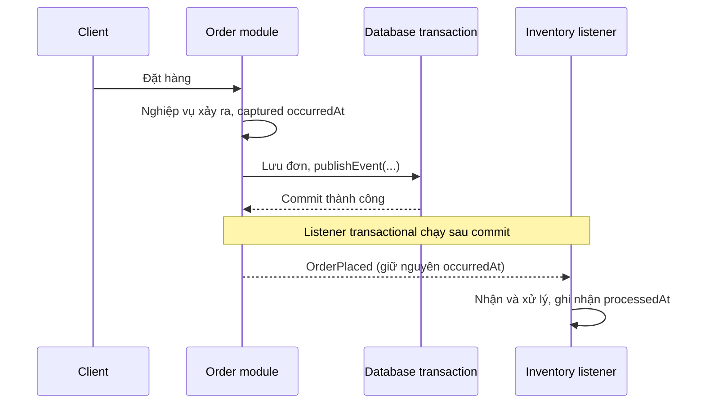
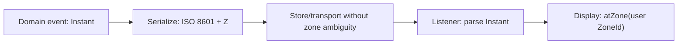

# Timestamp và timezone trong thiết kế Spring Modulith application events

## 1. Vì sao thời gian là một phần của hợp đồng sự kiện?

Một **application event** diễn tả một sự thật nghiệp vụ, chẳng hạn `OrderPlaced`, `PaymentCaptured` hoặc `ShipmentDispatched`. Bên cạnh mã định danh và dữ liệu nghiệp vụ, nhiều event cần ghi lại **sự thật đó xảy ra vào thời điểm nào**. Trường thời gian giúp listener xử lý đúng hạn, tính SLA, đối chiếu log, tái xử lý dữ liệu và giải thích thứ tự nghiệp vụ.

Trong **SPRING_MODULITH_APPLICATION_EVENTS**, các module Spring Modulith giao tiếp bằng application events để giảm phụ thuộc và bảo vệ ranh giới nghiệp vụ. Một module có thể phát sự kiện trong transaction của mình; module khác xử lý bằng `@ApplicationModuleListener` **sau commit**, và việc xử lý có thể bị chậm hoặc phải retry. Bởi vậy, timestamp trong event phải có ý nghĩa ổn định, không phụ thuộc múi giờ của máy chủ hay thời điểm một listener tình cờ chạy.

Trong chương **Thiết kế event**, bài *Timestamp và timezone* tập trung vào năm câu hỏi:

1. Timestamp trong event biểu diễn **thời điểm nghiệp vụ** nào?
2. Nên dùng `Instant`, `OffsetDateTime`, `ZonedDateTime` hay `LocalDateTime`?
3. Múi giờ của người dùng hoặc của quy tắc nghiệp vụ được lưu ở đâu?
4. Event đi qua publisher, transaction, listener, registry và retry thì timestamp có đổi không?
5. Làm sao kiểm thử chính xác mà không lệ thuộc đồng hồ và timezone môi trường?

## 2. Phân biệt ba khái niệm thời gian

Trước khi chọn kiểu Java, cần phân biệt **thời điểm tuyệt đối**, **ngày giờ địa phương** và **quy tắc múi giờ**.

| Khái niệm | Ví dụ | Ý nghĩa |
| --- | --- | --- |
| **Instant** | `2026-11-25T08:00:00Z` | Một điểm xác định trên trục thời gian toàn cầu; không mang timezone hiển thị |
| **UTC offset** | `+07:00`, `-05:00` | Độ lệch tại một thời điểm; không chứa quy tắc đổi giờ mùa hè |
| **Zone ID** | `Asia/Ho_Chi_Minh`, `America/New_York` | Vùng thời gian IANA với quy tắc lịch sử/tương lai, có thể thay đổi offset theo ngày |
| **Local date/time** | `2026-11-25 15:00` | Thời gian trên đồng hồ tại một địa điểm, chưa tự xác định một instant |
| **Timestamp xử lý** | `2026-11-25T08:00:03Z` | Thời điểm một listener/consumer bắt đầu hoặc hoàn tất xử lý, khác thời điểm nghiệp vụ xảy ra |

Ví dụ **cùng một thời điểm tuyệt đối**:

```text
Instant (UTC)         2026-11-25T08:00:00Z
Asia/Ho_Chi_Minh      2026-11-25 15:00:00 +07:00
America/New_York      2026-11-25 03:00:00 -05:00
```

Ba dòng là ba cách biểu diễn **một instant**, không phải ba sự kiện khác nhau. Vì vậy, đừng lưu `2026-11-25 15:00:00` rồi hy vọng mọi listener tự hiểu đây là giờ Việt Nam. Một server ở timezone khác có thể diễn giải thành thời điểm sai.

### Quy tắc mặc định

- **Mốc sự kiện đã xảy ra:** dùng `java.time.Instant` (hoặc chuỗi ISO 8601 biểu diễn UTC rõ ràng khi trao đổi dữ liệu).
- **Mốc lịch theo quy tắc địa phương:** giữ thêm `ZoneId` và ngày/giờ địa phương khi nghiệp vụ cần giải thích lịch, giờ mở cửa hoặc lựa chọn của người dùng.
- **Hiển thị:** chuyển từ `Instant` sang `ZonedDateTime` ở ranh giới giao diện hoặc lúc tạo báo cáo.
- **Thời gian không có timezone:** chỉ dùng `LocalDate`/`LocalTime`/`LocalDateTime` khi chính **ngày/giờ địa phương** là dữ liệu nghiệp vụ; không coi chúng là timestamp tuyệt đối.

## 3. Các kiểu `java.time` và tình huống sử dụng

| Kiểu Java | Mang instant duy nhất? | Mang Zone ID? | Dùng trong event khi |
| --- | --- | --- | --- |
| `Instant` | Có | Không | Ghi lại lúc nghiệp vụ xảy ra hoặc thời hạn tuyệt đối |
| `OffsetDateTime` | Có | Không, chỉ offset | Hợp đồng cần giữ độ lệch được gửi cùng timestamp |
| `ZonedDateTime` | Có | Có | Quy tắc nghiệp vụ cần biết vùng thời gian gốc, không chỉ instant |
| `LocalDateTime` | Không | Không | Giữ giờ tường minh người dùng chọn, phải đi kèm thông tin zone nếu chuyển sang instant |
| `LocalDate` | Không | Không | Ngày nghiệp vụ như ngày trả hàng, ngày kế toán hoặc ngày giao |
| `Duration` | Không | Không | Khoảng thời gian trôi qua như timeout 15 phút |
| `Period` | Không | Không | Khoảng thời gian lịch như thêm 1 tháng vào ngày địa phương |

Đối với event mô tả một hành động **đã xảy ra**, nên chọn `Instant occurredAt` để có ngữ nghĩa rõ ràng và ổn định qua các hệ thống.

`OffsetDateTime` chứa được thông tin offset đầu vào, ví dụ `2026-11-25T15:00:00+07:00`; hai giá trị có offset khác nhau có thể biểu diễn cùng một instant. `ZonedDateTime` chứa thêm Zone ID để áp dụng quy tắc lịch, ví dụ `Asia/Ho_Chi_Minh`; Zone ID hữu ích nếu muốn tính lịch địa phương về sau. `LocalDateTime` không đủ xác định một instant vì thiếu cả offset lẫn timezone.

**Lưu ý về UTC:** `Instant` là kiểu biểu diễn một thời điểm, không mang timezone riêng. Ký tự `Z` là cách định dạng với offset UTC. Gọi “lưu `Instant` theo UTC” là cách nói thực hành để thống nhất biểu diễn, không có nghĩa phải chuyển các instant giữa các timezone.

## 4. Timestamp nào là `occurredAt`, `publishedAt`, `committedAt` và `processedAt`?

Các bước trong vòng đời một sự kiện có thể diễn ra tại những thời điểm khác nhau:



| Tên trường/khái niệm | Khi nào được xác định? | Cần hiểu đúng |
| --- | --- | --- |
| `occurredAt` | Khi hành vi nghiệp vụ tạo ra sự thật được ghi nhận | Thuộc **hợp đồng event** và phải giữ nguyên trong mọi lần xử lý lại |
| `publishedAt` | Khi ứng dụng gọi `publishEvent` hoặc khi một lớp hạ tầng ghi nhận publication, nếu có | Phải ghi rõ định nghĩa; không mặc nhiên bằng `occurredAt` |
| `committedAt` | Khi transaction gốc commit | Spring không tự điền timestamp commit chuẩn xác vào payload event; đừng suy ra từ thời điểm listener chạy |
| `receivedAt` | Khi listener nhận callback | Thời gian quan sát tại consumer, có thể trễ do queue/thread/retry |
| `processedAt` | Khi một lần xử lý hoàn tất | Thường là metadata vận hành của listener, không được thay `occurredAt` |

Ví dụ một đơn phát sinh lúc `08:00:00Z`, commit lúc `08:00:00.150Z`, listener bắt đầu lúc `08:00:03Z` và hoàn tất lúc `08:00:04Z`. Nếu listener thất bại và được xử lý lại sau 10 phút, **event vẫn có cùng `occurredAt = 08:00:00Z`**. Một timestamp mới ở lần retry chỉ là thời gian của lần xử lý đó.

Điều này đặc biệt quan trọng với quy tắc như “thời hạn thanh toán là 15 phút sau khi đặt hàng”. Nếu tính từ `clock.instant()` trong listener, chỉ cần listener bị chậm là thời hạn bị kéo dài ngoài ý muốn. Nên tính từ `event.occurredAt()` hoặc từ mốc đã được quy trình nghiệp vụ lưu ổn định.

> **Ngữ nghĩa giao dịch:** Gọi `publishEvent(...)` bên trong transaction không chứng minh transaction đã commit. Với listener sau commit, một transaction rollback sẽ không được coi là sự kiện nghiệp vụ đã hoàn tất. Nếu cần timestamp commit chính xác, phải thiết kế cơ chế riêng; đừng gọi `occurredAt` là commit time.

## 5. Thiết kế payload event có timestamp rõ ràng

Ví dụ module `order` công bố event công khai:

```java
// com/example/shop/order/OrderPlaced.java
package com.example.shop.order;

import java.time.Instant;
import java.util.Objects;
import java.util.UUID;

public record OrderPlaced(
        UUID eventId,
        UUID orderId,
        Instant occurredAt
) {
    public OrderPlaced {
        Objects.requireNonNull(eventId, "eventId");
        Objects.requireNonNull(orderId, "orderId");
        Objects.requireNonNull(occurredAt, "occurredAt");
    }
}
```

Ở đây:

- `eventId` định danh **một sự kiện** để correlating log và chống xử lý lặp.
- `orderId` định danh **đối tượng nghiệp vụ** liên quan; một đơn có thể phát nhiều event.
- `occurredAt` là timestamp tuyệt đối, thể hiện lúc `OrderPlaced` được tạo bởi nghiệp vụ.

Một event được phát lại do retry nên giữ **cùng `eventId`, `orderId` và `occurredAt`**. Không tạo UUID hay thời điểm mới trong listener, vì như vậy có thể biến một lần xử lý lại thành một sự kiện kinh doanh mới.

### 5.1. Publisher lấy thời gian từ `Clock`

Thay vì gọi `Instant.now()` trực tiếp ở khắp nơi, inject `Clock` để kiểm thử có thể cố định thời gian:

```java
// com/example/shop/config/TimeConfiguration.java
package com.example.shop.config;

import java.time.Clock;
import org.springframework.context.annotation.Bean;
import org.springframework.context.annotation.Configuration;

@Configuration
class TimeConfiguration {
    @Bean
    Clock clock() {
        return Clock.systemUTC();
    }
}
```

```java
// Minh họa mã trong com.example.shop.order.internal
@Service
class PlaceOrderService {
    private final OrderRepository orders;
    private final ApplicationEventPublisher publisher;
    private final Clock clock;

    PlaceOrderService(
            OrderRepository orders,
            ApplicationEventPublisher publisher,
            Clock clock
    ) {
        this.orders = orders;
        this.publisher = publisher;
        this.clock = clock;
    }

    @Transactional
    public UUID place(PlaceOrderCommand command) {
        Order order = Order.create(command);
        Instant occurredAt = clock.instant();

        orders.save(order);
        publisher.publishEvent(new OrderPlaced(
                UUID.randomUUID(),
                order.id(),
                occurredAt
        ));

        return order.id();
    }
}
```

Đoạn publisher minh họa việc đặt timestamp **tại ranh giới nghiệp vụ**; `Order`, `OrderRepository`, `PlaceOrderCommand` là các kiểu domain giả định, còn annotation/import Spring được lược bớt để tập trung vào thời gian. Nếu event chỉ được tạo sau khi một bước phức tạp thành công, hãy lấy `occurredAt` tại thời điểm nghiệp vụ xác nhận sự thật ấy, không nhất thiết lấy ngay lúc method bắt đầu.

Lời gọi `Clock.systemUTC()` không phải cách “ép” `Instant` thành UTC; nó biểu thị rằng đồng hồ sản xuất dùng UTC làm mốc chuẩn và tránh phụ thuộc timezone mặc định ở các đoạn code khác.

### 5.2. Listener giữ timestamp nguồn và đo thời gian xử lý riêng

```java
// Minh họa mã trong com.example.shop.notification.internal
@Component
class OrderPlacedListener {
    private final Clock clock;
    private final NotificationService notifications;

    OrderPlacedListener(Clock clock, NotificationService notifications) {
        this.clock = clock;
        this.notifications = notifications;
    }

    @ApplicationModuleListener
    void on(OrderPlaced event) {
        Instant startedAt = clock.instant();
        notifications.sendOrderConfirmationOnce(
                event.eventId(),
                event.orderId(),
                event.occurredAt()
        );
        Instant completedAt = clock.instant();

        // Ghi log/metric với startedAt, completedAt và event.occurredAt().
    }
}
```

`NotificationService.sendOrderConfirmationOnce` là API nội bộ minh họa; implementation cần bảo đảm xử lý trùng một cách bền vững theo `eventId` hoặc khóa nghiệp vụ phù hợp. Việc gửi ra hệ thống email bên ngoài còn cần xem khả năng lỗi ở ranh giới gửi/ghi nhận, ví dụ dùng outbox và cơ chế deduplication phù hợp.

`startedAt` và `completedAt` mô tả **lần chạy listener**; chúng không thay đổi nội dung `event.occurredAt()`. Nếu đo độ trễ xử lý bằng hiệu hai timestamp, cần nhớ rằng đồng hồ các máy khác nhau có thể lệch và việc đo độ dài xử lý nội bộ nên dùng đồng hồ đo thời gian đã trôi qua (monotonic) khi cần độ chính xác cao.

## 6. Khi nào phải lưu timezone nghiệp vụ?

Một `Instant` xác định thời điểm tuyệt đối nhưng **không chứa ý định địa phương**. Với các nghiệp vụ chỉ cần biết “đã xảy ra lúc nào” như `OrderPlaced`, đó thường là điều mong muốn. Nhưng có nghiệp vụ cần hiểu “người dùng muốn 9 giờ sáng tại đâu”, ví dụ:

- Cửa hàng mở cửa lúc **09:00 theo giờ địa phương** của từng chi nhánh.
- Khách đặt lịch nhận hàng vào **08:30 ngày 03/12 tại Hà Nội**.
- Tính báo cáo theo **ngày kế toán của chi nhánh**, không theo ngày UTC.
- Nhắc thanh toán vào **đầu ngày địa phương** của khách.

Trong các trường hợp này, **giữ riêng ý định lịch và vùng thời gian**:

```java
// Hợp đồng minh họa cho một cuộc hẹn đã được xác nhận
public record PickupScheduled(
        UUID pickupId,
        Instant scheduledFor,
        LocalDateTime requestedLocalTime,
        String zoneId
) {}
```

Ví dụ `scheduledFor = 2026-12-03T01:30:00Z`, `requestedLocalTime = 2026-12-03T08:30`, `zoneId = "Asia/Ho_Chi_Minh"`. `scheduledFor` phục vụ scheduler; `requestedLocalTime` và `zoneId` lưu đúng ý định khách chọn để diễn giải hoặc kiểm tra khi quy tắc vùng thay đổi.

**Phân biệt**: `occurredAt` của sự kiện “đã lên lịch nhận hàng” là lúc lịch được tạo, còn `scheduledFor` là **thời điểm dự kiến trong tương lai**. Không gán cả hai nghĩa vào một field `timestamp`.

### 6.1. Chuyển từ `Instant` sang giờ địa phương

```java
Instant occurredAt = Instant.parse("2026-11-25T08:00:00Z");
ZoneId zone = ZoneId.of("Asia/Ho_Chi_Minh");

ZonedDateTime localDisplay = occurredAt.atZone(zone);
// 2026-11-25T15:00+07:00[Asia/Ho_Chi_Minh]
```

Một `Instant` đổi sang timezone để hiển thị không tạo ra một sự kiện mới và không làm thay đổi thời điểm tuyệt đối. Tránh gọi `LocalDateTime.now()` để hiển thị thay cho `occurredAt`: đó là **thời gian hiện tại của nơi xử lý**, không liên quan đến sự kiện gốc.

### 6.2. Chuyển lịch địa phương sang `Instant`

Với lịch do người dùng chọn, phải biết timezone:

```java
LocalDateTime requested = LocalDateTime.of(2026, 12, 3, 8, 30);
ZoneId zone = ZoneId.of("Asia/Ho_Chi_Minh");

Instant scheduledFor = requested.atZone(zone).toInstant();
// 2026-12-03T01:30:00Z
```

Với vùng có **daylight saving time (DST)**, thao tác này cần thêm chính sách giải quyết giờ địa phương không tồn tại hoặc bị lặp; phần tiếp theo giải thích chi tiết. Không lấy offset của **thời điểm hiện tại** rồi gán cho một lịch **trong tương lai**.

## 7. DST: Hai lỗi nguy hiểm khi dùng `LocalDateTime`

Một số vùng như `America/New_York` thay đổi offset theo mùa. Điều này tạo ra hai trường hợp:

1. **Gap:** Một đoạn giờ địa phương bị bỏ qua khi đồng hồ nhảy tới. Ví dụ ngày đổi giờ mùa xuân có thể không tồn tại `02:30`.
2. **Overlap:** Một đoạn giờ địa phương lặp lại khi đồng hồ quay lui. Ví dụ `01:30` có thể ứng với **hai instant** khác nhau.

Vì vậy, `LocalDateTime` và `ZoneId` không phải lúc nào cũng xác định duy nhất một instant. Java có quy tắc mặc định khi gọi `atZone()`, nhưng hệ thống đặt lịch nên có **chính sách nghiệp vụ tường minh**: từ chối, yêu cầu khách chọn offset, hay chuyển sang giờ hợp lệ gần nhất.

```java
import java.time.LocalDateTime;
import java.time.ZoneId;
import java.time.ZoneOffset;
import java.time.Instant;
import java.util.List;

ZoneId zone = ZoneId.of("America/New_York");
LocalDateTime local = LocalDateTime.of(2026, 11, 1, 1, 30);

List<ZoneOffset> offsets = zone.getRules().getValidOffsets(local);
if (offsets.isEmpty()) {
    throw new IllegalArgumentException("Giờ địa phương không tồn tại (DST gap)");
}
if (offsets.size() > 1) {
    throw new IllegalArgumentException("Giờ địa phương nhập nhằng (DST overlap)");
}

Instant scheduledFor = local.atOffset(offsets.get(0)).toInstant();
```

Ví dụ `2026-11-01 01:30` tại New York rơi vào vùng lặp khi kết thúc DST; mỗi offset hợp lệ tương ứng một thời điểm khác nhau. Đoạn code chủ động từ chối giờ nhập nhằng để người dùng hoặc quy tắc sản phẩm quyết định. Một ứng dụng vận tải có thể cần chọn chuyến đầu/chuyến sau; ứng dụng đặt lịch có thể yêu cầu xác nhận offset.

**Không dùng offset cố định như `-05:00` thay thế hoàn toàn `America/New_York`** khi nghiệp vụ tính ngày giờ tại New York trong tương lai: offset cụ thể thay đổi theo lịch DST. `ZoneId` lưu được quy tắc vùng thời gian, còn `ZoneOffset` chỉ là độ lệch tại một mốc.

## 8. JSON, cơ sở dữ liệu và khả năng tương thích

Khi event được serialize cho event publication registry, log hoặc kênh tích hợp bên ngoài, cần thống nhất **hình thức biểu diễn**. Đối với thời điểm tuyệt đối, hợp đồng JSON nên dùng chuỗi ISO 8601 / RFC 3339 có offset rõ:

```json
{
  "eventId": "238e0185-541d-4d6e-b1e6-a7a2d1f50310",
  "orderId": "fa46b827-fd34-4550-9e08-f829ee37aa6c",
  "occurredAt": "2026-11-25T08:00:00Z"
}
```

Chuỗi `"2026-11-25T08:00:00Z"` chứa mốc UTC không nhập nhằng. Nếu client gửi `"2026-11-25T15:00:00+07:00"`, đó là **cùng instant**. Nên chuẩn hóa cách xuất và kiểm thử round-trip; đừng trộn chuỗi có timezone với chuỗi thiếu timezone trong cùng một field.

Các điểm cần kiểm tra khi triển khai:

- **Jackson/Java time:** Cấu hình serializer cho `Instant` để xuất chuỗi ISO rõ ràng. Nếu tạo `ObjectMapper` thủ công, cần bảo đảm hỗ trợ `java.time` (ví dụ Java Time module) và tránh vô tình xuất numeric timestamp khác format hợp đồng.
- **Độ chính xác:** Java `Instant` hỗ trợ đến nanosecond, nhưng database/driver có thể chỉ lưu microsecond hoặc millisecond. Chọn precision theo contract, kiểm thử lưu-đọc và tránh so sánh bằng tuyệt đối nếu persistence làm tròn/cắt phần lẻ.
- **Epoch numeric:** Nếu buộc dùng epoch, ghi rõ đơn vị (`epochMillis`, `epochSeconds`) và precision. Số `1764057600` và `1764057600000` không thể dùng lẫn nếu consumer không biết đơn vị.
- **Database timezone:** Kiểu cột và hành vi driver phụ thuộc hệ quản trị. Chẳng hạn PostgreSQL `TIMESTAMP WITH TIME ZONE` lưu thời điểm được chuẩn hóa nhưng không lưu Zone ID gốc; `TIMESTAMP WITHOUT TIME ZONE` không tự mô tả offset. Muốn giữ zone của nghiệp vụ, cần cột riêng.
- **Không dùng mặc định của host:** Tránh dựa vào `ZoneId.systemDefault()` khi tính logic nghiệp vụ, bởi cùng một event có thể được listener chạy trên máy có cấu hình khác.
- **Schema evolution:** Đổi ý nghĩa của `occurredAt` từ “lúc nghiệp vụ xảy ra” sang “lúc được xử lý” là thay đổi hợp đồng nguy hiểm dù tên field không đổi. Nếu cần thời gian xử lý, thêm metadata riêng.



Trong cùng tiến trình Spring Boot, event không nhất thiết đi qua JSON. Tuy nhiên, nếu dùng persistence publication hoặc mở rộng sang tích hợp liên dịch vụ, một định dạng thời gian ổn định giúp giảm lỗi khi migrate.

## 9. Timestamp, retry và thứ tự sự kiện

Một timestamp là **thông tin về thời gian**, không phải bảo đảm về thứ tự xử lý. Hai event có thể được tạo rất gần nhau; đồng hồ giữa các máy có thể lệch; listener xử lý bất đồng bộ có thể chạy theo thứ tự khác với thứ tự được phát.

Ví dụ:

```text
08:00:00.100Z  OrderPlaced    (order-42, version 1)
08:00:00.200Z  OrderCancelled (order-42, version 2)

Listener nhận:
08:00:01.000Z  OrderCancelled
08:00:02.000Z  OrderPlaced (retry)
```

Nếu listener dùng `occurredAt` như một cơ chế khóa chống cũ/mới duy nhất, nó có thể vẫn cập nhật sai do event đến trễ, trùng hoặc đồng hồ khác nhau. Với một aggregate cần xử lý theo thứ tự, nên cân nhắc **phiên bản trạng thái** (`aggregateVersion`), sequence do nguồn sở hữu sinh ra hoặc một state machine kiểm tra chuyển trạng thái. `eventId` giúp deduplication; `occurredAt` giúp phân tích thời gian; hai thứ không thay thế quy tắc thứ tự nghiệp vụ.

### `@ApplicationModuleListener` và registry

Spring Modulith hỗ trợ listener xử lý sau commit và **Event Publication Registry** để ghi nhận các publication tới transactional listeners khi cấu hình thành phần lưu trữ phù hợp. Registry giúp nhận biết publication chưa hoàn tất và hỗ trợ xử lý lại theo khả năng/cấu hình được sử dụng. Tuy vậy:

1. Timestamp trong payload được **giữ nguyên** qua các lần giao lại.
2. Mỗi lần xử lý có thể có `attemptStartedAt`/`attemptFinishedAt` riêng trong log hoặc telemetry.
3. Không suy diễn “exactly-once” chỉ vì có registry; listener phải hỗ trợ idempotency.
4. Không suy ra thứ tự giao theo `occurredAt`, `eventId` hoặc thời gian registry nếu hạ tầng không có bảo đảm tương ứng.
5. Không dùng “event đã cũ hơn N phút” làm điều kiện tự động bỏ qua trừ khi chính nghiệp vụ định nghĩa hành vi hết hạn và xử lý bù.

Độ trễ quan sát có thể tính gần đúng từ `receivedAt - occurredAt` nếu hai timestamp lấy từ đồng hồ đồng bộ tương đối, nhưng đây là **độ trễ đầu-cuối ước tính** bao gồm thời gian transaction, dispatch và queue. Đừng nhầm với thời lượng thực thi của listener; để đo một đoạn xử lý trong cùng tiến trình, monotonic duration như `System.nanoTime()` phù hợp hơn.

## 10. Kiểm thử thời gian không phụ thuộc máy chạy

### 10.1. Cố định `Clock` để kiểm tra timestamp nguồn

```java
import static org.assertj.core.api.Assertions.assertThat;

import java.time.Clock;
import java.time.Instant;
import java.time.ZoneOffset;
import org.junit.jupiter.api.Test;

class OrderEventTimeTest {

    @Test
    void usesBusinessInstantRatherThanSystemTimezone() {
        Instant fixed = Instant.parse("2026-11-25T08:00:00Z");
        Clock clock = Clock.fixed(fixed, ZoneOffset.UTC);

        OrderPlaced event = new OrderPlaced(
                java.util.UUID.randomUUID(),
                java.util.UUID.randomUUID(),
                clock.instant()
        );

        assertThat(event.occurredAt()).isEqualTo(fixed);
    }
}
```

Đây là kiểm thử đơn vị cho cách lấy mốc thời gian. Với publisher thực tế, nên inject `Clock.fixed(...)` vào service và kiểm tra event được phát bằng test double hoặc cơ chế test events của Spring Modulith. Mục tiêu là phát hiện code vô tình dùng `Instant.now()` hoặc `LocalDateTime.now()` bên ngoài `Clock` đã inject.

### 10.2. Kiểm thử chuyển đổi vùng thời gian

```java
Instant fixed = Instant.parse("2026-11-25T08:00:00Z");
ZoneId vietnam = ZoneId.of("Asia/Ho_Chi_Minh");

ZonedDateTime displayed = fixed.atZone(vietnam);
assertThat(displayed.getHour()).isEqualTo(15);
assertThat(displayed.toInstant()).isEqualTo(fixed);
```

### 10.3. Kiểm thử DST và serialization

Với ứng dụng có lịch tại vùng dùng DST, hãy kiểm thử cả **gap**, **overlap**, lịch mùa hè/mùa đông và việc giữ Zone ID sau khi serialize/deserialize. Với JSON, kiểm thử parse `2026-11-25T08:00:00Z` thành đúng `Instant`, round-trip không đổi instant và payload không bị xuất thành timestamp số sai đơn vị.

### 10.4. Kiểm thử giao sự kiện sau commit

Một bài kiểm thử tích hợp nên chứng minh:

- Transaction phát event **commit** thì listener transactional nhận event.
- Transaction **rollback** thì listener sau commit không thực hiện hành vi hoàn tất.
- Listener bị lỗi rồi chạy lại thì cùng `eventId` và `occurredAt` được bảo toàn.
- Sự kiện được xử lý lại không gây tác dụng phụ trùng; timestamp xử lý có thể đổi nhưng `occurredAt` vẫn giữ nguyên.

Kết quả phụ thuộc cách cấu hình event publication và transaction thực tế; đừng dùng sleep cố định như một bằng chứng đáng tin cậy cho hành vi bất đồng bộ.

## 11. Các lỗi thường gặp và cách sửa

| Sai lầm | Hậu quả | Cách sửa |
| --- | --- | --- |
| Event dùng `LocalDateTime.now()` | Listener ở timezone khác hiểu sai thời điểm | Dùng `Instant` cho mốc tuyệt đối |
| Lưu `"2026-11-25 15:00:00"` không có zone | Không biết giờ địa phương thuộc vùng nào | Lưu ISO 8601 UTC hoặc thêm Zone ID theo nghiệp vụ |
| Ghi đè `occurredAt` khi retry | Mất sự thật thời gian gốc, sai deadline/SLA | Giữ timestamp nguồn, lưu thời gian lần thử riêng |
| Dùng `ZoneOffset.ofHours(7)` cho mọi vùng | Sai khi vùng có DST, thiếu lịch sử vùng | Dùng `ZoneId` IANA khi tính lịch địa phương |
| Coi `receivedAt` là lúc transaction commit | Báo cáo commit sai và đánh giá độ trễ sai | Định nghĩa thời gian rõ ràng, có cơ chế commit time riêng nếu cần |
| Sắp xếp event chỉ theo timestamp | Sai khi đồng hồ lệch, event trùng hoặc đến không đúng thứ tự | Dùng version/sequence và quy tắc chuyển trạng thái |
| Chỉ test trên timezone của laptop | Lỗi khó tái hiện ở CI/production | Inject `Clock`, test UTC và timezone khác |
| Mã hóa epoch nhưng không nói đơn vị | Chênh lệch thời gian x1000 | Đặt field rõ `epochMillis` hoặc `epochSeconds` |

## 12. Bài thực hành: Đặt hàng và thời hạn thanh toán

**Bối cảnh:** Module `order` nhận đơn, phát `OrderPlaced` và cho phép khách thanh toán trong **15 phút kể từ lúc đơn được ghi nhận**. Module `payment` nghe event để tạo hướng dẫn thanh toán. Một listener có thể nhận event muộn hoặc được gọi lại khi gặp lỗi.

**Yêu cầu:**

1. Tạo event công khai `OrderPlaced(eventId, orderId, occurredAt)` dùng `Instant`.
2. Inject `Clock` vào publisher để ghi `occurredAt` ở nơi quyết định đơn được ghi nhận.
3. Tính `paymentDeadline = occurredAt.plus(Duration.ofMinutes(15))`, thay vì cộng 15 phút vào thời điểm listener chạy.
4. Ở `payment`, bảo đảm nhận lại cùng `eventId` không tạo hướng dẫn thanh toán thứ hai.
5. Cho khách chọn `Asia/Ho_Chi_Minh` hoặc `America/New_York` để **hiển thị** deadline; hai giao diện phải biểu diễn cùng một `Instant`.
6. Thêm test `Clock.fixed(...)`, test event đến trễ và test trường hợp transaction gốc rollback.
7. Mô tả cách log `receivedAt`, `processedAt`, `eventId`, `orderId` để quan sát độ trễ mà không ghi đè timestamp nguồn.

**Gợi ý mã tính hạn:**

```java
Instant deadline = event.occurredAt().plus(Duration.ofMinutes(15));
boolean expired = !clock.instant().isBefore(deadline);
ZonedDateTime customerView = deadline.atZone(customerZoneId);
```

Biến `customerZoneId` là `ZoneId` do lựa chọn người dùng hoặc cấu hình nghiệp vụ cung cấp. `deadline` là một mốc tuyệt đối, còn `customerView` chỉ là biểu diễn để hiển thị. Nếu chính sách là “hết hạn lúc 23:59 ngày địa phương”, hãy mô hình hóa ngày/giờ địa phương và Zone ID theo quy tắc lịch thay vì mặc định cộng một `Duration`.

**Tiêu chí tự đánh giá:** Dù listener chạy sau 2 giây hay 10 phút, `occurredAt` và deadline của cùng một event không đổi. Chuyển timezone không đổi instant. Hai lần xử lý cùng event không tạo tác dụng phụ lặp. Kiểm thử không phụ thuộc timezone mặc định của laptop hay CI.

## 13. Ghi nhớ

- Timestamp mô tả **một mốc có ngữ nghĩa**. Với event đã xảy ra, thường nên dùng `Instant occurredAt`; với thời gian xử lý, dùng metadata khác.
- `Instant` định danh thời điểm tuyệt đối; `ZoneId` lưu quy tắc vùng thời gian; `LocalDateTime` chỉ là giờ địa phương, có thể nhập nhằng trong DST.
- Khi tính lịch trong tương lai, giữ đủ **giờ địa phương + Zone ID** nếu nghiệp vụ cần lưu ý định gốc. Khi hiển thị, chuyển từ `Instant` sang timezone của người dùng.
- Publisher lấy thời điểm từ `Clock` để có thể kiểm thử; listener sau commit không được tự gán lại `occurredAt` khi xử lý hoặc retry.
- Event Publication Registry và retry hỗ trợ giao sự kiện đáng tin cậy, nhưng không thay thế idempotency, version/sequence và quy tắc trạng thái của từng module.
- JSON, database và telemetry phải có quy ước rõ về offset, precision và tên trường; tránh phụ thuộc timezone mặc định của máy chủ.

Thiết kế timestamp và timezone đúng giúp các module diễn giải cùng một sự thật nghiệp vụ theo cùng một thời điểm, kể cả khi chúng có timezone khác nhau, chạy bất đồng bộ hoặc xử lý lại sau lỗi.
