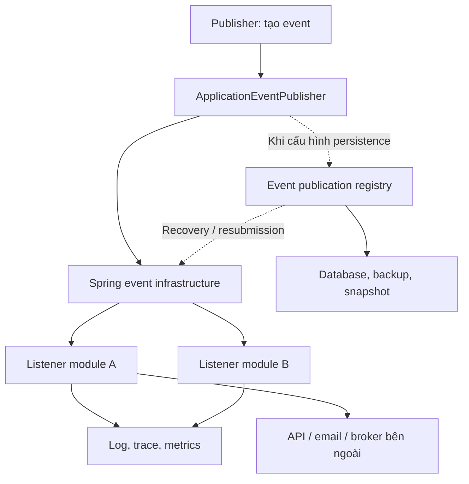

# Thiết kế event an toàn với dữ liệu nhạy cảm trong Spring Modulith

## 1. Tại sao dữ liệu nhạy cảm là vấn đề của event design?

Trong mô hình giao tiếp bằng **application events**, một module phát thông tin về sự kiện nghiệp vụ và các module khác lắng nghe để xử lý. Thiết kế này giúp module phát giảm phụ thuộc vào module tiêu thụ, nhưng cũng tạo ra một **đường đi dữ liệu**: thông tin trong event có thể được đọc bởi nhiều listener, được ghi lại để khôi phục khi lỗi, xuất hiện trong log, trace hoặc bản sao lưu.

Vì vậy, một event đúng về mặt nghiệp vụ vẫn có thể là **event thiết kế không an toàn** nếu mang quá nhiều dữ liệu nhạy cảm. Ví dụ, `OrderPlaced` có thể chỉ cần `orderId` và thời điểm tạo đơn; nếu publisher gửi thêm email, số điện thoại, địa chỉ giao hàng, thông tin thanh toán và access token, mọi consumer đều có cơ hội nhận những thông tin mà phần lớn không cần.

Trong phạm vi **SPRING_MODULITH_APPLICATION_EVENTS**, bài này giải thích cách bảo vệ dữ liệu khi thiết kế publisher, listener, event contract, xử lý sau commit, event publication registry, retry, kiểm thử và quan sát luồng giao sự kiện. Mục tiêu là giữ ranh giới module rõ ràng **và** giảm nguy cơ rò rỉ dữ liệu trong toàn bộ vòng đời event.

Sau bài học, bạn có thể:

- Nhận diện dữ liệu cá nhân, bí mật xác thực, thông tin thanh toán và dữ liệu nghiệp vụ cần hạn chế.
- Xác định **mục đích sử dụng**, người nhận và mức dữ liệu tối thiểu cho mỗi event.
- Chọn giữa **chỉ mang định danh**, **snapshot có kiểm soát** và **truy vấn dữ liệu qua API công khai**.
- Hiểu vì sao after-commit, registry bền vững và replay ảnh hưởng đến nơi dữ liệu có thể tồn tại.
- Bảo vệ payload trong logging, tracing, persistence, testing và các luồng tích hợp bên ngoài.
- Thiết kế kiểm thử để phát hiện vô tình đưa trường nhạy cảm vào event contract.

> **Nguyên tắc:** Một module có quyền biết sự kiện `OrderPlaced` đã xảy ra không có nghĩa nó cần biết toàn bộ thông tin khách hàng, chi tiết thẻ thanh toán hoặc dữ liệu riêng tư liên quan đến đơn hàng.

## 2. “Dữ liệu nhạy cảm” gồm những gì?

Mức độ nhạy cảm phụ thuộc vào bản chất dữ liệu, mục đích sử dụng, khả năng kết hợp với nguồn khác và chính sách áp dụng cho hệ thống. Không chỉ password hoặc số thẻ mới cần bảo vệ.

| Loại dữ liệu | Ví dụ | Rủi ro nếu đưa vào event không kiểm soát |
|---|---|---|
| Dữ liệu nhận diện cá nhân | Họ tên, email, số điện thoại, địa chỉ giao hàng, mã định danh cá nhân | Lộ danh tính, liên hệ trái mục đích, suy luận về hành vi mua hàng |
| Dữ liệu xác thực và bí mật | Password, session cookie, OAuth access/refresh token, API key, private key | Chiếm quyền truy cập hoặc giả mạo danh tính |
| Thông tin tài chính/thanh toán | Số thẻ đầy đủ, mã xác minh thẻ, tài khoản ngân hàng, giao dịch chi tiết | Gian lận và vi phạm yêu cầu bảo vệ thông tin thanh toán |
| Dữ liệu sức khỏe, sinh trắc, vị trí chính xác | Chẩn đoán, hồ sơ sức khỏe, dữ liệu định vị, đặc trưng sinh trắc | Tác động lớn đến quyền riêng tư và an toàn cá nhân |
| Dữ liệu kinh doanh bảo mật | Giá thương lượng, hợp đồng chưa công bố, thuật toán định giá, thông tin khách hàng doanh nghiệp | Lộ bí mật thương mại hoặc chiến lược kinh doanh |
| Định danh và metadata có thể liên kết | `userId`, `orderId`, IP, correlation ID, device ID | Có thể truy ngược hoặc kết hợp để nhận diện một người |

**Một ID không mặc nhiên là dữ liệu vô hại.** `customerId` hoặc `orderId` có thể trở thành dữ liệu cá nhân khi gắn được với hồ sơ khách hàng. Hash email không tự động khiến dữ liệu thành ẩn danh; nếu còn khả năng đối chiếu bằng từ điển hoặc kết hợp với nguồn khác, rủi ro nhận diện vẫn tồn tại.

Khi review event, hãy xét cả **mức độ nhạy cảm của toàn bộ tổ hợp dữ liệu**. Một thành phố và thời điểm giao hàng có thể tương đối phổ thông nếu đứng riêng, nhưng khi kết hợp với mã khách hàng và mô tả sản phẩm, chúng có thể tiết lộ thông tin riêng tư.

### 2.1. Dữ liệu nào tuyệt đối không nên xuất hiện trong application event thông thường?

Các bí mật xác thực (password dạng rõ, token phiên, refresh token, API key và private key) **không phải dữ liệu nghiệp vụ cần broadcast**. Hãy giữ chúng trong cơ chế quản lý bí mật/xác thực chuyên dụng; không thêm chúng vào event chỉ để một consumer “đỡ phải gọi service”.

Với dữ liệu thanh toán, ưu tiên **mã tham chiếu giao dịch** hoặc token do nhà cung cấp thanh toán cấp theo mục đích được phép, thay vì đưa số thẻ đầy đủ hay mã bảo mật thẻ vào Java object, message hay log. Ngay cả payment token cũng có thể là thông tin nhạy cảm nếu sử dụng được để thực hiện hành động có giá trị, nên phải kiểm soát quyền sử dụng.

## 3. Event đi qua những điểm nào có thể làm lộ dữ liệu?

Một event trong Spring Modulith có thể xuất hiện ở nhiều lớp hơn lời gọi `publishEvent(...)` nhìn thấy trong code.



Tùy cấu hình và phiên bản thư viện, một event có thể được ghi trong registry để theo dõi publication chưa hoàn thành. Khi đó, **payload có thể tồn tại lâu hơn vòng đời request và transaction gốc**. Có thể có cả những bản sao kỹ thuật từ database backup, dump phục vụ điều tra, test fixture, log và hệ thống observability.

Các câu hỏi bắt buộc khi thiết kế:

1. **Ai phát?** Module nào thực sự sở hữu dữ liệu và sự kiện?
2. **Ai nhận?** Những listener nào cần sự thật này và cần trường nào?
3. **Ai lưu?** Có event publication registry, outbox, broker hoặc log chứa payload không?
4. **Lưu bao lâu?** Dữ liệu còn tồn tại trong publication, backup và log sau khi xử lý xong bao lâu?
5. **Ai đọc được?** Quyền truy cập database, log aggregation, dashboard và backup có bị mở rộng không?
6. **Xử lý lại ra sao?** Replay một event cũ có còn phù hợp với quyền và trạng thái dữ liệu hiện tại không?

Spring Modulith giúp kiểm soát phụ thuộc kiến trúc giữa package/module nhưng **không tự biến mọi consumer thành đối tượng đã được cấp quyền đọc mọi trường trong event**. Bảo vệ dữ liệu phải được giải quyết ở mức thiết kế hợp đồng và cấu hình hạ tầng.

## 4. Nguyên tắc thiết kế: chỉ mang điều consumer thực sự cần

Một quy trình hữu ích là **purpose → consumers → fields → storage → retention**:

- **Purpose (mục đích):** Event báo về sự kiện nghiệp vụ nào? `OrderPlaced` không phải một bản sao đầy đủ của `Order`.
- **Consumers (người nhận):** Inventory cần `orderId` hoặc danh sách mặt hàng? Notifications có thật sự cần email ngay lúc nhận không?
- **Fields (trường dữ liệu):** Mỗi trường giúp consumer thực hiện hành động cụ thể nào? Trường không có lý do rõ ràng nên loại bỏ.
- **Storage (nơi lưu):** Nếu lưu publication, có chấp nhận lưu chính các trường đó trong database và backup không?
- **Retention (thời gian lưu):** Sau khi xử lý/replay, dữ liệu còn cần tồn tại ở đâu và theo chính sách nào?

Cách này kết hợp **data minimization** với ranh giới nghiệp vụ của Spring Modulith. Module phát nên công bố **sự thật**; không công bố nguyên cả database entity để tiện cho mọi consumer.

### 4.1. Ví dụ event có quá nhiều dữ liệu

```java
package com.example.shop.orders;

import java.math.BigDecimal;
import java.util.UUID;

// Ví dụ minh họa thiết kế không nên sử dụng.
public record OrderPlacedUnsafe(
        UUID orderId,
        String customerName,
        String email,
        String phone,
        String shippingAddress,
        String accessToken,
        String fullCardNumber,
        BigDecimal negotiatedPrice
) {
}
```

Vấn đề không chỉ ở việc `notifications` nhận email. Module `analytics`, `inventory` hoặc listener mới trong tương lai cũng có thể nhận toàn bộ payload; nhiều thư viện/logging mặc định có thể hiển thị `record.toString()` gồm các trường trên. Nếu registry serialize event, những trường đó có thể bị ghi bền vững.

Việc giữ `accessToken` và `fullCardNumber` trong event là đặc biệt nguy hiểm và thường không có lý do nghiệp vụ hợp lệ. Những trường còn lại có thể thật sự cần trong một luồng cụ thể, nhưng phải giải thích **consumer nào**, **mục đích nào** và **điều kiện lưu giữ** trước khi chấp nhận.

### 4.2. Một public event tối giản

```java
package com.example.shop.orders;

import java.time.Instant;
import java.util.UUID;

public record OrderPlaced(
        UUID eventId,
        UUID orderId,
        Instant occurredAt
) {
    public OrderPlaced {
        if (eventId == null || orderId == null || occurredAt == null) {
            throw new IllegalArgumentException("Required event fields are missing");
        }
    }
}
```

Event này công bố rằng một đơn hàng cụ thể đã được đặt và cung cấp định danh để truy vết. Nó không chứa email, địa chỉ, token hoặc thông tin thẻ.

Tuy nhiên, **tối giản trường dữ liệu không đồng nghĩa loại bỏ yêu cầu bảo vệ**: `orderId` vẫn có thể là định danh liên kết được với cá nhân và cần được xử lý theo chính sách dữ liệu của hệ thống.

### 4.3. Event contract là API, không phải entity dump

```java
// Cách nên tránh: đưa nguyên entity persistence sang module khác.
public record OrderPlaced(OrderJpaEntity order) {
}
```

Nếu consumer nhận trực tiếp `OrderJpaEntity`, nó có thể dựa vào các field nội bộ, trigger lazy loading sau transaction, hoặc vô tình serialize các association chứa dữ liệu nhạy cảm. Mỗi lần entity thay đổi, event contract cũng thay đổi theo ngoài ý muốn.

Nên định nghĩa event bằng record/DTO công khai, kiểm tra danh sách trường và khả năng tương thích như một API. **Mọi field mới phải được review về mục đích sử dụng, mức độ nhạy cảm và nơi lưu.**

## 5. Ba chiến lược truyền dữ liệu cho consumer

Không có một chiến lược đúng cho mọi trường hợp. Hãy chọn dựa trên yêu cầu nghiệp vụ, độ nhất quán và bảo mật.

| Chiến lược | Ví dụ | Ưu điểm | Đánh đổi |
|---|---|---|---|
| **Chỉ mang ID/tham chiếu** | `OrderPlaced(orderId)` | Payload nhỏ, giảm phân tán dữ liệu nhạy cảm | Consumer cần đọc dữ liệu qua API khác; dữ liệu có thể đã thay đổi |
| **Snapshot tối thiểu theo mục đích** | `InvoiceIssued(invoiceId, currency, total)` | Consumer nhận đúng dữ liệu tại thời điểm fact phát sinh | Có bản sao dữ liệu; cần bảo vệ, versioning và chính sách lưu giữ |
| **Tham chiếu đến dữ liệu có quyền truy cập** | `DocumentReady(documentId)` | Payload không chứa nội dung nhạy cảm trực tiếp | Consumer phải được cấp quyền; dữ liệu có thể hết hạn/không tồn tại lúc retry |

### 5.1. Chỉ mang ID, consumer truy vấn qua API có kiểm soát

Với email xác nhận đơn, module `notifications` có thể nhận `OrderPlaced`, sau đó dùng **API đọc công khai có mục đích giới hạn** từ module sở hữu dữ liệu để lấy thông tin cần thiết.

```java
// OrderNotificationQuery.java
package com.example.shop.orders;

import java.util.Optional;
import java.util.UUID;

// Public contract được thiết kế cho mục đích thông báo đơn hàng.
public interface OrderNotificationQuery {

    Optional<OrderNotificationContact> findContactForConfirmation(UUID orderId);
}
```

```java
// OrderNotificationContact.java
package com.example.shop.orders;

public record OrderNotificationContact(String email) {
}
```

```java
package com.example.shop.notifications;

import com.example.shop.orders.OrderNotificationQuery;
import com.example.shop.orders.OrderPlaced;
import org.springframework.modulith.events.ApplicationModuleListener;
import org.springframework.stereotype.Component;

@Component
class ConfirmationListener {

    private final OrderNotificationQuery contacts;
    private final ConfirmationSender sender;

    ConfirmationListener(OrderNotificationQuery contacts, ConfirmationSender sender) {
        this.contacts = contacts;
        this.sender = sender;
    }

    @ApplicationModuleListener
    void on(OrderPlaced event) {
        contacts.findContactForConfirmation(event.orderId())
                .ifPresent(contact ->
                        sender.sendOnce(event.orderId(), contact.email()));
    }
}
```

Đây là **mã minh họa hợp đồng**, cần có implementation cho `OrderNotificationQuery` và `ConfirmationSender`, cùng chính sách quyền truy cập thực tế.

Điểm mấu chốt: chỉ module phục vụ gửi xác nhận mới cần địa chỉ email; event công khai không phải chia sẻ email cho mọi subscriber. Tuy vậy, **public Java interface không tự thực thi authorization**. Cần kiểm soát consumer nào có quyền gọi, giới hạn khả năng truy vấn, kiểm toán các thao tác và bảo vệ response khi có dữ liệu nhạy cảm.

Cách này có đánh đổi: email có thể được cập nhật hoặc dữ liệu cá nhân có thể bị xóa sau lúc `OrderPlaced` xảy ra nhưng trước lúc listener chạy. Nếu email phải gửi đến địa chỉ **được xác nhận tại thời điểm đặt hàng**, cần mô hình snapshot hoặc một bản ghi tác vụ thông báo chuyên dụng, bảo vệ và lưu giữ đúng mục đích thay vì giả định truy vấn hiện tại sẽ luôn đúng.

### 5.2. Snapshot tối thiểu khi “giá trị tại thời điểm xảy ra” là bắt buộc

Ví dụ, hóa đơn đã phát hành có thể phải ghi nhận `currency` và `total` tại thời điểm phát hành để đảm bảo chính xác lịch sử. Đối với recipient email tại thời điểm giao dịch, module sở hữu dữ liệu có thể tạo **notification work item** chứa đúng địa chỉ nhận trong vùng lưu trữ có kiểm soát thay vì đặt toàn bộ thông tin khách hàng vào event chung.

Snapshot có thể cần thiết; điều kiện là:

1. Mục đích và consumer được xác định.
2. Chỉ dữ liệu cần cho mục đích ấy được sao chép.
3. Chỉ người có quyền mới truy cập được bản sao.
4. Có quy tắc mã hóa, thời hạn lưu và cách xử lý khi replay/erasure.
5. Sự thay đổi schema hoặc mục đích sử dụng được đánh giá lại.

**Mã hóa payload** không khiến việc broadcast mọi dữ liệu trở nên hợp lệ: ai có khả năng giải mã, khóa được quản lý ở đâu và dữ liệu xuất hiện ở đâu sau giải mã vẫn là những câu hỏi bắt buộc.

### 5.3. Tham chiếu có kiểm soát thay vì URL chứa bí mật

Đối với tài liệu nhạy cảm, event có thể mang `documentId`. Consumer đã được cấp quyền gọi một service để lấy tài liệu khi cần. Tránh đưa **pre-signed URL tồn tại lâu**, bearer token hay khóa truy cập trực tiếp vào event vì bản thân chúng có thể là thông tin xác thực.

Thiết kế truy cập cần xử lý trường hợp tài liệu bị thu hồi, người dùng rút quyền hoặc việc xử lý chậm khiến tài liệu đã hết hạn. Một event “tài liệu đã sẵn sàng” không có nghĩa mọi listener mãi mãi được quyền truy cập nội dung.

## 6. Publisher và ranh giới giao dịch: chỉ thông báo fact hợp lệ

Publisher nên phát event về thay đổi nghiệp vụ đã được xác lập trong transaction. Listener thực hiện side effect liên quan đến dữ liệu nhạy cảm thường chỉ nên chạy **sau khi transaction gốc commit thành công**.

```java
package com.example.shop.orders;

import java.time.Clock;
import java.util.UUID;
import org.springframework.context.ApplicationEventPublisher;
import org.springframework.stereotype.Service;
import org.springframework.transaction.annotation.Transactional;

@Service
public class OrderService {

    private final OrderRepository orders;
    private final ApplicationEventPublisher publisher;
    private final Clock clock;

    public OrderService(
            OrderRepository orders,
            ApplicationEventPublisher publisher,
            Clock clock
    ) {
        this.orders = orders;
        this.publisher = publisher;
        this.clock = clock;
    }

    @Transactional
    public UUID placeOrder(PlaceOrderCommand command) {
        Order saved = orders.save(Order.from(command));

        publisher.publishEvent(new OrderPlaced(
                UUID.randomUUID(),
                saved.id(),
                clock.instant()
        ));

        return saved.id();
    }
}
```

`Order`, `OrderRepository`, `PlaceOrderCommand` và bean `Clock` cần được định nghĩa theo ứng dụng thực tế. Ví dụ cho thấy publisher dùng một event công khai tối thiểu để thông báo đã ghi nhận đơn.

**Gọi `publishEvent(...)` không có nghĩa database đã commit ngay thời điểm đó.** Đối với consumer gửi email hoặc truy vấn thông tin riêng tư để gửi xác nhận, dùng `@TransactionalEventListener` với phase `AFTER_COMMIT` hoặc `@ApplicationModuleListener` phù hợp. Nếu transaction rollback, listener sau commit không nên thực hiện tác vụ gửi xác nhận.

`@ApplicationModuleListener` kết hợp xử lý sự kiện theo ranh giới transaction với xử lý bất đồng bộ và transaction riêng của listener ở các phiên bản Spring Modulith hỗ trợ. Cần cấu hình hạ tầng async (`@EnableAsync` hoặc cấu hình tương đương), transaction manager và executor phù hợp; annotation **không tự bảo đảm** dữ liệu hay quyền truy cập của consumer là an toàn.

### 6.1. Không log payload khi xử lý lỗi

Một lỗi phổ biến là ghi toàn bộ event trong catch block:

```java
// Tránh khi event có thể chứa dữ liệu nhạy cảm.
log.error("Failed to handle event {}", event, exception);
```

Với Java `record`, `toString()` có thể hiển thị giá trị của các thành phần; một lần logging vô ý đủ tạo bản sao dữ liệu trong log aggregation.

Thay vào đó, ghi **loại event**, **định danh tương quan được phép**, **listener**, **mã lỗi đã phân loại** và **trạng thái xử lý**. Nếu định danh liên kết được với cá nhân, vẫn phải áp dụng chính sách đối với log đó.

## 7. Event publication registry: payload có thể trở thành dữ liệu lưu bền vững

Spring Modulith hỗ trợ theo dõi quá trình giao sự kiện tới listener qua **event publication registry**. Khi lựa chọn persistence bền vững (chẳng hạn JDBC/JPA theo release đang sử dụng), thông tin publication và dữ liệu cần cho việc phục hồi có thể được lưu trong database.

Điều này có hai hệ quả:

- **Lỗi consumer không còn chỉ là vấn đề trong bộ nhớ.** Publication chưa hoàn thành có thể tồn tại để điều tra và xử lý lại.
- **Event payload có thể được lưu lâu hơn dự kiến.** Mọi trường nhạy cảm đưa vào event có nguy cơ nằm trong publication storage, bản sao lưu, snapshot điều tra và dữ liệu replay.

Hãy coi registry và mọi bảng outbox/inbox tương ứng là **kho dữ liệu cần bảo vệ**, không phải vùng đệm kỹ thuật “không cần phân loại”. Các thông tin cụ thể được lưu và thời gian lưu tùy cách tích hợp, phiên bản, serializer và thiết lập vận hành.

### 7.1. Review trước khi bật persistence

| Hạng mục | Câu hỏi kiểm tra |
|---|---|
| Nội dung lưu | Registry serialize toàn bộ event hay chỉ tham chiếu? Có field cá nhân nào xuất hiện? |
| Quyền truy cập | Tài khoản DB, công cụ quản trị, người xem backup và dashboard nào đọc được publication? |
| Mã hóa | Database, đĩa, backup và kênh truyền được bảo vệ thế nào? Khóa quản lý ở đâu? |
| Serialization | Event cũ có được giải mã/deserialize sau khi đổi schema hoặc khóa mã hóa không? |
| Thời gian lưu | Publication đã hoàn thành, thất bại và bị bỏ dở được giữ bao lâu? |
| Xóa/ẩn dữ liệu | Có cơ chế xử lý khi hết thời hạn, thu hồi quyền hoặc yêu cầu xóa phù hợp chính sách? |
| Recovery | Khi replay, consumer còn có quyền và còn mục đích hợp lệ để dùng dữ liệu không? |
| Audit | Ai đã xem, trích xuất hoặc chạy lại publication chứa thông tin nhạy cảm? |

Đừng tự giả định Spring Modulith có chính sách retry vô hạn, tự dọn sạch mọi publication, tự mã hóa payload hoặc tự xử lý yêu cầu xóa dữ liệu. Những hành vi này phụ thuộc cấu hình và khả năng của release; **cần xác minh trong hệ thống đang chạy**.

### 7.2. Backup và bản sao bị bỏ quên

Ngay cả khi xóa publication khỏi bảng chính, dữ liệu có thể còn trong:

- Database backup hoặc snapshot.
- Dump dùng để debug hoặc tái hiện lỗi.
- Log có chứa tham số/serialized event.
- Data warehouse hay hệ thống audit được đồng bộ riêng.
- Test fixture được sao chép từ dữ liệu thật.

Hãy lập **inventory luồng dữ liệu**, ghi rõ mục đích và thời hạn giữ ở từng nơi. Việc “đã xóa khỏi bảng publication” không đủ chứng minh dữ liệu không còn trong hệ sinh thái.

## 8. Retry, idempotency và nguy cơ dùng dữ liệu không còn hợp lệ

Consumer xử lý sau commit có thể thất bại và được resubmit. Cùng một fact có thể được xử lý lại; dữ liệu cá nhân có thể đã được cập nhật, hủy quyền hoặc xóa trong thời gian chờ.

Ví dụ:

1. `OrderPlaced` được ghi nhận ngày T1.
2. Listener gửi email gặp lỗi, publication còn chưa hoàn thành.
3. Khách đổi email hoặc thay đổi lựa chọn nhận thông báo tại T2.
4. Một công cụ recovery replay publication tại T3.

Nếu email nằm trong event T1, consumer có thể gửi thông báo tới địa chỉ cũ. Nếu consumer truy vấn email tại T3, nó có thể lấy địa chỉ mới, nhưng điều đó cũng **có thể sai** nếu yêu cầu nghiệp vụ là dùng địa chỉ tại thời điểm đặt hàng.

Vì thế, thiết kế cần quyết định **snapshot hay trạng thái hiện tại**, và lưu lại *mục đích sử dụng* cùng *quy tắc hiệu lực* phù hợp. Với dữ liệu đã bị xóa hoặc người dùng không còn cho phép xử lý, consumer phải có đường xử lý rõ ràng (bỏ qua có kiểm soát, hủy tác vụ, đánh dấu kết thúc theo nghiệp vụ hoặc điều tra), thay vì tự tái tạo thông tin cũ từ payload.

### 8.1. Idempotency không phải là lý do giữ dữ liệu bí mật

Có thể dùng `(consumerId, eventId)` làm khóa xử lý fact hoặc `(orderId, notificationType)` cho yêu cầu “mỗi đơn một email xác nhận”, với ràng buộc duy nhất/transaction nguyên tử phù hợp.

```java
@ApplicationModuleListener
void on(OrderPlaced event) {
    // Định danh là đầu vào cho cơ chế idempotency,
    // không phải lý do đưa toàn bộ hồ sơ khách vào event.
    notificationJobs.enqueueOnce(
            event.orderId(),
            "ORDER_RECEIVED",
            event.eventId()
    );
}
```

`notificationJobs.enqueueOnce(...)` là API minh họa do ứng dụng tự triển khai. Nó cần một cơ chế atomic/unique để tránh race condition khi cùng event được xử lý đồng thời.

Nếu sau đó một worker gửi email ra ngoài, việc “đã gửi” và “đã đánh dấu hoàn thành” có thể xảy ra ở hai hệ thống khác nhau. Vẫn phải cân nhắc idempotency key của bên nhận, trạng thái gửi và cách khôi phục. Spring Modulith registry không tự cung cấp **exactly-once side effect** với mọi hệ thống ngoài.

### 8.2. Đừng làm dữ liệu cũ “sống lại” từ event

Nếu event chứa nguyên địa chỉ hoặc hồ sơ, replay một publication cũ có thể khiến consumer tạo lại bản ghi mà hệ thống vừa xóa. Với hệ thống có chính sách xóa/ẩn dữ liệu, phải kiểm tra **tình trạng hợp lệ hiện tại** trước khi tái tạo hoặc xuất dữ liệu, và bảo đảm cơ chế cleanup/replay phối hợp đúng.

Đây là một lý do mạnh để ưu tiên payload chứa **tham chiếu có kiểm soát** thay vì snapshot cá nhân trong event broadcast, khi tính đúng đắn nghiệp vụ cho phép.

## 9. Phân quyền giữa các module: ranh giới kiến trúc và ranh giới bảo mật

Spring Modulith xác định module dựa trên package/API và có thể kiểm tra các quan hệ phụ thuộc không hợp lệ bằng `ApplicationModules.verify()`. Điều này hữu ích để ngăn một module truy cập thẳng lớp nội bộ của module khác.

```java
package com.example.shop;

import org.junit.jupiter.api.Test;
import org.springframework.modulith.core.ApplicationModules;

class ModuleArchitectureTests {

    @Test
    void verifiesModuleBoundaries() {
        ApplicationModules.of(ShopApplication.class).verify();
    }
}
```

Nhưng **module boundary không tương đương security boundary**. Những bean vẫn chạy trong cùng process và thường dùng cùng danh tính hệ thống. Một public API hoặc event listener hợp lệ về kiến trúc có thể vẫn đưa dữ liệu nhạy cảm đến consumer sai mục đích.

Khi thiết kế public API để listener đọc dữ liệu:

1. Cấp quyền theo **nghiệp vụ và mục đích** (chẳng hạn `findContactForConfirmation`), hạn chế API tổng quát `findAnyCustomerData`.
2. Chỉ trả về trường được phép, dùng DTO riêng thay vì full entity.
3. Xác định danh tính/ngữ cảnh của caller khi cần kiểm soát truy cập thực sự.
4. Hạn chế khả năng truy vấn hàng loạt, xuất dữ liệu hoặc truy cập tài khoản khác.
5. Ghi audit đủ để điều tra nhưng không lộ chính dữ liệu cần bảo vệ.

Nếu nhiều module trong cùng process có yêu cầu **phân tách quyền mạnh**, các interface Java và package convention có thể chưa đủ. Cần đánh giá quyền ở tầng database/API hoặc kiến trúc thực thi phù hợp với mô hình đe dọa.

## 10. Bảo vệ dữ liệu khi tích hợp qua network hoặc broker

Application events nội bộ Spring Modulith được phát trong tiến trình ứng dụng. Nếu cần chuyển sự kiện ra message broker hoặc service ngoài, đó là **một biên dữ liệu mới** cần thiết kế riêng.

Ví dụ `OrderPlaced` trong ứng dụng có thể được một adapter chuyển sang integration event cho đối tác:

```text
Internal fact: OrderPlaced(eventId, orderId, occurredAt)
         |
         v
Integration adapter: xác định người nhận và dữ liệu được phép
         |
         v
External message contract: payload tối thiểu theo mục đích đối tác
```

Không nên tự động serialize toàn bộ domain event gửi sang broker vì:

- Đối tác bên ngoài có hợp đồng và mức tin cậy khác các module nội bộ.
- Broker, DLQ, replay topic và data lake có thời hạn lưu riêng.
- Schema/event version có thể tồn tại nhiều năm.
- Cần mã hóa khi truyền (chẳng hạn TLS), xác thực, phân quyền topic/queue và audit phù hợp.
- Một bí mật có thể tiếp tục tồn tại trong dead-letter queue dù ứng dụng gốc đã xóa event.

Mã hóa TLS bảo vệ dữ liệu **trong quá trình truyền** chứ không thay thế mã hóa khi lưu, quyền đọc topic, giới hạn retention hoặc kiểm soát dữ liệu sau khi consumer giải mã.

## 11. Logging, tracing, metrics và xử lý exception

Dữ liệu nhạy cảm có thể rò rỉ khi hệ thống vận hành, kể cả khi event contract ban đầu được thiết kế tốt. Hãy chú ý các nguồn phát sinh bản sao:

| Vị trí | Rủi ro | Cách giảm thiểu |
|---|---|---|
| `record.toString()` hoặc log `event` | Tự in toàn bộ payload | Chỉ log trường đã được allowlist |
| Exception message | Chứa email, số thẻ, SQL parameter hoặc response bên ngoài | Dùng mã lỗi ổn định; kiểm soát nội dung exception và stack trace |
| HTTP request/response debug | Ghi đầy đủ body khi truy vấn dữ liệu nhạy cảm | Tắt/mask body logging trên endpoint phù hợp |
| Distributed tracing | Đưa email, token hoặc địa chỉ vào span attribute/baggage | Chỉ dùng metadata an toàn; tránh user input nhạy cảm |
| Metrics labels | Lưu `orderId`, email hoặc token thành label | Dùng label có cardinality thấp, không chứa dữ liệu định danh |
| Test logs và CI artifacts | Snapshot dữ liệu thật hoặc fixture bí mật | Dùng dữ liệu giả; giới hạn artifact và retention |
| Admin dashboard cho registry | Hiển thị payload nguyên văn | Mask, giới hạn quyền, audit truy cập |

Ví dụ log có chọn lọc:

```java
private static final Logger log =
        LoggerFactory.getLogger(ConfirmationListener.class);

@ApplicationModuleListener
void on(OrderPlaced event) {
    log.info(
            "Consuming event type={} eventId={}",
            "OrderPlaced",
            event.eventId()
    );

    // Xử lý bên trong; không log contact.email() hoặc token.
    process(event);
}
```

Đây là **đoạn minh họa trong một lớp listener** đã có phương thức `process`, cùng import SLF4J phù hợp. `eventId` là định danh tương quan; nó vẫn cần được phân loại và kiểm soát nếu có thể liên kết với hồ sơ cá nhân. Tùy chính sách, có thể thay bằng correlation ID phục vụ quan sát, nhưng không tự khẳng định mọi ID đều “an toàn tuyệt đối”.

### 11.1. Redaction phải ở nơi dữ liệu xuất hiện

Chỉ mask ở giao diện dashboard là chưa đủ nếu log pipeline vẫn lưu nguyên payload. Nên dùng kết hợp:

- Thiết kế payload tối thiểu ngay tại publisher.
- Không tạo log chứa toàn bộ event/request.
- Bộ lọc redaction ở điểm phát log và pipeline tập trung khi phù hợp.
- Quyền truy cập, retention và audit cho log/trace.
- Kiểm thử chống hồi quy cho các thông tin đặc biệt nguy hiểm.

Một biểu thức regex để che email trong log có thể bỏ sót format, payload mã hóa hoặc dữ liệu kết hợp. Vì vậy **allowlist trường được log** thường đáng tin cậy hơn blacklist những gì “trông giống” dữ liệu nhạy cảm.

## 12. Mã hóa và quản trị khóa

Nếu event bắt buộc mang dữ liệu nhạy cảm, mã hóa có thể bổ sung một lớp bảo vệ. Tuy nhiên phải phân biệt:

| Cơ chế | Bảo vệ chủ yếu | Không giải quyết |
|---|---|---|
| TLS giữa dịch vụ/broker | Nội dung khi truyền qua mạng | Nội dung trong DB, log hoặc consumer sau giải mã |
| Mã hóa ổ đĩa/DB/backup | Dữ liệu khi lưu trên phương tiện | Truy cập thông qua tài khoản DB được cấp quyền |
| Mã hóa trường/payload | Một số trường khỏi người không có khóa giải mã | Sai mục đích sử dụng, khóa bị lộ hoặc log sau giải mã |
| Tokenization | Giảm nhu cầu lưu/truyền dữ liệu gốc | Quyền truy cập hệ thống giải token, khả năng token bị lạm dụng |
| Masking/redaction | Hạn chế thông tin hiện trên log/UI | Payload bản gốc trong nơi lưu khác |

Các câu hỏi khi triển khai encryption:

1. Ai được quyền giải mã?
2. Khóa được cấp phát, lưu, quay vòng và thu hồi ra sao?
3. Có thể deserialize và replay event cũ sau rotation không?
4. Việc giải mã có làm mất dữ liệu cần cho xử lý hợp lệ hoặc khiến log in ra bản rõ không?
5. Có cơ chế phát hiện lỗi giải mã và xử lý publication tồn đọng không?

Không hardcode khóa mã hóa trong Java source, event payload hoặc cấu hình được commit vào repository. Khi thiết kế registry/replay, **khả năng đọc event cũ** cần được cân bằng với yêu cầu thu hồi, xóa và giới hạn lưu giữ dữ liệu.

## 13. Tiến hóa schema và kiểm tra từng trường mới

Event contract có thể thay đổi theo thời gian. Một thay đổi nhỏ như thêm `customerEmail` vào `OrderPlaced` có thể là **thay đổi lớn về phạm vi xử lý dữ liệu**, dù không làm hỏng compile.

Trong review pull request, mọi trường mới nên trả lời:

- Nó có cần thiết cho fact này hay chỉ một consumer đang muốn tiết kiệm lời gọi API?
- Nó thuộc phân loại nhạy cảm nào?
- Ai nhận được nó, bao gồm listener mới và công cụ replay?
- Nếu được serialize trong registry, nó tồn tại ở đâu và trong bao lâu?
- Có cần mã hóa, masking, authorization hoặc thay đổi retention?
- Event cũ thiếu trường này được xử lý thế nào khi replay?
- Người tiêu dùng dữ liệu có thể hiểu sai ngữ nghĩa hoặc sử dụng ngoài mục đích ban đầu không?

Đối với các event đã tồn tại bền vững, thay đổi serializer, tên class, loại field hoặc cơ chế mã hóa cũng cần đánh giá khả năng đọc publication cũ. Đừng giải quyết lỗi bằng cách mặc định điền dữ liệu nhạy cảm hoặc “bỏ qua” record cũ mà chưa xác định tác động nghiệp vụ.

### 13.1. Có nên tạo nhiều event cho các nhóm consumer?

Đôi khi tốt hơn là giữ **một fact công khai tối giản** (`OrderPlaced`) và một **tác vụ giới hạn mục đích** trong module consumer (ví dụ `NotificationJob` được lưu trong kho có kiểm soát). Khi consumer cần snapshot nhạy cảm, bản sao có thể được quản lý riêng theo quyền và retention của tác vụ.

Tránh tách event chỉ để giấu việc các module đang dùng chung sai một entity hoặc để chuyển dữ liệu qua một topic “bí mật” nhưng mọi consumer đều có quyền. Phân chia hợp đồng phải đi cùng quyền truy cập thực tế.

## 14. Kiểm thử dữ liệu nhạy cảm trong event

Bên cạnh test publisher, listener, commit/rollback và retry, hãy kiểm tra **hợp đồng bảo mật dữ liệu**.

### 14.1. Test tập trường event công khai

Với `OrderPlaced` là Java `record`, một test nhỏ có thể khóa phạm vi field được phép:

```java
package com.example.shop.orders;

import static org.assertj.core.api.Assertions.assertThat;

import java.util.Arrays;
import org.junit.jupiter.api.Test;

class OrderPlacedContractTests {

    @Test
    void eventContainsOnlyApprovedFields() {
        var fields = Arrays.stream(OrderPlaced.class.getRecordComponents())
                .map(component -> component.getName())
                .toList();

        assertThat(fields).containsExactlyInAnyOrder(
                "eventId",
                "orderId",
                "occurredAt"
        );
    }
}
```

Test này không thay thế review nghiệp vụ và không chứng minh mọi serializer đều an toàn. Nó giúp phát hiện việc vô tình thêm `email`, `token` hoặc một reference tới entity vào record đã được dùng rộng rãi.

Khi dùng JSON serialization cho publication, nên bổ sung test serialize/deserialize bằng **cùng ObjectMapper/serializer thực tế** mà ứng dụng cấu hình. Kiểm tra JSON không xuất hiện trường nhạy cảm, và event cũ vẫn đọc được khi cần phục hồi. Không giả định rằng `@JsonIgnore` hay masking khi render UI đã xóa dữ liệu trong mọi serializer khác.

### 14.2. Test publisher bằng Spring Modulith

```java
package com.example.shop.orders;

import static org.assertj.core.api.Assertions.assertThat;

import org.junit.jupiter.api.Test;
import org.springframework.beans.factory.annotation.Autowired;
import org.springframework.modulith.test.ApplicationModuleTest;
import org.springframework.modulith.test.PublishedEvents;

@ApplicationModuleTest
class OrderEventsTests {

    @Autowired OrderService orders;
    @Autowired PublishedEvents published;

    @Test
    void publishesMinimalOrderPlacedEvent() {
        // Fixture thuộc dự án, không phải API của Spring Modulith.
        PlaceOrderCommand command = OrderFixtures.validCommand();

        var orderId = orders.placeOrder(command);

        assertThat(published.ofType(OrderPlaced.class))
                .anySatisfy(event -> {
                    assertThat(event.orderId()).isEqualTo(orderId);
                    assertThat(event.eventId()).isNotNull();
                });
    }
}
```

`OrderFixtures`, repository và database test cần được định nghĩa trong ứng dụng thực tế. Test trên chứng minh event được publish với ID hợp lệ; **chưa chứng minh** listener đã xử lý sau commit hay thông tin không rò rỉ ở mọi logging pipeline.

### 14.3. Test tác động của commit, replay và quyền truy cập

| Tình huống | Kỳ vọng cần kiểm tra |
|---|---|
| Transaction tạo đơn rollback | Listener `AFTER_COMMIT` không gửi xác nhận và không tạo side effect dựa trên đơn chưa commit |
| Commit thành công | Listener chỉ nhận dữ liệu được phép và xử lý đúng mục đích |
| Consumer gặp lỗi | Publication chưa hoàn thành được nhận diện và phục hồi đúng theo cấu hình |
| Replay cùng event | Không tạo email/job trùng, không đưa dữ liệu nhạy cảm vào log |
| Email thay đổi giữa publish và retry | Hành vi tuân theo chính sách snapshot hay đọc trạng thái hiện tại đã định nghĩa |
| Dữ liệu bị xóa/hết quyền trước replay | Consumer xử lý đúng chính sách, không tự hồi sinh dữ liệu |
| Thêm trường vào event contract | Test allowlist và review dữ liệu phát hiện thay đổi |
| Export log/trace/registry | Không chứa thông tin cấm theo chính sách và chỉ người có quyền được xem |

Khi kiểm thử after-commit, lưu ý test method được `@Transactional` bao bọc thường rollback cuối test. Phải tạo giao dịch **commit thật** hoặc dùng công cụ kiểm thử transaction phù hợp, đồng thời chờ điều kiện với timeout cho listener bất đồng bộ. Tránh dùng `Thread.sleep(...)` cố định làm bằng chứng listener đã xử lý.

## 15. Một quy trình review event có dữ liệu nhạy cảm

Giả sử đội phát triển muốn thêm `customerEmail` vào `OrderPlaced` để `notifications` giảm một lần truy vấn. Thực hiện quy trình review ngắn sau:

1. **Mô tả mục đích:** Email dùng để gửi xác nhận đơn hay gửi quảng cáo? Hai mục đích có quyền và thời gian lưu khác nhau.
2. **Liệt kê toàn bộ consumer:** `notifications`, `inventory`, `analytics`, registry và adapter broker nếu có.
3. **Đánh giá phương án ít dữ liệu hơn:** `OrderPlaced(orderId)` + restricted read API hoặc notification job riêng.
4. **Đánh giá semantics:** Cần email tại thời điểm đặt đơn hay email hiện tại khi listener chạy lại?
5. **Kiểm tra persistence:** Trường này có bị lưu trong publication, backup, log hoặc dead-letter queue không?
6. **Kiểm tra authorization và retention:** Ai được đọc, lưu bao lâu, xóa khi nào và xử lý replay ra sao?
7. **Bổ sung test:** Contract allowlist, commit/rollback, idempotency, log redaction và lỗi recovery.
8. **Ghi quyết định:** Nêu rõ lý do chọn phương án, trách nhiệm vận hành và điều kiện phải review lại.

Nếu không giải thích được những câu hỏi trên, việc thêm trường nhạy cảm vào event là quyết định chưa đủ căn cứ.

## 16. Các sai lầm phổ biến và cách sửa

| Sai lầm | Hệ quả | Hướng xử lý |
|---|---|---|
| Publish nguyên JPA Entity | Rò field nội bộ, lazy loading, phụ thuộc vào persistence schema | Public event DTO/record tối thiểu |
| Thêm email/địa chỉ “để tiện” | Mọi listener và registry có thể thấy thông tin | Purpose-specific API hoặc snapshot được kiểm soát |
| Dùng password/token trong event | Có thể lộ bí mật xác thực khi log/serialize | Không chuyển bí mật qua event; dùng hạ tầng xác thực phù hợp |
| Cho rằng same process nghĩa là an toàn | Dữ liệu có thể lan sang listener, DB, log và integration adapter | Thiết kế theo vòng đời dữ liệu thực tế |
| Dựa vào `@ApplicationModuleListener` để bảo mật payload | Annotation điều phối xử lý, không thực thi phân quyền field | Kiểm soát hợp đồng và quyền truy cập riêng |
| Chỉ mask ở dashboard | Dữ liệu gốc vẫn nằm trong log storage | Ngăn phát sinh log nhạy cảm, dùng allowlist và redaction tại pipeline |
| Cho rằng mã hóa DB xử lý toàn bộ vấn đề | Consumer/DB user được cấp quyền vẫn đọc được bản rõ | Kết hợp phân quyền, mã hóa và tối thiểu hóa |
| Giữ event publication vô hạn | Tăng diện tích dữ liệu, khó xử lý yêu cầu xóa | Retention và lifecycle rõ cho registry/backup |
| Replay event cũ không kiểm tra quyền hiện tại | Dùng dữ liệu đã thu hồi hoặc tái tạo dữ liệu đã xóa | Chính sách validity, expiry, skip/cancel có kiểm soát |
| Chỉ test event được publish | Không phát hiện rò rỉ khi serialize/log/retry | Thêm test contract và kịch bản vận hành |

## 17. Bài tập thực hành

### Bài tập 1 — Thiết kế lại event quá nhiều dữ liệu

Cho event:

```java
public record OrderPlaced(
        String email,
        String fullName,
        String streetAddress,
        String accessToken,
        String cardNumber,
        String orderId
) {}
```

Hãy phân loại từng trường, xác định listener `notifications`, `inventory` và `analytics` thực sự cần gì. Thiết kế `OrderPlaced` mới và giải thích cách consumer có quyền lấy thông tin bổ sung mà không đọc trực tiếp entity/repository nội bộ.

**Gợi ý:** Loại bỏ hoàn toàn token và card number; cân nhắc event chỉ có `orderId`, `eventId`, `occurredAt`, cộng API/notification job theo mục đích cụ thể. Đánh giá `orderId` là định danh có thể liên kết cá nhân.

### Bài tập 2 — Email đổi trước khi retry

Một đơn đã được đặt với email A; consumer lỗi; khách thay email sang B; ngày hôm sau hệ thống replay `OrderPlaced`.

Hãy viết hai chính sách hợp lệ trong hai domain khác nhau: gửi về **email tại thời điểm đặt đơn** hoặc **email hiện tại**. Với mỗi chính sách, nêu nguồn dữ liệu, cách bảo vệ, điều kiện hết hạn và cách tránh gửi trùng. Chứng minh vì sao chỉ chứa `orderId` chưa đủ để quyết định nếu chưa biết yêu cầu nghiệp vụ.

### Bài tập 3 — Kiểm tra publication và observability

Một lỗi production làm log ghi `OrderPlacedUnsafe.toString()`. Event đã được lưu trong registry và log aggregator. Hãy lập danh sách những nơi cần điều tra, quyền truy cập cần thu hẹp, dữ liệu cần xử lý theo chính sách, và test cần thêm để ngăn lỗi lặp lại.

Đánh giá cả **backup**, **log retention**, **replay**, **schema compatibility** và việc một consumer mới có thể nhận event trong tương lai.

## 18. Tổng kết

Thiết kế event có dữ liệu nhạy cảm bắt đầu bằng việc **xác định sự thật nghiệp vụ và mức dữ liệu tối thiểu cần công bố**. Một event công khai không nên trở thành bản sao của entity chứa thông tin cá nhân, bí mật xác thực hoặc dữ liệu tài chính. Khi consumer cần thêm dữ liệu, hãy chọn có chủ đích giữa tham chiếu có kiểm soát, API đọc theo mục đích và snapshot tối thiểu được bảo vệ.

Trong **Spring Modulith Application Events**, transaction sau commit giúp tránh side effect cho dữ liệu đã rollback, còn event publication registry hỗ trợ quan sát và phục hồi sự kiện thất bại. Cả hai **không tự cung cấp phân quyền dữ liệu, mã hóa, retention hay idempotency**. Cần kiểm soát payload, listener, persistence, logging, replay và test như những phần của cùng một thiết kế bảo vệ dữ liệu xuyên module.

