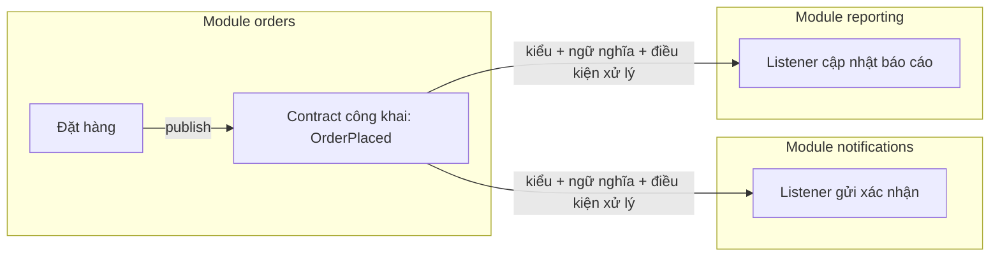
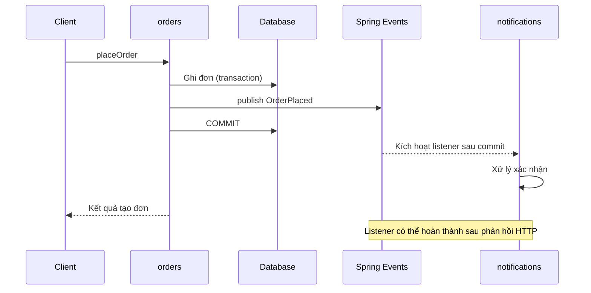

# Event contract là gì trong Spring Modulith?

## 1. Event contract: hợp đồng giữa module phát và module nhận

Trong Spring Modulith, một **application event** thông báo rằng một sự thật nghiệp vụ vừa xảy ra. Module phát (publisher) công bố sự kiện; các module nhận (consumer/listener) quyết định có cần phản ứng hay không. Ví dụ, module `orders` công bố `OrderPlaced` sau khi đơn được chấp nhận, còn `notifications` và `reporting` lần lượt gửi xác nhận và cập nhật báo cáo.

**Event contract (hợp đồng sự kiện)** là tập hợp các cam kết mà module phát và module nhận phải cùng hiểu để giao tiếp chính xác. Hợp đồng bao gồm **tên và ý nghĩa sự kiện, cấu trúc payload, thời điểm phát, ranh giới module, kỳ vọng xử lý, cách ứng phó lỗi và quy tắc thay đổi theo thời gian**.

Đây là một hợp đồng kiến trúc và nghiệp vụ, không chỉ là chữ ký của một Java `record`. Hai ứng dụng có thể cùng biên dịch với `OrderPlaced(UUID orderId)` nhưng vẫn xử lý sai nếu một bên hiểu “đặt đơn” là **đã tiếp nhận yêu cầu** còn bên kia hiểu là **đơn đã commit và đủ điều kiện thực hiện**.

Trong module học `SPRING_MODULITH_APPLICATION_EVENTS`, event contract là mắt xích kết nối các mục tiêu: giảm phụ thuộc giữa các module, bảo vệ ranh giới nghiệp vụ, dùng publisher/listener đúng cách, xử lý sau commit, theo dõi publication bằng Event Publication Registry, retry có kiểm soát và kiểm thử việc giao sự kiện đáng tin cậy.

### Hình dung một hợp đồng sự kiện



`orders` không cần biết `notifications` có sử dụng SMTP hay `reporting` lưu bảng tổng hợp nào. Đổi lại, các consumer phải hiểu chính xác contract của `OrderPlaced`. **Giảm phụ thuộc vào implementation không có nghĩa loại bỏ phụ thuộc vào hợp đồng.**

## 2. Event contract cam kết những gì?

Một contract thực tế thường có các thành phần sau:

| Thành phần | Câu hỏi phải trả lời | Ví dụ với `OrderPlaced` |
| --- | --- | --- |
| **Tên và chủ sở hữu** | Module nào sở hữu event và được phép quyết định ý nghĩa? | `orders` sở hữu `OrderPlaced` |
| **Ngữ nghĩa nghiệp vụ** | Chính xác điều gì đã xảy ra? | Đơn được chấp nhận theo quy tắc đặt hàng |
| **Điều kiện phát** | Khi nào publisher phát? | Sau khi tạo đơn hợp lệ trong transaction đặt hàng |
| **Payload** | Có những field nào, kiểu dữ liệu, đơn vị và ràng buộc ra sao? | `eventId`, `orderId`, số tiền, đơn vị tiền, thời điểm |
| **Thời điểm xử lý** | Consumer được xử lý trước hay sau commit? | Gửi email sau commit thành công |
| **Giao nhận và lỗi** | Có thể chậm, mất, lặp, sai thứ tự? Ai xử lý lại? | Listener có thể retry; phải idempotent |
| **Tương thích** | Đổi kiểu, tên field, ý nghĩa được quản lý thế nào? | Giữ khả năng đọc publication cũ khi nâng cấp |
| **Ranh giới** | Module nhận được phép phụ thuộc vào kiểu nào? | Event công khai; entity và repository vẫn nội bộ |
| **Vận hành** | Quan sát thành công/thất bại bằng cách nào? | Liên hệ log và publication theo `eventId` |

Không phải event nào cũng cần toàn bộ metadata trong bảng được **đưa vào payload**. Chẳng hạn, phương thức retry, quyền truy cập, thời gian tối đa mong đợi và ý nghĩa event có thể được mô tả bằng tài liệu hoặc cấu hình. Điều quan trọng là các bên hiểu cùng một cam kết, và phần nào **chưa được bảo đảm**.

## 3. Phân biệt event với command và lời gọi API

Event thường được đặt tên theo **điều đã xảy ra**, còn command mô tả **điều muốn hệ thống làm**.

| Thông điệp | Loại | Hệ quả thiết kế |
| --- | --- | --- |
| `OrderPlaced` | Event: đơn đã được đặt | Nhiều consumer có thể độc lập phản ứng |
| `PaymentCaptured` | Event: tiền đã được thu | Listener không được giả định một transaction chung |
| `SendConfirmationEmail` | Command: yêu cầu gửi email | Có người thực hiện cụ thể và chính sách thành công/thất bại rõ |
| `reserveStock(orderId)` | API/command đồng bộ | Caller có thể cần kết quả ngay để quyết định chấp nhận đơn |

Nếu “giữ được tồn kho” là điều kiện bắt buộc trước khi chấp nhận đơn, một event phát rồi trả về thành công ngay **không đủ** để thực thi bất biến đó. Có thể cần gọi đồng bộ hoặc một quy trình điều phối có trạng thái. Ngược lại, gửi thư hoặc đồng bộ read model sau khi đơn commit là các tác dụng phụ thường phù hợp với application events.

**Contract của event xác định một sự thật.** Nó không hứa rằng tất cả listener đã hoàn tất trước khi publisher trả kết quả, trừ khi hệ thống chủ động lựa chọn và chứng minh được semantics đó.

## 4. Ví dụ event contract trong Java

Giả sử contract nghiệp vụ là:

> `OrderPlaced` được phát khi module `orders` ghi nhận một đơn đặt hàng hợp lệ. Consumer chỉ được thực hiện tác dụng phụ bên ngoài sau khi transaction đặt hàng commit. `amountAtPlacement` là số tiền tại thời điểm chấp nhận đơn, tính bằng `currencyCode`. Sự kiện có ID ổn định để đối chiếu và chống xử lý trùng khi được giao lại.

### 4.1. Định nghĩa kiểu event ở API công khai

Trong cách phát hiện module mặc định của Spring Modulith, có thể đặt event ở **base package của module phát**:

```java
// File: com/example/shop/orders/OrderPlaced.java
package com.example.shop.orders;

import java.math.BigDecimal;
import java.time.Instant;
import java.util.Objects;
import java.util.UUID;

/**
 * Đơn hàng đã được module orders chấp nhận.
 *
 * eventId: ID duy nhất của lần phát sinh sự kiện, giữ nguyên khi retry.
 * orderId: ID đơn hàng.
 * amountAtPlacement: số tiền được chốt khi đặt đơn.
 * currencyCode: mã tiền tệ ISO 4217, ví dụ "VND".
 * occurredAt: thời điểm ứng dụng tạo event, không mặc định là lúc commit.
 */
public record OrderPlaced(
        UUID eventId,
        UUID orderId,
        BigDecimal amountAtPlacement,
        String currencyCode,
        Instant occurredAt
) {
    public OrderPlaced {
        Objects.requireNonNull(eventId, "eventId");
        Objects.requireNonNull(orderId, "orderId");
        Objects.requireNonNull(amountAtPlacement, "amountAtPlacement");
        Objects.requireNonNull(currencyCode, "currencyCode");
        Objects.requireNonNull(occurredAt, "occurredAt");

        if (amountAtPlacement.signum() < 0) {
            throw new IllegalArgumentException("Negative amount");
        }
        if (!currencyCode.matches("[A-Z]{3}")) {
            throw new IllegalArgumentException("Invalid currency code format");
        }
    }
}
```

Kiểm tra `[A-Z]{3}` chỉ bảo đảm **định dạng ba chữ cái in hoa**, chưa xác minh mã có thật trong ISO 4217 hay không. Nếu nghiệp vụ cần xác thực chặt, cần chính sách kiểm tra mã tiền tệ phù hợp. Đặt validation ngay trong record giúp các publisher và test không vô tình tạo payload sai.

Đây là **dữ liệu bất biến ở mức field**: `UUID`, `Instant`, `BigDecimal` và `String` đều phù hợp. Nếu event chứa `List` hoặc `Map`, cần defensive copy; `record` không tự bảo đảm bất biến sâu cho đối tượng mutable.

### 4.2. Publisher giữ ownership của dữ liệu

```java
// File: com/example/shop/orders/internal/PlaceOrderService.java
package com.example.shop.orders.internal;

import com.example.shop.orders.OrderPlaced;
import java.time.Clock;
import java.time.Instant;
import java.util.UUID;
import org.springframework.context.ApplicationEventPublisher;
import org.springframework.stereotype.Service;
import org.springframework.transaction.annotation.Transactional;

@Service
class PlaceOrderService {
    private final OrderRepository orders;
    private final ApplicationEventPublisher events;
    private final Clock clock;

    PlaceOrderService(
            OrderRepository orders,
            ApplicationEventPublisher events,
            Clock clock
    ) {
        this.orders = orders;
        this.events = events;
        this.clock = clock;
    }

    @Transactional
    public UUID place(PlaceOrderCommand input) {
        var order = orders.createFrom(input);

        events.publishEvent(new OrderPlaced(
                UUID.randomUUID(),
                order.id(),
                order.amountAtPlacement(),
                order.currencyCode(),
                Instant.now(clock)
        ));

        return order.id();
    }
}
```

`OrderRepository`, `PlaceOrderCommand` và kiểu trả về từ `createFrom(...)` ở đây là các thành phần minh họa do module `orders` định nghĩa. Để chạy thực tế, dự án cần triển khai chúng, cung cấp `Clock` bean và một API nghiệp vụ công khai cho module gọi tạo đơn. Consumer của event **không cần import repository hoặc entity** nội bộ.

Quan trọng: `publishEvent(...)` trong một method có `@Transactional` diễn ra **trước khi transaction kết thúc**. Contract nghiệp vụ “đơn đã được chấp nhận” cần được bảo đảm tại lúc commit thành công, nên những side effect không thể rollback phải được xử lý **sau commit**.

### 4.3. Consumer chỉ phụ thuộc vào contract

```java
// File: com/example/shop/notifications/internal/OrderEmailListener.java
package com.example.shop.notifications.internal;

import com.example.shop.orders.OrderPlaced;
import org.springframework.modulith.events.ApplicationModuleListener;
import org.springframework.stereotype.Component;

@Component
class OrderEmailListener {
    private final ConfirmationSender sender;

    OrderEmailListener(ConfirmationSender sender) {
        this.sender = sender;
    }

    @ApplicationModuleListener
    void on(OrderPlaced event) {
        // sendOnce là API minh họa; implementation phải xử lý trùng.
        sender.sendOnce(event.eventId(), event.orderId());
    }
}
```

`@ApplicationModuleListener` của Spring Modulith kết hợp mô hình listener **bất đồng bộ, sau commit và có transaction xử lý riêng**. Nó phù hợp cho những tác dụng phụ không cần ngăn request đặt hàng hoàn thành. Bản thân annotation **không** làm email trở thành tác dụng phụ có thể rollback hoặc bảo đảm email chỉ được gửi một lần. `sender.sendOnce(...)` phải có chiến lược idempotency/đối soát phù hợp với bên cung cấp dịch vụ email.

Trong ví dụ, `notifications` chỉ import kiểu event ở API công khai của `orders`. Cách tổ chức này giúp đổi cách lưu đơn hàng hoặc cách gửi email mà không cần đổi hợp đồng giữa hai module.

## 5. Contract về transaction và thời điểm

Trong cùng một ứng dụng Spring Boot, cách khai báo listener ảnh hưởng đến hành vi:

| Listener | Thời điểm theo cấu hình mặc định | Ý nghĩa contract |
| --- | --- | --- |
| `@EventListener` | Gọi tại lúc publish, thường đồng bộ trong cùng thread | Listener có thể chạy trước commit, làm chậm hoặc làm lỗi publisher |
| `@Async` trên listener | Chạy bằng executor ở thread khác | Không tự chờ transaction publisher commit |
| `@TransactionalEventListener(phase = AFTER_COMMIT)` | Khi transaction publisher commit thành công | Không mặc nhiên bất đồng bộ hoặc bền vững |
| `@ApplicationModuleListener` | Bất đồng bộ, sau commit, có transaction riêng cho listener | Cần xử lý lỗi và giao lại theo cấu hình thực tế |

Ví dụ về chuỗi thời gian dự kiến với listener sau commit:



Thứ tự hiển thị ở sơ đồ là luồng logic; **không dùng thứ tự mũi tên để giả định lịch thực thi chính xác** giữa callback sau commit, thread bất đồng bộ và phản hồi HTTP. Nếu publisher rollback, transactional listener ở pha `AFTER_COMMIT` thông thường sẽ không được gọi. Nếu phát event **ngoài transaction**, `@TransactionalEventListener` theo mặc định không chạy trừ khi cấu hình `fallbackExecution = true`; fallback không biến thao tác đó thành một commit.

Contract nên ghi rõ:

- Event mô tả sự thật ở **thời điểm nào**: khi tiếp nhận, khi xác thực hay khi commit?
- Consumer có được phép thấy dữ liệu **chưa commit** không?
- Việc cập nhật ở consumer là **đồng bộ bắt buộc** hay **eventual consistency**?
- Publisher có cần quan tâm kết quả xử lý listener không?

Nếu listener sau commit đồng bộ cần ghi database, phải hiểu transaction lúc đó đã hoàn tất. Với thao tác ghi mới, cân nhắc transaction mới như `REQUIRES_NEW`; không dựa vào tài nguyên transaction vừa commit như thể nó sẽ commit lần thứ hai.

## 6. Contract về giao nhận: trễ, lặp, lỗi và thứ tự

Không nên coi `ApplicationEventPublisher.publishEvent(...)` là bảo đảm “đã giao và xử lý xong ở tất cả listener”. Spring application events trước hết là cơ chế giao tiếp trong tiến trình ứng dụng. Kết quả thực tế phụ thuộc loại listener và hạ tầng:

| Tình huống | Tác động đối với contract | Cách phản ứng |
| --- | --- | --- |
| Publisher commit nhưng listener chưa chạy xong | Projection hoặc email có thể đến muộn | Mô tả eventual consistency và quan sát độ trễ |
| Listener xử lý xong side effect rồi lỗi trước khi ghi hoàn tất | Cùng event có thể bị xử lý lại | Dùng `eventId` ổn định và idempotency |
| Listener lỗi hoặc ứng dụng dừng | Publication có thể chưa hoàn tất | Kiểm tra registry/kho lưu trữ và quy trình phục hồi |
| Event mới tới trước event cũ | State có thể bị ghi đè sai | Dùng version/sequence hoặc đọc trạng thái hiện hành |
| Nhiều listener cùng nhận một event | Một listener thành công, listener khác thất bại | Mỗi listener chịu trách nhiệm kết quả và phục hồi riêng |

### 6.1. Vai trò của Event Publication Registry

Spring Modulith có **Event Publication Registry** để theo dõi việc phát các sự kiện cho listener giao dịch được hỗ trợ, khi ứng dụng tích hợp kho lưu trữ publication phù hợp. Registry giúp phát hiện publication chưa được đánh dấu hoàn tất, làm cơ sở cho cơ chế xử lý lại.

Tuy nhiên, contract **không được hứa** các điều chưa cấu hình hoặc chưa kiểm chứng:

- Không phải mọi `@EventListener` đều tự được theo dõi.
- Cần xác minh backend lưu publication, transaction, phiên bản thư viện và cấu hình phục hồi.
- Không được mặc định event sẽ được retry vô hạn hoặc phục hồi tự động mà không có cơ chế vận hành phù hợp.
- Trạng thái publication hoàn tất không tương đương bảo đảm **exactly once** cho một email, HTTP call hay hệ thống thanh toán bên ngoài.

Khi chuyển sự kiện sang message broker hoặc sang ứng dụng khác, còn phải xét hợp đồng về topology, định dạng tuần tự hóa, xác nhận nhận, partition/order và chính sách retry của broker/consumer. **Một application event trong JVM không tự trở thành message giữa nhiều tiến trình hoặc nhiều instance.**

### 6.2. Định danh sự kiện và xử lý lặp

Hai ID dưới đây giải quyết hai vấn đề khác nhau:

```text
orderId = danh tính đơn hàng, có thể xuất hiện ở nhiều event
eventId = danh tính một lần xảy ra sự kiện, giữ nguyên khi retry/replay
```

Nếu consumer lưu dấu xử lý, có thể dùng khóa duy nhất theo `(consumer_name, event_id)`. Để việc ghi dấu không làm sai kết quả, dấu đã xử lý và cập nhật nghiệp vụ nên nằm trong **cùng transaction của consumer**. Khi tác dụng phụ là email hoặc một API ngoài database, phải thiết kế thêm idempotency key phía nhận hoặc một quy trình đối soát.

Ngược lại, `eventId` không bắt buộc trong tất cả payload. Nếu consumer chỉ xóa cache theo `orderId`, việc xóa lại cùng khóa vốn có thể idempotent. Chỉ thêm metadata khi có một nhu cầu kiểm chứng được.

### 6.3. Thứ tự không mặc nhiên được bảo đảm

`OrderPlaced(orderId)` và `OrderCancelled(orderId)` có thể đến consumer ở thứ tự khác thứ tự phát khi listener bất đồng bộ hoặc retry. Nếu cần xử lý snapshot lần lượt, contract có thể thêm `aggregateVersion` được quản lý tăng đơn điệu, hoặc yêu cầu consumer tải trạng thái mới nhất thay vì áp dụng sự kiện cũ lên projection.

Không nên thay thế version bằng `occurredAt` một cách mặc định: timestamp có thể trùng, đồng hồ lệch và retry muộn.

## 7. Event contract được công khai qua ranh giới module như thế nào?

Một kiểu Java `public` không nhất thiết là một API mà module khác nên phụ thuộc. Với cách tổ chức Spring Modulith mặc định, **base package** của module được xem là API công khai, còn các subpackage thường là nội bộ, trừ phần được khai báo thành **named interface**.

Ví dụ:

```text
com.example.shop/
  orders/
    OrderPlaced.java          <-- event/API công khai của orders
    internal/
      PlaceOrderService.java  <-- implementation riêng của orders
      OrderRepository.java    <-- repository nội bộ
  notifications/
    internal/
      OrderEmailListener.java <-- consumer sở hữu listener
```

Nếu muốn gom event vào `orders.events`, có thể công bố một named interface:

```java
// File: orders/events/package-info.java
@org.springframework.modulith.NamedInterface("events")
package com.example.shop.orders.events;
```

Khi đó, các event được công bố trong package này là một phần của `orders::events`. Một module nhận có thể thể hiện ràng buộc rõ ràng với interface này:

```java
// File: notifications/package-info.java
@org.springframework.modulith.ApplicationModule(
    allowedDependencies = "orders::events"
)
package com.example.shop.notifications;
```

Ví dụ này đòi hỏi kiểu event thực sự đặt tại `orders.events`. Với cấu hình `allowedDependencies` như trên, `notifications` chỉ được phụ thuộc theo các interface được khai báo cho module đó. **Named interface và allowed dependencies giúp kiểm tra cấu trúc phụ thuộc; chúng không thay đổi semantics của transaction hoặc độ bền giao event.**

Để kiểm tra kiến trúc:

```java
import com.example.shop.ShopApplication;
import org.junit.jupiter.api.Test;
import org.springframework.modulith.core.ApplicationModules;

class ModuleContractTests {
    @Test
    void verifiesModuleBoundaries() {
        ApplicationModules.of(ShopApplication.class).verify();
    }
}
```

Test này có thể phát hiện consumer import kiểu từ package nội bộ hoặc phụ thuộc module không hợp lệ theo cấu trúc đã định nghĩa. Nó không chứng minh payload đúng ngữ nghĩa, listener chạy sau commit hay retry an toàn: các cam kết đó cần được kiểm thử riêng.

## 8. Tiến hóa contract khi hệ thống thay đổi

Event contract có vòng đời dài hơn một method của publisher. Đặc biệt khi có Event Publication Registry, transactional outbox hoặc broker, một event **đã được lưu từ phiên bản ứng dụng trước** có thể tiếp tục được đọc ở phiên bản sau.

### 8.1. Những thay đổi cần đánh giá

| Thay đổi | Rủi ro | Cách tiếp cận |
| --- | --- | --- |
| Thêm field tùy chọn với default hợp lý | Reader cũ hoặc dữ liệu cũ không có field | Kiểm tra serializer và logic fallback ở consumer |
| Đổi tên/xóa field | Consumer hoặc publication cũ không đọc được | Migration, adapter hoặc event version mới |
| Đổi tên package/class event | Bản ghi cũ có thể chứa thông tin kiểu Java | Kiểm tra deserialize/replay bằng dữ liệu cũ |
| Đổi `BigDecimal` sang `double` | Mất độ chính xác tiền tệ | Bảo toàn kiểu miền nghiệp vụ và contract số học |
| Đổi đơn vị “đồng” thành “nghìn đồng” | Dữ liệu vẫn đọc được nhưng sai ý nghĩa | Đổi tên/phiên bản và cập nhật consumer có kiểm soát |
| Đổi ý nghĩa “đã đặt” thành “đã thanh toán” | Phá vỡ logic dù chữ ký không đổi | Tạo sự kiện riêng `PaymentCaptured` |
| Chuyển listener từ đồng bộ sang sau commit | Thay đổi thứ tự xử lý và khả năng nhìn dữ liệu | Đánh giá lại các yêu cầu consistency |

**Tương thích schema và tương thích ngữ nghĩa là hai khía cạnh khác nhau.** Một event vẫn deserialize được chưa chắc đã an toàn nếu ý nghĩa nghiệp vụ bị đổi.

### 8.2. Quy trình thay đổi hợp đồng

Một quy trình thực tế:

1. Xác định **module sở hữu** và tất cả consumer đã biết.
2. Nêu rõ thay đổi: payload, ngữ nghĩa, thời điểm phát hay delivery policy.
3. Phân loại khả năng tương thích với consumer và **publication đang chờ**.
4. Nếu cần, phát hành kiểu event mới, adapter đọc phiên bản cũ hoặc triển khai chuyển đổi dữ liệu.
5. Kiểm thử phiên bản mới với event đã được lưu bởi phiên bản cũ; theo dõi publication chưa hoàn tất khi rollout.
6. Chỉ ngừng hỗ trợ contract cũ khi có bằng chứng các consumer và dữ liệu cũ đã được xử lý.

Một field `schemaVersion` có thể hữu ích khi payload được lưu hoặc truyền qua ranh giới hệ thống, nhưng bản thân số phiên bản **không tự cung cấp logic migration**. Chính sách versioning và serializer phải được xác định theo hạ tầng thực tế.

## 9. Contract cho consumer: được kỳ vọng những gì?

Publisher chịu trách nhiệm phát event đúng nghiệp vụ và đúng payload. Consumer chịu trách nhiệm **xử lý phù hợp với các cam kết được công bố**, gồm:

- Chỉ phụ thuộc vào kiểu event/API công khai, không truy cập trực tiếp entity/repository nội bộ của publisher.
- Hiểu rõ dữ liệu trong event là **snapshot lịch sử** hay **khóa để truy vấn trạng thái hiện tại**. Nếu chỉ có ID, đọc lại nguồn sau commit có thể cho trạng thái đã thay đổi.
- Không giả định transaction publisher vẫn còn mở trong listener sau commit.
- Xử lý khả năng giao lặp, chậm hoặc sai thứ tự nếu đường giao nhận có thể xảy ra các tình huống đó.
- Ghi lỗi, độ trễ, số lần xử lý và kết quả theo định danh có thể đối chiếu; tránh log dữ liệu nhạy cảm.
- Báo cáo hoặc xử lý không hoàn tất thay vì âm thầm bỏ qua lỗi khiến publication kẹt lâu.

Ví dụ, một listener tăng `dailyOrderCount` bằng phép `count + 1` cho mỗi lần nhận event có thể đếm trùng khi retry. Nếu mục tiêu là một bản ghi cho mỗi đơn, consumer có thể ghi theo khóa `orderId` hoặc `eventId` cùng ràng buộc duy nhất và transaction phù hợp.

Không nên xem một listener **xử lý thành công** chỉ vì method không ném exception, nếu nó đã nuốt lỗi từ API bên ngoài và dữ liệu nghiệp vụ chưa đạt yêu cầu. Quy tắc xác nhận “hoàn tất” cũng là một phần contract vận hành.

## 10. Một bản mô tả contract mẫu để thảo luận giữa các module

Ví dụ sau là **tài liệu hợp đồng viết cho con người**, không phải định dạng cấu hình mặc định bắt buộc của Spring Modulith:

| Thuộc tính | Cam kết của `OrderPlaced` |
| --- | --- |
| Chủ sở hữu | `orders` |
| Ý nghĩa | Đơn hàng đã được ghi nhận hợp lệ |
| Điều kiện phát | Trong transaction đặt hàng; side effect consumer chỉ chạy khi commit thành công |
| Payload | `eventId: UUID`, `orderId: UUID`, `amountAtPlacement: BigDecimal`, `currencyCode: String`, `occurredAt: Instant` |
| Ý nghĩa tiền | Tổng tiền tại thời điểm đặt hàng, theo định nghĩa đã chốt của nghiệp vụ |
| Đồng bộ | Consumer chịu eventual consistency; publisher không chờ email hoặc báo cáo hoàn thành |
| Lặp | Cùng event có thể được xử lý lại khi phục hồi; `eventId` không đổi |
| Thứ tự | Không hứa thứ tự tuyệt đối giữa các listener; consumer tự xử lý nếu phụ thuộc thứ tự |
| Khôi phục | Dùng registry và quy trình phục hồi được cấu hình, giám sát publication chưa hoàn tất |
| Phạm vi công khai | Base package `orders` hoặc named interface dành cho events |
| Tương thích | Kiểm tra event cũ trước khi đổi payload hoặc kiểu Java; không đổi ngầm ý nghĩa |

Bản mô tả này hữu ích khi có nhiều listener: người viết `notifications` có thể đặt câu hỏi “nếu email gửi thành công nhưng đánh dấu publication thất bại, gửi lại có trùng không?”, còn người viết `reporting` có thể hỏi “số tiền là snapshot hay giá trị hiện hành?”. Cả hai câu trả lời đều tác động trực tiếp đến cách thiết kế consumer.

## 11. Kiểm thử hợp đồng sự kiện

Kiểm thử tốt cần xác nhận không chỉ cấu trúc Java, mà cả các cam kết vận hành:

| Nhóm kiểm thử | Tình huống cần chứng minh |
| --- | --- |
| **Payload validation** | Không tạo được event thiếu `eventId` hoặc có số tiền âm |
| **Semantic test** | Publisher chỉ phát `OrderPlaced` khi nghiệp vụ tạo đơn thành công |
| **Transaction test** | Rollback publisher không kích hoạt side effect của listener sau commit |
| **Module boundary test** | Consumer chỉ import contract công khai, `ApplicationModules.verify()` thành công |
| **Duplicate delivery** | Cùng `eventId` được xử lý lại không làm sai số lượng/email/thanh toán |
| **Ordering test** | Event cũ không thể ghi đè projection mới nếu contract cần version |
| **Recovery test** | Publication chưa hoàn tất đọc lại và xử lý theo cấu hình registry thực tế |
| **Compatibility test** | Phiên bản mới đọc được những event cũ còn cần replay |
| **Observability test** | Lỗi/tồn đọng được báo cáo và có thể đối chiếu theo event |

Ví dụ unit test cho ràng buộc trong record:

```java
import static org.junit.jupiter.api.Assertions.assertThrows;

import com.example.shop.orders.OrderPlaced;
import java.math.BigDecimal;
import java.time.Instant;
import java.util.UUID;
import org.junit.jupiter.api.Test;

class OrderPlacedContractTest {
    @Test
    void rejectsNegativeAmount() {
        assertThrows(IllegalArgumentException.class, () -> new OrderPlaced(
                UUID.randomUUID(),
                UUID.randomUUID(),
                new BigDecimal("-100.00"),
                "VND",
                Instant.parse("2026-01-01T00:00:00Z")
        ));
    }
}
```

Test trên chỉ kiểm tra một invariant của payload. Để chứng minh **“sau commit”** hay **“được xử lý lại khi thất bại”**, cần integration test sử dụng cấu hình transaction, listener và Event Publication Registry đúng như ứng dụng triển khai. Nếu có kho lưu publication, nên có test tương thích serialization với dữ liệu đại diện của phiên bản trước.

## 12. Các lỗi thường gặp khi định nghĩa contract

**Lỗi 1 — Chỉ mô tả class và field, không mô tả ý nghĩa.** Consumer không biết sự kiện được phát trước hay sau khi điều kiện nghiệp vụ được xác nhận, dẫn đến xử lý sai dù code biên dịch.

**Lỗi 2 — Truyền entity hoặc repository nội bộ.** Event bộc lộ chi tiết persistence, dễ gặp lazy loading, dữ liệu mutable và vướng ranh giới Spring Modulith.

**Lỗi 3 — Cho rằng `@Async` đồng nghĩa với sau commit.** Listener có thể đọc dữ liệu khi transaction publisher chưa commit; cần chọn đúng transactional listener và pha xử lý.

**Lỗi 4 — Cam kết “chạy đúng một lần” chỉ dựa vào registry.** Publication hoàn tất không tự bảo đảm side effect HTTP/email chỉ xảy ra một lần; listener cần idempotency và đôi khi đối soát.

**Lỗi 5 — Đổi ý nghĩa event nhưng giữ nguyên tên.** Consumer cũ có thể tiếp tục chạy và tạo dữ liệu sai mà không phát sinh exception.

**Lỗi 6 — Coi event trong một tiến trình là message broker.** Khi triển khai nhiều instance hoặc dịch vụ, application events không tự tạo kênh liên tiến trình, phân phối công việc, backpressure hay retention.

**Lỗi 7 — Không định nghĩa cách quan sát xử lý lỗi.** Publication lỗi nhưng không có số liệu tồn đọng hoặc quy trình phục hồi khiến dữ liệu dần mất nhất quán.

## 13. Checklist trước khi công bố một event contract

1. **Tên và chủ sở hữu:** Event mô tả đúng một sự thật nghiệp vụ, module nào chịu trách nhiệm thay đổi contract?
2. **Điều kiện:** Khi nào sự thật đó được xem là đã xảy ra? Transaction đã commit chưa?
3. **Payload:** Field tối thiểu nào thực sự cần? Có quy định kiểu, đơn vị, nullability và ngữ nghĩa lịch sử không?
4. **Ranh giới:** Event thuộc API công khai; module nhận không phụ thuộc nội bộ module phát?
5. **Thực thi:** Listener nào cần sau commit, đồng bộ hay bất đồng bộ? Có chấp nhận eventual consistency?
6. **Lỗi:** Có thể retry, giao lặp, giao trễ hoặc sai thứ tự? Consumer làm sao xử lý an toàn?
7. **Khôi phục:** Registry/kho lưu publication và cơ chế phục hồi đã cấu hình, kiểm chứng và giám sát chưa?
8. **Tương thích:** Dữ liệu event cũ và consumer cũ có còn hoạt động khi đổi contract?
9. **Bảo vệ dữ liệu:** Payload và log có giới hạn dữ liệu nhạy cảm và kích thước phù hợp?
10. **Kiểm thử:** Có test cho schema, nghiệp vụ, boundary, commit/rollback, retry và recovery?

**Ghi nhớ:** Event contract là **cam kết dữ liệu và hành vi giao tiếp giữa các module**, không đơn thuần là tên một class. Khi xác định đúng sự thật nghiệp vụ, payload, ranh giới công khai và kỳ vọng xử lý, Spring Modulith giúp các module phối hợp ít phụ thuộc hơn. Các yêu cầu về độ tin cậy cần được hoàn thiện bằng listener sau commit, cơ chế ghi nhận publication, retry/idempotency, kiểm thử và quan sát có chủ đích.
