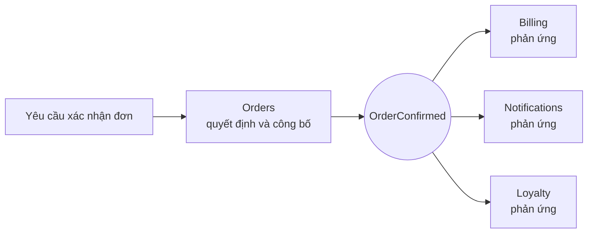
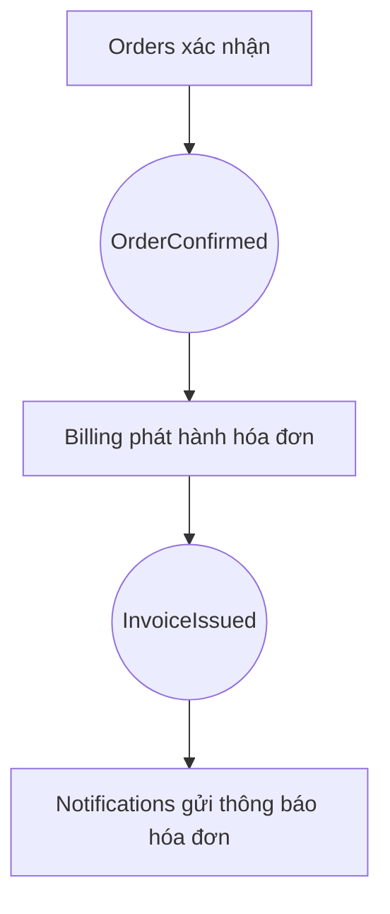
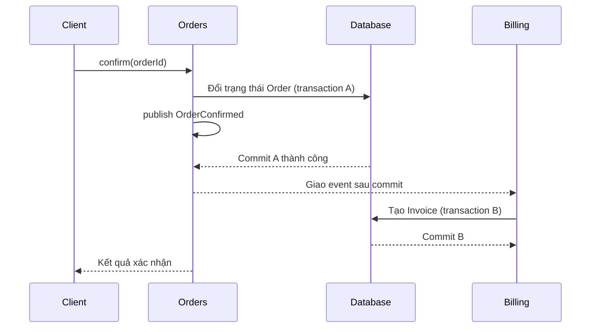
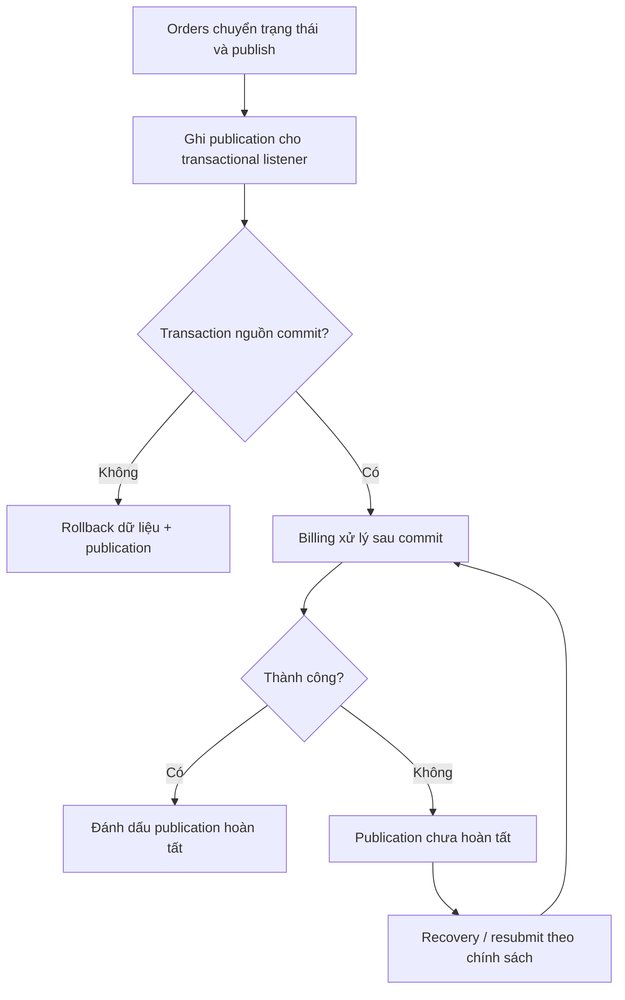

# Người phát hành hợp đồng

> **Chương:** Hợp đồng sự kiện  
> **Phạm vi học phần:** `SPRING_MODULITH_APPLICATION_EVENTS` — giao tiếp giữa các module Spring Modulith bằng application events nhằm giảm phụ thuộc và giữ ranh giới nghiệp vụ; thực hành publisher, listener, xử lý sau commit, Event Publication Registry, retry, kiểm thử và quan sát việc giao sự kiện đáng tin cậy.

## 1. Ai có quyền tuyên bố một sự kiện đã xảy ra?

Trong hệ thống bán hàng, khi đơn chuyển sang trạng thái `CONFIRMED`, các module khác có thể cần phản ứng:

- **Billing** lập hóa đơn.
- **Notifications** gửi thư xác nhận.
- **Loyalty** ghi nhận điểm thưởng.
- **Reporting** cập nhật báo cáo.

Giả sử Billing tự tạo và phát `OrderConfirmed` vì nó vừa nhận một yêu cầu lập hóa đơn. Tình huống này có thể dẫn tới sai lệch: việc Billing bắt đầu lập hóa đơn **không phải bằng chứng** rằng Orders đã xác nhận đơn hợp lệ và commit trạng thái đó.

**Người phát hành hợp đồng sự kiện** (*event contract publisher/producer*) là thành phần có trách nhiệm **công bố một sự thật nghiệp vụ** theo hợp đồng sự kiện đã được xác định. Trong thiết kế modular monolith, trách nhiệm này cần gắn với **module sở hữu sự thật nghiệp vụ**.



Ví dụ, **Orders** sở hữu trạng thái đơn nên là **owner** của hợp đồng `OrderConfirmed`. Bên trong Orders, một service hoặc aggregate có thể tạo event và một service dùng `ApplicationEventPublisher` để phát. Billing được phép **tiêu thụ** hợp đồng đó, nhưng không tự ý phát một sự kiện mang nghĩa “Orders đã xác nhận đơn”.

## 2. Phân biệt bốn vai trò thường bị lẫn

| Vai trò | Trách nhiệm | Ví dụ |
|---|---|---|
| **Business/event owner** | Quyết định ngữ nghĩa, điều kiện và vòng đời hợp đồng | Module Orders sở hữu `OrderConfirmed` |
| **Contract maintainer** | Quản lý định nghĩa Java, tài liệu, thay đổi tương thích | Nhóm chịu trách nhiệm mã nguồn Orders |
| **Runtime publisher** | Tạo event instance và gọi cơ chế phát tại thời điểm hợp lệ | `OrderService.confirm(...)` gọi `publishEvent(...)` |
| **Consumer/listener** | Tiếp nhận và phản ứng bằng dữ liệu, nghiệp vụ thuộc module mình | Billing tạo invoice sau khi nhận `OrderConfirmed` |

Các vai trò có thể do cùng một nhóm đảm trách, nhưng không đồng nghĩa:

- **Owner của một event type** xác định *ai được kết luận rằng sự việc đã xảy ra*.
- **Runtime publisher** là đoạn code cụ thể thực hiện phát một *event instance*.
- **Contract maintainer** phê duyệt thay đổi cấu trúc, phiên bản, tài liệu và quy tắc tương thích.
- **Consumer** phụ thuộc vào hợp đồng công khai và thiết kế phản ứng của riêng mình.

Trong Spring, tên `ApplicationEventPublisher` là **một interface kỹ thuật để phát event**, không phải định danh chủ sở hữu nghiệp vụ. Bất kỳ bean nào được inject interface này cũng có thể gọi `publishEvent` về mặt kỹ thuật; ràng buộc ai **nên** phát loại event nào cần được bảo vệ bằng thiết kế, review và kiểm thử.

## 3. Hợp đồng do publisher công bố bao gồm những gì?

Hợp đồng sự kiện không chỉ là Java `record`. Nó phải mô tả **điều được bảo đảm là đúng khi event được công bố**, cùng những dữ liệu mà consumer có thể dựa vào.

| Thành phần hợp đồng | Câu hỏi publisher cần trả lời | Ví dụ với `OrderConfirmed` |
|---|---|---|
| **Tên và ý nghĩa** | Điều gì đã xảy ra? | Đơn đã được xác nhận theo quy tắc Orders |
| **Module owner** | Ai có quyền công bố sự thật này? | Orders |
| **Điều kiện phát** | Khi nào có một lần phát sinh mới? | Chuyển trạng thái hợp lệ sang `CONFIRMED` |
| **Ranh giới giao dịch** | Dữ liệu nguồn đã commit trước khi listener hành động chưa? | Publisher phát trong transaction; consumer quan trọng xử lý sau commit |
| **Payload** | Consumer được dựa vào dữ liệu nào? | `eventId`, `orderId`, `occurredAt` |
| **Tính bất biến** | Dữ liệu có thể bị thay đổi sau khi publish? | Dùng immutable `record`, value objects |
| **Tính tương thích** | Khi đổi hợp đồng, cần duy trì consumer cũ thế nào? | Xem xét publication còn tồn, version, migration |
| **Điều kiện phát lại** | Một lệnh HTTP retry có tạo event mới không? | Không tạo sự kiện mới khi không có chuyển trạng thái mới |
| **Quan sát** | Theo dõi event và kết quả consumer qua khóa nào? | `eventId`, `orderId`, `correlationId` |

**Một hợp đồng tốt diễn đạt sự thật, không giấu một lệnh.** `OrderConfirmed` thông báo một sự kiện có thể được nhiều module quan tâm. `CreateInvoiceNow` là yêu cầu thực hiện một hành động cụ thể và có tính command; dùng event để che giấu một command có thể khiến hệ thống khó hiểu và khó kiểm soát thất bại.

## 4. Chọn đúng publisher dựa trên quyền sở hữu nghiệp vụ

Xét một số sự kiện:

| Event | Module phù hợp làm owner | Bằng chứng để được phát | Consumer tiềm năng |
|---|---|---|---|
| `OrderConfirmed` | Orders | Trạng thái đơn chuyển hợp lệ sang confirmed | Billing, Notifications |
| `PaymentCaptured` | Payments | Kết quả thu tiền đã được xác nhận theo quy trình Payments | Orders, Accounting |
| `InvoiceIssued` | Billing | Hóa đơn đã được phát hành hợp lệ | Notifications, Reporting |
| `StockReserved` | Inventory | Đã giữ hàng thành công trong Inventory | Orders, Shipping |
| `OrderCancelled` | Orders | Đơn chuyển hợp lệ sang cancelled | Inventory, Notifications |

Sự kiện nên xuất phát từ **module biết sự thật**, không nhất thiết là module đầu tiên nhận HTTP request. Một HTTP controller chỉ nhận yêu cầu `confirmOrder`; Orders mới quyết định liệu yêu cầu đó có được chấp nhận hay không.

### 4.1. Nhiều nơi gọi `publishEvent` có phải nhiều owner?

Không nhất thiết. Orders có thể có nhiều luồng xác nhận hợp lệ (người dùng thao tác, batch job hoặc quy trình tự động) cùng phát `OrderConfirmed` thông qua một entry point nghiệp vụ thống nhất.

Điều cần bảo đảm là mọi luồng:

1. Sử dụng **cùng ngữ nghĩa và bất biến** xác nhận đơn.
2. Phát event **chỉ khi có chuyển trạng thái phù hợp**.
3. Tạo metadata và payload **nhất quán**.
4. Không phát lặp vô tình khi request retry hoặc hai luồng chạy đồng thời.

Có thể gom việc tạo và phát vào một application service, hoặc để aggregate ghi nhận domain events rồi service phát ra tại điểm transaction phù hợp. Chọn một quy ước nhất quán để tránh nhiều publisher tạo những biến thể hợp đồng khác nhau.

### 4.2. Consumer không nên phát event thay owner

Một cách làm sai:

```java
package com.acme.shop.billing.internal;

// Sai về ownership: Billing tự tuyên bố Orders đã xác nhận.
publisher.publishEvent(new OrderConfirmed(
        UUID.randomUUID(), orderId, Instant.now()
));
```

Về Java, việc này **có thể compile** nếu Billing thấy được kiểu `OrderConfirmed`. Nhưng nó phá ngữ nghĩa: **Billing không nắm quyền xác nhận trạng thái Orders**.

Cách làm phù hợp hơn: Billing chỉ phát `InvoiceIssued` sau khi hóa đơn thực sự được phát hành trong module Billing. Orders có thể lắng nghe `InvoiceIssued` nếu nghiệp vụ cần biết kết quả.



Ở đây mỗi module công bố **sự thật thuộc quyền sở hữu của mình**; consumer không cần gọi service nội bộ của module khác để kích hoạt hậu xử lý.

## 5. Đặt hợp đồng event ở package được phép truy cập

Spring Modulith hỗ trợ chia một ứng dụng Spring Boot thành các **application module**. Theo chiến lược package mặc định, public types nằm ở **base package** của closed module thuộc API công khai; subpackages được coi là nội bộ nếu không được xuất qua **named interface**.

Với các event contract dùng xuyên module, có thể chọn package `orders.events` và công khai có chủ đích:

```text
com.acme.shop
├── ShopApplication.java
├── orders
│   ├── events
│   │   ├── package-info.java
│   │   └── OrderConfirmed.java
│   └── internal
│       ├── OrderService.java
│       ├── OrderRepository.java
│       └── Order.java
├── billing
│   ├── package-info.java
│   └── internal
│       └── OrderConfirmedListener.java
└── notifications
    └── internal
        └── ConfirmationListener.java
```

Khai báo named interface:

```java
// orders/events/package-info.java
@org.springframework.modulith.NamedInterface("events")
package com.acme.shop.orders.events;
```

Định nghĩa hợp đồng:

```java
package com.acme.shop.orders.events;

import java.time.Instant;
import java.util.Objects;
import java.util.UUID;

public record OrderConfirmed(
        UUID eventId,
        UUID orderId,
        Instant occurredAt,
        UUID correlationId
) {
    public OrderConfirmed {
        Objects.requireNonNull(eventId, "eventId");
        Objects.requireNonNull(orderId, "orderId");
        Objects.requireNonNull(occurredAt, "occurredAt");
        Objects.requireNonNull(correlationId, "correlationId");
    }
}
```

Đây là **POJO/record event** dùng được với `ApplicationEventPublisher`; Spring không yêu cầu kế thừa `ApplicationEvent`. `record` giúp bất biến về tham chiếu; nếu một field chứa đối tượng mutable hoặc collection, cần sao chép phòng vệ để bảo đảm bất biến thực sự.

Một consumer có thể giới hạn phụ thuộc chỉ đến named interface này:

```java
// billing/package-info.java
@org.springframework.modulith.ApplicationModule(
        allowedDependencies = "orders::events"
)
package com.acme.shop.billing;
```

Điều này giúp Billing tham chiếu `OrderConfirmed` mà không được phụ thuộc `orders.internal.OrderRepository` theo các quy tắc module. **Việc export một event type cho phép consumer nhìn thấy hợp đồng; nó không trao quyền nghiệp vụ cho consumer tự công bố sự kiện đó.** Quyền phát event theo ownership cần thêm quy ước và kiểm thử.

## 6. Publisher tạo event khi một bất biến đã được thỏa mãn

Hãy đặt một điểm phát rõ ràng trong application service của Orders:

```java
package com.acme.shop.orders.internal;

import com.acme.shop.orders.events.OrderConfirmed;
import java.time.Clock;
import java.time.Instant;
import java.util.UUID;
import org.springframework.context.ApplicationEventPublisher;
import org.springframework.stereotype.Service;
import org.springframework.transaction.annotation.Transactional;

@Service
public class OrderService {

    private final OrderRepository orders;
    private final ApplicationEventPublisher events;
    private final Clock clock;

    public OrderService(
            OrderRepository orders,
            ApplicationEventPublisher events,
            Clock clock
    ) {
        this.orders = orders;
        this.events = events;
        this.clock = clock;
    }

    @Transactional
    public void confirm(UUID orderId, UUID correlationId) {
        Order order = orders.findById(orderId).orElseThrow();

        // true chỉ khi đơn thực sự chuyển sang CONFIRMED.
        if (!order.confirmIfAllowed()) {
            return;
        }

        events.publishEvent(new OrderConfirmed(
                UUID.randomUUID(),
                order.getId(),
                Instant.now(clock),
                correlationId
        ));
    }
}
```

Giả sử `Order` là entity JPA được quản lý trong transaction và `confirmIfAllowed()` chỉ trả `true` sau khi kiểm tra đầy đủ trạng thái, tồn kho, quy tắc nghiệp vụ cần thiết. Việc gọi `publishEvent(...)` không chứng minh commit chắc chắn thành công: transaction vẫn có thể rollback vì lỗi database hoặc nghiệp vụ xảy ra sau đó.

Điểm thiết kế quan trọng là **event được phát đúng một lần theo một lần chuyển trạng thái thực tế**. Nếu HTTP client gửi lại yêu cầu vì timeout, code cần phân biệt:

- Đơn **đã confirmed** và không có chuyển trạng thái mới: không tạo `OrderConfirmed` mới.
- Đơn **chưa confirmed**: thực hiện kiểm tra nghiệp vụ và xác nhận hợp lệ.
- Hai yêu cầu chạy **đồng thời**: dùng khóa, optimistic locking hoặc kiểm soát concurrency phù hợp để tránh cả hai đều nhìn thấy trạng thái cũ và phát hai event khác ID cho một chuyển trạng thái.

Không nên lấy việc “service method được gọi” làm điều kiện duy nhất để phát event. Publisher phải kiểm chứng **sự việc mà event tuyên bố**.

### 6.1. Chọn nơi tạo event: aggregate hay application service?

Hai mô hình đều có thể đúng:

| Mô hình | Cách thực hiện | Ưu điểm và điều kiện |
|---|---|---|
| Application service tạo và phát event | Service gọi domain method rồi `publishEvent` | Dễ thấy ranh giới transaction, đơn giản với luồng vừa |
| Aggregate ghi nhận domain event | Aggregate đổi trạng thái và thêm event vào collection; infrastructure/service công bố | Domain sở hữu sự thật rõ, cần cơ chế phát và xóa event đã ghi nhận chính xác |

Nếu dùng domain event collection hoặc tích hợp repository events, cần hiểu **thời điểm framework thực sự publish** (có thể trước commit) và tương tác với rollback. Quy tắc cho consumer chỉ phản ứng **sau khi transaction nguồn commit** vẫn phải được thể hiện đúng.

## 7. Người phát hành hợp đồng chịu trách nhiệm về transaction nào?

Một sự kiện có thể được tạo trong transaction của publisher, nhưng các listener có thể chạy theo cơ chế khác nhau:

| Loại listener | Thời điểm xử lý thông thường | Hệ quả với hợp đồng |
|---|---|---|
| `@EventListener` | Đồng bộ khi `publishEvent` được gọi | Có thể chạy trước commit; lỗi listener đồng bộ có thể tác động transaction nguồn |
| `@TransactionalEventListener` | Gắn với transaction phase, mặc định `AFTER_COMMIT` | Không phản ứng khi transaction nguồn rollback; mặc định không tự async |
| `@ApplicationModuleListener` | Sau commit, bất đồng bộ, transaction mới | Phù hợp với phản ứng liên module nhưng có eventual consistency |

Ví dụ listener Billing:

```java
package com.acme.shop.billing.internal;

import com.acme.shop.orders.events.OrderConfirmed;
import org.springframework.modulith.events.ApplicationModuleListener;
import org.springframework.stereotype.Component;

@Component
class OrderConfirmedListener {

    private final InvoiceService invoices;

    OrderConfirmedListener(InvoiceService invoices) {
        this.invoices = invoices;
    }

    @ApplicationModuleListener
    void on(OrderConfirmed event) {
        invoices.issueIfAbsent(
                event.orderId(),
                event.eventId(),
                event.correlationId()
        );
    }
}
```

`@ApplicationModuleListener` kết hợp transactional event listener, `@Async` và transaction mới (dùng semantics `REQUIRES_NEW` cho phản ứng). Ứng dụng cần bật/cấu hình async execution phù hợp, chẳng hạn `@EnableAsync` và executor có giới hạn tài nguyên.



Sơ đồ cho thấy quan hệ nhân quả, không ấn định thứ tự vật lý giữa phản hồi HTTP và thời điểm listener async thực thi. Billing có thể xử lý trễ sau khi Orders đã commit. Đây là **eventual consistency** được thiết kế có chủ đích.

**Phạm vi cam kết của publisher:** Orders cam kết sự kiện phản ánh trạng thái Orders theo quy tắc đã công bố. Orders không thể hứa rằng mọi consumer đã hoàn tất ngay khi transaction của Orders commit.

## 8. Ai chịu trách nhiệm khi consumer thất bại?

Một luồng event-driven có ba nhóm bảo đảm cần được tách:

1. **Publisher:** phát đúng loại event, đúng payload, trong ranh giới transaction và chỉ sau một chuyển trạng thái hợp lệ.
2. **Cơ chế publication:** theo dõi những publication cần hoàn tất để có khả năng phát hiện và khôi phục sau lỗi.
3. **Consumer:** xử lý hợp lệ, chống trùng, ghi trạng thái của mình và công bố kết quả riêng nếu cần.

Nếu Billing tạo hóa đơn lỗi, transaction Orders đã commit **không tự động rollback**. Billing có thể thử lại hoặc báo một trạng thái nghiệp vụ phù hợp; nếu nghiệp vụ yêu cầu quy trình bù trừ, phải thiết kế riêng.

### 8.1. Event Publication Registry không thay thế trách nhiệm publisher

Spring Modulith có **Event Publication Registry** để theo dõi publication đến các transactional event listener khi dùng cơ chế lưu phù hợp. Với **persistent publication store** được cấu hình đúng, có thể ghi nhận những publication chưa hoàn tất và xử lý lại theo chính sách ứng dụng/phiên bản framework.



Các điều kiện cần nắm:

- Chỉ việc inject `ApplicationEventPublisher` **không tự bảo đảm giao nhận bền vững**.
- Registry lưu publication dành cho listener theo cơ chế được hỗ trợ; không phải mọi `@EventListener` đều nhận cùng bảo đảm.
- Kho lưu publication, transaction, cách resubmit và policy vận hành phải được cấu hình và kiểm thử theo phiên bản Spring Modulith dùng thật.
- Registry giúp kiểm soát publication nhưng **không hứa exactly-once**. Có thể xảy ra xử lý trùng nếu listener đã làm xong nhưng trạng thái completion chưa được ghi.
- `eventId` do publisher tạo **không mặc nhiên** là ID bản ghi publication mà registry dùng.

Publisher nên công bố event với metadata ổn định, còn consumer phải thiết kế **idempotency** ở ranh giới của mình.

### 8.2. Ví dụ chống trùng tại consumer

Nếu mỗi đơn chỉ được phát hành một hóa đơn, Billing nên dựa trên khóa nghiệp vụ `orderId`:

```java
@Service
public class InvoiceService {

    private final InvoiceRepository invoices;

    public InvoiceService(InvoiceRepository invoices) {
        this.invoices = invoices;
    }

    @Transactional
    public void issueIfAbsent(
            UUID orderId,
            UUID eventId,
            UUID correlationId
    ) {
        if (invoices.existsByOrderId(orderId)) {
            return;
        }
        invoices.save(Invoice.forOrder(
                orderId, eventId, correlationId
        ));
    }
}
```

Ngoài kiểm tra `existsByOrderId`, **database phải có unique constraint phù hợp** với bất biến “một invoice trên một order”. Hai listener chạy đồng thời vẫn có thể cùng vượt qua kiểm tra tồn tại trước khi insert.

Với việc gửi email hay gọi API thanh toán, side effect ở hệ thống ngoài không nằm trong transaction DB của Billing. Cần hợp đồng idempotency của hệ thống ngoài, state machine hoặc cơ chế bù trừ phù hợp.

## 9. Publisher quản trị vòng đời hợp đồng, consumer phối hợp thay đổi

Contract owner phải chịu trách nhiệm làm cho event **ổn định về ý nghĩa và có thể tiến hóa**. Việc thêm một consumer hoặc đổi nội dung event có thể kéo theo thay đổi ở nhiều module.

### 9.1. Những thay đổi nào cần review?

| Thay đổi hợp đồng | Ảnh hưởng có thể xảy ra | Trách nhiệm publisher/owner |
|---|---|---|
| Thêm field tùy chọn | Consumer cũ có thể vẫn chạy, phụ thuộc serializer/validation | Công bố semantics và kiểm tra tương thích |
| Thêm field bắt buộc | Constructor, serializer và publication cũ có thể không đọc được | Lên kế hoạch migration hoặc version mới |
| Đổi tên/xóa field | Consumer biên dịch lỗi hoặc deserialize lỗi | Thống kê người dùng và cung cấp lộ trình thay thế |
| Đổi ý nghĩa `OrderConfirmed` | Listener có thể xử lý sai dù vẫn compile | Ưu tiên event mới và migration rõ |
| Đổi điều kiện publish | Event có thể xuất hiện ít hơn/nhiều hơn | Tài liệu hóa điều kiện mới và test publisher |
| Chuyển từ nội bộ sang message broker | Hợp đồng serialization, routing và bảo mật khác | Quản lý integration event độc lập nếu cần |
| Ngừng phát event | Listener có thể không còn nhận tín hiệu để cập nhật | Thống nhất deprecation với consumer |

Ví dụ: nếu `OrderConfirmed` trước kia được phát khi đơn chỉ cần chấp nhận thanh toán, nhưng sau này chỉ phát khi tồn kho đã được giữ, đó là **thay đổi ý nghĩa nghiệp vụ**, có thể là breaking change ngay cả khi Java record giữ nguyên.

### 9.2. Publication tồn đọng và phiên bản code mới

Khi có Event Publication Registry với persistence, một event đã được lưu ở phiên bản cũ có thể được xử lý lại sau khi triển khai phiên bản code mới. Lúc đó:

1. Consumer/serializer mới phải đọc được dữ liệu cũ hoặc có quy trình chuyển đổi.
2. Những bất biến của event cũ không nên bị diễn giải lại âm thầm.
3. Contract owner cần xác định có xử lý hết backlog trước deployment, hỗ trợ nhiều phiên bản hay chuyển sang event type mới.
4. Test tương thích phải dùng mẫu publication/payload cũ, không chỉ dựng event bằng constructor mới.

Không có yêu cầu bắt buộc mọi event nội bộ phải có field `schemaVersion`. Tuy nhiên, nếu event được lưu bền vững, chuyển qua broker hoặc có consumer triển khai độc lập, cần quyết định phiên bản và compatibility có chủ đích.

## 10. Event catalog: ghi rõ người phát hành và người tiêu thụ

Khi số lượng event tăng, nhóm nên có **event catalog** mô tả quan hệ hợp đồng. Đây là tài liệu quản trị do đội ngũ duy trì; không phải registry runtime mà chỉ cần gọi một API `EventCatalog` là Spring tự tạo đầy đủ mọi metadata.

Một mục catalog ví dụ:

```yaml
eventType: OrderConfirmed
ownerModule: orders
maintainer: orders-team
semantic: "Đơn chuyển hợp lệ sang trạng thái CONFIRMED"
publisher:
  class: "OrderService"
  method: "confirm"
  transaction: "Orders transaction; consumer đáng tin cậy xử lý sau commit"
  trigger: "Một lần chuyển trạng thái xác nhận thành công"
contract:
  package: "com.acme.shop.orders.events"
  namedInterface: "events"
  payload:
    eventId: UUID
    orderId: UUID
    occurredAt: Instant
    correlationId: UUID
consumers:
  - module: billing
    purpose: "Tạo invoice"
    idempotencyKey: "orderId"
  - module: notifications
    purpose: "Gửi xác nhận đơn"
status: active
```

Đây là **định dạng minh họa do dự án lựa chọn**; Spring Modulith không bắt buộc YAML theo schema này. Có thể dùng `ApplicationModules` và `Documenter` để sinh sơ đồ/module canvas mô tả một phần quan hệ sự kiện, sau đó bổ sung owner, semantics và chính sách reliability bằng tài liệu nghiệp vụ.

Catalog giúp người duy trì hợp đồng trả lời “ai đang dùng event này?” trước khi sửa tên field, thay điều kiện phát hoặc ngừng phát.

## 11. Metadata do publisher tạo và giới hạn trách nhiệm

Thông tin do publisher cung cấp thường gồm:

| Metadata | Tại sao hữu ích? | Nguyên tắc |
|---|---|---|
| `eventId` | Phân biệt event instance, hỗ trợ retry/tracing | Một ID cho một sự việc; giữ nguyên khi xử lý lại |
| `occurredAt` | Biết sự việc được ghi nhận lúc nào | Dùng `Instant`/UTC; không nhầm với commit timestamp |
| `orderId` | Xác định đối tượng nghiệp vụ | Không dùng thay mọi loại event ID |
| `correlationId` | Nối nhiều bước của cùng một luồng | Truyền qua publisher/consumer theo hợp đồng |
| `causationId` (nếu dùng) | Biết command/event trực tiếp gây ra event | Chỉ dùng khi workflow cần liên hệ nhân quả |
| `schemaVersion` (nếu dùng) | Quản lý compatibility payload | Không tự thay thế migration |
| `tenantId` (nếu cần) | Định vị tenant trong ứng dụng đa thuê | Phải kiểm tra isolation/quyền truy cập |

Không gửi password, token, dữ liệu cá nhân dư thừa hoặc entity JPA nội bộ vào event. Bởi một hợp đồng sự kiện có thể được chia sẻ với nhiều consumer, persist trong registry hoặc chuyển ra ngoài ứng dụng.

**Phân biệt event metadata với infrastructure metadata:** Event Publication Registry có publication ID và trạng thái riêng; hệ thống tracing có `traceId`; broker có message headers. Chúng có thể liên kết với `eventId` nhưng không mặc nhiên cùng một ID.

## 12. Kiểm chứng “đúng người phát hành” trong Spring Modulith

`ApplicationModules.verify()` giúp kiểm tra các ranh giới phụ thuộc, nhưng **không tự chứng minh chỉ Orders mới có quyền gọi `publishEvent(new OrderConfirmed(...))`**. Một module có quyền nhìn thấy event contract vẫn có thể khởi tạo record về mặt Java.

Vì vậy, cần kết hợp nhiều lớp kiểm chứng.

### 12.1. Kiểm tra ranh giới package

```java
import org.junit.jupiter.api.Test;
import org.springframework.modulith.core.ApplicationModules;

class ModuleArchitectureTests {

    @Test
    void modulesRespectBoundaries() {
        ApplicationModules.of(ShopApplication.class).verify();
    }
}
```

Kiểm thử này giúp phát hiện phụ thuộc vào package nội bộ và vòng phụ thuộc module theo mô hình Spring Modulith. Nó **không thay thế** một quy tắc kiến trúc riêng về ai được phát loại event nào.

### 12.2. Kiểm thử publisher bằng `PublishedEvents`

Spring Modulith cung cấp `@ApplicationModuleTest` và `PublishedEvents` để xác minh event đã được công bố:

```java
@ApplicationModuleTest
class OrderPublishingTests {

    @Autowired
    OrderService orders;

    @Test
    void publishesOnlyWhenOrderBecomesConfirmed(
            PublishedEvents publishedEvents
    ) {
        UUID orderId = createConfirmableOrder();
        UUID correlationId = UUID.randomUUID();

        orders.confirm(orderId, correlationId);

        assertThat(publishedEvents.ofType(OrderConfirmed.class)
                .matching(OrderConfirmed::orderId, orderId)
                .matching(OrderConfirmed::correlationId, correlationId))
                .hasSize(1);
    }

    private UUID createConfirmableOrder() {
        // Thay bằng fixture phù hợp nghiệp vụ của dự án.
        throw new UnsupportedOperationException("Implement test fixture");
    }
}
```

Đây là **khung minh họa**, cần bổ sung import, fixture và thiết lập test thực tế. Nên có test riêng cho đơn đã xác nhận, đơn không hợp lệ, request bị retry và hai yêu cầu cạnh tranh để chứng minh một chuyển trạng thái không tạo nhiều event không mong muốn.

### 12.3. Kiểm thử listener và bảo đảm sau commit

Với `@TransactionalEventListener` hoặc `@ApplicationModuleListener`, cần integration test có **commit thực sự**. Nếu transaction bao quanh test bị rollback, listener `AFTER_COMMIT` có thể không chạy. Với listener bất đồng bộ, chờ kết quả theo điều kiện bằng công cụ như `Scenario` của Spring Modulith thay vì `Thread.sleep(...)` cố định.

Các ca kiểm thử nên bao gồm:

| Tình huống | Kết quả cần xác minh |
|---|---|
| Orders xác nhận hợp lệ và commit | Có đúng event type/payload; Billing có thể tạo invoice |
| Orders rollback | Listener sau commit không tạo invoice |
| Đơn đã confirmed được xác nhận lại | Không phát event mới nếu không có chuyển trạng thái |
| Hai request xác nhận đồng thời | Không nhân đôi một sự kiện nghiệp vụ do race |
| Billing thất bại sau commit | Trạng thái Orders không bị quay ngược |
| Publication được retry | Event giữ danh tính; không tạo invoice trùng |
| Code mới nhận publication cũ | Deserialization và semantics vẫn đúng |
| Module ngoài tự phát `OrderConfirmed` | Kiểm thử/rule kiến trúc bổ sung phát hiện vi phạm ownership |

Muốn kiểm tra ràng buộc “chỉ code trong module Orders được publish `OrderConfirmed`”, nhóm có thể viết **quy tắc ArchUnit/custom architecture test**, tìm nơi tạo/công bố event và review ngoại lệ. Chỉ `ApplicationModules.verify()` không đủ để kiểm chứng ownership nghiệp vụ đó.

## 13. Khi nào một event có nhiều producer là hợp lý?

Trong modular monolith, quy tắc thường an toàn là **một owner module cho một sự thật nghiệp vụ**. Tuy nhiên, có thể có nhiều **entry point**:

- HTTP API xác nhận đơn.
- Batch xác nhận đơn quá hạn chờ.
- Job phản ứng với thanh toán thành công.

Nếu cả ba cùng dùng **application service của Orders**, cùng áp dụng bất biến và phát cùng kiểu `OrderConfirmed` khi xảy ra chuyển trạng thái thật, đó vẫn là **một owner**. Các entry point là con đường gọi nghiệp vụ, không phải ba nguồn sự thật độc lập.

Trường hợp event là **integration event tổng hợp** từ nhiều hệ thống khác nhau cần một chủ sở hữu hợp đồng ở lớp tích hợp: adapter nhận thông điệp ngoài, xác thực và chuyển đổi thành sự thật nghiệp vụ mà ứng dụng có quyền công bố. Không để mỗi consumer tự tạo một biến thể `OrderConfirmed` từ dữ liệu bên ngoài không kiểm chứng.

Nếu thực sự muốn nhiều module ngang hàng phát cùng một event type, cần xác định rõ:

1. Sự kiện có cùng ngữ nghĩa ở mọi nguồn không?
2. Consumer có được phép dựa vào một nguồn duy nhất làm authoritative source không?
3. Event identity và idempotency có tránh xung đột giữa producer không?
4. Ai chịu trách nhiệm khi một producer thay đổi dữ liệu, phiên bản hoặc điều kiện phát?

Nếu không có câu trả lời rõ, nên dùng **event type khác nhau theo nguồn/ý nghĩa** hoặc thống nhất lại owner.

## 14. Những lỗi thiết kế thường gặp

| Lỗi | Hệ quả | Cách sửa |
|---|---|---|
| Consumer tự phát event của owner | Công bố sự thật chưa được kiểm chứng | Để module owner phát event sau điều kiện nghiệp vụ |
| Đồng nhất `ApplicationEventPublisher` với business owner | Bất kỳ bean inject API cũng có thể phát sự kiện tùy tiện | Xác định owner, kiểm thử và review nơi phát |
| Phát event chỉ vì method được gọi | Tạo event lặp dù trạng thái không đổi | Phát khi chuyển trạng thái hợp lệ |
| Đặt event trong `orders.internal` | Consumer phải import chi tiết nội bộ | Công bố qua base package/named interface |
| Payload chứa entity JPA nội bộ | Coupling, lazy proxy và serialization khó quản lý | Dùng ID, immutable value objects/snapshot phù hợp |
| Coi `publishEvent` là đã commit | Listener đồng bộ có thể chạy trước commit | Chọn listener phase phù hợp |
| Giả định mọi event đều async | `@EventListener` mặc định đồng bộ | Cấu hình async rõ và kiểm thử |
| Coi registry là exactly-once | Lỗi giữa side effect và ghi completion có thể gây retry | Thiết kế idempotency và unique constraint |
| Đổi nghĩa event mà không thông báo consumer | Logic listener hiểu sai | Quản trị semantics và version/migration |
| Chỉ test event được phát, không test rollback | Sai lệch khi source rollback | Integration test sau commit và persistence |
| Không theo dõi publication tồn đọng | Consumer lỗi âm thầm sau HTTP 200 | Metric, logs và cảnh báo độ trễ |

## 15. Quy trình phát hành một hợp đồng sự kiện mới

Khi cần tạo `OrderConfirmed` lần đầu:

1. **Chọn owner:** Module nào thực sự sở hữu chuyển trạng thái? Xác định một owner chịu trách nhiệm.
2. **Viết câu định nghĩa:** Ví dụ “`OrderConfirmed` nghĩa là Orders đã thực hiện chuyển trạng thái xác nhận hợp lệ”.
3. **Xác định trigger:** Điểm nào sau kiểm tra nghiệp vụ phát sinh sự kiện? Cần phân biệt accepted request với committed state.
4. **Thiết kế payload:** Dữ liệu nào consumer thực sự cần? Chọn ID, timestamp và correlation phù hợp.
5. **Chọn vị trí công khai:** Public type tại base package hoặc named interface; tránh expose entity/repository nội bộ.
6. **Triển khai runtime publisher:** Điểm phát nằm trong luồng nghiệp vụ có transaction và chính sách concurrency/idempotency rõ.
7. **Thống nhất consumer:** Xác định listener, transaction phase, mức chịu trễ, retry và idempotency.
8. **Quyết định độ bền:** Nếu cần khôi phục khi crash, cấu hình persistent Event Publication Registry và resubmit theo phiên bản/framework.
9. **Viết test:** Kiểm tra phát đúng điều kiện, rollback, concurrency, listener, retry và ranh giới module.
10. **Ghi event catalog và observability:** Công bố owner/contract/consumer, metric backlog và cách xử lý publication lỗi.

Một hợp đồng mới chỉ thực sự hữu dụng khi cả **ý nghĩa nghiệp vụ** lẫn **bảo đảm xử lý thực tế** đều được những bên liên quan hiểu.

## 16. Bài thực hành: ai được phát `OrderConfirmed`?

**Bối cảnh:** ứng dụng Spring Boot/Spring Modulith có `Orders`, `Payments`, `Billing` và `Notifications`.

Yêu cầu:

- Client gọi `Orders.confirmOrder(id)`.
- `Payments` có thể phát `PaymentCaptured` khi thu tiền thành công.
- `Orders` quyết định xác nhận đơn dựa trên nghiệp vụ; nếu hợp lệ, công bố `OrderConfirmed`.
- `Billing` nghe `OrderConfirmed` và tạo hóa đơn sau commit.
- `Notifications` nghe `InvoiceIssued` hoặc `OrderConfirmed` tùy ý nghĩa thông báo cần gửi.

**Nhiệm vụ:**

1. Vẽ sơ đồ event flow, đánh dấu owner cho từng event.
2. Viết định nghĩa hợp đồng `OrderConfirmed` bằng một câu không mơ hồ; phân biệt nó với `ConfirmOrder`.
3. Đặt event `OrderConfirmed` tại named interface `orders::events` và cho Billing phụ thuộc API này.
4. Triển khai publisher chỉ gọi `publishEvent` khi `Order.confirmIfAllowed()` thực sự chuyển trạng thái.
5. Thiết kế retry HTTP và concurrency để một chuyển trạng thái chỉ tạo một sự kiện logic.
6. Viết Billing listener `@ApplicationModuleListener` có unique constraint chống hai invoice trên cùng order.
7. Cấu hình publication store/recovery theo phiên bản Spring Modulith thực tế nếu nghiệp vụ yêu cầu không bỏ sót phản ứng sau commit.
8. Kiểm thử publisher, rollback, event lặp, retry và listener sau commit.
9. Cố ý thêm một đoạn code ở Billing tự `publishEvent(new OrderConfirmed(...))`; viết/áp dụng rule kiểm tra ownership để phát hiện sai phạm.
10. Ghi một mục catalog chứa owner, trigger, payload, consumers và chính sách khi lỗi.

### Tiêu chí nghiệm thu

| Tiêu chí | Cách kiểm chứng |
|---|---|
| `OrderConfirmed` có một owner rõ ràng | Catalog và review kiến trúc |
| Không có module khác phát `OrderConfirmed` | Custom architecture test hoặc kiểm soát code bằng rule |
| Event chỉ phát sau một chuyển trạng thái hợp lệ | Test publisher với trạng thái trước/sau |
| Public contract không lộ dữ liệu nội bộ | `ApplicationModules.verify()` và review payload |
| Source rollback không tạo side effect sau commit | Integration test transaction |
| Billing không tạo invoice trùng | Integration test retry + unique constraint |
| Publication thất bại được quan sát và khôi phục nếu đã cấu hình | Test persistent store/resubmit và giám sát |
| Consumer hiểu đúng ý nghĩa và version event | Contract tests và tài liệu catalog |

### Câu hỏi tự kiểm tra

1. Khác biệt giữa **business owner**, **contract maintainer**, **runtime publisher** và **consumer** là gì?
2. Vì sao Billing không nên phát `OrderConfirmed` dù nó import được public event record?
3. Một owner có thể có nhiều entry point để phát cùng loại event không? Điều kiện nào phải giữ?
4. Khi nào một yêu cầu `confirmOrder` được gọi nhưng không nên phát `OrderConfirmed`?
5. `@NamedInterface` và `allowedDependencies` giúp gì cho việc chia sẻ event contract?
6. Vì sao listener `@EventListener` đồng bộ có thể nhìn thấy event trước commit?
7. Registry có bảo đảm mọi consumer chỉ xử lý đúng một lần không? Cần những cơ chế nào thêm?
8. Tại sao đổi nghĩa một event có thể là breaking change dù các field không đổi?
9. `ApplicationModules.verify()` có xác minh độc quyền phát sự kiện theo nghiệp vụ không?
10. Khi publisher và consumer do hai nhóm phụ trách, ai nên quyết định deprecation của một event?

## 17. Ghi nhớ

**Người phát hành hợp đồng sự kiện** là phía có quyền và trách nhiệm công bố một **sự thật nghiệp vụ**. Trong Spring Modulith, chủ sở hữu hợp đồng nên là **module sở hữu trạng thái và bất biến** mà event mô tả. Runtime publisher dùng `ApplicationEventPublisher` để phát sự kiện; các consumer chỉ phụ thuộc vào hợp đồng công khai và tự chịu trách nhiệm xử lý bên trong module của mình.

Thiết kế đúng người phát hành đòi hỏi xác định **owner, trigger, payload, transaction, khả năng chống phát lặp và quy trình thay đổi hợp đồng**. Ranh giới module giúp giảm phụ thuộc; listener sau commit, Event Publication Registry, retry, idempotency, kiểm thử và observability giúp phản ứng có thể được xử lý đáng tin cậy theo yêu cầu nghiệp vụ. Mỗi cơ chế giải quyết một phần bài toán và cần được kiểm chứng bằng hành vi thực tế.

### Tài liệu tham khảo

- [Spring Modulith — Fundamentals](https://docs.spring.io/spring-modulith/reference/fundamentals.html): application module, base package API, named interfaces và explicit dependencies.
- [Spring Modulith — Working with Application Events](https://docs.spring.io/spring-modulith/reference/events.html): `@ApplicationModuleListener`, transactional events và Event Publication Registry.
- [Spring Modulith — Testing Application Modules](https://docs.spring.io/spring-modulith/reference/testing.html): `@ApplicationModuleTest`, `PublishedEvents` và kiểm thử hành vi ứng dụng.
- [Spring Framework — Application Events](https://docs.spring.io/spring-framework/reference/core/beans/context-introduction.html#context-functionality-events): `ApplicationEventPublisher`, `@EventListener` và cơ chế Spring event.
