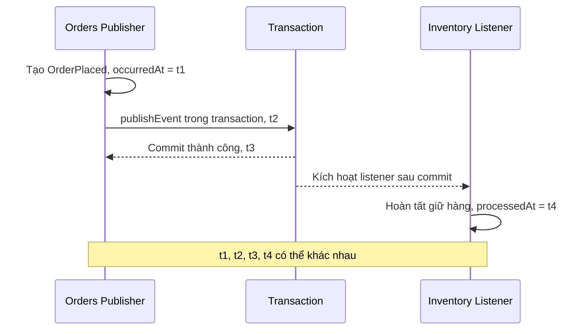
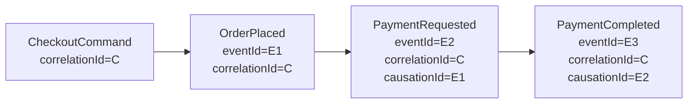
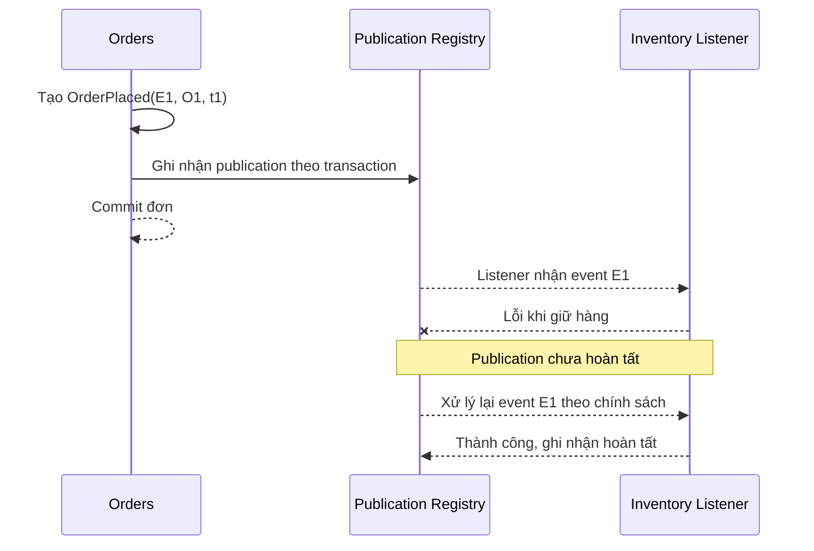

# Ý nghĩa trường dữ liệu trong hợp đồng sự kiện Spring Modulith

## 1. Một trường dữ liệu trong event phải có ý nghĩa nghiệp vụ rõ ràng

Trong ứng dụng Spring Boot tổ chức bằng Spring Modulith, module `orders` có thể phát sự kiện `OrderPlaced` để module `inventory` giữ hàng và module `billing` bắt đầu xử lý thanh toán. Hai module tiêu thụ không nhất thiết biết cách `orders` lưu entity, xây dựng repository hoặc quản lý transaction nội bộ. Chúng cần một **hợp đồng sự kiện** đủ rõ để hiểu *điều gì đã xảy ra* và *những dữ liệu nào được bảo đảm*.

Hợp đồng sự kiện không chỉ gồm tên Java class và kiểu của từng trường. Mỗi trường còn cần một **ngữ nghĩa**: trường đại diện cho thực thể hay lần xảy ra sự kiện, giá trị được chụp ở thời điểm nào, có bắt buộc không, được thay đổi theo quy tắc nào, có thể dùng để chống xử lý trùng không và ai là bên chịu trách nhiệm cung cấp.

Ví dụ, chỉ đọc `id` hoặc `time` thì người nhận không biết đây là `orderId` hay `eventId`, thời điểm người dùng bấm nút hay thời điểm giao dịch commit. Dùng sai một trường có thể gây hậu quả nghiêm trọng ngay cả khi chương trình biên dịch thành công:

- Kho dùng `eventId` thay cho `orderId` để xác định đơn hàng cần giữ hàng.
- Thanh toán dùng tổng tiền *hiện tại* của đơn thay vì tổng tiền tại thời điểm đơn được chấp nhận.
- Listener tạo `eventId` mới mỗi lần retry nên không còn nhận biết được sự kiện bị phát lại.
- Hệ thống sắp thứ tự nghiệp vụ theo `occurredAt`, dù đồng hồ hoặc thứ tự thực thi không bảo đảm tương ứng với thứ tự thay đổi thực tế.

Trong phạm vi học `SPRING_MODULITH_APPLICATION_EVENTS`, hiểu ngữ nghĩa trường dữ liệu là tiền đề cho publisher, listener, xử lý sau commit, Event Publication Registry, retry, kiểm thử và quan sát giao sự kiện đáng tin cậy.

> **Nguyên tắc:** Mỗi trường cần trả lời được ba câu hỏi: *Nó mô tả điều gì? Giá trị được xác định tại thời điểm nào? Bên nhận được phép dựa vào bảo đảm nào của trường này?*

## 2. Các nhóm trường thường gặp

Không có một danh sách trường bắt buộc cho mọi Spring application event. Spring Modulith không yêu cầu mọi event phải có `eventId`, `schemaVersion` hay `correlationId`. Đội ngũ thiết kế chọn các trường theo yêu cầu nghiệp vụ, khả năng vận hành và tương thích với các bên tiêu thụ.

| Nhóm | Trường ví dụ | Ý nghĩa thường dùng |
| --- | --- | --- |
| **Danh tính sự kiện** | `eventId`, `eventType` | Phân biệt một lần xảy ra sự kiện với các lần xảy ra khác |
| **Danh tính nghiệp vụ** | `orderId`, `paymentId`, `customerId` | Chỉ ra đối tượng hoặc thực thể nghiệp vụ bị ảnh hưởng |
| **Thời gian** | `occurredAt`, `publishedAt`, `processedAt` | Phân biệt thời điểm xảy ra nghiệp vụ, công bố và xử lý |
| **Nội dung nghiệp vụ** | `items`, `quantity`, `totalPayable`, `currencyCode` | Dữ kiện mà listener dùng để thực hiện trách nhiệm của mình |
| **Ngữ cảnh luồng xử lý** | `correlationId`, `causationId` | Liên kết các sự kiện và hành động thuộc cùng quy trình |
| **Phiên bản** | `schemaVersion`, `aggregateVersion` | Diễn đạt phiên bản hợp đồng hoặc phiên bản trạng thái thực thể |
| **Nguồn và phạm vi** | `sourceModule`, `tenantId` | Cung cấp ngữ cảnh nguồn phát hoặc vùng dữ liệu khi thực sự cần |

Một event nhỏ `OrderCancelled(UUID eventId, UUID orderId, Instant occurredAt)` có thể đủ cho một ứng dụng. Event khác cần thêm thông tin dòng hàng hoặc tiền tệ để bên nhận xử lý đúng trạng thái lịch sử. Đừng đưa trường vào chỉ vì chúng thường xuất hiện trong các mẫu kiến trúc.

## 3. eventId khác gì orderId?

### 3.1. eventId: định danh cho một lần xảy ra

`eventId` định danh **một sự kiện nghiệp vụ cụ thể**. Nếu cùng một đơn hàng phát sinh `OrderPlaced`, rồi `OrderPaid`, rồi `OrderShipped`, thông thường đó là **ba event khác nhau**, mỗi event có `eventId` riêng.

Ví dụ:

```text
orderId = 7f5d... (một đơn hàng)

eventId = 10a1...  OrderPlaced
eventId = 20b2...  PaymentCompleted
eventId = 30c3...  OrderShipped
```

Định danh này có ích khi kiểm thử, theo dõi log, chẩn đoán và xử lý trùng lặp. Khi **giao lại chính sự kiện cũ**, listener phải nhận cùng giá trị `eventId`; nếu tạo ID mới cho mỗi lần retry, hệ thống có thể nhầm việc phát lại với một sự kiện nghiệp vụ mới.

Không nên hiểu `eventId` là bảo đảm giao đúng một lần. Listener vẫn cần thiết kế **idempotency** vì có thể thấy lại cùng event sau lỗi, retry hoặc các cơ chế tái công bố.

### 3.2. orderId: định danh đối tượng nghiệp vụ

`orderId` định danh **đơn hàng** được event nói tới. Nó giúp người nhận biết đối tượng cần xử lý và đối chiếu với dữ liệu nghiệp vụ của mình. Nhiều event hoàn toàn có thể mang cùng `orderId` vì chúng mô tả các thay đổi khác nhau trên cùng đơn hàng.

| Tình huống | `eventId` | `orderId` |
| --- | --- | --- |
| Tạo đơn hàng lần đầu | ID mới của `OrderPlaced` | ID của đơn mới |
| Thanh toán đơn đó | ID mới của `PaymentCompleted` | Vẫn ID của đơn |
| Retry xử lý `OrderPlaced` | **Giữ ID của event cũ** | Giữ ID của đơn cũ |
| Người dùng tạo một đơn hàng khác | ID mới | ID đơn hàng mới |

Nếu một listener quản lý việc giữ hàng theo mỗi đơn, `orderId` có thể là khóa nghiệp vụ để bảo đảm một đơn không bị giữ hàng hai lần. `eventId` có thể đồng thời là khóa chống xử lý lặp **theo một loại sự kiện và consumer cụ thể**. Phải chọn khóa theo quy tắc nghiệp vụ; một khóa không nhất thiết phù hợp cho mọi loại listener.

### 3.3. ID do ứng dụng thiết kế và ID của registry

`eventId` trong record là **thuộc hợp đồng ứng dụng tự khai báo**. Đừng mặc định nó chính là ID của bản ghi Event Publication Registry. Cơ chế registry có thể theo dõi từng publication cho các transactional listener với metadata lưu trữ riêng. Ý nghĩa và cách liên hệ hai loại ID cần được xác định từ cách tích hợp thực tế.

## 4. occurredAt, publishedAt, committedAt và processedAt

Thời gian là một trong những vùng dễ gây hiểu nhầm nhất của event contract.

| Trường | Ý nghĩa khi được khai báo | Ai thường xác định? |
| --- | --- | --- |
| `occurredAt` | Thời điểm publisher xác định sự kiện nghiệp vụ xảy ra | Module phát |
| `publishedAt` | Thời điểm lời gọi công bố event được thực hiện, nếu ứng dụng có ghi nhận | Publisher hoặc lớp hạ tầng quan sát |
| `committedAt` | Thời điểm transaction được commit thành công, nếu hệ thống thực sự có nguồn thời gian này | Transaction/hạ tầng, không tự có trong event |
| `processedAt` | Thời điểm một listener xử lý hoặc hoàn tất công việc, tùy định nghĩa | Consumer hoặc hệ thống quan sát |

Ví dụ luồng xử lý:



Không nên viết rằng `occurredAt` luôn là thời điểm commit. Nếu tạo event bằng `clock.instant()` bên trong transaction, timestamp thường được chụp **trước** khi transaction commit và thậm chí transaction còn có thể rollback. Với listener chỉ chạy sau commit, event được xử lý khi commit thành công, nhưng `occurredAt` vẫn mang thời điểm đã được chụp.

Nên dùng `java.time.Instant` cho mốc thời gian tuyệt đối, thống nhất cách diễn giải UTC khi lưu trữ/trao đổi. Đừng chuyển đổi `LocalDateTime` không gắn múi giờ thành thời điểm tuyệt đối nếu thiếu quy ước múi giờ rõ ràng.

**Không dựa vào timestamp để bảo đảm thứ tự:** đồng hồ các nút có thể lệch, hai event có thể cùng độ phân giải thời gian, listener bất đồng bộ có thể hoàn tất đảo thứ tự. Nếu thứ tự thay đổi của một thực thể quan trọng, cần thiết kế thêm cơ chế xác định phiên bản hoặc thứ tự nghiệp vụ và kiểm soát cập nhật tương ứng.

## 5. Dữ liệu nghiệp vụ: giá trị, đơn vị và trạng thái được chụp

Tên trường phải gắn với **quy tắc nghiệp vụ**. Trong event `OrderPlaced`, các bên nhận có thể cần:

- `items`: những dòng hàng tại thời điểm đơn đã được chấp nhận; mỗi dòng có `productId` và `quantity`.
- `totalPayable`: tổng số tiền người mua phải trả theo quyết định của `orders` lúc chốt đơn.
- `currencyCode`: đơn vị tiền tệ áp dụng cho `totalPayable`, ví dụ `VND` hoặc `USD`.

### 5.1. Tránh các tên trường không đủ rõ nghĩa

| Tên khó hiểu | Tên rõ hơn | Điều cần mô tả trong hợp đồng |
| --- | --- | --- |
| `id` | `eventId` hoặc `orderId` | ID của event hay của đơn hàng |
| `amount` | `totalPayable` | Có gồm thuế, phí, giảm giá không; tính tại bước nào |
| `price` | `unitPrice` hoặc `finalUnitPrice` | Đơn giá niêm yết hay đơn giá đã áp dụng giảm giá |
| `time` | `occurredAt` | Thời điểm nghiệp vụ xảy ra theo định nghĩa của publisher |
| `count` | `quantity` | Số lượng sản phẩm, đơn vị đo và điều kiện hợp lệ |
| `status` | `orderStatusAfterChange` | Trạng thái trước hay sau sự kiện |

Tên tốt giảm hiểu lầm, nhưng vẫn cần phần mô tả: `totalPayable` có thể bao gồm vận chuyển hoặc không tùy miền nghiệp vụ. Không nên để từng listener tự suy diễn.

### 5.2. Tiền tệ và số thập phân

Nếu payload chứa tiền, nên dùng `BigDecimal` cho giá trị thập phân, thay vì `double` để tránh sai số nhị phân trong tính toán tài chính. Đồng thời **luôn diễn đạt đơn vị tiền tệ**, vì số `100` không cho biết là 100 VND hay 100 USD.

```java
import java.math.BigDecimal;

BigDecimal totalPayable = new BigDecimal("250000");
String currencyCode = "VND";
```

Đừng mặc định có thể suy ra tổng tiền bằng cách nhân `quantity` với giá trong danh mục hiện tại: giá bán, giảm giá, thuế và phí có thể đã khác sau khi đơn hàng được đặt. Nếu listener xử lý giá trị **tại thời điểm đặt hàng**, payload nên chứa chính giá trị đã chốt hoặc có hợp đồng truy vấn bản ghi lịch sử tương đương.

### 5.3. Chọn ID hay snapshot?

| Payload | Lợi ích | Giới hạn cần hiểu |
| --- | --- | --- |
| Chỉ `orderId` | Event nhỏ, ít trường cần quản lý | Consumer có thể cần gọi API công khai để đọc thêm và có thể thấy trạng thái mới |
| `orderId` kèm `items` | Kho nắm danh sách mặt hàng tại lúc xảy ra event | Hợp đồng lớn hơn, các trường cần ổn định và kiểm soát phiên bản |
| `orderId`, `totalPayable`, `currencyCode` | Thanh toán có dữ kiện giá trị đã chốt | Publisher phải xác định rõ điều gì đã bao gồm trong tổng tiền |
| Mang toàn bộ entity JPA `Order` | Không phù hợp làm hợp đồng giữa module | Rò rỉ nội bộ, có thể mutable/lazy, khó serializable và khó tương thích |

Đưa **thông tin cần thiết cho các consumer** vào event, đồng thời tránh rải dữ liệu nhạy cảm, không liên quan và dễ lỗi thời khắp các module.

## 6. Ví dụ hợp đồng OrderPlaced bằng Java record

Đây là một hợp đồng minh họa cho Java 17+ với các trường được chọn có chủ đích. `eventId` phân biệt sự kiện; `orderId` xác định đơn hàng; `occurredAt` là mốc nghiệp vụ; `lines` là snapshot dòng hàng; `totalPayable` và `currencyCode` là giá trị thanh toán đã chốt.

```java
package com.example.shop.orders.events;

import java.math.BigDecimal;
import java.time.Instant;
import java.util.Currency;
import java.util.List;
import java.util.Objects;
import java.util.UUID;

public record OrderPlaced(
        UUID eventId,
        UUID orderId,
        Instant occurredAt,
        List<Line> lines,
        BigDecimal totalPayable,
        String currencyCode) {

    public OrderPlaced {
        Objects.requireNonNull(eventId, "eventId");
        Objects.requireNonNull(orderId, "orderId");
        Objects.requireNonNull(occurredAt, "occurredAt");
        Objects.requireNonNull(lines, "lines");
        Objects.requireNonNull(totalPayable, "totalPayable");
        Objects.requireNonNull(currencyCode, "currencyCode");

        lines = List.copyOf(lines);
        if (lines.isEmpty()) {
            throw new IllegalArgumentException("lines must not be empty");
        }
        if (totalPayable.signum() < 0) {
            throw new IllegalArgumentException("totalPayable must be >= 0");
        }
        Currency.getInstance(currencyCode); // Kiểm tra mã tiền tệ hợp lệ.
    }

    public record Line(UUID productId, int quantity) {
        public Line {
            Objects.requireNonNull(productId, "productId");
            if (quantity <= 0) {
                throw new IllegalArgumentException("quantity must be > 0");
            }
        }
    }
}
```

Trong ví dụ này, `record` bảo đảm các tham chiếu trường không được gán lại sau khi khởi tạo. `List.copyOf(lines)` tạo danh sách không thể sửa và tránh phụ thuộc vào những lần thay đổi danh sách nguồn; mỗi `Line` cũng là record gồm các thành phần bất biến.

**Bất biến cần xét cả dữ liệu lồng nhau:** `List.copyOf` không deep-copy từng phần tử. Nếu `Line` là một class có setter hoặc chứa collection mutable, payload vẫn có thể bị thay đổi bên trong. `BigDecimal`, `UUID`, `Instant` và `String` là các kiểu phù hợp cho dữ liệu giá trị bất biến trong ví dụ này.

Quy tắc cho `totalPayable >= 0` là lựa chọn của ví dụ (chấp nhận đơn bằng 0 trong một số chương trình khuyến mãi), không phải quy tắc có sẵn của Spring Modulith. Nếu miền nghiệp vụ không cho phép đơn bằng 0, phải đổi validation tương ứng.

### 6.1. Publisher xác định ý nghĩa các trường ở thời điểm phát

Một service trong module `orders` có thể tạo event sau khi đã ghi nhận dữ liệu đơn hàng trong transaction:

```java
// Trích đoạn trong orders.internal.OrderService.
@Transactional
public UUID placeOrder(PlaceOrderCommand command) {
    Order order = repository.create(command);

    var lines = order.lines().stream()
        .map(line -> new OrderPlaced.Line(
            line.productId(),
            line.quantity()))
        .toList();

    OrderPlaced event = new OrderPlaced(
        UUID.randomUUID(),           // ID cho lần xảy ra event này.
        order.id(),                  // ID ổn định của đơn hàng.
        clock.instant(),            // Thời điểm chụp tại publisher.
        lines,                      // Snapshot dòng hàng.
        order.totalPayable(),       // Giá trị đã chốt.
        order.currencyCode()        // Đơn vị của tổng tiền.
    );

    events.publishEvent(event);
    return order.id();
}
```

Đây là mã minh họa: `Order`, `repository.create(...)`, `PlaceOrderCommand` và `clock`/`events` là thành phần do ứng dụng cung cấp. Cần hiện thực validation, lưu dữ liệu và transaction thực tế để chạy hoàn chỉnh.

Một câu hỏi quan trọng là **lúc nào `OrderPlaced` thực sự mang ý nghĩa “đã đặt hàng”?** Nếu hệ thống chỉ coi đơn hợp lệ sau khi transaction commit, hãy dùng kiểu listener giao dịch phù hợp, chẳng hạn xử lý sau commit, để không thực hiện phản ứng nghiệp vụ với transaction cuối cùng bị rollback.

Đặc biệt, `ApplicationEventPublisher.publishEvent(...)` **không tự bảo đảm** mọi listener đều chạy sau commit. Một `@EventListener` thông thường mặc định chạy đồng bộ; cơ chế listener được chọn mới quyết định khi nào và ở transaction nào event được xử lý.

## 7. correlationId, causationId và thông tin truy vết

Ngoài dữ liệu nghiệp vụ, một số hệ thống cần biết sự kiện được tạo ra **trong quy trình nào** và **do hành động/sự kiện nào gây ra**. Hai khái niệm thường được dùng:

- **`correlationId`:** một định danh liên kết các bước của **cùng một luồng xử lý**. Ví dụ yêu cầu Checkout #A dẫn đến `OrderPlaced`, `PaymentRequested` và `PaymentCompleted` có thể dùng cùng một correlation ID.
- **`causationId`:** định danh của **sự kiện hoặc lệnh trực tiếp dẫn đến sự kiện hiện tại**. Nếu `PaymentCompleted` được sinh ra do xử lý `PaymentRequested`, causation ID của `PaymentCompleted` có thể trỏ tới event ID của `PaymentRequested`.



Những trường này là **quy ước của ứng dụng**, không phải trường bắt buộc của `ApplicationEventPublisher` hoặc mọi event Spring Modulith. Cần xác định nơi khởi tạo, cách kế thừa và thời điểm reset correlation ID. Với bước đầu tiên không có event cha, `causationId` có thể không tồn tại; đừng tạo một ID giả và gọi đó là nguyên nhân.

**Phân biệt với `traceId`:** trace ID từ Micrometer Tracing/OpenTelemetry phục vụ quan sát luồng thực thi phân tán. Trace có thể thay đổi qua các đợt xử lý, đặc biệt khi listener được thử lại sau một khoảng thời gian. Correlation ID nghiệp vụ nên ổn định theo quy trình cần theo dõi; không mặc định trace ID và correlation ID là cùng một giá trị.

Các trường như `sourceModule`, `initiatedBy`, `tenantId` chỉ thêm nếu tiêu thụ hoặc vận hành thật sự cần. `tenantId` cần được xác định rõ là ranh giới dữ liệu hay ngữ cảnh nghiệp vụ, và phải được đối chiếu với quyền truy cập trong triển khai thực tế.

## 8. schemaVersion khác gì aggregateVersion?

**`schemaVersion`** thể hiện phiên bản *hình dạng và ngữ nghĩa hợp đồng event* do ứng dụng quy ước, ví dụ thay đổi tên trường hoặc bổ sung thông tin. **`aggregateVersion`** (hay `orderVersion`) có thể thể hiện *phiên bản trạng thái của một aggregate nghiệp vụ* sau một thay đổi.

| Trường | Đối tượng được đánh số phiên bản | Ví dụ |
| --- | --- | --- |
| `schemaVersion` | Hợp đồng của loại `OrderPlaced` | Cấu trúc v1 chỉ có `orderId`; v2 bổ sung `occurredAt` |
| `aggregateVersion` | Trạng thái của đơn hàng | Thay đổi trạng thái đơn từ version 7 sang version 8 |

Hai loại version **không thay thế nhau**. Một schema v2 có thể chứa event của hàng nghìn đơn với aggregate version khác nhau. Một đơn cũng có thể có các thay đổi nghiệp vụ nối tiếp nhau nhưng vẫn phát event theo cùng schema.

Spring Modulith không tự thêm `schemaVersion` hoặc `aggregateVersion` vào mọi event record do người dùng tự định nghĩa. Chỉ dùng chúng khi hợp đồng và hệ thống tiêu thụ thật sự cần. Nếu yêu cầu xử lý có thứ tự, `aggregateVersion` có thể hỗ trợ phát hiện event cũ hoặc không liên tục; **chỉ có trường version chưa đủ bảo đảm giao sự kiện đúng thứ tự**. Consumer vẫn phải xác định chính sách khi nhận version nhảy cóc hoặc đảo thứ tự.

### 8.1. Thay đổi hợp đồng mà không phá vỡ consumer

Giả sử phiên bản ban đầu:

```java
public record OrderPlacedV1(UUID eventId, UUID orderId) {}
```

Sau đó module `billing` cần biết tổng tiền và mã tiền tệ:

```java
public record OrderPlacedV2(
    UUID eventId,
    UUID orderId,
    java.math.BigDecimal totalPayable,
    String currencyCode) {}
```

Ví dụ dùng tên V1/V2 chỉ để minh họa **hai hợp đồng không tương thích**, không yêu cầu mọi dự án phải đặt tên event theo số phiên bản.

Trong Java, bổ sung thành phần vào `record` thay đổi constructor chính và những điểm tạo instance, nên cần kiểm tra mọi publisher/consumer khi build. Nếu Event Publication Registry đang lưu các publication chưa được xử lý bằng cơ chế serialization phù hợp, thay đổi record hoặc cấu hình serializer còn có thể tác động việc **khôi phục event cũ** sau khi nâng cấp.

Khi đổi hợp đồng nên trả lời:

1. Có consumer nào còn dùng trường hoặc ngữ nghĩa cũ?
2. Có publication đang chờ xử lý hoặc có event lịch sử cần đọc lại không?
3. Trường mới có giá trị mặc định **đúng về nghiệp vụ** cho dữ liệu cũ không?
4. Có cần hỗ trợ song song hai dạng event hoặc thêm adapter chuyển đổi không?
5. Bài kiểm thử có chứng minh được quá trình chuyển tiếp và xử lý lại sau nâng cấp không?

Không nên chỉ thêm một giá trị `schemaVersion` mới mà không định nghĩa cách consumer xử lý sự khác biệt giữa các schema.

## 9. Ý nghĩa của trường dữ liệu đối với retry và Event Publication Registry

Một listener của module `inventory` có thể lỗi sau khi giao dịch `orders` đã commit. Spring Modulith cung cấp **Event Publication Registry** để theo dõi các publication đến transactional event listener khi ứng dụng cấu hình hạ tầng lưu trữ phù hợp. Các publication chưa hoàn thành có thể được dùng làm cơ sở cho cơ chế xử lý lại theo chính sách và phiên bản đang vận hành.



Sơ đồ mang tính khái niệm và giả định registry đã tích hợp lưu trữ, khả năng gửi lại đã được thiết lập. **Không mặc định** rằng chỉ thêm annotation listener sẽ bật mọi dạng persistence và retry tự động. Cách khôi phục, lịch thử lại và hành vi cụ thể phụ thuộc vào phiên bản và cấu hình Spring Modulith.

Ý nghĩa các trường trong quá trình này:

- `eventId` **giữ nguyên** khi xử lý lại cùng `OrderPlaced`, giúp đối chiếu log và khử trùng.
- `orderId` vẫn trỏ đến **cùng một đơn hàng**; listener có thể dùng nó làm khóa để tránh giữ tồn kho lặp.
- `occurredAt` giữ thời điểm sự kiện gốc, không bị thay bằng thời điểm retry.
- `totalPayable` và `lines` phải là snapshot bất biến, tránh trả về dữ liệu nghiệp vụ khác giữa những lần xử lý.
- `processedAt`, thời gian retry và số lần thử lại phù hợp hơn để lưu ở **trạng thái xử lý hoặc telemetry riêng của consumer**, vì chúng là thông tin biến đổi theo mỗi lần xử lý.

Trong một hệ thống có nhiều listener, `eventId` có thể xuất hiện ở nhiều consumer. Mỗi consumer cần chính sách lưu vết và chống trùng riêng. Đừng dùng một cờ toàn cục “eventId đã xử lý” rồi ngăn các listener hợp lệ khác xử lý cùng sự kiện đó.

## 10. Các lỗi thiết kế trường dữ liệu phổ biến

| Thiết kế có vấn đề | Rủi ro | Cách điều chỉnh |
| --- | --- | --- |
| `id`, `timestamp`, `data` không có mô tả | Người nhận hiểu sai ý nghĩa | Đặt tên theo ý nghĩa nghiệp vụ và bổ sung quy ước |
| Dùng `double amount` cho tiền | Sai số tính toán thập phân | Dùng `BigDecimal` cùng `currencyCode` và quy tắc đơn vị |
| Chỉ phát `orderId` nhưng yêu cầu xử lý giá lịch sử | Truy vấn sau có thể lấy giá mới | Mang snapshot tiền đã chốt hoặc dùng nguồn dữ liệu lịch sử hợp lệ |
| Mang `OrderEntity`/JPA proxy trong event | Lộ nội bộ, mutation/lazy loading, khó lưu trữ | Dùng record/DTO bất biến và dữ liệu tối thiểu |
| Đặt `occurredAt = Instant.now()` trong mỗi lần retry | Mất thời gian nghiệp vụ gốc | Tạo timestamp một lần ở publisher, giữ cùng payload khi retry |
| Sinh `eventId` mới khi replay cùng event | Consumer khó nhận ra việc xử lý lại | Bảo toàn event ID gốc |
| Dùng `schemaVersion` để suy ra thứ tự đơn | Nhầm phiên bản hợp đồng với phiên bản aggregate | Dùng trường thứ tự/phiên bản nghiệp vụ riêng nếu thật sự cần |
| Đặt mật khẩu, token hoặc thông tin cá nhân dư thừa trong payload | Lộ dữ liệu qua log, registry, debug | Chỉ chứa dữ liệu cần thiết, kiểm soát lưu trữ và log |
| Thêm `status` là trạng thái mutable không rõ thời điểm | Listener hiểu nhầm trạng thái hiện tại và sau thay đổi | Diễn đạt “trạng thái sau sự kiện” hoặc dùng loại event riêng |

### 10.1. Không nhầm event với command

`OrderPlaced` nên mô tả **một sự thật đã xảy ra** theo định nghĩa nghiệp vụ của `orders`. `ReserveStock` lại là một **yêu cầu thực hiện hành động**: bên nhận có thể chấp nhận hoặc từ chối. Khi đặt tên và chọn trường, hãy quyết định đây là sự kiện thông báo một thay đổi, hay là command cần kết quả.

Nếu đơn chỉ được xác nhận khi kho giữ hàng thành công, một listener sau commit không thể tự làm cho transaction tạo đơn đã commit bị rollback. Có thể cần API đồng bộ hoặc quy trình nhiều bước với trạng thái chờ xác nhận. Ý nghĩa trường `orderStatus` và thời điểm phát event phải phản ánh lựa chọn nghiệp vụ đó.

## 11. Kiểm thử ý nghĩa trường dữ liệu

Không chỉ kiểm thử kiểu Java. Cần khẳng định **mỗi trường mang đúng ngữ nghĩa** trong các đường xử lý.

| Kiểm thử | Điều cần kiểm chứng |
| --- | --- |
| Event contract | Trường bắt buộc được cung cấp, dữ liệu hợp lệ, tên và đơn vị đúng |
| Publisher | `eventId` được tạo một lần; `orderId` lấy từ đơn đã tạo; `occurredAt` lấy từ `Clock` phù hợp |
| Snapshot | Việc sửa danh sách nguồn sau khi tạo event không đổi `lines`; `totalPayable` là giá trị đã chốt |
| Module boundary | Consumer chỉ import hợp đồng đã công bố, không dùng entity/repository nội bộ của publisher |
| After commit | Với listener sau commit, rollback của publisher không kích hoạt xử lý nghiệp vụ |
| Retry và idempotency | Cùng `eventId` được giao lại không tạo tác dụng phụ trùng |
| Compatibility | Consumer vẫn hiểu được event chưa xử lý từ phiên bản cũ khi nâng cấp hợp đồng |

Ví dụ JUnit cho những phần có thể kiểm thử trực tiếp:

```java
import static org.junit.jupiter.api.Assertions.*;

import java.math.BigDecimal;
import java.time.Instant;
import java.util.ArrayList;
import java.util.UUID;
import org.junit.jupiter.api.Test;

class OrderPlacedContractTest {

    @Test
    void eventKeepsOriginalBusinessSnapshot() {
        UUID eventId = UUID.randomUUID();
        UUID orderId = UUID.randomUUID();
        Instant occurredAt = Instant.parse("2026-01-01T10:00:00Z");

        var source = new ArrayList<OrderPlaced.Line>();
        source.add(new OrderPlaced.Line(UUID.randomUUID(), 2));

        var event = new OrderPlaced(
            eventId, orderId, occurredAt, source,
            new BigDecimal("250000"), "VND");

        source.clear();

        assertEquals(eventId, event.eventId());
        assertEquals(orderId, event.orderId());
        assertEquals(occurredAt, event.occurredAt());
        assertEquals(1, event.lines().size());
        assertEquals(0,
            new BigDecimal("250000").compareTo(event.totalPayable()));
        assertEquals("VND", event.currencyCode());
        assertThrows(UnsupportedOperationException.class,
            () -> event.lines().clear());
    }
}
```

Đoạn test trên chỉ khẳng định một phần hợp đồng dữ liệu. Để xác minh **sau commit** và registry, cần các bài integration test chạy với transaction manager, cơ chế lưu publication và listener theo cấu hình ứng dụng.

## 12. Checklist thiết kế và bài tập

Trước khi một event được dùng bởi module khác, hãy tự kiểm tra:

1. **Tên event là một sự thật nghiệp vụ:** bên nhận hiểu chính xác điều gì đã xảy ra.
2. **Tên trường nói rõ vai trò:** `eventId` khác `orderId`; `occurredAt` khác `processedAt`.
3. **Mỗi giá trị có đơn vị và ràng buộc:** tiền có `currencyCode`; quantity xác định đơn vị và phạm vi; trạng thái có quy tắc rõ.
4. **Payload là snapshot phù hợp:** không lộ JPA entity, tránh object mutable và dữ liệu nhạy cảm không cần thiết.
5. **Ngữ cảnh truy vết không bị nhầm:** correlation/causation theo quy ước ứng dụng, không đồng nhất mặc định với trace ID.
6. **Version có ý nghĩa riêng:** schema version khác aggregate version; thay đổi hợp đồng cần kế hoạch cho consumer và publication tồn đọng.
7. **Trường phục vụ retry ổn định:** `eventId` và `occurredAt` giữ nguyên khi xử lý lại cùng event; mỗi listener có idempotency phù hợp.
8. **Ranh giới module vẫn được bảo vệ:** event thuộc API công khai hoặc named interface thích hợp, kiểm chứng bằng `ApplicationModules.verify()`.

**Bài tập:** Thiết kế hợp đồng `PaymentCompleted` cho module `billing` và nêu ngữ nghĩa của ít nhất sáu trường. Phân biệt `paymentId`, `orderId` và `eventId`; giải thích lựa chọn `amount`/`currencyCode`, `occurredAt` và `correlationId`. Sau đó mô tả điều gì được giữ nguyên, điều gì thay đổi nếu listener của `orders` xử lý lại chính `PaymentCompleted` đó hai lần.

**Ghi nhớ:** Một hợp đồng sự kiện đáng tin cậy bắt đầu từ **ngữ nghĩa nhất quán của dữ liệu**: mỗi trường nói rõ nó đại diện cho sự kiện nào, thực thể nào, thời điểm nào và snapshot nào. Từ nền tảng ấy, Spring Modulith có thể phối hợp các module bằng application events; publisher, listener sau commit, Event Publication Registry, retry, idempotency, kiểm thử và quan sát mới có đủ thông tin để vận hành luồng xử lý một cách có kiểm soát.
