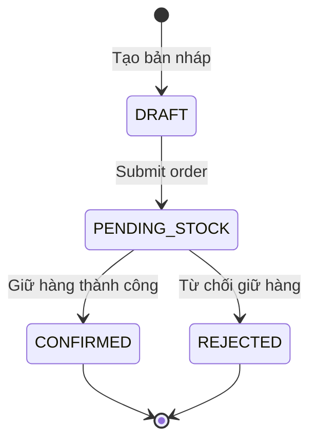
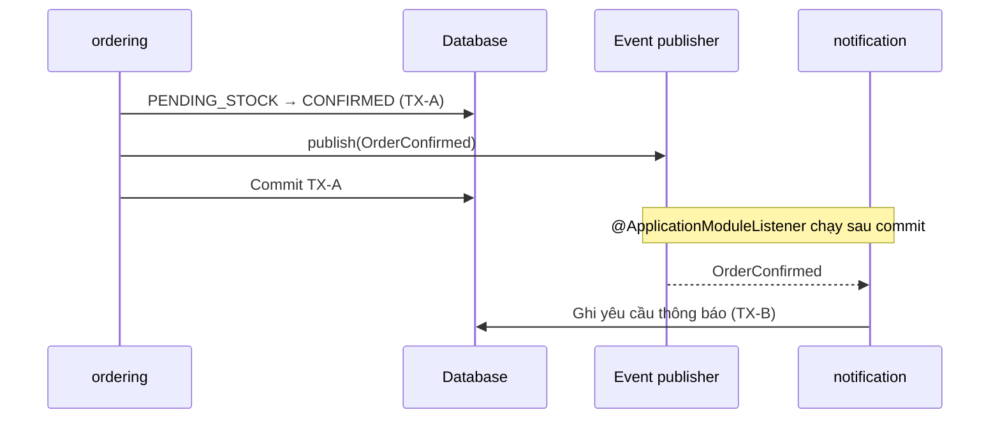
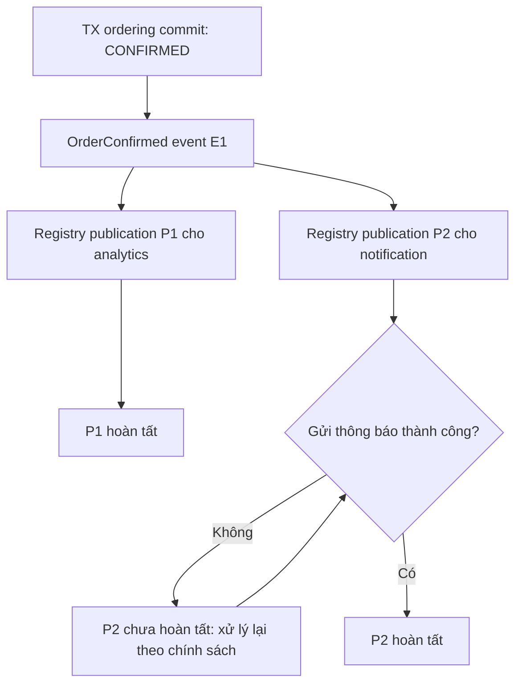

# Trạng thái bắt buộc trong hợp đồng sự kiện Spring Modulith

## 1. Hiểu đúng “trạng thái bắt buộc”

Trong hệ thống theo kiến trúc module, một **domain event** là thông tin về sự thật nghiệp vụ đã xảy ra. Khi module `ordering` công bố `OrderConfirmed`, module `notification` có thể gửi thư xác nhận mà không phải đọc trực tiếp bảng đơn hàng. Điều này chỉ an toàn nếu `OrderConfirmed` luôn có cùng ý nghĩa: **đơn hàng đã được xác nhận thành công**.

Trong chương **Hợp đồng sự kiện**, “trạng thái bắt buộc” là tập hợp các **điều kiện về trạng thái nghiệp vụ và dữ liệu trạng thái mà publisher/consumer phải tôn trọng** để một sự kiện có nghĩa hợp lệ. Có bốn câu hỏi cần trả lời:

1. **Tiền điều kiện:** đối tượng nghiệp vụ phải ở trạng thái nào mới thực hiện được hành động?
2. **Hậu điều kiện:** sau khi hành động thành công, trạng thái nào được xác lập?
3. **Hợp đồng dữ liệu:** trạng thái có phải một trường bắt buộc của payload không? Giá trị nào được chấp nhận?
4. **Điều kiện áp dụng ở consumer:** nếu event đến trễ, đến trùng hoặc ngoài thứ tự, consumer vẫn bảo vệ được trạng thái cục bộ như thế nào?

**Không phải event nào cũng bắt buộc có trường `status`.** Event chuyên biệt `OrderConfirmed` đã hàm ý trạng thái xác nhận; event tổng quát `OrderStatusChanged` cần trường `newStatus` để nói rõ trạng thái mới. Yêu cầu bắt buộc ở đây thuộc **ngữ nghĩa nghiệp vụ của hợp đồng**, không đơn thuần là annotation validation trên một field Java.

Với phạm vi học **SPRING_MODULITH_APPLICATION_EVENTS**, việc thống nhất trạng thái là nền tảng để tổ chức giao tiếp giữa các application module Spring Modulith bằng publisher/listener, xử lý sau commit, Event Publication Registry, retry, kiểm thử và quan sát. Application event giúp giảm phụ thuộc vào implementation của module khác, nhưng không tự xác minh rằng sự kiện đang mô tả một trạng thái nghiệp vụ có thật.

## 2. Mô hình trạng thái phải được xác định trước event

Ví dụ hệ thống đặt hàng gồm các module `ordering`, `inventory`, `notification`. Module `ordering` sở hữu vòng đời đơn hàng với các trạng thái:

- `DRAFT`: đơn mới được tạo, chưa được gửi đi xử lý.
- `PENDING_STOCK`: đơn đã được tiếp nhận, đang chờ kết quả giữ tồn kho.
- `CONFIRMED`: đơn được xác nhận sau khi đáp ứng điều kiện nghiệp vụ.
- `REJECTED`: đơn không thể được chấp nhận, chẳng hạn không đủ tồn kho.

Trong ví dụ giản lược, `CONFIRMED` và `REJECTED` là trạng thái kết thúc; hệ thống thực tế có thể có thêm `CANCELLED`, `PAID` hoặc `SHIPPED`, kèm các quy tắc chuyển tiếp riêng.



Đối với mỗi thay đổi, cần định nghĩa **trạng thái trước, trạng thái sau và sự kiện được phép phát**:

| Hành động | Trạng thái trước bắt buộc | Trạng thái sau | Event phát |
| --- | --- | --- | --- |
| Submit | `DRAFT` | `PENDING_STOCK` | `OrderSubmitted` |
| Xác nhận | `PENDING_STOCK` | `CONFIRMED` | `OrderConfirmed` |
| Từ chối | `PENDING_STOCK` | `REJECTED` | `OrderRejected` |
| Retry xác nhận đơn đã xác nhận | `CONFIRMED` | Không đổi | Không phát event mới |
| Xác nhận đơn đã bị từ chối | `REJECTED` | Không được phép | Báo vi phạm, không phát `OrderConfirmed` |

Một command được gọi **không đồng nghĩa** với một sự thật nghiệp vụ đã xảy ra. Chỉ phát event sau khi kiểm tra tiền điều kiện và thực hiện thành công chuyển trạng thái tương ứng.

### 2.1. Bốn tầng trạng thái cần phân biệt

| Tầng | Ví dụ | Điều cần kiểm chứng |
| --- | --- | --- |
| Trạng thái gốc | Đơn đang `PENDING_STOCK` | Điều kiện chuyển đổi đã thỏa |
| Trạng thái đã xác lập | Đơn chuyển sang `CONFIRMED` | Thay đổi thực sự thành công |
| Trạng thái được event cam kết | `OrderConfirmed` | Event nhất quán với lần chuyển đổi |
| Trạng thái lúc consumer xử lý | Đơn có thể tiếp tục thay đổi | Không ngầm coi event lịch sử là dữ liệu hiện tại |

Tầng cuối đặc biệt quan trọng đối với event bất đồng bộ: một listener có thể xử lý `OrderSubmitted` sau khi đơn đã đạt `CONFIRMED`. Event `OrderSubmitted` vẫn đúng về mặt lịch sử, nhưng **không mô tả trạng thái mới nhất**.

## 3. Trạng thái ngầm trong event chuyên biệt

Một event có tên rõ nghĩa thường không cần lặp lại giá trị trạng thái. Ví dụ:

```java
// com/example/shop/ordering/OrderConfirmed.java
package com.example.shop.ordering;

import java.time.Instant;
import java.util.Objects;
import java.util.UUID;

public record OrderConfirmed(
        UUID eventId,
        UUID orderId,
        long aggregateVersion,
        Instant occurredAt) {

    public OrderConfirmed {
        Objects.requireNonNull(eventId, "eventId is required");
        Objects.requireNonNull(orderId, "orderId is required");
        Objects.requireNonNull(occurredAt, "occurredAt is required");
        if (aggregateVersion <= 0) {
            throw new IllegalArgumentException("Version must be positive");
        }
    }
}
```

Record này công bố một sự thật: **đơn được xác nhận**. Vì vậy không bắt buộc phải thêm `status = CONFIRMED`. Việc xuất hiện đồng thời `OrderConfirmed` và `status = PENDING_STOCK` thậm chí tạo hai nguồn thông tin mâu thuẫn.

Các trường trong ví dụ có ý nghĩa khác nhau: `eventId` nhận diện một lần sự kiện xảy ra; `orderId` xác định đối tượng nghiệp vụ; `aggregateVersion` là phiên bản trạng thái của đơn tại thời điểm chuyển đổi; `occurredAt` là thời điểm tạo sự kiện, **không đồng nhất với thời điểm transaction commit**.

Các trường chỉ cần có mặt khi phục vụ được mục đích của contract. Ví dụ nếu consumer không cần version, một event nhỏ có thể chỉ chứa `orderId` và `eventId`. Ngược lại, khi consumer phải xây dựng bản sao trạng thái hoặc đối chiếu event đến trễ, version là thông tin hữu ích.

Một event có tên theo cột mốc nghiệp vụ thường rõ nghĩa hơn event tổng quát trong các trường hợp consumer chỉ quan tâm một cột mốc cụ thể. Chẳng hạn `notification` lắng nghe `OrderConfirmed` và không cần biết các trạng thái `DRAFT`, `PENDING_STOCK`, `REJECTED`.

## 4. Trạng thái tường minh trong event tổng quát

Khi công bố một hợp đồng tổng quát như `OrderStatusChanged`, event cần đủ thông tin để nói **đã thay đổi từ đâu sang đâu**.

```java
// com/example/shop/ordering/OrderStatus.java
package com.example.shop.ordering;

public enum OrderStatus {
    DRAFT, PENDING_STOCK, CONFIRMED, REJECTED
}
```

```java
// com/example/shop/ordering/OrderStatusChanged.java
package com.example.shop.ordering;

import java.time.Instant;
import java.util.Objects;
import java.util.UUID;

public record OrderStatusChanged(
        UUID eventId,
        UUID orderId,
        OrderStatus previousStatus,
        OrderStatus newStatus,
        long aggregateVersion,
        Instant occurredAt) {

    public OrderStatusChanged {
        Objects.requireNonNull(eventId, "eventId is required");
        Objects.requireNonNull(orderId, "orderId is required");
        Objects.requireNonNull(previousStatus, "previousStatus is required");
        Objects.requireNonNull(newStatus, "newStatus is required");
        Objects.requireNonNull(occurredAt, "occurredAt is required");

        if (previousStatus == newStatus) {
            throw new IllegalArgumentException("Status must actually change");
        }
        if (aggregateVersion <= 0) {
            throw new IllegalArgumentException("Version must be positive");
        }
    }
}
```

Đối với contract này, `previousStatus`, `newStatus` và `aggregateVersion` được **quy định là bắt buộc**. Constructor kiểm tra không rỗng, có thay đổi, version hợp lệ. Nhưng nó chưa chứng minh chuyển trạng thái `REJECTED → CONFIRMED` được phép: quy tắc ấy phải nằm tại **module `ordering` sở hữu nghiệp vụ**, trong domain service hoặc aggregate.

Không thể coi việc “`newStatus` khác `previousStatus`” là điều kiện đủ để phát event. Hợp đồng phải có cả kiểm tra hình dạng dữ liệu lẫn invariant nghiệp vụ.

### 4.1. Bắt buộc theo ngữ nghĩa, không bắt buộc cho mọi loại event

| Trường | Khi nào cần | Lưu ý |
| --- | --- | --- |
| `newStatus` | Event tổng quát cần mô tả trạng thái vừa đạt | Có thể thừa với event chuyên biệt |
| `previousStatus` | Consumer cần lý do hoặc loại chuyển đổi | Có thể không cần nếu event đã có nghĩa rõ ràng |
| `aggregateVersion` | Consumer cần loại event cũ, bảo vệ projection | Không suy từ UUID hoặc timestamp |
| `eventId` | Cần định danh, truy vết hoặc dedup theo event | Khác với `orderId` và publication ID |
| `orderId` | Cần định vị đối tượng nghiệp vụ | Một đối tượng có thể có nhiều event |
| `occurredAt` | Cần timestamp nghiệp vụ | Không phải bảo đảm thứ tự xử lý |
| `correlationId` | Cần liên kết workflow xuyên nhiều module | Khác với `causationId` và trace ID |

Đối với consumer chỉ quan tâm sự kiện xác nhận, `OrderConfirmed` là contract đơn giản hơn. Đối với một consumer đồng bộ hóa mọi trạng thái của đơn, `OrderStatusChanged` mang trạng thái trước/sau và version có thể hữu ích hơn. Hai kiểu thiết kế phải có mục đích rõ, tránh phát **cả hai** một cách không kiểm soát làm consumer xử lý trùng cùng một chuyển đổi.

## 5. Publisher phải xác lập trạng thái trước khi phát event

Một lỗi phổ biến là phát `OrderConfirmed` ngay khi nhận command xác nhận, rồi mới thử cập nhật dữ liệu. Nếu cập nhật thất bại nhưng transaction không báo lỗi, event sẽ nói điều không xảy ra.

```java
// Sai về ý nghĩa nếu tryConfirm() không bảo đảm cập nhật thành công.
events.publishEvent(new OrderConfirmed(eventId, orderId, version, now));
orders.tryConfirm(orderId);
```

Publisher tốt thực hiện các bước sau **trong transaction**: kiểm tra tiền điều kiện, cập nhật trạng thái một cách nguyên tử, xác nhận kết quả cập nhật, rồi công bố event tương ứng.

### 5.1. Service cập nhật có điều kiện

```java
// com/example/shop/ordering/internal/OrderConfirmationService.java
package com.example.shop.ordering.internal;

import com.example.shop.ordering.OrderConfirmed;
import java.time.Instant;
import java.util.UUID;
import org.springframework.context.ApplicationEventPublisher;
import org.springframework.stereotype.Service;
import org.springframework.transaction.annotation.Transactional;

@Service
class OrderConfirmationService {

    private final OrderRepository orders;
    private final ApplicationEventPublisher events;

    OrderConfirmationService(OrderRepository orders,
                             ApplicationEventPublisher events) {
        this.orders = orders;
        this.events = events;
    }

    @Transactional
    public void confirmAfterStockReserved(UUID orderId) {
        ConfirmationResult result = orders.confirmIfPending(orderId);

        switch (result.outcome()) {
            case CHANGED -> events.publishEvent(new OrderConfirmed(
                    UUID.randomUUID(),
                    orderId,
                    result.newVersion(),
                    Instant.now()));
            case ALREADY_CONFIRMED -> {
                // Retry cùng kết quả: không phát event mới.
            }
            case UNEXPECTED_STATE -> throw new IllegalStateException(
                    "Cannot confirm order from its current state");
        }
    }
}
```

`OrderRepository`, `ConfirmationResult` cùng các giá trị `CHANGED`, `ALREADY_CONFIRMED`, `UNEXPECTED_STATE` là các kiểu **nội bộ minh họa**, cần được khai báo/cài đặt trong dự án thực tế. Mục đích đoạn mã là thể hiện thứ tự kiểm tra trạng thái và thời điểm phát event.

Với hệ cơ sở dữ liệu quan hệ, `confirmIfPending()` có thể dùng cập nhật có điều kiện:

```sql
UPDATE orders
SET status = 'CONFIRMED',
    version = version + 1
WHERE id = :order_id
  AND status = 'PENDING_STOCK';
```

Số dòng cập nhật bằng 1 nghĩa là một chuyển đổi thành công. Repository cần đọc/trả version mới và bảo vệ tính nhất quán khi nhiều transaction cạnh tranh. Nếu cập nhật 0 dòng, phải phân biệt đơn **đã xác nhận**, **đã từ chối** và **không tồn tại**; không được coi cả ba đều là lần xử lý thành công lặp lại.

Chỉ khi thật sự chuyển `PENDING_STOCK → CONFIRMED`, publisher mới phát một `OrderConfirmed`. Nếu client hoặc listener gửi lệnh xác nhận lại sau khi đã thành công, không tạo thêm sự kiện mới cho cùng một cột mốc.

## 6. Commit và trạng thái được bảo đảm với listener

Spring Framework và Spring Modulith có các cơ chế listener khác nhau:

| Cơ chế | Thời điểm xử lý mặc định | Quan hệ với trạng thái publisher |
| --- | --- | --- |
| `@EventListener` | Với multicaster mặc định thường đồng bộ khi publish | Có thể chạy trước khi transaction gốc commit |
| `@TransactionalEventListener` | Mặc định ở pha `AFTER_COMMIT` | Phù hợp khi cần dữ liệu transaction đã commit |
| `@ApplicationModuleListener` | Shortcut Spring Modulith cho transactional listener bất đồng bộ, giao dịch riêng | Phù hợp phản ứng sau commit giữa các module |

Ví dụ về ranh giới transaction:



Listener sau commit có thể tin rằng **transaction gốc đã commit thành công** trước khi nhận event. Tuy nhiên, dữ liệu có thể thay đổi thêm sau commit; event vẫn mô tả **trạng thái tại lần chuyển đổi**, không cam kết trạng thái mới nhất ở thời điểm listener đang chạy.

Nếu publisher chạy **không có transaction**, listener `@TransactionalEventListener` mặc định không được kích hoạt trừ khi đã bật `fallbackExecution`. Vì thế, phải xác minh `@Transactional` thực sự bao quanh hành động và lệnh publish (ví dụ lời gọi từ ngoài proxy Spring, không nhầm với self-invocation không được AOP áp dụng).

**Khác biệt quan trọng:** Trạng thái nghiệp vụ của publisher và trạng thái giao nhận của listener thuộc **hai transaction**. Nếu TX-B lỗi, TX-A không tự động rollback; event `OrderConfirmed` vẫn đúng nghĩa nếu TX-A đã commit.

## 7. Consumer phải dựa vào public contract

Module `notification` có thể nhận `OrderStatusChanged` để lựa chọn thông báo theo trạng thái mới, nhưng không được trực tiếp truy cập `ordering.internal.OrderRepository`.

```java
// com/example/shop/notification/internal/OrderNotificationListener.java
package com.example.shop.notification.internal;

import com.example.shop.ordering.OrderStatusChanged;
import org.springframework.modulith.events.ApplicationModuleListener;
import org.springframework.stereotype.Component;

@Component
class OrderNotificationListener {

    private final NotificationRequests requests;

    OrderNotificationListener(NotificationRequests requests) {
        this.requests = requests;
    }

    @ApplicationModuleListener
    void on(OrderStatusChanged event) {
        switch (event.newStatus()) {
            case CONFIRMED -> requests.scheduleOnce(
                    event.orderId(), "ORDER_CONFIRMED", event.eventId());
            case REJECTED -> requests.scheduleOnce(
                    event.orderId(), "ORDER_REJECTED", event.eventId());
            case DRAFT, PENDING_STOCK -> {
                // Chưa cần thông báo cuối.
            }
        }
    }
}
```

`NotificationRequests` là service **nội bộ cần triển khai**. `scheduleOnce()` được giả định ghi một yêu cầu thông báo với khóa nghiệp vụ duy nhất `(orderId, notificationType)`. Phần gửi email thực tế cần chính sách retry/idempotency riêng khi gọi dịch vụ ngoài.

Nguyên tắc thiết kế:

1. Module phát **sở hữu** trạng thái và quy tắc chuyển đổi.
2. Module nhận chỉ hiểu public contract để quyết định hành vi thuộc trách nhiệm của nó.
3. Nếu cần trạng thái hiện tại, consumer gọi **public query API** của owner hoặc dùng projection có version, không đọc repository `internal`.
4. Không coi việc có một event trong log là quyền để consumer tự chỉnh sửa trạng thái aggregate của publisher.

Nếu chỉ cần phản ứng khi xác nhận, một listener cho `OrderConfirmed` có thể đơn giản hơn switch trên mọi trạng thái.

## 8. Bất đồng bộ: event được nhận muộn hoặc ngoài thứ tự

Khi listener chạy bất đồng bộ, cùng một đơn có thể phát nhiều event trước khi consumer xử lý tất cả:

```text
T1: ordering phát OrderStatusChanged(new=PENDING_STOCK, version=2).
T2: ordering phát OrderStatusChanged(new=CONFIRMED, version=3).
T3: analytics nhận version=3 trước, projection → CONFIRMED.
T4: analytics nhận version=2 sau.
```

Nếu `analytics` cứ ghi `newStatus` mới nhận vào projection ở T4, trạng thái sẽ bị kéo lùi về `PENDING_STOCK`. Event ở T4 vẫn **hợp lệ**, nhưng nó là sự thật **cũ hơn**.

### 8.1. Aggregate version bảo vệ projection

Khi consumer giữ **trạng thái hiện tại** của đơn trong bảng riêng, có thể áp dụng event nếu version đến lớn hơn version đã ghi:

```sql
UPDATE order_projection
SET status = :incoming_status,
    aggregate_version = :incoming_version
WHERE order_id = :order_id
  AND aggregate_version < :incoming_version;
```

Với đơn chưa có trong projection, cần hỗ trợ insert/upsert có bảo vệ concurrency. Version phải do **module sở hữu aggregate** tạo và tăng nhất quán tại lần thay đổi trạng thái. Không suy ra thứ tự nghiệp vụ từ UUID, thứ tự enum hoặc timestamp.

**Giới hạn:** Bỏ qua event version thấp chỉ phù hợp với consumer giữ **ảnh chụp trạng thái mới nhất**. Consumer audit log hoặc tính toán mọi lần chuyển trạng thái có thể phải xử lý từng sự kiện (theo thứ tự/đối soát phù hợp), không bỏ qua mọi event cũ.

### 8.2. Trạng thái trong event là sự thật lịch sử

Khi nhận `OrderStatusChanged(new=CONFIRMED, version=3)`, consumer biết đơn **đã được xác nhận tại lần chuyển đổi version 3**. Consumer không được suy ra rằng trạng thái hiện tại *chắc chắn* vẫn là `CONFIRMED` nếu nghiệp vụ cho phép các thay đổi tiếp theo.

Nếu hành vi đòi hỏi trạng thái mới nhất, cần truy vấn API công khai thích hợp và quyết định cách xử lý race condition giữa lúc query và lúc thực thi. Không có event contract nào tự loại bỏ được mọi cạnh tranh đồng thời.

## 9. Trạng thái thiếu, không hợp lệ và thay đổi hợp đồng

Khi `newStatus` là trường bắt buộc, consumer không nên tự đoán một giá trị mặc định để “chạy cho xong”.

| Tình huống | Hành vi cần cân nhắc |
| --- | --- |
| `newStatus == null` | Từ chối sự kiện sai contract, ghi nhận lỗi để xử lý |
| `previousStatus == newStatus` trong event “Changed” | Không chấp nhận một chuyển đổi không thực sự xảy ra |
| `aggregateVersion <= 0` | Từ chối nếu contract quy định version dương |
| Giá trị trạng thái mới mà consumer chưa hiểu | Xử lý tương thích có kiểm soát; cảnh báo, điều chỉnh version hoặc cập nhật consumer |
| Event hợp lệ nhưng đã xử lý | Bỏ qua hiệu ứng trùng một cách idempotent |
| Event đúng nhưng cũ hơn projection hiện tại | Giữ projection mới hơn theo chính sách version |

Java record với `Objects.requireNonNull()` hỗ trợ ngăn một số payload sai hình dạng ngay lúc tạo. Nhưng validation ở constructor không thay thế **state machine của aggregate**. Payload có thể mang `REJECTED → CONFIRMED` mà vẫn qua kiểm tra “hai trạng thái khác nhau”; publisher phải chặn trước khi phát.

### 9.1. Khi thêm một trạng thái mới

Giả sử `ordering` thêm `ON_HOLD`. Với contract công khai mang Java enum:

- Các consumer có switch bao phủ toàn enum có thể cần logic mới.
- Publication chưa hoàn tất được lưu từ trước có thể phải được deserialize khi ứng dụng nâng cấp.
- Nếu event đi qua broker cho hệ thống triển khai riêng, consumer cũ có thể không hỗ trợ giá trị mới.
- Sự thay đổi trạng thái có thể kéo theo thay đổi nghiệp vụ của notification và analytics.

Trong modular monolith, phần lớn module được build cùng nhau nên bất tương thích Java dễ bị phát hiện sớm; tuy nhiên sự kiện lưu bền vững **có thể sống qua lần triển khai**. Cần lên kế hoạch tương thích serialization và xử lý event cũ.

Không nên dùng `UNKNOWN` làm giá trị mặc định rồi đi vào nhánh gửi email thành công. Nếu cần tương thích với trạng thái chưa biết, phải mô tả rõ **bỏ qua, giữ pending, cảnh báo hay yêu cầu migration**, tùy trách nhiệm của từng consumer.

## 10. State của nghiệp vụ khác state của Event Publication Registry

Spring Modulith cung cấp **Event Publication Registry** để theo dõi publication đến các transactional event listeners. Một event có thể có nhiều listener, và việc giao cho từng listener có trạng thái hoàn tất riêng.

Ví dụ:

```text
Đơn hàng:
    status = CONFIRMED

OrderConfirmed(eventId=E1, orderId=O1):
    publication đến analytics      = COMPLETED
    publication đến notification   = CHƯA HOÀN TẤT
```

Một publication chưa hoàn tất **không làm trạng thái đơn trở lại `PENDING_STOCK`**. Nó chỉ cho biết cơ chế giao nhận/công việc của listener đó chưa được ghi nhận thành công.



Với triển khai registry bền vững phù hợp, thông tin về publication chưa hoàn tất có thể phục vụ khôi phục sau sự cố. Cơ chế resubmission, retry tự động, lưu trữ và các API xử lý cụ thể **phụ thuộc phiên bản/cấu hình**, không nên suy ra rằng chỉ dùng `@ApplicationModuleListener` thì đã tự động có giao sự kiện exactly once.

### 10.1. Trạng thái nghiệp vụ và idempotency

Khi publication được xử lý lại:

- Dùng lại **cùng `eventId`** của sự kiện nguồn.
- Một hiệu ứng nghiệp vụ không được lặp chỉ vì listener chạy lại.
- Nếu đã xác nhận đơn, publisher không phát `OrderConfirmed` mới cho cùng chuyển đổi.
- Nếu đã gửi hoặc lên lịch thư xác nhận, consumer cần nhận biết bằng khóa như `(orderId, notificationType)`.

Có hai mức chống trùng khác nhau:

| Khóa | Nhận diện | Ví dụ |
| --- | --- | --- |
| `(consumerName, eventId)` | Một consumer đã xử lý cùng một event | Tránh áp dụng lại `E1` |
| `(orderId, notificationType)` | Một hiệu ứng nghiệp vụ không được nhân đôi | Hai event khác ID không tạo hai thư cùng loại |

Đối với cập nhật local, dấu “đã xử lý” và thay đổi nghiệp vụ cần nằm trong **cùng transaction** nếu có thể. Khi gửi email hoặc gọi API ngoài, transaction database không bao phủ hiệu ứng ngoài; có thể cần outbox, idempotency key phía nhà cung cấp và đối soát.

## 11. Trạng thái bắt buộc khi một bước sau commit thất bại

Xét luồng:

```text
TX-A (ordering):
    PENDING_STOCK → CONFIRMED
    publish OrderConfirmed
    commit thành công

TX-B (notification):
    nhận OrderConfirmed sau commit
    gửi email xác nhận
    gặp lỗi kỹ thuật
```

TX-B lỗi không tự rollback TX-A: **đơn vẫn `CONFIRMED`**. Biện pháp là xử lý lại việc gửi thông báo hoặc báo lỗi vận hành, không thay đổi trạng thái đơn chỉ để che giấu lỗi delivery.

Với bước nghiệp vụ cốt lõi như giữ tồn kho, hệ thống có thể duy trì `PENDING_STOCK` trong khi chờ. Khi `inventory` phát hiện hết hàng, event kết quả như `StockReservationRejected` thể hiện **kết quả nghiệp vụ hợp lệ**, từ đó một module điều phối yêu cầu `ordering` chuyển trạng thái sang `REJECTED` qua API công khai.

Ngược lại, database timeout khi kiểm tra tồn kho là **lỗi kỹ thuật**, chưa chứng minh hàng không đủ và không nên được biến thành `StockReservationRejected` chỉ để listener hoàn tất. Cần phân biệt kết quả nghiệp vụ với lỗi hạ tầng khi định nghĩa các trạng thái “bắt buộc” của quy trình.

## 12. Kiểm soát quyền sở hữu trạng thái giữa các module

Ví dụ cấu trúc package:

```text
com.example.shop
├── ShopApplication.java
├── ordering/
│   ├── OrderStatus.java                 # Public contract
│   ├── OrderConfirmed.java              # Public event
│   ├── OrderStatusChanged.java          # Public event
│   └── internal/
│       ├── OrderConfirmationService.java
│       └── OrderRepository.java
├── notification/
│   └── internal/
│       ├── OrderNotificationListener.java
│       └── NotificationRequests.java
└── analytics/
    └── internal/
        └── OrderProjectionListener.java
```

`ordering` quyết định quy tắc `PENDING_STOCK → CONFIRMED`. `notification` và `analytics` chỉ sử dụng public contract do `ordering` cung cấp để cập nhật dữ liệu thuộc module mình.

Kiểm tra ranh giới bằng Spring Modulith:

```java
import org.junit.jupiter.api.Test;
import org.springframework.modulith.core.ApplicationModules;

class ModulithArchitectureTest {

    @Test
    void verifiesBoundaries() {
        ApplicationModules.of(ShopApplication.class).verify();
    }
}
```

Test kiến trúc giúp phát hiện phụ thuộc vào lớp nội bộ và các vòng phụ thuộc module. Nếu cần truy cập dữ liệu mới nhất của đơn, hãy công bố public query API, **không** để consumer import trực tiếp `ordering.internal.OrderRepository`.

## 13. Kiểm thử hợp đồng trạng thái bắt buộc

Một bộ test có ích cần kiểm tra **tiền điều kiện, trạng thái sau, thời điểm phát, payload và khi nhận lại**:

| Kịch bản | Kết quả mong đợi |
| --- | --- |
| Xác nhận đơn `PENDING_STOCK` | Chuyển `CONFIRMED`, phát một `OrderConfirmed` |
| Xác nhận lại đơn đã `CONFIRMED` | Không phát event mới cho cùng chuyển đổi |
| Xác nhận đơn `REJECTED` | Không đổi trạng thái, không phát `OrderConfirmed` |
| Tạo `OrderStatusChanged` thiếu `newStatus` | Bị constructor/validation từ chối |
| Transaction publisher rollback | Listener `AFTER_COMMIT` không chạy |
| Consumer nhận version 3 rồi version 2 | Projection không lùi về trạng thái cũ |
| Consumer nhận lại cùng `eventId` | Không tạo tác động trùng |
| Publication còn chưa hoàn tất | Trạng thái đơn vẫn đúng; có khả năng kiểm tra và replay |
| Một consumer import repository `internal` | Kiểm tra kiến trúc phát hiện |

### 13.1. Unit test ràng buộc payload

```java
import static org.assertj.core.api.Assertions.assertThatThrownBy;
import java.time.Instant;
import java.util.UUID;
import org.junit.jupiter.api.Test;

class OrderStatusChangedContractTest {

    @Test
    void rejectsMissingRequiredStatus() {
        assertThatThrownBy(() -> new OrderStatusChanged(
                UUID.randomUUID(),
                UUID.randomUUID(),
                OrderStatus.PENDING_STOCK,
                null,
                2L,
                Instant.now()))
            .isInstanceOf(NullPointerException.class);
    }
}
```

Test giả định các public contract được import từ module `ordering`. Nó chỉ chứng minh một **trường bắt buộc không bị thiếu**; để xác minh nghiệp vụ phải test service thực hiện chuyển trạng thái và event publication thực tế.

### 13.2. Integration test sau commit và retry

Spring Modulith hỗ trợ `@ApplicationModuleTest` và các công cụ kiểm thử event như `Scenario` trong các phiên bản phù hợp. Một test đầy đủ nên:

1. Tạo đơn ở `PENDING_STOCK` và xác nhận qua public API.
2. Chờ event/điều kiện với **timeout rõ ràng**; assert trạng thái `CONFIRMED` và payload hợp lệ.
3. Thử xác nhận lại; assert không có event mới về cùng lần chuyển.
4. Cố tình rollback transaction publisher; assert transactional listener không chạy.
5. Mô phỏng listener lỗi rồi replay khi có registry bền vững; assert không tạo thông báo trùng.
6. Cố tình gửi event trạng thái ngoài thứ tự; assert projection giữ version mới nhất.

Không nên dùng `Thread.sleep()` cố định như cơ chế đồng bộ chính của test bất đồng bộ. Với event publication bền vững, cần kiểm thử bằng adapter lưu trữ và cấu hình retry thực sự được chọn cho dự án.

## 14. Quan sát đồng thời trạng thái nghiệp vụ và trạng thái xử lý event

Giao tiếp bất đồng bộ đòi hỏi hai góc nhìn vận hành:

| Thông tin | Câu hỏi vận hành |
| --- | --- |
| Số đơn `PENDING_STOCK` quá hạn | Workflow nào đang bị kẹt? |
| Số đơn `CONFIRMED` chưa gửi thông báo | Listener nào còn công việc? |
| Số publication chưa hoàn tất | Event nào cần điều tra hoặc tái xử lý? |
| Số payload thiếu trường bắt buộc | Consumer có đang nhận event sai contract? |
| Số event đến cũ hoặc trùng | Có đang gặp race hoặc retry nhiều lần? |
| Thời gian từ phát event đến hoàn tất listener | Độ trễ của phối hợp xuyên module ra sao? |

Ví dụ log:

```json
{
  "eventType": "OrderStatusChanged",
  "eventId": "52c9a2c6-50d1-4a5a-9ca3-71c5ca7ca1a7",
  "orderId": "049e0f63-14ce-4c02-957e-952e0bb979bb",
  "previousStatus": "PENDING_STOCK",
  "newStatus": "CONFIRMED",
  "aggregateVersion": 3,
  "listener": "notification.OrderNotificationListener",
  "result": "PROCESSED"
}
```

Có thể ghép `correlationId`, trace/span và metrics của Spring Boot Actuator hoặc Micrometer nếu hệ thống đã cấu hình. Không mặc định Spring Modulith tự xuất toàn bộ thông tin này. Tránh đưa dữ liệu cá nhân hoặc thông tin thanh toán vào log khi không cần thiết.

## 15. Sai lầm thường gặp

| Sai lầm | Hậu quả | Cách giải quyết |
| --- | --- | --- |
| Bắt mọi event chứa `status` | Contract dư thừa, có thể mâu thuẫn với tên event | Chọn event chuyên biệt hoặc tổng quát có lý do |
| Phát `OrderConfirmed` trước khi chuyển trạng thái thành công | Gửi thông báo xác nhận sai | Kiểm tra state machine, phát sau kết quả update |
| Cho phép `newStatus = null` | Consumer buộc phải đoán trạng thái | Ràng buộc constructor và xử lý lỗi contract |
| Enum nằm trong `ordering.internal` | Rò rỉ phụ thuộc implementation | Đưa kiểu công khai vào API/named interface |
| Dùng `enum.ordinal()` làm thứ tự nghiệp vụ | Sai khi thêm/sắp xếp enum | Dùng transition rule và aggregate version |
| Xem event nhận được là trạng thái mới nhất | Projection có thể lùi khi event đến trễ | Dùng version và quy tắc xử lý rõ |
| Retry command luôn phát event mới | Nhân đôi các hành vi consumer | Chống lặp command và kiểm tra trạng thái |
| Retry listener không idempotent | Email hoặc tồn kho bị xử lý lặp | Dedup event ID và khóa hiệu ứng nghiệp vụ |
| Coi publication chưa hoàn tất là đơn `REJECTED` | Nhầm trạng thái delivery với nghiệp vụ | Theo dõi hai nguồn trạng thái riêng |
| Chỉ test happy path | Không phát hiện rollback, trùng, ngoài thứ tự | Kiểm thử trạng thái lỗi và replay |

## 16. Bài tập thực hành

**Bối cảnh:** Một hệ thống có ba application module: `ordering` sở hữu đơn hàng, `notification` gửi thông báo và `analytics` lưu trạng thái đơn cho báo cáo. Vòng đời là `DRAFT → PENDING_STOCK → CONFIRMED/REJECTED`.

**Yêu cầu:**

1. Vẽ state machine và ghi trạng thái trước/sau bắt buộc cho từng action.
2. Định nghĩa `OrderConfirmed` không có field `status` và `OrderStatusChanged` có `previousStatus`, `newStatus`, `aggregateVersion`.
3. Viết constructor validation cho mọi trường bắt buộc của `OrderStatusChanged`.
4. Tạo service dùng cập nhật có điều kiện để xác nhận đơn; chỉ phát event khi transition thành công.
5. Viết `@ApplicationModuleListener` ở `notification`, chỉ gửi xác nhận khi contract cho phép; bảo vệ hiệu ứng lặp.
6. Trong `analytics`, thử nhận `OrderStatusChanged(version=3, CONFIRMED)` trước `OrderStatusChanged(version=2, PENDING_STOCK)`; projection phải giữ version mới nhất.
7. Gây lỗi ở listener sau commit và thử resubmit publication; chứng minh trạng thái `CONFIRMED` của publisher không tự rollback.
8. Chạy `ApplicationModules.of(ShopApplication.class).verify()` để bảo đảm consumer không phụ thuộc vào repository `internal`.

**Câu hỏi kiểm tra:** Nếu có event tên `OrderConfirmed` nhưng payload lại ghi `PENDING_STOCK`, lỗi thuộc phía nào? Nếu một listener gửi email thành công nhưng ghi nhận publication hoàn tất thất bại, việc retry phải bảo vệ trạng thái nào? Nếu analytics cần audit mọi lần chuyển, có được bỏ qua tất cả event mang version nhỏ hơn version đã xử lý không?

**Tiêu chí hoàn thành:** Học viên giải thích được tiền điều kiện, hậu điều kiện và trạng thái cần có trong payload; biết khi nào field trạng thái là bắt buộc; xây dựng được publisher thực thi invariant, listener bảo vệ idempotency, projection dùng version; phân biệt rõ trạng thái nghiệp vụ với publication status.

## 17. Ghi nhớ

“Trạng thái bắt buộc” của hợp đồng sự kiện là **sự cam kết chính xác về một lần thay đổi nghiệp vụ**. Event chuyên biệt như `OrderConfirmed` có thể hàm ý trạng thái mà không cần field `status`; event tổng quát như `OrderStatusChanged` phải truyền trạng thái cần thiết để consumer hiểu đúng. Với Spring Modulith, publisher phải xác lập chuyển đổi hợp lệ trong transaction, listener sau commit phải hiểu event là sự thật tại một thời điểm, và các module phải bảo vệ trạng thái trước retry, nhận trùng, nhận ngoài thứ tự bằng version, idempotency, Event Publication Registry, kiểm thử và khả năng quan sát.
