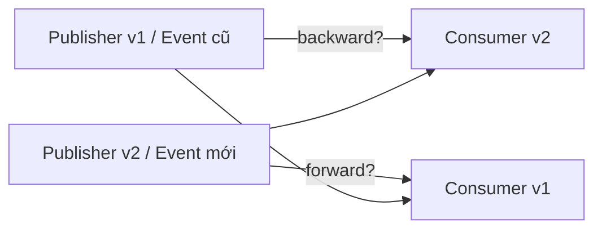
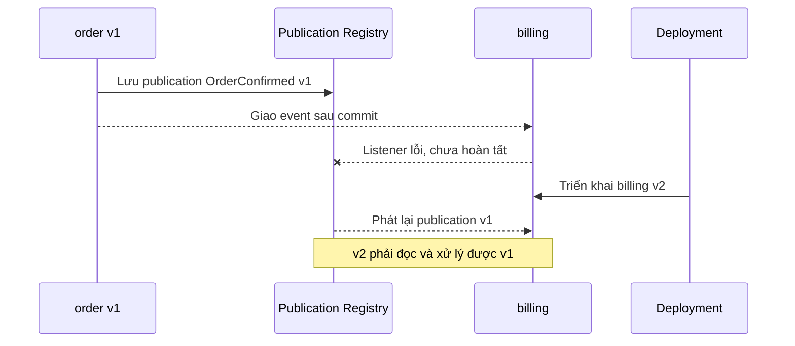
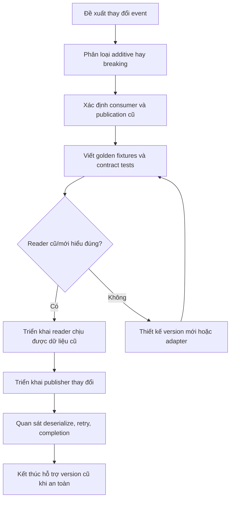

# Cam kết tương thích cho hợp đồng sự kiện trong Spring Modulith

## 1. Vì sao một sự kiện cần có cam kết tương thích?

Một ứng dụng Spring Modulith có thể chia thành các module `order` (đơn hàng), `billing` (hóa đơn), `inventory` (tồn kho) và `notification` (thông báo). Khi `order` phát `OrderConfirmed`, các module khác có thể xử lý sự kiện đó mà không cần gọi trực tiếp service nội bộ của `order`. Đây là một cách giảm coupling và bảo vệ ranh giới nghiệp vụ.

Tuy nhiên, sự độc lập đó chỉ bền vững khi **hợp đồng sự kiện đủ ổn định**. Giả sử module `order` ban đầu phát:

```json
{
  "eventId": "53c1ba94-15a9-48ba-8e49-e7cde3237c0a",
  "orderId": "f4d22519-ac9d-42b6-9134-18c24a6c76a8",
  "totalAmount": 150000,
  "currency": "VND"
}
```

Sau một lần refactor, publisher đổi `orderId` thành `purchaseId`, hoặc âm thầm chuyển `totalAmount` từ **VND** sang **đơn vị nghìn VND**. Consumer cũ có thể không tìm thấy trường cần thiết hoặc vẫn đọc được dữ liệu nhưng tính toán sai. Với listener xử lý sau commit, vấn đề còn có thể xuất hiện **sau khi ứng dụng đã được triển khai**: registry lưu một publication cũ, listener bị lỗi và cần phát lại khi code consumer đã nâng cấp.

**Cam kết tương thích** (compatibility guarantee) là quy định rõ những thay đổi nào publisher được phép thực hiện mà consumer đang được hỗ trợ vẫn có thể đọc và xử lý event đúng nghĩa. Cam kết cần bao trùm **cấu trúc dữ liệu**, **ý nghĩa nghiệp vụ** và **hành vi giao sự kiện**, không chỉ câu hỏi JSON có deserialize thành công hay không.

Mục tiêu của bài học trong chương **Hợp đồng sự kiện**, thuộc module **SPRING_MODULITH_APPLICATION_EVENTS**, là giúp bạn:

- Phân biệt tương thích ngược, xuôi, hai chiều và những giới hạn cụ thể của chúng.
- Thiết kế event Java record/DTO có quy tắc thay đổi và giá trị mặc định rõ ràng.
- Biết khi nào có thể thêm trường, khi nào phải tạo phiên bản hợp đồng mới.
- Hiểu ảnh hưởng của Spring Modulith Event Publication Registry, listener sau commit và retry đối với event cũ.
- Viết contract test, kiểm thử replay và kế hoạch triển khai an toàn khi các module phát/nhận sự kiện thay đổi.

> **Giới hạn cần nhớ:** Spring Modulith cung cấp cơ chế application events, ranh giới module và registry cho những publication phù hợp. Nó **không mặc định tự cam kết** mọi kiểu event Java sẽ luôn tương thích qua tất cả phiên bản, và không tự upcast event cũ sang một schema mới. Chính đội phát triển phải định nghĩa hợp đồng và kiểm thử các bảo đảm đó.

## 2. Tương thích ngược, tương thích xuôi và tương thích hai chiều

Gọi `P1` là dữ liệu do publisher phiên bản 1 tạo, `P2` là dữ liệu phiên bản 2 tạo; `C1` và `C2` là consumer đọc phiên bản cũ và mới.

| Thuật ngữ | Điều cần chứng minh | Tình huống minh họa |
| --- | --- | --- |
| **Backward compatibility** (tương thích ngược) | Consumer mới `C2` vẫn đọc và hiểu được sự kiện cũ `P1` | Listener phiên bản mới xử lý publication được lưu trước nâng cấp |
| **Forward compatibility** (tương thích xuôi) | Consumer cũ `C1` vẫn đọc và hiểu được sự kiện mới `P2` | Publisher đã thêm một trường tùy chọn nhưng consumer cũ chưa cập nhật |
| **Full compatibility** (tương thích hai chiều) | Cả `C2(P1)` và `C1(P2)` đều hoạt động đúng | Đội muốn triển khai reader và writer không phụ thuộc chặt thứ tự |
| **Breaking change** | Một hoặc nhiều cặp reader/writer đang được hỗ trợ không còn hoạt động đúng | Xóa trường bắt buộc, đổi loại dữ liệu, đổi ý nghĩa tiền tệ |

Sơ đồ các trường hợp đọc:



Một thay đổi chỉ được gọi là tương thích khi **có điều kiện cụ thể**:

- Reader có thể bỏ qua trường chưa biết hoặc có quy tắc xử lý mở rộng rõ ràng.
- Trường mới là tùy chọn, hoặc có default đúng nghĩa khi đọc dữ liệu cũ.
- Ý nghĩa và các giá trị đã công bố của trường hiện có được giữ nguyên.
- Consumer vẫn được đáp ứng các giả định về thời điểm phát, số lần xử lý và quan hệ với transaction.
- Định dạng lưu trữ và cơ chế deserialize thực tế có hỗ trợ các thay đổi đó.

Ví dụ, thêm trường `campaignCode` là bước **có thể** tương thích; nếu consumer cũ dùng JSON parser mặc định cấu hình từ chối trường lạ, nó vẫn có thể lỗi. Tương tự, JSON parse thành công chưa bảo đảm việc gán giá trị thiếu sẽ không làm sai nghiệp vụ.

### 2.1. Tương thích thuộc về các cặp phiên bản được hỗ trợ

Không có “tương thích tuyệt đối” với mọi consumer từng tồn tại. Cam kết cần quy định phạm vi, chẳng hạn:

> “Trong hai phiên bản ứng dụng liên tiếp, producer của `OrderConfirmed` giữ nguyên các trường bắt buộc và ngữ nghĩa; trường mới chỉ được thêm dưới dạng tùy chọn. Consumer mới đọc được serialized events được giữ từ phiên bản trước. Thay đổi phá vỡ schema được phát hành bằng event type/version mới.”

Ví dụ trên là **chính sách đề xuất**, không phải một cam kết do Spring Modulith áp sẵn. Nhóm có thể chọn thời hạn hỗ trợ dài hơn dựa vào tuổi thọ publication, consumer bên ngoài, quy định lưu dữ liệu và thời gian chuyển đổi thực tế.

## 3. Ba lớp tương thích cần xem xét

### 3.1. Tương thích dữ liệu (wire/storage compatibility)

Đây là khả năng đọc một event được serialize (ví dụ JSON, Avro hoặc Protobuf) khi schema writer/reader khác phiên bản.

Các câu hỏi:

- Trường nào bắt buộc? Trường nào có thể vắng mặt hoặc null?
- Tên trường, kiểu dữ liệu, format số và timestamp có ổn định?
- Reader xử lý trường chưa biết, enum chưa biết và event type chưa biết thế nào?
- Định dạng được lưu có kèm tên class Java/Java type metadata không?
- Bản event từ trước nâng cấp còn có thể deserialize sau khi đổi tên class/package?

### 3.2. Tương thích API Java (source/binary compatibility)

Spring Modulith chạy trong ứng dụng Java/Spring Boot, nên event thường là class hoặc record được module khác import trực tiếp. Dù JSON tương thích, đổi mã Java vẫn có thể phá code caller.

Ví dụ, với:

```java
public record OrderConfirmed(
        java.util.UUID orderId,
        String currency) {}
```

Nếu thêm một thành phần record `campaignCode`, **chữ ký canonical constructor đổi**. Lời gọi Java cũ `new OrderConfirmed(orderId, "VND")` không còn biên dịch nếu không cung cấp constructor tương thích. Code đã biên dịch trước đó, nếu được nạp cạnh class mới mà constructor cũ không còn, cũng có thể gặp lỗi liên kết nhị phân.

Với modular monolith triển khai toàn bộ cùng một artifact, việc build lại các module giúp phát hiện nhiều lỗi nguồn. Nhưng ứng dụng vẫn có thể phải đọc **publication được lưu từ phiên bản trước**, hoặc chia sẻ event DTO cho hệ thống bên ngoài. Vì vậy, kiểm tra Java source không thay thế kiểm tra dữ liệu cũ.

### 3.3. Tương thích hành vi và ngữ nghĩa nghiệp vụ

Giả sử `OrderConfirmed.totalAmount` luôn là `BigDecimal` và JSON vẫn hợp lệ, nhưng publisher đổi ngầm ý nghĩa từ **tổng đơn đã bao gồm thuế** sang **tổng chưa gồm thuế**. Không parser nào phát hiện được lỗi này.

Tương tự, đổi một sự kiện từ “đơn hàng đã commit thành công” sang “đã gửi yêu cầu tạo đơn nhưng có thể rollback” là thay đổi **ngữ nghĩa thời điểm phát**, dù không thêm hay xóa trường.

Cam kết tốt vì vậy phải mô tả rõ:

| Khía cạnh | Cần ghi vào hợp đồng |
| --- | --- |
| Sự kiện nói lên điều gì? | Một sự thật nghiệp vụ đã xảy ra, không phải dự định chưa chắc thành công |
| Khi nào được phát? | Sau thao tác nghiệp vụ nào; có gắn với transaction/commit không |
| Đơn vị và kiểu tiền | Ví dụ `BigDecimal totalAmount` theo đơn vị tiền của `currency`, không phải số nghìn |
| Định danh | `eventId` riêng cho mỗi domain event; `orderId` là ID đối tượng nghiệp vụ |
| Thời gian | ISO-8601/UTC hay timezone cụ thể; thời điểm phát và thời điểm xảy ra có khác nhau không |
| Lặp và retry | Consumer phải chấp nhận redelivery thế nào; idempotency dựa trên khóa nào |
| Ordering | Có được bảo đảm thứ tự giữa nhiều event cho cùng `orderId` hay không |
| Bảo mật và retention | Payload có chứa dữ liệu cá nhân không; lịch sử được giữ bao lâu |

## 4. Hợp đồng mẫu: OrderConfirmed phiên bản đầu tiên

Xét dự án `com.example.shop` có module `order` sở hữu sự kiện và `billing` lắng nghe. Package được tổ chức theo nghiệp vụ:

```text
com.example.shop
├── ShopApplication.java
├── order/
│   ├── OrderConfirmed.java           ← API của module order
│   ├── OrderManagement.java
│   └── internal/
│       └── OrderRepository.java
└── billing/
    └── internal/
        └── OrderConfirmedListener.java
```

Lớp khởi động ứng dụng ở package `com.example.shop`, ví dụ:

```java
package com.example.shop;

import org.springframework.boot.SpringApplication;
import org.springframework.boot.autoconfigure.SpringBootApplication;

@SpringBootApplication
public class ShopApplication {

    public static void main(String[] args) {
        SpringApplication.run(ShopApplication.class, args);
    }
}
```

Với Gradle, dự án cần dependency Spring Boot, Spring Modulith và JUnit/Jackson phù hợp. Một tập phụ thuộc minh họa (phiên bản do dependency management/BOM tương thích quyết định):

```groovy
dependencies {
    implementation 'org.springframework.boot:spring-boot-starter'
    implementation 'org.springframework.modulith:spring-modulith-starter-core'
    implementation 'org.springframework.modulith:spring-modulith-events-api'

    testImplementation 'org.springframework.boot:spring-boot-starter-test'
    testImplementation 'org.springframework.modulith:spring-modulith-starter-test'
}
```

Khi dùng Jackson trong phần mã ứng dụng, cần bảo đảm Jackson annotations/databind thực sự có mặt qua dependencies thích hợp. Event Publication Registry có persistence cần thêm adapter/backend và cấu hình database tương ứng; riêng các dependency trên không có nghĩa publication đã được lưu bền.

Ở hợp đồng đầu tiên, event có bốn trường:

```java
package com.example.shop.order;

import com.fasterxml.jackson.annotation.JsonIgnoreProperties;
import java.math.BigDecimal;
import java.util.UUID;

@JsonIgnoreProperties(ignoreUnknown = true)
public record OrderConfirmed(
        UUID eventId,
        UUID orderId,
        BigDecimal totalAmount,
        String currency) {}
```

Serialized JSON tương ứng (định dạng minh họa):

```json
{
  "eventId": "53c1ba94-15a9-48ba-8e49-e7cde3237c0a",
  "orderId": "f4d22519-ac9d-42b6-9134-18c24a6c76a8",
  "totalAmount": 150000,
  "currency": "VND"
}
```

Ở ví dụ này, ta định nghĩa rõ:

1. `eventId` là ID bất biến của **lần phát sinh sự kiện**, không phải ID của đơn hàng.
2. `orderId` là ID nghiệp vụ của đơn được xác nhận.
3. `totalAmount` là **tổng tiền đơn vị VND**, không mang đơn vị “nghìn VND”; `BigDecimal` được dùng thay cho `double` để tránh sai số nhị phân thông thường.
4. `currency` theo mã tiền tệ tiêu chuẩn mà ứng dụng chấp nhận; ví dụ `"VND"`.
5. Event nói rằng **đơn hàng đã được xác nhận thành công theo giao dịch nghiệp vụ của publisher**, không nói rằng hóa đơn đã phát hành hoặc email đã gửi.
6. Consumer có thể nhận lại cùng `eventId` trong một lần giao lại và phải xử lý lặp an toàn.

`@JsonIgnoreProperties(ignoreUnknown = true)` làm một Jackson reader bỏ qua những trường chưa biết khi deserialize **đúng kiểu này**. Annotation không điều khiển mọi serializer, không áp dụng cho consumer không dùng Jackson và không bảo đảm ngữ nghĩa của những trường mới.

### 4.1. Công bố event ở package API

`order.OrderConfirmed` nằm trực tiếp tại package gốc `order`, nên với Spring Modulith module đóng mặc định, module `billing` có thể sử dụng như API công khai. Nếu đưa event vào `order.internal` nhưng vẫn import từ `billing`, `ApplicationModules.verify()` có thể báo vi phạm ranh giới.

Nếu muốn có package `order.events`, cần công bố named interface phù hợp. Cơ chế này liên quan đến **phạm vi module được phép phụ thuộc**, khác với việc đảm bảo **phiên bản dữ liệu event có tương thích**. Cần thỏa mãn cả hai điều kiện.

## 5. Ma trận đánh giá thay đổi hợp đồng

Bảng dưới là hướng dẫn quyết định **với JSON và consumer được thiết kế cho evolution**. Các thay đổi “có thể tương thích” luôn cần contract test và quy tắc ngữ nghĩa.

| Thay đổi ở producer | Đánh giá mặc định | Điều kiện hoặc cách xử lý |
| --- | --- | --- |
| Thêm trường **tùy chọn** `campaignCode` | Có thể tương thích hai chiều | Reader cũ bỏ qua trường mới; reader mới có default hợp nghĩa khi thiếu |
| Thêm trường **bắt buộc** `paymentMethod` | Dễ phá tương thích ngược | Event cũ không có trường; cần default hoặc event version mới |
| Xóa trường `currency` | Breaking với reader dùng trường này | Giữ trường cũ đến hết thời gian hỗ trợ hoặc tạo hợp đồng mới |
| Đổi `orderId` thành `purchaseId` | Breaking | Dual-read/alias trong giai đoạn chuyển đổi hoặc type mới |
| Đổi `totalAmount` từ số sang chuỗi | Breaking với parser/schema typed | Chỉ làm với chuyển đổi có chủ đích và test |
| Đổi ý nghĩa `totalAmount` từ “có thuế” sang “chưa thuế” | **Breaking về ngữ nghĩa** | Tên và phiên bản hợp đồng mới; không đổi âm thầm |
| Bổ sung một giá trị `status` trong enum | Có thể breaking | Consumer cũ phải có nhánh `UNKNOWN`/fallback phù hợp |
| Thay event name/type từ `OrderConfirmed` sang `OrderAccepted` | Breaking nếu listener chỉ đăng ký type cũ | Cần hỗ trợ giai đoạn chuyển đổi, routing/mapping |
| Thêm một consumer mới | Không sửa payload | Nhưng có thể tăng số publication và yêu cầu kiểm thử idempotency |
| Thay publisher phát trước commit thay vì sau commit | Breaking về thời điểm/ngữ nghĩa | Đánh giá transaction và phản ứng của consumer |
| Đổi ID sự kiện khi retry cùng publication | Breaking về identity | Retry phải giữ ID event gốc; attempt là dữ liệu vận hành |
| Đổi package/tên class Java của event | Rủi ro lớn | Mã import, persisted type metadata và listener routing có thể bị ảnh hưởng |

### 5.1. “Thêm trường tùy chọn” vẫn phải được kiểm chứng

Một thay đổi chỉ thật sự an toàn nếu:

- **Producer mới** có thể phát trường tùy chọn khi đã biết giá trị.
- **Consumer cũ** có thể bỏ qua trường chưa biết (hoặc cơ chế serialize đã định nghĩa rõ).
- **Consumer mới** không phụ thuộc bắt buộc vào giá trị đó khi đọc event cũ.
- Nếu trường bị thiếu và default được dùng, default không làm sai kết quả nghiệp vụ.
- Khi event đang lưu ở registry hoặc audit log, cơ chế deserialize phù hợp với version đang đọc.

Ví dụ thêm `campaignCode` có thể đặt default `null` với nghĩa “không có hoặc không được cung cấp”; không nên tự gán `"FREE_ORDER"` vì việc đó sẽ thay đổi giá trị kinh doanh khi replay event cũ.

## 6. Mở rộng record theo hướng tương thích

Giữ tên type `OrderConfirmed`, bổ sung trường tùy chọn `campaignCode`, giữ bốn trường cũ nguyên tên/kiểu/ngữ nghĩa:

```java
package com.example.shop.order;

import com.fasterxml.jackson.annotation.JsonIgnoreProperties;
import java.math.BigDecimal;
import java.util.Objects;
import java.util.UUID;

@JsonIgnoreProperties(ignoreUnknown = true)
public record OrderConfirmed(
        UUID eventId,
        UUID orderId,
        BigDecimal totalAmount,
        String currency,
        String campaignCode) {

    public OrderConfirmed {
        Objects.requireNonNull(eventId, "eventId");
        Objects.requireNonNull(orderId, "orderId");
        Objects.requireNonNull(totalAmount, "totalAmount");
        Objects.requireNonNull(currency, "currency");

        if (totalAmount.signum() < 0) {
            throw new IllegalArgumentException("totalAmount must be >= 0");
        }
        if (currency.isBlank()) {
            throw new IllegalArgumentException("currency is required");
        }

        // Vắng mặt hoặc chuỗi trắng được hiểu là không có campaign.
        campaignCode = campaignCode == null || campaignCode.isBlank()
                ? null
                : campaignCode;
    }

    // Giữ lời gọi constructor bốn tham số của caller Java trước đây.
    public OrderConfirmed(
            UUID eventId,
            UUID orderId,
            BigDecimal totalAmount,
            String currency) {

        this(eventId, orderId, totalAmount, currency, null);
    }
}
```

Điểm chính:

- JSON cũ thiếu `campaignCode` sẽ được Jackson hỗ trợ record thông thường deserialize với giá trị `null`, sau đó qua compact constructor chuẩn hóa.
- JSON mới có `campaignCode` vẫn có thể được **consumer cũ đã được cấu hình bỏ qua trường lạ** đọc bằng record bốn trường.
- Constructor bốn tham số giữ khả năng gọi `new OrderConfirmed(eventId, orderId, totalAmount, currency)` trong mã Java mới, đồng thời cung cấp chữ ký cũ cho những caller trước đây sử dụng constructor đó.
- Consumer mới vẫn phải xử lý trường `campaignCode == null`; không được đổi từ “tùy chọn” thành “bắt buộc” chỉ vì producer mới thường gửi giá trị.
- Việc giữ constructor chỉ giải quyết một phần tương thích **API Java**. Record còn có thay đổi `equals()`, `hashCode()`, `toString()` và cấu trúc thành phần; code phụ thuộc vào số lượng thành phần, reflection, schema generator hoặc persistence serializer vẫn cần được kiểm tra.

**Không suy ra rằng mọi record đều tương thích chỉ vì thêm constructor cũ.** Ví dụ mới dùng **Jackson có hỗ trợ Java records** để minh họa một lựa chọn; serializer khác có thể có quy tắc creator, trường bắt buộc và type metadata khác.

### 6.1. JSON cũ và JSON mới

**Dữ liệu trước khi thêm trường:**

```json
{
  "eventId": "53c1ba94-15a9-48ba-8e49-e7cde3237c0a",
  "orderId": "f4d22519-ac9d-42b6-9134-18c24a6c76a8",
  "totalAmount": 150000,
  "currency": "VND"
}
```

**Dữ liệu sau khi thêm trường:**

```json
{
  "eventId": "53c1ba94-15a9-48ba-8e49-e7cde3237c0a",
  "orderId": "f4d22519-ac9d-42b6-9134-18c24a6c76a8",
  "totalAmount": 150000,
  "currency": "VND",
  "campaignCode": "TET2026"
}
```

Hai payload dùng chung `eventId` chỉ để **so sánh hai biểu diễn schema của cùng một ví dụ sự kiện**. Trong hệ thống thật, mỗi lần một sự kiện nghiệp vụ **mới** xảy ra phải có `eventId` riêng; không dùng chung ID cho hai sự kiện khác nhau.

### 6.2. Hướng triển khai giảm rủi ro

Thêm trường tùy chọn thường an toàn hơn nếu triển khai theo trình tự:

1. Chuẩn bị consumer để **bỏ qua trường lạ** và có default/nhánh xử lý khi vắng mặt.
2. Bổ sung contract test đọc dữ liệu cũ bằng code mới.
3. Chỉ sau khi phạm vi consumer được hỗ trợ đã sẵn sàng mới cho publisher đưa trường mới vào payload.
4. Theo dõi lỗi deserialize và xử lý event sau triển khai; nếu có consumer ngoài chưa cập nhật, không tự cho rằng họ sẽ bỏ qua trường mới.

Trong modular monolith đồng triển khai, nhiều bước có thể nằm trong một bản phát hành ứng dụng. Nhưng nếu có **event còn lưu trong registry**, consumer chưa được nâng cấp hoặc event được externalize cho hệ thống khác, vẫn cần cách nghĩ theo các phiên bản reader/writer cùng tồn tại.

## 7. Contract test cho cả hai chiều tương thích

Một phép thử có ích hơn việc chỉ compile project là dùng **golden events**: những JSON được lưu cố định từ phiên bản producer/consumer cần hỗ trợ. Ví dụ dùng Java 17+, JUnit 5 và Jackson.

Tạo `src/test/java/com/example/shop/order/OrderConfirmedCompatibilityTests.java`:

```java
package com.example.shop.order;

import static org.junit.jupiter.api.Assertions.*;

import com.fasterxml.jackson.annotation.JsonIgnoreProperties;
import com.fasterxml.jackson.databind.ObjectMapper;
import java.math.BigDecimal;
import java.util.UUID;
import org.junit.jupiter.api.Test;

class OrderConfirmedCompatibilityTests {

    private final ObjectMapper mapper = new ObjectMapper();

    private static final String EVENT_ID =
            "53c1ba94-15a9-48ba-8e49-e7cde3237c0a";

    private static final String OLD_JSON = """
        {
          "eventId": "53c1ba94-15a9-48ba-8e49-e7cde3237c0a",
          "orderId": "f4d22519-ac9d-42b6-9134-18c24a6c76a8",
          "totalAmount": 150000,
          "currency": "VND"
        }
        """;

    private static final String NEW_JSON = """
        {
          "eventId": "53c1ba94-15a9-48ba-8e49-e7cde3237c0a",
          "orderId": "f4d22519-ac9d-42b6-9134-18c24a6c76a8",
          "totalAmount": 150000,
          "currency": "VND",
          "campaignCode": "TET2026"
        }
        """;

    // Đóng vai contract reader cũ của chính ví dụ.
    @JsonIgnoreProperties(ignoreUnknown = true)
    private record OldOrderConfirmed(
            UUID eventId,
            UUID orderId,
            BigDecimal totalAmount,
            String currency) {}

    @Test
    void newReaderAcceptsOldJsonWithoutCampaignCode() throws Exception {
        OrderConfirmed event =
                mapper.readValue(OLD_JSON, OrderConfirmed.class);

        assertEquals(UUID.fromString(EVENT_ID), event.eventId());
        assertEquals(new BigDecimal("150000"), event.totalAmount());
        assertEquals("VND", event.currency());
        assertNull(event.campaignCode());
    }

    @Test
    void oldTolerantReaderAcceptsNewOptionalField() throws Exception {
        OldOrderConfirmed event =
                mapper.readValue(NEW_JSON, OldOrderConfirmed.class);

        assertEquals(UUID.fromString(EVENT_ID), event.eventId());
        assertEquals(new BigDecimal("150000"), event.totalAmount());
        assertEquals("VND", event.currency());
    }

    @Test
    void newReaderPreservesNewField() throws Exception {
        OrderConfirmed event =
                mapper.readValue(NEW_JSON, OrderConfirmed.class);

        assertEquals("TET2026", event.campaignCode());
    }

    @Test
    void legacyJavaConstructorStillWorks() {
        var event = new OrderConfirmed(
                UUID.randomUUID(),
                UUID.randomUUID(),
                new BigDecimal("150000"),
                "VND");

        assertNull(event.campaignCode());
    }
}
```

Test này chứng minh trường hợp **cụ thể**: JSON và hai reader được minh họa trong code. Nó không chứng minh mọi consumer cũ bên ngoài đều tương thích, cũng không chứng minh Spring Modulith đã deserialize publication từ database thành công.

Một bộ contract test tốt nên bổ sung:

- JSON thiếu trường **bắt buộc** phải bị từ chối thay vì tạo object có dữ liệu âm thầm sai.
- JSON có trường lạ được đọc đúng theo chính sách.
- Giá trị `totalAmount`, `currency` và `eventId` còn nguyên ý nghĩa sau serialize/deserialize.
- Consumer xử lý được cả `campaignCode = null`, chuỗi rỗng (nếu cho phép) và giá trị hợp lệ.
- Cấu hình `ObjectMapper` dùng trong test phải tương thích hoặc được lấy từ serializer **thực sự** sử dụng ở runtime khi kiểm tra khả năng replay.
- Nếu code dùng khác Jackson hoặc đã bật tính năng strict binding, có bộ thử phù hợp với serializer đó.

## 8. Khi nào phải tạo phiên bản event mới?

Một hợp đồng mới là lựa chọn an toàn khi thay đổi **không thể biểu diễn hợp lý như thêm trường tùy chọn**. Ví dụ doanh nghiệp thay “đơn đã xác nhận” thành một quy trình hai bước gồm “đã chấp nhận yêu cầu” và “đã xác nhận thanh toán”; đổi tên `OrderConfirmed` nhưng giữ nguyên consumer cũ sẽ khiến listener hành động sai thời điểm.

Một cách là công bố event type riêng, chẳng hạn:

```java
package com.example.shop.order;

import java.math.BigDecimal;
import java.time.Instant;
import java.util.UUID;

// Hợp đồng đã phát hành, giữ để đọc những event/consumer còn hỗ trợ.
public record OrderConfirmedV1(
        UUID eventId,
        UUID orderId,
        BigDecimal totalAmount,
        String currency) {}
```

```java
package com.example.shop.order;

import java.math.BigDecimal;
import java.time.Instant;
import java.util.UUID;

// Hợp đồng mới minh họa một sự kiện khác ý nghĩa:
// yêu cầu được chấp nhận, chưa cam kết thanh toán đã hoàn tất.
public record OrderAcceptedV2(
        UUID eventId,
        UUID orderId,
        BigDecimal requestedAmount,
        String currency,
        Instant acceptedAt) {}
```

Hai snippet biểu diễn **hai file Java khác nhau**, cùng nằm trong package `order`. Trong code thực tế, không được đặt hai khai báo `public` này trong cùng một file.

Vì ngữ nghĩa khác nhau, `OrderAcceptedV2` nên được coi là một **loại event mới**, không chỉ đổi tên class rồi kỳ vọng các listener cũ vẫn xử lý như trước.

### 8.1. Ba chiến lược xử lý breaking change

| Chiến lược | Khi nào phù hợp | Điểm cần quản lý |
| --- | --- | --- |
| **Event type mới** như `OrderAcceptedV2` | Ý nghĩa thay đổi đáng kể hoặc consumer cũ không thể hiểu | Cập nhật publisher/listener, quá trình ngừng hỗ trợ type cũ |
| **Adapter/upcaster** cho dữ liệu đã lưu | Event cũ vẫn cần replay thành model mới | Quy tắc chuyển đổi dữ liệu có căn cứ; xử lý field không suy ra được |
| **Hỗ trợ song song v1/v2 có thời hạn** | Cần chuyển consumer ở nhiều thời điểm | Tránh nhân đôi side effect, có lịch kết thúc và đo lưu lượng v1 |

Một **upcaster** đọc dữ liệu cũ và chuyển đổi thành representation mà code mới hiểu. Đây là cơ chế **phải xây dựng/cấu hình phù hợp với serializer và nơi lưu event**. Spring Modulith không tự cung cấp một bộ quy tắc migration tổng quát cho mọi loại event do ứng dụng định nghĩa.

Không nên lặng lẽ “sửa” một sự kiện cũ bằng cách tưởng tượng dữ liệu chưa từng tồn tại. Ví dụ, nếu v1 không có `acceptedAt`, dùng thời gian replay làm `acceptedAt` sẽ đánh tráo thời điểm nghiệp vụ. Có thể để trường không xác định theo chính sách, bổ sung dữ liệu lịch sử đáng tin cậy hoặc giữ adapter riêng cho sự kiện cũ.

### 8.2. Cẩn thận khi dual-publish

Trong giai đoạn chuyển đổi, publisher có thể tạm thời phát `OrderConfirmedV1` và `OrderAcceptedV2` cho cùng một hoạt động nghiệp vụ. Nếu hai event cùng đến consumer thực hiện tạo hóa đơn hoặc gửi email, consumer có thể chạy tác vụ **hai lần**.

Vì vậy, phải xác định rõ:

1. Hai event có thực sự mô tả cùng một sự kiện nghiệp vụ hay đại diện hai thời điểm khác nhau?
2. Consumer nào còn subscribe v1, consumer nào đã nhận v2?
3. Có một **business occurrence ID** hoặc khóa idempotency dùng xuyên các phiên bản nếu chúng biểu diễn cùng một hoạt động?
4. Cần thử nghiệm migration với publication đang chờ, retry và khởi động lại ứng dụng.
5. Thời điểm nào chắc chắn không còn consumer cần v1 và không còn dữ liệu v1 chưa được xử lý?

Đừng cho rằng hai phiên bản có `eventId` khác nhau thì idempotency dựa trên `eventId` đủ ngăn xử lý trùng nghiệp vụ: nếu chúng diễn đạt cùng một hành động, cần một **định danh nghiệp vụ ổn định** dùng cho mục đích loại trùng xuyên phiên bản.

## 9. Bối cảnh riêng của Spring Modulith

### 9.1. Sự kiện nội bộ trong cùng JVM

Với `ApplicationEventPublisher`, đối tượng event là một Java object được dispatch tới các listener đã đăng ký trong Spring application context. Ở luồng đơn giản không có persistence hoặc externalization, consumer thường nhận object cùng kiểu Java, không có bước JSON serialize qua mạng.

Điều này làm thay đổi rủi ro so với broker:

- Hai module cùng build/deploy có thể được compiler kiểm tra phụ thuộc Java trực tiếp.
- Nếu thêm một record component, các caller/consumer trực tiếp có thể phải cập nhật trong cùng đợt build.
- Một listener nhận object bằng type Java được công bố; nếu bỏ/đổi tên class hoặc package, code import cũ có thể fail compile.
- **Không vì thế mà hợp đồng trở nên vô thời hạn**: publication còn lưu hoặc external consumer có thể vẫn phụ thuộc dữ liệu/type cũ.

### 9.2. Event Publication Registry và publication cũ

Spring Modulith có **Event Publication Registry** để theo dõi publication cho những transactional listener phù hợp. Khi được cấu hình với backend persistence, registry lưu thông tin phục vụ theo dõi các publication chưa hoàn tất; một publication có thể được xử lý lại sau lỗi hoặc khởi động lại tùy cấu hình/phiên bản.

Giả sử:



Tại điểm phát lại, code chạy là **consumer mới** nhưng dữ liệu được tạo bởi **producer cũ**. Vì vậy, backward compatibility là yêu cầu thật sự ngay cả trong một modular monolith triển khai chung một artifact.

Điểm dễ bỏ sót:

- Một persistence implementation/serializer có thể lưu payload kèm **kiểu Java** hoặc type metadata. Đổi tên package/class hay xóa class cũ có thể làm việc deserialize event lịch sử thất bại.
- Một event đã được gửi tới nhiều listener có thể tương ứng với nhiều publication record. Việc thay đổi danh tính listener có thể ảnh hưởng cách hạ tầng nhận diện phần việc còn đang chờ.
- Cấu hình database, serialization, cleanup, completion và cách resubmission khác nhau theo phiên bản/adapter. Không được suy ra từ bài viết này rằng **mọi publication tự retry**.
- Event Publication Registry hỗ trợ độ tin cậy giao sự kiện, nhưng **không tự biến event schema cũ thành schema mới** và không thay thế idempotency của tác vụ bên ngoài.

Trước khi xóa class v1, đổi FQCN hoặc thay cấu trúc dữ liệu bắt buộc, hãy xác định **có còn serialized publication v1 hay không** và xây dựng đường xử lý an toàn cho chúng. Cần kiểm tra trên chính backend registry/serializer mà ứng dụng dùng, thay vì chỉ test ObjectMapper tùy ý.

### 9.3. Listener sau commit và “tương thích hành vi”

Ví dụ consumer:

```java
package com.example.shop.billing.internal;

import com.example.shop.order.OrderConfirmed;
import org.springframework.modulith.events.ApplicationModuleListener;
import org.springframework.stereotype.Component;

@Component
class OrderConfirmedListener {

    @ApplicationModuleListener
    void on(OrderConfirmed event) {
        // Bổ sung idempotency, kiểm tra orderId và
        // tạo hóa đơn theo nghiệp vụ thực tế.
        if (event.campaignCode() != null) {
            // Trường tùy chọn; có thể không tồn tại trong event cũ.
        }
    }
}
```

`@ApplicationModuleListener` kết hợp listener giao dịch sau commit, xử lý bất đồng bộ và transaction riêng theo cơ chế Spring Modulith. Sự kiện được publish phải nằm trong transaction nguồn phù hợp để listener mặc định nhận sau commit; xuất bản từ code không có transaction có thể dẫn tới listener không được gọi theo ngữ nghĩa mặc định của `@TransactionalEventListener`.

Nếu publisher đổi thời điểm phát từ **sau khi lưu đơn thành công** thành **ngay khi nhận yêu cầu nhưng chưa chắc commit**, payload vẫn có thể giống hệt, song listener lại có thể tạo hóa đơn cho đơn hàng bị hủy. Đây là breaking change về **cam kết nghiệp vụ**.

### 9.4. Event được đưa ra ngoài JVM

Khi dùng Spring Modulith event externalization hoặc tích hợp broker/HTTP, hợp đồng trở thành **wire contract** giữa các process. Lúc này cần xác định rõ:

- Tên event type bên ngoài có ổn định và độc lập với FQCN Java không.
- JSON/schema headers sử dụng format và naming policy nào.
- Reader các phiên bản cũ bỏ qua trường mới hay từ chối?
- Có schema registry, sự kiện mẫu (golden fixtures), version trong envelope hoặc routing theo version không?
- Thời gian trễ/retention trên broker có thể kéo dài hơn kỳ triển khai ứng dụng không?

Đừng tự suy đoán event type external được quyết định bằng một thuật toán cố định: cách đặt tên, routing, serialization và headers tùy cơ chế externalization và cấu hình ứng dụng. Hãy coi giao thức đã công bố với subscriber là hợp đồng cần được kiểm thử riêng.

## 10. Cam kết tương thích với định danh, thứ tự và retry

Một event contract thường chứa nhiều hơn domain fields. Metadata có thể gồm `eventId`, `correlationId`, `causationId`, `occurredAt` và một trường `schemaVersion` khi cần:

```json
{
  "type": "shop.order.confirmed",
  "schemaVersion": 1,
  "eventId": "53c1ba94-15a9-48ba-8e49-e7cde3237c0a",
  "correlationId": "c4168fb1-832d-4367-a9ce-6a1c6ac4ed95",
  "causationId": "71e8662c-706a-4ae1-982e-0c3247ca441d",
  "occurredAt": "2026-01-10T10:15:30Z",
  "payload": {
    "orderId": "f4d22519-ac9d-42b6-9134-18c24a6c76a8",
    "totalAmount": 150000,
    "currency": "VND"
  }
}
```

Đây là **envelope minh họa do ứng dụng tự thiết kế**. `schemaVersion` và các ID trong JSON này không phải những trường mặc định mà `ApplicationEventPublisher` của Spring tự chèn vào mọi event.

Một cam kết cần làm rõ:

| Thuộc tính | Cam kết đề xuất |
| --- | --- |
| `eventId` | Cùng một domain event được redeliver vẫn giữ cùng ID; event mới có ID khác |
| `correlationId` | Các event trong cùng workflow có thể liên kết qua một ID ổn định |
| `causationId` | Trỏ tới nguyên nhân trực tiếp theo quy ước command/event |
| `occurredAt` | Thời điểm nghiệp vụ được ghi nhận, không được ghi lại thành thời điểm retry |
| `schemaVersion` | Biểu thị version hợp đồng serialization, **không đồng nhất** với số lần delivery |
| Thứ tự xử lý | Nếu không có cơ chế ordering riêng, consumer không được giả định thứ tự toàn cục |
| Giao lặp | Consumer phải có idempotency khi side effect có thể gây hại nếu làm nhiều lần |
| Giao sau commit | Khi cam kết dùng listener sau commit, publisher/consumer phải kiểm thử rollback |

**Event ID không phải publication ID.** Registry có thể quản lý nhiều publication cho cùng một event, mỗi publication ứng với listener phù hợp. `eventId` thuộc domain event; ID hàng database/publication phục vụ hạ tầng là định danh khác và không nên thay nhau.

### 10.1. Idempotency là một phần của compatibility

Giả sử một listener đã gửi hóa đơn thành công nhưng ứng dụng lỗi trước khi ghi nhận completion của publication. Sau restart, event có thể được giao lại. Nếu code mới vô tình bỏ cơ chế kiểm tra `(listener, eventId)` hoặc đổi khóa loại trùng không có migration, hành vi của consumer không còn tương thích với dữ liệu/side effect cũ.

Để thực hiện idempotency:

1. Giữ `eventId` bất biến cho lần xử lý lại cùng event.
2. Lưu marker xử lý theo consumer và event ID khi phù hợp.
3. Khi dùng cùng database, đặt marker và thay đổi nghiệp vụ trong transaction có tính nguyên tử phù hợp.
4. Với side effect bên ngoài (email, thanh toán), dùng idempotency key/trạng thái đối soát phía đích nếu có; database transaction cục bộ **không tạo ra exactly-once** giữa hai hệ thống.
5. Với dual-publish v1/v2 biểu diễn cùng hành động, phải có khóa nghiệp vụ xuyên version, vì hai event khác nhau có thể mang `eventId` khác nhau.

## 11. Quy trình thay đổi và triển khai hợp đồng an toàn

Một thay đổi có thể chia thành bốn pha:



### 11.1. Preflight trước khi thay đổi event

- Xác định **owner**: module nào tạo và chịu trách nhiệm về sự kiện.
- Liệt kê **consumer nội bộ** trong code, cùng consumer được externalize nếu có.
- Xác minh tuổi thọ của event tồn đọng trong registry, queue, audit log hay outbox.
- Đối chiếu phiên bản Java/Spring/Jackson/serializer đang dùng; không giả định mọi parser xử lý field lạ giống nhau.
- Kiểm tra event được phát trong transaction nào và listener có chạy sau commit không.
- Chọn rõ **compatible extension**, **new event type** hoặc **adapter**.
- Xác định tiêu chí kết thúc giai đoạn hỗ trợ cũ có thể quan sát được.

### 11.2. Nếu chỉ thêm trường tùy chọn

Với consumer có vòng đời độc lập, thứ tự thường an toàn hơn:

1. **Consumer trước:** hỗ trợ field vắng mặt, field lạ và dữ liệu cũ.
2. **Producer sau:** bắt đầu gửi field tùy chọn.
3. **Quan sát:** tỷ lệ deserialize lỗi, listener retry, publication chưa hoàn tất, lỗi nghiệp vụ và side effect lặp.
4. **Kiểm tra phạm vi hỗ trợ:** mọi consumer được hỗ trợ đã đáp ứng cam kết mới trước khi tăng yêu cầu bắt buộc.

Với các module build trong cùng Spring Boot artifact, có thể triển khai code cùng lúc, nhưng vẫn nên dùng các golden event cũ để kiểm chứng dữ liệu còn lưu.

### 11.3. Nếu là breaking change

1. Công bố event type/schema version mới với ngữ nghĩa tường minh.
2. Tạo adapter/upcaster nếu dữ liệu cũ có thể ánh xạ trung thực, hoặc giữ đường xử lý riêng cho v1.
3. Di chuyển từng consumer và thử lỗi/rollback/restart.
4. Trong thời gian dual-publish, kiểm soát duplicate side effects.
5. Chỉ ngừng hỗ trợ v1 khi consumer phụ thuộc v1 đã được di chuyển và publication/dữ liệu lịch sử cần xử lý đã có chiến lược rõ ràng.

Đổi schema và xóa dữ liệu tồn đọng nhằm “giải quyết” lỗi deserialize là quyết định nghiệp vụ/retention nghiêm trọng, cần cơ chế phục hồi và phê duyệt phù hợp. Trong quy trình thông thường, hãy ưu tiên **giữ khả năng đọc dữ liệu cũ** và chuyển đổi một cách có kiểm soát.

## 12. Kiểm thử theo nhiều lớp

Một bài test JSON duy nhất không xác nhận đầy đủ cam kết. Nên chia thử nghiệm theo mục tiêu:

| Nhóm kiểm thử | Câu hỏi | Ví dụ |
| --- | --- | --- |
| **Schema/serialization contract test** | Reader hiện tại đọc được payload ở các version hỗ trợ? | Jackson test với golden JSON cũ và mới |
| **Semantic test** | Thiếu field tùy chọn có dẫn đến xử lý đúng? | `campaignCode = null` không tạo ưu đãi giả |
| **Architecture test** | Consumer chỉ phụ thuộc API event công khai? | `ApplicationModules.of(ShopApplication.class).verify()` |
| **Publisher test** | Sự kiện được phát khi đúng điều kiện nghiệp vụ? | Giao dịch xác nhận đơn thành công publish `OrderConfirmed` |
| **Listener integration test** | Event cũ vẫn kích hoạt đúng listener sau commit? | Replay event cũ qua cấu hình event handling thật |
| **Registry recovery test** | Publication cũ chưa hoàn tất có đọc và retry sau deploy? | Lưu bằng code v1, nâng lên v2, khôi phục trên backend test |
| **Idempotency test** | Nhận một event hai lần có tạo side effect hai lần? | Hai attempt cùng `eventId` chỉ tạo một hóa đơn |
| **External contract test** | Subscriber bên ngoài đọc schema mới? | Consumer-driven contract/golden events của đối tác |

### 12.1. Test kiến trúc với Spring Modulith

```java
package com.example.shop;

import org.junit.jupiter.api.Test;
import org.springframework.modulith.core.ApplicationModules;

class ModuleArchitectureTests {

    @Test
    void moduleDependenciesAreValid() {
        ApplicationModules.of(ShopApplication.class).verify();
    }
}
```

Test này có tác dụng phát hiện phụ thuộc sai ranh giới và vòng phụ thuộc module. Nó **không biết** dữ liệu JSON cũ có deserialize được vào record mới hay không và cũng không tự phát hiện thay đổi ngữ nghĩa như đổi đơn vị tiền.

### 12.2. Kiểm thử publisher/listener sau commit

Khi sử dụng `@ApplicationModuleListener`, bài integration test cần:

- Có Spring transaction manager và persistence phù hợp, publish event trong transaction nguồn thực sự.
- Kiểm tra listener chỉ xử lý event từ transaction đã **commit**, không xử lý event từ transaction rollback theo cấu hình mặc định.
- Thử event cũ được serialize, lưu và giao lại với **backend registry thực tế đang dùng**.
- Xác minh metadata `eventId`, `correlationId`, `causationId` không thay đổi khi retry.
- Kiểm tra một hoặc nhiều consumer thất bại không khiến side effect bị lặp ngoài dự định.

Nếu dự án cấu hình `@TransactionalEventListener(fallbackExecution = true)` hoặc event listener kiểu khác, các giả định trên có thể thay đổi; phải ghi nhận rõ trong hợp đồng và test theo cấu hình triển khai thực tế.

### 12.3. Golden fixtures nên được quản lý như API công khai

Đối với mỗi event type được cam kết hỗ trợ, lưu mẫu dữ liệu:

```text
contracts/
└── order-confirmed/
    ├── v1-minimal.json
    ├── v1-with-optional-fields.json
    ├── v2-minimal.json
    ├── invalid-missing-order-id.json
    └── README.md
```

Đây là **cấu trúc minh họa để áp dụng cho dự án**, không phải tệp cần tạo trong phạm vi bài học hiện tại. Mỗi fixture cần nêu version, producer, giả định nghiệp vụ và kết quả consumer mong đợi. Khi nâng version, không sửa fixture v1 để “làm cho test xanh”; nếu v1 thực tế đã từng phát, fixture phải tiếp tục phản ánh bản đó.

## 13. Những lỗi phổ biến khi cam kết tương thích

| Sai lầm | Tại sao nguy hiểm | Cách xử lý |
| --- | --- | --- |
| Chỉ chạy compile rồi kết luận event tương thích | Code hiện tại compile nhưng publication cũ có thể không đọc được | Thử deserialize/replay dữ liệu được lưu từ trước |
| Thêm field mới nhưng consumer không chịu field lạ | Forward compatibility thất bại | Cấu hình reader phù hợp và contract test |
| Cho trường mới có default gây thay đổi nghiệp vụ | Schema đọc được nhưng hành vi sai | Default có ý nghĩa thực, hoặc event version mới |
| Đổi `totalAmount` sang nghìn đồng mà giữ tên trường | Sai số nghiệp vụ không bị parser phát hiện | Thay đổi contract/version và ghi rõ đơn vị |
| Đổi package/class event nhưng chưa xét registry | Publication cũ có thể không deserialize được | Kiểm tra type metadata và kế hoạch migration |
| Tưởng `@ApplicationModuleListener` đồng nghĩa delivery exactly-once | Side effect có thể lặp khi retry | Dùng idempotency, quản lý completion và side effect |
| Tưởng `schemaVersion` tự làm upcast | Reader vẫn cần ánh xạ dữ liệu cũ | Cung cấp adapter hoặc xử lý version riêng |
| Dùng chung `eventId` cho hai event mới v1/v2 mà không có quy tắc | Gây khó truy vết và duplicate handling | Xác định business occurrence ID và chính sách identity rõ |
| Đặt event class tại `internal` rồi cho module khác import | Vi phạm API/module boundary | Đưa event ra package API hoặc named interface |
| Xóa event v1 ngay sau khi đổi publisher | Consumer và publication cũ có thể chưa hết | Xem retention, tồn đọng, lộ trình ngừng hỗ trợ |
| Dual-publish mà không kiểm soát consumer | Gửi email/lập hóa đơn hai lần | Theo dõi subscribe và áp dụng idempotency xuyên version |
| Chỉ so sánh tên field | Bỏ sót thời điểm commit, ordering, lặp, ý nghĩa giá trị | Viết behavioral contract và integration test |

## 14. Bài thực hành: thêm field mà không phá consumer cũ

**Bối cảnh:** hệ thống `com.example.booking` gồm module `reservation`, `payment` và `email`. `reservation` phát `ReservationConfirmed` có `eventId`, `reservationId`, `totalAmount`, `currency`. `payment` tạo ghi nhận thanh toán; `email` gửi thư xác nhận sau commit. Có thể còn publication cũ đang chờ xử lý.

### Yêu cầu

1. Thiết kế một trường `couponCode` **tùy chọn** cho `ReservationConfirmed`. Viết lại record và cung cấp constructor cũ để lời gọi Java bốn tham số vẫn hợp lệ.
2. Định nghĩa rõ khi `couponCode` vắng mặt thì consumer xử lý như thế nào; tránh suy diễn “có mã giảm giá” từ một giá trị rỗng.
3. Tạo hai fixture JSON trước/sau khi thêm trường. Viết test consumer mới đọc được payload cũ và consumer cũ bỏ qua field mới.
4. Giải thích tại sao payload cũ đã tồn tại trong Event Publication Registry có thể được phát lại sau triển khai; xác định cần kiểm thử serializer nào.
5. Giả sử publisher muốn đổi `totalAmount` thành **số tiền đã trừ khuyến mãi** trong khi trước đó là **số tiền chưa giảm**. Phân loại thay đổi và đề xuất hợp đồng mới.
6. Thiết kế `eventId` và khóa idempotency cho `payment`, kể cả khi listener nhận lại cùng event sau lỗi.
7. Chạy `ApplicationModules.verify()` để kiểm tra `email`/`payment` chỉ import event API công khai của `reservation`, không import repository nội bộ.

### Hướng giải

Trường `couponCode` là additive, có thể tương thích khi consumer cũ chịu được unknown fields và consumer mới có nhánh xử lý khi field không có. Đổi ngữ nghĩa `totalAmount` là **breaking semantic change**, cần trường/hợp đồng khác rõ ràng như `grossAmount`/`netAmount` hoặc event version mới cùng kế hoạch chuyển đổi.

Khi registry phát lại cùng `ReservationConfirmed`, `eventId` của event vẫn phải giữ nguyên. `payment` nên áp dụng idempotency tương ứng để không ghi nhận thanh toán lặp. Test Java code hiện hành chưa đủ; cần thử dữ liệu lịch sử trên serializer và persistence adapter được dùng thực tế.

## 15. Checklist phát hành một thay đổi event contract

Trước khi merge/publish thay đổi:

- [ ] Có tài liệu mô tả **event owner**, ý nghĩa, điều kiện phát và consumer đang được hỗ trợ.
- [ ] Biết rõ trường **required/optional**, giá trị mặc định, đơn vị, format, nullable và enum.
- [ ] Đã phân loại thay đổi là **backward/forward/full compatible** hoặc **breaking** với giả định cụ thể.
- [ ] Không đổi ngầm **ngữ nghĩa nghiệp vụ**, thời điểm phát, thứ tự, identity và retry guarantee.
- [ ] Golden fixtures từ các version còn hỗ trợ vẫn giữ nguyên.
- [ ] Consumer mới xử lý được dữ liệu cũ; consumer cũ xử lý dữ liệu mới nếu cam kết forward compatibility.
- [ ] Khi đổi Java record/class, đã xem xét source/binary compatibility và type metadata đang lưu.
- [ ] Khi có registry/broker/outbox, đã kiểm tra dữ liệu còn chờ và thời hạn lưu trữ.
- [ ] Breaking change có event type/version mới hoặc adapter được chứng minh đúng.
- [ ] Giai đoạn dual-publish có kế hoạch ngăn side effect trùng và thời điểm kết thúc.
- [ ] `ApplicationModules.verify()`, tests serialize/replay, after-commit và idempotency đều đạt yêu cầu của thay đổi.
- [ ] Có giám sát publication lỗi, deserialize lỗi, consumer chưa di chuyển và quy trình xử lý dữ liệu cũ.

**Nguyên tắc trung tâm:** một event là **hợp đồng giữa các module**. Spring Modulith giúp module giao tiếp qua sự kiện và theo dõi việc phát/giao đáng tin cậy, nhưng tính tương thích phải được đội phát triển bảo vệ bằng schema rõ ràng, cam kết ngữ nghĩa, lộ trình versioning và bài test với dữ liệu cũ. Khi làm đúng, module có thể phát triển mà không vô tình phá consumer đang hoạt động hoặc những publication đang chờ được khôi phục.

### Tài liệu tham khảo

- [Spring Modulith — Working with Application Events](https://docs.spring.io/spring-modulith/reference/events.html): application events, transactional listener, Event Publication Registry và cơ chế giao tiếp.
- [Spring Modulith — Verifying Application Module Structure](https://docs.spring.io/spring-modulith/reference/verification.html): ranh giới module và kiểm tra quan hệ phụ thuộc.
- [Spring Framework — Transaction-bound Events](https://docs.spring.io/spring-framework/reference/data-access/transaction/event.html): transaction phase và điều kiện kích hoạt `@TransactionalEventListener`.
- [Jackson — JsonIgnoreProperties](https://fasterxml.github.io/jackson-annotations/javadoc/2.15/com/fasterxml/jackson/annotation/JsonIgnoreProperties.html): hành vi bỏ qua field không biết trong Jackson.
- [CloudEvents — Specification](https://github.com/cloudevents/spec/blob/v1.0.2/cloudevents/spec.md): mô hình event envelope khi gửi ra ngoài, gồm `id`, `source`, `type` và extension attributes.
