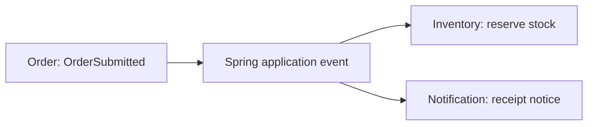
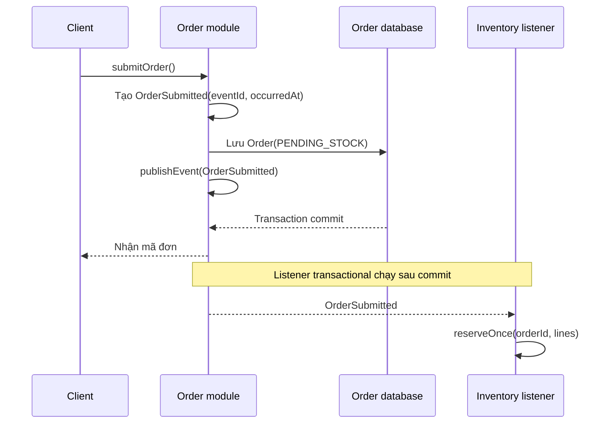

# Tài liệu hóa contract của application event trong Spring Modulith

## 1. Vì sao event contract cần tài liệu riêng?

Trong hệ thống **SPRING_MODULITH_APPLICATION_EVENTS**, các module Spring Modulith giao tiếp bằng application events để giảm phụ thuộc và bảo vệ ranh giới nghiệp vụ. Khi module `order` công bố `OrderSubmitted`, module `inventory` có thể giữ hàng, còn `notification` có thể chuẩn bị thông báo. Bên phát không cần biết những listener nào đang tồn tại, nhưng các bên phải hiểu **cùng một ý nghĩa nghiệp vụ** của sự kiện.

Nếu tài liệu chỉ ghi “`OrderSubmitted` gồm `orderId`, `occurredAt`”, các câu hỏi quan trọng vẫn chưa có đáp án: “Submitted” nghĩa là đơn đã được lưu hay đã giữ đủ hàng? Sự kiện được phát trước hay sau commit? Listener có thể nhận trùng không? Nếu một dòng hàng bị hủy sau đó, payload cũ có được thay đổi không? Consumer có thể dùng sự kiện để gửi email xác nhận đã giao hàng không?

**Event contract (hợp đồng sự kiện)** là cam kết được công bố giữa module sở hữu sự kiện và các module tiêu thụ. Tài liệu hóa contract biến những cam kết ấy thành mô tả có thể đọc, đánh giá và kiểm thử. Đối với chương **Hợp đồng sự kiện**, mục tiêu của bài là tạo tài liệu giúp người phát, người nhận và người vận hành hiểu đúng một loại sự kiện qua nhiều phiên bản.

Sau bài này, bạn có thể:

1. Mô tả đầy đủ ý nghĩa, thời điểm phát, quyền sở hữu và phạm vi công khai của event.
2. Viết bảng schema có kiểu dữ liệu, ràng buộc, ý nghĩa, tính bắt buộc và ví dụ.
3. Tài liệu hóa cam kết giao dịch, xử lý sau commit, khả năng nhận lặp và khi nào retry.
4. Ghi rõ quy tắc thay đổi contract để không phá vỡ consumer.
5. Kết hợp tài liệu với kiểm thử kiến trúc và kiểm thử hành vi của Spring Modulith.

## 2. Tài liệu contract khác gì Javadoc và Java record?

Java class định nghĩa **hình dạng kiểu dữ liệu**; Javadoc có thể mô tả field và method; nhưng **hợp đồng** còn định nghĩa điều kiện tạo sự kiện, cách diễn giải nó và trách nhiệm của consumer. Cùng một kiểu `OrderSubmitted(UUID orderId)` có thể bị hiểu theo hai nghĩa hoàn toàn khác nhau:

| Cách hiểu | Hệ quả đối với consumer |
| --- | --- |
| Đơn đã được tiếp nhận, đang chờ kiểm tra tồn kho | `inventory` bắt đầu giữ hàng; `notification` chưa thể nói “đơn đã xác nhận” |
| Đơn đã xác nhận và giữ hàng thành công | `notification` có thể gửi xác nhận, nhưng `inventory` không nên tiếp tục giữ hàng lần nữa |

Không thể phân biệt hai nghĩa này chỉ bằng tên record và danh sách field. Cần một định nghĩa nghiệp vụ viết thành lời, ví dụ: **“`OrderSubmitted` xảy ra khi module `order` chấp nhận và lưu đơn ở trạng thái `PENDING_STOCK`; nó không xác nhận tồn kho hay thanh toán.”**

Ba tầng tài liệu bổ sung cho nhau:

| Tầng | Trả lời câu hỏi | Ví dụ |
| --- | --- | --- |
| **Tài liệu nghiệp vụ** | Sự thật nào xảy ra, có ý nghĩa gì và không có ý nghĩa gì? | `OrderSubmitted` chỉ có nghĩa đơn đã được tiếp nhận |
| **Tài liệu kỹ thuật** | Kiểu Java, package, field, nullability, API công khai, phiên bản? | `com.example.shop.order.OrderSubmitted` với `UUID` và `Instant` |
| **Tài liệu vận hành** | Khi nào được chuyển đến listener, có retry, idempotency, timeout và cách quan sát ra sao? | Listener sau commit, có thể xử lý lại cùng `eventId` |

Đặc biệt, đừng viết “event được gửi chính xác một lần” chỉ vì hai module ở cùng JVM. Spring `ApplicationEventPublisher` không mặc nhiên là message broker bền vững; các cam kết về lưu publication, retry và delivery phải được ghi theo **cấu hình thực tế**.

## 3. Chọn một trường hợp xuyên suốt: `OrderSubmitted`

Giả sử hệ thống bán hàng có ba module:

```text
com.example.shop
├── ShopApplication.java
├── order/
│   ├── OrderSubmitted.java       # Contract sự kiện công khai
│   └── internal/
│       ├── CheckoutService.java  # Publisher
│       └── OrderRepository.java  # Lưu dữ liệu của order
├── inventory/
│   └── internal/
│       └── OrderSubmittedListener.java
└── notification/
    └── internal/
        └── OrderNotificationListener.java
```

Theo mô hình mặc định của Spring Modulith, các package con trực tiếp dưới package ứng dụng thường đại diện cho **application module**. Một kiểu đặt ngay tại package gốc như `order.OrderSubmitted` thuộc API mặc định được công khai; các lớp trong `order.internal` là chi tiết triển khai. Nếu đặt event ở package con riêng, có thể công khai bằng `@NamedInterface`.

**Quyết định nghiệp vụ cho ví dụ này:** `order` nhận đơn hợp lệ và lưu ở trạng thái `PENDING_STOCK`. Nó phát `OrderSubmitted`, còn `inventory` giữ hàng bất đồng bộ sau commit. Module `notification` chỉ gửi thông báo “đã tiếp nhận” khi nhận event này; thông báo “đã xác nhận” đòi hỏi một sự thật nghiệp vụ khác.



Sơ đồ thể hiện **luồng sự kiện lúc chạy**. Xét chiều phụ thuộc Java, các listener import kiểu công khai của `order`, còn publisher không import lớp listener. Tài liệu contract nên nói rõ cả nơi sở hữu kiểu và nơi có quyền xử lý, để không khiến các module phụ thuộc vào implementation của nhau.

## 4. Các mục bắt buộc trong một tài liệu contract

Không có một mẫu duy nhất cho mọi đội ngũ, nhưng một tài liệu có thể được review độc lập nên trả lời các nhóm câu hỏi sau:

| Nhóm thông tin | Nội dung cần ghi | Câu hỏi để tự kiểm tra |
| --- | --- | --- |
| **Định danh** | Tên event, phiên bản, package hoặc tên schema, người/module sở hữu | Consumer tìm đúng hợp đồng bằng cách nào? |
| **Ngữ nghĩa** | Sự thật đã xảy ra, trạng thái trước/sau, các điều **không** được suy ra | `Submitted` khác `Confirmed` ra sao? |
| **Publisher** | Module phát, điều kiện phát, lúc xác định dữ liệu snapshot | Sự kiện có thể phát trong transaction nào? |
| **Payload** | Field, kiểu, bắt buộc/tùy chọn, ràng buộc, độ chính xác, đơn vị, ví dụ | Một UUID hoặc timestamp đang chỉ điều gì? |
| **Quan hệ và bảo mật** | Correlation ID, dữ liệu nhạy cảm, phạm vi hiển thị, lưu giữ | Có cần đưa email hoặc thông tin thanh toán vào event? |
| **Delivery/transaction** | Listener đồng bộ hay sau commit, cam kết được cấu hình, lỗi và retry | Commit nguồn có đồng nghĩa consumer đã xong không? |
| **Thứ tự/idempotency** | Khóa loại trùng, version aggregate khi cần, xử lý event đến trễ | Nhận event hai lần có làm tác dụng phụ hai lần không? |
| **Compatibility** | Quy tắc thêm/đổi/xóa field, quy trình thay phiên bản | Thay đổi này có phá consumer cũ không? |
| **Ví dụ & kiểm thử** | Payload hợp lệ/bất hợp lệ, use case điển hình, acceptance criteria | Có thể viết test từ tài liệu mà không hỏi tác giả không? |
| **Vận hành** | Log, metric, correlation, cách tìm publication chưa hoàn tất | Khi listener lỗi, người vận hành đối chiếu được gì? |

**Không nên ghi tên consumer hiện có như danh sách cố định bắt buộc.** Contract có thể nêu ví dụ các consumer đang sử dụng hoặc kỳ vọng về mặt nghiệp vụ; một trong các lợi ích của application events là module phát không phải thay đổi mỗi khi có thêm listener mới.

## 5. Ví dụ Java record là một phần của contract

Module `order` công khai record như sau:

```java
// com/example/shop/order/OrderSubmitted.java
package com.example.shop.order;

import java.time.Instant;
import java.util.List;
import java.util.Objects;
import java.util.UUID;

public record OrderSubmitted(
        UUID eventId,
        UUID orderId,
        Instant occurredAt,
        List<Line> lines
) {
    public OrderSubmitted {
        Objects.requireNonNull(eventId, "eventId");
        Objects.requireNonNull(orderId, "orderId");
        Objects.requireNonNull(occurredAt, "occurredAt");
        lines = List.copyOf(Objects.requireNonNull(lines, "lines"));

        if (lines.isEmpty()) {
            throw new IllegalArgumentException("lines must not be empty");
        }
        if (lines.stream().anyMatch(line -> line.quantity() <= 0)) {
            throw new IllegalArgumentException("quantity must be positive");
        }
    }

    public record Line(UUID skuId, int quantity) {
        public Line {
            Objects.requireNonNull(skuId, "skuId");
            if (quantity <= 0) {
                throw new IllegalArgumentException("quantity must be positive");
            }
        }
    }
}
```

Record này là **code minh họa** cho ứng dụng tự xây dựng. Nó dùng các kiểu Java chuẩn và không phụ thuộc entity JPA; `lines` là bản sao cấu trúc bất biến, còn `Line` là record bất biến. Các validation cốt lõi trong code giúp dữ liệu không trái với tài liệu, nhưng chúng vẫn không thay thế phần diễn giải nghiệp vụ.

Một ví dụ dữ liệu tương ứng:

```json
{
  "eventId": "63a0d3fd-8ce9-4db8-b5dd-2ae91c12f3a1",
  "orderId": "9a27f69c-d517-4477-b2cf-10fd6e2d38e9",
  "occurredAt": "2026-11-25T08:00:00Z",
  "lines": [
    { "skuId": "113bc075-4640-4449-b773-e2f330037c52", "quantity": 2 }
  ]
}
```

Đây là **biểu diễn JSON để tài liệu hóa** payload, không có nghĩa Spring application event trong cùng JVM luôn đi qua JSON. Nếu sử dụng Event Publication Registry có lưu/serialize dữ liệu, hoặc tích hợp message broker bên ngoài, phải cấu hình và kiểm thử biểu diễn serialization thật sự của ứng dụng.

### Phân biệt `eventId`, `orderId` và `occurredAt`

- `eventId`: định danh của một lần **sự thật nghiệp vụ được công bố**. Retry của cùng publication giữ nguyên ID; nếu phát một sự kiện nghiệp vụ mới thì tạo ID mới.
- `orderId`: định danh aggregate của đơn hàng. Một đơn hàng có thể phát nhiều event trong vòng đời, do đó `orderId` không tương đương `eventId`.
- `occurredAt`: `Instant` phản ánh lúc nghiệp vụ tạo sự thật `OrderSubmitted`. Nó không phải thời điểm listener nhận, không tự xác nhận thời điểm commit.
- `lines`: snapshot những dòng hàng được tiếp nhận tại lúc phát. Nếu giỏ hàng sau đó thay đổi, listener vẫn phải đọc payload theo nghĩa snapshot, không sửa giá trị cũ.

Không thêm entity JPA, đối tượng Spring bean, mật khẩu, số thẻ hoặc dữ liệu cá nhân không cần thiết vào payload. Event là hợp đồng trao đổi giữa các module và có thể được lưu phục vụ phục hồi; tối thiểu hóa payload giúp bảo vệ ranh giới và giảm tác động khi mô hình lưu trữ thay đổi.

## 6. Viết một tài liệu contract có thể mang đi review

Dưới đây là mẫu tài liệu nội dung cho chính `OrderSubmitted`. Trong dự án thực tế, đội ngũ có thể đặt cùng module sở hữu hoặc trong tài liệu kiến trúc có chủ sở hữu rõ ràng. **Ví dụ dưới đây là nội dung tài liệu cần duy trì cùng code**, không phải một nguồn schema mới có hiệu lực tự động chỉ vì đã được viết ra.

### Contract: `OrderSubmitted` — phiên bản 1

**Chủ sở hữu:** module `order`. **Kiểu Java:** `com.example.shop.order.OrderSubmitted`. **Trạng thái:** hợp đồng công khai nội bộ ứng dụng.

**Ý nghĩa nghiệp vụ:** Đơn hàng đã vượt qua validation đầu vào và được ghi nhận ở trạng thái `PENDING_STOCK`. Các dòng hàng là snapshot của yêu cầu được chấp nhận. Event **không khẳng định** đã giữ đủ tồn kho, thu tiền hoặc giao hàng.

**Điều kiện phát:** Một hành động đặt hàng hợp lệ làm phát sinh đơn mới; module `order` tạo event trong transaction ghi đơn. Trường `occurredAt` được lấy tại thời điểm nghiệp vụ xác định việc tiếp nhận, không phải khi listener bắt đầu.

**Phạm vi tiêu thụ:** Module quan tâm đến việc đơn được tiếp nhận có thể lắng nghe kiểu công khai này. Ví dụ `inventory` xem xét giữ hàng; `notification` gửi thông báo đã tiếp nhận. Bên phát không cần import các listener.

| Field | Kiểu Java / biểu diễn JSON | Bắt buộc | Ràng buộc và ý nghĩa |
| --- | --- | --- | --- |
| `eventId` | `UUID` / chuỗi UUID | Có | Định danh duy nhất cho event; giữ nguyên qua retry |
| `orderId` | `UUID` / chuỗi UUID | Có | Định danh đơn do `order` sở hữu |
| `occurredAt` | `Instant` / ISO 8601 UTC | Có | Mốc nghiệp vụ xảy ra; ví dụ `2026-11-25T08:00:00Z` |
| `lines` | `List<Line>` / JSON array | Có | Ít nhất một dòng; danh sách snapshot không thay đổi sau khi công bố |
| `lines[].skuId` | `UUID` / chuỗi UUID | Có | Mã sản phẩm/biến thể được yêu cầu |
| `lines[].quantity` | `int` / JSON integer | Có | Số lượng nguyên dương, đơn vị là sản phẩm |

**Ví dụ hợp lệ:** JSON ở mục 5. **Ví dụ không hợp lệ:** `lines=[]`, `quantity=0`, `occurredAt=null`, `eventId` không phải UUID. Với kiểu Java record trong ví dụ, các trường hợp tương ứng bị constructor chặn; một JSON consumer ngoài ứng dụng cần có validation tương đương nếu hệ thống hỗ trợ giao qua JSON.

**Cam kết giao nhận:** Với listener dùng `@ApplicationModuleListener`, hành vi listener thực hiện bất đồng bộ **sau khi transaction gốc commit**. Nếu publisher rollback, không có thành công nghiệp vụ để listener sau commit xử lý. Một lần `publishEvent` không bảo đảm mọi consumer đã hoàn tất và không mặc nhiên là exactly-once delivery.

**Xử lý lại:** Consumer phải dự kiến khả năng chạy lại cùng event và thiết kế idempotency. `inventory` có thể dùng `orderId` như khóa nghiệp vụ chống giữ hàng hai lần; hệ thống quan sát có thể dùng `eventId` để đối chiếu các lần thử.

**Thứ tự:** Không cam kết mọi listener xử lý đúng thứ tự thời gian nếu chưa có cơ chế và kiểm thử phù hợp. Consumer không dựa riêng vào `occurredAt` để áp đặt thứ tự cập nhật aggregate.

**Compatibility:** Thay đổi tên/ý nghĩa field, bỏ field bắt buộc, đổi kiểu hoặc đổi nghĩa `Submitted` đều cần đánh giá tác động và kế hoạch version. Thêm field mới cũng phải đánh giá consumer Java, serialization và dữ liệu publication đang lưu.

**Tiêu chí kiểm chứng:** `order` chỉ phát event cho đơn hợp lệ; event được tạo với timestamp/ID đúng; listener sau commit không chạy tác vụ thành công khi transaction rollback; consumer xử lý trùng không tạo giữ hàng lần hai; cấu trúc module không vi phạm ranh giới.

Mẫu này tập trung vào **điều được bảo đảm** và **điều không được suy ra**. Đó là hai phần quan trọng nhất để tránh consumer tự đặt ra những giả định không được phía phát cam kết.

## 7. Tài liệu hóa vòng đời transaction và listener

Một sự kiện có thể được tạo trong transaction của publisher, nhưng listener có thể nhận và xử lý ở thời điểm khác. Contract cần phân biệt **hành vi tạo sự kiện**, **việc commit trạng thái nguồn** và **việc xử lý sự kiện ở module nhận**.



Sơ đồ là mô hình giải thích trách nhiệm, không phải cam kết thứ tự thực thi từng dòng ở mọi cấu hình hạ tầng. Đặc biệt, một lệnh `publishEvent` trong transaction không tự chứng minh sự kiện đã được lưu bền vững hoặc tất cả consumer đều nhận được.

### 7.1. Ví dụ publisher: ghi dữ liệu và phát sự kiện

```java
// Ví dụ phương thức trong com.example.shop.order.internal.CheckoutService
@Transactional
public UUID submit(CheckoutCommand command) {
    Order order = Order.submitPendingStock(command);
    orders.save(order);

    var items = order.lines().stream()
            .map(line -> new OrderSubmitted.Line(
                    line.skuId(), line.quantity()))
            .toList();

    var event = new OrderSubmitted(
            UUID.randomUUID(),
            order.id(),
            clock.instant(),
            items
    );

    applicationEventPublisher.publishEvent(event);
    return order.id();
}
```

`Order`, `CheckoutCommand`, `orders`, `clock` và `applicationEventPublisher` là những thành phần giả định được khai báo/inject trong service của ứng dụng. Phần tài liệu phải mô tả rõ: `OrderSubmitted` được tạo **sau khi use case đã xác nhận dữ liệu đầu vào và trạng thái nghiệp vụ**, còn transaction gốc có thể rollback sau lời gọi `publishEvent`.

### 7.2. Ví dụ listener: tự bảo vệ hành vi của module nhận

```java
// com/example/shop/inventory/internal/OrderSubmittedListener.java
package com.example.shop.inventory.internal;

import com.example.shop.order.OrderSubmitted;
import org.springframework.modulith.events.ApplicationModuleListener;
import org.springframework.stereotype.Component;

@Component
class OrderSubmittedListener {

    private final ReservationService reservations;

    OrderSubmittedListener(ReservationService reservations) {
        this.reservations = reservations;
    }

    @ApplicationModuleListener
    void handle(OrderSubmitted event) {
        var items = event.lines().stream()
                .map(line -> new ReservationItem(line.skuId(), line.quantity()))
                .toList();

        reservations.reserveOnce(event.orderId(), items);
    }
}
```

Trong ví dụ, `ReservationService` và `ReservationItem` là kiểu nội bộ do `inventory` tự xây dựng. `@ApplicationModuleListener` hỗ trợ xử lý **bất đồng bộ sau commit** với transaction riêng cho listener trong ngữ cảnh sử dụng Spring Modulith phù hợp.

Contract không nên yêu cầu listener import `order.internal.OrderRepository` để đọc tiếp các chi tiết lưu trữ. Nếu event thiếu thông tin cần thiết, hai nhóm phải thống nhất bổ sung payload hoặc thiết kế API công khai có chủ đích.

### 7.3. Bảng tình huống giao dịch cần được ghi rõ

| Tình huống | Điều đã xảy ra | Điều consumer có thể giả định |
| --- | --- | --- |
| `submit` kiểm tra đầu vào thất bại | Chưa tạo đơn hợp lệ | Không được diễn giải như đã có `OrderSubmitted` hợp lệ |
| Publisher gọi `publishEvent`, transaction sau đó rollback | Transaction nguồn không hoàn tất | Transactional listener sau commit không xử lý sự kiện như giao dịch đã thành công |
| Transaction nguồn commit, listener chưa chạy | Đơn đã được lưu | `inventory` có thể **chưa** giữ hàng |
| Listener giữ hàng thất bại do lỗi tạm thời | Đơn gốc vẫn có thể đã commit | Cần vận hành retry/phục hồi theo cơ chế cấu hình |
| Listener từ chối vì thiếu hàng | Một kết quả nghiệp vụ hợp lệ | Không retry vô hạn cùng yêu cầu với hy vọng nó thành công |
| Listener nhận lại cùng event | Có thể xảy ra khi phục hồi | Xử lý lại không được tự động giữ hàng hai lần |

Tài liệu nên ghi cả **mức độ nhất quán**: trong ví dụ, `order` chấp nhận trạng thái `PENDING_STOCK` trước khi hoàn tất reservation; do đó giữa hai module có khoảng thời gian nhất quán cuối cùng (*eventual consistency*). Nếu nghiệp vụ đòi hỏi tồn kho phải được giữ trước khi xác nhận đơn, cần một hợp đồng hoặc quy trình đồng bộ khác thay vì gọi `OrderSubmitted` là event “đã xác nhận”.

## 8. Tài liệu hóa delivery, idempotency và failure policy

Trong Spring Modulith, `ApplicationEventPublisher` phát event trong ứng dụng; có thể kết hợp listener transactional và **Event Publication Registry** để theo dõi publication nếu ứng dụng cấu hình các thành phần hỗ trợ lưu trữ. Registry hỗ trợ nhận biết publication chưa hoàn tất và cơ chế xử lý lại theo cấu hình/chiến lược được dùng. Nó không mặc nhiên biến mọi sự kiện thành thông điệp Kafka/RabbitMQ hoặc bảo đảm tác dụng phụ chỉ xảy ra đúng một lần.

Đối với từng contract, tài liệu phải phân biệt rõ:

- **Cơ chế dispatch hiện dùng:** event nội bộ Spring, transactional listener, hay đã có message broker/outbox.
- **Thời điểm listener được phép xử lý:** tức thời hay sau commit; listener có transaction riêng hay không.
- **Điều kiện được xem là hoàn tất:** ví dụ listener không ném lỗi và publication được đánh dấu hoàn tất theo hạ tầng đang cấu hình.
- **Điều kiện cần retry:** lỗi kỹ thuật có thể phục hồi, publication chưa hoàn tất; tần suất, giới hạn và phương án xử lý cuối cùng do hệ thống quy định.
- **Lỗi nghiệp vụ:** ví dụ hết hàng; trả kết quả nghiệp vụ cho quy trình điều phối, thay vì coi đây luôn là lỗi kỹ thuật cần retry.
- **Khóa idempotency:** trường nào dùng để tránh ghi trùng dữ liệu hoặc gửi trùng thông báo.
- **Quan sát và khôi phục:** log/metric nào xác định publication bị kẹt, ai chịu trách nhiệm và thao tác phục hồi nào được hỗ trợ.

### 8.1. Event ID và business ID dùng cho những việc khác nhau

Nếu nhận lặp `OrderSubmitted` với **cùng `eventId`**, consumer thường phải xem đó là cùng một lần công bố. Nhưng một đơn có thể phát hai sự kiện khác nhau (ví dụ khi bổ sung thay đổi có chủ đích). Để bảo vệ bất biến “mỗi đơn chỉ có một reservation hiệu lực cho một bước giữ hàng”, module `inventory` phải chọn **business key** phù hợp như `(orderId, reservationPurpose)` và đảm bảo ở tầng lưu trữ.

Ví dụ:

```text
Nhận OrderSubmitted(eventId=E1, orderId=O9):
  → Chưa có reservation cho O9 → tạo reservation và giữ hàng

Nhận lại OrderSubmitted(eventId=E1, orderId=O9):
  → Đã có reservation cho O9 → trả về kết quả đã ghi nhận

Nhận OrderSubmitted(eventId=E2, orderId=O9):
  → Phải xét chính sách nghiệp vụ: E2 có đại diện một hành động mới không?
```

Chỉ dùng `existsByOrderId()` trong code rồi `save()` mà không bảo vệ đồng thời có thể gây race condition. Tài liệu phải nói rõ bất biến nào được bảo vệ bằng ràng buộc unique, optimistic locking hoặc cơ chế tương đương.

### 8.2. Timestamp và thứ tự xử lý

`occurredAt` là `Instant` chỉ thời điểm nghiệp vụ, không phải thời điểm listener bắt đầu. Một lần retry giữ nguyên `occurredAt`, còn `receivedAt`, `attemptStartedAt` và `processedAt` có thể khác nhau.

Contract không nên hứa “consumer luôn nhận event theo thứ tự tạo” nếu chưa có cơ chế thực thi bảo đảm. Với các event thay đổi trạng thái cùng aggregate, có thể cần `aggregateVersion` hoặc sequence được chủ sở hữu tạo, cộng state machine kiểm tra chuyển trạng thái. Timestamp riêng lẻ không thay thế được số phiên bản nghiệp vụ.

### 8.3. Xử lý lỗi ở ngoài transaction

Gửi email, gọi API ngoài hoặc ghi dữ liệu ở hệ thống khác có thể thành công trước khi consumer ghi nhận hoàn tất. Nếu lần xử lý bị chạy lại, side effect có nguy cơ xảy ra lần nữa. Contract nên nêu rõ điều này để consumer chọn cơ chế deduplication, outbox hoặc khóa idempotency phù hợp. Tài liệu chỉ ghi “có retry” mà bỏ qua side effect là chưa đầy đủ.

## 9. Quản lý phiên bản và khả năng tương thích của contract

Một hợp đồng công khai cần có **quy tắc tiến hóa**, ngay cả khi các module đang chạy cùng Spring Boot application. Trong cùng JVM, thay đổi record class có thể làm các module consumer không còn biên dịch; khi có publication lưu trữ hoặc các hệ thống tiêu thụ bên ngoài, thay đổi còn liên quan đến dữ liệu cũ cần deserialize.

| Thay đổi | Rủi ro | Cách xử lý đề xuất |
| --- | --- | --- |
| Sửa lỗi chính tả trong diễn giải, không đổi nghĩa | Thấp | Cập nhật tài liệu, vẫn review để bảo đảm không đổi ngữ nghĩa |
| Thêm một thông tin **tùy chọn** vào schema JSON | Tùy consumer và cấu hình parser | Kiểm tra parser có bỏ qua field lạ; bổ sung giá trị mặc định rõ ràng |
| Thêm component vào **Java record** công khai | Có thể phá constructor/call site, kể cả khi ý nghĩa là field tùy chọn | Xem API Java như hợp đồng riêng; cân nhắc overload/factory hoặc event phiên bản mới |
| Đổi tên field hoặc kiểu `UUID` thành `String` | Có thể phá source/binary compatibility và dữ liệu lưu | Phối hợp migration, không thay âm thầm |
| Thay `occurredAt` thành thời điểm consumer xử lý | Phá **ngữ nghĩa**, dù Java type không đổi | Tạo field mới và duy trì nghĩa của field cũ |
| Đổi định nghĩa `OrderSubmitted` từ “tiếp nhận” sang “đã giữ hàng” | Phá logic nghiệp vụ của listener | Tạo loại event với tên/phiên bản rõ nghĩa, ví dụ `OrderConfirmed` |
| Loại bỏ field hoặc event đã công bố | Consumer có thể không còn hoạt động hoặc không đọc được publication cũ | Lập kế hoạch deprecation, migration và ngừng sử dụng có kiểm chứng |

### 9.1. Mỗi thay đổi phải xét ba nhóm consumer

1. **Consumer Java đang biên dịch cùng ứng dụng:** Constructor, accessor, package, nested type có thay đổi không?
2. **Consumer đọc dữ liệu event đã lưu:** Serializer/deserializer hiện tại có xử lý được payload phiên bản cũ không?
3. **Consumer bên ngoài (nếu có):** Dịch vụ hoặc job khác có đang tin vào schema JSON, nghĩa field hoặc cam kết delivery không?

Không mặc định một thay đổi là “backward compatible” chỉ vì JSON có thể thêm field: đối với `record` trong Java, thay đổi danh sách component còn thay đổi canonical constructor và yêu cầu code caller thích ứng.

### 9.2. Một quy trình version hóa có thể kiểm chứng

Giả sử `OrderSubmitted` v1 không có tiền tệ, và module mới cần số tiền:

1. Kiểm tra thực sự cần số tiền trong event hay nên truy vấn một API công khai của module sở hữu thông tin.
2. Định nghĩa rõ tên, đơn vị và người sở hữu giá trị (ví dụ số nguyên tiền nhỏ nhất + mã tiền tệ ISO), tránh trường `amount` mơ hồ.
3. Xác định consumer và publication đã lưu có bị ảnh hưởng không.
4. Chọn cách thêm field tương thích có kiểm chứng hoặc giới thiệu kiểu event mới, chẳng hạn `OrderSubmittedV2`, cùng giai đoạn chuyển tiếp.
5. Cập nhật tài liệu, ví dụ payload, test, migration và lịch loại bỏ phiên bản cũ trước khi triển khai.

Không có một quy tắc buộc mọi event đều phải thêm số `version` trong payload. Với contract nội bộ chỉ tồn tại dưới dạng Java type, tên kiểu, package và lịch sử thay đổi có thể đủ. Khi có nhiều phiên bản payload phải cùng tồn tại, tài liệu và cơ chế phân biệt version trở nên cần thiết.

## 10. Kiểm thử xác minh tài liệu hợp đồng

Một tài liệu tốt phải tạo được **tiêu chí kiểm thử có thể thực hiện**. Với `OrderSubmitted`, nên kết hợp kiểm tra ở nhiều mức:

| Mức kiểm thử | Điều được xác nhận | Ví dụ |
| --- | --- | --- |
| **Unit contract test** | Field và invariant khớp tài liệu | Không cho `lines` rỗng hoặc `quantity <= 0` |
| **Publisher test** | Đúng nghiệp vụ mới phát event, dữ liệu snapshot đúng | Đơn được tạo ở `PENDING_STOCK`; event dùng ID và thời điểm nguồn |
| **Transaction test** | Listener sau commit tuân theo ranh giới transaction | Rollback không kích hoạt tác vụ listener sau commit |
| **Consumer test** | Bên nhận diễn giải đúng contract, xử lý trùng an toàn | `inventory` nhận cùng event hai lần chỉ có một reservation |
| **Architecture test** | Không import chi tiết nội bộ module khác, không tạo vòng | Spring Modulith `ApplicationModules.verify()` |
| **Compatibility test** | Đọc được payload/event đã lưu khi triển khai version mới | Round-trip dữ liệu cũ với serializer và schema hiện hành |

### 10.1. Unit test bám theo bảng schema

```java
import static org.junit.jupiter.api.Assertions.assertEquals;
import static org.junit.jupiter.api.Assertions.assertThrows;

import java.time.Instant;
import java.util.List;
import java.util.UUID;
import org.junit.jupiter.api.Test;

class OrderSubmittedContractTest {

    @Test
    void rejectsEmptyOrderLines() {
        assertThrows(IllegalArgumentException.class, () ->
                new OrderSubmitted(
                        UUID.randomUUID(),
                        UUID.randomUUID(),
                        Instant.parse("2026-11-25T08:00:00Z"),
                        List.of()
                ));
    }

    @Test
    void preservesOccurredAtFromPublisher() {
        Instant occurredAt = Instant.parse("2026-11-25T08:00:00Z");
        OrderSubmitted event = new OrderSubmitted(
                UUID.randomUUID(),
                UUID.randomUUID(),
                occurredAt,
                List.of(new OrderSubmitted.Line(UUID.randomUUID(), 2))
        );

        assertEquals(occurredAt, event.occurredAt());
    }
}
```

Đây là ví dụ JUnit cho record đã định nghĩa tại mục 5; đặt test trong package/import phù hợp với module thực tế. Nên bổ sung kiểm thử module phát bằng `Clock.fixed(...)` để kiểm tra publisher gán timestamp ổn định, và kiểm thử snapshot không đổi sau khi dữ liệu đơn hàng được cập nhật.

### 10.2. Kiểm tra ranh giới Spring Modulith

```java
import org.junit.jupiter.api.Test;
import org.springframework.modulith.core.ApplicationModules;

class ModuleBoundaryTest {

    @Test
    void respectsPublishedEventContracts() {
        ApplicationModules.of(ShopApplication.class).verify();
    }
}
```

`ShopApplication` là lớp `@SpringBootApplication` tại package gốc của ứng dụng ví dụ. Phép `verify()` giúp phát hiện dependency không hợp lệ và chu trình module. Nếu listener `inventory` import `order.internal.OrderRepository`, cần sửa thiết kế vì điều đó vượt quá bề mặt contract đã được công khai.

### 10.3. Dùng kiểm thử tích hợp cho cam kết vận hành

Để xác minh hành vi sau commit, không thể chỉ gọi trực tiếp method listener trong unit test. Cần một kiểm thử thực sự có transaction nguồn và listener transactional, chờ điều kiện kết quả một cách xác định, kiểm tra rollback và xử lý lại. Nếu dự án bật Event Publication Registry, bổ sung tình huống listener lỗi rồi được xử lý lại mà publication và side effect không bị nhân đôi. Kết quả phụ thuộc cấu hình thực tế của module lưu trữ; không khẳng định registry đã bật chỉ vì có dependency Spring Modulith.

Các câu kiểm thử này nên có liên kết trong tài liệu contract, để người review biết tiêu chí nào đang được CI bảo vệ và tiêu chí nào mới là kỳ vọng thiết kế.

## 11. Giữ tài liệu đồng bộ với code và kiến trúc

Tài liệu hợp đồng nhanh chóng mất giá trị nếu được tạo một lần rồi không cập nhật khi event thay đổi. Vì vậy hãy đặt **quy trình quản lý contract** ngay trong vòng đời phát triển:

1. **Module sở hữu đề xuất thay đổi:** Người sửa `OrderSubmitted` phải giải thích vì sao cần thay đổi ngữ nghĩa, payload hoặc cách phát.
2. **Review tác động lên consumer:** Xác định các module đang import event, kể cả listener có thể ít được thực thi. Với tích hợp ngoài, rà soát schema và message lưu trữ.
3. **Cập nhật tài liệu trước hoặc cùng code:** Sửa bảng field, ví dụ payload, các điều kiện phát, compatibility và chính sách lỗi.
4. **Bổ sung test theo cam kết:** Nếu thêm ràng buộc mới như `quantity > 0`, test constructor/validation; nếu đổi sau commit, test transaction; nếu đổi schema, test serialization với dữ liệu cũ.
5. **Kiểm tra ranh giới:** `ApplicationModules.verify()` tiếp tục PASS; publisher không import listener hoặc implementation nội bộ module khác.
6. **Đính kèm thay đổi hợp đồng trong review:** Người review nhìn thấy cả code, tài liệu và kết quả kiểm thử liên quan.
7. **Ghi lịch sử phiên bản khi có thay đổi tương thích:** Chỉ rõ thay đổi đã xảy ra, tác động và thời điểm các consumer cần chuyển sang cách đọc mới.

### 11.1. Tài liệu đặt ở đâu?

Một cách tổ chức dễ tra cứu là đặt tài liệu gần module sở hữu, ví dụ một thư mục `docs/events/` dưới phạm vi `order`, hoặc trang tài liệu kiến trúc có phân công chủ sở hữu. Tên tệp có thể là `OrderSubmitted.md`, với đường dẫn đến kiểu Java và test liên quan.

Tùy phiên bản đang dùng, Spring Modulith có hỗ trợ **mô tả và tạo tài liệu cấu trúc application modules**, chẳng hạn các sơ đồ phụ thuộc module. Các sơ đồ được sinh từ mô hình module giúp kiểm tra **module nào phụ thuộc module nào**, còn phần **ngữ nghĩa, invariant, delivery và xử lý lỗi** vẫn cần con người viết và review. Đừng xem sơ đồ package như tài liệu contract hoàn chỉnh.

Nếu ứng dụng còn xuất OpenAPI hoặc AsyncAPI cho các tích hợp bên ngoài, cần thống nhất nguồn định nghĩa schema; đừng giả định application event nội bộ Spring tự động xuất hiện trong OpenAPI hoặc tự động được publish qua broker. Tài liệu tích hợp ngoài và tài liệu event nội bộ có thể liên kết với nhau nhưng phải phân biệt rõ phạm vi.

### 11.2. Mẫu changelog ngắn cho một contract

| Phiên bản/tình trạng | Thay đổi | Tác động |
| --- | --- | --- |
| `v1` — lần đầu công bố | `eventId`, `orderId`, `occurredAt`, `lines` | Consumer xử lý snapshot khi đơn ở `PENDING_STOCK` |
| **Đề xuất** mở rộng | Bổ sung thông tin chính sách giao hàng | Phải review tương thích Java record, serialization và consumer |
| **Đề xuất** đổi nghĩa event | `Submitted` sẽ nghĩa “đã xác nhận” | Không nên âm thầm sửa; cân nhắc event khác với nghĩa chính xác |

Bảng này minh họa cách ghi kế hoạch và lịch sử. Những dòng ghi **Đề xuất** không có nghĩa các thay đổi ấy đã được triển khai.

## 12. Contract cần hỗ trợ quan sát sự kiện

Tài liệu còn phục vụ người xử lý sự cố. Khi một listener không hoàn tất, họ cần biết **đây là sự kiện nào, phát từ nghiệp vụ nào, consumer nào xử lý, và có thể retry hay không**.

Đối với `OrderSubmitted`, có thể dùng:

| Dữ liệu quan sát | Nguồn | Dùng để |
| --- | --- | --- |
| `eventId` | Payload do `order` tạo | Kết nối log của cùng một sự kiện qua nhiều lần xử lý |
| `orderId` | Payload nghiệp vụ | Tra cứu trạng thái đơn và reservation có liên quan |
| `occurredAt` | Payload gốc | Đối chiếu thời điểm nghiệp vụ xảy ra |
| `receivedAt` | Listener/telemetry | Ước tính độ trễ khi bắt đầu xử lý |
| `attemptId`, `attemptNumber` (nếu có) | Hệ thống xử lý/retry | Phân biệt các lần thử của cùng publication |
| Trạng thái publication | Registry/quan sát nếu được cấu hình | Tìm publication chưa hoàn tất hoặc cần phục hồi |
| Kết quả nghiệp vụ | `inventory` hoặc module liên quan | Phân biệt giữ hàng thành công, thiếu hàng và lỗi kỹ thuật |

**Chú ý:** `receivedAt` là thời gian quan sát, không thay đổi `occurredAt`. Nếu hai thời điểm được đo bởi đồng hồ khác nhau thì độ trễ tính toán có thể sai vì clock skew. Độ dài một lần xử lý nên đo bằng công cụ metric thích hợp. Không ghi lại tràn lan toàn bộ payload nếu payload có dữ liệu cá nhân hoặc nhạy cảm.

Ví dụ nội dung log mang tính khái niệm:

```text
eventType=OrderSubmitted
eventId=63a0d3fd-8ce9-4db8-b5dd-2ae91c12f3a1
aggregateId=9a27f69c-d517-4477-b2cf-10fd6e2d38e9
consumer=inventory.OrderSubmittedListener
outcome=RETRYABLE_FAILURE
reason=DATABASE_TIMEOUT
```

Để xử lý hiệu quả, tài liệu cần cho biết lỗi nào **có thể retry**, lỗi nào là **kết quả nghiệp vụ hợp lệ**, và ai sở hữu hành động khôi phục. Ví dụ: timeout database khác với tình huống kho không còn hàng. Không nên để một exception kỹ thuật chung quyết định mọi chiến lược xử lý.

## 13. Những lỗi thường gặp khi tài liệu hóa contract

| Cách viết chưa tốt | Vấn đề | Cách diễn đạt hữu ích hơn |
| --- | --- | --- |
| “Event báo đơn hàng xong” | Không rõ “xong” là đã tạo, đã giữ hàng hay đã giao | “Đơn đã được lưu ở `PENDING_STOCK`; chưa đảm bảo tồn kho” |
| “`orderId`: ID” | Thiếu kiểu, chủ sở hữu, quan hệ với `eventId` | “UUID định danh aggregate Order do module `order` sở hữu” |
| “Timestamp: thời gian gửi” | Không rõ xảy ra, publish, commit hay xử lý | “`occurredAt`: `Instant` lúc nghiệp vụ tiếp nhận đơn” |
| “Listener chạy sau khi phát event” | Dễ hiểu nhầm khi transaction rollback | “Transactional listener xử lý sau khi transaction nguồn commit” |
| “Có registry nên đảm bảo đúng một lần” | Hứa hẹn quá mức về delivery và side effect | “Có thể theo dõi/khôi phục publication theo cấu hình; listener phải idempotent” |
| “Field mới là optional nên luôn tương thích” | Java record có thể đổi canonical constructor | “Kiểm tra cả Java API và schema/payload đã lưu” |
| “Các consumer là A, B và không thêm ai khác” | Biến publish/subscribe thành danh sách hardcode | “Contract công khai cho listener được phép phụ thuộc; ví dụ A và B đang sử dụng” |
| Chỉ copy JSON ví dụ | Thiếu giới hạn, lỗi, ý nghĩa nghiệp vụ | Thêm bảng field, điều kiện phát, trường hợp không hợp lệ và test |
| Chỉ tạo sơ đồ module | Không mô tả event và cam kết delivery | Dùng sơ đồ bổ trợ, thêm tài liệu nghiệp vụ và vận hành |

Một rủi ro khác là tài liệu nói “event v1” nhưng code và dữ liệu lưu vẫn không có cách nhận diện phiên bản khi nhiều phiên bản cần tồn tại. Hãy chọn cơ chế quản lý version tương ứng với **phạm vi thực tế**: Java type nội bộ, payload lưu trong registry hoặc hợp đồng tích hợp ngoài.

## 14. Bài tập thực hành: Viết và kiểm chứng một contract

**Bối cảnh:** Hệ thống có `order`, `inventory` và `notification`. Sau khi tiếp nhận đơn ở `PENDING_STOCK`, `order` phát `OrderSubmitted`. `inventory` có thể giữ hàng sau commit; `notification` gửi thông báo đã tiếp nhận. Một lần xử lý listener có thể thất bại và được chạy lại.

**Nhiệm vụ thực hiện:**

1. Viết tài liệu `OrderSubmitted` v1 bằng mẫu mục 6. Ghi rõ chủ sở hữu, event type, điều kiện phát và sự thật **không được suy ra**.
2. Lập bảng schema với `eventId`, `orderId`, `occurredAt`, `lines[].skuId`, `lines[].quantity`; nêu kiểu, bắt buộc, validation và đơn vị.
3. Đưa một JSON hợp lệ và ít nhất ba JSON không hợp lệ: UUID sai, danh sách trống, số lượng âm.
4. Ghi cam kết transaction: event được tạo trong use case ghi đơn; listener xử lý sau commit và có thể chạy lại.
5. Đề xuất idempotency key cho `inventory`, bảo vệ bằng quy tắc lưu trữ phù hợp; nêu cách xử lý khi sự kiện đến trễ.
6. Giả sử muốn thêm `deliveryAddress`: xác định liệu event có thật sự cần trường này, ảnh hưởng tới dữ liệu cá nhân và compatibility Java record.
7. Viết unit test validation payload, kiểm thử publisher/rollback/listener, và kiểm tra `ApplicationModules.of(ShopApplication.class).verify()`.
8. Tạo một checklist review ngắn và chỉ rõ ai cần phê duyệt thay đổi contract.

**Tình huống phân tích bổ sung:** Một developer đổi nghĩa `OrderSubmitted` từ “đã tiếp nhận” sang “đã giữ hàng”, nhưng giữ nguyên kiểu Java và các field. Theo bạn thay đổi có phá contract không?

**Đáp án gợi ý:** Có. Đây là thay đổi **ngữ nghĩa**, khiến consumer `inventory` có thể giữ hàng lại hoặc consumer `notification` gửi sai thông báo. Nên công bố một event đúng nghĩa, chẳng hạn `OrderConfirmed` nếu trạng thái nghiệp vụ thực sự được xác nhận, và tổ chức chuyển đổi có kiểm thử thay vì đổi nghĩa ngầm.

### Tiêu chí tự đánh giá

- Người đọc biết chính xác **khi nào** event tồn tại và **điều gì** chưa được bảo đảm.
- Từ tài liệu có thể viết constructor validation và các test nghiệp vụ.
- Đơn vị thời gian, định dạng timestamp và danh tính event được mô tả không nhập nhằng.
- Listener nhận trùng không gây side effect trùng; lỗi kỹ thuật và từ chối nghiệp vụ có cách xử lý riêng.
- Mọi thay đổi field hoặc ý nghĩa được đánh giá trên Java consumer, dữ liệu event đã lưu và consumer ngoài ứng dụng nếu có.
- Tài liệu chỉ rõ module sở hữu, API công khai, vị trí kiểm thử và thông tin quan sát phục vụ phục hồi.

## 15. Ghi nhớ

Tài liệu hóa event contract là **mô tả cam kết nghiệp vụ và kỹ thuật có thể kiểm chứng**, gồm tên và ý nghĩa sự kiện, chủ sở hữu, điều kiện phát, payload, transaction, delivery, xử lý trùng, lỗi, phiên bản và ví dụ. Java record và JSON chỉ diễn tả một phần của cam kết đó.

Trong Spring Modulith, việc công khai contract rõ ràng giúp publisher không phải biết listener, giữ đúng ranh giới module và cho phép consumer phản ứng độc lập. Listener sau commit, Event Publication Registry và retry chỉ đáng tin cậy khi mọi bên hiểu đúng thời điểm sự kiện, khả năng xử lý lại và trách nhiệm idempotency. Khi tài liệu, mã nguồn và kiểm thử được duy trì cùng nhau, sự kiện có thể phát triển qua nhiều thay đổi mà vẫn giữ được ý nghĩa nghiệp vụ nhất quán.
