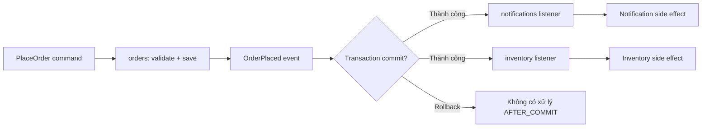
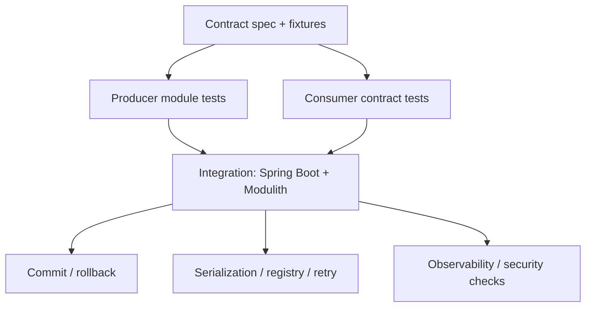

# Kiểm thử contract của application event giữa các module Spring Modulith

## 1. Vì sao cần kiểm thử hợp đồng sự kiện?

Trong Spring Modulith, các module có thể trao đổi qua `ApplicationEventPublisher` và những listener như `@ApplicationModuleListener` thay vì phụ thuộc trực tiếp vào service nội bộ của nhau. Cách giao tiếp này giảm coupling tại điểm gọi, nhưng tạo ra một phụ thuộc quan trọng khác: **module phát và module nhận phải cùng hiểu hợp đồng của event**.

Giả sử module `orders` phát `OrderPlaced`. Module `notifications` dựa trên `orderId` để gửi email xác nhận, `inventory` dựa trên cùng sự kiện để khởi động giữ hàng. Nếu một người đổi ý nghĩa `OrderPlaced` từ “đơn đã được ghi nhận” thành “khách vừa gửi yêu cầu đặt đơn”, cả hai consumer có thể xử lý quá sớm dù mã Java vẫn biên dịch bình thường. Nếu người khác đổi tên field hoặc thay định dạng serialize, sự kiện đang chờ trong event publication registry có thể không đọc lại được.

**Kiểm thử contract (contract testing)** nhằm phát hiện các thay đổi làm producer và consumer không còn tương thích về cấu trúc, ý nghĩa và cách vận hành. Trong phạm vi **SPRING_MODULITH_APPLICATION_EVENTS**, bài này tập trung vào:

- Hợp đồng công khai của event: tên, kiểu, field, nullability, phiên bản và dữ liệu nhạy cảm.
- Ý nghĩa nghiệp vụ: event khẳng định điều gì đã xảy ra, ranh giới commit nằm ở đâu.
- Tương thích producer/consumer: consumer cũ hiểu được event mới đến mức nào và code mới đọc lại event cũ ra sao.
- Kiểm thử publisher, listener, transaction after-commit, retry/idempotency và event publication registry.
- Cách đưa các kiểm tra phù hợp vào CI và quy trình review thay đổi contract.

> **Giới hạn:** Spring Modulith hỗ trợ phát hiện module, xác minh phụ thuộc và kiểm thử hành vi sự kiện; không có một phép kiểm tự động duy nhất bảo đảm mọi thay đổi event tương thích về nghiệp vụ. Bộ test contract cần được đội phát triển thiết kế và duy trì theo chính hợp đồng của hệ thống.

## 2. Contract của một event gồm những lớp nào?

Một event không chỉ là tên class. Hợp đồng được consumer nhìn thấy có ít nhất năm lớp:

| Lớp hợp đồng | Câu hỏi cần kiểm tra | Ví dụ khi thay đổi gây lỗi |
|---|---|---|
| **Cấu trúc (shape)** | Tên event, kiểu dữ liệu và các field cần thiết có còn tương thích? | Đổi `orderId` từ `UUID` sang cấu trúc object khác |
| **Ngữ nghĩa (semantics)** | Event còn diễn tả đúng sự thật nghiệp vụ đã được cam kết? | `OrderPlaced` phát khi mới nhận request, trước khi kiểm tra hợp lệ |
| **Thời điểm (timing)** | Event được publish trong ngữ cảnh nào; consumer có được xử lý sau commit? | Listener gửi email trước khi transaction tạo đơn rollback |
| **Phân phối (delivery)** | Có thể giao trễ/lặp, thất bại và replay không; consumer phản ứng thế nào? | Event được resubmit gây tạo hai khoản giữ hàng |
| **Tiến hóa và lưu trữ (evolution)** | Event cũ đã lưu còn deserialize được; consumer cũ có hiểu event mới? | Đổi tên class/field khiến publication tồn đọng không đọc được |

Cần phân biệt ba loại kiểm thử:

1. **Provider/producer contract test:** module phát kiểm tra nó công bố đúng event và payload theo điều kiện nghiệp vụ.
2. **Consumer contract test:** module nhận kiểm tra nó xử lý đúng event hợp lệ, không dựa vào chi tiết không thuộc hợp đồng.
3. **Compatibility/integration test:** kiểm tra hợp đồng ở ranh giới hai phía, định dạng lưu trữ, transaction và các tình huống retry/khôi phục.

Chỉ kiểm tra `instanceof OrderPlaced` hay test compile PASS là chưa đủ. Java type system phát hiện một số thay đổi chữ ký nhưng không hiểu được “`OrderPlaced` chỉ được phát sau khi đơn được chấp nhận” hoặc “consumer có thể nhận lại cùng một event”.

### 2.1. Domain event, integration event và command

Trong cùng Spring Boot process, một *application event* có thể đồng thời đại diện cho **domain event** công khai giữa các module. Nếu muốn đưa event ra broker hoặc cho service bên ngoài, thường nên có **integration contract** riêng do adapter lập nên, với yêu cầu compatibility, bảo mật, retention và deployment khác.

| Loại thông điệp | Ý nghĩa | Test contract trọng tâm |
|---|---|---|
| `PlaceOrder` command | Yêu cầu xử lý đặt đơn, có thể bị từ chối | Precondition, validation, phản hồi, idempotency của yêu cầu |
| `OrderPlaced` event | Fact đơn hàng đã được ghi nhận | Payload và ngữ nghĩa, quyền phát, transaction boundary, replay |
| `OrderPlacedIntegrationV1` | Hợp đồng phát ra hệ thống khác | Serialization, versioning, quyền truy cập và compatibility liên phiên bản triển khai |

Đừng dùng một record Java nội bộ làm hợp đồng mạng bất biến chỉ vì nó “đã có sẵn”. Hai môi trường có thể cần hai mô hình dữ liệu khác nhau.

## 3. Một event contract dùng xuyên suốt ví dụ

Giả sử hệ thống thương mại điện tử có ba module `orders`, `notifications` và `inventory`. Module `orders` sở hữu trạng thái đơn hàng; hai module còn lại phản ứng với sự kiện công khai.

Cấu trúc package theo quy ước:

```text
com.example.shop
├── ShopApplication.java
├── orders
│   ├── OrderPlaced.java            // Hợp đồng công khai
│   └── internal
│       ├── Order.java
│       ├── OrderService.java       // Publisher
│       └── OrderRepository.java
├── notifications
│   └── internal
│       └── OrderNotificationListener.java
└── inventory
    └── internal
        └── StockReservationListener.java
```

Ví dụ hợp đồng Java record:

```java
package com.example.shop.orders;

import java.time.Instant;
import java.util.UUID;

public record OrderPlaced(
        UUID eventId,
        UUID orderId,
        Instant occurredAt,
        int schemaVersion
) {
    public static final int CURRENT_SCHEMA = 1;

    public OrderPlaced {
        if (eventId == null || orderId == null || occurredAt == null) {
            throw new IllegalArgumentException("Required identifiers/time are missing");
        }
        if (schemaVersion < 1) {
            throw new IllegalArgumentException("Invalid schemaVersion");
        }
    }
}
```

Đây là **hợp đồng minh họa**, không phải record chuẩn do Spring Modulith cung cấp. Event được đặt ở package công khai `orders` để listener ở module khác có thể import mà không chạm vào `orders.internal`.

| Trường | Cam kết contract | Điều không được suy ra |
|---|---|---|
| `eventId` | Định danh của **một fact**; giúp trace/dedup | Không phải mọi lần delivery có eventId khác nhau |
| `orderId` | Định danh đơn được ghi nhận | Không chứa toàn bộ entity hay bảo đảm thanh toán xong |
| `occurredAt` | Thời điểm tạo fact theo định nghĩa của publisher | Không phải thời điểm listener nhận, thời điểm commit tuyệt đối hoặc thứ tự toàn cục |
| `schemaVersion` | Phiên bản cấu trúc hợp đồng | Không tự động nâng cấp event cũ hoặc xác nhận tương thích |

**Cam kết ngữ nghĩa:** `OrderPlaced` được tạo sau khi `orders` kiểm tra quy tắc tạo đơn và đã xác lập trạng thái hợp lệ trong transaction. Các consumer after-commit chỉ xử lý sau khi transaction commit thành công. Nó **không** khẳng định thanh toán hay giữ hàng đã hoàn tất.



## 4. Viết contract spec trước khi viết test

Để test không chỉ “chụp ảnh implementation”, trước tiên lập **contract spec** gồm các yêu cầu mà producer và consumer cùng chấp nhận.

| Nhóm | Quy tắc cho `OrderPlaced` | Test phù hợp |
|---|---|---|
| Tên và chủ sở hữu | `orders` phát `OrderPlaced` khi tạo đơn hợp lệ | Publisher/module test |
| Field bắt buộc | `eventId`, `orderId`, `occurredAt` khác null; version hợp lệ | Unit/serialization test |
| Quyền công khai | Consumer chỉ import `orders.OrderPlaced` hoặc API công khai | `ApplicationModules.verify()` |
| Payload | Không có Entity JPA, password, token, thông tin thẻ | Contract reflection và serialization test |
| Semantics | `OrderPlaced` không có nghĩa `PaymentCaptured` | Business behavior/consumer test |
| Transaction | Side effect sau commit không chạy khi rollback | Integration test với transaction thực |
| Delivery | Có thể nhận lại cùng fact, consumer idempotent | Retry/idempotency integration test |
| Evolution | Version mới và event cũ trong registry có cách đọc phù hợp | Backward compatibility test |
| Quan sát | Log không chứa dữ liệu nhạy cảm; có event ID và consumer ID khi cần | Logging/observability test phù hợp |

Một test tốt phải có **lý do nghiệp vụ**. Thí dụ, test `eventId != null` bảo vệ consumer cần khử trùng theo event; test “record có đúng bốn field” hữu ích khi đội đã chốt allowlist dữ liệu, nhưng cũng có thể làm hỏng những bổ sung field hợp lệ. Vì vậy hãy phân biệt test cho **yêu cầu bất biến** với test chỉ phản ánh hình dạng hiện tại.

## 5. Test lớp cấu trúc: field, kiểu và ràng buộc

### 5.1. Test invariant trong record

Có thể test trực tiếp constructor mà không cần khởi động Spring context:

```java
package com.example.shop.orders;

import static org.assertj.core.api.Assertions.assertThatThrownBy;

import java.time.Instant;
import java.util.UUID;
import org.junit.jupiter.api.Test;

class OrderPlacedContractTests {

    @Test
    void rejectsMissingOrderId() {
        assertThatThrownBy(() -> new OrderPlaced(
                UUID.randomUUID(),
                null,
                Instant.now(),
                1
        )).isInstanceOf(IllegalArgumentException.class);
    }

    @Test
    void rejectsInvalidVersion() {
        assertThatThrownBy(() -> new OrderPlaced(
                UUID.randomUUID(),
                UUID.randomUUID(),
                Instant.now(),
                0
        )).isInstanceOf(IllegalArgumentException.class);
    }
}
```

Đây là test **invariant dữ liệu**, không chứng minh Spring có phát event đúng thời điểm. Constructor validation hữu ích để loại bỏ event thiếu thông tin bắt buộc sớm, nhưng cần xác định cách deserialize event cũ với dữ liệu chưa đầy đủ; đừng thêm validation mới làm mọi publication cũ không khôi phục được mà không có kế hoạch migration.

### 5.2. Test field allowlist khi hợp đồng bảo mật cần thiết

Đôi khi yêu cầu an toàn dữ liệu quy định một event công khai chỉ được chứa các trường đã duyệt. Java reflection có thể làm kiểm tra đơn giản:

```java
package com.example.shop.orders;

import static org.assertj.core.api.Assertions.assertThat;

import java.util.Arrays;
import org.junit.jupiter.api.Test;

class OrderPlacedPayloadShapeTests {

    @Test
    void exposesOnlyApprovedFields() {
        var fields = Arrays.stream(OrderPlaced.class.getRecordComponents())
                .map(component -> component.getName())
                .toList();

        assertThat(fields).containsExactlyInAnyOrder(
                "eventId",
                "orderId",
                "occurredAt",
                "schemaVersion"
        );
    }
}
```

Test này có chủ đích yêu cầu review khi thêm field, kể cả field không gây hỏng Java API. Nó **không phải phép kiểm compatibility toàn diện**: field có tên hợp lệ vẫn có thể chứa nội dung bị cấm, và serializer có thể ghi thêm metadata. Với hợp đồng mở rộng có chủ đích, cập nhật allowlist sau review thay đổi và chạy lại test serialization.

### 5.3. Test phạm vi API công khai

Module `notifications` nên tham chiếu `orders.OrderPlaced` và không import `orders.internal.OrderRepository`. Test kiến trúc:

```java
package com.example.shop;

import org.junit.jupiter.api.Test;
import org.springframework.modulith.core.ApplicationModules;

class ModuleBoundaryTests {

    @Test
    void respectsApplicationModuleDependencies() {
        ApplicationModules.of(ShopApplication.class).verify();
    }
}
```

Test trên kiểm tra các ràng buộc kiến trúc mà Spring Modulith hỗ trợ theo cách cấu hình application modules. Nếu PASS, nó cho thấy phụ thuộc hợp lệ **theo quy tắc kỹ thuật đã cấu hình**, chứ không xác nhận nghĩa của `OrderPlaced`, payload JSON hay khả năng phục hồi publication.

## 6. Test serialization và round-trip

Dù event chỉ dùng Java object trong một tiến trình Spring Boot, hạ tầng event publication registry hoặc adapter tích hợp có thể **serialize payload** để lưu và xử lý lại. Vì thế, test chỉ chạy constructor/handler chưa đủ khi production có persistence.

### 6.1. Test round-trip bằng cấu hình serializer thực tế

Ví dụ sau dùng `ObjectMapper` được Boot cấu hình, với module Java Time thích hợp cho `Instant`. Trong dự án thực tế, nếu registry sử dụng serializer khác, phải test **đúng serializer và cấu hình** của cơ chế đó.

```java
package com.example.shop.orders;

import static org.assertj.core.api.Assertions.assertThat;

import com.fasterxml.jackson.databind.ObjectMapper;
import java.time.Instant;
import java.util.UUID;
import org.junit.jupiter.api.Test;
import org.springframework.beans.factory.annotation.Autowired;
import org.springframework.boot.test.context.SpringBootTest;

@SpringBootTest
class OrderPlacedSerializationTests {

    @Autowired ObjectMapper mapper;

    @Test
    void canSerializeAndReadBackEvent() throws Exception {
        var original = new OrderPlaced(
                UUID.fromString("11111111-1111-1111-1111-111111111111"),
                UUID.fromString("22222222-2222-2222-2222-222222222222"),
                Instant.parse("2026-01-02T03:04:05Z"),
                1
        );

        String json = mapper.writeValueAsString(original);
        OrderPlaced restored = mapper.readValue(json, OrderPlaced.class);

        assertThat(restored).isEqualTo(original);
        assertThat(json).contains("orderId", "occurredAt");
        assertThat(json).doesNotContain("password", "accessToken", "cardNumber");
    }
}
```

**Ý nghĩa của test:** event có thể xuất/nhập qua một định dạng cụ thể và các trường cấm quen thuộc không xuất hiện. Chưa đủ để khẳng định mọi dữ liệu nhạy cảm được bảo vệ: `orderId` có thể là thông tin liên kết cá nhân; log, serializer khác hoặc các field lồng nhau có thể vẫn rò rỉ.

**Ràng buộc thực thi:** Ví dụ giả định dự án có Spring Boot, Jackson, cấu hình phù hợp cho Java record và Java time. Khi dùng Spring Boot mới hoặc serializer khác, cần điều chỉnh test theo thư viện thực tế. Không copy một cách máy móc cấu hình ObjectMapper test khác production vì có thể khiến test PASS nhưng registry đọc event thật thất bại.

### 6.2. Test byte/JSON contract thay vì chỉ so sánh object

Round-trip với **cùng một class mới** có thể PASS ngay cả khi không đọc được payload cũ. Do đó cần thêm test với payload được ghi nhận như **fixture hợp đồng**.

Ví dụ JSON đang sử dụng:

```json
{
  "eventId": "11111111-1111-1111-1111-111111111111",
  "orderId": "22222222-2222-2222-2222-222222222222",
  "occurredAt": "2026-01-02T03:04:05Z",
  "schemaVersion": 1
}
```

Đoạn fixture trên nên được giữ ổn định và kiểm tra bằng chính serializer dùng khi lưu publication. Có thể lưu fixture trong test resources ở bước triển khai test thực tế; trong bài này chỉ minh họa inline để tránh phụ thuộc vào repository cụ thể.

Khi so sánh JSON, phân biệt **khác biệt biểu diễn không quan trọng** (thứ tự key nếu consumer không yêu cầu) với **thay đổi có ý nghĩa hợp đồng** (tên field, kiểu, enum value, timestamp format). Test snapshot từng ký tự có thể quá giòn; nên so sánh JSON tree hoặc các ràng buộc thật sự được cam kết.

## 7. Backward compatibility và forward compatibility

Hai chiều tương thích thường bị nhầm lẫn:

- **Backward compatibility:** code **mới** vẫn xử lý được payload **cũ** đã từng phát hoặc đang chờ replay.
- **Forward compatibility:** consumer **cũ** vẫn xử lý được payload **mới** trong giai đoạn producer/consumer khác phiên bản.

Trong một ứng dụng Spring Modulith cùng tiến trình, các module thường được deploy cùng nhau; nhưng **event publication lưu bền vững** có thể chứa bản ghi từ release trước. Do đó backward compatibility với event cũ vẫn rất quan trọng. Forward compatibility càng quan trọng khi có broker, adapter ngoài tiến trình hoặc rollout không đồng bộ.

| Thay đổi | Nguy cơ | Chiến lược đánh giá |
|---|---|---|
| Thêm field tùy chọn | Consumer cũ có thể không biết field; payload cũ không có field | Test old→new, new→old; xác định default hợp lệ |
| Đổi tên `orderId` thành `purchaseId` | Deserializer hoặc consumer mất field đang dùng | Giữ alias/migration/version, test fixture cũ |
| Đổi UUID sang số/string khác ngữ nghĩa | Type/schema có thể parse sai hoặc nhận dạng khác | Định nghĩa mapping, thường cần contract version mới |
| Đổi nghĩa `OrderPlaced` | Code vẫn compile nhưng consumer ra quyết định sai | Test business semantics; cân nhắc event mới |
| Xóa field đã được consumer đọc | Consumer cũ fail hoặc dùng null | Kiểm tra quyền sở hữu consumer và lộ trình deprecation |
| Đổi package/class name | Publication lưu type name có thể không deserialize | Test serializer/replay thực tế; migration type mapping |
| Thêm giá trị enum | Consumer switch exhaustive hoặc default sai | Test unknown value và fallback hợp lệ |
| Đổi định dạng timestamp/time zone | Mất khả năng parse hoặc diễn giải thời gian | Test fixture và quy tắc timestamp rõ ràng |

### 7.1. Ví dụ thêm field nhưng vẫn đọc được JSON cũ

Giả sử release tiếp theo thêm `sourceChannel` chỉ để phân tích. Một record phiên bản mới có thể cho phép field này vắng mặt trong event cũ:

```java
package com.example.shop.orders;

import java.time.Instant;
import java.util.UUID;

// Kiểu minh họa cho bài test tiến hóa contract.
public record OrderPlacedV2(
        UUID eventId,
        UUID orderId,
        Instant occurredAt,
        int schemaVersion,
        String sourceChannel
) {
}
```

Khi cấu hình Jackson đang dùng hỗ trợ deserialization Java record, một field reference không có trong JSON cũ thường trở thành `null`. Test tương thích nên kiểm tra điều đó và xác định **null có được phép về nghiệp vụ không**:

```java
@Test
void newReaderAcceptsOldPayload() throws Exception {
    String oldJson = """
        {
          "eventId": "11111111-1111-1111-1111-111111111111",
          "orderId": "22222222-2222-2222-2222-222222222222",
          "occurredAt": "2026-01-02T03:04:05Z",
          "schemaVersion": 1
        }
        """;

    OrderPlacedV2 restored =
            mapper.readValue(oldJson, OrderPlacedV2.class);

    assertThat(restored.orderId()).isNotNull();
    assertThat(restored.sourceChannel()).isNull();
}
```

**Bối cảnh code:** Đoạn method này nằm trong một test class có `ObjectMapper mapper` đã được cấu hình như mục 6.1. Đây là ví dụ backward compatibility của **JSON shape**, chưa bảo đảm persistence adapter của Modulith có thể tìm đúng Java type khi class bị đổi tên. Không nên đổi tên class từ `OrderPlaced` sang `OrderPlacedV2` ngoài production mà không xem registry lưu type identifier thế nào.

Khi muốn dùng default như `"UNKNOWN"`, hãy xác định nó có nghĩa hợp lệ và test hành vi consumer với default đó. Đừng điền một giá trị giả khiến phân tích nghiệp vụ hiểu sai dữ liệu lịch sử.

### 7.2. Consumer cũ xử lý payload mới

Nếu consumer cũ nhận một field lạ, behavior phụ thuộc serializer. Jackson ObjectMapper có cấu hình `FAIL_ON_UNKNOWN_PROPERTIES` hoặc các thiết lập tương đương; Boot và Java components khác có thể chọn khác nhau. Không tuyên bố rằng “thêm field luôn tương thích”.

Test cụ thể phải chạy với **cấu hình consumer cũ** hoặc bản build consumer cũ được giữ để kiểm tra. Nếu consumer dùng enum exhaustive switch, thêm enum value cũng có thể phá hành vi dù JSON parse thành công.

### 7.3. Schema version không phải phép màu

Field `schemaVersion` giúp định tuyến/migration, nhưng chỉ có tác dụng khi cả producer và consumer **định nghĩa và thực thi quy tắc xử lý theo version**. Nếu dữ liệu được lưu ở dạng Java serialization mang cả class name, một field version không tự cứu được lỗi đổi package/class.

Có thể chọn version trong payload, version ở header/envelope, tên event riêng cho phiên bản mới hoặc cơ chế upcaster. Phương án phù hợp phụ thuộc serializer, mức độ khác biệt nghiệp vụ và nơi event được lưu.

## 8. Contract về ngữ nghĩa: test fact thay vì test gọi method

Một lỗi nguy hiểm là đổi event từ **fact** thành **yêu cầu** nhưng giữ nguyên tên class.

Ví dụ, `OrderPlaced` cam kết đơn đã được chấp nhận theo quy tắc domain. Một implementation sai có thể publish trước khi validation:

```java
// Sai về ý nghĩa hợp đồng nếu validate có thể từ chối đơn.
publisher.publishEvent(new OrderPlaced(
        eventId, orderId, clock.instant(), 1
));
validateAndSaveOrder(command);
```

Nếu validation thất bại, sự kiện đã được publish. Với `@EventListener` đồng bộ, side effect có thể xảy ra ngay; với listener after-commit, semantics phụ thuộc transaction nhưng việc công bố fact trước khi quyết định nghiệp vụ vẫn là thiết kế dễ nhầm lẫn.

Implementation nên xác lập fact trước trong transaction:

```java
@Transactional
public UUID placeOrder(PlaceOrderCommand command) {
    Order order = orders.save(Order.createPlaced(command));

    publisher.publishEvent(new OrderPlaced(
            UUID.randomUUID(),
            order.id(),
            clock.instant(),
            OrderPlaced.CURRENT_SCHEMA
    ));
    return order.id();
}
```

`Order`, `PlaceOrderCommand`, `orders`, `publisher` và `clock` là các thành phần minh họa thuộc implementation của module `orders`.

**Test semantics cần chứng minh**:

1. Input hợp lệ và chuyển trạng thái thành công → phát một fact có dữ liệu đúng.
2. Input bị từ chối trước chuyển trạng thái → không phát `OrderPlaced`.
3. Transaction rollback → các side effect thiết kế theo `AFTER_COMMIT` không chạy.
4. `OrderPlaced` chỉ khẳng định đơn đã được ghi nhận; listener không tự gán “đã thanh toán” nếu contract không có điều kiện đó.
5. Với command retry, không phát nhiều fact khác nhau cho cùng một chuyển trạng thái nếu domain không cho phép.

Một test chỉ xác nhận `verify(publisher).publishEvent(any())` sẽ bỏ qua hầu hết các cam kết này.

## 9. Test publisher bằng Spring Modulith

Spring Modulith cung cấp `@ApplicationModuleTest` để kiểm thử một application module và `PublishedEvents` để quan sát sự kiện được phát trong test context. Đó là công cụ phù hợp để chứng minh module `orders` thực sự phát contract công khai.

```java
package com.example.shop.orders.internal;

import static org.assertj.core.api.Assertions.assertThat;

import com.example.shop.orders.OrderPlaced;
import org.junit.jupiter.api.Test;
import org.springframework.beans.factory.annotation.Autowired;
import org.springframework.modulith.test.ApplicationModuleTest;
import org.springframework.modulith.test.PublishedEvents;

@ApplicationModuleTest
class OrderPublicationTests {

    @Autowired OrderService orders;
    @Autowired PublishedEvents events;

    @Test
    void createsOrderAndPublishesExpectedFact() {
        // Fixture minh họa do dự án cung cấp.
        PlaceOrderCommand command = OrderFixtures.validCommand();

        var orderId = orders.placeOrder(command);

        assertThat(events.ofType(OrderPlaced.class))
                .anySatisfy(event -> {
                    assertThat(event.orderId()).isEqualTo(orderId);
                    assertThat(event.eventId()).isNotNull();
                    assertThat(event.occurredAt()).isNotNull();
                    assertThat(event.schemaVersion()).isEqualTo(1);
                });
    }
}
```

`OrderService` và `OrderFixtures` phải được dự án cung cấp cùng datasource/repository hoặc test double phù hợp. Test minh họa nằm trong `orders.internal`, cùng package với implementation để có thể tham chiếu `OrderService` package-private; kiểu sự kiện `OrderPlaced` vẫn nằm trong API công khai `orders`. Khi muốn kiểm thử theo public use-case API, có thể chuyển test sang package phù hợp và gọi qua interface công khai thay vì nới quyền implementation chỉ cho test.

**Giới hạn:** `PublishedEvents` xác nhận event được publish trong test; nó **không tự chứng minh listener sau commit đã hoàn thành**, không bảo đảm publication registry ghi bền vững, và không thay thế test serialization. Nên giữ các loại test này riêng để lỗi có nguyên nhân dễ xác định.

### 9.1. Negative path cũng thuộc contract

Khi thiếu hàng hoặc đơn không hợp lệ, nếu module trả lỗi mà vẫn publish `OrderPlaced` thì contract bị phá. Test negative path với command không hợp lệ và xác nhận không có event tương ứng trong tập được quan sát hoặc qua event recorder.

Tránh khẳng định một hành vi kiểm thử chưa được định nghĩa, ví dụ cho rằng `@ApplicationModuleTest` mặc định sẽ commit mọi transaction. Hãy cấu hình transaction và context theo bài test thực tế.

## 10. Test consumer: consumer hiểu contract như thế nào?

Consumer contract không chỉ kiểm tra signature method `on(OrderPlaced event)`. Cần xác nhận consumer dùng **đúng ý nghĩa** và dữ liệu đã cam kết của event.

Ví dụ listener:

```java
package com.example.shop.notifications.internal;

import com.example.shop.orders.OrderPlaced;
import org.springframework.modulith.events.ApplicationModuleListener;
import org.springframework.stereotype.Component;

@Component
class OrderNotificationListener {

    private final NotificationSender sender;

    OrderNotificationListener(NotificationSender sender) {
        this.sender = sender;
    }

    @ApplicationModuleListener
    void on(OrderPlaced event) {
        sender.sendOrderReceivedOnce(event.orderId(), event.eventId());
    }
}
```

`NotificationSender` là service nội bộ của module `notifications`, có hợp đồng idempotency riêng. Listener chỉ sử dụng ID đã công bố; không import `orders.internal.OrderRepository` và không suy ra rằng đơn đã thanh toán.

### 10.1. Unit test hành vi consumer

Có thể test trực tiếp handler mà không khởi động Spring (JUnit + Mockito), với test nằm trong cùng package để gọi method package-private:

```java
package com.example.shop.notifications.internal;

import static org.mockito.Mockito.mock;
import static org.mockito.Mockito.verify;

import com.example.shop.orders.OrderPlaced;
import java.time.Instant;
import java.util.UUID;
import org.junit.jupiter.api.Test;

class OrderNotificationListenerTests {

    @Test
    void sendsConfirmationUsingPublicEventContract() {
        NotificationSender sender = mock(NotificationSender.class);
        OrderNotificationListener listener =
                new OrderNotificationListener(sender);

        var event = new OrderPlaced(
                UUID.fromString("11111111-1111-1111-1111-111111111111"),
                UUID.fromString("22222222-2222-2222-2222-222222222222"),
                Instant.parse("2026-01-02T03:04:05Z"),
                1
        );

        listener.on(event);

        verify(sender).sendOrderReceivedOnce(
                event.orderId(),
                event.eventId()
        );
    }
}
```

Test này có nghĩa: consumer dùng public event fields để thực hiện nghiệp vụ đã định nghĩa. Nó chưa kiểm tra Spring đã tìm thấy listener, chưa chứng minh `@ApplicationModuleListener` chạy sau commit và chưa test idempotency bên trong `NotificationSender`. Các nội dung đó cần integration test khác.

### 10.2. Consumer-driven contract

Consumer có thể công bố những giả định tối thiểu mà nó dựa vào:

- `orderId` luôn hiện diện và ổn định trong một fact.
- `eventId` giữ nguyên qua retry cùng publication.
- Tên `OrderPlaced` có nghĩa đơn đã được tạo/chấp nhận, không phải “yêu cầu đặt đơn”.
- Consumer có thể xử lý event sau commit và bị gọi lại.

Producer phải kiểm tra các giả định ấy, và khi định đổi contract cần kiểm tra tác động tới consumer. Trong ứng dụng single-deploy, có thể triển khai bằng test/fixture chia sẻ trong CI. Với các consumer tách deploy, có thể sử dụng phương pháp consumer-driven contract với artifact/version tương ứng. **Spring Modulith không tự biến mọi `@ApplicationModuleListener` thành một bài test consumer-driven contract hoàn chỉnh.**

## 11. Test contract của transaction và after-commit

Đây là điểm dễ khiến test đơn vị PASS nhưng hệ thống thực sai. Khi event được publish bên trong method `@Transactional`, việc gọi `publishEvent(...)` có thể xảy ra **trước commit**. Listener `@EventListener` mặc định chạy đồng bộ; `@TransactionalEventListener` với `AFTER_COMMIT` hoặc `@ApplicationModuleListener` phù hợp với hậu xử lý chỉ sau commit.

### 11.1. Bảng tình huống bắt buộc

| Kịch bản | Event được gọi publish? | Transaction gốc | Kỳ vọng listener AFTER_COMMIT |
|---|---|---|---|
| Đơn hợp lệ | Có | Commit | Có thể nhận và xử lý |
| Đơn hợp lệ nhưng lỗi sau publish | Có thể có | Rollback | **Không** xử lý như fact đã commit |
| Lệnh bị từ chối trước lưu | Không nên có `OrderPlaced` | Không commit thay đổi | Không xử lý |
| Publish bên ngoài transaction | Có | Không có transaction | Theo cấu hình `fallbackExecution`; mặc định transactional listener thường không chạy |

Trường hợp cuối dễ bị bỏ sót khi một refactor bỏ `@Transactional`, một method tự gọi qua `this` làm proxy giao dịch không áp dụng, hoặc logic chạy trên thread khác không mang transaction context.

### 11.2. Ví dụ điều khiển commit/rollback trong integration test

Với một listener **đồng bộ** dựa trên `@TransactionalEventListener(phase = AFTER_COMMIT)` và probe thread-safe được cấu hình trong test context, có thể sử dụng `TransactionTemplate` để kiểm tra thời điểm. Ý tưởng:

```java
// Phần minh họa bên trong @SpringBootTest đã cấu hình:
// @Autowired TransactionTemplate transactions;
// @Autowired ApplicationEventPublisher publisher;
// @Autowired AfterCommitProbe probe;

@Test
void listenerRunsOnlyAfterSuccessfulCommit() {
    probe.clear();

    var committed = new OrderPlaced(
            UUID.randomUUID(), UUID.randomUUID(), Instant.now(), 1
    );

    transactions.executeWithoutResult(status -> {
        publisher.publishEvent(committed);
        assertThat(probe.received()).isEmpty();
    });

    assertThat(probe.received()).contains(committed);

    probe.clear();

    var rolledBack = new OrderPlaced(
            UUID.randomUUID(), UUID.randomUUID(), Instant.now(), 1
    );

    transactions.executeWithoutResult(status -> {
        publisher.publishEvent(rolledBack);
        status.setRollbackOnly();
    });

    assertThat(probe.received()).isEmpty();
}
```

**Đây là đoạn minh họa phương pháp test**, không phải class độc lập: cần định nghĩa `AfterCommitProbe`, cấu hình một `@TransactionalEventListener` đồng bộ ghi vào probe, inject các bean và import JUnit/AssertJ cần thiết. Test này chủ động dùng synchronous probe để xác nhận phase giao dịch; không dùng để suy luận thời điểm hoàn thành của một `@ApplicationModuleListener` bất đồng bộ.

Với listener bất đồng bộ, nên chờ **điều kiện nghiệp vụ có timeout** (ví dụ số thông báo trong database) thay vì `Thread.sleep` cố định. Đừng đặt `@Transactional` trên chính test method rồi cho rằng nó sẽ commit: Spring Test thường rollback transaction test khi kết thúc nếu không điều khiển khác đi.

## 12. Contract về retry, registry và idempotency

Contract của event nên nói rõ consumer có thể được gọi lại với cùng một fact. Event publication registry giúp theo dõi những publication chưa hoàn thành khi có cơ chế persistence phù hợp, nhưng **không bảo đảm mọi side effect chỉ xảy ra đúng một lần**.

Ví dụ:

1. Listener nhận `OrderPlaced(eventId=A, orderId=O)`.
2. Listener gọi dịch vụ gửi email; email thực sự được gửi.
3. Ứng dụng dừng trước khi đánh dấu publication đã hoàn thành.
4. Publication được resubmit, consumer nhận lại event A.
5. Nếu consumer không có idempotency, email có thể bị gửi hai lần.

### 12.1. Contract của consumer idempotent

Đối với nghiệp vụ “mỗi đơn một email xác nhận”, khóa idempotency có thể là `(orderId, notificationType)`. Nếu nghiệp vụ là “xử lý mỗi fact một lần”, khóa có thể là `(consumerId, eventId)`. Cần ghi rõ lựa chọn trong hợp đồng.

```java
@ApplicationModuleListener
void on(OrderPlaced event) {
    // API giả định của ứng dụng: bảo đảm atomic/unique ở persistence.
    notificationJobs.enqueueOnce(
            event.orderId(),
            "ORDER_RECEIVED",
            event.eventId()
    );
}
```

`enqueueOnce` không phải API Spring Modulith. Implementation cần ràng buộc unique hoặc cơ chế nguyên tử tương đương. Mẫu `if (!exists) insert` không có khóa/ràng buộc có thể bị race trong retry đồng thời.

**Test contract**: gửi cùng `eventId` hai lần, sau đó xác minh chỉ tạo một notification job. Nếu consumer gửi email qua hệ thống ngoài, test thêm tình huống “gửi thành công nhưng không đánh dấu hoàn thành” và thiết kế idempotency key bên nhận hoặc quy trình đối soát.

### 12.2. Test event publication registry trong môi trường thật

Khi cấu hình starter persistence của Spring Modulith (JDBC/JPA hay lựa chọn phù hợp với release), bài integration test cần xác minh:

| Điều kiện | Kết quả cần kiểm tra |
|---|---|
| Producer commit; listener xử lý thành công | Publication được ghi nhận hoàn thành theo contract của registry |
| Listener ném exception | Publication còn được phát hiện chưa hoàn thành |
| Chạy resubmission theo cơ chế đã cấu hình | Listener được thử lại đúng publication và xử lý idempotent |
| Event cũ được lưu trước khi nâng cấp | Có thể deserialize/replay hoặc được migration theo kế hoạch |
| Nhiều listener cho một event | Thất bại của một listener không khiến báo nhầm listener khác chưa xử lý |
| Rollback producer | Không tạo side effect sau commit như event nghiệp vụ đã commit |

Các API truy vấn, chiến lược retry và cơ chế dọn publication **phụ thuộc phiên bản, starter và cấu hình**. Không nên hardcode tên method của registry theo release khác vào bài test hiện tại mà chưa đối chiếu dependency. Chọn datasource/test container và transaction giống production ở những điểm quyết định tính nguyên tử.

### 12.3. Event cũ không được tự động trở thành event mới

Nếu sau khi nâng cấp, thay đổi ngữ nghĩa `OrderPlaced`, việc replay một publication cũ với logic consumer mới có thể không đúng. Bên cạnh deserialization, cần có test **semantic migration**:

- Consumer mới hiểu ý nghĩa mà event cũ từng cam kết.
- Nếu cần xử lý khác, có version handler hoặc adapter.
- Không tự “nâng” fact quá khứ thành điều chưa xảy ra.
- Có cơ chế xác định publication không thể phục hồi và xử lý thủ công theo quy trình.

## 13. Contract test cho thứ tự, thời gian và tiến hóa state

Event sau commit có thể được xử lý bất đồng bộ. Vì vậy thứ tự publish, thứ tự commit và thứ tự listener xử lý không phải lúc nào cũng trùng nhau, đặc biệt khi có retry và nhiều listener.

Giả sử cùng đơn hàng có:

```text
OrderPlaced(orderId = O, orderVersion = 1)
OrderCancelled(orderId = O, orderVersion = 2)
```

Nếu consumer xử lý `OrderCancelled` trước `OrderPlaced`, nó phải biết có được chấp nhận event cũ sau đó hay không. Không suy ra thứ tự toàn cục từ `Instant.now()`: đồng hồ giữa máy có thể lệch và thời điểm event được tạo khác thời điểm commit/giao.

Nếu nghiệp vụ yêu cầu ordering theo aggregate, contract có thể quy định `orderVersion` tăng đơn điệu và consumer từ chối event stale. Các test nên có:

- Event version 2 đến trước version 1.
- Một event version 1 bị giao lại.
- Hai event trùng version nhưng khác `eventId` và nội dung.
- Snapshot/state được truy vấn tại thời điểm consumer chạy khác lúc fact phát sinh.

Không nên thêm sequence vào mọi event nếu consumer không có yêu cầu ordering; trường mới làm contract phức tạp hơn và có thể kéo theo cơ chế xử lý lỗi không cần thiết.

## 14. Cách tổ chức bộ test trong một ứng dụng Spring Modulith

Bộ kiểm tra nên phản ánh **người sở hữu từng cam kết**, để mỗi lỗi có nơi xử lý rõ ràng.

| Tầng test | Phạm vi | Thời điểm chạy |
|---|---|---|
| Unit contract | Constructor invariant, DTO shape, validation | Mỗi commit |
| Serialization compatibility | JSON/serialized payload cũ và mới | Mỗi PR đổi event, CI |
| Module architecture | `ApplicationModules.verify()` | Mỗi commit hoặc PR |
| Publisher module test | Fact được phát với payload và điều kiện đúng | Mỗi commit |
| Consumer behavior test | Consumer phản ứng theo contract, xử lý null/optional | Mỗi commit |
| Transaction integration | Commit/rollback và listener after-commit | CI tích hợp |
| Registry/recovery test | Publication bền vững, failure, resubmit, idempotency | CI tích hợp và trước release |
| End-to-end workflow | Luồng nhiều module; timeout và trạng thái cuối | Trước release/đợt thay đổi lớn |

**Không phải mọi event cần mọi tầng test.** Ví dụ, một event nội bộ không persist và không có side effect quan trọng có thể cần ít lớp hơn. Nhưng khi có registry bền vững và consumer tác động tiền/tồn kho/email, rollback/retry/versioning cần được xem là một phần của hợp đồng.

### 14.1. Không dùng test quá giống implementation

Test kiểu “method gọi `publishEvent` đúng một lần” có thể thất bại khi refactor hợp lệ hoặc PASS khi phát event sai ý nghĩa. Ưu tiên test dựa trên **kết quả quan sát được**: tạo đơn hợp lệ cho ra fact đúng; rollback không gửi thông báo; cùng fact retry không tạo side effect trùng.

Một số test kiểm tra call count vẫn hữu ích nếu đó là bất biến nghiệp vụ, nhưng phải giải thích rõ vì sao số lần gọi là hợp đồng.

### 14.2. Tách test producer và test consumer để giảm coupling kiểm thử

Nếu mọi test của `orders` phải khởi động toàn bộ hạ tầng email/payment, bộ test đang quá phụ thuộc. Module test giúp kiểm tra producer trong một phạm vi hẹp. Consumer test riêng có thể dùng event fixture làm input. Bộ integration test sau đó chứng minh việc kết nối thật.

Có thể xem ba cấp độ:



## 15. Quy trình review và triển khai thay đổi event contract

Một thay đổi event thường tác động đến nhiều hơn class chứa record. Trình tự đề xuất:

1. **Phát biểu cam kết hiện tại.** Ai phát? Event nghĩa là gì? Field bắt buộc/optional? Những consumer nào đang dùng?
2. **Phân loại thay đổi.** Chỉ thêm field tùy chọn, đổi type, đổi tên, đổi thời điểm publish hay đổi ý nghĩa nghiệp vụ?
3. **Kiểm tra consumer.** Consumer nào phụ thuộc vào field hoặc semantics bị đổi? Có consumer bên ngoài tiến trình không?
4. **Kiểm tra dữ liệu tồn đọng.** Registry, outbox, broker, DLQ hoặc backup có event cũ không?
5. **Chuẩn bị fixture và test compatibility.** Test cả payload cũ được đọc bởi code mới; nếu cần rollout lệch phiên bản, test consumer cũ đọc payload mới.
6. **Giữ đường migration an toàn.** Adapter, optional field, upcaster, song song hai phiên bản hoặc event mới khi ngữ nghĩa khác nhau.
7. **Test vận hành.** Commit/rollback, retry, idempotency, thất bại khi deserialize và quan sát publication tồn đọng.
8. **Triển khai và theo dõi.** Xác định cách rollback code và xử lý các publication bị kẹt trước khi bỏ đường tương thích.

### 15.1. Bảng quyết định nhanh

| Yêu cầu thay đổi | Khuyến nghị |
|---|---|
| Thêm trường tùy chọn cho consumer mới | Test old→new/new→old theo serializer và default thực tế |
| Thêm trường nhạy cảm | Review mục đích, quyền nhận, logging và persistence; ưu tiên restricted API/snapshot chuyên dụng |
| Đổi nghĩa từ “đã tạo” sang “đã thanh toán” | Tạo event có nghĩa mới thay vì âm thầm đổi `OrderPlaced` |
| Đổi cấu trúc định danh | Có kế hoạch version/migration và test consumer phụ thuộc |
| Chuyển listener sang async after-commit | Bổ sung test commit/rollback, timeout, duplicate và failure path |
| Bật publication registry | Test serializer, schema lưu trữ, resubmission, retention và replay event cũ |

## 16. Bài tập thực hành

### Bài tập 1 — Nhận diện breaking change

Một record cũ:

```java
public record OrderPlaced(
        UUID eventId,
        UUID orderId,
        Instant occurredAt
) {}
```

Một nhóm đề xuất thay thành:

```java
public record OrderPlaced(
        UUID eventId,
        String orderId,
        Instant occurredAt,
        String customerEmail
) {}
```

Hãy liệt kê các thay đổi về kiểu, dữ liệu nhạy cảm, serializer và consumer. Xây dựng **ít nhất ba bài test** chứng minh compatibility hoặc phát hiện breaking change, bao gồm việc xử lý payload cũ từ registry.

**Gợi ý:** Đổi `UUID` sang `String` có thể làm hỏng type contract; thêm email cần kiểm soát phạm vi phân phối; round-trip của class mới không chứng minh đọc được event cũ.

### Bài tập 2 — Kiểm thử rollback

§OrderService.placeOrder` đã phát `OrderPlaced` rồi ném exception khiến transaction rollback. Một listener gửi email xác nhận trước commit.

Hãy giải thích vì sao test publisher có thể PASS nhưng nghiệp vụ vẫn sai. Thiết kế test để xác nhận consumer after-commit không gửi email khi rollback và gửi đúng một confirmation job khi commit. Nêu rõ tại sao không dùng `Thread.sleep` cố định làm điều kiện chờ async.

### Bài tập 3 — Sự kiện bị giao lại

Một publication `OrderPlaced(eventId=A, orderId=O)` đã thực hiện việc giữ hàng nhưng listener chết trước khi đánh dấu hoàn thành. Sau đó registry resubmit event A.

Hãy thiết kế khóa idempotency, ràng buộc database và test chứng minh không giữ hàng hai lần. Nếu business cho phép một đơn có nhiều lần yêu cầu giữ hàng hợp lệ, cần điều chỉnh khóa ra sao để **không chặn nhầm fact mới**?

### Bài tập 4 — Lập test matrix cho thay đổi schema

Tạo một bảng cho hai bản producer P1/P2 và consumer C1/C2. Xác định các tổ hợp sẽ tồn tại khi triển khai, trường hợp nào cần đọc fixture cũ, trường hợp nào cần chấp nhận field mới và trường hợp nào phải trả lỗi có kiểm soát.

Sau đó viết chính sách không xóa code migration cho đến khi các publication cũ cần hỗ trợ đã được hoàn thành hoặc được xử lý theo quy trình rõ ràng.

## 17. Checklist review contract trước khi merge

- [ ] Event có tên và ý nghĩa nghiệp vụ rõ ràng, khẳng định fact đúng thời điểm.
- [ ] Producer sở hữu dữ liệu và ranh giới chuyển trạng thái tạo ra event.
- [ ] Field bắt buộc, optional, default, kiểu và nullability được xác định.
- [ ] Consumer chỉ dùng hợp đồng công khai, không dựa vào entity/repository nội bộ.
- [ ] Payload không chứa dữ liệu nhạy cảm không cần thiết.
- [ ] Có test dữ liệu hợp lệ, dữ liệu từ chối và invariant của event.
- [ ] Có test serializer thực tế nếu registry/outbox/broker lưu event.
- [ ] Event cũ đang lưu được đọc lại hoặc có kế hoạch migration.
- [ ] Listener sau commit được kiểm tra với commit thật và rollback.
- [ ] Nếu xử lý lại có thể xảy ra, consumer có idempotency được kiểm chứng.
- [ ] Test module architecture và test publisher/consumer phù hợp đều PASS.
- [ ] Có cách theo dõi và xử lý publication thất bại sau khi triển khai.

## 18. Tổng kết

**Kiểm thử contract của application event** bảo vệ lời cam kết giữa các module Spring Modulith. Hợp đồng đó bao gồm **cấu trúc payload, ý nghĩa nghiệp vụ, thời điểm sau commit, cách xử lý khi giao lặp và khả năng đọc lại dữ liệu đã lưu**. Compile PASS hoặc `publishEvent` được gọi đúng lần chưa đủ chứng minh consumer nhận đúng sự thật và xử lý an toàn.

Để giao tiếp giữa các module ít phụ thuộc và đáng tin cậy, hãy kết hợp unit contract test, serialization compatibility test, `ApplicationModules.verify()`, `@ApplicationModuleTest`/`PublishedEvents`, consumer test và integration test cho transaction, registry, retry và idempotency. Giữ fixture đại diện cho những event đã phát thực tế và xem mỗi thay đổi event là thay đổi **hợp đồng công khai** cần được producer và consumer cùng kiểm chứng.

