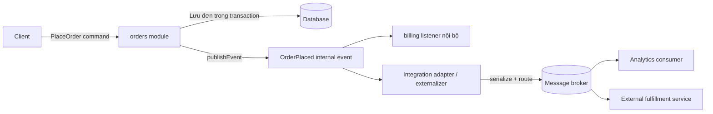
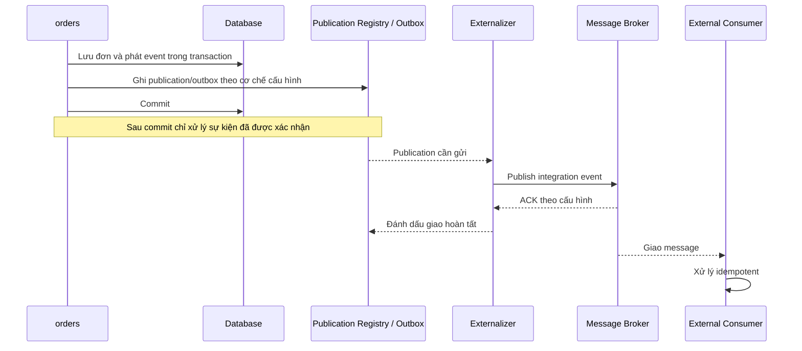

# Event ra ngoài ứng dụng trong Spring Modulith

Spring Modulith giúp các module trong cùng ứng dụng giao tiếp qua **application events** để giảm phụ thuộc trực tiếp và bảo vệ ranh giới nghiệp vụ. Nhưng nhiều hệ thống còn phải thông báo cho dịch vụ thanh toán, kho bên ngoài, nền tảng phân tích hoặc ứng dụng đối tác. Khi đó, sự kiện cần **đi ra ngoài tiến trình ứng dụng** qua một phương tiện tích hợp như Kafka, RabbitMQ, một message broker khác hoặc một cơ chế truyền thông được vận hành riêng.

Bài học này thuộc chương **Event nội bộ và tích hợp**, tập trung vào cách chuyển từ **internal event** sang **integration event**, chọn vị trí externalization, duy trì hợp đồng công khai, xử lý commit, mất kết nối, retry, idempotency, kiểm thử và quan sát. Ví dụ xuyên suốt là ứng dụng bán hàng với module `orders` phát sự kiện khi đơn hàng được tạo.

> **Ý chính:** Một application event được phát bằng `ApplicationEventPublisher` không tự xuất hiện trên broker. Đưa event ra ngoài là **một bước giao nhận riêng**, cần hợp đồng dữ liệu và mức bảo đảm độc lập với việc thông báo giữa các module trong cùng Spring application context.

## 1. Ranh giới nào được vượt qua?

Trong ứng dụng đơn khối theo module, `orders` có thể phát `OrderPlaced`, còn `billing` và `notifications` đăng ký listener. Các thành phần chạy cùng JVM, cùng Spring application context. Bên ngoài ứng dụng, một dịch vụ khác không thể trực tiếp đăng ký `@ApplicationModuleListener` vào context đó.

| Tiêu chí | Internal application event | Integration event ra ngoài |
| --- | --- | --- |
| Người nhận | Các module/bean trong ứng dụng | Dịch vụ, ứng dụng, hệ thống khác |
| Cơ chế giao | Spring event multicaster và transactional listeners | Broker hoặc cổng tích hợp đã cấu hình |
| Hợp đồng dữ liệu | Java type trong API module, có thể phát triển cùng codebase | Payload/serialization và schema ổn định qua ranh giới triển khai |
| Thay đổi phiên bản | Thường triển khai cùng một ứng dụng | Producer và consumer có thể chạy phiên bản khác nhau |
| Độ tin cậy | Phụ thuộc listener, transaction và Event Publication Registry nếu dùng | Cần thêm trạng thái publish, broker acknowledgment, retry, idempotency |
| Quyền truy cập | Code trong cùng ứng dụng đã có classpath | Có quy định xác thực, phân quyền, dữ liệu nhạy cảm |
| Lỗi thường gặp | Listener sau commit thất bại hoặc xử lý trùng | Broker mất kết nối, timeout, duplicate, message không tương thích |

Một event có thể là **sự thật nghiệp vụ hợp lệ** nhưng chưa đủ điều kiện để công bố ra ngoài. Ví dụ `OrderPlaced` nội bộ chứa cấu trúc trạng thái hoặc chi tiết chỉ các module nội bộ mới cần; đối tác bên ngoài chỉ nên nhận ID đơn, thời điểm và tổng giá trị được phép chia sẻ.

## 2. Khi nào cần phát event ra ngoài?

Các tình huống phù hợp:

1. **Phát thông tin thay đổi nghiệp vụ:** dịch vụ giao vận độc lập cần biết đơn đã sẵn sàng gửi.
2. **Cập nhật read model ngoài ứng dụng:** data platform nhận đơn vừa tạo để xây dựng báo cáo theo thời gian gần thực.
3. **Tích hợp với hệ thống khác:** ERP hoặc CRM nhận thông điệp về đơn, hóa đơn hoặc khách hàng đã được cập nhật.
4. **Cho phép các hệ thống phản ứng độc lập:** producer không cần gọi đồng bộ hàng loạt API của các consumer và chịu thời gian phản hồi của họ.

Không phải mọi thay đổi dữ liệu đều đáng phát ra ngoài. Những event chỉ liên quan cache nội bộ, dữ liệu tạm hoặc chi tiết implementation có thể không có giá trị cho bên ngoài. Cần chọn **business fact có ý nghĩa công khai**, không externalize cả luồng thao tác kỹ thuật.

### Ví dụ quyết định

| Nhu cầu | Hướng hợp lý |
| --- | --- |
| `billing` trong cùng ứng dụng muốn tạo hóa đơn sau commit | Internal `OrderPlaced` + listener theo transaction |
| Dịch vụ phân tích nằm ngoài ứng dụng cần biết đơn mới | Integration event `OrderCreatedV1` ra broker |
| API cần biết **ngay** tồn kho đã được giữ hay chưa | Command/query qua hợp đồng có kết quả; không dùng outbound event để giả lập câu trả lời tức thì |
| Cần gửi trạng thái đơn hiện tại cho hệ thống ngoài theo lệnh người dùng | API đồng bộ hoặc quá trình đồng bộ có trạng thái; event chỉ thích hợp nếu nghiệp vụ cho phép xử lý bất đồng bộ |
| Đối tác ngoài cần biết mọi thay đổi của entity JPA | Thiết kế lại tập event nghiệp vụ; không gửi entity/database row trực tiếp |

## 3. Luồng outbound event tổng thể



Luồng nghiệp vụ có năm giai đoạn cần tách bạch:

1. Module `orders` xử lý `PlaceOrder`, kiểm tra quy tắc và thay đổi trạng thái đơn.
2. Module này phát một **application event** phản ánh sự thật `OrderPlaced`.
3. Adapter/externalizer tạo hoặc chọn **integration event** có schema được công khai.
4. Bộ gửi thực hiện publish ra broker và xác định kết quả giao theo cơ chế cụ thể.
5. Consumer ở hệ thống khác nhận, kiểm tra schema, xử lý và tự đảm bảo idempotency.

**Đường đi logic không đồng nghĩa mọi bước đã thành công trong một transaction duy nhất.** Lưu đơn trong database và gửi một message ra broker liên quan hai tài nguyên khác nhau. Cần thiết kế riêng chuyện broker bị lỗi ngay sau khi đơn đã commit.

## 4. Internal event và integration event có nên dùng chung một class?

Có hai cách phổ biến.

**Cách A — Công bố trực tiếp một event đã được thiết kế như hợp đồng tích hợp.** Nếu event có payload nhỏ, ổn định và được phép chia sẻ, ứng dụng có thể chọn externalize chính kiểu event đó.

**Cách B — Chuyển internal event sang integration event riêng.** Khi consumer ngoài không nên biết model nội bộ, hoặc producer có vòng đời schema khác, tạo event payload public độc lập và map từ event nội bộ.

| Cân nhắc | Dùng chung event class | Tách integration DTO |
| --- | --- | --- |
| Độ đơn giản | Ít mapping, phù hợp sự kiện nhỏ | Cần lớp mapping/adapter |
| Độc lập schema | Consumer bị ảnh hưởng khi Java type thay đổi | Có thể giữ hợp đồng ngoài khi model nội bộ đổi |
| Quyền riêng tư | Dễ vô tình externalize field nội bộ | Chỉ định trường được công bố |
| Đa phiên bản | Khó hơn nếu các phía triển khai lệch phiên bản | Có thể giữ V1 song song V2 |
| Phân ranh ownership | Hợp khi internal event đã là public contract | Rõ ràng boundary nội bộ và tích hợp |

**Không có một phương án đúng cho mọi hệ thống.** Khi event ra ngoài có nhiều consumer độc lập, ưu tiên tách contract thường giúp quản trị an toàn hơn.

### 4.1. Internal event của module đơn hàng

```java
// com.example.shop.orders.OrderPlaced.java
package com.example.shop.orders;

import java.time.Instant;
import java.util.UUID;

public record OrderPlaced(
        UUID eventId,
        UUID orderId,
        Instant occurredAt,
        UUID correlationId
) {}
```

Đây là event do `orders` sở hữu và công bố tại API module. Với `OrderPlaced`, các module bên trong biết sự thật đơn vừa được đặt, có thể dùng `orderId` để tra cứu qua public query API nếu cần.

### 4.2. Integration DTO riêng

```java
// com.example.shop.integrations.OrderCreatedV1.java
package com.example.shop.integrations;

import java.math.BigDecimal;
import java.time.Instant;
import java.util.UUID;

public record OrderCreatedV1(
        UUID eventId,
        UUID orderId,
        Instant occurredAt,
        String currency,
        BigDecimal totalAmount,
        UUID correlationId
) {}
```

Đối với schema công bố ra ngoài:

- `eventId` giữ **ổn định khi retry**; không tự tạo mới mỗi lần gửi lại.
- `orderId` là khóa của đối tượng nghiệp vụ.
- `occurredAt` chỉ rõ thời điểm event được ghi nhận, không nhất thiết là lúc broker nhận.
- `currency` và `totalAmount` là dữ liệu đã được phê duyệt công khai; số tiền cần được xác định nhất quán với đơn tại thời điểm tạo.
- `correlationId` phục vụ tracing nếu hệ thống có chính sách truyền ID này.

Tên có hậu tố `V1` thể hiện một cách quản lý version. Tùy hệ thống có thể dùng schema registry và version trong metadata, nhưng contract thay đổi phải được quản lý chứ không chỉ đổi tên class.

## 5. Phát internal event tại module sở hữu

Application service của `orders` phát `OrderPlaced` sau khi áp dụng quy tắc nghiệp vụ:

```java
// com.example.shop.orders.internal.PlaceOrderService.java
package com.example.shop.orders.internal;

import com.example.shop.orders.OrderPlaced;
import com.example.shop.orders.PlaceOrder;
import java.time.Clock;
import java.time.Instant;
import java.util.UUID;
import org.springframework.context.ApplicationEventPublisher;
import org.springframework.stereotype.Service;
import org.springframework.transaction.annotation.Transactional;

@Service
class PlaceOrderService {

    private final OrderRepository orders;
    private final ApplicationEventPublisher events;
    private final Clock clock;

    PlaceOrderService(
            OrderRepository orders,
            ApplicationEventPublisher events,
            Clock clock) {
        this.orders = orders;
        this.events = events;
        this.clock = clock;
    }

    @Transactional
    public UUID place(PlaceOrder command) {
        Order order = Order.place(command.customerId(),
                                  command.sku(),
                                  command.quantity());
        orders.save(order);

        events.publishEvent(new OrderPlaced(
                UUID.randomUUID(),
                order.id(),
                Instant.now(clock),
                command.correlationId()
        ));

        return order.id();
    }
}
```

Trong ví dụ trên, `PlaceOrder`, `Order` và `OrderRepository` là các type minh họa cần triển khai theo nghiệp vụ, bean `Clock` cần cấu hình. Mục đích là thể hiện **nguồn sự thật thuộc `orders`**; module không biết Kafka topic hay endpoint của consumer ngoài.

Điểm quan trọng: `publishEvent(...)` được gọi **trong transaction, trước commit**. Đây là lời gọi công bố event, **không phải bằng chứng transaction đã commit**. Nếu transaction rollback, việc có listener đồng bộ đang xử lý ngay lúc publish có thể gây side effect không mong muốn. Với outbound event dựa trên dữ liệu đã commit, cần cơ chế transaction-aware phù hợp.

## 6. Cách 1: Spring Modulith Event Externalization

Spring Modulith có khả năng **event externalization** tích hợp với một số công nghệ messaging thông qua module hỗ trợ phù hợp với phiên bản framework. Đây là cách để chỉ định event nào được đưa ra hệ thống ngoài và cấu hình routing/serialization.

Trong những phiên bản hỗ trợ annotation này, có thể đánh dấu kiểu event được phép gửi ra ngoài:

```java
// Minh họa kiểu integration event được chọn externalize.
// Xác nhận package/API và routing tương thích với Spring Modulith
// mà project đang sử dụng trước khi áp dụng.
package com.example.shop.orders;

import java.time.Instant;
import java.util.UUID;
import org.springframework.modulith.events.Externalized;

@Externalized
public record OrderCreatedForIntegration(
        UUID eventId,
        UUID orderId,
        Instant occurredAt
) {}
```

Đặt event này trong **public API của module sở hữu**, hoặc một named interface được xuất chủ ý, cho phép các thành phần tích hợp nhìn thấy hợp đồng mà không phải import repository/entity nội bộ.

Để đoạn minh họa hoạt động, ứng dụng còn phải:

1. Thêm dependency externalization phù hợp với broker/phiên bản Spring Modulith.
2. Cấu hình kết nối broker, serialization, lựa chọn/routing event và đích gửi theo API version đang sử dụng.
3. **Thực sự phát** một instance `OrderCreatedForIntegration` khi nghiệp vụ thành công; annotation trên class không tự tạo event.
4. Cấu hình transaction, publication registry/recovery và quan sát theo mức đảm bảo mong muốn.
5. Kiểm thử broker integration và lỗi gửi trong môi trường dự án.

**Chú ý:** Externalization là một capability riêng, không đồng nghĩa chỉ gắn `@ApplicationModuleListener` hoặc `@Externalized` là tự có mọi bảo đảm giao bền vững. Routing key, topic, điều kiện đánh dấu publication hoàn thành và cơ chế resubmit cần được kiểm tra theo phiên bản starter/adapter dùng thực tế. Không tự giả định framework sẽ đổi tên class thành topic đúng quy ước của hệ thống.

### Khi nào chọn externalization tích hợp?

Phù hợp khi một event đã được thiết kế để công bố, hạ tầng broker được Spring Modulith hỗ trợ, và chính sách routing/serialization đáp ứng yêu cầu. Cách này giảm mã glue trong ứng dụng nhưng vẫn cần sở hữu schema, xác thực broker, retry và monitoring.

## 7. Cách 2: Adapter chuyển internal event thành integration event

Khi schema nội bộ và ngoài phải khác nhau, sử dụng một outbound adapter **thuộc module tích hợp**. Module này nghe public internal event `OrderPlaced` và chuyển thành `OrderCreatedV1`.

Ví dụ interface trừu tượng của cổng outbound:

```java
// com.example.shop.integrations.internal.OutboundEventGateway.java
package com.example.shop.integrations.internal;

import com.example.shop.integrations.OrderCreatedV1;

interface OutboundEventGateway {

    // Contract của application: chỉ return khi broker đã xác nhận
    // chấp nhận message theo chính sách ACK được chọn.
    // Ném exception nếu chưa thể xác nhận; cần xử lý timeout rõ ràng.
    void publishAndConfirm(
            String destination,
            String partitionKey,
            OrderCreatedV1 event);
}
```

Adapter lắng nghe event:

```java
// com.example.shop.integrations.internal.OrderExternalizationListener.java
package com.example.shop.integrations.internal;

import com.example.shop.orders.OrderPlaced;
import com.example.shop.orders.OrderQueries;
import com.example.shop.orders.OrderSummary;
import com.example.shop.integrations.OrderCreatedV1;
import org.springframework.modulith.events.ApplicationModuleListener;
import org.springframework.stereotype.Component;

@Component
class OrderExternalizationListener {

    private final OrderQueries orderQueries;
    private final OutboundEventGateway gateway;

    OrderExternalizationListener(
            OrderQueries orderQueries,
            OutboundEventGateway gateway) {
        this.orderQueries = orderQueries;
        this.gateway = gateway;
    }

    @ApplicationModuleListener
    void on(OrderPlaced event) {
        OrderSummary snapshot = orderQueries.findForIntegration(
                event.orderId());

        OrderCreatedV1 externalEvent = new OrderCreatedV1(
                event.eventId(),          // không tạo eventId mới khi retry
                event.orderId(),
                event.occurredAt(),
                snapshot.currency(),
                snapshot.totalAmount(),
                event.correlationId()
        );

        gateway.publishAndConfirm(
                "orders.created.v1",
                event.orderId().toString(),
                externalEvent
        );
    }
}
```

Các type `OrderQueries`, `OrderSummary` và implementation của `OutboundEventGateway` là **hợp đồng ví dụ**, không phải API được Spring Modulith tạo sẵn. `OrderQueries.findForIntegration(...)` phải được module `orders` chủ động công khai và giới hạn dữ liệu cần chia sẻ.

Thiết kế trên có ý nghĩa:

- Module `orders` không import broker client, topic hoặc class của module tích hợp.
- Adapter chỉ import **API công khai** của `orders`, không vào `orders.internal`.
- Event bên ngoài có payload và version riêng.
- Listener chỉ báo thành công khi cổng đã xác nhận việc publish theo chính sách ACK; nếu method mới **khởi chạy một future rồi return ngay**, registry có thể đánh dấu hoàn thành trước khi broker chấp nhận message.

**Cảnh báo về snapshot:** đoạn ví dụ truy vấn `OrderSummary` tại thời điểm gửi. Nếu đơn có thể thay đổi trước khi listener chạy/retry, nó có thể tạo payload **khác với trạng thái lúc event phát sinh**. Khi consumer cần số tiền đúng tại thời điểm đặt hàng, phải đưa snapshot bất biến cần thiết vào `OrderPlaced` ngay lúc phát, hoặc lưu một bản snapshot/outbox record tại thời điểm nghiệp vụ. Không dựa vào truy vấn hiện tại để tái dựng sự thật lịch sử nếu dữ liệu có thể đổi.

### Không đồng nhất gửi thành công với tiêu thụ thành công

Broker acknowledgment theo cấu hình xác nhận **broker đã nhận** (ở mức mà broker/client hỗ trợ). Nó **không** chứng minh consumer đã xử lý xong nghiệp vụ. Nếu cần bảo đảm consumer hoàn tất, phải thiết kế quy trình xác nhận riêng (ví dụ event kết quả, trạng thái workflow, retry và timeout).

## 8. Transaction, độ bền và khoảng trống có thể mất event

Luồng tạo đơn gồm hai kết quả khác nhau: database xác nhận đơn đã được lưu và broker xác nhận đã nhận message.



Sơ đồ là một **mẫu thiết kế độ tin cậy**; trạng thái cụ thể và transaction của registry/outbox phụ thuộc implementation. Không nên suy từ sơ đồ rằng hai hệ thống database và broker tham gia một transaction phân tán duy nhất.

### Những cửa sổ lỗi quan trọng

| Thời điểm lỗi | Kết quả có thể xảy ra | Điều kiện phục hồi |
| --- | --- | --- |
| Transaction lưu đơn rollback | Đơn không tồn tại | Không externalize một sự thật chưa commit |
| Đơn đã commit, app crash trước khi gửi | Đơn tồn tại nhưng broker chưa nhận | Cần publication/outbox bền vững được ghi cùng transaction nguồn và recovery |
| Broker nhận message, producer timeout trước khi nhận ACK | Có thể broker đã nhận nhưng producer không biết | Retry có thể tạo message trùng; giữ stable `eventId` |
| Broker ACK thành công, app crash trước khi đánh dấu publication hoàn tất | Broker đã có message; trạng thái gửi vẫn chờ | Có thể gửi lại; consumer phải idempotent |
| Consumer nhận rồi crash sau side effect nhưng trước ACK consumer | Side effect có thể đã xảy ra | Consumer idempotency, transaction và recovery riêng |

**Chỉ publish sau commit bằng callback trong bộ nhớ chưa giải quyết được cửa sổ crash** giữa commit và lúc callback thực thi. Nếu yêu cầu không đánh mất sự kiện, cần cơ chế ghi dấu bền vững như Event Publication Registry có persistence phù hợp hoặc transactional outbox, cùng quy trình recovery.

### Event Publication Registry và transactional outbox

Spring Modulith Event Publication Registry theo dõi những event publication đến transactional listeners, và có thể hỗ trợ cơ chế externalization tùy module/adapter đã cấu hình. Khi có repository lưu trạng thái publication, thông tin chưa hoàn tất có thể được tìm và resubmit theo chính sách.

**Transactional outbox** là mẫu lưu thông điệp tích hợp/ý định gửi vào bảng outbox **trong cùng transaction** với thay đổi nghiệp vụ; worker/publisher đọc outbox rồi gửi ra broker và cập nhật trạng thái. Đây là một chiến lược tổng quát, có thể triển khai qua công cụ riêng hoặc tích hợp sẵn, không đồng nhất tên gọi hay schema với Event Publication Registry của mọi phiên bản Spring Modulith.

Bảng chọn:

| Nhu cầu | Hướng tiếp cận |
| --- | --- |
| Có Spring Modulith transactional events và storage registry phù hợp | Cân nhắc publication registry + externalization/recovery theo adapter được hỗ trợ |
| Broker không có adapter phù hợp hoặc muốn điều khiển payload/outbox độc lập | Transactional outbox + publisher chuyên biệt |
| Event không quan trọng, chấp nhận mất khi crash | Xử lý sau commit không bền vững có thể đủ, nhưng phải nói rõ giới hạn |
| Phải đồng bộ kết quả trong HTTP request | Hợp đồng command/API trả kết quả hoặc workflow trạng thái; outbound event không thay thế |

Không thể khẳng định **exactly once end-to-end** chỉ bằng việc dùng registry, outbox hay Kafka. Tùy crash boundary và broker, cùng event có thể được giao lại; consumer phải xử lý trùng.

## 9. Routing, partition key và thứ tự sự kiện

Integration event phải có **địa chỉ đến** và quy tắc định tuyến được quản lý.

Ví dụ metadata gửi message:

```text
destination: orders.created.v1
message-key: <orderId>
event-type: OrderCreated
schema-version: 1
event-id: <eventId>
correlation-id: <correlationId>
payload: { orderId, occurredAt, currency, totalAmount }
```

Ví dụ trên mô tả hợp đồng do ứng dụng thiết kế, không phải tên header bắt buộc của Spring Modulith hay mọi broker.

- **Destination/topic:** định danh luồng sự kiện; tên mang ý nghĩa nghiệp vụ, không phụ thuộc tên class triển khai.
- **Partition/routing key:** với broker hỗ trợ partitioning, có thể chọn `orderId` để các thông điệp của một đơn có cơ hội đi cùng partition.
- **Event ID:** dùng để deduplicate khi retry hoặc giao lại.
- **Schema version:** quản trị thay đổi payload.
- **Correlation ID:** hỗ trợ truy vết qua hệ thống.

**Không giả định thứ tự toàn cục.** Ví dụ Kafka duy trì thứ tự trong một partition theo semantics của broker, nhưng thứ tự end-to-end còn phụ thuộc producer, retry, partition key, consumer concurrency và nhiều nguồn phát. Nếu cần bảo đảm tiến trình một đơn đi từ `CREATED` → `PAID` → `CANCELLED`, cần chiến lược key, sequence/aggregate version và quy tắc xử lý out-of-order.

Một cách bổ sung là đưa `aggregateVersion` tăng dần theo từng đơn vào event contract. Consumer có thể kiểm tra version cũ hoặc phát hiện thiếu phiên bản. Việc này chỉ có hiệu quả khi producer tạo version và công bố nhất quán.

## 10. Đóng gói schema và quản trị phiên bản

Integration event được consumer bên ngoài đọc bằng JSON, Avro, Protobuf hoặc một format đã thống nhất. Java record là representation ở producer; **payload thực tế là hợp đồng liên hệ giữa các dịch vụ**.

Ví dụ JSON của `OrderCreatedV1`:

```json
{
  "eventId": "02b51e75-77f1-4a2d-b4dd-4a5199d0c238",
  "eventType": "OrderCreated",
  "schemaVersion": 1,
  "orderId": "c68e7d7c-7673-40d5-9d25-a3ca3bc381d1",
  "occurredAt": "2026-11-25T08:00:00Z",
  "currency": "VND",
  "totalAmount": 250000,
  "correlationId": "c8a18bc3-1929-4854-b075-e717ec14c2e1"
}
```

JSON trên là ví dụ có thêm envelope fields, không được tạo tự động chỉ nhờ `record`. Producer/serializer phải xây dựng contract thống nhất.

### Thay đổi tương thích và không tương thích

| Thay đổi | Rủi ro |
| --- | --- |
| Thêm field tùy chọn mà consumer chấp nhận bỏ qua | Thường dễ tương thích hơn |
| Đổi tên hoặc xóa field mà consumer đang dùng | Có thể phá consumer cũ |
| Thay ý nghĩa `totalAmount` từ trước thuế thành sau thuế | Phá ngữ nghĩa dù cấu trúc JSON không đổi |
| Thay ID từ UUID thành integer | Có thể phá parser và logic định danh |
| Đổi loại event từ “đã đặt” sang “đã nhận yêu cầu đặt” | Phá hợp đồng nghiệp vụ |
| Thay cấu trúc lớn hoặc quy tắc business | Cân nhắc công bố schema/event V2 song song trong giai đoạn chuyển đổi |

Mỗi public integration event nên có tài liệu về **điều kiện phát, nghĩa của field, schema, route, duplicate/retry, thứ tự, quyền truy cập, kỳ vọng consumer**. Nếu có nhiều bên dùng, schema registry và contract tests giúp giảm lỗi triển khai lệch phiên bản.

### Dữ liệu nhạy cảm

Không externalize entity JPA, thông tin thẻ thanh toán, token xác thực, toàn bộ địa chỉ/email hoặc dữ liệu cá nhân chỉ vì thuận tiện. Chỉ gửi trường được phép và cần thiết, áp dụng chính sách phân quyền topic, TLS, secret management, retention và kiểm soát log theo môi trường.

## 11. Consumer phải chịu được giao lặp và giao sai thứ tự

Giả sử broker giao `OrderCreatedV1` hai lần sau một lần retry. Consumer không nên tạo hai bản ghi giao vận.

Một cách thiết kế idempotent:

```text
Khi nhận message:
  1. Kiểm tra schema và route đã hỗ trợ.
  2. Bắt đầu transaction ở hệ thống consumer.
  3. Ghi nhận eventId vào inbox/processed_events với unique constraint.
  4. Nếu eventId đã tồn tại: bỏ qua side effect lặp.
  5. Nếu chưa có: thực thi nghiệp vụ và ghi trạng thái cùng transaction.
  6. Commit và ACK broker theo cơ chế consumer.
```

Đây là **mẫu inbox/idempotent consumer**, cần điều chỉnh với transaction của persistence và hệ thống ngoài. Nếu consumer gọi dịch vụ vận chuyển không hỗ trợ idempotency, chỉ ghi `processed_events` có thể chưa đủ để ngăn side effect lặp khi crash giữa lúc gọi API và ghi dấu thành công.

### Lỗi có thể phục hồi và lỗi không thể phục hồi

- **Transient:** broker timeout, kết nối mạng, database lock tạm thời; có thể retry với backoff và giới hạn số lần.
- **Permanent:** schema không hỗ trợ, payload vi phạm điều kiện nghiệp vụ, dữ liệu nguồn sai; cần xác định nguyên nhân, sửa contract hoặc chuyển vào hàng lỗi.
- **Poison message:** message luôn làm consumer thất bại; cân nhắc dead-letter queue/topic kèm cảnh báo và quy trình xử lý thủ công.

Retry không giới hạn có thể làm nghẽn partition, tăng duplicate hoặc khiến hệ thống bên ngoài bị gọi quá tải. Hệ thống cần xác định timeout, retry budget, backoff và cách khôi phục theo độ quan trọng của từng event.

## 12. Kiểm thử outbound event theo từng lớp

### 12.1. Kiểm tra module nguồn tạo đúng internal event

Spring Modulith hỗ trợ `@ApplicationModuleTest` và `PublishedEvents` để kiểm tra event đã phát:

```java
package com.example.shop.orders;

import static org.assertj.core.api.Assertions.assertThat;

import java.util.UUID;
import org.junit.jupiter.api.Test;
import org.springframework.beans.factory.annotation.Autowired;
import org.springframework.modulith.test.ApplicationModuleTest;
import org.springframework.modulith.test.PublishedEvents;

@ApplicationModuleTest
class OrderEventsTest {

    @Autowired Orders orders;

    @Test
    void placingOrderPublishesEvent(PublishedEvents events) {
        UUID orderId = orders.place(
                new PlaceOrder(UUID.randomUUID(), "BOOK-1", 2,
                               UUID.randomUUID())
        );

        assertThat(events.ofType(OrderPlaced.class)
                         .matching(OrderPlaced::orderId, orderId))
            .hasSize(1);
    }
}
```

Ví dụ giả định có `Orders`, `PlaceOrder` và persistence test đã cấu hình. Test xác minh **internal publisher**, chưa chứng minh broker đã nhận event. Nếu test transaction rollback, listener sau commit có thể không chạy dù `PublishedEvents` quan sát thấy event được publish.

### 12.2. Kiểm tra mapping và contract

Test mapper để xác minh:

- `eventId` được giữ nguyên từ internal event sang outbound event.
- Snapshot không lấy dữ liệu hiện tại thay cho dữ liệu lịch sử nếu hợp đồng yêu cầu tại thời điểm đặt hàng.
- JSON/schema dùng tên field, kiểu dữ liệu, định dạng timestamp và version đúng contract.
- Không có trường nội bộ nhạy cảm trong payload.
- Cùng internal event sau retry sinh ra cùng dữ liệu quan trọng hoặc idempotency key.

Các test này có thể chạy mà không cần broker.

### 12.3. Kiểm tra tích hợp broker

Integration test với broker thử nghiệm phù hợp (ví dụ Testcontainers) có thể chứng minh:

1. Transaction thành công tạo đúng message ở route đã cấu hình.
2. Rollback transaction không đưa thông điệp nghiệp vụ chưa hợp lệ ra ngoài.
3. Broker từ chối/timeout khiến publication chưa được coi là hoàn tất.
4. Recovery/resubmit chuyển publication chưa hoàn tất sang trạng thái thành công khi broker hoạt động lại.
5. Broker đã nhận message rồi producer crash không dẫn đến **side effect trùng** tại consumer.
6. Event V1 được consumer phiên bản cũ chấp nhận theo chính sách tương thích.
7. Event từ hai đơn khác nhau không gây giả định thứ tự sai.

Trong test, hãy xác minh dữ liệu persisted của publication/outbox và message thật trên broker, không chỉ kiểm tra mock `publish(...)` đã được gọi.

### 12.4. Kiểm tra module boundary

```java
package com.example.shop;

import org.junit.jupiter.api.Test;
import org.springframework.modulith.core.ApplicationModules;

class ModularityTests {

    @Test
    void moduleBoundariesAreValid() {
        ApplicationModules.of(ShopApplication.class).verify();
    }
}
```

Test cấu trúc giúp phát hiện dependency không hợp lệ, chẳng hạn adapter import `orders.internal.OrderRepository`. Nó không thay thế test schema, giao message và hành vi retry.

## 13. Quan sát vận hành: biết event bị kẹt ở đâu

Tại thời điểm có sự cố “đơn đã tạo nhưng hệ thống giao vận chưa nhận”, cần phân biệt:

- Đơn trong database đã commit chưa?
- `OrderPlaced` đã được phát trong transaction hay chưa?
- Publication/outbox có record chưa hoàn tất không?
- Mapper có lỗi serialization/schema không?
- Producer có nhận broker ACK không?
- Broker có message và consumer group đã đọc chưa?
- Consumer xử lý thành công hay đang retry/dead-letter?

Một bản ghi log cấu trúc **minh họa**:

```json
{
  "eventId": "02b51e75-77f1-4a2d-b4dd-4a5199d0c238",
  "sourceModule": "orders",
  "eventType": "OrderCreated",
  "schemaVersion": 1,
  "destination": "orders.created.v1",
  "orderId": "c68e7d7c-7673-40d5-9d25-a3ca3bc381d1",
  "correlationId": "c8a18bc3-1929-4854-b075-e717ec14c2e1",
  "publicationStatus": "PENDING",
  "retryCount": 3
}
```

Đây **không** phải JSON tự động do Spring Modulith xuất ra. Ứng dụng có thể tạo log/metrics dựa trên registry và publisher, tránh ghi payload nhạy cảm.

Nên theo dõi lượng publication pending/failed, tuổi của publication cũ nhất, số retry, tỉ lệ lỗi serialization, độ trễ đến ACK, số message trong dead-letter queue và lag của consumer. Một dashboard hữu ích phải phân biệt **producer gửi thành công** với **consumer xử lý thành công**.

## 14. Sai lầm thường gặp

| Sai lầm | Hậu quả | Cách khắc phục |
| --- | --- | --- |
| Tưởng `publishEvent` tự gửi ra Kafka/RabbitMQ | Không có message ngoài ứng dụng | Cấu hình externalization hoặc outbound adapter thật |
| Externalize thẳng toàn bộ JPA entity | Rò rỉ schema và dữ liệu, khó serialize | Dùng integration DTO ổn định, payload tối thiểu |
| Tạo `eventId` mới mỗi lần retry | Consumer khó nhận diện duplicate | Tạo ID khi nghiệp vụ hình thành, giữ ổn định khi gửi lại |
| Chỉ đăng ký listener after-commit trong bộ nhớ | Có thể mất sự kiện khi crash | Registry persistence/recovery hoặc transactional outbox |
| Gateway gọi send async rồi return ngay | Publication bị đánh dấu thành công trước broker ACK | Chờ kết quả/ACK theo contract hoặc quản lý future và trạng thái gửi đáng tin cậy |
| Giả định broker ACK là consumer hoàn tất | Báo thành công quá sớm | Theo dõi consumer riêng hoặc dùng event phản hồi |
| Đổi ý nghĩa field mà không version | Consumer cũ có thể xử lý sai âm thầm | Quản lý contract, schema version và migration |
| Dùng `orderId` mới cho retry cùng nghiệp vụ | Nhầm event mới với giao lặp | Giữ business key và message ID phù hợp |
| Consumer không có inbox/idempotency | Side effect trùng khi broker giao lại | Unique constraint, idempotency key và transaction |
| Phát internal event nhiều lần để “đẩy” message ngoài | Nhiều listener nội bộ cũng bị chạy lại | Recovery đúng publication/outbox thay vì tái thực hiện nghiệp vụ |
| Bỏ qua bảo mật topic và retention | Lộ dữ liệu, người đọc không phù hợp | Phân quyền, TLS, hạn chế payload và giữ log an toàn |

## 15. Bài tập tình huống

Ứng dụng `shop` tạo đơn và phát `OrderPlaced`. Một dịch vụ giao vận độc lập phải nhận thông tin đơn qua broker. Dịch vụ phân tích cũng muốn nghe cùng luồng.

Hãy giải quyết:

1. Type nào là internal event? Type nào là contract công khai ra broker?
2. Nếu khách thay đổi địa chỉ sau khi đặt hàng, service giao vận có nên đọc thông tin địa chỉ **hiện tại** từ `orders` để tái dựng event cũ không?
3. Nếu database lưu đơn commit nhưng broker mất kết nối, đâu là cách giữ publication để gửi lại?
4. Nếu broker đã nhận rồi producer timeout, retry có làm consumer thấy hai message không?
5. Ai sở hữu idempotency khi hệ thống giao vận đã tạo vận đơn?
6. Khi producer đổi `totalAmount` thành số tiền **đã trừ hoàn tiền**, có thể giữ tên event/schema V1 không?
7. Có thể dùng `ApplicationModules.verify()` để xác minh toàn bộ hành vi trên không?

<details>
<summary>Gợi ý đáp án</summary>

1. `OrderPlaced` thuộc API `orders`; `OrderCreatedV1` là DTO tích hợp có schema/version và payload được phép chia sẻ. Có thể dùng chung type nếu hợp đồng thực sự phù hợp.
2. Không, nếu event cần snapshot tại thời điểm đặt hàng. Hãy lưu/bổ sung snapshot bất biến khi nghiệp vụ tạo event/outbox.
3. Cấu hình Event Publication Registry bền vững và recovery được hỗ trợ, hoặc transactional outbox ghi cùng transaction lưu đơn.
4. Có thể. Producer không chắc broker nhận hay chưa; consumer phải chịu được giao lặp qua stable `eventId` hoặc business key.
5. Consumer giao vận chịu trách nhiệm chống tạo vận đơn trùng, kết hợp broker/idempotency theo khóa phù hợp.
6. Không nên âm thầm đổi nghĩa. Cần đánh giá tương thích và version/schema mới nếu consumer đang dựa vào nghĩa cũ.
7. `verify()` kiểm tra các ràng buộc cấu trúc module đã khai báo. Phải thêm test transaction, mapping/schema, broker, retry và consumer để đánh giá tính đúng đắn đầu cuối.

</details>

## 16. Ghi nhớ

- **Internal event** diễn tả sự thật bên trong Spring application context; **integration event** là hợp đồng công bố cho hệ thống khác với schema và vòng đời riêng.
- Spring Modulith có thể **externalize** sự kiện thông qua module tích hợp, hoặc ứng dụng có thể dùng **outbound adapter** chuyển internal event thành integration DTO.
- Bảo vệ boundary bằng cách để module nghiệp vụ phát event, adapter import API công khai và giữ broker/topic/schema ở lớp tích hợp.
- `publishEvent` không đồng nghĩa transaction đã commit, và broker ACK không đồng nghĩa consumer đã hoàn tất.
- Với yêu cầu giao bền vững, cần registry/outbox có persistence và recovery; retry có thể sinh message trùng, nên người nhận phải idempotent.
- Quản trị event ID, snapshot, schema version, partition key, bảo mật, tracing và quan sát là một phần của thiết kế event ra ngoài ứng dụng.

**Tài liệu tham khảo chính thức:**

- [Spring Modulith — Event Externalization](https://docs.spring.io/spring-modulith/reference/events.html)
- [Spring Modulith — Application Module Fundamentals](https://docs.spring.io/spring-modulith/reference/fundamentals.html)
- [Spring Modulith — Testing Application Modules](https://docs.spring.io/spring-modulith/reference/testing.html)
- [Spring Framework — Transaction-bound Events](https://docs.spring.io/spring-framework/reference/data-access/transaction/event.html)
- [Spring Data Commons — Publishing Events from Aggregate Roots](https://docs.spring.io/spring-data/commons/reference/repositories/core-domain-events.html)
