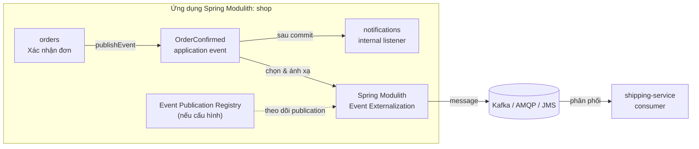
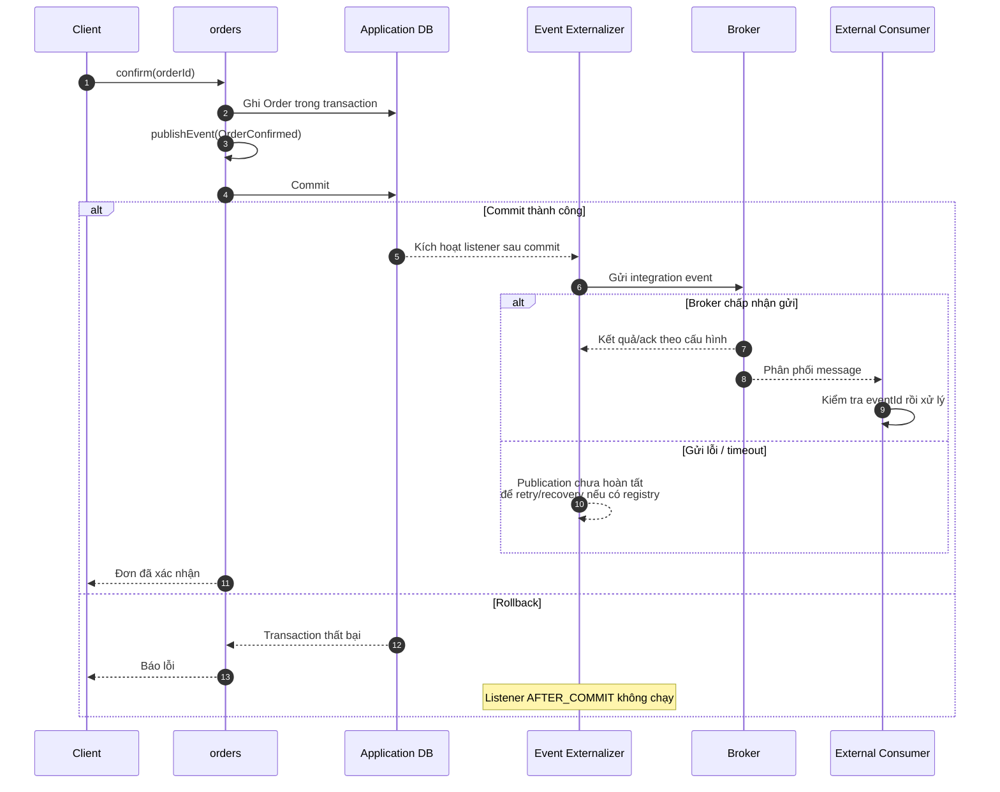

# External event: đưa application events ra ngoài ranh giới ứng dụng

## 1. External event là gì?

Trong **Spring Modulith Application Events**, module nghiệp vụ có thể phát một sự kiện bằng `ApplicationEventPublisher` để những module khác trong **cùng ứng dụng** phản ứng. Nhưng có lúc thông tin đó còn cần được gửi tới một hệ thống độc lập, ví dụ dịch vụ vận chuyển, kho dữ liệu, ứng dụng di động hoặc hệ thống đối tác.

Khi một sự kiện được **công bố ra bên ngoài ranh giới tiến trình ứng dụng** qua Kafka, AMQP, JMS hoặc một cơ chế trao đổi thông điệp, ta đang xử lý một **external event** (sự kiện phát ra bên ngoài). Payload dành cho bên ngoài thường được gọi là **integration event**. Hai khái niệm có liên quan, nhưng nhấn mạnh những khía cạnh khác nhau:

- **Externalization** là hành động chọn, chuyển đổi và gửi sự kiện từ ứng dụng sang hạ tầng bên ngoài.
- **Integration event** là hợp đồng dữ liệu mà hệ thống bên ngoài nhận và hiểu.
- **Internal application/domain event** là sự kiện phục vụ giao tiếp giữa các module trong cùng ứng dụng, có thể chứa thông tin phù hợp với mô hình nội bộ.

Ví dụ: khi module `orders` xác nhận đơn, nó công bố `OrderConfirmed` nội bộ. Module `notifications` trong cùng ứng dụng có thể phản ứng qua `@ApplicationModuleListener`; đồng thời hệ thống vận chuyển bên ngoài cần nhận thông tin đơn đã xác nhận để lập kế hoạch giao hàng. Ta chọn `OrderConfirmed` để **externalize** thành thông điệp `order.confirmed.v1`.

Mục tiêu của bài: biết **khi nào nên phát external event, cách công bố qua Spring Modulith, cách tách hợp đồng tích hợp khỏi domain model**, và cách xử lý lỗi, phát lại, idempotency, quan sát và kiểm thử.

## 2. Internal event và external event khác nhau ở đâu?

| Tiêu chí | Internal application event | External/integration event |
|---|---|---|
| Người nhận | Module hoặc listener trong cùng tiến trình Spring | Ứng dụng, process hoặc tổ chức khác |
| Cơ chế truyền | `ApplicationEventPublisher` và listener Spring | Broker/transport: Kafka, AMQP, JMS, message channel... |
| Hợp đồng | Thường là kiểu Java có thể cùng biên dịch và triển khai | Phải tính đến schema/serialization, nhiều phiên bản và vòng đời độc lập |
| Tốc độ thay đổi | Có thể cập nhật đồng thời với các module nội bộ | Cần tính tương thích với consumer triển khai chậm hơn |
| Phạm vi lỗi | Lỗi xử lý trong ứng dụng, phụ thuộc kiểu listener | Lỗi mạng, broker, serialize, timeout, consumer và message backlog |
| Giao dịch | Có thể xử lý đồng bộ hoặc sau commit | DB transaction nội bộ **không tự bao trùm** broker và DB của consumer |
| Quan sát | Log, kiểm thử module, publication registry | Thêm broker metrics, consumer lag, dead-letter, correlation và contract tests |
| Tin cậy | Tùy listener và persistence registry | Cần thiết kế publication, retry/recovery, idempotency và xác nhận của bên nhận |

**External event không đơn giản là `@EventListener` chạy ở máy khác.** Khi thông điệp đi qua broker, dữ liệu cần có định dạng trao đổi ổn định, định danh để xử lý trùng, quyền truy cập và quy tắc vận hành riêng.

Không phải mọi internal event đều phải gửi ra ngoài. Chỉ externalize những sự kiện có giá trị với bên ngoài và được phép chia sẻ. Event như `OrderCacheInvalidated` thường là chi tiết kỹ thuật nội bộ; event như `OrderConfirmed` có thể là mốc nghiệp vụ hữu ích để tích hợp.

## 3. Nhìn toàn bộ luồng: từ transaction đến consumer bên ngoài

Giả sử ứng dụng `shop` có module `orders`, `notifications` và một hệ thống `shipping-service` chạy độc lập:



Luồng logic gồm các bước:

1. `orders` thực hiện chuyển trạng thái nghiệp vụ trong transaction và phát `OrderConfirmed`.
2. Spring xử lý các listener phù hợp. Với externalization mặc định của Spring Modulith, việc xuất event ra broker được thực hiện qua cơ chế **transactional event listener sau commit**.
3. Thành phần externalization quyết định **event có được gửi ra ngoài không**, **payload gửi đi là gì** và **gửi tới đích nào**.
4. Broker tiếp nhận thông điệp, rồi phân phối tới consumer theo cấu hình.
5. `shipping-service` đọc integration event và cập nhật nghiệp vụ của nó; consumer cần tự quản lý lỗi, retry và duplicate.

**Commit DB, broker nhận message và consumer xử lý xong là ba mốc khác nhau.** HTTP API tạo đơn có thể đã trả thành công dù hệ thống vận chuyển chưa thấy message hoặc chưa xử lý.

## 4. Những khái niệm dễ nhầm: external event, outbox và broker

| Khái niệm | Nó giải quyết điều gì? | Nó không tự giải quyết điều gì? |
|---|---|---|
| `ApplicationEventPublisher` | Phát sự kiện trong Spring application | Tự gửi qua network/broker |
| `@Externalized` | Đánh dấu sự kiện được Spring Modulith chọn để xuất | Tự tạo topic, broker hoặc chiến lược idempotency |
| `EventExternalizationConfiguration` | Tùy chỉnh lựa chọn event, payload, header và routing | Bảo đảm consumer bên ngoài đã hoàn tất |
| **Event Publication Registry** | Lưu trạng thái publication và hỗ trợ khôi phục publication chưa hoàn tất khi cấu hình persistence | Exactly-once cho side effect tại consumer |
| **Outbox pattern** | Lưu công việc cần xuất event trong transaction dữ liệu cục bộ rồi chuyển đi theo cơ chế tin cậy | Không loại bỏ hoàn toàn duplicate nếu gửi lại |
| **Message broker** | Nhận, lưu/chuyển thông điệp theo khả năng và cấu hình của broker | Không thay thế hợp đồng nghiệp vụ và kiểm soát trùng ở consumer |

Spring Modulith hỗ trợ externalization gốc qua listener bất đồng bộ. Tài liệu Spring Modulith hiện hành cũng mô tả lựa chọn **outbox chuyên dụng** qua Namastack Outbox hoặc JobRunr (được bổ sung từ nhánh 2.1). Cần xem **phiên bản Spring Modulith đang dùng** trước khi áp dụng các cấu hình outbox cụ thể.

## 5. Khai báo sự kiện nghiệp vụ tại module phát

Trong ví dụ này, `orders` là module sở hữu sự thật “đơn hàng đã xác nhận”. Ta dùng record Java bất biến, chỉ mang dữ liệu có giá trị với tích hợp:

```java
package com.example.shop.orders;

import java.math.BigDecimal;
import java.time.Instant;
import java.util.UUID;
import org.springframework.modulith.events.Externalized;

@Externalized("orders.confirmed.v1::#{#this.orderId()}")
public record OrderConfirmed(
        UUID eventId,
        UUID orderId,
        Instant occurredAt,
        BigDecimal confirmedTotal,
        String currencyCode
) {}
```

Ý nghĩa của khai báo:

- `@Externalized` là annotation của Spring Modulith đánh dấu kiểu event cần gửi ra bên ngoài. Có thể dùng annotation tương ứng của jMolecules nếu ứng dụng lựa chọn hệ sinh thái đó.
- `orders.confirmed.v1` là **target** logic; với tích hợp Kafka, nó có thể là tên topic.
- Cú pháp `target::key` truyền thêm **routing key**. Phần `#{#this.orderId()}` là SpEL lấy `orderId` từ event; với Kafka, key hữu ích để phân vùng các event liên quan tới một đơn hàng.
- `eventId` là định danh duy nhất của **event gốc**; cần được giữ nguyên nếu publication bị gửi lại.
- `occurredAt` nói về thời điểm phát sinh nghiệp vụ; `confirmedTotal` và `currencyCode` là snapshot tại thời điểm đơn được xác nhận.

Lưu ý: `@Externalized` khiến kiểu event được **chọn để externalize** khi có cấu hình broker tương ứng. Nó không có nghĩa vừa tạo bean là hệ thống tự gửi được message; ứng dụng vẫn cần dependency, thông số kết nối và broker/topic/queue phù hợp.

### Phát event trong transaction nghiệp vụ

```java
package com.example.shop.orders;

import java.time.Clock;
import java.util.UUID;
import org.springframework.context.ApplicationEventPublisher;
import org.springframework.stereotype.Service;
import org.springframework.transaction.annotation.Transactional;

@Service
class CheckoutService {

    private final OrderRepository orders;
    private final ApplicationEventPublisher events;
    private final Clock clock;

    CheckoutService(
            OrderRepository orders,
            ApplicationEventPublisher events,
            Clock clock) {
        this.orders = orders;
        this.events = events;
        this.clock = clock;
    }

    @Transactional
    public UUID confirm(UUID orderId) {
        Order order = orders.findById(orderId).orElseThrow();

        if (order.isConfirmed()) {
            return orderId;
        }

        order.confirm(); // Kiểm tra invariant của đơn.
        orders.save(order);

        events.publishEvent(new OrderConfirmed(
                UUID.randomUUID(),
                orderId,
                clock.instant(),
                order.getConfirmedTotal(),
                order.getCurrencyCode()
        ));

        return orderId;
    }
}
```

Các kiểu `Order` và `OrderRepository` là mã minh họa do module `orders` sở hữu; ứng dụng thực cần triển khai domain model, transaction manager, bean `Clock` và xử lý yêu cầu xác nhận đồng thời. Chính method `confirm` không gọi `KafkaTemplate` hoặc HTTP client của bên nhận.

Có hai nguyên tắc quan trọng:

- **Chỉ phát sau khi quyết định nghiệp vụ thành công**, trong ranh giới transaction thích hợp. Nếu rollback, listener externalization chạy sau commit không gửi event của transaction đã rollback.
- **Đừng sinh lại eventId khi retry publication cũ.** Retry phải giữ nguyên thông điệp gốc để consumer có cơ sở chống trùng.

Trong thiết kế lớn, việc đặt annotation broker trực tiếp trên domain event là một **lựa chọn đơn giản**. Nếu muốn domain không biết về cơ chế tích hợp, nên cấu hình selection/mapping bằng Java configuration và tách ra một integration DTO ổn định.

## 6. Cấu hình Spring Modulith externalization

Theo tài liệu Spring Modulith, hỗ trợ externalization phụ thuộc vào **broker-specific artifact**. Ví dụ Gradle cho Kafka:

```groovy
dependencies {
    implementation "org.springframework.modulith:spring-modulith-events-kafka"
    // Các Spring Boot / Spring Kafka / persistence dependencies
    // khác cần được cấu hình theo phiên bản dự án.
}
```

Ứng dụng cần kết nối Kafka hợp lệ (bootstrap servers, serializers, security...) và topic thích hợp. Khi dùng AMQP, thay bằng `spring-modulith-events-amqp` cùng dependency broker như Spring Rabbit; JMS dùng `spring-modulith-events-jms`; Spring Messaging dùng `spring-modulith-events-messaging` và kênh nhận tương ứng.

| Hạ tầng | Artifact Spring Modulith | Cách hiểu target/key điển hình |
|---|---|---|
| Kafka | `spring-modulith-events-kafka` | Target là topic; routing key dùng làm message key |
| AMQP | `spring-modulith-events-amqp` | Routing key dùng trong cơ chế định tuyến AMQP; cần cấu hình broker/binding |
| JMS | `spring-modulith-events-jms` | Không có cơ chế routing key giống Kafka/AMQP |
| Spring Messaging | `spring-modulith-events-messaging` | Target trỏ tới bean `MessageChannel`, có thể chuyển tiếp qua Spring Integration |

Với lựa chọn mặc định theo annotation, Spring Modulith chọn các kiểu event có `@Externalized` và nằm trong package được quản lý bởi Spring Boot. Event không được chọn chỉ tiếp tục được xử lý ở phía nội bộ.

Điều cần kiểm tra theo phiên bản/thư viện: serializer, tên topic/queue, yêu cầu broker tồn tại và hành vi xác nhận publish. Cấu hình broker khác nhau có thể cho ra mức bảo đảm gửi message khác nhau.

## 7. Tách domain event và integration DTO bằng mapping

Đôi khi record `OrderConfirmed` phù hợp với module nội bộ nhưng không phải hợp đồng tốt cho bên ngoài. Ví dụ, hệ thống vận chuyển chỉ cần `orderId` và `confirmedAt`; bên ngoài cần schema ổn định dù đối tượng domain phát triển.

Lúc đó ta ánh xạ sự kiện nguồn sang **integration DTO**:

```java
package com.example.shop.integration;

public record OrderConfirmedMessageV1(
        String eventId,
        String orderId,
        String confirmedAt,
        String totalAmount,
        String currency
) {}
```

Các trường được chuyển sang dạng chuỗi chỉ để minh họa một wire contract rõ ràng; trong hệ thống thực tế phải thống nhất schema, encoding thời gian và kiểu tiền giữa producer/consumer.

Có thể dùng cấu hình programmatic:

```java
package com.example.shop.integration;

import com.example.shop.orders.OrderConfirmed;
import org.springframework.context.annotation.Bean;
import org.springframework.context.annotation.Configuration;
import org.springframework.modulith.events.EventExternalizationConfiguration;

@Configuration(proxyBeanMethods = false)
class ExternalEventConfiguration {

    @Bean
    EventExternalizationConfiguration externalizationConfiguration() {
        return EventExternalizationConfiguration.externalizing()
                .select(EventExternalizationConfiguration
                        .annotatedAsExternalized())
                .mapping(OrderConfirmed.class, event ->
                        new OrderConfirmedMessageV1(
                                event.eventId().toString(),
                                event.orderId().toString(),
                                event.occurredAt().toString(),
                                event.confirmedTotal().toPlainString(),
                                event.currencyCode()))
                .build();
    }
}
```

Ý nghĩa từng bước:

1. **Selection** xác định event nào cần phát ra broker; ở đây dùng `@Externalized`.
2. **Mapping** biến `OrderConfirmed` thành `OrderConfirmedMessageV1`.
3. **Routing** tiếp tục sử dụng thông tin của **event nguồn**, trừ khi cấu hình thay đổi routing theo đối tượng đã ánh xạ.
4. **Serialization** do hạ tầng gửi message thực hiện theo cấu hình serializer.

Khi không muốn domain class có `@Externalized`, có thể chuyển sang cấu hình **selection bằng type/package và routing bằng code**. Cách này đặt toàn bộ quyết định tích hợp ở module adapter; cần lựa chọn đúng API builder theo phiên bản.

**Quan trọng:** mapping không có nghĩa Spring Modulith tự đảm bảo mọi consumer hiểu JSON. Hợp đồng wire format cần quy định tên trường, phiên bản, kiểu dữ liệu, quyền sử dụng và chính sách thay đổi schema. Nếu broker đang lưu message cũ, consumer mới phải xử lý được dữ liệu cũ hoặc có phương án migration.

## 8. Định tuyến event và khóa message

Routing của external event không chỉ là đặt tên topic. Nó ảnh hưởng khả năng truy vết và cách broker xử lý thông điệp.

Ví dụ:

```text
target: orders.confirmed.v1
key:    30d2aeb7-... (orderId)
event:  OrderConfirmedMessageV1
```

Với Kafka, dùng cùng `orderId` làm key thường khiến các event của cùng một đơn vào cùng partition (trong điều kiện cấu hình partitioner và số partition tương ứng). Nhưng điều đó **không tự bảo đảm thứ tự toàn hệ thống**, đặc biệt khi xử lý bất đồng bộ, retry, thay đổi số partition hoặc nhiều producer. Với AMQP, ý nghĩa routing key phụ thuộc exchange và binding; với JMS, không dùng routing key theo cách này.

Một số lựa chọn thiết kế:

| Khóa | Khi nào nên dùng? | Điểm cần chú ý |
|---|---|---|
| `orderId` | Consumer muốn xử lý nhiều sự kiện của một đơn theo chuỗi | Thích hợp để gom sự kiện của cùng aggregate |
| `customerId` | Consumer gom xử lý theo khách hàng | Không phù hợp nếu yêu cầu thứ tự theo đơn |
| `eventId` | Mỗi event có key riêng, dễ đối chiếu | Không giúp gom các sự kiện của cùng một đối tượng |
| Không key | Consumer không yêu cầu định tuyến theo đối tượng | Không suy luận được thứ tự liên quan đến aggregate |

Không đưa dữ liệu nhạy cảm như email hoặc số điện thoại làm key khi không cần thiết; key cũng có thể xuất hiện trong log, công cụ vận hành và dữ liệu broker lưu trữ.

## 9. Transaction và ý nghĩa của "đã gửi"

External event đi qua nhiều ranh giới, mỗi ranh giới có thể thành công hay thất bại độc lập.



Sơ đồ minh họa **các quan hệ nhân quả**, không khẳng định thứ tự thực tế giữa phản hồi HTTP, broker ack và consumer hoàn thành; externalization chạy bất đồng bộ theo cấu hình mặc định.

Ta cần tách ba trạng thái:

- **Đã commit nghiệp vụ:** DB của `orders` đã chấp nhận thay đổi trạng thái.
- **Đã gửi/được broker chấp nhận:** producer nhận kết quả từ hạ tầng broker theo cấu hình xác nhận.
- **Đã tiêu thụ/hoàn thành:** hệ thống nhận xử lý xong và lưu hiệu ứng nghiệp vụ.

Ngay cả khi broker trả ACK, nó **không đồng nghĩa** mọi consumer đã cập nhật dữ liệu. Khi consumer lỗi hoặc khởi động lại, cùng message có thể được phát lại. Hãy thiết kế theo giả định **at-least-once ở những tuyến có retry**, có thể gặp duplicate; không hứa chính xác một lần cho cả luồng.

## 10. Event Publication Registry và phục hồi externalization

Spring Modulith triển khai externalization mặc định như một transactional event listener chuyển tiếp tới thành phần gửi broker. Khi có **Event Publication Registry với backend lưu trữ phù hợp** (như JDBC/JPA), hệ thống có thể ghi nhận publication liên quan tới listener và theo dõi lần gửi chưa hoàn tất để hỗ trợ resubmit.

Một tình huống điển hình:

1. `OrderConfirmed` được phát trong transaction xác nhận đơn.
2. Registry ghi nhận publication của externalization theo cơ chế tích hợp và transaction.
3. Transaction đơn hàng commit, externalizer bắt đầu gửi.
4. Broker không sẵn sàng hoặc client gặp timeout; publication chưa được đánh dấu hoàn tất.
5. Tác vụ vận hành/khôi phục phù hợp sẽ tìm và phát lại publication chưa hoàn tất.
6. Nếu broker thực ra đã nhận message ở bước 4 nhưng producer không nhận ACK, lần gửi lại có thể khiến **consumer nhận hai lần**.

Registry hữu ích để không bỏ sót công việc bị lỗi, nhưng không giải quyết đồng bộ tuyệt đối giữa DB cục bộ và broker. Ngoài ra, hỗ trợ bền vững phụ thuộc vào **artifact persistence, serializer và cấu hình retry/resubmission**. Không nên khẳng định chỉ cần thêm `@Externalized` là cơ chế phục hồi đã hoạt động đầy đủ.

### Outbox chuyên dụng khác gì?

**Outbox pattern** ghi một bản ghi mô tả thông điệp phải gửi **trong cùng transaction** với thay đổi nghiệp vụ, rồi có thành phần khác lấy bản ghi và gửi broker. Cách này tách đường đi của network khỏi transaction chính và hỗ trợ phát lại có kiểm soát.

Từ Spring Modulith **2.1**, tài liệu chính thức bổ sung khả năng ủy quyền externalization cho **Namastack Outbox** hoặc **JobRunr** khi cần tính năng outbox nâng cao. Với các phiên bản hỗ trợ, ví dụ lựa chọn chế độ:

```properties
spring.modulith.events.externalization.mode=outbox
```

Chế độ này chỉ có hiệu lực khi có **starter outbox phù hợp, backend và cấu hình cần thiết**; không được suy luận property tự tạo outbox nếu thiếu dependency. Chế độ mặc định theo tài liệu hiện hành là `module-listener`. Nếu dự án dùng bản Spring Modulith cũ, hãy kiểm tra hướng dẫn của đúng phiên bản trước khi sao chép property.

### Bảng lỗi thường gặp

| Điểm lỗi | Ảnh hưởng | Hướng xử lý |
|---|---|---|
| Transaction nguồn rollback | Sự kiện sau commit không được gửi | Trả lỗi nghiệp vụ, không phát thông điệp nói rằng đã thành công |
| Ứng dụng dừng sau commit trước khi gửi | Có nguy cơ mất thông điệp nếu không có lưu vết bền vững | Registry/persistent publication hoặc outbox phù hợp |
| Broker nhận message, ACK bị mất | Producer có thể phát lại và gây duplicate | Dedupe theo `eventId` ở consumer |
| Serializer lỗi khi xử lý event cũ | Publication tồn đọng hoặc gửi thất bại | Versioning, kiểm thử deserialize và migration |
| Consumer xử lý lỗi giữa chừng | Broker có thể redeliver message | Retry, backoff, DLQ và idempotency |
| Consumer ghi DB thành công rồi crash trước khi ack | Message có thể đến lần nữa | Ghi nhận event đã xử lý cùng transaction cục bộ |

## 11. Thiết kế integration event cho nhiều phiên bản hệ thống

Vì external event có thể được giữ trong broker và consumer triển khai độc lập, **schema là API công khai giữa hệ thống**.

Ví dụ wire contract:

```json
{
  "eventId": "7ca123ab-9d9a-4672-bc11-09f7ea8940a1",
  "eventType": "order.confirmed",
  "schemaVersion": 1,
  "orderId": "45c98ca3-1127-46ba-86aa-4b9031765160",
  "occurredAt": "2026-11-25T08:00:00Z",
  "confirmedTotal": "249000.00",
  "currencyCode": "VND"
}
```

Đây là **minh họa hợp đồng JSON**, không phải cấu trúc tự động được Spring Modulith áp đặt; khi dùng mapping Java ở mục 7, muốn có `eventType` và `schemaVersion` thì phải khai báo hoặc bổ sung chúng trong DTO/header.

Quy tắc thiết kế:

- **Tên event** diễn đạt sự việc đã xảy ra, ví dụ `order.confirmed`, không phải lệnh `send.shipping.request`.
- **ID sự kiện** ổn định qua retry giúp người nhận chống trùng. **ID nghiệp vụ** giúp xác định aggregate.
- **Snapshot có chủ đích:** cung cấp những trường bên nhận cần tại thời điểm phát sinh, tránh buộc họ truy vấn trạng thái đã đổi.
- **Định dạng thời gian rõ ràng:** ưu tiên UTC/ISO-8601 (ví dụ `Instant` trên producer), thống nhất timezone.
- **Tiền tệ:** lưu giá trị decimal chính xác và mã tiền tệ, quy định cách làm tròn/thuế/chiết khấu.
- **Phiên bản:** thêm trường/tên version và quy ước tương thích trước khi có consumer phụ thuộc.
- **Bảo mật:** không tự động phát toàn bộ entity JPA, secret, token hay dữ liệu cá nhân không cần thiết.

Đối với thay đổi phá vỡ hợp đồng, cân nhắc version mới hoặc topic mới và hỗ trợ song song trong thời gian chuyển tiếp. Với thay đổi bổ sung, vẫn phải xác minh consumer có chấp nhận trường mới hoặc trường thiếu trong message cũ không.

## 12. Consumer bên ngoài phải tự quản lý idempotency

Giả sử hệ thống `shipping-service` nhận thông điệp `OrderConfirmedMessageV1` và lập kế hoạch giao hàng. Khi network có lỗi, broker có thể gửi lại cùng message. Không được dựa vào việc producer “chỉ phát một lần” để bảo đảm consumer chỉ thực hiện một lần.

Một mô hình xử lý minh họa:

```java
// Pseudocode ứng dụng consumer, lược bỏ cấu hình broker.
// Implement bằng transaction và unique constraint phù hợp.
@Transactional
public void handle(OrderConfirmedMessageV1 message) {
    String consumer = "shipping-service";
    String eventId = message.eventId();

    if (processedEvents.existsByConsumerAndEventId(
            consumer, eventId)) {
        return;
    }

    shipping.createPlanIfAbsent(message.orderId());
    processedEvents.save(new ProcessedEvent(consumer, eventId));
}
```

**Lưu ý về concurrent delivery:** check `exists(...)` rồi `save(...)` không đủ để chống race condition. Cần unique constraint ở kho dữ liệu, và xử lý lỗi xung đột; cập nhật shipping plan cùng record đã xử lý trong một transaction cục bộ khi có thể.

Cũng cần xác định ý nghĩa của việc `createPlanIfAbsent`: nếu hệ thống đã tạo kế hoạch vì cùng một `orderId` từ luồng hợp lệ khác, phải có khóa nghiệp vụ chính xác và quy tắc xử lý. Với side effect bên ngoài nữa (gọi HTTP đối tác), có thể cần idempotency key, inbox/outbox hoặc quy trình đối soát.

**ACK của consumer** chỉ nên xảy ra khi kết quả được lưu thành công theo contract của hạ tầng. Nếu nhận message nhưng không thể xử lý, cần lựa chọn retry với backoff và DLQ phù hợp; tránh loop retry vô hạn gây quá tải.

## 13. Quan sát và kiểm thử đường đi external event

Khác với kiểm thử một `@EventListener` trong cùng JVM, kiểm thử externalization cần quan sát cả **adapter và broker**.

### 13.1. Kiểm thử ở module nguồn

Dùng kiểm thử ứng dụng/module để xác minh:

- Khi xác nhận đơn thành công, publisher phát đúng `OrderConfirmed` với `eventId`, `orderId` và snapshot cần thiết.
- Khi transaction rollback, đường externalization sau commit không gửi message.
- Khi đơn đã xác nhận, thao tác không lặp lại sự kiện cùng ý nghĩa ngoài quy tắc nghiệp vụ.

Spring Modulith có hỗ trợ kiểm thử module như `@ApplicationModuleTest`, `PublishedEvents` và kiểm chứng cấu trúc module. Tuy nhiên, kiểm thử “event được phát trong JVM” **chưa chứng minh** broker đã nhận message.

### 13.2. Kiểm thử mapping và schema

- Với `OrderConfirmed` mẫu, đối chiếu JSON/DTO sau mapping và routing target chính xác.
- Kiểm tra `eventId` và `orderId` không bị thay đổi.
- Kiểm tra serializer với các kiểu `UUID`, `Instant`, `BigDecimal`, số tiền và mã tiền tệ.
- Thử đọc **message phiên bản cũ** bằng consumer hiện tại; không chỉ round-trip bằng cùng version code.

### 13.3. Kiểm thử tích hợp với broker

Sử dụng broker thử nghiệm hoặc Testcontainers/embedded broker phù hợp để:

1. Commit transaction nguồn và xác nhận đúng topic/queue, key và payload.
2. Gây lỗi kết nối broker; xác minh publication được giữ để khôi phục nếu registry/outbox được cấu hình.
3. Khôi phục kết nối, thực hiện resubmit theo workflow đã thiết lập; xác minh thông điệp được gửi.
4. Gửi cùng thông điệp hai lần; consumer chỉ tạo một kết quả nghiệp vụ theo idempotency.
5. Mô phỏng consumer lỗi, kiểm tra backoff, DLQ và trạng thái quan sát.

Không nên viết test dựa vào `Thread.sleep` cố định để đoán thời điểm listener/broker hoàn tất. Hãy chờ điều kiện quan sát được với timeout có giới hạn.

### 13.4. Chỉ số và log vận hành

| Nhóm | Dữ liệu cần theo dõi |
|---|---|
| Producer | Số event được chọn, số gửi thành công/thất bại, độ trễ đến broker |
| Registry/outbox | Số publication chưa hoàn tất, tuổi bản ghi tồn, số lần resubmit |
| Broker | Tình trạng topic/queue, độ trễ, backlog, lỗi authentication |
| Consumer | Lag, retry, DLQ, tỷ lệ duplicate bị loại, thời gian hoàn thành |
| Truy vết | `eventId`, `orderId`, `correlationId` (nếu có), loại và version event |

Không ghi toàn bộ payload chứa dữ liệu nhạy cảm vào log để “dễ debug”. Nên dùng metadata cần thiết và masking/retention theo yêu cầu ứng dụng.

## 14. Các sai lầm phổ biến

| Sai lầm | Cách phòng tránh |
|---|---|
| Đưa entity nội bộ thành public API | Ánh xạ sang integration DTO ổn định |
| Cho rằng `@Externalized` đủ để hoạt động | Cấu hình dependency, broker, serializer và quyền truy cập |
| Gửi trực tiếp tới broker trước khi DB commit | Dùng cơ chế sau commit và cân nhắc registry/outbox |
| Coi broker ACK là consumer đã hoàn thành | Theo dõi kết quả ở consumer riêng biệt |
| Tin rằng registry/outbox bảo đảm exactly-once | Dedupe theo `eventId` và khóa nghiệp vụ |
| Mặc định có global ordering | Thiết kế key, partition, xử lý song song và retry |
| Bỏ qua schema cũ trong backlog | Versioning, contract test và migration |
| Phát mọi event ra ngoài | Chỉ chọn sự kiện có consumer và quyền chia sẻ rõ ràng |

## 15. Tình huống thực hành: từ event nội bộ đến external event

**Yêu cầu:** xác nhận đơn sẽ kích hoạt email nội bộ và gửi thông tin cho `shipping-service` độc lập, nơi có thể tạm dừng vài giờ.

Các bước triển khai:

1. Trong `orders`, phát `OrderConfirmed` trong transaction; `notifications` xử lý nội bộ bằng `@ApplicationModuleListener`.
2. Chọn event bằng `@Externalized` hoặc configuration; ánh xạ `OrderConfirmedMessageV1` sang topic `orders.confirmed.v1`, key `orderId`.
3. Cấu hình registry/outbox và quy trình resubmit khi broker lỗi; `shipping-service` dedupe theo `eventId`, có retry/DLQ.
4. Kiểm thử commit, rollback, broker outage, phát lại, schema cũ và backlog.

**Tự kiểm tra:** Broker đã nhận message nhưng producer mất ACK thì sao? Publication có thể được gửi lại; consumer phải nhận biết trùng bằng `eventId`. Tương tự, consumer crash trước ACK sau khi lưu kế hoạch cũng không được tạo kế hoạch lần hai.

## 16. Checklist trước khi phát event ra ngoài

- Event mô tả **điều đã xảy ra**, có ý nghĩa với hệ thống bên ngoài.
- Xác định rõ **consumer, mục đích, quyền truy cập và thời gian lưu** của dữ liệu gửi đi.
- Đã quyết định reuse domain event hay mapping sang **integration DTO** có version.
- Có `eventId` ổn định, business ID, thời gian và snapshot cần thiết.
- Có topic/queue, routing key và serializer phù hợp với broker đã chọn.
- Xác định khi nào transaction nguồn commit và khi nào externalization bắt đầu.
- Có persistence registry/outbox và cách khôi phục publication theo yêu cầu tin cậy thực tế.
- Consumer có chiến lược idempotency, retry/backoff, DLQ và đối soát.
- Có kiểm thử rollback, broker outage, duplicate delivery và đọc message phiên bản cũ.
- Có log/metric cho publication thất bại và backlog, không lộ secret hoặc dữ liệu nhạy cảm.

**Kết luận:** External event là cầu nối từ các application events trong Spring Modulith đến những hệ thống độc lập. Spring Modulith giúp chọn, ánh xạ và định tuyến các event được phép externalize; hạ tầng broker thực hiện truyền thông điệp. Chất lượng tích hợp phụ thuộc vào hợp đồng dữ liệu ổn định, ranh giới transaction được hiểu đúng, khả năng phục hồi publication, và consumer xử lý idempotent khi nhận lại message.

### Tài liệu tham khảo

- [Spring Modulith — Working with Application Events (Externalizing Events)](https://docs.spring.io/spring-modulith/reference/events.html): annotation, cơ chế selection/mapping/routing, broker integrations, registry và outbox.
- [Spring Modulith — Configuration Properties](https://docs.spring.io/spring-modulith/reference/appendix.html): cấu hình externalization mode và các tùy chọn vận hành theo phiên bản.
