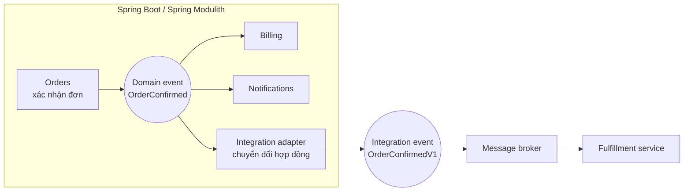
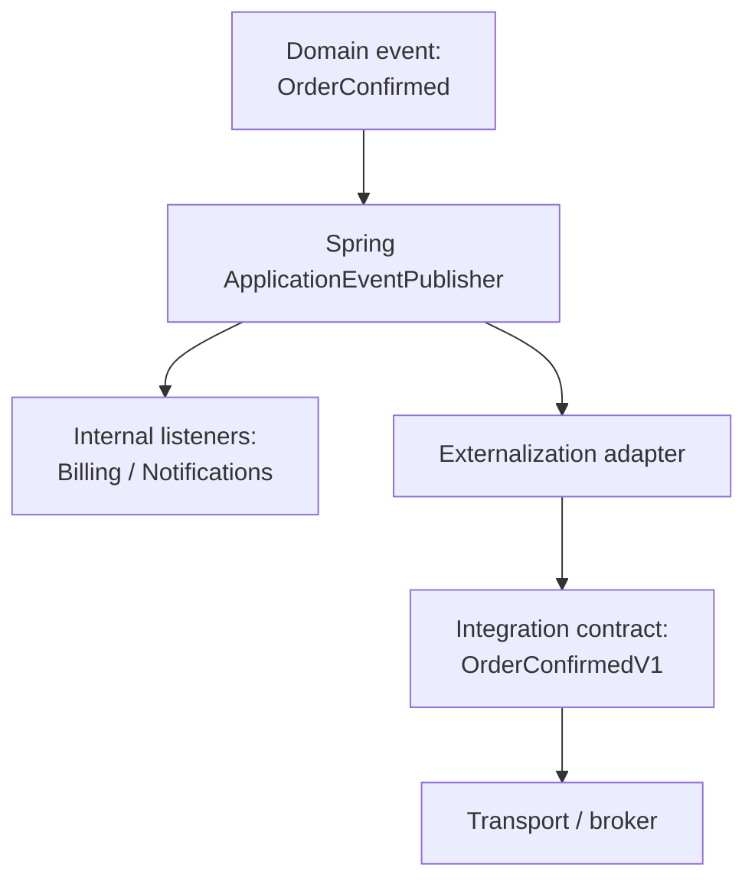
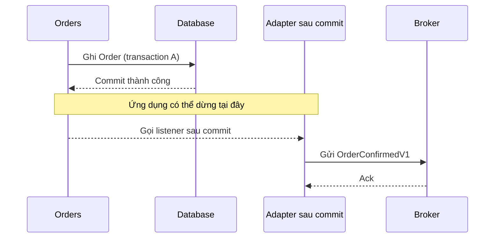
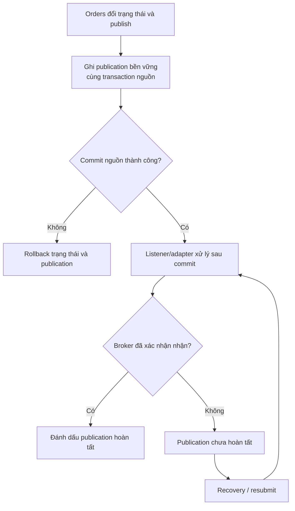
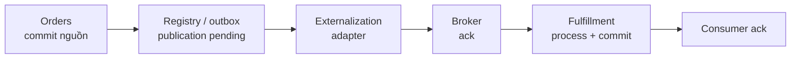

# Domain event và integration event

> **Chương:** Event nội bộ và tích hợp  
> **Học phần:** `SPRING_MODULITH_APPLICATION_EVENTS` — tổ chức giao tiếp giữa các module Spring Modulith bằng application events, giảm phụ thuộc trực tiếp và bảo vệ ranh giới nghiệp vụ; thực hành publisher, listener, xử lý sau commit, Event Publication Registry, retry, kiểm thử và quan sát việc giao sự kiện đáng tin cậy.

## 1. Một sự việc, hai ranh giới giao tiếp

Một ứng dụng thương mại điện tử có các application module `Orders`, `Billing` và `Notifications`. Sau khi đơn được xác nhận, Billing lập hóa đơn, Notifications gửi xác nhận. Ngoài ứng dụng còn có dịch vụ kho vận (Fulfillment) chạy trên tiến trình độc lập và cần nhận biết đơn đã được xác nhận.

Tại đây xuất hiện hai loại quan hệ:

1. **Bên trong miền nghiệp vụ hoặc ứng dụng:** Orders thông báo một sự thật đã xảy ra cho các module cùng ứng dụng.
2. **Vượt ranh giới ứng dụng:** hệ thống công bố một hợp đồng ổn định cho một dịch vụ bên ngoài, có thể qua Kafka, RabbitMQ hoặc cơ chế tích hợp khác.



**Domain event** ghi nhận một sự việc có ý nghĩa trong mô hình nghiệp vụ. **Integration event** là sự kiện được thiết kế như **hợp đồng trao đổi qua ranh giới hệ thống hoặc bounded context**, để các consumer không cùng triển khai nội bộ vẫn hiểu và xử lý được.

Hai loại có thể mô tả **cùng một sự việc**, nhưng không nhất thiết có cùng lớp Java, trường dữ liệu, thời điểm công bố, độ chi tiết hoặc cam kết giao nhận.

## 2. Domain event là gì?

Domain event mô tả **một sự thật nghiệp vụ đã phát sinh** trong một domain hoặc bounded context:

- `OrderConfirmed`: một đơn được xác nhận.
- `PaymentCaptured`: tiền được thu thành công.
- `StockReserved`: hàng tồn kho đã được giữ.
- `InvoiceIssued`: hóa đơn được phát hành.

Event được phát bởi thành phần **có thẩm quyền xác định sự thật đó**: Orders sở hữu `OrderConfirmed`, Payments sở hữu `PaymentCaptured`. Tên thường dùng thì quá khứ vì nó diễn tả **điều đã xảy ra**, không phải yêu cầu làm việc gì.

### 2.1. Ví dụ domain event trong Orders

```java
package com.acme.shop.orders.events;

import java.math.BigDecimal;
import java.time.Instant;
import java.util.UUID;

public record OrderConfirmed(
        UUID eventId,
        UUID orderId,
        BigDecimal confirmedAmount,
        String currency,
        Instant occurredAt
) {}
```

Các trường có ý nghĩa:

| Trường | Vai trò |
|---|---|
| `eventId` | Định danh một lần phát sinh sự kiện; giữ nguyên khi xử lý lại |
| `orderId` | Định danh aggregate/đối tượng nghiệp vụ |
| `confirmedAmount` | Giá trị đơn tại thời điểm xác nhận, nếu consumer thực sự cần snapshot này |
| `currency` | Đơn vị tiền tệ của giá trị đã xác nhận |
| `occurredAt` | Thời điểm logic nghiệp vụ nhận biết sự việc; không mặc định là commit timestamp |

Event nên bất biến, mang **ID và snapshot cần thiết**; tránh truyền trực tiếp entity JPA, repository, lazy proxy hoặc object graph của Orders cho module khác.

Một domain event **không cần** kế thừa `ApplicationEvent` của Spring. Khi ứng dụng dùng `ApplicationEventPublisher`, một `record` Java bình thường cũng có thể được phát.

### 2.2. Domain event không đồng nghĩa command

| Khái niệm | Ví dụ | Ý nghĩa |
|---|---|---|
| **Command** | `ConfirmOrder` | Yêu cầu Orders thử xác nhận đơn; có thể bị từ chối |
| **Domain event** | `OrderConfirmed` | Orders xác nhận rằng chuyển trạng thái nghiệp vụ đã xảy ra |
| **Query** | `GetOrderStatus` | Yêu cầu trả về thông tin hiện tại |

Nếu khách gửi `ConfirmOrder` nhưng đơn không đủ điều kiện xác nhận thì **không được** tạo `OrderConfirmed` chỉ vì method được gọi. Event phải phản ánh một sự việc có thật theo quy tắc domain.

## 3. Integration event là gì?

Integration event là thông điệp sự kiện dành cho **consumer nằm ngoài ranh giới triển khai hoặc sở hữu của producer**, thường qua broker hoặc hệ thống tích hợp. Nó cần hợp đồng dữ liệu và ngữ nghĩa có thể sử dụng **không phụ thuộc Java class nội bộ, database schema hoặc vòng đời triển khai của producer**.

Một integration event có thể chứa:

- **Tên loại và phiên bản hợp đồng:** ví dụ `orders.order-confirmed.v1`.
- **Định danh và thời điểm:** `eventId`, `occurredAt`, định danh đối tượng.
- **Dữ liệu cần thiết cho consumer:** snapshot gọn, đơn vị tiền tệ, trạng thái đã công bố.
- **Thông tin tương quan:** `correlationId`, `causationId` khi workflow cần.
- **Thông tin truyền tải:** topic/routing key, message key, content type, schema version theo kênh tích hợp.

Ví dụ hợp đồng tách khỏi Java domain model:

```java
package com.acme.shop.orders.integration;

import java.math.BigDecimal;
import java.time.Instant;
import java.util.UUID;

// Hợp đồng thông điệp bên ngoài phiên bản 1.
public record OrderConfirmedV1(
        UUID eventId,
        UUID orderId,
        String confirmedAmount,
        String currency,
        Instant occurredAt
) {}
```

Trong thực tế, consumer ngoài Java không cần biết record này. Hợp đồng chính có thể là **JSON Schema, Avro, Protobuf** hoặc định dạng đã thống nhất; lớp Java chỉ là một cách ánh xạ khi producer triển khai.

**Integration event không nhất thiết bằng việc “đẩy nguyên domain event ra Kafka”.** Domain event có thể chứa chi tiết chỉ phù hợp nội bộ. Contract bên ngoài có vòng đời và tiêu chí tương thích độc lập.

## 4. Bảng so sánh domain event và integration event

| Tiêu chí | Domain event | Integration event |
|---|---|---|
| Mục đích | Ghi nhận sự thật trong mô hình nghiệp vụ | Công bố sự thật qua ranh giới hệ thống/bounded context |
| Phạm vi chính | Domain/module hoặc các module cùng ứng dụng | Consumer bên ngoài ứng dụng hay triển khai độc lập |
| Chủ sở hữu | Module sở hữu sự thật nghiệp vụ | Producer/nhóm sở hữu hợp đồng tích hợp |
| Biểu diễn | Java record/value object là lựa chọn tự nhiên | Payload có schema độc lập ngôn ngữ |
| Độ chi tiết | Gần với ngôn ngữ và mô hình domain | Tối ưu cho nhu cầu và bảo mật của consumer bên ngoài |
| Versioning | Có thể tiến hóa cùng ứng dụng nếu chỉ dùng nội bộ | Phải xét consumer triển khai không đồng thời |
| Transport | Spring application event là một lựa chọn | Broker, HTTP/webhook, event stream hoặc cơ chế tích hợp |
| Transaction | Có thể phát trong transaction nghiệp vụ | Cần giải bài toán commit nguồn và gửi ra ngoài |
| Delivery | Phụ thuộc loại listener và registry được cấu hình | Phụ thuộc broker, cơ chế gửi, retry, acknowledgement |
| Độ tin cậy | Không mặc định bền vững chỉ vì là domain event | Không mặc định exactly-once chỉ vì qua broker |
| Bảo mật | Ranh giới module và quyền xử lý nội bộ | Ranh giới tin cậy, dữ liệu công khai, phân quyền consumer |

Phân loại này nói về **ý định và ranh giới hợp đồng**, không phải bắt buộc mỗi sự kiện phải có hai object. Với hệ thống nhỏ, cùng một loại event có thể đáp ứng cả hai vai trò nếu hợp đồng được thiết kế tương thích và duy trì ổn định; tuy nhiên cần đưa ra quyết định đó một cách có chủ đích.

## 5. Application event nằm ở đâu trong bức tranh?

Spring Framework dùng `ApplicationEventPublisher` để phát **application events** đến listener trong cùng `ApplicationContext`. Đây là **cơ chế phân phối**, không phải phân loại nghiệp vụ.

Một `OrderConfirmed` có thể đồng thời là:

1. **Domain event** vì mô tả việc đơn đã được xác nhận.
2. **Spring application event** vì được phát qua `ApplicationEventPublisher`.
3. **Hợp đồng liên module** nếu Billing nghe event đó qua phần API công khai của Orders.

**Nó chỉ trở thành integration event** theo nghĩa kiến trúc khi được dùng làm hợp đồng trao đổi qua ranh giới tích hợp tương ứng, chẳng hạn được chuyển đổi và phát ra broker.



Việc gọi `publishEvent` **không tự** gửi Kafka, không tự thực thi listener bất đồng bộ và không tự bảo đảm sẽ phát lại sau crash. Các tính chất này do cấu hình và hạ tầng quyết định.

## 6. Ranh giới module: ai công bố, ai được xem dữ liệu?

Trong Spring Modulith, mỗi application module sở hữu dữ liệu và hành vi của mình. Theo quy ước **closed module**, public types đặt ở base package là API mặc định; package con thường là nội bộ nếu không được xuất qua **named interface**.

Ví dụ:

```text
com.acme.shop
├── ShopApplication.java
├── orders
│   ├── events
│   │   ├── package-info.java
│   │   └── OrderConfirmed.java       # Domain event public cho module khác
│   ├── internal
│   │   ├── OrderService.java
│   │   └── OrderRepository.java
│   └── integration
│       ├── OrderConfirmedV1.java    # Contract chuyển ra bên ngoài
│       └── OrderEventRelay.java     # Adapter/bridge
├── billing
│   ├── package-info.java
│   └── internal
│       └── OrderConfirmedListener.java
└── notifications
    └── internal
        └── ConfirmationListener.java
```

Đánh dấu package domain event được phép truy cập:

```java
// orders/events/package-info.java
@org.springframework.modulith.NamedInterface("events")
package com.acme.shop.orders.events;
```

Giới hạn Billing chỉ phụ thuộc hợp đồng `orders::events`:

```java
// billing/package-info.java
@org.springframework.modulith.ApplicationModule(
        allowedDependencies = "orders::events"
)
package com.acme.shop.billing;
```

Billing được import `OrderConfirmed` từ API công khai. Nó **không được** import `orders.internal.OrderRepository` chỉ vì repository là `public` trong Java.

Integration adapter thuộc Orders có thể biết cả domain event và contract bên ngoài vì cùng module sở hữu nghiệp vụ. Nếu triển khai adapter ở module tích hợp riêng, cần công bố API liên module và quản lý phụ thuộc một cách tương ứng.

### 6.1. Đừng rò rỉ mô hình nội bộ qua integration event

Một hợp đồng không nên chứa:

```java
// Không phù hợp: exposing persistence model ra ngoài.
public record OrderConfirmedExternal(OrderJpaEntity order) {}
```

Consumer bên ngoài không nên phải hiểu quan hệ JPA, lazy-loading, tên trường DB hoặc giá trị chỉ dùng trong Orders. Hãy công bố **business identifier** và dữ liệu consumer cần, đi kèm ngữ nghĩa, đơn vị và version rõ ràng.

## 7. Phát domain event trong transaction nguồn

Ví dụ trong module Orders:

```java
package com.acme.shop.orders.internal;

import com.acme.shop.orders.events.OrderConfirmed;
import java.time.Clock;
import java.time.Instant;
import java.util.UUID;
import org.springframework.context.ApplicationEventPublisher;
import org.springframework.stereotype.Service;
import org.springframework.transaction.annotation.Transactional;

@Service
public class OrderService {

    private final OrderRepository orders;
    private final ApplicationEventPublisher events;
    private final Clock clock;

    public OrderService(
            OrderRepository orders,
            ApplicationEventPublisher events,
            Clock clock
    ) {
        this.orders = orders;
        this.events = events;
        this.clock = clock;
    }

    @Transactional
    public void confirm(UUID orderId) {
        Order order = orders.findById(orderId).orElseThrow();

        // Chỉ true khi thực sự có chuyển trạng thái hợp lệ.
        if (!order.confirmIfAllowed()) {
            return;
        }

        events.publishEvent(new OrderConfirmed(
                UUID.randomUUID(),
                order.getId(),
                order.getConfirmedAmount(),
                order.getCurrencyCode(),
                Instant.now(clock)
        ));
    }
}
```

Giả sử `Order` là entity được quản lý trong transaction. `confirmIfAllowed()` phải kiểm tra bất biến nghiệp vụ và xử lý trạng thái đã xác nhận; nếu yêu cầu bị lặp hoặc trạng thái không đổi, **không nên phát event mới**. Cần tính đến optimistic locking/concurrency để hai request không cùng tạo hai event cho một chuyển trạng thái.

Event được **publish trong transaction**, nhưng dữ liệu nguồn lúc đó chưa chắc đã commit. Vì vậy consumer có side effect độc lập — đặc biệt là adapter gửi broker — cần lựa chọn cơ chế **chỉ xử lý sau commit**.

## 8. Listener nội bộ và adapter tích hợp có trách nhiệm khác nhau

Billing xử lý event để tạo dữ liệu của Billing:

```java
package com.acme.shop.billing.internal;

import com.acme.shop.orders.events.OrderConfirmed;
import org.springframework.modulith.events.ApplicationModuleListener;
import org.springframework.stereotype.Component;

@Component
class OrderConfirmedListener {

    private final InvoiceService invoices;

    OrderConfirmedListener(InvoiceService invoices) {
        this.invoices = invoices;
    }

    @ApplicationModuleListener
    void on(OrderConfirmed event) {
        invoices.issueIfAbsent(event.orderId(), event.eventId());
    }
}
```

Adapter tích hợp nhận **cùng domain event**, rồi chủ động ánh xạ sang hợp đồng bên ngoài:

```java
package com.acme.shop.orders.integration;

import com.acme.shop.orders.events.OrderConfirmed;
import org.springframework.modulith.events.ApplicationModuleListener;
import org.springframework.stereotype.Component;

@Component
class OrderEventRelay {

    private final ExternalEventPort externalEvents;

    OrderEventRelay(ExternalEventPort externalEvents) {
        this.externalEvents = externalEvents;
    }

    @ApplicationModuleListener
    void on(OrderConfirmed domainEvent) {
        OrderConfirmedV1 integrationEvent = new OrderConfirmedV1(
                domainEvent.eventId(),
                domainEvent.orderId(),
                domainEvent.confirmedAmount().toPlainString(),
                domainEvent.currency(),
                domainEvent.occurredAt()
        );

        // Port do ứng dụng định nghĩa; adapter cụ thể gửi tới broker.
        externalEvents.publish(
                "orders.order-confirmed.v1",
                domainEvent.orderId().toString(),
                integrationEvent
        );
    }
}
```

Interface ví dụ cho port gửi thông điệp:

```java
package com.acme.shop.orders.integration;

public interface ExternalEventPort {

    /**
     * Chỉ trả về sau khi broker đã xác nhận nhận thông điệp,
     * hoặc ném exception khi gửi thất bại.
     */
    void publish(String destination, String messageKey, Object payload);
}
```

`ExternalEventPort` là **abstraction minh họa của ứng dụng**, không phải interface có sẵn trong Spring Modulith. Adapter Kafka/RabbitMQ cụ thể phải hiện thực nó và đảm bảo ý nghĩa acknowledgement được nêu trong contract; nếu method trả về trước khi broker xác nhận nhưng listener đã được đánh dấu hoàn tất, có thể xuất hiện khoảng trống gây mất thông điệp.

`@ApplicationModuleListener` của Spring Modulith kết hợp **transactional event listener sau commit**, xử lý **bất đồng bộ** và **transaction mới**. Cần bật/cấu hình async execution phù hợp, chẳng hạn `@EnableAsync` với executor giới hạn tài nguyên.

Đoạn mã trên minh họa đường đi, **chưa tự tạo broker adapter, message serializer, registry persistence hoặc recovery job**. Trong ứng dụng triển khai thật, cần cấu hình chúng riêng và kiểm thử failure paths.

## 9. Vì sao cần tách mapping domain → integration?

Nếu gửi nguyên `OrderConfirmed` ra ngoài, một thay đổi nhỏ trong domain model có thể thành thay đổi hợp đồng của mọi hệ thống tiêu thụ. Một lớp mapping cho phép mỗi bên tiến hóa có kiểm soát.

Ví dụ Orders sau này đổi cấu trúc nội bộ:

```text
Domain event phiên bản mới:
OrderConfirmed(eventId, orderId, pricingSnapshot, confirmedAt)

Integration contract vẫn giữ:
OrderConfirmedV1(eventId, orderId, confirmedAmount, currency, occurredAt)
```

Adapter lấy các giá trị ổn định từ `pricingSnapshot` và tạo integration payload tương thích. Consumer bên ngoài không cần triển khai cùng thời điểm với Orders.

| Quyết định thiết kế | Lợi ích | Đánh đổi |
|---|---|---|
| Dùng trực tiếp một event type nội bộ và bên ngoài | Ít code mapping; phù hợp hợp đồng nhỏ, ổn định | Domain bị ràng buộc với consumer bên ngoài |
| Tách domain event và integration event | Quản trị version, bảo mật, payload và tần suất thay đổi riêng | Tốn công mapping, test và tài liệu |
| Gộp nhiều domain events thành một integration event | Giảm nhiễu, tạo ngữ nghĩa phù hợp bên ngoài | Cần theo dõi trạng thái và thời điểm tổng hợp |
| Tách một domain event thành nhiều integration events | Phục vụ nhu cầu consumer khác nhau | Tăng số hợp đồng và vòng đời quản trị |

Với hệ thống có nhiều consumer độc lập hoặc dữ liệu nhạy cảm, tách mapping thường hữu ích. Với ứng dụng nhỏ và hợp đồng có thể kiểm soát hoàn toàn, việc dùng chung một record cũng có thể là lựa chọn hợp lệ.

### 9.1. Integration event không phải bản chụp toàn bộ database

Một event `OrderConfirmedV1` không nên chứa tất cả thông tin khách hàng, địa chỉ, token thanh toán hoặc thực thể JPA chỉ vì “sau này có thể cần”. Hãy cung cấp **tối thiểu dữ liệu có ngữ nghĩa ổn định**; dữ liệu nhạy cảm cần có cơ sở chia sẻ và chính sách bảo vệ.

Nếu Fulfillment cần địa chỉ giao hàng, cân nhắc hợp đồng tích hợp chuyên biệt cho Fulfillment hoặc cơ chế truy cập được phân quyền. Tránh biến event thành kênh phát tán dữ liệu cá nhân đến mọi consumer cùng topic.

## 10. Transaction và bài toán dual write

Xét cách triển khai không an toàn:

```java
@Transactional
public void confirm(UUID orderId) {
    orders.confirm(orderId);                  // Ghi database
    kafkaPublisher.send(orderConfirmedV1);    // Gửi broker ngay
}
```

Nếu broker nhận event thành công nhưng database rollback, hệ thống ngoài nhận `OrderConfirmedV1` cho một đơn thực tế **chưa confirmed**. Ngược lại, database có thể commit còn việc gửi broker thất bại, khiến Fulfillment không nhận được thông tin.

Đây là **dual-write problem**: hai hệ thống (database và broker) không tham gia một giao dịch nguyên tử thông thường.

### 10.1. Gửi sau commit giải quyết điều gì?

Một listener sau commit không gửi event cho transaction đã rollback. Tuy nhiên, **chỉ gửi sau commit trong bộ nhớ chưa đủ độ bền**: ứng dụng có thể dừng sau khi commit database nhưng trước khi listener kịp gửi.



Để đảm bảo công việc hậu commit **có thể được khôi phục**, cần thêm một trạng thái publication/outbox bền vững ghi cùng transaction nguồn.

### 10.2. Event Publication Registry và transactional outbox

Spring Modulith cung cấp **Event Publication Registry** để theo dõi publication dành cho transactional event listener khi đã cấu hình cơ chế lưu trữ tương ứng. Với một **persistent event publication store** và transaction đúng, những publication chưa hoàn tất có thể được phát hiện, xử lý lại theo chính sách.



Cách tiếp cận này gần với **transactional outbox**: ghi nhận ý định gửi thông điệp bền vững cùng việc thay đổi dữ liệu nguồn, rồi gửi ra ngoài sau đó.

Phân biệt:

- **Publication registry** là cơ chế cụ thể Spring Modulith dùng để quản lý publication cho các listener phù hợp.
- **Transactional outbox** là mẫu thiết kế tổng quát; một outbox triển khai độc lập có thể lưu một bản ghi tích hợp đã serialize và một worker/CDC sẽ chuyển tới broker.
- Tùy phiên bản, cấu hình externalization, serializer và loại publication store, cách Spring Modulith hiện thực đường đi có thể khác. Cần kiểm thử việc ghi cùng transaction, cách đánh dấu completion và khả năng resubmit trong stack đang dùng.

**Không khẳng định “exactly once” chỉ vì có registry hoặc broker.** Nếu broker đã nhận nhưng ứng dụng crash trước khi publication được đánh dấu hoàn tất, lần retry có thể gửi **lại cùng integration event**.

### 10.3. Bảng các điểm lỗi

| Điểm lỗi | Tình huống | Cách xử lý kỳ vọng |
|---|---|---|
| Trước commit DB | Orders rollback | Không gửi event ngoài; publication nguồn cũng rollback nếu ghi cùng transaction |
| Sau commit, trước khi gửi | Process crash | Publication bền vững còn chờ; recovery xử lý lại |
| Broker từ chối hoặc timeout | Không chắc đã nhận | Publication chưa hoàn tất và retry an toàn |
| Broker đã nhận, chưa kịp đánh dấu hoàn tất | Process crash | Có thể gửi lại; consumer phải idempotent |
| Listener xử lý rồi commit nhưng mất ack | Broker/consumer redelivery | Consumer dedup hoặc business idempotency |
| Schema event cũ không deserialize được | Triển khai code mới | Kiểm thử tương thích, migration hoặc chiến lược xử lý backlog |

Độ tin cậy của **internal Billing listener** và **externalization adapter** cần được đánh giá riêng; mỗi consumer có thể thành công hoặc thất bại độc lập.

## 11. Dùng khả năng event externalization của Spring Modulith

Ngoài việc tự viết adapter, Spring Modulith có **cơ chế event externalization** để chọn những application events cần đưa tới các hệ thống thông điệp hỗ trợ. Hướng tích hợp cụ thể (như Kafka, AMQP/RabbitMQ hoặc công nghệ được phiên bản đang dùng hỗ trợ) cần module dependency và cấu hình routing/serialization tương ứng.

Ở mức kiến trúc, quy trình gồm:

1. Publisher phát một application event trong transaction nguồn.
2. Cấu hình externalization **chọn những loại event được phép công bố ra ngoài**.
3. Hệ thống xác định destination/routing key và chuyển event thành dạng thông điệp phù hợp.
4. Sau commit, infrastructure gửi qua message broker.
5. Nếu có publication registry/persistent store phù hợp, publication chưa hoàn tất được theo dõi và có thể resubmit.

**Không externalize mọi domain event theo mặc định.** Một số sự kiện chứa thông tin nội bộ hoặc chỉ có ý nghĩa đối với một module. Dùng allowlist chọn event, áp dụng mapping hoặc projection sang hợp đồng tích hợp và định nghĩa rõ destination, schema, bảo mật.

Chẳng hạn, quyết định thiết kế có thể là:

```text
Internal event:   com.acme.shop.orders.events.OrderConfirmed
External event:   orders.order-confirmed.v1
Destination:      orders.confirmed.v1
Message key:      orderId
Payload:          OrderConfirmedV1
Consumer:         Fulfillment (hệ thống ngoài)
Reliability:      persistent publication store + recovery + consumer idempotency
```

Đây là **mẫu tài liệu cấu hình**, không phải một file YAML mà Spring Modulith tự đọc. API cấu hình, auto-configuration và cách mapping cụ thể cần kiểm tra theo phiên bản framework và integration adapter thực tế; tránh sao chép cú pháp từ một phiên bản khác mà chưa xác nhận.

### 11.1. Chọn giữa externalization tích hợp và adapter riêng

| Phương án | Khi phù hợp | Cần kiểm tra |
|---|---|---|
| Spring Modulith event externalization | Chọn event và định tuyến tới broker theo hạ tầng framework hỗ trợ | Version module, routing, serializer, registry, ack, recovery |
| Listener `@ApplicationModuleListener` + adapter | Cần logic chuyển đổi riêng, enrich, routing hoặc kiểm soát đặc biệt | Transaction, ack, lỗi, retry, ID ổn định |
| Outbox riêng + worker/CDC | Có yêu cầu tích hợp phức tạp, hạ tầng hoặc chính sách delivery riêng | Atomic write, polling/CDC, relay, dedup, vận hành |

Các lựa chọn có thể đạt mục tiêu tương tự nhưng **không được xem là tương đương về bảo đảm** nếu chưa kiểm thử crash, ack và retry thật.

## 12. Thiết kế integration event cho consumer triển khai độc lập

Một consumer ngoài ứng dụng có thể đang chạy phiên bản cũ khi producer triển khai phiên bản mới. Vì vậy integration event cần quy tắc **compatibility** rõ.

### 12.1. Đặt tên và version

Ví dụ:

```text
Event type:       orders.order-confirmed
Schema version:   1
Destination:      orders.confirmed.v1
Message key:      orderId
Event ID:         UUID
Time:             UTC / ISO-8601
Currency:         ISO 4217
```

Không có quy định bắt buộc version phải nằm trong tên topic. Có thể version trong schema/headers hoặc event type. Chọn một quy ước thống nhất theo công nghệ và chính sách vận hành.

### 12.2. Thay đổi tương thích và thay đổi phá vỡ hợp đồng

| Thay đổi | Nguy cơ | Cách kiểm soát |
|---|---|---|
| Thêm field tùy chọn | Consumer/serializer cũ có thể không chấp nhận field mới | Test backward/forward compatibility theo format |
| Xóa/đổi tên field | Consumer cũ mất dữ liệu bắt buộc | Version/migration hoặc giai đoạn chuyển tiếp |
| Đổi đơn vị tiền | Consumer tính sai dù parse thành công | Ghi units rõ, coi thay đổi semantics là breaking |
| Đổi ý nghĩa “confirmed” | Consumer hiểu sai trigger | Tạo event mới hoặc lộ trình chuyển đổi |
| Đổi định dạng timestamp | Parsing/độ chính xác khác | Schema rõ và test dữ liệu lịch sử |
| Đổi partition/message key | Thứ tự theo order thay đổi | Kiểm thử ordering và phân vùng |
| Thay đổi cách phát lại | Consumer có thể thấy thông điệp trùng | Duy trì eventId và idempotency |

**Event version khác aggregate version.** `schemaVersion` quản lý hợp đồng serialization; `aggregateVersion` biểu diễn thứ tự biến đổi của một aggregate nếu nghiệp vụ cần. Không được dùng `schemaVersion` để suy ra thứ tự xử lý đơn hàng.

### 12.3. Schema theo ví dụ JSON

Thông điệp gửi broker có thể được serialize như sau:

```json
{
  "eventType": "orders.order-confirmed",
  "schemaVersion": 1,
  "eventId": "120ca5b1-a9c0-46da-b786-3aa50c773a25",
  "orderId": "8a73a650-b1da-4513-b5aa-34caa5d64a9a",
  "confirmedAmount": "259900.00",
  "currency": "VND",
  "occurredAt": "2026-11-25T08:00:00Z"
}
```

Đây là **ví dụ payload**, không phải schema chuẩn do Spring Modulith bắt buộc. Trong ví dụ, adapter chuyển `BigDecimal` nội bộ sang chuỗi bằng `toPlainString()` để giữ biểu diễn decimal đã thống nhất; consumer cần quy định cách parse, đơn vị và quy tắc làm tròn. Không suy ra đặc tính chính xác chỉ từ JSON minh họa; phải có schema và test thực tế.

## 13. Identity, correlation và idempotency qua ranh giới

| Giá trị | Vai trò | Quy tắc gợi ý |
|---|---|---|
| `eventId` | Nhận diện một event instance | Giữ ổn định khi gửi lại cùng event |
| `orderId` | Business key | Dùng làm message key khi cần giữ thứ tự theo order |
| `correlationId` | Nối các bước cùng workflow | Không thay thế xác thực/quyền truy cập |
| `causationId` | Chỉ event/command trực tiếp gây ra sự kiện này | Cần khi chuỗi event dài |
| `traceId` | Theo dõi telemetry | Không dùng làm business idempotency key |
| `schemaVersion` | Diễn giải contract | Không dùng thay thứ tự aggregate |

Producer **có thể** duy trì cùng `eventId` từ domain event đến integration event nếu hai contract mô tả cùng một lần phát sinh. Nếu một domain event được chuyển thành nhiều integration events có ý nghĩa khác nhau, cần quy tắc identity rõ ràng; mỗi thông điệp logic có thể cần ID riêng, và giữ `causationId` để liên kết tới domain event gốc.

### 13.1. Consumer cần xử lý trùng

Ví dụ Fulfillment nhận hai lần `OrderConfirmedV1(eventId = E-42, orderId = O-9)` do retry. Tùy nghiệp vụ:

- Dùng bảng `processed_events(consumer_id, event_id)` có unique constraint.
- Đặt unique constraint cho tác vụ nghiệp vụ, ví dụ một lệnh giữ hàng cho mỗi `orderId` và loại nghiệp vụ phù hợp.
- Ghi “đã xử lý event” và side effect DB trong **cùng transaction** nếu có thể.
- Với tác vụ gửi sang dịch vụ khác, dùng idempotency key và chính sách bù trừ/đối soát.

Một cách chống trùng ở consumer (mã giả):

```text
transaction:
  if processed_events.contains(consumerId, eventId):
      return
  reserveInventoryIfAllowed(orderId)
  processed_events.insert(consumerId, eventId) // unique
commit
acknowledge message only after commit
```

**Cần xử lý race condition:** Hai consumer chạy song song có thể cùng thấy event chưa được xử lý. Ràng buộc unique, locking hoặc thao tác insert có tính nguyên tử phải bảo vệ dữ liệu, không chỉ một câu `exists(...)` trước khi ghi.

Không hứa “exactly once end-to-end” chỉ dựa vào cơ chế một broker; các tác dụng phụ DB và API ngoài vẫn cần bảo đảm riêng.

## 14. Thứ tự và nhất quán giữa các sự kiện

Nếu Orders phát `OrderConfirmed` và sau đó `OrderCancelled`, hệ thống ngoài có thể cần nhận biết **thứ tự theo cùng order**. Khi xử lý bất đồng bộ hoặc nhiều partition:

- Hai event có thể được gửi/nhận theo thứ tự khác nhau do retry hoặc concurrency.
- Không thể suy ra thứ tự tuyệt đối chỉ từ `occurredAt` nếu có nhiều nguồn clock.
- `orderId` làm message key có thể giúp giữ locality/ordering theo partition khi broker hỗ trợ, nhưng không tự giải quyết mọi trường hợp retry hay multi-producer.
- `aggregateVersion` hoặc sequence nghiệp vụ tăng đều theo aggregate có thể giúp consumer phát hiện event đến trễ hoặc thiếu, nếu được tạo đúng từ domain.

### 14.1. Ví dụ consumer không được cập nhật mù quáng

Giả sử Fulfillment đã xử lý `OrderCancelled(orderId=O-9, version=12)`. Nếu sau đó nhận lại `OrderConfirmed(orderId=O-9, version=11)`, không nên cập nhật trạng thái thành confirmed vì event này cũ hơn.

Consumer cần quy tắc:

1. Kiểm tra version/sequence nếu contract cung cấp.
2. Bỏ qua event cũ hơn trạng thái đã áp dụng.
3. Xác định cách xử lý **gap** (nhận version 13 khi chưa thấy 12).
4. Cân nhắc sự kiện bù trừ hoặc đồng bộ trạng thái khi thiếu event.

Những yêu cầu trên thuộc **ngữ nghĩa luồng tích hợp**; chỉ thêm annotation event listener không tự giải quyết.

## 15. Độ tin cậy và quan sát ở hai phía

Với giao tiếp giữa module và dịch vụ ngoài, hãy phân biệt các chỉ số ở từng đoạn:



| Điểm quan sát | Metric/log hữu ích | Ý nghĩa |
|---|---|---|
| Orders | `eventType`, `eventId`, `orderId`, `occurredAt` | Xác định nguồn phát và business trigger |
| Publication registry | Số publication chưa hoàn tất, tuổi lớn nhất, trạng thái lỗi | Nhận biết backlog nội bộ |
| Adapter/externalization | Lần thử, độ trễ, broker ack/fail | Chẩn đoán đoạn gửi ra ngoài |
| Broker | Lag, retry, partition, dead-letter theo hạ tầng | Phát hiện lỗi truyền tải |
| Fulfillment consumer | `eventId` đã xử lý, trạng thái, latency, side effect | Xác minh kết quả nghiệp vụ bên nhận |
| Toàn luồng | `correlationId`, trace context | Liên kết nguồn và đích qua nhiều bước |

Không đặt `eventId`, `orderId` hoặc `correlationId` làm label có cardinality rất cao trên metrics; chúng thích hợp trong logs/traces. Metric labels nên ưu tiên `eventType`, consumer, outcome, destination và nhóm lỗi có số giá trị giới hạn.

Khi event được gửi qua broker, tracing context có thể nằm trong message headers; lúc consumer xử lý async/restart, không mặc định MDC của HTTP request nguồn còn tồn tại. Các correlation ID cần cho nghiệp vụ nên là dữ liệu bền vững và được truyền nhất quán.

**Phân biệt ack của broker và xử lý xong của consumer:** Broker xác nhận đã nhận thông điệp **không chứng minh** Fulfillment đã giữ hàng hoặc ghi trạng thái thành công. Nên có metric và đối soát ở cả phía producer lẫn consumer.

## 16. Kiểm thử hợp đồng và những điểm lỗi cần chứng minh

Một ứng dụng có test đơn giản rằng publisher gọi `publishEvent(...)` vẫn chưa chứng minh integration event được gửi đúng hoặc có khả năng phục hồi.

### 16.1. Kiểm thử domain event và module boundary

Trong Spring Modulith, có thể dùng `@ApplicationModuleTest` và `PublishedEvents` để kiểm tra Orders phát domain event đúng:

```java
@ApplicationModuleTest
class OrderDomainEventTests {

    @Autowired
    OrderService orders;

    @Test
    void publishesOnValidTransition(PublishedEvents publishedEvents) {
        UUID orderId = createConfirmableOrder();
        orders.confirm(orderId);

        assertThat(publishedEvents.ofType(OrderConfirmed.class)
                .matching(OrderConfirmed::orderId, orderId))
                .hasSize(1);
    }

    private UUID createConfirmableOrder() {
        // Cần fixture thực tế của Orders trong dự án.
        throw new UnsupportedOperationException("Provide test fixture");
    }
}
```

Đây là **khung minh họa**, cần thêm fixture và imports phù hợp với dự án. Test trường hợp đơn đã confirmed, trạng thái không hợp lệ và concurrency để tránh tạo event không mong muốn.

Kiểm tra ranh giới module:

```java
@Test
void modulesRespectTheirBoundaries() {
    ApplicationModules.of(ShopApplication.class).verify();
}
```

Điều này kiểm tra phụ thuộc code theo mô hình Spring Modulith, **không tự chứng minh** event đã được gửi tới broker.

### 16.2. Kiểm thử adapter/domain-to-integration mapping

Với `OrderEventRelay`, kiểm tra rằng:

1. Một `OrderConfirmed` hợp lệ tạo đúng `OrderConfirmedV1`.
2. `eventId`, `orderId`, `currency` và `occurredAt` không bị đổi sai.
3. Destination và message key đúng hợp đồng.
4. Không đưa trường nhạy cảm hoặc entity nội bộ vào payload.
5. Contract mới đọc được dữ liệu cũ theo chính sách compatibility.

Ở mức unit test, có thể fake/mock `ExternalEventPort` để xác minh payload. Ở mức integration test, dùng hạ tầng broker hoặc test container thích hợp để kiểm tra routing, serialization và acknowledgement.

### 16.3. Kiểm thử commit, crash, retry và recovery

| Tình huống | Bảo đảm cần xác minh |
|---|---|
| Orders rollback | Không tạo side effect ngoài cho event chưa commit |
| Commit Orders, listener chưa kịp chạy | Publication còn tồn nếu đã cấu hình persistent store |
| Broker gửi thất bại | Publication không bị đánh dấu hoàn tất sai |
| Broker nhận, app crash trước completion | Resubmit có thể gửi trùng nhưng consumer idempotent |
| Listener/adapter retry cùng event | Dùng lại identity/contract, không tạo event logic mới |
| Consumer nhận trùng | Side effect nghiệp vụ đúng một lần theo khóa bảo vệ |
| Schema v1 còn tồn khi code v2 được deploy | Deserialization/migration hoạt động |
| Event đến sai thứ tự | Consumer xử lý version/sequence theo thiết kế |
| Broker ack nhưng consumer lỗi | Có cơ chế quan sát và retry phía consumer |

Với `@ApplicationModuleListener`, cần integration test có **commit transaction thật**, tránh trường hợp test tự bọc transaction rồi rollback khiến listener `AFTER_COMMIT` không chạy. Với async, chờ điều kiện bằng API `Scenario` của Spring Modulith hoặc cơ chế polling có thời hạn, thay vì `Thread.sleep(...)` cố định.

Với registry, dùng **persistence thực tế** và kiểm thử resubmit trên cùng dữ liệu còn tồn sau restart. Test chỉ mock một method `publish` không chứng minh recovery.

## 17. Khi nào không cần tạo integration event?

Không phải mọi domain event đều cần được gửi ra ngoài. Hãy cân nhắc:

| Trường hợp | Lựa chọn gợi ý |
|---|---|
| Billing phản ứng bên trong cùng Spring Modulith | Internal application/domain event với listener phù hợp |
| Notifications cũng là module trong cùng ứng dụng | Application event nội bộ có thể đủ |
| Fulfillment chạy riêng và cần biết đơn xác nhận | Integration event qua hạ tầng phù hợp |
| Hệ thống ngoài cần **truy vấn** trạng thái mới nhất theo yêu cầu | API query có thể thích hợp hơn sự kiện |
| Thông tin chỉ là chi tiết triển khai của Orders | Giữ event nội bộ, không externalize |
| Dịch vụ ngoài yêu cầu version/format ổn định | Dùng integration contract được quản trị |
| Workflow yêu cầu transaction nguyên tử với thao tác khác tiến trình | Đánh giá lại quy trình, saga/orchestration hoặc thiết kế bù trừ; broker event không tự tạo transaction phân tán |

Sự lựa chọn phụ thuộc vào **owner, mức nhất quán cần thiết, tần suất thay đổi, security boundary và thời gian sống độc lập của consumer**.

## 18. Các hiểu lầm phổ biến

| Hiểu lầm | Cách hiểu chính xác |
|---|---|
| “Domain event là tên khác của Spring application event” | Domain event là khái niệm nghiệp vụ; application event là cơ chế Spring để phân phối event |
| “Integration event phải là cùng object với domain event” | Có thể mapping hoặc dùng chung tùy hợp đồng và ranh giới |
| “Cứ gọi `publishEvent` là Kafka nhận event” | Cần externalization/adapter, destination và transport thực |
| “Gửi trong `@Transactional` sẽ rollback cả broker” | DB và broker thường không thuộc một transaction nguyên tử |
| “Listener sau commit là không thể mất event” | Crash giữa commit và dispatch vẫn là rủi ro nếu không persist publication |
| “Registry giúp exactly-once end-to-end” | Có thể retry và giao lại; consumer phải idempotent |
| “Broker ack nghĩa là Fulfillment đã xử lý xong” | Broker ack chỉ chứng minh một giai đoạn truyền tải |
| “Event có tên giống nhau là cùng ngữ nghĩa ở mọi hệ thống” | Mỗi bounded context có thể có thuật ngữ/định nghĩa riêng |
| “Đổi field Java là đủ để đổi schema của hệ thống ngoài” | Cần quản lý format, compatibility, serializer và consumer |
| “Consumer nhận event theo đúng thứ tự phát” | Async, partition, retry và concurrency có thể đảo thứ tự |
| “Integration event nên mang toàn bộ OrderEntity” | Làm lộ implementation, dữ liệu nhạy cảm và gây coupling |
| “Event Publication Registry là event sourcing store” | Registry theo dõi publication; event sourcing dùng chuỗi event làm nguồn trạng thái |

## 19. Bài thực hành: tách domain event khỏi integration event

**Bối cảnh:** ứng dụng Spring Boot/Spring Modulith có Orders, Billing và Notifications. Dịch vụ Fulfillment độc lập cần nhận sự kiện xác nhận đơn qua broker.

**Nhiệm vụ thực hành:**

1. Xác định owner của `OrderConfirmed` và diễn đạt chính xác điều kiện nghiệp vụ để phát.
2. Tạo immutable domain event `OrderConfirmed` trong API/named interface của Orders.
3. Cho `OrderService` phát domain event chỉ khi chuyển trạng thái hợp lệ trong transaction.
4. Viết `@ApplicationModuleListener` trong Billing để tạo invoice idempotent sau commit.
5. Tạo integration contract `OrderConfirmedV1` độc lập với entity và repository của Orders.
6. Viết adapter mapping `OrderConfirmed` sang `OrderConfirmedV1`, xác định destination và message key.
7. Tích hợp broker bằng Spring Modulith externalization hoặc một port/adapter có contract xác nhận gửi thành công.
8. Cấu hình persistent Event Publication Registry hoặc cơ chế outbox thích hợp, rồi xác định chính sách retry/recovery.
9. Đặt unique constraint, processed-event table hoặc khóa idempotency cho Fulfillment.
10. Viết test commit/rollback, mapping/schema, broker failure, crash, retry, message duplicate và ordering.
11. Ghi log theo `eventId`/`correlationId` và đặt metric/cảnh báo cho publication backlog, broker delivery và consumer lag.
12. Tài liệu hóa domain event, integration contract v1, owner, consumer, schema compatibility và quy trình deprecation.

### 19.1. Tiêu chí nghiệm thu

| Tiêu chí | Cách xác minh |
|---|---|
| Orders là nguồn sự thật của `OrderConfirmed` | Review domain + test publisher |
| Billing không phụ thuộc nội bộ Orders | `ApplicationModules.verify()` |
| Transaction Orders rollback không tạo event ngoài | Integration test rollback |
| Contract bên ngoài không chứa entity/chi tiết JPA | Contract review và test serializer |
| Lỗi gửi broker không bị đánh dấu hoàn tất sai | Test broker failure + registry |
| Publication tồn đọng được xử lý lại | Test persistent registry/recovery |
| Gửi trùng không làm Fulfillment giữ hàng trùng | Test idempotency và unique constraint |
| v1 còn đọc được khi code producer nâng phiên bản | Compatibility test với payload lịch sử |
| Có thể truy được nơi xử lý hỏng | Log, metric, tracing và đối soát producer/consumer |

### Câu hỏi tự kiểm tra

1. Domain event khác integration event ở **mục đích** và **ranh giới hợp đồng** như thế nào?
2. Vì sao `OrderConfirmed` có thể vừa là domain event vừa là Spring application event?
3. Trường hợp nào nên tạo `OrderConfirmedV1` riêng thay vì gửi thẳng `OrderConfirmed` ra broker?
4. Vì sao việc gửi broker ngay trong transaction DB là rủi ro dual write?
5. Listener `AFTER_COMMIT` giải quyết gì và vẫn còn khoảng trống nào khi process crash?
6. Event Publication Registry và transactional outbox giống, khác nhau ở điểm nào?
7. Vì sao broker acknowledgement không chứng minh consumer đã xử lý nghiệp vụ?
8. Khi broker gửi lại event, vì sao `eventId` phải ổn định và consumer cần idempotency?
9. `schemaVersion` có thể dùng thay `aggregateVersion` để kiểm tra thứ tự không?
10. Những kiểm thử nào mới chứng minh được integration event có khả năng khôi phục sau lỗi?

## 20. Ghi nhớ

**Domain event** công bố một **sự thật thuộc miền nghiệp vụ**; **integration event** trình bày sự thật đó thành một **hợp đồng ổn định để trao đổi qua ranh giới hệ thống**. Spring application events là cơ chế truyền sự kiện trong ứng dụng và có thể được dùng để phân phối domain events giữa các application module của Spring Modulith.

Muốn giao event ra ngoài đáng tin cậy, cần quyết định rõ **owner, mapping contract, ranh giới commit, độ bền của publication, retry, idempotency, versioning, thứ tự xử lý và observability**. Spring Modulith có các cơ chế hỗ trợ như `@ApplicationModuleListener`, Event Publication Registry và event externalization, nhưng việc cấu hình persistence/broker, kiểm thử crash và xử lý trùng vẫn là trách nhiệm của hệ thống.

### Tài liệu tham khảo

- [Spring Modulith — Working with Application Events](https://docs.spring.io/spring-modulith/reference/events.html): giao tiếp sự kiện, transactional listeners, Event Publication Registry và event externalization.
- [Spring Modulith — Fundamentals](https://docs.spring.io/spring-modulith/reference/fundamentals.html): application modules, API boundaries, named interfaces và phụ thuộc giữa module.
- [Spring Framework — Standard and Custom Events](https://docs.spring.io/spring-framework/reference/core/beans/context-introduction.html#context-functionality-events): `ApplicationEventPublisher` và `@EventListener`.
- [Spring Framework — Transaction-bound Events](https://docs.spring.io/spring-framework/reference/data-access/transaction/event.html): các pha xử lý `@TransactionalEventListener`.
