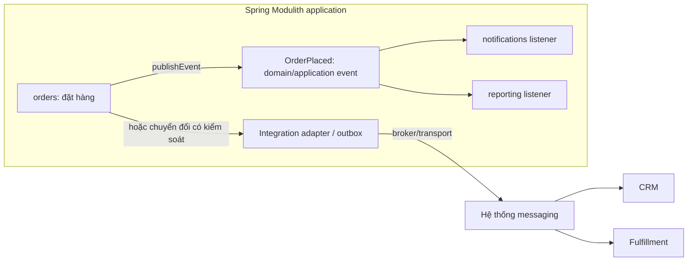
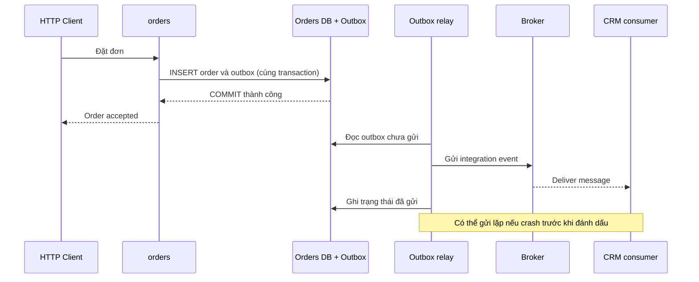
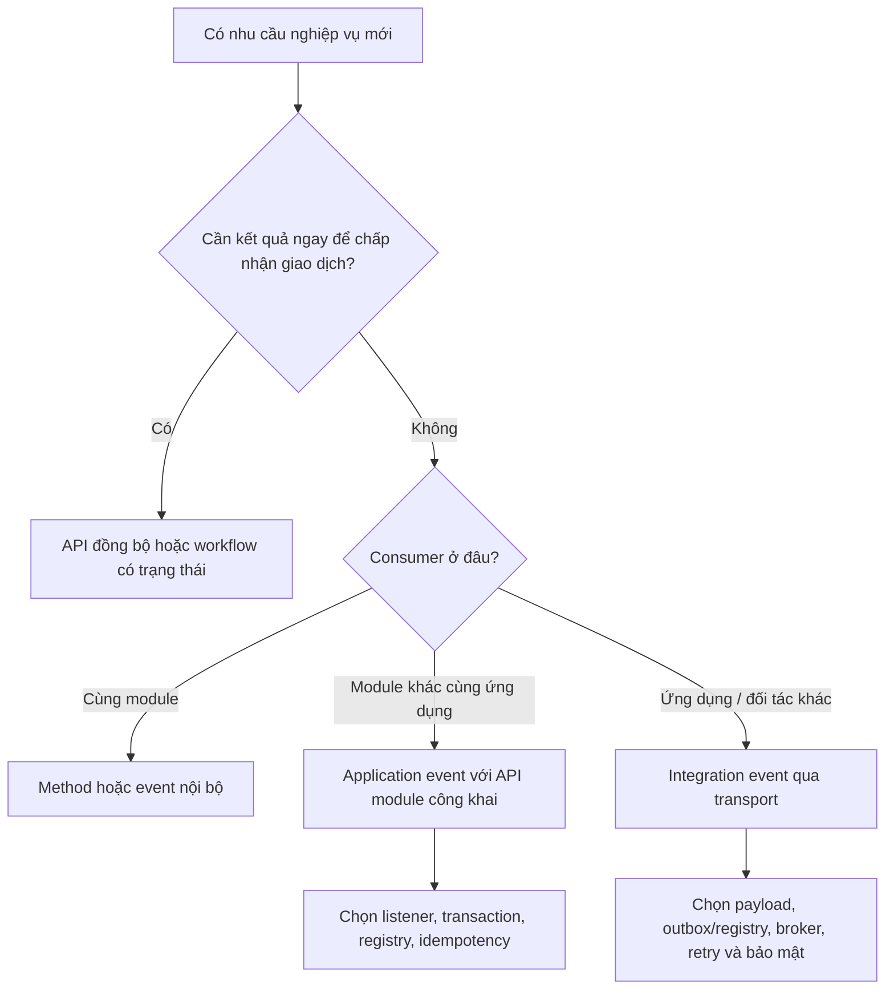

# Chọn phạm vi phát hành: event nội bộ và integration event trong Spring Modulith

## 1. Vì sao cần quyết định phạm vi phát hành?

Trong mô hình **Spring Modulith Application Events** (`SPRING_MODULITH_APPLICATION_EVENTS`), các module có thể thông báo thay đổi nghiệp vụ qua application events thay vì gọi trực tiếp chi tiết triển khai của nhau. Ví dụ, khi `orders` hoàn thành một đơn hàng, `notifications` cần gửi thư và `reporting` cần cập nhật số liệu. Khi đó, một sự kiện `OrderPlaced` có thể giúp hai module phản ứng độc lập.

Nhưng cùng một sự thật nghiệp vụ có thể còn được hệ thống CRM, đối tác vận chuyển hoặc dịch vụ tính hoa hồng ở ứng dụng khác quan tâm. Nếu phát tất cả event ra ngoài ngay từ đầu, ứng dụng sẽ làm lộ những thay đổi nội bộ, tăng lượng thông điệp và phải hỗ trợ các hợp đồng bên ngoài không cần thiết. Nếu chỉ giữ event trong tiến trình, các hệ thống khác lại không thể nhận dữ liệu qua cơ chế này.

**Chọn phạm vi phát hành** là quyết định **ai được nhận thông tin sự kiện, qua ranh giới nào và với những cam kết giao nhận nào**. Quyết định ấy cần dựa trên nhu cầu nghiệp vụ và kiến trúc, không dựa đơn thuần vào việc một class có `public` hay listener có `@Async`.

Ba phạm vi thường gặp:

1. **Trong một module:** Sự kiện chỉ được một số thành phần cùng module sử dụng về mặt thiết kế; ví dụ tái tính toán dữ liệu dẫn xuất trong `orders`.
2. **Giữa các module trong cùng ứng dụng:** Event là hợp đồng giữa `orders`, `notifications` và `reporting`, nhưng vẫn được phát qua cơ chế application events **trong cùng Spring application context**.
3. **Giữa các hệ thống:** Integration event được đưa qua broker, outbox/relay hoặc một cơ chế truyền bên ngoài để ứng dụng khác có thể nhận và xử lý.

Điểm cần nhớ: hai phạm vi đầu tiên đều có thể dùng Spring application events. Spring `ApplicationEventPublisher` **không có sẵn một chế độ tự giới hạn phát tới đúng một module**; listener phù hợp trong cùng application context có thể được gọi. Ranh giới module được duy trì bằng API, quy ước phụ thuộc và kiểm tra kiến trúc, không phải bằng một bộ lọc runtime mặc định cho từng module.

## 2. Phân biệt ranh giới module và ranh giới hệ thống

Trong một modular monolith, các module là **đơn vị tổ chức nghiệp vụ và phụ thuộc mã nguồn**; chúng thường vẫn cùng một quá trình Java. Khi chuyển sang một ứng dụng khác, event đi qua **ranh giới tiến trình và triển khai**, có thêm những vấn đề về mạng, broker, schema, bảo mật, theo dõi và vận hành.

| Tiêu chí | Application event nội bộ | Integration event bên ngoài |
| --- | --- | --- |
| Đối tượng nhận | Listener của các module trong cùng Spring application context | Consumer ở tiến trình, ứng dụng, dịch vụ hoặc tổ chức khác |
| Kênh phổ biến | `ApplicationEventPublisher`, `@EventListener`, transactional listener | Broker, event transport, outbox và relay, gateway tích hợp |
| Payload | Java object/event contract nội bộ | Thông điệp phải có định dạng và schema phù hợp kênh truyền |
| Phụ thuộc | Phụ thuộc Java API và ngữ nghĩa nghiệp vụ | Phụ thuộc schema, định tuyến, phiên bản, bảo mật, delivery semantics |
| Transaction | Có thể gắn với transaction database của publisher qua cơ chế listener | Không có transaction database chung tự động giữa các tiến trình |
| Độ trễ | Có thể đồng bộ hoặc bất đồng bộ | Thường bất đồng bộ nhưng có thể có các cách kết nối khác |
| Thứ tự/độ bền | Phụ thuộc listener, registry và cấu hình | Phụ thuộc outbox, broker, partition, consumer và cấu hình |
| Thay đổi contract | Các module có thể triển khai cùng phiên bản ứng dụng | Nhiều consumer có thể nâng cấp độc lập, cần chiến lược tương thích |

**Nội bộ hay tích hợp là phân loại theo ranh giới sở hữu/triển khai, không phải theo tốc độ hoặc thread.** Một `@ApplicationModuleListener` chạy bất đồng bộ vẫn là listener nội bộ ứng dụng. Một lời gọi HTTP đồng bộ tới đối tác vẫn là tích hợp hệ thống bên ngoài dù không dùng event.

Sơ đồ minh họa hai tuyến phát hành:



Đường truyền ra ngoài chỉ nên tồn tại khi có nhu cầu nhận ở bên ngoài. **Không mặc định công bố mọi event** chỉ vì ứng dụng đã dùng broker.

## 3. Cách quyết định phạm vi: hỏi ai sở hữu nhu cầu

Khi xuất hiện một sự kiện nghiệp vụ, hãy trả lời theo thứ tự:

1. **Ai thật sự cần biết?** Chỉ một service nội bộ, vài module trong cùng ứng dụng, hay một ứng dụng/đối tác khác?
2. **Kết quả có phải điều kiện hoàn tất giao dịch không?** Nếu bắt buộc có kết quả ngay, có thể cần một lời gọi đồng bộ hoặc quy trình điều phối, thay vì một event xử lý muộn.
3. **Consumer cần dữ liệu tại thời điểm sự kiện hay trạng thái hiện tại?** Nếu chỉ cần tra cứu dữ liệu hiện tại, một ID có thể đủ. Nếu cần lịch sử chính xác, cân nhắc snapshot.
4. **Ai chịu trách nhiệm vận hành consumer và nâng cấp contract?** Consumer ngoài ứng dụng hoặc do đội khác sở hữu cần hợp đồng ổn định hơn.
5. **Nếu consumer bị tắt hoặc hệ thống phát restart, phải làm gì?** Với tích hợp bên ngoài thường cần lưu thông điệp bền vững, retry, idempotency, quan sát tồn đọng và đối soát.
6. **Dữ liệu có được phép rời ranh giới ứng dụng không?** Kiểm tra bí mật, dữ liệu cá nhân, quyền truy cập và giới hạn thông tin theo bên nhận.

Ví dụ trong một cửa hàng:

| Nhu cầu | Phạm vi nên cân nhắc | Lý do |
| --- | --- | --- |
| Cập nhật giá trị tính toán phụ của aggregate đơn hàng | Nội bộ `orders` | Không có consumer liên module cần contract này |
| Gửi email xác nhận từ `notifications` cùng ứng dụng | Event giữa các module | Module gửi thư phản ứng sau commit, không buộc `orders` biết implementation |
| Cập nhật báo cáo từ `reporting` cùng ứng dụng | Event giữa các module | Chấp nhận eventual consistency và retry có kiểm soát |
| Đồng bộ CRM ở ứng dụng độc lập | Integration event | Vượt ranh giới tiến trình và vòng đời triển khai |
| Giao thông tin đơn hàng cho đối tác vận chuyển | Integration event có chọn lọc | Cần một contract dữ liệu rõ, phù hợp quyền truy cập của đối tác |
| Kiểm tra tồn kho bắt buộc trước khi chấp nhận đặt hàng | API đồng bộ hoặc workflow điều phối | Việc chấp nhận đơn phụ thuộc trực tiếp kết quả kiểm tra/giữ hàng |

Không có quy tắc “một nghiệp vụ chỉ được có một loại event”. Cùng một sự thật có thể có **domain event nội bộ** và **integration event được thiết kế riêng** nếu nội dung và yêu cầu giao nhận khác nhau.

## 4. Phạm vi thứ nhất: event dùng trong một module

Ví dụ module `orders` cần làm mới một thống kê nội bộ khi địa chỉ giao hàng của đơn đổi. Nếu công việc này không liên quan module khác, không cần công khai một sự kiện cho toàn ứng dụng.

```java
// File: com/example/shop/orders/internal/ShippingAddressChanged.java
package com.example.shop.orders.internal;

import java.util.UUID;

record ShippingAddressChanged(UUID orderId) {}
```

Một listener cùng package nội bộ có thể xử lý:

```java
// File: com/example/shop/orders/internal/ShippingProjectionListener.java
package com.example.shop.orders.internal;

import org.springframework.context.event.EventListener;
import org.springframework.stereotype.Component;

@Component
class ShippingProjectionListener {
    private final ShippingProjection projection;

    ShippingProjectionListener(ShippingProjection projection) {
        this.projection = projection;
    }

    @EventListener
    void on(ShippingAddressChanged event) {
        projection.refresh(event.orderId());
    }
}
```

`ShippingProjection` là abstraction minh họa do `orders` sở hữu. Bản ghi `ShippingAddressChanged` ở package nội bộ, có mức truy cập package-private; các module khác không nên phụ thuộc vào kiểu này.

**Giới hạn cần hiểu:** Nếu dùng `ApplicationEventPublisher.publishEvent(...)` để phát object này, sự kiện vẫn đi qua cơ chế events của application context, **không phải hàng đợi riêng của module `orders`**. Kiểu package-private và kiểm tra ranh giới giúp giữ contract nội bộ ở mức thiết kế; chúng không phải cơ chế an ninh runtime. Khi thật sự cần hạn chế người nghe hoặc dữ liệu, cần thiết kế cách phân phối và quyền truy cập tương ứng.

Đôi khi một lời gọi method trực tiếp trong module đơn giản và rõ nghĩa hơn tạo event. Ví dụ, nếu cập nhật thống kê phải thành công trong cùng một transaction để giữ bất biến, method đồng bộ thường dễ kiểm soát lỗi và transaction hơn.

## 5. Phạm vi thứ hai: event giữa các module cùng ứng dụng

Khi `orders` muốn thông báo “đơn hàng đã được đặt” cho `notifications` và `reporting`, một event công khai có thể đóng vai trò contract giữa các module.

### 5.1. Event công khai do module phát sở hữu

```java
// File: com/example/shop/orders/OrderPlaced.java
package com.example.shop.orders;

import java.time.Instant;
import java.util.Objects;
import java.util.UUID;

public record OrderPlaced(UUID eventId, UUID orderId, Instant occurredAt) {
    public OrderPlaced {
        Objects.requireNonNull(eventId, "eventId");
        Objects.requireNonNull(orderId, "orderId");
        Objects.requireNonNull(occurredAt, "occurredAt");
    }
}
```

Trong convention mặc định của Spring Modulith, kiểu event ở **base package** của module `orders` là thành phần API mà module khác có thể tham chiếu. Nếu đặt kiểu event trong một subpackage như `orders.events`, có thể công khai nó bằng `@NamedInterface` phù hợp và ràng buộc `allowedDependencies`.

### 5.2. Phát sự kiện trong transaction đặt hàng

```java
// File: com/example/shop/orders/internal/OrderService.java
package com.example.shop.orders.internal;

import com.example.shop.orders.OrderPlaced;
import java.time.Clock;
import java.time.Instant;
import java.util.UUID;
import org.springframework.context.ApplicationEventPublisher;
import org.springframework.stereotype.Service;
import org.springframework.transaction.annotation.Transactional;

@Service
class OrderService {
    private final OrderRepository repository;
    private final ApplicationEventPublisher events;
    private final Clock clock;

    OrderService(OrderRepository repository, ApplicationEventPublisher events, Clock clock) {
        this.repository = repository;
        this.events = events;
        this.clock = clock;
    }

    @Transactional
    public UUID place(PlaceOrderCommand command) {
        var created = repository.create(command);
        var event = new OrderPlaced(
                UUID.randomUUID(), created.id(), Instant.now(clock));
        events.publishEvent(event);
        return created.id();
    }
}
```

`OrderRepository`, `PlaceOrderCommand` và `Clock` bean là các thành phần minh họa phải được định nghĩa/cấu hình trong ứng dụng cụ thể. Mã cho thấy module phát **không cần biết listener nào tồn tại**.

Lưu ý: `publishEvent` được gọi **khi transaction đang mở**. Một listener thông thường với `@EventListener` mặc định có thể chạy ngay lúc publish, trước commit; nếu ném exception, nó có thể làm lỗi transaction của publisher. Đây là lựa chọn semantics cần cân nhắc, không phải mặc định “fire-and-forget”.

### 5.3. Listener xử lý sau commit

```java
// File: com/example/shop/notifications/internal/OrderEmailListener.java
package com.example.shop.notifications.internal;

import com.example.shop.orders.OrderPlaced;
import org.springframework.modulith.events.ApplicationModuleListener;
import org.springframework.stereotype.Component;

@Component
class OrderEmailListener {
    private final ConfirmationSender sender;

    OrderEmailListener(ConfirmationSender sender) {
        this.sender = sender;
    }

    @ApplicationModuleListener
    void on(OrderPlaced event) {
        sender.sendOnce(event.eventId(), event.orderId());
    }
}
```

`@ApplicationModuleListener` là tiện ích của Spring Modulith dành cho listener bất đồng bộ, kích hoạt sau commit và thực thi trong transaction riêng. `ConfirmationSender.sendOnce(...)` là API minh họa: muốn tránh gửi email trùng sau retry, implementation phải có idempotency key hoặc đối soát với hệ thống gửi.

Event này vẫn **nội bộ ứng dụng** dù listener xử lý bất đồng bộ. Nếu dùng Event Publication Registry đã được cấu hình phù hợp, các publication tới transactional listener được hỗ trợ có thể được theo dõi và xử lý lại nếu chưa hoàn tất. Registry không tự bảo đảm việc gửi email chỉ xảy ra một lần hay tự tạo kênh liên tiến trình.

## 6. Phạm vi thứ ba: integration event ra hệ thống khác

Giả sử CRM và hệ thống vận chuyển được triển khai riêng. Chúng không có cùng `ApplicationContext` với ứng dụng bán hàng, nên sẽ **không tự nhận** `OrderPlaced` do `ApplicationEventPublisher` phát. Cần một cơ chế phân phối như message broker hoặc integration service.

Một lựa chọn dễ kiểm soát là định nghĩa **integration event riêng** cho người nhận bên ngoài:

```java
// Ví dụ DTO công khai cho integration adapter, không phải kiểu bắt buộc của framework.
package com.example.shop.orders.integration;

import java.time.Instant;
import java.util.UUID;

public record OrderPlacedV1(
        UUID eventId,
        UUID orderId,
        Instant occurredAt,
        String eventType,
        int schemaVersion
) {}
```

Ở đây payload cố tình chỉ có các field được phép chia sẻ. Với đối tác cần địa chỉ giao hàng, có thể thiết kế **một contract chuyên biệt theo quyền truy cập của đối tác**, thay vì đặt toàn bộ dữ liệu khách hàng vào mọi event.

### 6.1. Chuyển đổi contract là một bước kiến trúc

```text
Domain/application event nội bộ
    OrderPlaced(eventId, orderId, occurredAt)
        |
        | mapping, kiểm tra dữ liệu được phép, schema version
        v
Integration event
    OrderPlacedV1(eventId, orderId, occurredAt, eventType, schemaVersion)
        |
        | serialize + route
        v
Broker/topic/queue → External consumer
```

Việc tách hai kiểu giúp thay đổi chi tiết của ứng dụng bên trong mà không mặc nhiên buộc consumer ngoài nâng cấp. Một thay đổi schema của integration event phải được kiểm tra tương thích theo lịch triển khai độc lập của consumer.

Không phải lúc nào cũng cần tạo hai class. Nếu domain event đã là một contract nhỏ, ổn định, không chứa dữ liệu cần che giấu và có chính sách versioning phù hợp, hệ thống có thể chọn externalize chính nó. Nhưng quyết định này cần **chủ động đánh giá**, vì từ thời điểm công bố ra ngoài, contract trở thành trách nhiệm dài hạn.

### 6.2. Event Externalization trong Spring Modulith

Spring Modulith có các khả năng **Event Externalization** khi tích hợp module và transport phù hợp: lựa chọn những application events được phép đưa ra ngoài, ánh xạ/routing sang hệ thống messaging và phối hợp với cơ chế theo dõi publication theo cấu hình. Việc sử dụng trực tiếp API, annotation, event selector và routing expression phụ thuộc phiên bản Spring Modulith và công nghệ transport đang triển khai.

Để áp dụng an toàn, cần xác định rõ:

- **Danh sách event được externalize**: chỉ event có consumer bên ngoài hoặc use case được phê duyệt; không chọn cả package nội bộ một cách tùy tiện.
- **Destination/routing**: topic, queue hoặc routing key thể hiện contract tích hợp, không để tên class Java ngẫu nhiên trở thành contract vĩnh viễn.
- **Payload mapping**: chọn field được phép chia sẻ, phiên bản schema, encoding và headers cần thiết.
- **Durability và recovery**: xác minh cấu hình broker adapter, lưu publication, hành vi retry và quyền sở hữu việc phát lại.
- **Observability**: log/correlation ID, số publication tồn đọng, sự kiện lỗi, độ trễ và cảnh báo.

Không nên xem việc thêm annotation externalization là chứng minh đã đạt atomicity giữa business database và broker. Cần kiểm thử **thời điểm ghi nhận việc phát**, **thất bại ở adapter**, **restart** và **việc gửi lại** trên stack thật.

## 7. Bảo đảm không mất event khi đi qua ranh giới hệ thống

Với integration event, một lỗi kinh điển là:

1. Transaction tạo đơn **commit** thành công.
2. Ứng dụng chưa kịp gửi event ra broker thì **crash**.
3. CRM không biết đơn đã được đặt.

Đảo thứ tự cũng không giải quyết được: nếu gửi ra broker trước rồi transaction tạo đơn rollback, bên ngoài có thể thấy một đơn hàng chưa từng được chấp nhận.

### 7.1. Transactional outbox

Một phương án thường dùng là lưu thông điệp integration event vào **outbox trong cùng database transaction với thay đổi nghiệp vụ**, rồi để một relay riêng gửi thông điệp ra broker:



Ví dụ Java bên dưới minh họa **interface outbox do ứng dụng tự xây dựng**, không khẳng định đây là API có sẵn trong Spring Modulith:

```java
@Service
class PlaceOrderUseCase {
    private final OrderRepository orders;
    private final IntegrationOutbox outbox;

    PlaceOrderUseCase(OrderRepository orders, IntegrationOutbox outbox) {
        this.orders = orders;
        this.outbox = outbox;
    }

    @Transactional
    public UUID place(PlaceOrderCommand command) {
        var created = orders.create(command);
        var integrationEvent = new OrderPlacedV1(
                UUID.randomUUID(),
                created.id(),
                created.placedAt(),
                "order.placed",
                1
        );
        outbox.insert(integrationEvent); // Ghi trong cùng DB transaction
        return created.id();
    }
}
```

Đây là một **phương án kiến trúc**, không phải thay thế bắt buộc cho Spring Modulith Event Publication Registry. Nếu dùng một outbox tự xây, `outbox.insert(...)` phải thực sự lưu vào cùng database/transaction; lưu sang một database khác hoặc gửi HTTP bên trong method trên sẽ **không** bảo đảm atomicity mong muốn.

Khi relay gửi broker thành công nhưng crash trước khi đánh dấu outbox đã gửi, thông điệp có thể được gửi lại. Vì vậy transactional outbox thường cung cấp cách **tránh mất thông điệp ở khoảng trống giữa business commit và gửi**, nhưng vẫn yêu cầu **idempotent consumer**, xử lý duplicate và giám sát backlog.

### 7.2. Event Publication Registry và outbox khác nhau thế nào?

| Thành phần | Mục tiêu chính | Điều cần xác minh |
| --- | --- | --- |
| Spring Modulith Event Publication Registry | Theo dõi publication tới listener giao dịch được hỗ trợ, phục vụ nhận diện và xử lý lại publication chưa hoàn tất | Backend lưu publication, transaction, listener được theo dõi, cơ chế retry/resubmission theo phiên bản |
| Transactional outbox | Ghi ý định gửi integration event **cùng transaction nghiệp vụ**, relay chuyển tới hệ thống ngoài | Outbox và business cùng DB transaction, relay an toàn, delivery/ack, deduplication |
| Message broker | Truyền và lưu/định tuyến thông điệp theo đặc tính transport | Độ bền, ack, retention, retry, partition, consumer groups, ACL |

Các cơ chế có thể liên quan hoặc được tích hợp với nhau, nhưng **không phải ba tên gọi cho cùng một tính năng**. Không hứa “giao đúng một lần” chỉ vì đã sử dụng một trong số đó. Chỉ kết luận về độ bền sau khi kiểm thử cấu hình thực tế cùng các tình huống crash.

## 8. Chọn lọc dữ liệu khi phát ra ngoài

Event nội bộ phục vụ nhu cầu trong cùng ứng dụng; integration event vượt một ranh giới bảo mật và tổ chức. Payload xuất bản ngoài cần được xem như **hợp đồng public có kiểm soát**.

Ví dụ `OrderPlaced` nội bộ có thể chứa thông tin cần cho billing/analytics, nhưng CRM chỉ cần `orderId`, `customerId` và thời điểm chấp nhận. Đối tác vận chuyển có thể cần địa chỉ giao, nhưng không có lý do biết cách tính mức chiết khấu nội bộ.

| Dữ liệu | Event nội bộ | Integration event |
| --- | --- | --- |
| `orderId`, `eventId` | Thường hữu ích | Thường hữu ích để correlation/dedup |
| Snapshot số tiền/đơn vị tiền | Khi consumer nghiệp vụ cần | Chỉ gửi tới consumer được phép và cần |
| Email, địa chỉ, số điện thoại | Cần xem xét quyền dữ liệu ngay cả trong ứng dụng | Chỉ chia sẻ khi có mục đích rõ, biện pháp bảo vệ và kiểm soát truy cập |
| JPA entity, lazy proxy | Không nên làm contract giữa các module | Không được dùng làm payload tích hợp |
| Access token, password, session cookie | Không thuộc event contract nghiệp vụ | Không bao giờ đưa vào integration payload |
| Internal debug fields, stack traces | Không nên là API module | Không công bố ra ngoài |

Cần quan tâm thêm tới **tenant isolation**, phân quyền consumer/topic, mã hóa khi truyền/lưu theo yêu cầu, thời gian giữ dữ liệu và cách xóa/thu hồi dữ liệu theo chính sách. Không dùng tên package hoặc `public` của Java như một cơ chế kiểm soát quyền truy cập.

## 9. Versioning và quyền nâng cấp độc lập

Trong cùng modular monolith, các module thường được build và deploy cùng nhau; thay đổi Java event có thể được compiler và `ApplicationModules.verify()` giúp phát hiện. Một integration event ngoài hệ thống thì có thể được đọc bởi consumer chạy **phiên bản cũ hơn** và do một nhóm khác vận hành.

Ví dụ contract tích hợp:

```json
{
  "eventId": "1b3dcf6c-f60e-4d3a-bcf2-93e4d5ca825e",
  "eventType": "order.placed",
  "schemaVersion": 1,
  "occurredAt": "2026-11-25T08:00:00Z",
  "data": {
    "orderId": "9ad434c7-7b74-4d75-b0e6-72e6bd50752d"
  }
}
```

Đây là **định dạng JSON minh họa**; Spring application events nội bộ truyền Java object, còn integration transport/serializer cụ thể do hệ thống cấu hình. Các trường `eventId`, `eventType`, `schemaVersion` và `occurredAt` không tự được Spring Modulith thêm vào mọi message.

Khi thay đổi integration contract:

- **Thêm field** cần đánh giá consumer cũ có bỏ qua được không, dữ liệu cũ có thiếu giá trị bắt buộc không.
- **Xóa/đổi tên field** có thể làm consumer không đọc được message.
- **Đổi ý nghĩa** của event có thể gây hỏng nghiệp vụ mà không có lỗi parse; nên cân nhắc event mới.
- **Đổi tên class/package Java** không nên vô tình trở thành đổi tên loại event bên ngoài; định tuyến và contract ngoài nên được định danh rõ.
- **Bản ghi đã lưu/chưa xử lý** cần tiếp tục đọc lại được trong giai đoạn nâng cấp; nếu không, phải có migration/upcaster.

Một `schemaVersion` hữu ích khi đi kèm chiến lược tương thích, serializer và migration; **chỉ đặt số phiên bản không tự chuyển đổi dữ liệu cũ**.

## 10. Chọn phạm vi theo nhu cầu nhất quán và thời gian phản hồi

Một event giúp các module giảm phụ thuộc, nhưng không tự giải quyết mọi điều kiện nghiệp vụ.

Giả sử quy trình tạo đơn có ba bước:

1. Xác minh đơn và giữ tồn kho.
2. Ghi đơn đã chấp nhận.
3. Gửi email và đồng bộ CRM.

Nếu phải xác nhận giữ tồn kho mới được tạo đơn, bước 1 là **điều kiện bắt buộc**; nên dùng một API đồng bộ hoặc workflow có trạng thái rõ ràng để quyết định. Sau khi đơn commit, email là tác dụng phụ nội bộ có thể xử lý bằng `@ApplicationModuleListener`; CRM ở ứng dụng khác cần integration event và tuyến giao nhận bền vững.



Chuyển từ nội bộ sang bên ngoài thường làm tăng yêu cầu vận hành: khi consumer bị tắt nhiều giờ, hệ thống phải biết giữ thông điệp ở đâu, làm sao replay, ai theo dõi backlog, và cách quản lý các lần gửi lặp. Việc chấp nhận eventual consistency phải là **quyết định rõ ràng** trong product/API chứ không chỉ là hệ quả tình cờ của listener bất đồng bộ.

## 11. Những giới hạn cần công bố trước khi phát hành

**Giới hạn 1 — Application events không tự phân phối giữa instance.** Nếu chạy hai instance Spring Boot, sự kiện phát trong instance A không tự tới listener trong instance B. Nếu có yêu cầu xử lý liên tiến trình, cần một cơ chế giao nhận và ownership phù hợp.

**Giới hạn 2 — Package nội bộ không phải danh sách người nhận runtime.** Kiểu event đặt trong `orders.internal` không biến `ApplicationEventPublisher` thành kênh kín; nó giúp quản lý phụ thuộc kiến trúc. Không dùng khả năng import Java để thay thế bảo mật.

**Giới hạn 3 — `@Async` không đồng nghĩa integration.** Một listener bất đồng bộ trong cùng application context vẫn là xử lý nội bộ; nó không tự cung cấp broker, retention hoặc durable queue.

**Giới hạn 4 — Externalize không đồng nghĩa exactly-once.** Một message broker có thể giao lại, relay outbox có thể gửi lặp và listener có thể thành công trước khi ghi nhận trạng thái hoàn tất. Consumer phải có chính sách idempotency và đối soát.

**Giới hạn 5 — “Sau commit” cần được chứng minh.** `@TransactionalEventListener(AFTER_COMMIT)` hoặc `@ApplicationModuleListener` có semantics khác `@EventListener` thông thường. Event được publish ngoài transaction còn cần hiểu `fallbackExecution` và cấu hình thực tế.

**Giới hạn 6 — Một event không nên là nơi công bố mọi dữ liệu.** Tối thiểu hóa payload theo consumer, bảo vệ dữ liệu và tách external contract nếu cần.

**Giới hạn 7 — Hợp đồng bên ngoài có vòng đời riêng.** Internal Java record có thể thay cùng một deploy; external schema phải chịu được consumer nâng cấp không cùng lúc, backlog và replay.

## 12. Kiểm thử theo từng phạm vi

Khi chọn phạm vi, hãy kiểm thử đúng ranh giới mà event vượt qua.

| Phạm vi | Tình huống kiểm thử | Điều cần chứng minh |
| --- | --- | --- |
| Cùng module | Listener xử lý event hợp lệ | Không vi phạm bất biến nghiệp vụ; lỗi đồng bộ được kiểm soát |
| Giữa module | `ApplicationModules.verify()` | Module nhận không import repository/entity nội bộ |
| Giữa module, sau commit | Transaction tạo đơn rollback | Không có side effect từ transactional listener sau commit |
| Giữa module, retry | Cùng event chạy hai lần | Consumer idempotent, không tạo kết quả sai |
| Integration | Business transaction rollback | Không có integration event cho giao dịch chưa commit theo cơ chế đã chọn |
| Integration | Commit xong, tiến trình crash trước khi gửi broker | Outbox/registry được cấu hình phù hợp còn dấu vết publication để phục hồi |
| Integration | Broker nhận message, relay crash trước ack/mark complete | Consumer chịu được duplicate |
| Integration | Hai message cùng aggregate tới sai thứ tự | Version/state check hoặc cơ chế ordering giữ kết quả đúng |
| Integration | Consumer chạy phiên bản cũ | Tương thích payload/serializer theo hợp đồng đã cam kết |
| Integration | Dữ liệu nhạy cảm trong aggregate | Mapping không làm rò rỉ field không được phép |
| Mọi phạm vi | Listener lỗi dài hạn | Có metric/log và quy trình xử lý publication tồn đọng |

Đối với phạm vi giữa module, một bài kiểm tra kiến trúc có thể là:

```java
import com.example.shop.ShopApplication;
import org.junit.jupiter.api.Test;
import org.springframework.modulith.core.ApplicationModules;

class ModuleBoundaryTest {

    @Test
    void verifiesBoundaries() {
        ApplicationModules.of(ShopApplication.class).verify();
    }
}
```

Phép `verify()` kiểm tra cấu trúc/phụ thuộc module; nó **không xác nhận thông điệp được gửi tới CRM**, không mô phỏng crash hay kiểm tra exactly-once. Để xác minh transport bên ngoài, cần integration test chạy với broker, outbox hoặc adapter đúng với môi trường triển khai.

## 13. Bài tập: chọn phạm vi cho hệ thống bán hàng

Cho hệ thống bán hàng modular monolith có `orders`, `notifications` và `reporting`, đồng thời có CRM riêng:

| Yêu cầu | Phương án | Điều kiện kèm theo |
| --- | --- | --- |
| Tính lại phí giao hàng trong lúc xác nhận đơn | Method đồng bộ ở module sở hữu | Bảo đảm bất biến cần có trước commit |
| Gửi email khi đơn đã được chấp nhận | Application event công khai giữa module | Listener sau commit, idempotency và quan sát thất bại |
| Cập nhật dashboard theo đơn mới | Application event giữa module | Cho phép eventual consistency; bảo vệ projection trước retry |
| Đồng bộ khách hàng/đơn sang CRM | Integration event được chọn lọc | Schema ổn định, mapping dữ liệu, outbox/transport, deduplication |
| Gửi dữ liệu giao hàng cho đối tác | Contract tích hợp riêng hoặc destination có quyền | Không phát hành giá nội bộ hay thông tin không cần thiết |

Giả sử CRM cần thêm field `customerTier`. Không nên vội bổ sung nó vào toàn bộ domain event nội bộ nếu chỉ CRM sử dụng. Hãy đánh giá nơi sở hữu dữ liệu này, quyền công bố và cách mapping qua integration contract. Nếu CRM thực sự cần theo dõi tier **tại thời điểm đặt**, phải chốt semantics snapshot thay vì tra cứu tier hiện tại một cách mơ hồ.

Tình huống nâng cao: CRM ngừng hoạt động ba giờ trong khi đơn tiếp tục được tạo. Với integration event, hệ thống phải có nơi giữ thông điệp theo hợp đồng durability, giám sát backlog và cách consumer khôi phục không tạo dữ liệu trùng. Với một `@EventListener` thuần trong JVM, các cam kết này không tự tồn tại.

## 14. Checklist chọn phạm vi phát hành

Trước khi tạo event hoặc bật externalization, hãy xác minh:

1. **Phạm vi consumer:** Thành phần cùng module, module khác cùng ứng dụng hay hệ thống bên ngoài? Nhu cầu đó đã có thật chưa?
2. **Mục đích:** Event diễn tả một sự thật đã xảy ra hay thực chất là command cần kết quả tức thì?
3. **Ownership:** Module nào sở hữu tên, ngữ nghĩa và payload? Ai phê duyệt khi thêm consumer bên ngoài?
4. **Ranh giới:** Event trong module API/named interface phù hợp; các class nội bộ không bị consumer import?
5. **Transaction:** Listener cần đồng bộ, after commit hay asynchronous? Event ở ngoài transaction phải được xử lý ra sao?
6. **Durability:** Nếu đi ra ngoài, thông điệp được ghi và phục hồi thế nào khi crash hoặc broker mất kết nối?
7. **Retry:** Consumer có idempotency key, xử lý trùng, sai thứ tự và lỗi không thể phục hồi không?
8. **Schema:** External payload được định tuyến, version và giữ tương thích cho consumer cũ thế nào?
9. **Bảo mật:** Payload chỉ có dữ liệu cần thiết, phù hợp người nhận và chính sách tenant/ACL?
10. **Quan sát:** Có thể đo publication backlog, độ trễ, retries và truy vết sự kiện từ publisher tới consumer?
11. **Kiểm thử:** Đã kiểm chứng cả business rollback, crash trước/sau gửi broker, consumer down, retry và schema cũ?

**Ghi nhớ:** Chỉ nên phát event **tới phạm vi cần thiết để đáp ứng nhu cầu nghiệp vụ**. Một application event trong Spring Modulith chủ yếu giúp phối hợp giữa các module cùng ứng dụng; integration event đưa một contract được chọn lọc qua ranh giới hệ thống. Chọn phạm vi đúng từ đầu giúp giảm coupling, tránh công bố dữ liệu quá mức và xác định chính xác nơi phải bổ sung transaction sau commit, Event Publication Registry, outbox, retry, idempotency, kiểm thử và giám sát.
