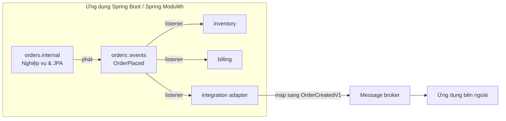
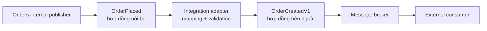
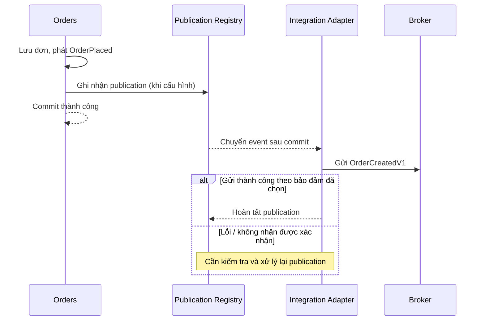

# Ẩn chi tiết triển khai khi thiết kế internal event và integration event

## 1. Vì sao cần ẩn chi tiết triển khai?

Trong ứng dụng Spring Boot được tổ chức theo **Spring Modulith**, các module như `orders`, `inventory` và `billing` cùng chạy trong một tiến trình nhưng có trách nhiệm nghiệp vụ riêng. Application events giúp các module phản ứng với sự kiện của nhau mà không cần gọi trực tiếp service hoặc repository nội bộ.

Giả sử `orders` công bố `OrderPlaced` để module kho giữ hàng. Module kho chỉ cần biết **đơn nào vừa được đặt** và **dòng hàng nào cần giữ**. Nó không cần biết `OrderEntity` có những cột nào, `OrderJpaRepository` lưu dữ liệu ra sao, trạng thái đơn được biểu diễn bằng enum hay service thực thi quy trình đặt hàng theo những bước nào.

**Ẩn chi tiết triển khai** nghĩa là bên phát công bố một hợp đồng mô tả **sự thật nghiệp vụ ổn định**, còn các lựa chọn về lưu trữ, thuật toán, cấu trúc nội bộ và hạ tầng được giữ phía sau ranh giới module. Tương tự, khi gửi sự kiện ra hệ thống khác, hợp đồng tích hợp không nên trở thành bản sao của Java entity hoặc internal application event.

Đây là một mục tiêu quan trọng của module học `SPRING_MODULITH_APPLICATION_EVENTS`: giảm phụ thuộc, bảo vệ ranh giới nghiệp vụ, đồng thời tạo điều kiện cho publisher, listener, xử lý sau commit, Event Publication Registry, retry, kiểm thử và quan sát hoạt động có thể kiểm soát.

Một hợp đồng sự kiện tốt giúp:

- **Thay đổi triển khai độc lập:** đổi bảng dữ liệu, ORM hoặc cách tính toán trong `orders` ít gây ảnh hưởng đến các bên nhận.
- **Ngăn phụ thuộc ngược:** `inventory` không phải import `orders.internal.OrderEntity` hoặc gọi repository của `orders`.
- **Bảo vệ dữ liệu:** không vô tình để lộ thuộc tính nhạy cảm qua event, log, publication registry hoặc message broker.
- **Ổn định khi triển khai độc lập:** hệ thống bên ngoài không bị khóa vào phiên bản class Java hoặc cấu trúc package của monolith.
- **Dễ kiểm thử và khôi phục:** payload chứa giá trị bất biến, mang đủ thông tin để xác minh hành vi khi listener chạy muộn hoặc retry.

> **Ranh giới quan trọng:** event là hợp đồng về *điều đã xảy ra*, không phải giao diện cho bên ngoài điều khiển hoặc nhìn thấy mọi chi tiết cách publisher thực hiện nghiệp vụ.

## 2. Internal event và integration event khác nhau ở đâu?

Trong bài này, **internal event** là sự kiện ứng dụng được phát và tiêu thụ **bên trong cùng ứng dụng Spring Boot**, có thể giữa hai application module. **Integration event** là hợp đồng sự kiện được công bố qua ranh giới **ứng dụng/hệ thống** để dịch vụ ngoài tiếp nhận, thường thông qua broker hoặc một kênh tích hợp.

| Khía cạnh | Internal event | Integration event |
| --- | --- | --- |
| Người nhận | Listener ở các module trong cùng ứng dụng | Dịch vụ/ứng dụng bên ngoài |
| Cơ chế tiêu biểu | `ApplicationEventPublisher`, `@ApplicationModuleListener` | Message broker, event bus, integration adapter |
| Ranh giới | Ranh giới module bên trong monolith | Ranh giới triển khai, tiến trình hoặc tổ chức |
| Kiểu dữ liệu | Có thể dùng Java record được công bố trong API module | Payload theo định dạng và schema đã thỏa thuận, ví dụ JSON/Avro |
| Mức độ ổn định kỳ vọng | Phù hợp vòng đời thay đổi và build của ứng dụng | Thường cần tương thích qua nhiều phiên bản triển khai độc lập |
| Chi tiết nên lộ | Dữ kiện nghiệp vụ tối thiểu cho các module nhận | Dữ kiện công khai tối thiểu cho các hệ thống đã được phép tiêu thụ |
| Kiểm soát phụ thuộc | `@NamedInterface`, `allowedDependencies`, `ApplicationModules.verify()` | Version schema, kiểm tra hợp đồng, chính sách truy cập và tương thích |
| Độ tin cậy | Transactional listener và publication registry khi cấu hình | Cần thêm thiết kế giao qua broker/outbox, retry, idempotency và quan sát |

Tên gọi “internal” **không nhất thiết có nghĩa là private trong một module**. Một internal application event có thể được công bố cho các module khác bằng API hoặc named interface, nhưng vẫn chưa phải hợp đồng tích hợp với hệ thống bên ngoài.

Một module cũng có thể phát event chỉ dùng trong nội bộ chính nó; loại này không cần được công bố ra API liên module. Mức độ hiển thị nên căn cứ vào **ai thực sự phải tiêu thụ**.



Sơ đồ thể hiện **hai ranh giới hợp đồng**: ranh giới giữa module nội bộ và ranh giới ra hệ thống ngoài. Đặt một adapter ở ranh giới thứ hai cho phép thay đổi schema tích hợp mà không buộc mọi module nội bộ phải đổi cùng lúc.

## 3. Những chi tiết nên giữ bên trong module

Không có một quy tắc máy móc rằng tất cả trường của entity đều bí mật. Cần xác định **thông tin nào có giá trị nghiệp vụ với người nhận** và **thông tin nào chỉ phục vụ cách triển khai hiện tại**.

| Chi tiết ở module phát | Vì sao không nên đưa trực tiếp vào event | Hợp đồng thay thế |
| --- | --- | --- |
| `OrderEntity`, Hibernate proxy, lazy collection | Ràng buộc người nhận vào ORM, quan hệ dữ liệu và trạng thái persistence context | DTO/record bất biến với các giá trị cần thiết |
| `OrderJpaRepository` hoặc phương thức repository | Lộ cơ chế lưu trữ và phá quyền sở hữu dữ liệu | API module cho truy vấn hợp lệ hoặc event nghiệp vụ |
| Enum `OrderInternalState` mô tả bước xử lý kỹ thuật | Người nhận phải biết state machine nội bộ, dễ vỡ khi refactor | Sự kiện nghiệp vụ như `OrderPlaced` hoặc trạng thái đã chuẩn hóa |
| `@Entity` ID tự tăng thuộc bảng cài đặt | Có thể không ổn định giữa môi trường/hệ thống và lộ cấu trúc dữ liệu | Business ID ổn định, chẳng hạn `orderId` |
| Object có setter, mutable list/map | Listener có thể thấy payload đổi sau khi publish hoặc sửa dữ liệu của listener khác | Immutable record, defensive copy và kiểu giá trị |
| Stack trace, exception class, JDBC URL | Đó là thông tin vận hành và triển khai, không phải sự thật nghiệp vụ | Log, tracing, metric và cảnh báo phù hợp |
| Token, mật khẩu, thông tin cá nhân không cần thiết | Tăng phạm vi lộ dữ liệu qua log, registry và broker | Chỉ trường đủ quyền và cần thiết, mã định danh hoặc dữ liệu đã tối thiểu hóa |
| Tên package `com.example.shop.orders.internal.*` | Bên nhận không nên phụ thuộc vào cấu trúc thư mục của publisher | API ổn định trong package công khai hoặc schema tích hợp độc lập |

Một tình huống điển hình là module thanh toán muốn biết tổng tiền của đơn đã chốt. Trường `totalPayable` kèm `currencyCode` có thể là **dữ kiện nghiệp vụ hợp lệ** trong event. Nhưng đưa cả `OrderEntity` vào để bên thanh toán gọi `getTotal()` lại làm lộ đối tượng mutable và cách triển khai.

## 4. Anti-pattern: công bố thẳng entity hoặc object nội bộ

Ví dụ không nên dùng:

```java
package com.example.shop.orders.events;

import com.example.shop.orders.internal.OrderEntity;

// Anti-pattern: hợp đồng event lộ entity triển khai của orders.
public record OrderPlaced(OrderEntity order) {}
```

Khi module kho muốn dùng event:

```java
package com.example.shop.inventory.internal;

import com.example.shop.orders.events.OrderPlaced;
import com.example.shop.orders.internal.OrderEntity;

class StockHandler {
    void on(OrderPlaced event) {
        OrderEntity order = event.order();
        // Đọc entity hoặc gọi method mutable/lazy-loaded...
    }
}
```

Thiết kế này có nhiều vấn đề:

1. **Rò rỉ kiểu nội bộ:** `inventory` phải biết `orders.internal.OrderEntity`; điều đó có thể vi phạm kiểm chứng ranh giới Spring Modulith.
2. **Rủi ro mutable:** record chỉ giữ tham chiếu final; thay đổi trạng thái entity ở một nơi khác vẫn có thể làm thay đổi giá trị mà listener đọc.
3. **Rủi ro transaction:** listener chạy sau commit có thể đụng vào entity detached hoặc thuộc tính lazy chưa khởi tạo.
4. **Rủi ro lưu trữ/truyền tải:** JPA proxy và quan hệ vòng khiến việc serialize event để lưu publication hay đẩy lên broker trở nên khó kiểm soát.
5. **Lệ thuộc vào refactor:** đổi tên trường hoặc tách entity có thể làm hỏng consumer dù sự thật nghiệp vụ “đơn đã được đặt” không đổi.

Một anti-pattern khác là **đặt tên trường theo cột cơ sở dữ liệu**:

```json
{
  "tbl_order_pk": 512,
  "state_code": 4,
  "fk_customer_row": 38
}
```

Payload trên yêu cầu consumer hiểu database schema và biết `state_code = 4` có nghĩa gì. Một hợp đồng tích hợp thích hợp cần dùng định danh và tên trường có ngữ nghĩa, chẳng hạn `orderId` và `occurredAt`, với định nghĩa rõ ràng.

## 5. Thiết kế internal event bằng giá trị nghiệp vụ bất biến

Module `orders` có thể công bố một record nhỏ chứa những dữ kiện module khác thật sự cần. Ví dụ Java 17+:

```java
// orders/events/OrderPlaced.java
package com.example.shop.orders.events;

import java.time.Instant;
import java.util.List;
import java.util.Objects;
import java.util.UUID;

public record OrderPlaced(
        UUID eventId,
        UUID orderId,
        Instant occurredAt,
        List<Line> lines) {

    public OrderPlaced {
        Objects.requireNonNull(eventId, "eventId");
        Objects.requireNonNull(orderId, "orderId");
        Objects.requireNonNull(occurredAt, "occurredAt");
        Objects.requireNonNull(lines, "lines");

        lines = List.copyOf(lines);
        if (lines.isEmpty()) {
            throw new IllegalArgumentException("lines must not be empty");
        }
    }

    public record Line(String sku, int quantity) {
        public Line {
            Objects.requireNonNull(sku, "sku");
            if (sku.isBlank() || quantity <= 0) {
                throw new IllegalArgumentException(
                    "sku and quantity must be valid");
            }
        }
    }
}
```

Ý nghĩa hợp đồng:

- `eventId` là ID của **một lần xảy ra sự kiện**. Khi xử lý lại chính event này, ID phải được giữ nguyên.
- `orderId` là ID nghiệp vụ của **đơn hàng**. Một đơn có thể xuất hiện trong nhiều loại sự kiện khác nhau.
- `occurredAt` là thời điểm publisher xác định sự kiện xảy ra, **không mặc nhiên là thời điểm commit hoặc listener nhận**.
- `lines` là snapshot các dòng hàng đã được đặt. `sku` và `quantity` phải được định nghĩa ổn định theo nghiệp vụ.

Không có trường `OrderEntity`, `OrderRepository`, `databaseId` hoặc tên service triển khai. `List.copyOf` bảo vệ cấu trúc list khỏi việc caller sửa list nguồn; mỗi `Line` cũng là record chỉ gồm kiểu dữ liệu bất biến. Nếu phần tử là object mutable thì `List.copyOf` một mình **không đủ** để tạo bất biến sâu.

### 5.1. Công bố event qua named interface

Package `orders.events` là subpackage của module `orders`. Nếu module khác cần import `OrderPlaced`, có thể công bố nhóm hợp đồng này:

```java
// orders/events/package-info.java
@org.springframework.modulith.NamedInterface("events")
package com.example.shop.orders.events;
```

Trong module `inventory`, giới hạn phụ thuộc đến riêng nhóm sự kiện:

```java
// inventory/package-info.java
@org.springframework.modulith.ApplicationModule(
    allowedDependencies = "orders::events"
)
package com.example.shop.inventory;
```

Như vậy `inventory` được phép dùng `orders::events` nhưng không được import `orders.internal.OrderRepository`. `@NamedInterface` công bố phạm vi API; nó **không** biến sự kiện thành message cho hệ thống ngoài và không tự kích hoạt retry.

### 5.2. Publisher tạo snapshot ở ranh giới module

Thay vì đưa entity ra ngoài, publisher đọc dữ liệu cần thiết và tạo giá trị mới:

```java
// Trích đoạn trong orders.internal.OrderService.
@Transactional
public UUID placeOrder(PlaceOrderCommand command) {
    OrderEntity order = repository.create(command);

    var lineSnapshots = order.getLines().stream()
        .map(line -> new OrderPlaced.Line(
            line.getSku(),
            line.getQuantity()))
        .toList();

    OrderPlaced event = new OrderPlaced(
        UUID.randomUUID(),
        order.getBusinessId(),
        clock.instant(),
        lineSnapshots
    );

    events.publishEvent(event);
    return order.getBusinessId();
}
```

`OrderEntity`, `repository`, `clock` và `events` là thành phần giả định thuộc implementation của ứng dụng; đoạn mã tập trung vào việc **chuyển entity thành snapshot**. Trong mã thực tế cần lưu đơn hàng và đảm bảo `OrderPlaced` mang đúng ngữ nghĩa “đơn đã được đặt” của quy trình.

Những đổi thay nội bộ sau này như chuyển từ JPA sang JDBC hoặc đổi cấu trúc bảng không buộc các listener phải sửa, miễn hợp đồng `OrderPlaced` vẫn giữ nguyên ngữ nghĩa.

## 6. Listener liên module chỉ đọc hợp đồng được công bố

Module kho có thể nhận sự kiện bằng `@ApplicationModuleListener`:

```java
package com.example.shop.inventory.internal;

import com.example.shop.orders.events.OrderPlaced;
import org.springframework.modulith.events.ApplicationModuleListener;
import org.springframework.stereotype.Component;

@Component
class InventoryOnOrderPlaced {

    private final StockReservationService reservations;

    InventoryOnOrderPlaced(StockReservationService reservations) {
        this.reservations = reservations;
    }

    @ApplicationModuleListener
    void on(OrderPlaced event) {
        reservations.reserveOnce(
            event.eventId(), event.orderId(), event.lines());
    }
}
```

`StockReservationService.reserveOnce(...)` là ví dụ API **nội bộ của inventory**. Việc giữ hàng phải được triển khai với quy tắc idempotency và transaction phù hợp, không dựa trên giả định event chỉ được giao đúng một lần.

Từ phía source code, chỉ có phụ thuộc **`inventory → orders::events`**. Module `orders` không phải import listener của `inventory` hoặc biết lớp `StockReservationService`. Đây là khác biệt giữa *công bố sự kiện nghiệp vụ* và *ra lệnh trực tiếp cho bên nhận thực thi phương thức cụ thể*.

Spring Modulith cung cấp `@ApplicationModuleListener` để hỗ trợ listener chạy **sau commit, bất đồng bộ và trong transaction riêng** khi môi trường transaction được cấu hình phù hợp. `ApplicationEventPublisher.publishEvent(...)` tự nó không làm mọi listener chuyển sang sau commit; listener `@EventListener` thông thường mặc định chạy đồng bộ. Quyết định xử lý sự kiện lúc nào cần tách khỏi quyết định **ẩn chi tiết triển khai**.

## 7. Integration event nên có schema tách biệt

Một ứng dụng khác có thể cần biết “đơn hàng đã được tạo” để cập nhật hệ thống phân tích. Nếu đưa nguyên Java `OrderPlaced` hoặc tên class có package `com.example.shop.orders.events.OrderPlaced` ra broker như hợp đồng bắt buộc, bên nhận sẽ bị ràng buộc vào mô hình trong monolith.

Thay vào đó có thể định nghĩa **integration event** độc lập, ví dụ một payload có tên hợp đồng `orders.created.v1`:

```json
{
  "eventId": "0cc84caf-a18e-421b-88c8-3888a6096d42",
  "eventType": "orders.created",
  "schemaVersion": 1,
  "orderId": "70ad470e-27af-43ae-943d-9d592b45f7a9",
  "occurredAt": "2026-11-25T08:15:00Z",
  "items": [
    {"sku": "SKU-100", "quantity": 2},
    {"sku": "SKU-200", "quantity": 1}
  ]
}
```

JSON trên là **hợp đồng minh họa**, không phải cấu trúc chuẩn do Spring Modulith bắt buộc. Các tên `eventType`, `schemaVersion` và tên topic cũng do hệ thống tích hợp quyết định.

Điểm khác biệt quan trọng: bên ngoài chỉ biết **giá trị và ý nghĩa đã thỏa thuận**. Bên nhận không cần biết `OrderPlaced` là record Java, module `orders` có package nội bộ nào, database dùng PostgreSQL hay MySQL, hoặc listener nội bộ của kho hoạt động ra sao.

| Internal event | Integration event | Quy tắc ánh xạ |
| --- | --- | --- |
| `OrderPlaced.eventId` kiểu `UUID` | `eventId` dạng chuỗi UUID | Giữ ID ổn định khi retry chính event |
| `OrderPlaced.orderId` kiểu `UUID` | `orderId` dạng chuỗi UUID | Giữ nguyên danh tính nghiệp vụ |
| `OrderPlaced.occurredAt` kiểu `Instant` | `occurredAt` dạng ISO-8601 UTC | Giữ thời điểm nghiệp vụ gốc |
| `OrderPlaced.lines` | `items` có `sku` và `quantity` | Chỉ xuất các trường hợp đồng cần |
| Không có `schemaVersion` trong record nội bộ | `schemaVersion = 1` | Phiên bản schema tích hợp có vòng đời riêng |
| Repository/entity nội bộ | Không có | Không cho lộ cấu trúc lưu trữ |

Một hệ thống ngoài có thể cần thêm hoặc bớt trường so với nội bộ. Điều đó là bình thường: **hai hợp đồng phục vụ hai nhóm người nhận khác nhau**.

## 8. Adapter chuyển internal event thành integration event

Một cách tổ chức là tạo module `integration` phụ trách chuyển đổi hợp đồng và giao tiếp broker. Module này lắng nghe `orders::events`, map sang DTO của hệ thống ngoài rồi gọi cổng gửi message.



Ví dụ DTO tích hợp (tên, vị trí class và schema là lựa chọn của ứng dụng):

```java
// integration/internal/OrderCreatedV1.java
package com.example.shop.integration.internal;

import java.util.List;

record OrderCreatedV1(
        String eventId,
        String eventType,
        String orderId,
        String occurredAt,
        List<ItemV1> items,
        int schemaVersion) {

    OrderCreatedV1 {
        items = List.copyOf(items);
    }

    record ItemV1(String sku, int quantity) {}
}
```

Adapter lắng nghe internal event:

```java
// integration/internal/OrderIntegrationRelay.java
package com.example.shop.integration.internal;

import com.example.shop.orders.events.OrderPlaced;
import org.springframework.modulith.events.ApplicationModuleListener;
import org.springframework.stereotype.Component;

@Component
class OrderIntegrationRelay {

    private final OrderEventTransport transport;

    OrderIntegrationRelay(OrderEventTransport transport) {
        this.transport = transport;
    }

    @ApplicationModuleListener
    void on(OrderPlaced event) {
        var items = event.lines().stream()
            .map(line -> new OrderCreatedV1.ItemV1(
                line.sku(), line.quantity()))
            .toList();

        var externalEvent = new OrderCreatedV1(
            event.eventId().toString(),
            "orders.created",
            event.orderId().toString(),
            event.occurredAt().toString(),
            items,
            1
        );

        transport.publish(
            "orders.created.v1",
            event.orderId().toString(),
            externalEvent
        );
    }
}
```

Ví dụ cổng hạ tầng mà adapter phụ thuộc:

```java
// integration/internal/OrderEventTransport.java
package com.example.shop.integration.internal;

interface OrderEventTransport {
    void publish(
        String destination,
        String partitionKey,
        OrderCreatedV1 event);
}
```

Ứng dụng sẽ hiện thực `OrderEventTransport` bằng broker producer hoặc cơ chế phát sự kiện phù hợp. Cần xác định rõ khi nào `publish(...)` được coi là **thành công**: producer nhận lời gọi chưa chắc đồng nghĩa broker đã xác nhận lưu message. Nếu consumer phải giao dịch theo tính nhất quán mạnh, cần thiết kế cơ chế xác nhận và retry tương ứng.

Để module `integration` chỉ phụ thuộc hợp đồng nội bộ đã công bố, có thể khai báo:

```java
// integration/package-info.java
@org.springframework.modulith.ApplicationModule(
    allowedDependencies = "orders::events"
)
package com.example.shop.integration;
```

Về mặt kiến trúc, integration adapter được phép import `OrderPlaced`, nhưng vẫn không được gọi `orders.internal.OrderRepository`. Về mặt tích hợp, schema `OrderCreatedV1` và địa chỉ broker do adapter quản lý, không làm rò rỉ vào module `orders`.

Spring Modulith cũng có cơ chế **event externalization** khi tích hợp các thành phần và hạ tầng phù hợp. Dù sử dụng khả năng externalization được cấu hình hay một adapter tự viết, đội ngũ vẫn phải quyết định schema, routing, điều kiện phát, tương thích phiên bản và yêu cầu giao tin cậy. Không nên mặc định rằng mọi `ApplicationEventPublisher` tự động phát ra broker.

## 9. Tách vòng đời thay đổi của hợp đồng nội bộ và hợp đồng tích hợp

Giả sử `orders` thay entity từ:

```text
OrderEntity -> List<OrderLineEntity>
```

sang:

```text
OrderHeaderEntity + OrderItemEntity + PriceSnapshotEntity
```

Nếu internal event đã chứa giá trị nghiệp vụ ổn định, thay đổi lưu trữ có thể chỉ ảnh hưởng hàm tạo snapshot trong module `orders`. Integration adapter và bên nhận bên ngoài vẫn sử dụng cùng schema.

Tình huống khác: module nội bộ quyết định đổi `OrderPlaced.lines` từ SKU sang `productId`. Adapter có thể cần ánh xạ để giữ `items[].sku` của hợp đồng ngoài, nếu nguồn dữ liệu ánh xạ hợp lệ và yêu cầu nghiệp vụ cho phép. **Không âm thầm đổi ý nghĩa `sku`** hoặc tái sử dụng cùng `schemaVersion` cho một thay đổi phá vỡ hợp đồng.

| Thay đổi | Có bắt buộc đổi integration event? | Cách đánh giá |
| --- | --- | --- |
| Đổi tên repository hoặc tên bảng | Thường không | Không làm thay đổi ý nghĩa event |
| Chuyển Hibernate sang JDBC | Thường không | Adapter không phụ thuộc ORM |
| Đổi tên internal service | Thường không | Bên ngoài không nhìn thấy service |
| Thêm trường nội bộ chỉ phục vụ kế toán | Không nhất thiết | Chỉ xuất trường khi consumer được phép và cần |
| Đổi ý nghĩa `OrderPlaced` hoặc `quantity` | Có thể có | Đánh giá tác động nghiệp vụ và tính tương thích |
| Xóa trường bắt buộc `orderId` khỏi payload ngoài | Thường là breaking change | Cần phiên bản mới hoặc lộ trình chuyển đổi |
| Đổi định dạng thời gian từ ISO-8601 sang số tùy ý | Có thể là breaking change | Kiểm tra contract và các consumer hiện tại |

Một nguyên tắc hữu ích là **integration event thuộc sở hữu của hợp đồng tích hợp**, dù dữ liệu nguồn đến từ module nghiệp vụ. Thay đổi mã nội bộ không tự động là lý do đổi schema ngoài.

### 9.1. Khi cần phiên bản mới

Ví dụ hệ thống đang công bố:

```json
{"eventType": "orders.created", "schemaVersion": 1, "orderId": "abc"}
```

Một yêu cầu mới buộc bên nhận phải hiểu thêm `currencyCode` và `totalPayable` với ngữ nghĩa khác trước. Đội ngũ cần xác định đây là bổ sung tương thích hay thay đổi phá vỡ. Nếu phá vỡ hợp đồng, cân nhắc `v2`, adapter chuyển đổi, khoảng thời gian chạy song song hoặc chính sách nâng cấp consumer.

Không nhất thiết phải gắn version lên mọi internal event; điều cần quản lý là **cách các bên nhận bị ảnh hưởng bởi thay đổi**, đặc biệt khi hệ thống ngoài triển khai theo lịch riêng hoặc có message cũ còn tồn đọng.

## 10. Ẩn chi tiết không đồng nghĩa bỏ qua độ tin cậy

Giả sử module `orders` đã commit giao dịch tạo đơn nhưng adapter ra broker bị lỗi mạng. Nếu thiết kế chỉ có một callback sau commit không được lưu vết, công việc đồng bộ ra ngoài có thể bị bỏ dở mà không biết.

Spring Modulith cung cấp **Event Publication Registry** để theo dõi publication cho transactional event listener khi được tích hợp hạ tầng lưu trữ phù hợp. Registry có thể giúp nhận diện publication còn chưa hoàn tất, là cơ sở để tái xử lý theo cấu hình. Tuy nhiên:

- Cơ chế lưu publication và phục hồi cần được thiết lập đúng với phiên bản Spring Modulith và hạ tầng sử dụng.
- Việc ghi nhận listener đã hoàn tất chỉ có ý nghĩa nếu adapter xác định **thành công của hành động phát ra ngoài** theo bảo đảm transport cần thiết.
- Gửi lại event hoặc message có thể dẫn đến **nhận trùng** ở broker/consumer; không được mặc nhiên giả định exactly-once end-to-end.
- Với yêu cầu bền vững qua lỗi hạ tầng, cần đánh giá cơ chế **transactional outbox** hoặc khả năng externalization/registry phù hợp, đồng thời kiểm tra cửa sổ lỗi giữa commit, gửi message và ghi nhận hoàn thành.



Sơ đồ chỉ biểu diễn **một luồng logic khi registry đã được cấu hình**; nó không cam kết rằng mỗi lần phát event sẽ luôn được gửi lại tự động. Dù thông điệp ngoài được retry, **`eventId` của cùng sự kiện phải ổn định**, để consumer có thể chống xử lý trùng.

### 10.1. Idempotency ở hai phía

Hợp đồng tích hợp có `eventId` là dữ liệu hữu ích, nhưng bản thân ID không ngăn tác dụng phụ trùng lặp. Ví dụ consumer gửi email mỗi khi nhận `orders.created`; nếu broker phát lại cùng message, cần kiểm tra `eventId` (và danh tính consumer) trước khi tạo tác dụng phụ.

Tại integration adapter, có thể cần chống gửi lặp hoặc chấp nhận gửi lại có chủ đích. Tại consumer ngoài, có thể lưu khóa `(consumerName, eventId)` cùng transaction thay đổi dữ liệu khi phù hợp. Nếu nghiệp vụ yêu cầu một đơn chỉ tạo đúng một bản ghi phân tích, `orderId` hoặc khóa miền tương ứng có thể là lớp kiểm soát bổ sung.

Idempotency được định nghĩa **theo tác dụng phụ**, không phải chỉ theo sự tồn tại của một field.

## 11. Kiểm thử để chứng minh không làm lộ implementation

Mục tiêu ẩn chi tiết triển khai nên có bằng chứng thông qua kiểm thử ranh giới và hợp đồng, không chỉ là nhận xét trong review code.

### 11.1. Kiểm tra ranh giới Spring Modulith

```java
import org.junit.jupiter.api.Test;
import org.springframework.modulith.core.ApplicationModules;

class ModuleArchitectureTests {

    @Test
    void verifyPublishedModuleApis() {
        ApplicationModules.of(ShopApplication.class).verify();
    }
}
```

Kiểm tra này có thể phát hiện việc adapter hoặc module kho import lớp trong `orders.internal`, sử dụng API ngoài `allowedDependencies`, hoặc tạo vòng phụ thuộc module. Nó không tự xác minh JSON external contract, broker đã nhận message hay dữ liệu nhạy cảm đã được loại bỏ.

### 11.2. Kiểm tra hợp đồng nội bộ và DTO tích hợp

Ví dụ Java 17+ kiểm tra mapping giữ nguyên ID và snapshot:

```java
import static org.junit.jupiter.api.Assertions.*;

import com.example.shop.orders.events.OrderPlaced;
import java.time.Instant;
import java.util.List;
import java.util.UUID;
import org.junit.jupiter.api.Test;

class EventMappingTest {

    @Test
    void internalEventContainsOnlyBusinessSnapshot() {
        UUID eventId = UUID.randomUUID();
        UUID orderId = UUID.randomUUID();
        var lines = new java.util.ArrayList<OrderPlaced.Line>();
        lines.add(new OrderPlaced.Line("SKU-100", 2));

        var event = new OrderPlaced(
            eventId, orderId,
            Instant.parse("2026-01-01T00:00:00Z"), lines);

        lines.clear();

        assertEquals(eventId, event.eventId());
        assertEquals(orderId, event.orderId());
        assertEquals(1, event.lines().size());
        assertThrows(UnsupportedOperationException.class,
            () -> event.lines().clear());
    }
}
```

Đây là bài kiểm thử đơn vị cho **payload nội bộ**; kiểm thử mapping thực tế nên gọi mapper/adapter đã triển khai và so khớp đúng JSON/schema `OrderCreatedV1`. Chẳng hạn `eventId` và `orderId` không được đổi, `occurredAt` giữ dạng thời gian có thể diễn giải thống nhất, các trường nội bộ hoặc nhạy cảm không xuất hiện trong JSON.

| Nhóm kiểm thử | Điều cần chứng minh |
| --- | --- |
| Architecture test | `inventory` và `integration` chỉ phụ thuộc API `orders::events`, không import `orders.internal` |
| Publisher test | Event được tạo từ snapshot nghiệp vụ đúng, không mang entity/proxy |
| Listener test | `inventory` đọc event để xử lý nghiệp vụ riêng, không chỉnh payload |
| Contract/serialization test | Payload ngoài khớp schema version, không lộ thông tin nội bộ |
| Compatibility test | Consumer còn hỗ trợ event schema cũ theo kế hoạch nâng cấp |
| After-commit test | Rollback của publisher không làm phát sinh tác dụng phụ đã cấu hình chỉ chạy sau commit |
| Failure/retry test | Lỗi broker/adapter được phát hiện, publication theo dõi được và gửi lại không tạo tác dụng phụ trùng |
| Security test | Dữ liệu nhạy cảm/không được cấp quyền không xuất hiện trong event, log hoặc message ngoài |

Khi kiểm thử broker, cần đặc biệt mô phỏng tình huống **broker đã nhận message nhưng adapter không nhận được xác nhận**. Đây là một trường hợp có thể dẫn tới phát lặp, kể cả khi nội dung event hoàn toàn bất biến.

## 12. Các tình huống lựa chọn và checklist thiết kế

| Nhu cầu | Cách xử lý thường phù hợp |
| --- | --- |
| Một phương thức nội bộ của `orders` cần thông báo cho thành phần cùng module | Internal event trong phạm vi module hoặc lời gọi nội bộ, tùy độ phức tạp |
| Kho cần phản ứng với đơn đã được chấp nhận | Internal event `OrderPlaced` được công bố qua API module |
| Hệ thống phân tích độc lập cần nhận thông tin đơn mới | Adapter chuyển `OrderPlaced` thành integration event `orders.created.v1` |
| Consumer ngoài cần dữ liệu tại lúc đặt hàng | Payload tích hợp chứa snapshot nghiệp vụ phù hợp |
| Consumer ngoài yêu cầu truy cập trực tiếp `OrderEntity` | Xác định API/hợp đồng dữ liệu cần thiết, không xuất entity nội bộ |
| Hệ thống cần biết kết quả giữ hàng ngay để xác nhận đơn | API đồng bộ hoặc quy trình nhiều bước với trạng thái rõ ràng |

Trước khi công bố một event, hãy kiểm tra lần lượt:

1. **Ai là consumer?** Thành phần cùng module, module khác trong monolith hay ứng dụng ngoài?
2. **Sự thật nghiệp vụ là gì?** Tên event diễn đạt điều đã xảy ra, thay vì tên lớp service hoặc câu lệnh triển khai.
3. **Thông tin nào thực sự cần?** Chọn business ID, snapshot, đơn vị và timestamp với ý nghĩa cụ thể.
4. **Có rò rỉ implementation không?** Loại entity, repository, Hibernate proxy, internal enum, schema DB và dữ liệu không liên quan.
5. **Ranh giới mã nguồn có đúng không?** Dùng package API/`@NamedInterface` và kiểm tra `allowedDependencies`.
6. **Hợp đồng ngoài có đời sống riêng không?** Tách DTO, tên event, schema và version của bên ngoài khỏi Java internal event khi cần.
7. **Khi commit, lỗi và retry thì sao?** Chọn listener sau commit, registry/outbox/externalization phù hợp, bảo đảm transport và idempotency.
8. **Đã có kiểm thử chứng minh chưa?** Kiểm thử architecture, serialization, compatibility, lỗi mạng và xử lý trùng.

### Bài tập tình huống

Một nhóm phát `OrderEntity` trực tiếp lên Kafka mỗi khi đặt hàng. Nhóm khác đề xuất sửa entity để thêm trường `databaseShard` và `internalFraudFlag`. Hãy trả lời:

1. Vì sao người tiêu thụ Kafka không nên phải nhận các trường mới đó?
2. Thiết kế lại `OrderPlaced` nội bộ và `orders.created.v1` bên ngoài với dữ liệu tối thiểu nào?
3. Adapter cần chuyển đổi các trường nào, và trường nào tuyệt đối không được xuất?
4. Nếu hệ thống phân tích không nhận được message sau khi đơn đã commit, cần quan sát, retry và idempotency ở đâu?
5. Nếu entity đổi tên hoặc đổi ORM, thành phần nào được phép thay đổi mà không phá hợp đồng tích hợp?

**Ghi nhớ:** Ẩn chi tiết triển khai là giữ cho event mang **sự thật nghiệp vụ được công bố có chủ đích** thay vì vô tình mang theo cấu trúc code và cơ sở dữ liệu. Spring Modulith giúp kiểm chứng ranh giới giữa các module qua API công khai và allowed dependency; integration adapter tiếp tục bảo vệ ranh giới ra hệ thống ngoài. Muốn luồng sự kiện vận hành tin cậy, cần kết hợp các hợp đồng này với transaction sau commit, Event Publication Registry hoặc outbox phù hợp, retry, idempotency, kiểm thử và quan sát.
