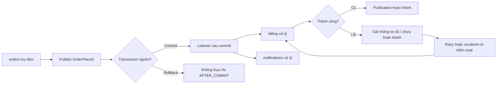
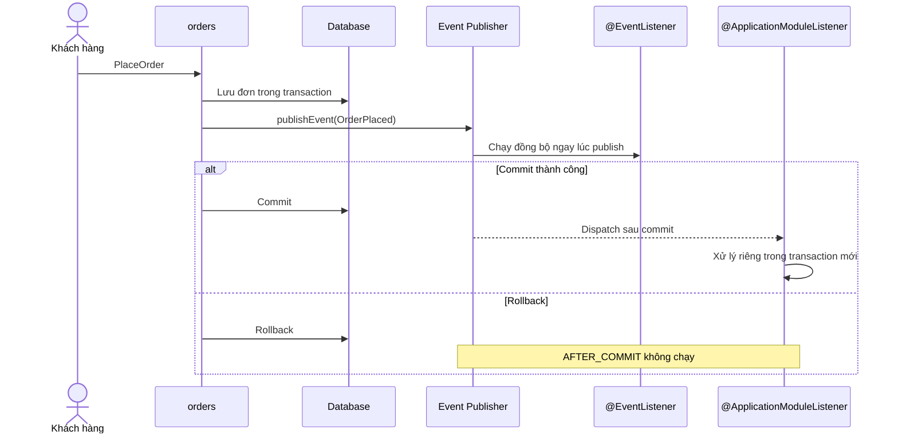

# Xử lý event trong chu kỳ phát hành Spring Modulith

Một application event chỉ có giá trị khi các thành phần quan tâm **xử lý đúng sự thật nghiệp vụ mà event đại diện**. Trong Spring Modulith, `ApplicationEventPublisher.publishEvent(...)` là điểm khởi đầu của việc công bố, còn **xử lý event (event processing)** là toàn bộ quá trình tìm listener, quyết định thời điểm thực thi, chạy nghiệp vụ của module nhận, ghi nhận kết quả và khôi phục nếu có lỗi.

Ví dụ, module `orders` hoàn tất đặt hàng và phát `OrderPlaced`. Module `billing` cần tạo hóa đơn; `notifications` cần gửi thư xác nhận. Hai tác vụ này do **hai module khác nhau sở hữu** và có mức đảm bảo khác nhau. Hóa đơn có thể cần retry bền vững, còn gửi thư có thể bị giới hạn số lần thử; việc một listener thất bại không tự động có nghĩa đơn đặt hàng chưa thành công.

Bài học thuộc chương **Chu kỳ phát hành**. Mục tiêu là hiểu từ lúc một event được công bố đến khi từng listener hoàn thành, thất bại hoặc được xử lý lại; chọn `@EventListener`, `@TransactionalEventListener`, `@ApplicationModuleListener` phù hợp; sử dụng Event Publication Registry, idempotency và kiểm thử/quan sát để giao tiếp giữa các module Spring Modulith đáng tin cậy.

## 1. “Xử lý event” gồm những bước nào?

Có thể chia chu kỳ xử lý một event thành các bước logic:

1. **Nghiệp vụ tạo sự thật:** module sở hữu chuyển trạng thái và hình thành event phù hợp, ví dụ `OrderPlaced`.
2. **Công bố (publication):** producer gọi `publishEvent(event)` trong ngữ cảnh Spring.
3. **Xác định người nhận:** cơ chế application events chọn những listener tương thích với kiểu event.
4. **Chọn thời điểm chạy:** listener có thể chạy ngay, trong một phase của transaction hoặc bất đồng bộ sau commit.
5. **Thực thi:** listener gọi nghiệp vụ của module mình, có thể ghi dữ liệu hoặc gọi hệ thống ngoài.
6. **Ghi nhận kết quả:** tùy cơ chế, publication được coi đã hoàn thành hoặc vẫn cần khôi phục.
7. **Phục hồi:** sự cố tạm thời có thể dẫn đến retry/resubmit; người nhận phải tránh xử lý trùng.



Sơ đồ minh họa listener **sau commit** và quy trình có lưu/truy vết publication khi đã cấu hình. Với `@EventListener` đồng bộ thông thường, listener có thể chạy **ngay lúc publish**, trước khi transaction kết thúc.

**Cần phân biệt ba khái niệm:**

- **Event đã hình thành:** mã nghiệp vụ tạo một object mô tả sự thật dự kiến.
- **Event đã publish:** `ApplicationEventPublisher` đã được gọi và cơ chế dispatch được kích hoạt.
- **Event đã xử lý thành công:** một listener cụ thể đã hoàn tất trách nhiệm của mình theo contract.

Ba dấu mốc không tương đương. Ngay cả khi publisher đã trả về bình thường, một listener bất đồng bộ vẫn có thể chưa chạy hoặc đang thất bại.

## 2. Ranh giới giữa publisher và listener

Trong Spring Modulith, một module nên chỉ phát event thuộc sự thật mà nó sở hữu. Module khác nghe event từ **API công khai** của module nguồn và thực hiện hành vi của mình.

Ví dụ cấu trúc:

```text
com.example.shop
├── ShopApplication.java
├── orders
│   ├── OrderPlaced.java                # Public event
│   └── internal
│       ├── Order.java
│       ├── OrderRepository.java
│       └── PlaceOrderService.java      # Publisher
├── billing
│   └── internal
│       ├── OrderPlacedInvoiceListener.java
│       ├── InvoiceService.java
│       └── InvoiceRepository.java
└── notifications
    └── internal
        ├── OrderPlacedEmailListener.java
        └── NotificationService.java
```

- `orders` biết event `OrderPlaced` và API `ApplicationEventPublisher`.
- `billing` có thể import `com.example.shop.orders.OrderPlaced` nhưng không truy cập `orders.internal.OrderRepository`.
- `notifications` cũng nghe `OrderPlaced`, không cần biết implementation của `billing`.
- Việc `billing` và `notifications` chạy như thế nào thuộc trách nhiệm của từng module.

Quan hệ phụ thuộc mã nguồn đi từ module nhận đến **event contract** của module phát. Publisher không phải inject tất cả listener. Spring Modulith cho phép kiểm tra ranh giới này với `ApplicationModules.verify()` khi module layout được cấu hình phù hợp.

### Command và event có mục tiêu khác nhau

Nếu `orders` **bắt buộc biết** việc giữ tồn kho đã thành công trước khi xác nhận đơn, nó nên gọi một public command/API của `inventory` và xử lý kết quả. `OrderPlaced` lại phù hợp để các module khác phản ứng sau khi đơn đã hợp lệ. Không biến một command cần kết quả ngay thành event bất đồng bộ rồi tuyên bố nghiệp vụ đã hoàn tất.

## 3. Tạo event bất biến và công bố đúng thời điểm

Public event có thể là Java record:

```java
// com.example.shop.orders.OrderPlaced.java
package com.example.shop.orders;

import java.time.Instant;
import java.util.UUID;

public record OrderPlaced(
        UUID eventId,
        UUID orderId,
        Instant occurredAt
) {}
```

`eventId` giúp theo dõi event; `orderId` là khóa nghiệp vụ để module nhận biết đơn; `occurredAt` là thời điểm tạo sự kiện theo hợp đồng, **không tự động là thời điểm commit**.

Ví dụ publisher:

```java
// com.example.shop.orders.internal.PlaceOrderService.java
package com.example.shop.orders.internal;

import com.example.shop.orders.OrderPlaced;
import java.time.Clock;
import java.time.Instant;
import java.util.UUID;

import org.springframework.context.ApplicationEventPublisher;
import org.springframework.stereotype.Service;
import org.springframework.transaction.annotation.Transactional;

@Service
class PlaceOrderService {

    private final OrderRepository orders;
    private final ApplicationEventPublisher publisher;
    private final Clock clock;

    PlaceOrderService(
            OrderRepository orders,
            ApplicationEventPublisher publisher,
            Clock clock) {
        this.orders = orders;
        this.publisher = publisher;
        this.clock = clock;
    }

    @Transactional
    public UUID place(UUID customerId, String sku, int quantity) {
        // Order và OrderRepository là ví dụ các thành phần nội bộ
        // cần được triển khai cùng các quy tắc nghiệp vụ thực tế.
        Order order = Order.place(customerId, sku, quantity);
        orders.save(order);

        publisher.publishEvent(new OrderPlaced(
                UUID.randomUUID(),
                order.id(),
                Instant.now(clock)
        ));

        return order.id();
    }
}
```

Trong ví dụ, bean `Clock` cần được khai báo, chẳng hạn bằng `Clock.systemUTC()`. `orders.save(...)` và `publishEvent(...)` diễn ra trong phạm vi `@Transactional` của application service; transaction có thể **vẫn chưa commit** khi mã publish chạy.

**Bất biến quan trọng:** `OrderPlaced` chỉ được tạo khi use case đã vượt qua các điều kiện nghiệp vụ để ghi nhận đơn. Nếu transaction cuối cùng rollback, listener `AFTER_COMMIT` không được thực thi như thể đơn đã lưu bền vững.

Không gửi nguyên JPA entity mutable/lazy-loaded qua event, đặc biệt khi listener chạy ở thread hoặc transaction khác. Event DTO/record bất biến giảm rò rỉ cấu trúc nội bộ và tránh truy cập entity sau khi persistence context đóng.

## 4. Ba cách xử lý phổ biến trong Spring

| Cơ chế | Thời điểm điển hình | Luồng thực thi | Dùng khi |
| --- | --- | --- | --- |
| `@EventListener` | Khi `publishEvent` dispatch, mặc định ngay lúc gọi | Đồng bộ theo mặc định của Spring multicaster | Phản ứng nhẹ, có chủ ý gắn với luồng gọi |
| `@TransactionalEventListener` | Mặc định phase `AFTER_COMMIT` | Không tự động bất đồng bộ | Chỉ chạy khi transaction nguồn commit thành công |
| `@ApplicationModuleListener` | Sau commit, bất đồng bộ, transaction riêng | Thành phần của Spring Modulith | Xử lý tác vụ giữa các module, tách khỏi transaction nguồn |

**Tên annotation không thay cho thiết kế giao dịch.** Cần biết listener xử lý tác vụ nào và tác vụ đó có được phép hoàn tất sau nghiệp vụ chính hay không.

### 4.1. Listener đồng bộ với `@EventListener`

```java
package com.example.shop.orders.internal;

import com.example.shop.orders.OrderPlaced;
import org.springframework.context.event.EventListener;
import org.springframework.stereotype.Component;

@Component
class OrderMetricsListener {

    @EventListener
    void on(OrderPlaced event) {
        // Minh họa thao tác nhẹ và không có side effect
        // phụ thuộc vào việc đơn đã commit.
        System.out.println("Published order event " + event.orderId());
    }
}
```

Với Spring event multicaster mặc định, method này chạy trên thread của publisher khi `publishEvent` được gọi. Nếu listener ném runtime exception chưa được xử lý, exception có thể truyền trở lại publisher và gây rollback transaction nếu quy tắc transaction áp dụng.

Vì vậy một listener đồng bộ gửi email chậm hoặc gọi HTTP ngoài có thể kéo dài transaction tạo đơn và khiến lỗi phụ làm thất bại use case chính. Nếu sự kiện chỉ để ghi nhận log/metrics, cũng cần cân nhắc tính chính xác của metrics khi source transaction rollback.

### 4.2. Listener theo transaction với `@TransactionalEventListener`

```java
package com.example.shop.notifications.internal;

import com.example.shop.orders.OrderPlaced;
import org.springframework.stereotype.Component;
import org.springframework.transaction.event.TransactionPhase;
import org.springframework.transaction.event.TransactionalEventListener;

@Component
class OrderNotificationListener {

    private final NotificationService notifications;

    OrderNotificationListener(NotificationService notifications) {
        this.notifications = notifications;
    }

    @TransactionalEventListener(phase = TransactionPhase.AFTER_COMMIT)
    void on(OrderPlaced event) {
        notifications.enqueueConfirmation(event.orderId());
    }
}
```

`@TransactionalEventListener` mặc định dùng `AFTER_COMMIT`; viết rõ phase giúp diễn đạt hợp đồng. Listener thông thường **không chạy** nếu không có transaction đang hoạt động khi publish, trừ khi cấu hình `fallbackExecution = true`.

**Lưu ý khi ghi dữ liệu sau commit:** callback `AFTER_COMMIT` có thể còn thấy tài nguyên transaction cũ được gắn với thread, nhưng transaction đó đã commit. Nếu listener cần ghi database với một commit mới, nên gọi service mở transaction độc lập, ví dụ `@Transactional(propagation = REQUIRES_NEW)` trên method của bean khác. Chỉ thêm `@Transactional` mặc định mà không phân tích propagation có thể tạo ra hành vi khó hiểu.

Ngoài `AFTER_COMMIT`, `@TransactionalEventListener` hỗ trợ các phase như `BEFORE_COMMIT`, `AFTER_ROLLBACK`, `AFTER_COMPLETION`. Chọn phase theo yêu cầu; không dùng `AFTER_ROLLBACK` để thực thi hệ quả của sự thật được tuyên bố là đã commit.

### 4.3. Listener module với `@ApplicationModuleListener`

```java
// com.example.shop.billing.internal.OrderPlacedInvoiceListener.java
package com.example.shop.billing.internal;

import com.example.shop.orders.OrderPlaced;
import org.springframework.modulith.events.ApplicationModuleListener;
import org.springframework.stereotype.Component;

@Component
class OrderPlacedInvoiceListener {

    private final InvoiceService invoices;

    OrderPlacedInvoiceListener(InvoiceService invoices) {
        this.invoices = invoices;
    }

    @ApplicationModuleListener
    void on(OrderPlaced event) {
        invoices.issueOnce(event.orderId(), event.eventId());
    }
}
```

Trong Spring Modulith, `@ApplicationModuleListener` là annotation kết hợp ý tưởng **transactional event listener sau commit**, **bất đồng bộ** và **transaction mới** (tương đương các cấu hình liên quan như `@Async`, `@Transactional(propagation = REQUIRES_NEW)`). Hành vi cụ thể còn cần hạ tầng transaction/async của ứng dụng và dependency framework phù hợp.

Ở ví dụ trên, `InvoiceService.issueOnce(...)` là service nội bộ giả định của module `billing`, cần được cài đặt có idempotency. `orders` không biết có listener nào nhận hay tạo hóa đơn ra sao.

## 5. Thời điểm xử lý so với transaction nguồn

Sơ đồ dưới minh họa điểm dễ nhầm: method `publishEvent` chạy trước khi transaction nguồn kết thúc.



Không nên suy ra thời điểm trả HTTP response hoặc lịch chạy các thread từ sơ đồ: listener bất đồng bộ có thể bắt đầu hoặc hoàn thành ở những thời điểm khác nhau so với response.

Những trường hợp cần kiểm tra:

1. **Rollback:** `@EventListener` đồng bộ có thể đã chạy; `@TransactionalEventListener(AFTER_COMMIT)` không chạy.
2. **Publish ngoài transaction:** `@EventListener` vẫn có thể nhận; `@TransactionalEventListener` mặc định bỏ qua.
3. **Listener sau commit lỗi:** transaction đặt hàng đã hoàn tất; lỗi listener không tự động rollback đơn đã lưu.
4. **Self-invocation:** một method `@Transactional` được gọi nội bộ cùng bean có thể không đi qua proxy Spring, khiến transaction dự kiến không có hiệu lực.
5. **Nhiều resource:** lưu DB và gửi tới broker/HTTP ngoài không mặc nhiên thuộc một atomic transaction duy nhất.

**Tách giao dịch không có nghĩa hệ thống luôn nhất quán tức thì.** Hóa đơn có thể chưa được tạo trong khi đơn đã thành công. Đây là tình huống nhất quán cuối cùng phải được phản ánh qua trạng thái, monitoring và chính sách recovery.

## 6. Chạy nghiệp vụ trong listener: giữ đúng ownership

Listener không phải nơi tùy tiện sửa dữ liệu của publisher. Nó phải chuyển event thành **hành vi của chính module nhận**.

Ví dụ hai subscriber của `OrderPlaced`:

```text
OrderPlaced
├── billing.OrderPlacedInvoiceListener
│   └── InvoiceService.issueOnce(orderId, eventId)
└── notifications.OrderPlacedEmailListener
    └── NotificationService.sendConfirmationOnce(orderId, eventId)
```

Module `billing` sở hữu quy tắc tạo hóa đơn và dữ liệu hóa đơn. Module `notifications` sở hữu lịch sử thông báo và việc tương tác với nhà cung cấp email. Cả hai đọc hợp đồng `OrderPlaced`, không lấy repository nội bộ của `orders` để cập nhật trạng thái đơn.

### Hành vi listener nên có đặc điểm gì?

- **Dễ xác định trách nhiệm:** một listener hoặc một service được gọi làm một công việc nghiệp vụ rõ ràng.
- **Idempotent:** nhận lại event không tạo thêm side effect sai.
- **Rõ ràng khi lỗi:** không nuốt exception rồi trả thành công nếu thao tác quan trọng chưa xong.
- **Có khóa tương quan:** `eventId`, `orderId` giúp log, test và truy vết.
- **Không phụ thuộc trạng thái JPA mutable của publisher:** dùng public DTO/event hoặc public query API.
- **Có chính sách retry phù hợp:** lỗi vĩnh viễn cần đưa sang xử lý khác, tránh retry mù.

Nếu listener vừa tạo hóa đơn vừa gửi email, cần hỏi liệu đây có phải hai trách nhiệm nên tách sang `billing` và `notifications` hay không. Việc tách giúp mỗi module có trạng thái hoàn thành và thất bại độc lập.

## 7. Một event có nhiều listener: trạng thái hoàn thành riêng

Một event có thể có 0, 1 hoặc nhiều listener. Không có yêu cầu mọi listener phải chạy thành công cùng lúc.

Ví dụ:

| Publication | Kết quả | Ý nghĩa |
| --- | --- | --- |
| `OrderPlaced E-01 → billing listener` | Hoàn thành | Hóa đơn đã tạo hoặc đã tồn tại hợp lệ |
| `OrderPlaced E-01 → notifications listener` | Lỗi tạm thời | Có thể cần retry gửi thông báo |
| `OrderPlaced E-01 → analytics listener` | Đang chờ | Báo cáo chưa cập nhật |

Khi có Event Publication Registry hỗ trợ những transactional listener, **việc giao đến từng listener** được theo dõi dưới các publication tương ứng theo contract framework. Do đó “event này đã hoàn thành hay chưa?” phải được đặt trong ngữ cảnh **listener/target**; không dùng một cờ toàn cục để kết luận mọi người nhận đã hoàn tất.

Một listener mới được thêm vào sau khi event đã phát không mặc nhiên nhận lại toàn bộ event lịch sử. Nếu sản phẩm cần xử lý lịch sử, phải thiết kế cơ chế replay/backfill, phạm vi thời gian và idempotency riêng.

## 8. Event Publication Registry theo dõi điều gì?

Spring Modulith cung cấp **Event Publication Registry** để theo dõi việc giao application events cho transactional listeners. Khi ứng dụng cấu hình một implementation persistence phù hợp (ví dụ JDBC, JPA hoặc MongoDB), registry có thể ghi nhận publication chưa hoàn thành, đánh dấu hoàn thành sau khi listener chạy thành công và hỗ trợ xác định mục cần resubmit/recovery.

Các khái niệm cần phân biệt:

- **Event:** payload nghiệp vụ `OrderPlaced`.
- **Target listener:** handler cụ thể cần nhận event.
- **Publication:** bản ghi theo dõi việc event được giao tới target đó.
- **Completed publication:** listener đã được ghi nhận xử lý thành công theo cơ chế framework.
- **Incomplete/failed publication:** quá trình xử lý chưa được ghi nhận hoàn tất, cần xác minh lỗi và chính sách phục hồi.

Bảng minh họa mang tính logic, không phải schema bảng chính thức:

| eventId | Listener | Trạng thái logic | Hướng xử lý |
| --- | --- | --- | --- |
| E-01 | `billing.on(OrderPlaced)` | COMPLETED | Không cần gửi lại |
| E-01 | `notifications.on(OrderPlaced)` | INCOMPLETE | Điều tra, retry khi thích hợp |
| E-02 | `billing.on(OrderPlaced)` | INCOMPLETE | Phục hồi nếu nguồn đã commit |

Cơ chế lưu trữ và các trạng thái/kiểu record thực tế phụ thuộc phiên bản Spring Modulith, dependency và cấu hình ứng dụng. Không nên coi bảng trên là một bảng SQL bắt buộc tên `event_publication` hay danh sách enum chuẩn của mọi phiên bản.

### Registry không tự thay thế mọi tầng bảo đảm

- Cần **cấu hình persistence** thích hợp; có listener không có nghĩa mọi publication đã được lưu bền vững.
- Cần **chính sách khôi phục/resubmit** phù hợp; không mặc định mọi ứng dụng tự retry vô hạn hoặc tự replay ngay khi khởi động.
- Registry không đảm bảo **exactly once** đối với email, HTTP hay các side effect bên ngoài.
- Registry không mặc nhiên là message broker; event nội bộ khác với event được externalize tới Kafka/RabbitMQ.
- Với công việc cần độ bền cao, kiểm chứng publication được ghi trong transaction/lifecycle thích hợp so với nghiệp vụ nguồn và khả năng recovery khi tiến trình bị tắt.

## 9. Các trạng thái lỗi quan trọng trong chu kỳ xử lý

Xem xét những tình huống sau:

| Thời điểm lỗi | Kết quả có thể xảy ra | Điều cần thiết |
| --- | --- | --- |
| `orders` validation thất bại | Không có `OrderPlaced` hợp lệ | Không publish trước khi quyết định nghiệp vụ |
| Transaction `orders` rollback | Listener `AFTER_COMMIT` không chạy | Đặt đúng transaction boundary |
| `@EventListener` đồng bộ ném exception | Có thể làm fail publisher/rollback transaction | Chỉ dùng nếu thất bại chung là điều mong muốn |
| `orders` commit, listener async chưa kịp chạy thì app crash | Tác vụ sau commit chưa hoàn tất | Publication persistence và recovery |
| `billing` tạo hóa đơn rồi crash trước khi đánh dấu publication hoàn thành | Hóa đơn đã có, event có thể được gửi lại | Listener idempotent và khóa duy nhất |
| `notifications` gửi email bị timeout | Không chắc phía email đã nhận hay chưa | Idempotency/receipt từ nhà cung cấp nếu có |
| Payload của event không tương thích với listener sau khi nâng version | Retry nhiều lần vẫn lỗi | Xử lý lỗi vĩnh viễn và quản trị contract |
| Hai publication của cùng đơn được xử lý đồng thời | Có nguy cơ race condition | Unique constraint, transaction và quy tắc ordering |

**Một lỗi xử lý không luôn là lý do phát lại toàn bộ event từ nghiệp vụ.** Nếu đơn đã lưu thành công, không gọi lại `PlaceOrder` chỉ để “kích hoạt lại listener”; điều đó có thể tạo thêm đơn hoặc event. Hãy phục hồi publication còn thiếu hoặc chạy lại tác vụ idempotent của người nhận theo cơ chế được thiết kế.

## 10. Retry, resubmit và idempotency

**Retry** thường nghĩa là thử lại một thao tác vừa thất bại theo chính sách backoff. **Resubmit/republication** nghĩa là đưa một publication chưa hoàn thành trở lại quá trình xử lý, có thể sau restart hoặc xử lý vận hành. Cả hai đều có thể khiến cùng event được listener nhận nhiều lần.

### Ví dụ tạo hóa đơn idempotent

Giả sử cùng một `OrderPlaced` được giao hai lần:

```text
on(OrderPlaced(eventId=E-01, orderId=O-42))
  -> create invoice(orderId=O-42)     # Lần 1
on(OrderPlaced(eventId=E-01, orderId=O-42))
  -> ensure invoice exists            # Lần retry
```

Yêu cầu nghiệp vụ là **mỗi đơn chỉ có hóa đơn phù hợp quy tắc**, vì vậy nên sử dụng `orderId` làm khóa business uniqueness. Một ID event khác nhau cũng có thể đại diện cùng đơn do lỗi producer hoặc retry ở cấp command.

Pseudocode xử lý:

```java
// Logic minh họa trong billing, không phải code đầy đủ cho mọi DB.
@Transactional
public void issueOnce(UUID orderId, UUID eventId) {
    if (invoiceRepository.existsByOrderId(orderId)) {
        return; // Đã hoàn thành theo business key
    }

    // Lấy dữ liệu cần thiết qua hợp đồng công khai hoặc snapshot.
    Invoice invoice = createInvoice(orderId, eventId);
    invoiceRepository.save(invoice);
    // DB cần UNIQUE(order_id) để chống hai listener cùng chạy.
}
```

**Kiểm tra `existsByOrderId` rồi insert không đủ** nếu hai thread chạy song song. Cần unique constraint/index ở database và xử lý kết quả tranh chấp an toàn. Nếu insert gặp xung đột uniqueness, transaction có thể bị đánh dấu rollback; nên xử lý qua ranh giới transaction phù hợp, không đơn giản nuốt exception rồi tiếp tục trong transaction đã hỏng.

Nếu listener gọi một hệ thống ngoài, chọn idempotency key ổn định và dựa vào contract của bên nhận. Trường hợp không có idempotency từ nhà cung cấp, cần chấp nhận và xử lý khả năng lặp khi crash giữa lúc side effect thành công và ghi nhận completion.

### Chính sách retry nên xác định

1. Lỗi nào **có thể thử lại** (timeout tạm thời, deadlock, mất kết nối).
2. Lỗi nào **không nên thử lại mù** (schema không hợp lệ, permission cố định, dữ liệu nghiệp vụ bị từ chối).
3. Số lần thử, khoảng cách/backoff và giới hạn tải.
4. Khi nào chuyển sang kiểm tra thủ công hoặc cơ chế tương tự dead-letter.
5. Điều kiện đánh dấu publication hoàn thành và cách xác minh side effect.
6. Ai sở hữu dashboard/cảnh báo cho publication treo lâu.

Không khẳng định Spring Modulith tự cung cấp cùng một lịch retry/backoff cho mọi storage backend hoặc phiên bản. Cần cấu hình và xác minh cơ chế recovery thực tế của ứng dụng.

## 11. Ordering, concurrency và giao lại event

Giả sử `orders` phát `OrderPlaced` rồi `OrderCancelled` rất nhanh. Hai listener bất đồng bộ không mặc nhiên xử lý tuần tự theo **thứ tự toàn cục**.

```text
OrderPlaced(orderId=O-42)   -> xử lý hóa đơn bắt đầu chậm
OrderCancelled(orderId=O-42) -> xử lý hủy bắt đầu nhanh
```

Nếu module `billing` có invariant về thứ tự, nó phải thiết kế state machine phù hợp. Một số hướng:

- Lưu **aggregate version** tăng dần khi thay đổi trạng thái, nếu event contract cần xử lý theo thứ tự.
- Kiểm tra trạng thái nghiệp vụ hiện tại hoặc snapshot có ý nghĩa trước khi áp dụng chuyển trạng thái.
- Áp dụng optimistic locking/unique constraint để chống xử lý đồng thời sai.
- Nếu dùng broker, chọn routing key theo aggregate và kiểm tra semantics ordering của broker/consumer.
- Có quy trình phát hiện, giữ lại hoặc loại bỏ event cũ khi cần.

**Không dựa vào thời điểm `occurredAt` duy nhất để quyết định thứ tự** trong mọi tình huống: độ phân giải timestamp, clock và transaction concurrency có thể khiến so sánh thời gian không đủ chắc chắn.

Trong ứng dụng Spring Modulith nội bộ, việc nhiều listener nhận cùng event cũng không cho thấy một listener đã hoàn thành trước listener khác. Nếu tác vụ `notifications` cần **chắc chắn hóa đơn đã phát hành** mới gửi email hóa đơn, nên nghe event `InvoiceIssued` của `billing`, thay vì phụ thuộc thứ tự hai listener `OrderPlaced`.

## 12. Bảo vệ ranh giới module khi xử lý sự kiện

Application events giảm phụ thuộc khi publisher chỉ biết **public event contract** và các module nghe tự xử lý phần việc của họ.

Một số sai lầm:

| Lỗi | Hậu quả | Hướng sửa |
| --- | --- | --- |
| Listener `billing` import `orders.internal.OrderRepository` | Phá ranh giới module | Dùng event DTO hoặc public query API `orders` |
| `orders` gọi thẳng `notifications.internal.EmailSender` | Publisher phụ thuộc implementation | Phát `OrderPlaced`, module thông báo tự nghe |
| Listener nhận event rồi cập nhật SQL trực tiếp bảng của publisher | Vượt quyền sở hữu dữ liệu, kiểm tra dependency có thể không bắt được | Gọi public command API hoặc phát sự kiện thuộc module nhận |
| Event chứa entity mutable/lazy-loaded | Lỗi ngoài transaction, rò rỉ domain model | Dùng immutable public event |
| Listener nuốt exception dù side effect chưa thành công | Publication có thể bị coi hoàn thành sai | Để lỗi được ghi nhận, kiểm soát retry đúng contract |
| Listener tự phát lại cùng event vô điều kiện | Event loop, trùng dữ liệu | Chỉ phát event mới khi có chuyển trạng thái mới |

Có thể bảo vệ ranh giới bằng test:

```java
package com.example.shop;

import org.junit.jupiter.api.Test;
import org.springframework.modulith.core.ApplicationModules;

class ModuleBoundaryTests {

    @Test
    void verifyModuleStructure() {
        ApplicationModules.of(ShopApplication.class).verify();
    }
}
```

Test cấu trúc kiểm tra các quy tắc module mà Spring Modulith biết (như import internal, vòng phụ thuộc, `allowedDependencies` khi cấu hình). Nó không tự bảo đảm listener xử lý đúng thời điểm, chính xác một lần hoặc transaction đã commit; những việc đó cần kiểm thử hành vi và vận hành.

## 13. Kiểm thử xử lý event

### 13.1. Kiểm thử publisher đã phát event

Spring Modulith có `@ApplicationModuleTest` và `PublishedEvents` để xác minh event được công bố:

```java
package com.example.shop.orders;

import static org.assertj.core.api.Assertions.assertThat;
import java.util.UUID;
import org.junit.jupiter.api.Test;
import org.springframework.beans.factory.annotation.Autowired;
import org.springframework.modulith.test.ApplicationModuleTest;
import org.springframework.modulith.test.PublishedEvents;

@ApplicationModuleTest
class OrderEventTest {

    @Autowired Orders orders;

    @Test
    void placingOrderPublishesEvent(PublishedEvents events) {
        UUID orderId = orders.place(
                new PlaceOrder(UUID.randomUUID(), "BOOK-01", 2)
        );

        assertThat(events.ofType(OrderPlaced.class)
                         .matching(OrderPlaced::orderId, orderId))
            .hasSize(1);
    }
}
```

Ví dụ này giả định `Orders`/`PlaceOrder`, persistence và các phụ thuộc test đã được thiết lập. Test chỉ cho biết event **được publish**; nó không chứng minh listener `AFTER_COMMIT` đã chạy hoặc publication đã được đánh dấu hoàn thành.

### 13.2. Kiểm thử listener sau commit

Thiết kế integration test với database test phù hợp:

1. Khi tạo đơn và transaction **commit**, chờ listener hoàn thành rồi xác minh hóa đơn có trong database.
2. Khi transaction nguồn **rollback**, bảo đảm không tạo hóa đơn từ listener `AFTER_COMMIT`.
3. Khi handler tạo hóa đơn bị lỗi có chủ ý, xác minh đơn vẫn commit và publication chưa được coi hoàn tất nếu registry được cấu hình.
4. Sau khi sửa lỗi và kích hoạt recovery, xác minh hóa đơn xuất hiện và trạng thái publication được ghi nhận hoàn thành.
5. Phát lại cùng `OrderPlaced` hai lần, kể cả chạy cạnh tranh, xác minh vẫn chỉ có một hóa đơn.

Đối với listener bất đồng bộ, test phải **đợi theo điều kiện có giới hạn thời gian** thay vì dùng sleep tùy tiện hoặc assert ngay sau khi `publishEvent` trả về.

Một unit test `InvoiceService.issueOnce(...)` riêng có thể kiểm tra các quy tắc nghiệp vụ và idempotency. Integration test kiểm tra tương tác transaction, registry và listener. Không cần mock mọi framework class để chứng minh lifecycle; điều cần kiểm tra là kết quả nghiệp vụ và trạng thái publication thực tế.

### 13.3. Kiểm tra từng dạng lỗi

| Ca kiểm thử | Kết luận muốn xác minh |
| --- | --- |
| Event phát ngoài transaction | Listener transactional theo mặc định không thực thi |
| Event trong transaction rollback | Không có side effect của `AFTER_COMMIT` |
| `@EventListener` ném exception | Có thể lan ngược tới publisher theo cấu hình mặc định |
| Listener async chậm | API đặt hàng không cần đợi tác vụ phụ hoàn thành |
| Listener thất bại sau commit | Đơn vẫn tồn tại, lỗi của module nhận được ghi nhận |
| Retry cùng event | Không tạo side effect trùng |
| Hai event cùng aggregate đến lệch thứ tự | Module nhận vẫn bảo vệ invariant |
| App tắt rồi chạy lại | Publication bền vững được phục hồi theo chính sách đã cấu hình |

## 14. Quan sát quá trình xử lý event

Để vận hành hệ thống có event đáng tin cậy, cần trả lời:

- **Event nào?** Kiểu, `eventId`, `orderId`, thời điểm hình thành.
- **Nguồn nào?** Module phát, use case gây ra event và transaction gốc.
- **Listener nào?** Module nhận, handler, thời điểm bắt đầu và kết thúc.
- **Kết quả?** Hoàn thành, đang xử lý, thất bại hay chưa có xác nhận completion.
- **Lỗi gì?** Exception, số lần thử, lần thử gần nhất, thời gian publication tồn đọng.
- **Tác động?** Hóa đơn/email đã được tạo/gửi hay chưa.
- **Có thể khôi phục không?** Chính sách resubmit, xử lý trùng và quyền thao tác vận hành.

Ví dụ log có cấu trúc **minh họa**, không phải schema mặc định do Spring Modulith xuất ra:

```json
{
  "eventType": "OrderPlaced",
  "eventId": "011b7e76-8a32-4724-a7b0-8975737b7ca2",
  "aggregateId": "2fdd81fb-6ea9-4b9d-b726-fbd9b3d4b5ad",
  "sourceModule": "orders",
  "listener": "billing.OrderPlacedInvoiceListener",
  "status": "INCOMPLETE",
  "attempt": 2,
  "lastErrorCategory": "DATABASE_TIMEOUT",
  "correlationId": "0ddc696f-1e0b-4f91-bbe6-983b192af9e6"
}
```

Không ghi bí mật, thông tin thanh toán hay toàn bộ dữ liệu khách hàng vào log. Nếu có tracing, liên kết event với `correlationId` và span của từng listener; nếu có registry, theo dõi publication pending/failed và thời gian chờ. Đừng nhầm **publication hoàn thành** với **toàn bộ hành trình nghiệp vụ đã hoàn tất**: một listener đã xong không chứng minh consumer bên ngoài hoặc các listener khác đã xong.

Có thể xây dashboard theo các chỉ số: số publication chưa hoàn thành, thời gian tồn đọng lớn nhất, tỷ lệ xử lý thành công, số lần retry, lỗi theo listener, độ trễ từ commit đến completion. Cảnh báo nên dựa trên mức độ quan trọng của từng loại sự kiện.

## 15. Tình huống tổng hợp: hóa đơn chậm sau khi đặt hàng

Giả sử khách hàng đặt đơn `O-42` lúc 10:00. `orders` lưu đơn và phát `OrderPlaced(E-01, O-42)`. Transaction đơn hàng commit. Listener `billing` cố tạo hóa đơn nhưng database tạm thời không truy cập được; listener `notifications` gửi xác nhận thành công.

| Mốc | `orders` | `billing` | `notifications` |
| --- | --- | --- | --- |
| 10:00 — Source commit | Đơn `O-42` đã đặt | Chưa có hóa đơn | Chưa gửi |
| 10:00 — Listener chạy | Không thay đổi | Lỗi DB, publication chưa hoàn thành | Gửi email thành công |
| 10:05 — Recovery | Đơn giữ nguyên | Giao lại `E-01`, tạo hóa đơn | Không có lý do gửi email lần hai |
| 10:06 — Completion | Đơn giữ nguyên | Hóa đơn được ghi nhận; publication hoàn thành | Publication đã hoàn thành từ trước |

Thời điểm chỉ minh họa; lịch retry thực tế tùy cấu hình. Điều đáng chú ý:

- Không rollback đơn đã commit chỉ vì listener xử lý chậm.
- Không phát lại nghiệp vụ `PlaceOrder` để sửa lỗi hóa đơn.
- Phục hồi **publication của `billing`** còn thiếu theo khả năng registry/recovery.
- `billing` phải idempotent: nếu hóa đơn đã tạo nhưng trạng thái publication chưa được ghi hoàn thành trước lúc crash, retry vẫn an toàn.
- Mỗi module có trạng thái thực tế và khả năng quan sát riêng; khi cần, API có thể biểu thị “đã đặt hàng, hóa đơn đang xử lý”.

## 16. Sai lầm thường gặp

| Sai lầm | Hậu quả | Cách khắc phục |
| --- | --- | --- |
| Tin `publishEvent` nghĩa là mọi listener đã hoàn thành | Báo trạng thái sai | Phân biệt publish, commit, listener completion |
| Dùng `@EventListener` cho email/HTTP chậm | Kéo dài transaction hoặc lan lỗi về publisher | Dùng listener sau commit theo yêu cầu |
| Ghi DB trong `AFTER_COMMIT` nhưng không mở transaction mới khi cần | Thay đổi không được commit như mong đợi | Dùng service/transaction độc lập phù hợp |
| Dùng `@ApplicationModuleListener` và nghĩ tự có durability | Event có thể không được phục hồi khi app crash nếu thiếu registry bền vững | Cấu hình registry store và recovery |
| Listener bắt mọi exception rồi return bình thường | Publication có thể bị coi hoàn tất dù nghiệp vụ lỗi | Chỉ trả thành công khi trách nhiệm được hoàn tất |
| Retry nhưng không có khóa chống trùng | Tạo nhiều hóa đơn/email | Thiết kế idempotency và unique constraint |
| Lấy dữ liệu lịch sử từ entity hiện tại | Event bị diễn giải sai nếu dữ liệu đã thay đổi | Dùng snapshot bất biến hoặc contract đọc hợp lệ |
| Dựa vào thứ tự của nhiều listener async | Race condition | Điều phối bằng sự kiện kết quả/state machine |
| Replay bằng cách gọi lại command gốc | Tạo thêm chuyển trạng thái và event | Resubmit publication chưa hoàn thành |
| Chỉ test `PublishedEvents` rồi coi là đã kiểm thử đầy đủ | Không bắt lỗi after commit, retry, crash | Có integration tests lifecycle và recovery |

## 17. Bài tập tự đánh giá

Trong một ứng dụng có `orders`, `billing` và `notifications`, hãy trả lời:

1. Vì sao `@EventListener` đồng bộ của `billing` có thể khiến transaction `orders` rollback?
2. Một listener `@TransactionalEventListener(AFTER_COMMIT)` có thực thi nếu event được publish ngoài transaction không?
3. `@ApplicationModuleListener` khác `@EventListener` ở những điểm nào về thread, transaction và tác động tới publisher?
4. Một `OrderPlaced` có hai listener, một listener thành công và một listener lỗi. Có thể kết luận “event đã xử lý xong hoàn toàn” không?
5. Vì sao vẫn cần idempotency nếu registry đã lưu publication?
6. Nếu `billing` tạo hóa đơn rồi crash trước khi đánh dấu hoàn thành, lần resubmit tiếp theo phải hành xử thế nào?
7. Test nào xác minh publisher? Test nào xác minh listener xử lý sau commit và recovery?
8. Nếu hai event `OrderPlaced` và `OrderCancelled` đến listener lệch thứ tự, nên kiểm soát điều gì?

<details>
<summary>Gợi ý trả lời</summary>

1. Với dispatcher mặc định, listener đồng bộ chạy trong lời gọi publish; runtime exception có thể truyền ngược và ảnh hưởng transaction.
2. Mặc định không, trừ khi cấu hình `fallbackExecution` phù hợp.
3. `@ApplicationModuleListener` dành cho xử lý sau commit, bất đồng bộ và transaction riêng; `@EventListener` mặc định đồng bộ tại thời điểm publish.
4. Không. Trạng thái hoàn thành cần xét theo từng listener/publication; listener lỗi có thể cần retry.
5. Crash/retry có thể dẫn đến giao lại cùng event, kể cả sau khi side effect thực tế đã thành công.
6. Kiểm tra business key và bảo đảm không tạo hóa đơn thứ hai; hoàn tất publication khi xử lý lại thành công.
7. `PublishedEvents` kiểm tra publish; integration test với commit/rollback, listener thực, persistence của registry và recovery kiểm tra lifecycle.
8. Bảo vệ invariant bằng state machine, version/ordering strategy và idempotency, không giả định listener async luôn xử lý tuần tự.

</details>

## 18. Ghi nhớ

- **Xử lý event** là cả chuỗi từ công bố, chọn listener, thực thi, xác nhận completion đến retry/recovery khi lỗi.
- `@EventListener` thường chạy đồng bộ lúc publish; `@TransactionalEventListener` mặc định chạy sau commit; `@ApplicationModuleListener` hướng tới xử lý liên module sau commit, bất đồng bộ và transaction riêng.
- **Publish không đồng nghĩa commit**, **commit không đồng nghĩa listener đã hoàn thành**.
- Event Publication Registry theo dõi publication cho các transactional listener khi được cấu hình persistence; cần chính sách recovery phù hợp và kiểm chứng từng trạng thái.
- Mỗi module sở hữu side effect của mình; retry phải an toàn nhờ idempotency, khóa duy nhất và transaction phù hợp.
- Test nên kiểm tra source transaction, listener completion, crash/retry, ordering và kết quả nghiệp vụ; quan sát publication là một phần của vận hành đáng tin cậy.

**Tài liệu tham khảo chính thức:**

- [Spring Modulith — Working with Application Events](https://docs.spring.io/spring-modulith/reference/events.html)
- [Spring Modulith — Application Modules](https://docs.spring.io/spring-modulith/reference/fundamentals.html)
- [Spring Modulith — Testing Application Modules](https://docs.spring.io/spring-modulith/reference/testing.html)
- [Spring Framework — Transaction-bound Events](https://docs.spring.io/spring-framework/reference/data-access/transaction/event.html)
